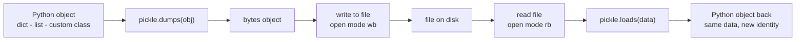
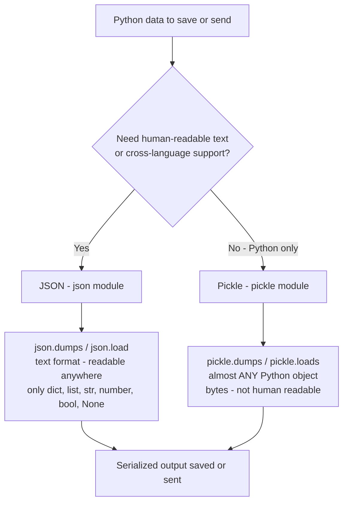

Serialization and Deserialization 
    
    `     serialization is the process of converting the complex data in python in JSON format 
        Deserialization is the reverse proecess of the Serialization 
        It's  the reverse  Process of the Deserialization`

**📊 Diagram — Serialization pipeline: object to bytes to file and back**

**📊 Diagram — JSON vs Pickle: which one to pick**

