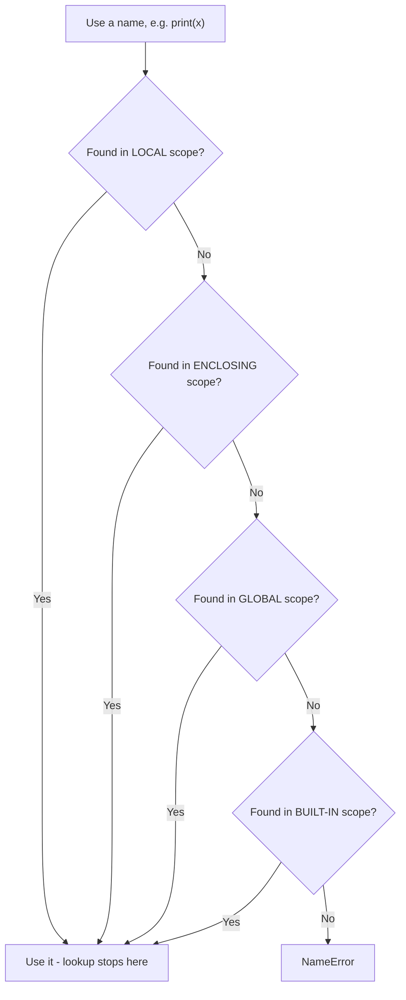
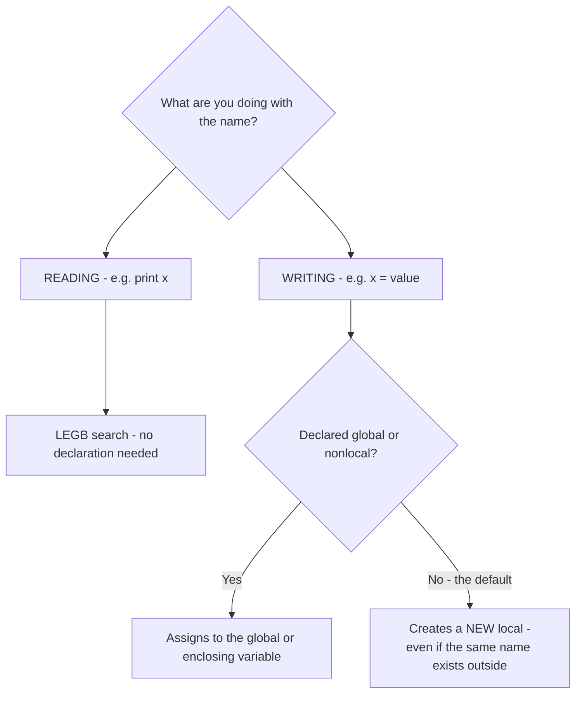

# Namespaces, Scope & the LEGB Rule

## Status
- Status: Learning
- Prerequisites: Functions, nested functions
- Source: namespace.py (raw class notes)
- Confidence: Building

---

# 1. The core idea — think of a school

A **namespace** is like a school's record room:

```text
Class register  → names of students IN YOUR CLASS   (Local)
Staff register  → names of teachers                 (Enclosing)
School register → names of everyone in the school   (Global)
Government list → every citizen's name              (Built-in)
```

When someone calls a name, the school checks registers **closest to you first**: your class register, then staff, then school, then government.

That's it. That's the whole topic:

```text
namespace = where Python stores variable/object names (a dict)
scope     = WHERE a name can be seen/used from
LEGB      = the ORDER Python searches namespaces
```

---

# 2. Namespace vs Scope — don't mix these up

| Term | Meaning |
|---|---|
| **Namespace** | The storage — a mapping of names → objects (`{'x': 10}`) |
| **Scope** | The region of code where a namespace is visible |

You can peek into them:

```python
x = 10

def f():
    y = 20
    print(locals())          # {'y': 20}        ← local namespace
    print(globals()['x'])    # 10               ← global namespace

f()
```

Output:

```text
{'y': 20}
10
```

---

# 3. LEGB — the search order

Python looks up a name in this fixed order. **First match wins.**

**📊 Diagram — LEGB lookup chain flowchart**



```text
       x
       ↓
┌───────────┐
│ Local     │   inside the current function
└─────┬─────┘
      ↓ not found
┌───────────┐
│ Enclosing │   outer function (nested functions)
└─────┬─────┘
      ↓ not found
┌───────────┐
│ Global    │   module level
└─────┬─────┘
      ↓ not found
┌───────────┐
│ Built-in  │   print, len, int, max...
└─────┬─────┘
      ↓ not found
  NameError
```

### Why this order?

Because the **closest definition should win** — local is the fastest, most specific answer; built-in is the last resort.

### Same name in different scopes? They coexist fine.

```python
x = 10            # global x

def f():
    x = 99        # local x — a DIFFERENT variable
    print(x)      # 99

f()
print(x)          # 10 — global untouched
```

Two `x`s exist in two different namespaces. No conflict.

---

# 4. Reading vs Writing — THE most important rule

```text
READING a name   → LEGB search, no declaration needed
ASSIGNING a name → creates a LOCAL, unless declared global/nonlocal
```

**📊 Diagram — Reading vs writing: the rule that explains most scope bugs**



This one rule explains ~90% of scope bugs. Assignment always creates a local by default — even if a global with the same name exists.

---

# 5. `global` — editing/creating globals from local scope

You cannot assign to a global inside a function normally — assignment makes a local. To actually hit the global, declare it:

```python
count = 0

def increment():
    global count     # "I mean the MODULE-level count"
    count += 1

increment()
increment()
print(count)         # 2
```

### You can also CREATE a global from local

```python
def fn():
    global a         # 'a' doesn't exist yet — this CREATES it globally
    a = 3
    print(a)

fn()
print(a)             # 3 — now visible at module level
```

### Why is it bad practice?

Functions that secretly edit hidden global state are hard to test and debug. Prefer passing values in and returning values out.

### Parameters are ALWAYS local

```python
def max(n):          # n is local to max, no matter what exists outside
    ...
```

No exceptions. Function parameters live in the local namespace.

---

# 6. Built-in scope

Built-ins are functions Python ships with: `print`, `len`, `int`, `max`, `list`...

See them all:

```python
import builtins
print(dir(builtins))
```

### TRAP: shadowing a built-in

From my own code:

```python
def max(n):          # ← shadows the built-in max!
    print("hello")

max(12)              # prints "hello", NOT an error
```

This runs because LEGB finds MY `max` (global) before the built-in `max`. But now `max([1,5,3])` is broken everywhere below this line. **Never name variables/functions after built-ins.**

---

# 7. `nonlocal` — reaching the ENCLOSING scope

`global` targets module level. For nested functions, the enclosing function's variables need `nonlocal`:

```python
def ennc():
    n = 23
    def enc1():
        nonlocal n   # "use enc's n, don't make a new local"
        n += 2
    enc1()
    print(n)

ennc()
```

Trace:

```text
ennc called      → local namespace {n: 23}
enc1 defined     → sees ennc's n via Enclosing scope
enc1 called      → nonlocal n → edits ennc's n → n becomes 25
print(n)         → 25
```

Without `nonlocal`: `n += 2` would make `n` local to `enc1` → read-before-assign → `UnboundLocalError`.

### The full hierarchy — multiple enclosing levels

The search goes **inside-out**, through ALL enclosing layers:

```text
local → enclosing 1 → enclosing 2 → enclosing 3 → ... → global → built-in
```

```python
def e1():
    a = 1
    def e2():
        b = 2
        def e3():
            print(a, b)    # finds a in e1 (E), b in e2 (E)
        e3()
    e2()

e1()    # 1 2
```

---

# 8. `global` vs `nonlocal`

| | `global` | `nonlocal` |
|---|---|---|
| Targets | module-level scope | enclosing function's scope |
| Works in | any function | nested functions only |
| Without it | assignment creates a local | same — UnboundLocalError |
| Use for | quick counters/config (avoid in real code) | closures, counters, trackers |

Remember:

```text
read     → LEGB search, no declaration needed
assign   → local by default
global   → for module-level assignment
nonlocal → for enclosing assignment
```

---

# 9. Common mistakes

- Expecting `x = 5` inside a function to change a global — it creates a LOCAL
- `UnboundLocalError` when a name is both printed and assigned in one function
- Shadowing built-ins (`list`, `max`, `sum`) and breaking them silently
- Using `nonlocal` in a non-nested function → SyntaxError
- Using `global` everywhere instead of returning values

---

# 10. Where you'll see this in ML

- Config values (learning rate, batch size) as globals read by many functions — reading works fine without declarations
- Closures/trackers holding experiment state via `nonlocal` — no globals needed
- Naming a DataFrame `list` or `max` breaks everything downstream — real bug source in notebooks

```python
def make_tracker():
    best = float('-inf')
    def track(score):
        nonlocal best
        if score > best:
            best = score
        return best
    return track

t = make_tracker()
t(0.82)   # 0.82
t(0.91)   # 0.91
```

---

# 11. Level check — PREDICT before reading answers

### Drill 1

```python
x = "global"

def f():
    print(x)

f()
```
**Answer:** `global` — reading does a plain LEGB lookup, no declaration needed.

### Drill 2 — the trap

```python
x = 10

def f():
    print(x)
    x = 20

f()
```
**Answer:** `UnboundLocalError` — `x = 20` anywhere in the body makes `x` local for the WHOLE function, so `print(x)` reads an unassigned local.

### Drill 3

```python
def outer():
    n = 5
    def inner():
        n = 99
    inner()
    print(n)

outer()
```
**Answer:** `5` — `inner`'s assignment created its OWN local `n`. The enclosing `n` was untouched (no `nonlocal`).

### Drill 4

```python
def f():
    global brand_new
    brand_new = 42

f()
print(brand_new)
```
**Answer:** `42` — `global` created the name at module level from inside the function.

---

**If you can explain why Drill 2 fails while Drill 1 works, mark this topic complete.**
