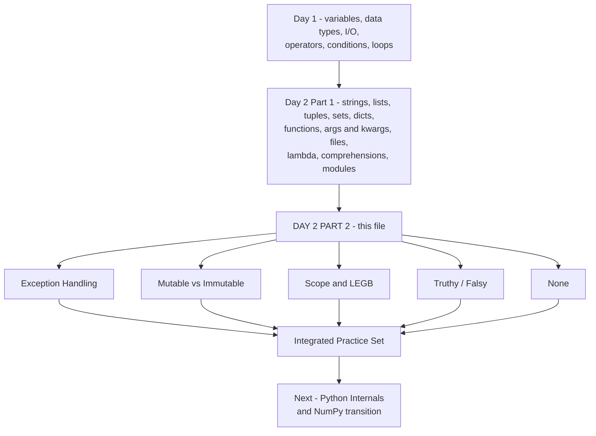
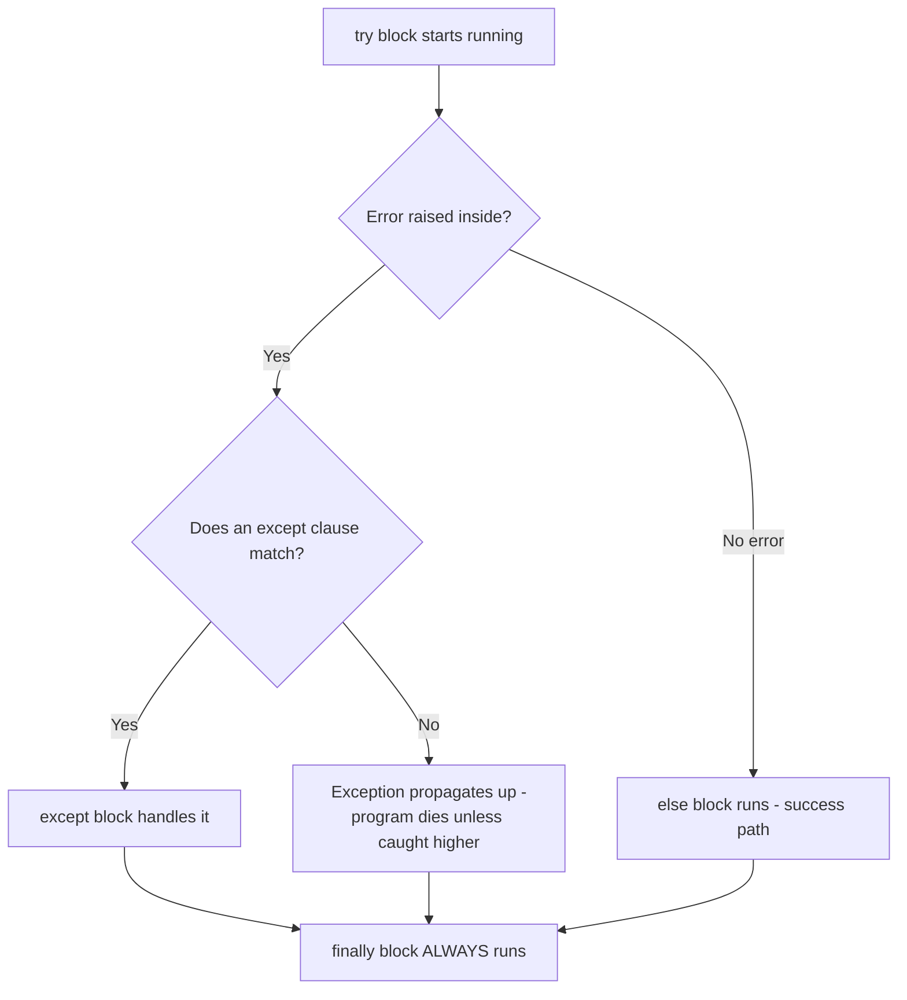

# DAY 2 — Python Core (Part 2): Exceptions, Mutability, Scope & Friends

## Status
- Status: Learning (day file, part 2 of Day 2)
- Covered earlier (Day 1 + Day 2 Part 1): variables, data types, I/O, operators, conditions, loops, strings, lists, tuples, sets, dicts, indexing/slicing, functions, `*args`/`**kwargs`, file handling, lambda/map/filter/reduce, comprehensions, modules & imports
- This file covers: Exception Handling, Mutable vs Immutable, Scope/LEGB, Truthy/Falsy, `None` + integrated practice
- Prerequisites: Day 1 + Day 2 Part 1 (all checked above)
- Next after this: integrated practice → then move to Python Internals / NumPy transition

## Topic Map

Standalone topic files (self-contained, study independently) — full index: [topics/Day2/topics.md](topics/Day2/topics.md)

| Topic | File |
|---|---|
| `*args` / `**kwargs` (Day 2 Part 1) | [topics/Day2/01-args-kwargs.md](topics/Day2/01-args-kwargs.md) |
| Exception Handling | [topics/Day2/02-exceptions.md](topics/Day2/02-exceptions.md) |
| Mutable vs Immutable (references, copies) | [topics/Day2/03-mutability-copy.md](topics/Day2/03-mutability-copy.md) |
| Scope & LEGB | [topics/Day2/04-scope-legb.md](topics/Day2/04-scope-legb.md) |
| Truthy / Falsy | [topics/Day2/05-truthy-falsy.md](topics/Day2/05-truthy-falsy.md) |
| None | [topics/Day2/06-none.md](topics/Day2/06-none.md) |

Next day: [topics/Day3/topics.md](topics/Day3/topics.md)

**📊 Diagram — Roadmap: where this file sits in the Python core journey**



---

## 1. EXCEPTION HANDLING

### 1.1 Why This Matters

Your program will eventually do something that fails:

- user gives wrong input
- file is missing
- number is divided by zero
- API call fails
- data file has unexpected format

In ML, one malformed row in a dataset can crash a whole training pipeline. Exception handling is how a program **survives** failures instead of dying.

Without it:

```python
data = int(input("Enter age: "))   # user types "abc"
# ValueError: invalid literal for int() with base 10: 'abc'
# program crashes here
```

### 1.2 Mental Model

```text
try:        # "I'll attempt this"
  ↓
except:     # "if it fails in this specific way, do this"
  ↓
else:       # "if it did NOT fail, do this"
  ↓
finally:    # "whether it failed or not, ALWAYS do this"
```

Think of it like a safety net:

```text
risky operation
     ↓
   fails? ──NO──→ else block
     │
    YES
     ↓
   except block
     ↓
   finally (always runs)
```

### 1.3 Core Concept

Python **raises** an exception when something goes wrong. If you don't catch it, the program terminates and prints a traceback. If you catch it, execution continues.

Key syntax:

```python
try:
    # risky code
    x = int(input("Enter a number: "))
except ValueError:
    # runs only when ValueError happens
    print("That wasn't a number!")
```

### 1.4 Syntax — the full family

```python
try:
    num = int(input("Enter number: "))
    result = 100 / num
except ValueError:
    print("Not a valid number")
except ZeroDivisionError:
    print("Can't divide by zero")
except Exception as e:      # catch-all — last resort
    print(f"Something else: {e}")
else:
    print(f"Result: {result}")   # runs only if try succeeded
finally:
    print("Done")                 # ALWAYS runs
```

**📊 Diagram — try / except / else / finally execution flow**



Catching multiple in one line:

```python
except (ValueError, TypeError):
    print("Bad value or bad type")
```

Raising your own errors:

```python
def train_model(data, epochs):
    if epochs <= 0:
        raise ValueError("epochs must be positive")
    if not data:
        raise RuntimeError("empty dataset")
```

### 1.5 Internal Behavior

When an exception occurs:

```text
exception raised at line N
        ↓
Python unwinds the current call stack
        ↓
checks each enclosing try/except block
        ↓
first matching except block handles it
        ↓
if none matches → program terminates with traceback
```

The exception propagates **up** through function calls:

```python
def inner():
    raise ValueError("boom")

def outer():
    inner()      # no try here — exception propagates further up

try:
    outer()
except ValueError as e:
    print("caught:", e)   # caught here, 2 levels up
```

This is why one try/except at the top of a pipeline can protect many nested calls.

### 1.6 Common Mistakes

| Mistake | Why it's wrong |
|---|---|
| `except:` with no type | catches EVERYTHING including `KeyboardInterrupt` — hides real bugs |
| Empty `except: pass` | silently swallows errors; you never know anything failed |
| `return` in `finally` | overrides the return value of try/except — confusing |
| Catching `Exception` and not re-raising | makes debugging impossible later |

```python
# Silent swallowing — the worst habit
try:
    model.fit(X_train, y_train)
except:
    pass          # model training failed... and nobody knows
```

### 1.7 ML Connection

- Robust pipelines: wrap data loading / preprocessing in `try/except` so one bad file doesn't kill the batch job.
- Log the exception instead of swallowing it: `logger.exception("failed to process %s", path)`.
- `raise` your own errors with clear messages in preprocessing functions — better error messages = faster debugging.

### 1.8 Interview

**Q: What is the difference between `raise` and `except`?**
Short answer: `raise` creates/throws an exception; `except` catches one.

**Q: What runs first — `else` or `finally`?**
`else` runs immediately after try succeeds; `finally` runs last, always — even if `else`/`except` returned.

---

## 2. MUTABLE vs IMMUTABLE

### 2.1 Why This Matters

This is where most Python bugs in ML data processing come from. You modify "one copy" of a dataset... and the original changes too. Understanding mutability saves you from silent data corruption.

### 2.2 Mental Model

```text
name ─────┐
          ↓
        object (stored on the heap)
          ↑
          │
other ────┘
```

A variable is a **name pointing to an object**, not a box holding a value.

- **Immutable**: object can't change. `int, float, str, tuple, bool, None`
- **Mutable**: object can change in place. `list, dict, set, bytearray` (and later: NumPy arrays, DataFrames)

```python
a = [1, 2, 3]      # a → list object
b = a              # b → SAME list object (no copy!)
b.append(4)
print(a)           # [1, 2, 3, 4]  ← a changed too!
```

### 2.3 Identity vs Equality

```python
a = [1, 2, 3]
b = [1, 2, 3]
c = a

a == b    # True  — equal content
a is b    # False — different objects
a is c    # True  — same object
```

- `==` compares **value**
- `is` compares **identity** (same object in memory → same `id()`)

Immutable safety:

```python
s = "abc"
t = s          # t points to same string
s += "d"       # creates a NEW string; s now points to new object
print(t)       # "abc" — unchanged. Strings are safe.
```

### 2.4 Copying — the escape hatch

```python
import copy

original = [[1, 2], [3, 4]]

shallow = original.copy()      # new outer list, SAME inner lists
shallow[0].append(99)
print(original)                # [[1, 2, 99], [3, 4]] ← changed!

deep = copy.deepcopy(original) # completely independent
deep[0].append(5)
print(original)                # unchanged
```

Shallow copy = new container, shared contents.
Deep copy = everything new.

### 2.5 Function Arguments Trap

Arguments are passed by **object reference**. Mutable objects get modified inside the function:

```python
def add_row(data, row):
    data.append(row)      # mutates the CALLER's list

df_rows = [["a", 1]]
add_row(df_rows, ["b", 2])
print(df_rows)            # [['a', 1], ['b', 2]] — caller changed!
```

Also the classic default-argument bug:

```python
def add_feature(features, new=[]):      # BAD: default is ONE shared list
    new.append(features)
    return new

add_feature("x")   # ['x']
add_feature("y")   # ['x', 'y']  ← the old list was reused!
```

Correct version:

```python
def add_feature(features, new=None):
    if new is None:
        new = []
    new.append(features)
    return new
```

### 2.6 Common Mistakes

- `b = a` thinking you copied a list → you didn't
- `.copy()` on nested lists → inner lists still shared
- tuples containing lists are "immutable" on the outside but the inner list can still change
- using a list as a dict key → TypeError (unhashable), use a tuple

### 2.7 ML Connection

This is the **data leakage / accidental mutation** story:

```python
X_scaled = X          # want to scale a copy?
X_scaled -= X.mean()  # original X changed too!
```

Pandas/NumPy mutation and train/test separation both depend on this concept. The rule:

> If you want to modify data without touching the original — **copy explicitly**.

### 2.8 Interview

**Q: `is` vs `==`?** — `is` = same object (identity), `==` = equal value.

**Q: Why are small integers like 5 cached but 300 not?** — CPython caches small ints (-5 to 256); `a = 5; b = 5; a is b` → True. But don't rely on it — use `==` for values.

---

## 3. SCOPE & LEGB

### 3.1 Why This Matters

"Why can my function see this variable?" / "Why does my function ignore my global?" — these are scope questions. Every real project hits this.

### 3.2 Mental Model

Python looks up a name in this order:

```text
L — Local        (inside current function)
↓
E — Enclosing    (outer function, for nested functions)
↓
G — Global       (module level)
↓
B — Built-in     (print, len, int, ...)
```

```python
x = "global x"                 # global

def outer():
    x = "enclosing x"          # enclosing (for inner)
    def inner():
        x = "local x"          # local
        print(x)               # local x
    inner()

outer()
```

### 3.3 Reading vs Writing — the trap

Reading a global works. **Assigning to it inside a function creates a new local** unless you say `global`:

```python
count = 0

def increment():
    global count     # without this → UnboundLocalError / bug
    count += 1
```

Nested functions need `nonlocal`:

```python
def counter():
    total = 0
    def add():
        nonlocal total
        total += 1
        return total
    return add
```

### 3.4 Common Mistakes

- Using `global` everywhere instead of returning values → spaghetti code
- `UnboundLocalError` when a name is both read and assigned in a function
- Forgetting that comprehensions have their own scope in Python 3 (`i` in `[i for i in range(5)]` does not leak)

### 3.5 ML Connection

- `global` counts/caches are useful in experiments but terrible in pipelines — pure functions (return, don't mutate) are the norm in preprocessing code.
- Closures (enclosing scope) power things like counters, config providers, and ML experiment trackers.

---

## 4. TRUTHY / FALSY

### 4.1 Core Concept

Every object is truthy or falsy. `if x:` checks truthiness, not just `True/False`.

**Falsy** (the complete list):

```python
None
False
0, 0.0, 0j
""                # empty string
[]                # empty list
{}                # empty dict
()                # empty tuple
set()             # empty set
```

Everything else is truthy.

### 4.2 Usage

```python
name = input("Name: ")
if name:              # empty input is falsy
    print(f"Hello {name}")
else:
    print("No name given")

data = []
if not data:          # idiomatic "is the list empty?"
    print("dataset empty — nothing to train")

def get_model():
    model = cache.get(key)
    if not model:     # None is falsy
        model = train_model()
```

### 4.3 Common Mistakes

- `if x == None` → should be `if x is None` (idiomatic + correct)
- `if len(data) > 0` → fine, but `if data:` is the Pythonic version
- A numpy array inside `if` raises `ValueError` (ambiguity) — that's a Day-NumPy topic, but remember it.

---

## 5. NONE

### 5.1 Core Concept

`None` is Python's "no value" — the return of every function without an explicit `return`. It is a **singleton**: there is exactly one None object.

```python
print(print("hi"))    # hi → None (print returns None)

def f():
    pass
print(f())            # None
```

### 5.2 Rules

- Test with `is None` / `is not None` — never `==` (idiomatic)
- `None` is falsy
- `None` is its own type: `type(None)` → `<class 'NoneType'>`

```python
def find_user(users, name):
    for u in users:
        if u["name"] == name:
            return u
    return None          # explicit "not found"

user = find_user(data, "saumitra")
if user is not None:
    print(user["age"])
else:
    print("not found")
```

### 5.3 Common Mistake

Using `== None` and `!= None`. Works, but every linter and interviewer expects `is`. Reason: identity, not value — and it can never be shadowed by weird `__eq__` behavior.

---

## 6. INTEGRATED PRACTICE SET (Day 2 review)

### A. Predict the output — then run

```python
a = [1, 2, 3]
b = a
c = a[:]
b.append(4)
c.append(5)
print(a, b, c)
```

**Reason**: `b = a` shares the object; `c = a[:]` copies it. So `a` and `b` are `[1,2,3,4]`, `c` is `[1,2,3,5]`.

### B. Why does this fail?

```python
x = 10
def change():
    x = x + 5
change()
```

**Reason**: assignment inside the function makes `x` local; reading it before assignment → `UnboundLocalError`. Fix: `global x` or return the value.

### C. Find the bug

```python
def process_rows(rows, result=[]):
    result.extend(rows)
    return result
```

**Bug**: mutable default argument shared across calls — results accumulate. Fix with `result=None`.

### D. Exception reasoning

```python
def safe_divide(a, b):
    try:
        return a / b
    except ZeroDivisionError:
        return None
    finally:
        print("finally")

print(safe_divide(10, 2))
print(safe_divide(10, 0))
```

Predict output. **Answer**: `finally` prints both times; first returns 5.0, second returns None.

### E. Truthiness check

For each, predict `if x:` result: `0`, `""`, `[]`, `[0]`, `"0"`, `None`, `(1,)`, `{0: 1}`, `0.0`, `False`.

**Answer**: falsy → `0, "", [], None, 0.0, False`. Truthy → `[0], "0", (1,), {0: 1}` (non-empty containers are truthy even with falsy contents).

### F. ML-flavored: accidental mutation

```python
X = [[1, 2], [3, 4]]      # pretend this is your dataset
X_norm = X                # "copy" for normalization
for row in X_norm:
    row[0] = 0
print(X)
```

**Reason**: nested lists share inner rows — `X` changed too. The fix in real ML: `copy.deepcopy()` or (better) NumPy with explicit copies.

---

## 7. INTERVIEW QUESTIONS (this batch)

1. What is the difference between `==` and `is`? Give a case where they disagree.
2. Why does `b = a` not copy a list? What actually happens in memory?
3. What is a mutable default argument bug and why does it happen?
4. What is the order of name lookup in Python? Give an example of each level.
5. What does `finally` guarantee? What happens if both `except` and `finally` contain `return`?
6. List all falsy values in Python. Why is `[0]` truthy?
7. Why use `x is None` instead of `x == None`?
8. How do you catch multiple different exceptions in one block?
9. Shallow copy vs deep copy — when does shallow copy still bite you?
10. Why can't a list be a dict key, but a tuple can?

---

## 8. CHEAT SHEET

```text
EXCEPTIONS
→ try/except/else/finally handle failures; raise creates errors

try: risky
except SpecificError: handle
except Exception as e: fallback
else: runs on success
finally: always runs

MUTABILITY
→ mutable: list, dict, set (change in place)
→ immutable: int, float, str, tuple, bool, None (new object on change)
→ == value, is identity
→ b = a shares; a.copy() shallow; copy.deepcopy() full

SCOPE
→ LEGB: Local → Enclosing → Global → Built-in
→ global for module-level assignment, nonlocal for enclosing
→ assignment in function = local by default

TRUTHINESS
→ falsy: None, False, 0, 0.0, "", [], {}, (), set()
→ everything else truthy

NONE
→ "no value" singleton; test with is None; falsy

IMPORTANT RULE
→ copy explicitly when you must not mutate the original

COMMON TRAP
→ mutable default arguments and accidentally shared references

ML CONNECTION
→ reference sharing = accidental dataset mutation = data bugs

INTERVIEW LINE
→ "Arguments pass references to objects; mutating a mutable argument mutates the caller's object."
```

## 9. MASTERY CHECKLIST

- [ ] I can write try/except/else/finally and raise
- [ ] I can explain why `b = a` doesn't copy a list
- [ ] I can fix a mutable default argument
- [ ] I can trace LEGB lookup
- [ ] I can list all falsy values
- [ ] I can use `is None` correctly
- [ ] I can answer the interview questions without looking
