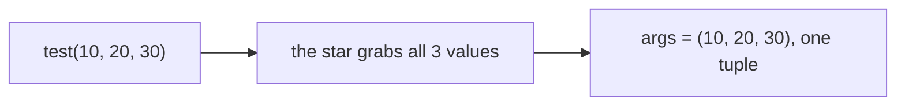
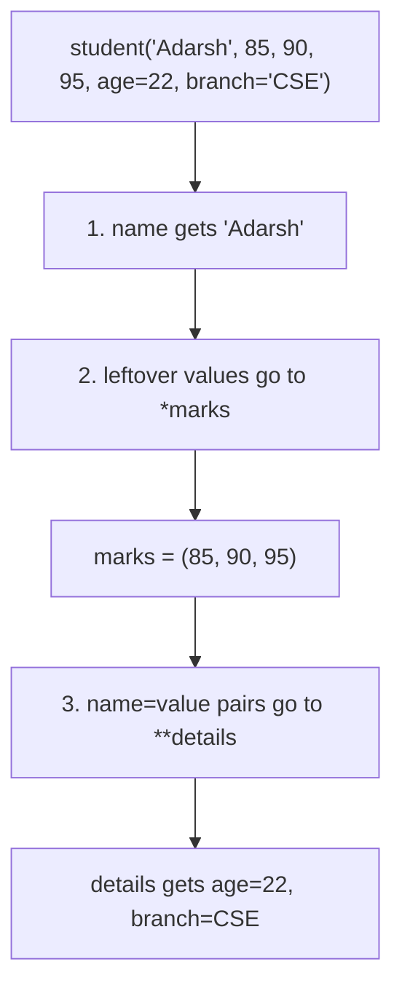
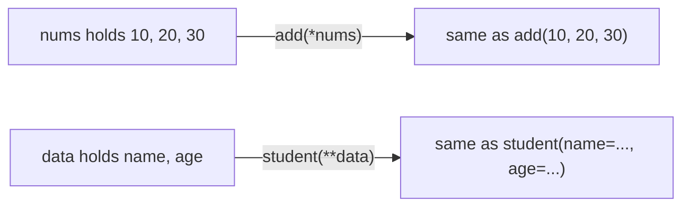

# *args and **kwargs

## Status
- Status: Learned (Level 2 — Programmer, solid)
- Prerequisites: Functions, parameters vs arguments, tuples, dicts
- Last studied: Day 2
- Confidence: Strong

---

# `*args` and `**kwargs`

This is a **small but important Python function concept**. You don't need to spend hours on it; understand the idea, syntax, unpacking, and practice it.

---

## 1. The problem they solve

Normally, a function has a fixed number of parameters:

```python
def add(a, b):
    return a + b
```

You can do:

```python
add(10, 20)
```

But what if you don't know beforehand how many values the user will provide?

For example:

```python
add(10, 20, 30, 40, 50)
```

Our function can't accept this because it only has `a` and `b`.

That's where `*args` comes in.

---

# 2. `*args`

`*args` allows a function to accept **any number of positional arguments**.

```python
def add(*args):
    print(args)
```

Now:

```python
add(10, 20)
add(10, 20, 30)
add(1, 2, 3, 4, 5)
```

Output:

```text
(10, 20)
(10, 20, 30)
(1, 2, 3, 4, 5)
```

### Important:

`args` is just a variable name.

The `*` is what matters.

You could write:

```python
def add(*numbers):
    print(numbers)
```

and it works exactly the same.

But conventionally we use:

```python
*args
```

---

# 3. What does `args` actually contain?

This is very important.

Inside the function:

```python
def test(*args):
    print(type(args))
```

```python
test(10, 20, 30)
```

Output:

```text
<class 'tuple'>
```

So:

> `*args` collects all extra positional arguments into a **tuple**.

Conceptually:

```text
test(10, 20, 30)

        ↓

args = (10, 20, 30)
```

**📊 Diagram — how the star packs extras into a tuple**



Therefore you can use normal tuple operations:

```python
def test(*args):
    print(len(args))
    print(args[0])
    print(args[-1])
```

---

# 4. Practical example

Let's create a function that can add any number of numbers:

```python
def add(*args):
    total = 0

    for num in args:
        total += num

    return total
```

Now:

```python
print(add(10, 20))
print(add(10, 20, 30))
print(add(1, 2, 3, 4, 5))
```

Output:

```text
30
60
15
```

This is the main purpose of `*args`.

---

# 5. Normal parameters + `*args`

You can combine them.

```python
def student(name, *marks):
    print("Name:", name)
    print("Marks:", marks)
```

Call:

```python
student("Adarsh", 85, 90, 92, 88)
```

Output:

```text
Name: Adarsh
Marks: (85, 90, 92, 88)
```

Here:

```text
"Adarsh" → name
85,90,92,88 → marks
```

So `*args` collects the **remaining positional arguments**.

---

# 6. Now `**kwargs`

`**kwargs` is similar, but for **keyword arguments**.

Remember:

```python
def student(name, age):
    ...
```

You can call:

```python
student(name="Adarsh", age=22)
```

These are keyword arguments.

Now suppose we don't know how many keyword arguments will be provided.

Use:

```python
def student(**kwargs):
    print(kwargs)
```

Call:

```python
student(name="Adarsh", age=22, city="Meerut")
```

Output:

```python
{
    'name': 'Adarsh',
    'age': 22,
    'city': 'Meerut'
}
```

### Key difference

`*args` → tuple

`**kwargs` → dictionary

Remember this:

```text
*args    → positional arguments → tuple

**kwargs → keyword arguments   → dictionary
```

---

# 7. Why is it called `kwargs`?

Again, `kwargs` is just a convention.

You could write:

```python
def student(**data):
    print(data)
```

It works.

But Python programmers conventionally use:

```python
**kwargs
```

because it means:

> keyword arguments

---

# 8. Working with `kwargs`

Since it's a dictionary:

```python
def student(**kwargs):
    print(kwargs["name"])
    print(kwargs["age"])
```

Call:

```python
student(name="Adarsh", age=22)
```

Output:

```text
Adarsh
22
```

You can also loop:

```python
def student(**kwargs):
    for key, value in kwargs.items():
        print(key, "=", value)
```

Call:

```python
student(
    name="Adarsh",
    age=22,
    branch="CSE"
)
```

Output:

```text
name = Adarsh
age = 22
branch = CSE
```

---

# 9. `*args` vs `**kwargs`

This is the most important comparison:

|           | `*args`              | `**kwargs`                 |
| --------- | -------------------- | -------------------------- |
| Accepts   | Positional arguments | Keyword arguments          |
| Stores as | Tuple                | Dictionary                 |
| Example   | `f(10, 20)`          | `f(a=10, b=20)`            |
| Meaning   | Any number of values | Any number of named values |

Example:

```python
def test(*args, **kwargs):
    print(args)
    print(kwargs)
```

Call:

```python
test(10, 20, 30, name="Adarsh", age=22)
```

Output:

```text
(10, 20, 30)

{'name': 'Adarsh', 'age': 22}
```

---

# 10. Combining normal parameters + `*args` + `**kwargs`

You can have all three:

```python
def student(name, *marks, **details):
    print(name)
    print(marks)
    print(details)
```

Call:

```python
student(
    "Adarsh",
    85,
    90,
    95,
    age=22,
    branch="CSE"
)
```

Output:

```text
Adarsh
(85, 90, 95)
{'age': 22, 'branch': 'CSE'}
```

Conceptually:

```text
"Adarsh"           → name

85,90,95           → *marks

age=22, branch=CSE → **details
```

**📊 Diagram — how Python fills the inputs**



---

# 11. Argument unpacking — very important

The `*` doesn't only **collect** arguments.

It can also **unpack** them.

Suppose:

```python
numbers = [10, 20, 30]
```

and:

```python
def add(a, b, c):
    return a + b + c
```

You could do:

```python
add(10, 20, 30)
```

Or unpack the list:

```python
add(*numbers)
```

Python interprets:

```python
add(*numbers)
```

as:

```python
add(10, 20, 30)
```

So:

> `*` can unpack an iterable into positional arguments.

---

# 12. `**` unpacking

Same idea with dictionaries.

```python
def student(name, age):
    print(name, age)
```

Dictionary:

```python
data = {
    "name": "Adarsh",
    "age": 22
}
```

Instead of:

```python
student(name="Adarsh", age=22)
```

you can:

```python
student(**data)
```

Python effectively turns it into:

```python
student(name="Adarsh", age=22)
```

So:

```text
*  → unpack positional arguments

** → unpack keyword arguments
```

**📊 Diagram — the star unwraps your data at call time**



---

# 13. Very important distinction

Don't confuse these two uses.

### In function definition:

```python
def f(*args):
```

means:

> Collect positional arguments.

### In function call:

```python
f(*values)
```

means:

> Unpack values into positional arguments.

Similarly:

```python
def f(**kwargs):
```

means:

> Collect keyword arguments.

While:

```python
f(**data)
```

means:

> Unpack dictionary into keyword arguments.

---

# 14. Common mistake

This:

```python
def add(*args):
    return args
```

doesn't return a number.

It returns a tuple:

```python
add(1, 2, 3)
```

→

```python
(1, 2, 3)
```

If you want the sum:

```python
def add(*args):
    return sum(args)
```

Now:

```python
add(1, 2, 3, 4)
```

→

```text
10
```

---

# 15. Where you'll actually see this

You will see `*args` and `**kwargs` frequently in:

* libraries
* decorators
* APIs
* frameworks
* flexible functions
* wrapper functions
* ML/DL libraries

For example, library functions often need to accept many optional configurations.

You don't need to master advanced uses right now, but you **must understand the collection/unpacking mechanism**.

---

# 16. What you need to remember

Memorize this mental model:

```text
             FUNCTION
                │
       ┌────────┴────────┐
       ↓                 ↓
    *args             **kwargs
       ↓                 ↓
 positional          keyword
 arguments           arguments
       ↓                 ↓
    tuple            dictionary
```

And:

```text
*  → positional

** → keyword
```

---

# Quick mastery test

Before moving on, you should be able to answer these:

### Q1

What is printed?

```python
def test(*args):
    print(type(args))

test(1, 2, 3)
```

**Answer:** `tuple`

### Q2

What is printed?

```python
def test(**kwargs):
    print(type(kwargs))

test(a=10, b=20)
```

**Answer:** `dict`

### Q3

What happens here?

```python
nums = [1, 2, 3]

def add(a, b, c):
    return a + b + c

add(*nums)
```

**Answer:** The list is unpacked into `1, 2, 3`.

### Q4

What happens here?

```python
data = {"a": 10, "b": 20}

def test(a, b):
    return a + b

test(**data)
```

**Answer:** The dictionary is unpacked into keyword arguments.

---

## Your level for this topic

You **do not need more depth than this right now**.

If you understand:

```python
*args       → tuple → positional
**kwargs    → dict   → keyword

*list       → unpack positional
**dict      → unpack keyword
```

and can write a few functions using them, **mark `*args / **kwargs` complete.**