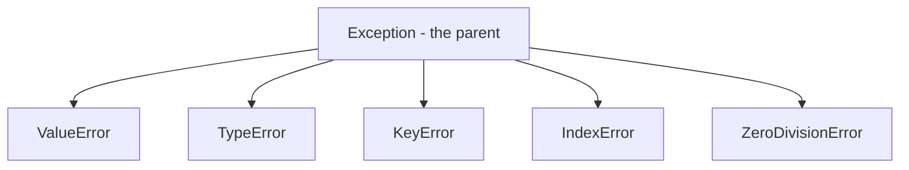
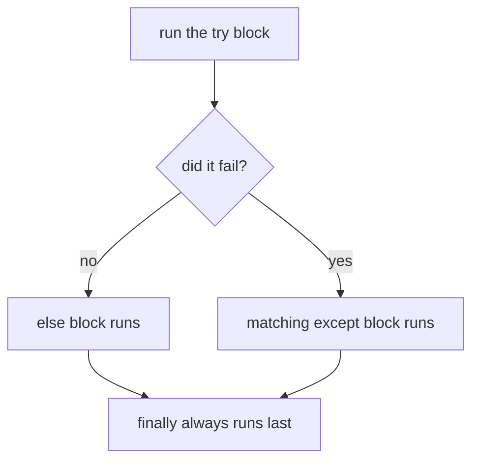

# Exception Handling

## Status
- Status: Learning
- Prerequisites: Functions, control flow
- Last studied: Day 2
- Confidence: Building

---

# Exception Handling

This is a **small but very important Python concept**. Your programs will fail sometimes — exception handling decides whether they crash or survive. You don't need to spend hours on it; understand `try/except/else/finally` and `raise`, and practice it.

---

## 1. The problem they solve

Normally, when something goes wrong, Python stops the program:

```python
num = int(input("Enter a number: "))
```

If the user types `"abc"`:

```text
ValueError: invalid literal for int() with base 10: 'abc'
process finished with exit code 1
```

The program **dies** right here. Nothing after this line runs.

Now imagine real failures:

- user gives wrong input
- file is missing
- number is divided by zero
- API call fails
- data file has an unexpected format

One bad row in a dataset of 10,000 rows can kill an entire training run.

That's where exception handling comes in.

### Two ways to design a program

```text
Design A (no handling): crash and die at the first failure
Design B (handling):    notice the failure, recover, keep going
```

Exception handling is Design B. It's how a program **survives** instead of dying.

---

# 2. `try` and `except`

`try` says: "I'll attempt this."

`except` says: "if it fails in this specific way, do this instead."

```python
try:
    num = int(input("Enter a number: "))
except ValueError:
    print("That wasn't a number!")
```

If the user types `"abc"`:

```text
That wasn't a number!
```

The program does NOT crash. It prints the message and keeps going.

If the user types `"42"`:

```text
(no output from except — the block is skipped)
```

The `except` block runs **only when the matching error happens**.

### Important:

`except ValueError` catches only that specific error type.

If a different error happens (like `TypeError`), it is NOT caught here — it crashes.

Let's prove that:

```python
try:
    result = "abc" + 5        # TypeError — wrong types
except ValueError:
    print("caught value error")
```

Output:

```text
TypeError: can only concatenate str (not "int") to str
process finished with exit code 1
```

The `except ValueError` did nothing — because this was a `TypeError`.

---

# 3. What an exception actually is

This is very important.

When something goes wrong, Python creates an **exception object** and throws it (raises it).

The object has two things:

```text
type     → which error it is   (ValueError, TypeError, ...)
message  → what happened       ("invalid literal ...")
```

You can catch the object and look at it with `as e`:

```python
try:
    x = int("abc")
except ValueError as e:
    print(type(e))
    print(e)
```

Output:

```text
<class 'ValueError'>
invalid literal for int() with base 10: 'abc'
```

So:

> An exception is an **object** — a type plus a message.

### Exceptions are classes

Every error type is actually a **class**, and they form a family tree (hierarchy):

```text
BaseException
    └── Exception
            ├── ValueError
            ├── TypeError
            ├── KeyError
            ├── IndexError
            └── ZeroDivisionError
```

**📊 Diagram — most errors come from one parent**



This matters because `except Exception` catches every child of `Exception` — which is almost everything you'll hit:

```python
try:
    risky()
except ValueError:
    print("value error")        # specific
except Exception as e:
    print("something else:", e) # any other Exception child
```

And `BaseException` (the root) includes `KeyboardInterrupt` and `SystemExit` — things you usually should NOT catch:

```python
try:
    while True:
        pass
except:            # bare except = BaseException = catches Ctrl+C too!
    pass           # now you can't even stop the program with Ctrl+C
```

---

# 4. Practical example

A function that never crashes on bad division:

```python
def safe_divide(a, b):
    try:
        return a / b
    except ZeroDivisionError:
        return None
```

Now:

```python
print(safe_divide(10, 2))
print(safe_divide(10, 0))
```

Output:

```text
5.0
None
```

No crash — the second call returns `None` instead of dying.

Trace what happens on `safe_divide(10, 0)`:

```text
try block starts
    ↓
10 / 0 raises ZeroDivisionError
    ↓
except ZeroDivisionError matches
    ↓
return None
```

A robust input loop — the classic pattern:

```python
while True:
    try:
        n = int(input("Enter a number: "))
        break
    except ValueError:
        print("That's not a number. Try again.")
```

Trace:

```text
user types "abc"  → ValueError → print message → loop again
user types "42"   → success    → break        → loop exits
```

This is the main purpose of exception handling — code that **keeps going** instead of dying.

---

# 5. Multiple `except` blocks

You can handle different errors differently:

```python
try:
    num = int(input("Enter number: "))
    result = 100 / num
except ValueError:
    print("Not a valid number")
except ZeroDivisionError:
    print("Can't divide by zero")
```

Python checks the `except` blocks **top to bottom**. The first match wins.

```text
user types "abc"  → ValueError       → "Not a valid number"
user types "0"    → ZeroDivisionError → "Can't divide by zero"
user types "10"   → success          → nothing printed
```

### Important:

Order matters — put specific errors first, the catch-all `Exception` last.

```python
try:
    risky()
except Exception:          # ❌ WRONG ORDER — catches everything first
    print("generic")
except ValueError:         # this never runs — Exception already won
    print("value error")
```

The specific `except ValueError` is dead code here. Swap the order.

### Catching multiple types in one line

```python
except (ValueError, TypeError):
    print("Bad value or bad type")
```

A tuple of types means: "catch any of these" — same handler for both.

---

# 6. `else` and `finally`

Two more blocks complete the family.

`else` runs **only if** the `try` block succeeded (no error).

`finally` runs **always** — success or failure, even if `except` or `else` returned.

```python
try:
    num = int(input("Enter number: "))
    result = 100 / num
except ValueError:
    print("Not a valid number")
except ZeroDivisionError:
    print("Can't divide by zero")
else:
    print(f"Result: {result}")   # only if try succeeded
finally:
    print("Done")                 # ALWAYS runs
```

**📊 Diagram — which blocks run, in order**



Trace with input `"10"`:

```text
Result: 10.0
Done
```

Trace with input `"abc"`:

```text
Not a valid number
Done
```

Notice: `Done` prints in **both** cases. That's `finally`.

### Why does `else` exist?

Putting success-only code in `else` keeps it out of the risky `try` block — so if THAT code fails, you don't accidentally catch it with the same handlers:

```python
try:
    x = int(text)
except ValueError:
    x = 0
else:
    print("conversion succeeded")   # clearly NOT risky code
```

### Why does `finally` exist?

Cleanup must happen no matter what — close files, release resources, log the attempt:

```python
file = open("data.csv")
try:
    process(file)
finally:
    file.close()      # runs even if process() crashed
```

---

# 7. Why is it called `except ValueError`?

Because Python errors have **types**, and each type has a name:

```text
ValueError          → wrong value       (int("abc"))
TypeError           → wrong type        (1 + "x")
KeyError            → missing dict key  (d["missing"])
IndexError          → index out of range
ZeroDivisionError   → division by zero
FileNotFoundError   → missing file
AttributeError      → attribute doesn't exist
```

You catch the type you expect, and handle it specifically.

### The `as e` pattern

```python
try:
    open("missing.csv")
except FileNotFoundError as e:
    print("failed:", e)
```

Output:

```text
failed: [Errno 2] No such file or directory: 'missing.csv'
```

The message tells you the exact path that failed — much easier to debug.

---

# 8. Working with exceptions

Catch multiple types in one line:

```python
except (ValueError, TypeError):
    print("Bad value or bad type")
```

Catch anything with a fallback — but keep it LAST:

```python
try:
    result = risky_operation()
except ValueError:
    print("bad value")
except Exception as e:       # catch-all — last resort
    print(f"Something else: {e}")
```

Why last? Because `Exception` catches almost everything — if it came first, the specific handlers would never run.

### The exception object — more things you can do

```python
try:
    x = int("abc")
except ValueError as e:
    print(e)               # message
    print(type(e).__name__)  # "ValueError"
    print(hasattr(e, "args"))  # True — args holds the message(s)
    print(e.args)          # ('invalid literal ...',)
```

### Logging the traceback

```python
import traceback

try:
    risky()
except Exception:
    traceback.print_exc()   # prints the full traceback without crashing
```

---

# 9. The full family — comparison

|           | Runs when                                 | Always? |
| --------- | ------------------------------------------ | ------- |
| `try`     | always (the risky code)                    | yes     |
| `except`  | try fails with matching type               | no      |
| `else`    | try succeeds (no exception)                | no      |
| `finally` | in every case — even after return          | yes     |

Remember this:

```text
try      → attempt
except   → handle failure
else     → on success
finally  → always
```

---

# 10. Combining everything

A realistic data-loading function:

```python
def load_data(path):
    try:
        data = read_file(path)
    except FileNotFoundError:
        print("file missing — using empty data")
        data = []
    else:
        print(f"loaded {len(data)} rows")
    finally:
        print("load attempt finished")
    return data
```

Trace (file exists):

```text
loaded 100 rows
load attempt finished
```

Trace (file missing):

```text
file missing — using empty data
load attempt finished
```

---

# 11. Exception propagation — very important

An exception raised in a nested call **bubbles up** the call stack until a matching `except` catches it.

```python
def inner():
    raise ValueError("boom")

def outer():
    inner()      # no try here — exception keeps going up

try:
    outer()
except ValueError as e:
    print("caught:", e)   # caught here, 2 levels up
```

Output:

```text
caught: boom
```

Conceptually:

```text
inner() raises
    ↓
outer() — no handler → keeps going up
    ↓
top-level try/except → MATCH → caught
    ↓
execution continues
```

**📊 Diagram — the error climbs until someone catches it**


So one `try/except` at the top of a pipeline can protect many nested calls.

### Deep propagation example

```python
def load():
    parse()

def parse():
    convert()

def convert():
    int("abc")     # ValueError raised here

try:
    load()         # 3 levels up — still caught!
except ValueError as e:
    print("caught at the top:", e)
```

Output:

```text
caught at the top: invalid literal for int() with base 10: 'abc'
```

The exception climbed through `load → parse → convert` without any of them knowing about exceptions.

### If nothing catches it

```text
ValueError raised
    ↓
no matching handler anywhere
    ↓
Python prints traceback
    ↓
program terminates (exit code 1)
```

---

# 12. `raise` — creating your own errors

You can throw errors yourself, with clear messages:

```python
def train_model(data, epochs):
    if epochs <= 0:
        raise ValueError("epochs must be positive")
    if not data:
        raise RuntimeError("empty dataset")
```

Now:

```python
train_model([], 10)
```

Output:

```text
RuntimeError: empty dataset
```

### Important:

`raise` **creates** an exception.

`except` **catches** one.

```python
raise ValueError("x")     # throw it
except ValueError:        # catch it
```

### Raising without a message

```python
raise ValueError          # message is empty
raise ValueError("message")  # message shown in traceback
```

### The full pattern — validate, raise, catch, recover

```python
def preprocess(df, required_cols):
    for col in required_cols:
        if col not in df.columns:
            raise KeyError(f"missing required column: {col}")
    return df.dropna()

try:
    clean = preprocess(raw, ["age", "income"])
except KeyError as e:
    print("validation failed:", e)
```

Output:

```text
validation failed: missing required column: income
```

Clear errors with clear messages = faster debugging.

---

# 13. The bare `raise` — re-raising

A bare `raise` inside an except block **re-throws the same exception**.

Pattern: log it, then pass it up — don't hide it:

```python
try:
    risky()
except Exception as e:
    logger.exception("failed: %s", e)
    raise        # keep the failure visible upstream
```

Trace:

```text
error logged
exception continues up to the next handler
```

Why do this? So the failure is both **recorded** and **visible** — swallowing it would make debugging impossible.

### Full trace of re-raise

```python
def f():
    try:
        raise ValueError("inner")
    except ValueError:
        print("handled inside f")
        raise              # re-raise the SAME exception

try:
    f()
except ValueError as e:
    print("caught at top:", e)
```

Output:

```text
handled inside f
caught at top: inner
```

The exception was handled once (the print), then re-raised, then caught again at the top. Same exception object the whole time.

### Important distinction:

```text
raise ValueError("x")   → create a NEW exception and throw it
raise                   → re-throw the CURRENT exception
```

**📊 Diagram — log it first, then pass it up**


---

# 14. Common mistakes

### Mistake 1 — silently swallowing

```python
try:
    model.fit(X_train, y_train)
except:
    pass          # model training failed... and nobody knows
```

Problems:

- bare `except:` catches **everything** — even `KeyboardInterrupt` (Ctrl+C)
- `pass` swallows the error — you never know anything failed
- debugging becomes impossible

Never swallow. At minimum, log it:

```python
except Exception as e:
    logger.exception("training failed: %s", e)
```

### Mistake 2 — `return` inside `finally`

```python
def f():
    try:
        return 1
    finally:
        return 2     # overrides!

print(f())
```

Output:

```text
2
```

`finally` runs AFTER the try's return — and its own return **wins**. Never return from `finally`.

### Mistake 3 — catching too broadly and hiding bugs

```python
try:
    process()
except Exception:
    pass        # even the most unexpected bug disappears
```

### Mistake 4 — wrong exception type

```python
try:
    x = 10 / 0
except (ValueError, TypeError):
    print("caught")
```

The program crashes — `ZeroDivisionError` is not in the tuple. Match the actual type.

---

# 15. Where you'll actually see this

* data loading — one bad file shouldn't kill a batch job
* API calls / network requests — they fail constantly
* preprocessing functions — validate input, raise clear errors
* robust ML pipelines — wrap risky steps so the pipeline survives
* logging — `logger.exception(...)` instead of `print`

In ML, one malformed row can crash a whole training run. Exception handling is how pipelines **survive**.

### Realistic ML pipeline sketch

```python
def run_pipeline(paths):
    for path in paths:
        try:
            df = load_csv(path)           # risky
            df = clean(df)                # risky
            model.fit(df)
        except FileNotFoundError:
            logger.warning("skipping missing file: %s", path)
            continue
        except Exception as e:
            logger.exception("failed on %s: %s", path, e)
```

One bad file → logged and skipped. The rest of the batch continues.

---

# 16. What you need to remember

Memorize this mental model:

```text
risky operation
     ↓
   fails? ──NO──→ else block (success-only)
     │
    YES
     ↓
   exception object raised (type + message)
     ↓
   matches an except type? ──YES──→ handle it, continue
     │
     NO
     ↓
   bubbles up the call stack
     ↓
   never caught → crash + traceback
     ↓
   finally: ALWAYS runs, no matter which path
```

And:

```text
try      → attempt
except   → handle failure
else     → on success
finally  → always
raise    → create an error
bare raise → re-throw the current error

exception = type + message (an object)
except Exception catches most errors (hierarchy)
```

---

# 17. PREDICT drills

Say the answer before reading it.

### Drill 1

```python
try:
    x = int("42")
except ValueError:
    print("bad")
else:
    print("good")
```

**Answer:** `good` — conversion succeeded, so `else` runs.

### Drill 2

```python
def f():
    try:
        return 1
    finally:
        print("done")

print(f())
```

**Answer:**

```text
done
1
```

`finally` runs even though `try` returned; the return value is preserved.

### Drill 3

```python
try:
    d = {"a": 1}
    d["missing"]
except KeyError:
    print("key error")
except Exception as e:
    print("generic:", e)
```

**Answer:** `key error` — the specific handler matches first.

### Drill 4 — trap

```python
try:
    d = {"a": 1}
    d["missing"]
except IndexError:
    print("index error")
```

**Answer:** program **crashes** — `KeyError` is not `IndexError`. No handler matches.

### Drill 5 — trap

```python
try:
    raise KeyError("k")
except ValueError:
    print("value error")
except Exception as e:
    print("generic:", e)
```

**Answer:** `generic: k` — `KeyError` isn't a `ValueError`, but `Exception` (its parent) catches it.

### Drill 6 — re-raise

```python
def f():
    try:
        raise ValueError("inner")
    except ValueError:
        print("handled")
        raise

try:
    f()
except ValueError as e:
    print("top:", e)
```

**Answer:**

```text
handled
top: inner
```

---

# 18. Experiment

1. Write `safe_divide` and call it with `0`, `"x"`, `None` — see which exceptions surface.
2. Put `print("finally")` in a `finally` with both try and except returning — observe the order.
3. Raise inside `except` and catch it in an outer try — verify propagation.
4. Write a `raise` without a message and observe the traceback.
5. Try catching `KeyboardInterrupt` — press Ctrl+C inside a bare `except:` block.

---

# 19. Interview questions

**Q: What is the difference between `raise` and `except`?**
Short: `raise` creates/throws an exception; `except` catches one.
Strong: `raise` can throw a new exception, re-raise the current one (bare `raise`), and propagate through the call stack; `except` registers handlers for specific types, and `except ... as e` exposes the exception object with its message.

**Q: What runs first — `else` or `finally`?**
`else` runs immediately after try succeeds; `finally` runs last, always — even if `else`/`except` returned.

**Deep follow-up: What happens if both `except` and `finally` have `return`?**
`finally` wins; its return value is what the function returns. That's why returning from `finally` is a known anti-pattern.

**Q: Why is `except Exception` different from bare `except:`?**
`except Exception` catches everything that inherits from `Exception` but NOT `KeyboardInterrupt`/`SystemExit` (which inherit from `BaseException`). Bare `except:` catches those too — so Ctrl+C stops working.

---

# 20. Follow-up chain

1. Which exceptions are built into Python? (ValueError, TypeError, KeyError, IndexError, ZeroDivisionError, FileNotFoundError...)
2. What does a bare `raise` do inside an except block? (re-raises the current exception, preserving traceback)
3. What is the difference between `except Exception` and `except BaseException`?
4. When is `else` useful? (success-only code that must not be caught by the same handlers)
5. What is a custom exception class and when do you define one?

```python
class ConfigError(Exception):
    """Raised when configuration is invalid."""

try:
    validate(config)
except ConfigError as e:
    print("config problem:", e)
```

Domain-specific failures get domain-specific names — better debugging.

---

# 21. Cheat sheet

```text
CONCEPT
→ try/except/else/finally handle failures; raise creates errors

MENTAL MODEL
→ safety net: risky code falls into except only if it fails;
→ exceptions bubble up the call stack until a match

KEY SYNTAX
→ try: risky
→ except SpecificError: handle
→ except Exception as e: fallback
→ else: runs on success
→ finally: always runs
→ raise / bare raise (re-raise)

IMPORTANT RULE
→ catch specific types; never silently pass; never return in finally

COMMON TRAP
→ bare except + pass = hidden failures; wrong type = crash anyway

ML CONNECTION
→ wrap data loading/preprocessing so one bad file doesn't kill the pipeline

INTERVIEW LINE
→ "Exceptions are objects raised on failure; they propagate up the
→ call stack until a matching handler catches them. finally always
→ runs, else only on success, and a bare raise re-throws the
→ current exception to keep failures visible."
```

---

# Quick mastery test

Before moving on, you should be able to answer these:

### Q1

What is printed?

```python
try:
    x = int("abc")
except ValueError:
    print("bad")
else:
    print("good")
```

**Answer:** `bad` — `except` matches, so `else` is skipped.

### Q2

What is printed?

```python
def f():
    try:
        return 1
    finally:
        print("done")

print(f())
```

**Answer:**

```text
done
1
```

`finally` runs even though `try` returned; the return value is preserved.

### Q3

What happens here?

```python
def inner():
    raise ValueError("boom")

def outer():
    inner()

try:
    outer()
except ValueError as e:
    print("caught:", e)
```

**Answer:** `caught: boom` — the exception propagates through `outer()` up to the matching `except`.

### Q4 — the trap

```python
try:
    x = 10 / 0
except (ValueError, TypeError):
    print("wrong type or value")
```

**Answer:** The program **crashes** — `ZeroDivisionError` is not in the caught tuple. No handler matches.

### Q5 — trickier

```python
try:
    raise KeyError("k")
except ValueError:
    print("value error")
except Exception as e:
    print("generic:", e)
```

**Answer:** `generic: k` — `KeyError` is not a `ValueError`, but `Exception` (its parent) catches it.

### Q6 — hardest

```python
def f():
    try:
        return 1
    finally:
        return 2

print(f())
```

**Answer:** `2` — `finally` runs after the try's return and its return overrides everything.

---

## Your level for this topic

You **do not need more depth than this right now**.

If you understand:

```python
try      → attempt
except   → handle failure (specific type)
else     → on success
finally  → always
raise    → create errors
bare raise → re-throw

exceptions are objects (type + message)
exceptions propagate up the call stack until caught
```

and can write a `safe_divide` and a robust input loop, **mark Exception Handling complete.**