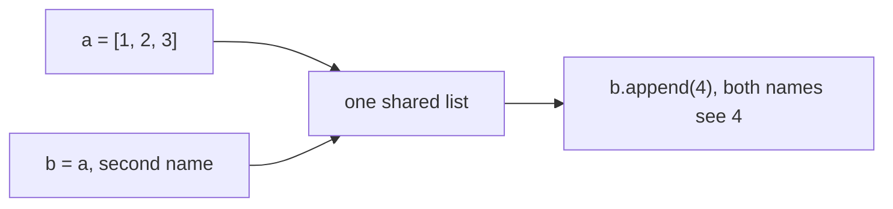
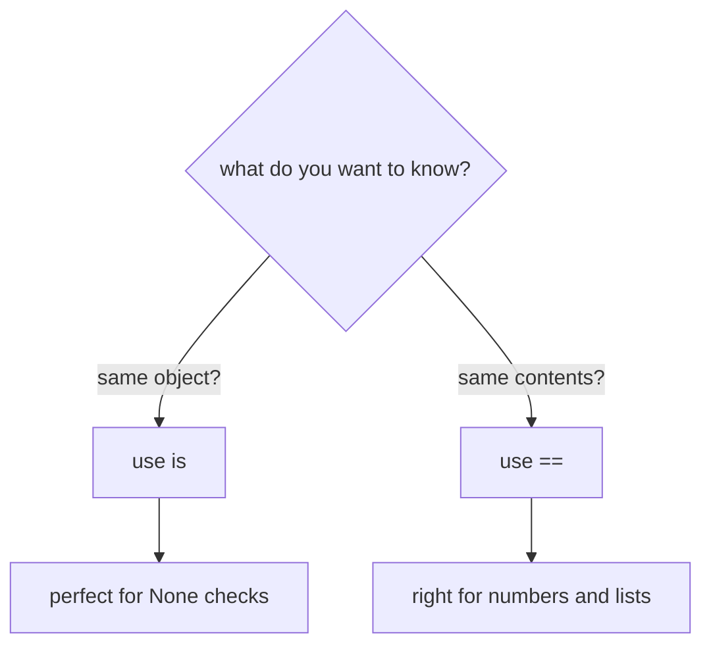
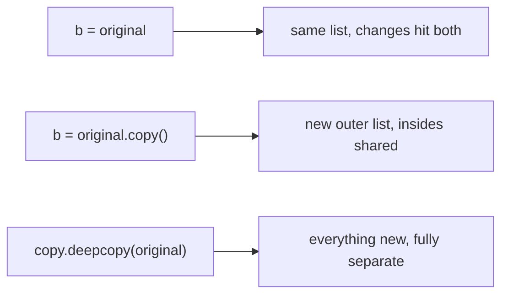
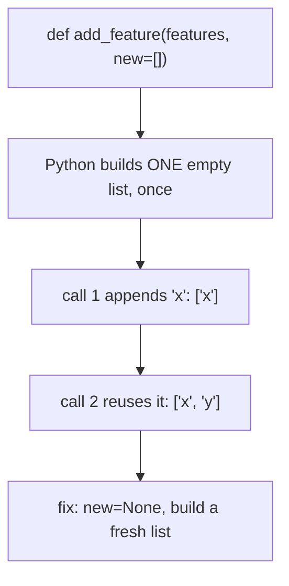

# Mutable vs Immutable (Objects, References, Copies)

## Status
- Status: Learning
- Prerequisites: Data types (list, tuple, str, dict, set), variables
- Last studied: Day 2
- Confidence: Building
V
---

# Mutable vs Immutable

This is a **small but very important Python concept**. Most data-corruption bugs in Python come from this single idea. You don't need to spend hours on it; understand references, mutability, and copying — it will save you from silent bugs.

---

## 1. The problem they solve

Normally, you think of a variable as a box that holds a value:

```python
a = [1, 2, 3]
b = a          # "copy the box"?
```

But Python does NOT copy. Try this:

```python
a = [1, 2, 3]
b = a          # b is NOT a copy
b.append(4)

print(a)       # [1, 2, 3, 4]  ← the ORIGINAL changed too!
```

Output:

```text
[1, 2, 3, 4]
```

Why did `a` change? Because `b = a` made both names point to the **same list object**.

In ML this becomes a disaster:

```python
X_scaled = X            # want a scaled copy?
X_scaled -= X.mean()    # original X changed too!
```

Your "copy" of the dataset silently corrupts the original.

That's the problem this topic solves — understanding what `=` really does.

---

# 2. Mutable vs Immutable — the core concept

Every object in Python is one of two kinds:

```text
Mutable   → can change in place   → list, dict, set, bytearray
                                      (later: NumPy arrays, DataFrames)

Immutable → cannot change         → int, float, str, tuple, bool, None
```

Watch the difference:

```python
# MUTABLE — list changes in place
a = [1, 2, 3]
a.append(4)
print(a)       # [1, 2, 3, 4] — the SAME object, now bigger

# IMMUTABLE — int can't change, so Python makes a NEW object
x = 5
x += 1         # x now points to a brand-new object 6
print(x)       # 6 — the old 5 object still exists, untouched
```

Output:

```text
[1, 2, 3, 4]
6
```

### Important:

A variable is a **name pointing to an object**, not a box holding a value.

```text
name ─────┐
          ↓
        object (stored in memory)
          ↑
          │
other ────┘
```

Both `a` and `b` point to the SAME object. That's why mutating through `b` changes what `a` sees.

### Why does this distinction matter?

Because it decides:

```text
can two names share one object safely?  → immutable: YES
                                          mutable: NO (they affect each other)
can this object be a dict key?          → immutable: YES (hashable)
                                          mutable: NO (unhashable)
can I pass it to a function safely?     → immutable: YES
                                          mutable: only if you want mutation
```

---

# 3. What actually happens internally

This is very important.

`b = a` copies the **reference** (the arrow), not the object.

```text
a = [1, 2, 3]

a ──────→ [1, 2, 3]    (one object in memory)

b = a

a ──────→ [1, 2, 3]
b ──────→ [1, 2, 3]    (same object! two arrows, one target)

b.append(4)

a ──────→ [1, 2, 3, 4]   ← a sees the change too
b ──────→ [1, 2, 3, 4]
```

**📊 Diagram — b = a means two names, one list**



For immutable objects, sharing is **safe** because nobody can change the object:

```python
s = "abc"
t = s          # t points to same string
s += "d"       # creates a NEW string; s now points to new object
print(t)       # "abc" — unchanged. Strings are safe.
```

Output:

```text
abc
```

Conceptually:

```text
s = "abc"
t = s

s ────→ "abc"
t ────→ "abc"

s += "d"

s ────→ "abcd"   (NEW object)
t ────→ "abc"    (old object untouched)
```

### The heap

All objects live on the **heap** — a big pool of memory where objects survive independently of the code that created them. Names (variables) are just arrows pointing into the heap.

```text
heap:  [1,2,3]   "abc"   5    {'k': 'v'}   ...
        ↑                  ↑
       a,b                x
```

---

# 4. Practical example

A function that accidentally mutates the caller's data:

```python
def add_row(data, row):
    data.append(row)      # mutates the CALLER's list

df_rows = [["a", 1]]
add_row(df_rows, ["b", 2])
print(df_rows)
```

Output:

```text
[['a', 1], ['b', 2]]
```

The caller's list changed — because `data` and `df_rows` point to the same object.

This is either a feature (efficient) or a bug (surprise mutation) — depending on whether you meant it.

### The safe version — copy inside the function

```python
def add_row(data, row):
    new_data = data.copy()   # work on a copy
    new_data.append(row)
    return new_data

df_rows = [["a", 1]]
result = add_row(df_rows, ["b", 2])
print(df_rows)    # [['a', 1]] — untouched
print(result)     # [['a', 1], ['b', 2]]
```

Output:

```text
[['a', 1]]
[['a', 1], ['b', 2]]
```

---

# 5. Identity vs Equality — `is` vs `==`

Two different questions:

```python
a = [1, 2, 3]
b = [1, 2, 3]
c = a

a == b    # True  — equal CONTENT (value)
a is b    # False — different OBJECTS (identity)
a is c    # True  — same object
```

```text
==  → compares VALUE   (are the contents equal?)
is  → compares IDENTITY (are they the SAME object?)
```

### Important:

`is` asks "same object?"

`==` asks "same value?"

Two lists with the same content are `==` but not `is`.

### Checking identity with `id()`

Every object has a unique id (its memory address in CPython):

```python
a = [1, 2, 3]
b = [1, 2, 3]
c = a

print(id(a))   # 1401234567890 (example)
print(id(b))   # 1409876543210 (different)
print(id(c))   # 1401234567890 (same as a)
```

`a is c` is True because `id(a) == id(c)`.

### The small-int caching trap

CPython caches small integers from -5 to 256:

```python
a = 5
b = 5
a is b    # True — both point to the cached 5

x = 300
y = 300
x is y    # False (usually) — two separate objects
```

Output:

```text
True
False
```

### Important:

Never rely on `is` for numbers or strings — use `==`. `is` is only correct for:

```text
None    (singleton)
True/False (singletons)
```

**📊 Diagram — is or ==? one question decides**



---

# 6. Copying — the escape hatch

When you genuinely want a separate object:

```python
b = a                    # NO copy — same object (reference)
b = a.copy()             # shallow copy (lists)
b = list(a)              # shallow copy (lists)
b = a[:]                 # shallow copy (lists, via slicing)
b = copy.copy(a)         # shallow copy (anything)
b = copy.deepcopy(a)     # deep copy (anything)
```

The rule:

> If you want to modify data without touching the original — **copy explicitly**.

```python
a = [1, 2, 3]

b = a            # shared — both change together
c = a.copy()     # independent
c.append(4)

print(a)   # [1, 2, 3] — safe
print(b)   # [1, 2, 3]
print(c)   # [1, 2, 3, 4]
```

Output:

```text
[1, 2, 3]
[1, 2, 3]
[1, 2, 3, 4]
```

---

# 7. Why is it called "shallow copy"?

This is very important.

A **shallow** copy creates a NEW outer container, but the **contents are still shared**:

```python
original = [[1, 2], [3, 4]]

shallow = original.copy()      # new outer list, SAME inner lists
shallow[0].append(99)
print(original)
```

Output:

```text
[[1, 2, 99], [3, 4]]    ← changed!
```

Conceptually:

```text
original ──→ [  outer list  ] ──→ [1,2] , [3,4]
shallow  ──→ [new outer list] ──→ [1,2] , [3,4]
              ↑ new              ↑ SAME inner lists
```

**📊 Diagram — three ways to copy a nested list**



A **deep** copy copies everything — outer AND inner:

```python
import copy

deep = copy.deepcopy(original)
deep[0].append(5)
print(original)      # unchanged
```

Output:

```text
[[1, 2], [3, 4]]
```

> Shallow copy = new container, shared contents.
> Deep copy = everything new.

### When does shallow copy bite you?

```text
flat data (1 level deep)  → shallow copy is fine
nested data (lists in lists,
dicts in lists, rows...)  → shallow copy STILL SHARES the inner parts
```

Datasets are almost always nested (rows of columns) — so in ML you usually need **deep** copies.

---

# 8. Mutable vs Immutable — comparison

|               | Mutable                    | Immutable              |
| ------------- | -------------------------- | ---------------------- |
| Change in place | Yes                      | No                     |
| `b = a` shares | Yes — both change        | Yes, but safe (can't change) |
| Change creates new object | No               | Yes                    |
| Examples      | `list, dict, set`         | `int, float, str, tuple, bool, None` |
| Can be a dict key | No (unhashable)       | Yes (if hashable)      |
| Typical risk  | accidental mutation        | none — always safe to share |

Remember this:

```text
mutable   → list, dict, set        → change in place
immutable → int, str, tuple, bool  → new object on change
```

### Why can't a mutable object be a dict key?

A dict key needs a stable **hash** (a number computed from the object). If the object changed, its hash would change — and the dict would lose track of it:

```python
d = {}
key = [1, 2]
d[key] = "value"      # TypeError: unhashable type: 'list'
```

Output:

```text
TypeError: unhashable type: 'list'
```

Tuples work:

```python
d = {}
key = (1, 2)          # immutable → hashable
d[key] = "value"
print(d)              # {(1, 2): 'value'}
```

---

# 9. The default-argument bug — combining functions + mutability

The most famous Python bug:

```python
def add_feature(features, new=[]):      # BAD
    new.append(features)
    return new

print(add_feature("x"))
print(add_feature("y"))
```

Output:

```text
['x']
['x', 'y']      ← the old list was reused!
```

Why? The default `[]` is created **ONCE** when the function is defined — and every call without `new` reuses that SAME list.

### What actually happens internally

```text
def add_feature(features, new=[]):

Python creates ONE list [] at definition time
      ↓
it lives on the function object forever
      ↓
call 1: add_feature("x")  → new = THE DEFAULT LIST → append "x" → ["x"]
call 2: add_feature("y")  → new = THE SAME LIST    → append "y" → ["x", "y"]
```

**📊 Diagram — why the default list remembers old values**



Correct version — `None` as the sentinel:

```python
def add_feature(features, new=None):
    if new is None:
        new = []
    new.append(features)
    return new

print(add_feature("x"))
print(add_feature("y"))
```

Output:

```text
['x']
['y']
```

Why `None` works:

```text
None is immutable → nothing can accumulate in it
None is a singleton → identity check is reliable
None is falsy → if new is None: is idiomatic
```

---

# 10. Tuples — the "half-immutable" case

A tuple is immutable on the outside... but if it **contains** a list, that list can still change:

```python
t = ([1, 2], 3)
t[0].append(99)    # works!
print(t)
```

Output:

```text
([1, 2, 99], 3)
```

The tuple didn't change — the list inside it did.

Conceptually:

```text
t ──→ ( [1,2] , 3 )
        ↑
       mutable list — its contents can change
```

### Important:

```text
immutable = the CONTAINER cannot change
mutable contents inside an immutable container CAN still change
```

---

# 11. Very important distinction — copy vs reference

```text
b = a        → REFERENCE — same object, NO copy
b = a.copy() → COPY — new object, same contents (shallow)
```

Don't confuse these two.

```text
assignment  → share the object
.copy()     → new container, shared contents (shallow)
deepcopy    → everything new (deep)
```

### Quick test of understanding

```python
a = [1, 2, 3]
b = a
c = a[:]

b.append(4)
c.append(5)

print(a, b, c)
```

**PREDICT** the output.

Answer: `[1, 2, 3, 4] [1, 2, 3, 4] [1, 2, 3, 5]`

```text
b = a    → shared → b's change appears in a
c = a[:] → copied → c's change stays in c
```

---

# 12. Common mistakes

- `b = a` thinking you copied a list → you didn't
- `.copy()` on nested lists → inner lists still shared
- tuples containing lists — "immutable" outside, inner list still changes
- using a list as a dict key → `TypeError: unhashable type: 'list'` (use a tuple)
- relying on small-int caching: `a = 5; b = 5; a is b` → True (CPython caches -5..256) — but don't rely on it; use `==` for values
- `+=` on a list mutates in place; `+=` on a str/int creates a new object — same syntax, different behavior!

```python
a = [1, 2]
a += [3]       # MUTATES the same list
print(a)       # [1, 2, 3]

s = "ab"
s += "c"       # creates a NEW string
print(s)       # "abc"
```

---

# 13. Where you'll actually see this

This is the **data leakage / accidental mutation** story in ML:

```python
X_scaled = X          # want to scale a copy?
X_scaled -= X.mean()  # original X changed too!
```

* Pandas/NumPy mutation — arrays and DataFrames are mutable objects
* train/test separation — never let preprocessing touch the test set
* dataset sharing — one reference change corrupts "your copy"
* function arguments — accidental in-place modification of caller data

### The train/test disaster

```python
X_train = data[:800]
X_test = data[800:]

# someone "normalizes" X_train:
X_train -= X_train.mean()

# ...and X_test changed too if they shared inner rows!
```

The rule:

> If you want to modify data without touching the original — **copy explicitly**.

---

# 14. What you need to remember

Memorize this mental model:

```text
name ─────┐
          ↓
        object (on the heap)
          ↑
          │
other ────┘

b = a        → share (same object)
a.copy()     → new container, shared contents (shallow)
deepcopy     → everything new (deep)

mutable   → list, dict, set → change in place
immutable → int, str, tuple, bool, None → new object on change

==  → value
is  → identity
```

And:

```text
mutable default arg → shared list bug → fix with None
tuple with a list inside → the list can still change
list as dict key → TypeError → use a tuple
```

---

# 15. PREDICT drills

Say the answer before reading it.

### Drill 1

```python
a = [1, 2, 3]
b = a
b.append(4)
print(a)
```

**Answer:** `[1, 2, 3, 4]` — `b = a` shares the same list object.

### Drill 2

```python
a = [1, 2, 3]
b = a[:]
b.append(4)
print(a)
```

**Answer:** `[1, 2, 3]` — slicing creates a new list.

### Drill 3

```python
a = [1, 2, 3]
b = [1, 2, 3]
print(a == b, a is b)
```

**Answer:** `True False` — equal content, different objects.

### Drill 4 — the trap

```python
def add_feature(features, new=[]):
    new.append(features)
    return new

print(add_feature("x"))
print(add_feature("y"))
```

**Answer:** `['x']` then `['x', 'y']` — the default list is one shared object reused across calls.

### Drill 5 — the trap

```python
original = [[1, 2], [3, 4]]
shallow = original.copy()
shallow[0].append(99)
print(original)
```

**Answer:** `[[1, 2, 99], [3, 4]]` — shallow copy shares the inner lists.

### Drill 6 — trickier

```python
t = ([1, 2], 3)
t[0].append(99)
print(t)
```

**Answer:** `([1, 2, 99], 3)` — the tuple is immutable, but the list inside it changed.

### Drill 7 — trickier

```python
def mutate(x):
    x.append(1)

def reassign(x):
    x = [9, 9]

a = []
mutate(a)
reassign(a)
print(a)
```

**Answer:** `[1]` — `mutate` changed the shared object; `reassign` only rebinds the local name (the caller's object is untouched).

---

# 16. Experiment

1. `a = [[1,2]]; b = a.copy(); b[0][0] = 99` — check `a`.
2. `def f(x=[]): x.append(1); return x` called twice — observe accumulation.
3. `x = 5; y = 5; x is y` vs `x = 300; y = 300; x is y` — see int caching.
4. `d = {}; d[[1]] = "x"` — observe the unhashable TypeError.
5. Check `id()` of the same list referenced by two names.

---

# 17. Interview questions

**Q: `is` vs `==`?**
Short: `is` = same object (identity), `==` = equal value.
Strong: `is` compares `id()`; `==` calls `__eq__`. `is` is correct for None and True/False; `==` for values.

**Q: Why are small integers like 5 cached but 300 not?**
CPython caches small ints (-5 to 256); `a = 5; b = 5; a is b` → True. But don't rely on it — use `==` for values.

**Q: Why does `b = a` not copy a list? What actually happens in memory?**
It copies the reference (the arrow), not the object. Both names now point to the same list on the heap. Mutation through either name is visible through both.

**Deep follow-up: What is the mutable default argument bug and why does it happen?**
The default is evaluated once at function definition time and stored on the function object. Every call reuses that one mutable object. Fix: `None` sentinel.

**Q: Why can't a list be a dict key, but a tuple can?**
Keys must be hashable — a mutable object's hash would change if it mutated, breaking the dict. Tuples are immutable → stable hash.

---

# 18. Follow-up chain

1. Shallow copy vs deep copy — when does shallow copy still bite you? (nested lists/dicts, NumPy arrays)
2. What happens when you pass a mutable object to a function and reassign it inside? (rebinding a local name — caller unaffected)
3. `append` vs `+=` on lists — both mutate in place; `+` creates a new list. Which is which?
4. How do NumPy views and Pandas `copy=` relate to this? (they extend the same reference model)
5. What happens to memory when an object has no names pointing to it? (garbage collected)

---

# 19. Cheat sheet

```text
CONCEPT
→ mutable: list, dict, set (change in place)
→ immutable: int, float, str, tuple, bool, None (new object on change)

MENTAL MODEL
→ variables are names pointing to heap objects; b = a shares

KEY SYNTAX
→ == value, is identity
→ a.copy() shallow; copy.deepcopy(a) deep

IMPORTANT RULE
→ copy explicitly when you must not mutate the original

COMMON TRAP
→ mutable default arguments; shallow copy on nested data; list as dict key

ML CONNECTION
→ reference sharing = accidental dataset mutation = data bugs

INTERVIEW LINE
→ "Arguments pass references to objects; mutating a mutable
→ argument mutates the caller's object. is tests identity,
→ == tests value."
```

---

# Quick mastery test

Before moving on, you should be able to answer these:

### Q1

What is printed?

```python
a = [1, 2, 3]
b = a
b.append(4)
print(a)
```

**Answer:** `[1, 2, 3, 4]` — `b = a` shares the same list object.

### Q2

What is printed?

```python
a = [1, 2, 3]
b = a[:]
b.append(4)
print(a)
```

**Answer:** `[1, 2, 3]` — slicing creates a new list.

### Q3

What is the result here?

```python
a = [1, 2, 3]
b = [1, 2, 3]
print(a == b, a is b)
```

**Answer:** `True False` — equal content, different objects.

### Q4 — the trap

```python
def add_feature(features, new=[]):
    new.append(features)
    return new

print(add_feature("x"))
print(add_feature("y"))
```

**Answer:** `['x']` then `['x', 'y']` — the default list is one shared object reused across calls. The bug is fixed with `new=None`.

### Q5 — trickier

```python
original = [[1, 2], [3, 4]]
shallow = original.copy()
shallow[0].append(99)
print(original)
```

**Answer:** `[[1, 2, 99], [3, 4]]` — shallow copy shares the inner lists.

### Q6 — hardest

```python
def reassign(x):
    x = [9, 9]

a = [1]
reassign(a)
print(a)
```

**Answer:** `[1]` — reassignment inside the function only rebinds the local name; the caller's list is untouched.

---

## Your level for this topic

You **do not need more depth than this right now**.

If you understand:

```python
b = a        → share
a.copy()     → shallow
deepcopy     → deep

mutable      → list, dict, set
immutable    → int, str, tuple, bool, None

==  → value
is  → identity

mutation in a function affects the caller; reassignment doesn't
```

and can explain why the default-argument bug happens, **mark Mutable vs Immutable complete.**