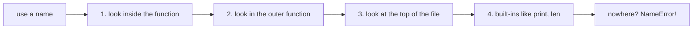
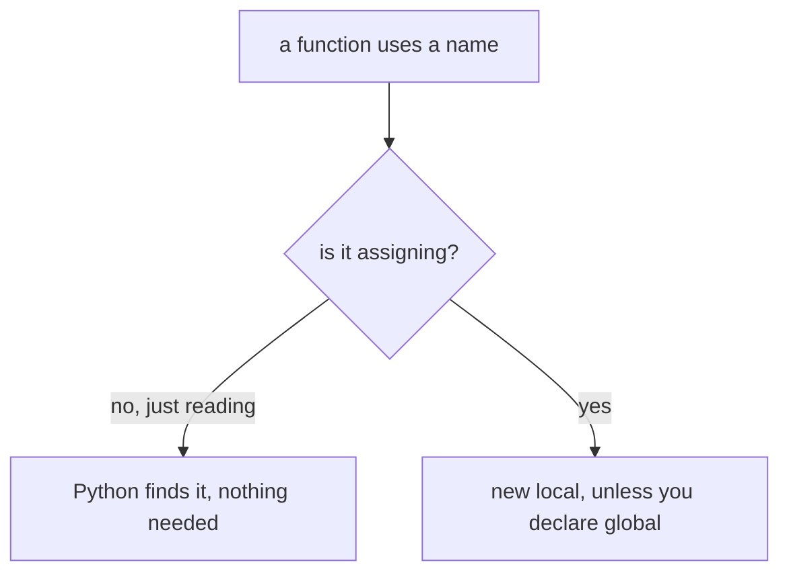
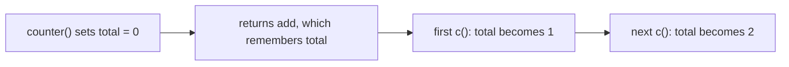

# Scope & LEGB

## Status
- Status: Learning
- Prerequisites: Functions, nested functions
- Last studied: Day 2
- Confidence: Building

---

# Scope & LEGB

This is a **small but very important Python concept**. "Why can my function see this variable?" / "Why does my function ignore my global?" — these are scope questions. Understand the LEGB lookup and assignment rules, and practice it.

---

## 1. The problem they solve

Try this:

```python
count = 0

def increment():
    count += 1     # UnboundLocalError!
```

Output:

```text
UnboundLocalError: local variable 'count' referenced before assignment
```

Why can't the function just use the global `count`?

And this:

```python
x = 10

def change():
    x = 20        # does this change the global x? NO

change()
print(x)
```

Output:

```text
10
```

The function "ignored" the global. Scope rules decide which variable a name refers to — and they're not always what you expect.

That's the problem this topic solves — understanding exactly which variable a name refers to.

---

# 2. LEGB — the core concept

Python looks up a name in this fixed order:

```text
L — Local        (inside current function)
↓
E — Enclosing    (outer function, for nested functions)
↓
G — Global       (module level)
↓
B — Built-in     (print, len, int, ...)
```

**📊 Diagram — where Python looks for a name**



First match wins. If nothing matches → `NameError`.

```python
x = "global x"                 # global

def outer():
    x = "enclosing x"          # enclosing (for inner)
    def inner():
        x = "local x"          # local
        print(x)               # local x
    inner()

outer()
```

Output:

```text
local x
```

Conceptually:

```text
print(x) → look in Local?  → found "local x" → USE IT
```

### Why this order?

```text
Local      → the fastest, most specific answer
Enclosing  → for closures (functions inside functions)
Global     → the module level
Built-in   → the last resort (print, len, int...)
```

The order is designed so the **closest** definition wins.

### Demonstrating each level

```python
# GLOBAL
x = "module level"

# BUILT-IN (no definition needed)
print(len("abc"))    # len is built-in

# LOCAL
def f():
    y = "local"
    print(y)

# ENCLOSING
def outer():
    z = "enclosing"
    def inner():
        print(z)     # found in enclosing scope
    inner()
```

---

# 3. What actually happens internally

This is very important.

At **compile time**, Python decides which names are local:

> Any name assigned anywhere in a function body is local for the WHOLE function.

So this crashes:

```python
x = 10

def f():
    print(x)     # UnboundLocalError!
    x = 20       # ← this line makes x local for the whole function
```

Why? Because Python already declared `x` as local (due to the assignment below), the `print` tries to read an **unassigned local** — not the global.

Conceptually:

```text
function body compiled:
    x assigned somewhere → x becomes LOCAL for entire function
    print(x) at the top → reads the local → NOT YET SET → error
```

### Namespaces are dictionaries

Each scope has its own namespace (a dict-like store):

```text
global namespace:  {'x': 10, 'f': <function>}
local namespace:   {}   ← starts empty, fills as you assign
```

You can peek at them:

```python
x = 10

def f():
    y = 20
    print(locals())    # {'y': 20} — the local namespace
    print(globals()['x'])  # 10 — reach into the global namespace

f()
```

Output:

```text
{'y': 20}
10
```

### The stack of frames

When you call a function, Python pushes a new **frame** (with its own namespace) onto the call stack:

```text
┌─────────────┐
│ f's frame   │  ← local namespace (y: 20)
├─────────────┤
│ main frame  │  ← global namespace (x: 10)
└─────────────┘
```

Lookup walks from the top frame down.

---

# 4. Practical example

Nested functions reading from outer scopes:

```python
def outer():
    y = "outer value"
    def inner():
        print(y)      # reads from enclosing scope (E)
    inner()

outer()
```

Output:

```text
outer value
```

Lookup for `y`:

```text
inner's Local?    → no y there
Enclosing (outer)? → FOUND "outer value" → USE IT
```

Reading from an outer scope works automatically. It's **writing** that needs declarations.

### The closure pattern

A function that "remembers" the enclosing scope even after the outer function finished:

```python
def make_multiplier(factor):
    def multiply(x):
        return x * factor     # factor comes from the enclosing scope
    return multiply

double = make_multiplier(2)
triple = make_multiplier(3)

print(double(10))   # 20
print(triple(10))   # 30
```

Output:

```text
20
30
```

Each returned function **captured its own** `factor`.

---

# 5. Reading vs Writing — the trap

Reading a global works fine:

```python
x = 100

def show():
    print(x)      # 100 — reads global, works
```

Output:

```text
100
```

**Assigning** to a global creates a **new local** — unless you declare it:

```python
count = 0

def increment():
    global count   # without this → UnboundLocalError
    count += 1
```

### Important:

```text
reading a name  → LEGB search, NO declaration needed
assigning a name → creates a LOCAL, unless declared global/nonlocal
```

**📊 Diagram — reading is free, assigning makes a local**



This single rule explains most scope bugs.

### A quick test of understanding

**PREDICT** the output:

```python
x = 10

def f():
    x = 99
    print(x)

f()
print(x)
```

Answer: `99` then `10` — inside `f`, `x` is a new local. The global is untouched.

---

# 6. `global`

`global x` tells Python: "use the module-level `x`, don't create a local one".

```python
count = 0

def increment():
    global count
    count += 1

increment()
increment()
print(count)
```

Output:

```text
2
```

### Important:

`global` is only needed for **assignment**.

Reading a global needs nothing — just use the name.

### Multiple globals in one declaration

```python
def reset():
    global count, score
    count = 0
    score = 0
```

---

# 7. Why is `global` needed?

Because assignment is how a **local variable is created**.

Without a declaration, Python can't tell whether you mean "assign to the global" or "create a new local".

The language rule is:

> Assignment inside a function = local by default.

So if you want the global, you must say so explicitly with `global`.

### The `+=` trap with globals

```python
count = 0

def increment():
    count += 1     # reads count, then assigns count → BOTH
```

`+=` does TWO things:

```text
1. read count   → LEGB lookup
2. assign count → local by default!
```

The assignment part makes `count` local → the read fails → `UnboundLocalError`.

That's why the error message says "referenced before assignment" — it's reading a local that hasn't been assigned yet.

---

# 8. `nonlocal`

For **nested functions**, `global` is the wrong tool — it would look at module level, not the enclosing function.

`nonlocal` means: "use the enclosing function's variable":

```python
def counter():
    total = 0
    def add():
        nonlocal total
        total += 1
        return total
    return add
```

### Important:

```text
global   → module-level scope
nonlocal → enclosing function's scope
```

### Without `nonlocal` — the bug

```python
def counter():
    total = 0
    def add():
        total += 1        # UnboundLocalError — total is local to add
        return total
    return add
```

`add` assigns `total`, so `total` becomes local to `add` — and reading it first fails.

---

# 9. `global` vs `nonlocal` — comparison

|               | `global`                        | `nonlocal`                  |
| ------------- | ------------------------------- | --------------------------- |
| Applies to    | module-level (global) scope     | enclosing function's scope  |
| Used in       | any function                    | nested functions only       |
| Error if missing | creates a local / UnboundLocalError | UnboundLocalError or SyntaxError |
| Typical use   | module-level counters, config   | closures, counters, trackers |

Remember this:

```text
read    → LEGB search, no declaration
assign  → local by default
global  → for module-level assignment
nonlocal → for enclosing assignment
```

### The error differences

```python
def f():
    nonlocal x    # SyntaxError: no enclosing scope has x
```

vs

```python
def outer():
    x = 1
    def inner():
        x = 2     # no nonlocal → creates a NEW local in inner
```

Without `nonlocal`, `inner` shadows the enclosing `x` instead of modifying it.

---

# 10. Combining — the closure

This is what `nonlocal` enables — a function that remembers state:

```python
def counter():
    total = 0
    def add():
        nonlocal total
        total += 1
        return total
    return add

c = counter()
print(c())
print(c())
print(c())
```

Output:

```text
1
2
3
```

The returned function `add` **captures** `total` from the enclosing scope — that's a **closure**, powered by scope rules.

Conceptually:

```text
counter() creates total = 0
   ↓
returns add (which still can see total)
   ↓
c() → total becomes 1 → returns 1
c() → total becomes 2 → returns 2
```

**📊 Diagram — the little counter that remembers**



### The closure captures the OBJECT, not a snapshot

If the enclosing variable changes later, the closure sees the change:

```python
def outer():
    n = 1
    def inner():
        return n
    n = 99          # change BEFORE calling inner
    return inner

f = outer()
print(f())          # 99 — sees the current value
```

Output:

```text
99
```

---

# 11. Comprehension scope — the newer distinction

In Python 3, comprehensions have their **own scope**:

```python
i = 100
squares = [i for i in range(5)]
print(i)
```

Output:

```text
100
```

The comprehension's `i` did NOT leak out. (In Python 2, `i` would be 4 — Python 3 fixed it.)

### But the comprehension can READ the outer scope

```python
base = 10
values = [base + i for i in range(3)]
print(values)     # [10, 11, 12]
```

The comprehension reads `base` (outer) and writes its own `i` (local to the comprehension).

---

# 12. Loops and `if` do NOT create scope

Only functions (and classes, and modules) create scope:

```python
if True:
    y = 50      # still module level!

for i in range(3):
    pass

print(y, i)
```

Output:

```text
50 2
```

No error — `y` and `i` are all module-level names.

### Important:

```text
creates scope:  functions, classes, modules
NO scope:       if, for, while, with  (blocks)
```

---

# 13. Very important distinction — read vs assign

```text
reading a name  → LEGB search, no declaration needed
assigning a name → creates a LOCAL unless declared global/nonlocal
```

And one more trap — mutation vs assignment:

```python
data = [1, 2]

def add():
    data.append(3)   # works — MUTATING, not assigning

def reset():
    data = []        # creates a NEW LOCAL — global untouched!
```

```python
add()
print(data)   # [1, 2, 3]

reset()
print(data)   # [1, 2, 3] — the global was NOT reset!
```

Output:

```text
[1, 2, 3]
[1, 2, 3]
```

### Important:

```text
mutation (append, sort, []=) → changes the object → no declaration needed
assignment (data = ...)      → rebinds the name → local by default
```

`append` mutates the shared object — it never rebinds a name, so no local is created. `data = []` rebinds a name — so a new local appears.

---

# 14. Common mistakes

- Using `global` everywhere instead of returning values → spaghetti code
- `UnboundLocalError` when a name is both read and assigned in a function
- Forgetting comprehensions have their own scope in Python 3
- Mutating a global list (works, no `global` needed) then being confused why reassigning fails (needs `global`)
- `nonlocal` used in a non-nested function → SyntaxError
- Shadowing built-ins: `def f(list): ...` then `list("abc")` breaks inside

### The shadowing mistake

```python
list = [1, 2, 3]     # shadows the built-in list

print(list("abc"))   # TypeError: 'list' object is not callable
```

The name `list` now points to a list, not the function. Avoid naming things after built-ins.

---

# 15. Where you'll actually see this

* closures — counters, config providers, experiment trackers
* decorators — they capture the wrapped function from the enclosing scope
* `global` counters/caches in quick experiments (fine) vs pipelines (avoid)
* pure functions — the norm in preprocessing code: return, don't mutate
* caching — a closure holding a cache dict that persists between calls

### ML-flavored example — an experiment tracker closure

```python
def make_tracker():
    runs = {}
    def track(name, metric):
        runs[name] = metric
        return runs
    return track

tracker = make_tracker()
tracker("run1", 0.85)
tracker("run2", 0.91)
print(tracker("run3", 0.88))
```

Output:

```text
{'run1': 0.85, 'run2': 0.91, 'run3': 0.88}
```

State lives in the closure — no global needed.

---

# 16. What you need to remember

Memorize this mental model:

```text
L — Local        (inside current function)
↓
E — Enclosing    (outer function, for nested functions)
↓
G — Global       (module level)
↓
B — Built-in     (print, len, int, ...)
```

And:

```text
read    → LEGB search, no declaration needed
assign  → local by default
global  → for module-level assignment
nonlocal → for enclosing assignment
mutation → no declaration needed (it's not assignment)
```

---

# 17. PREDICT drills

Say the answer before reading it.

### Drill 1

```python
x = "global"

def f():
    x = "local"
    print(x)

f()
print(x)
```

**Answer:** `local` then `global` — assignment inside `f` creates a local; the global is untouched.

### Drill 2 — the trap

```python
x = 10

def f():
    print(x)
    x = 20

f()
```

**Answer:** `UnboundLocalError` — the assignment `x = 20` makes `x` local for the whole function, so the `print` reads an unassigned local.

### Drill 3

```python
def counter():
    total = 0
    def add():
        nonlocal total
        total += 1
        return total
    return add

c = counter()
c()
c()
print(c())
```

**Answer:** `3` — `total` persists across calls via the enclosing scope (closure).

### Drill 4 — the trap

```python
data = [1, 2]

def reset():
    data = []

reset()
print(data)
```

**Answer:** `[1, 2]` — `data = []` inside `reset` creates a new local; the global is untouched. (Mutation like `data.append` WOULD affect it.)

### Drill 5 — trickier

```python
i = 100
[i for i in range(5)]
print(i)
```

**Answer:** `100` — in Python 3, comprehensions have their own scope; `i` doesn't leak.

### Drill 6 — trickier

```python
def outer():
    n = 1
    def inner():
        return n
    n = 99
    return inner

f = outer()
print(f())
```

**Answer:** `99` — the closure reads the CURRENT value of `n`, not a snapshot.

### Drill 7 — hardest

```python
def f():
    global x
    x = 5

x = 1
f()
print(x)
```

**Answer:** `5` — `global x` makes the assignment hit the module-level `x`.

---

# 18. Experiment

1. Define `counter()` and call the returned function multiple times — watch `total` persist via `nonlocal`.
2. Remove `nonlocal` — observe `UnboundLocalError`.
3. Write a nested function that reads (not writes) the enclosing variable — no `nonlocal` needed.
4. Print `locals()` and `globals()` inside a function to see the namespaces.
5. Create a decorator-style closure that counts how many times a function is called.

---

# 19. Interview questions

**Q: What is the order of name lookup in Python?**
LEGB: Local → Enclosing → Global → Built-in.

**Q: Why does this fail?**
```python
x = 10
def f():
    print(x)
    x = 20
```
→ `UnboundLocalError` because Python declares `x` local for the whole function at compile time (assignment exists somewhere in the body), so the `print` reads the uninitialized local.

**Deep follow-up: When would you use `global` vs returning a value?**
Almost always return. `global` makes functions depend on hidden state — hard to test, hard to reason about. Pure functions (input → output) are the norm in ML preprocessing.

**Q: What is a closure?**
A function that captures variables from its enclosing scope and keeps them alive after the outer function returns. Powered by the Enclosing scope level (E in LEGB).

---

# 20. Follow-up chain

1. What is the difference between `global` and `nonlocal`?
2. Do loops and `if` blocks create scope in Python? (No — only functions, classes, modules)
3. How do functions defined in a loop capture the loop variable? (classic closure trap)
4. Why does mutating a global list not need `global`, but reassigning does?
5. What happens if a local name shadows a built-in? (the built-in is unreachable in that scope)

### The loop closure trap (classic interview)

```python
funcs = []
for i in range(3):
    funcs.append(lambda: i)

print([f() for f in funcs])
```

**PREDICT** the output.

Answer: `[2, 2, 2]` — all lambdas capture the SAME `i` (the loop variable is module-level; by the time you call them, `i == 2`).

The fix — bind the value with a default argument:

```python
funcs = []
for i in range(3):
    funcs.append(lambda i=i: i)

print([f() for f in funcs])   # [0, 1, 2]
```

---

# 21. Cheat sheet

```text
CONCEPT
→ LEGB: Local → Enclosing → Global → Built-in

MENTAL MODEL
→ lookup goes inside-out; assignment in a function = local by default

KEY SYNTAX
→ global x for module-level assignment
→ nonlocal x for enclosing assignment

IMPORTANT RULE
→ if a name is assigned anywhere in a function, it's local everywhere in it

COMMON TRAP
→ UnboundLocalError from read-before-assign;
→ mutation vs assignment (append works, = doesn't)

ML CONNECTION
→ pure functions in pipelines; closures in experiment trackers

INTERVIEW LINE
→ "Python resolves names with LEGB; assignment declares a name local
→ to the whole function at compile time, hence UnboundLocalError.
→ global targets the module scope, nonlocal the enclosing scope."
```

---

# Quick mastery test

Before moving on, you should be able to answer these:

### Q1

What is printed?

```python
x = "global"

def f():
    x = "local"
    print(x)

f()
print(x)
```

**Answer:** `local` then `global` — assignment inside `f` creates a local; the global is untouched.

### Q2

What happens here?

```python
x = 10

def f():
    print(x)
    x = 20

f()
```

**Answer:** `UnboundLocalError` — the assignment `x = 20` makes `x` local for the whole function, so the `print` reads an unassigned local.

### Q3

What is printed?

```python
def counter():
    total = 0
    def add():
        nonlocal total
        total += 1
        return total
    return add

c = counter()
c()
c()
print(c())
```

**Answer:** `3` — `total` persists across calls via the enclosing scope (closure).

### Q4 — the trap

```python
data = [1, 2]

def reset():
    data = []

reset()
print(data)
```

**Answer:** `[1, 2]` — `data = []` inside `reset` creates a new local; the global is untouched. (Mutation like `data.append` WOULD affect it.)

### Q5 — trickier

```python
i = 100
[i for i in range(5)]
print(i)
```

**Answer:** `100` — in Python 3, comprehensions have their own scope; `i` doesn't leak.

### Q6 — hardest

```python
funcs = []
for i in range(3):
    funcs.append(lambda: i)

print([f() for f in funcs])
```

**Answer:** `[2, 2, 2]` — all lambdas capture the same loop variable. Fix: `lambda i=i: i`.

---

## Your level for this topic

You **do not need more depth than this right now**.

If you understand:

```python
L — Local → E — Enclosing → G — Global → B — Built-in

read    → search, no declaration
assign  → local by default
global  → module-level assignment
nonlocal → enclosing assignment
mutation → no declaration needed
```

and can explain the `UnboundLocalError` above, **mark Scope & LEGB complete.**