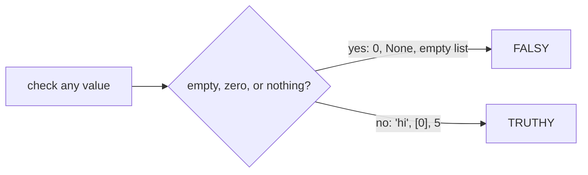
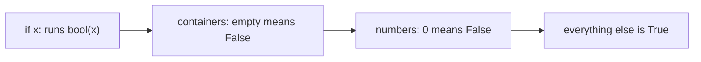
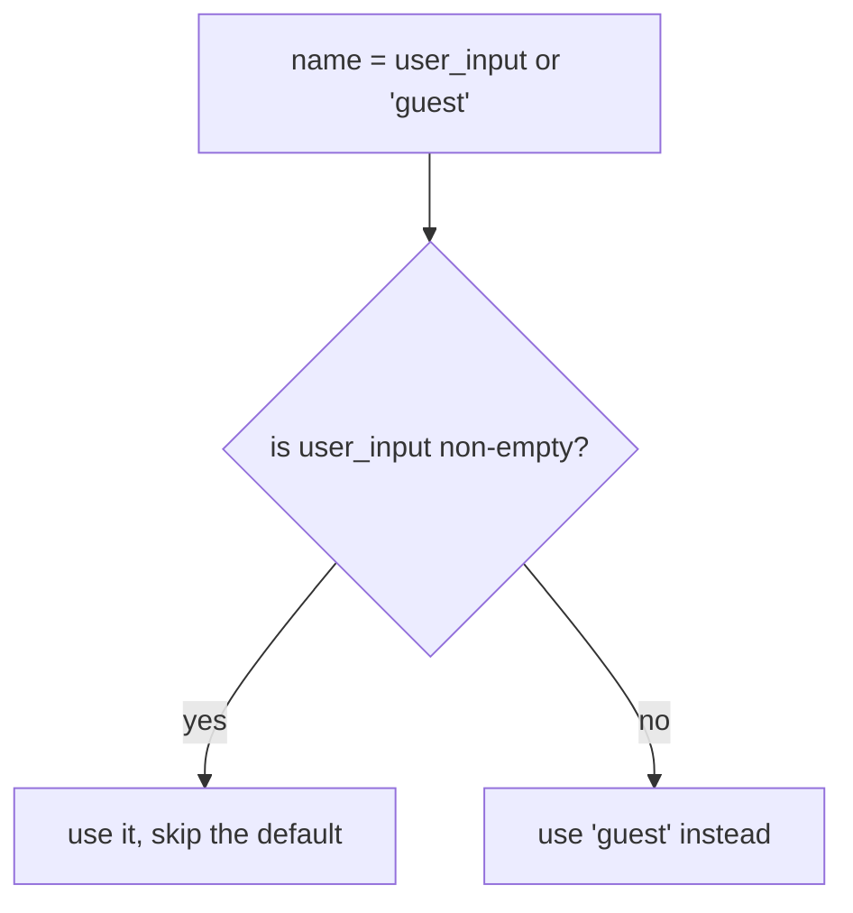

# Truthy / Falsy

## Status
- Status: Learning
- Prerequisites: Conditions, data types
- Last studied: Day 2
- Confidence: Building

---

# Truthy / Falsy

This is a **small but very important Python concept**. `if x:` is everywhere in real code, and it doesn't check what you might think. You don't need to spend hours on it; understand what counts as "true" in Python, and practice it.

---

## 1. The problem they solve

Try this:

```python
name = input("Name: ")

if name:                 # what does this check, exactly?
    print(f"Hello {name}")
else:
    print("No name given")
```

`name` is a **string**, not a boolean. So what does `if name:` mean when the user pressed Enter with nothing typed?

It means: is the string **empty**?

```text
user types "Adarsh" → name = "Adarsh" → if name: → True  → "Hello Adarsh"
user presses Enter  → name = ""       → if name: → False → "No name given"
```

Python's `if` doesn't require a boolean — every object is either **truthy** or **falsy**, and `if` checks that.

That's the problem this topic solves — knowing exactly when an object counts as "true".

---

# 2. Falsy values — the core concept

**Falsy** (the complete list — memorize it):

```python
None
False
0, 0.0, 0j
""                # empty string
[]                # empty list
{}                # empty dict
()                # empty tuple
set()             # empty set
```

That's it. **Everything else in Python is truthy.**

```python
if 0:        print("yes")   # no output — 0 is falsy
if 1:        print("yes")   # yes
if "":       print("yes")   # no output — empty string is falsy
if "0":      print("yes")   # yes — "0" is a string with one character
```

Output:

```text
yes
yes
```

### Important:

The complete falsy list:

```text
None, False, 0, 0.0, 0j, "", [], {}, (), set()
```

### A memory trick

Think of falsy as:

```text
nothing      → None
no           → False
zero         → 0, 0.0, 0j
empty text   → ""
empty box    → [], {}, (), set()
```

**📊 Diagram — one question: is it empty or zero?**



Everything with **something in it** (or a non-zero value) is truthy.

---

# 3. What actually happens internally

This is very important.

`bool(x)` decides truthiness in this order:

```text
1. x.__bool__()   → explicit truthiness (if defined)
2. x.__len__()    → len(x) != 0 (if __len__ defined)
3. otherwise      → always True
```

**📊 Diagram — how Python picks True or False**



That's **why** empty containers are falsy — their `__len__` returns `0`:

```python
bool([])      # False — len([]) == 0
bool("")      # False — len("") == 0
bool({})      # False — len({}) == 0
bool([0])     # True  — len([0]) == 1
```

And that's why `[0]` and `"0"` are truthy — they're non-empty containers, even though their contents are falsy.

### The dunder methods explained

```text
__bool__ → "do I have an explicit truth value?"
           custom classes can define this

__len__  → "how long am I?"
           containers define this
           len(x) == 0  → falsy
```

Numbers use neither — `0` is simply defined as falsy, everything else truthy.

### What `if x:` really translates to

```python
if x:            # Python internally does: if bool(x):
if not x:        # Python internally does: if not bool(x):
```

---

# 4. Practical example

```python
data = []
if not data:              # idiomatic "is the list empty?"
    print("dataset empty — nothing to train")
```

Output:

```text
dataset empty — nothing to train
```

The cache-miss pattern:

```python
def get_model():
    model = cache.get(key)
    if not model:         # None is falsy → cache miss
        model = train_model()
    return model
```

`if not x:` is just the negation — "if x is falsy".

### More real examples

```python
# user input validation
name = input("Name: ")
if not name:
    print("name is required")

# configuration defaults
config = {}
if not config:
    config = default_config()

# guarding before an expensive operation
results = []
if results:            # only if we actually have data
    plot(results)
```

---

# 5. Working with truthiness

```python
if x:             # truthiness check
if not x:         # negated check
bool(x)           # explicit → True or False
```

These idioms replace clunkier comparisons:

```python
if data:              # instead of: if len(data) > 0:
if not data:          # instead of: if len(data) == 0:
if model is None:     # instead of: if not model  ← when 0/"" could be legit values
```

### Important:

```text
if x:        → "if x has something"
if not x:    → "if x is empty"
```

### `bool()` in expressions

```python
print(bool("abc"))     # True
print(bool(0.0))       # False
print(bool([0]))       # True
print(bool(None))      # False
```

Output:

```text
True
False
True
False
```

---

# 6. Why are `[0]` and `"0"` truthy?

This is where people get confused.

Truthiness checks container **emptiness**, not contents:

```python
bool([0])   # True — the list has one element
bool("0")   # True — the string has one character
bool(0)     # False — zero
bool("")    # False — empty string
```

Conceptually:

```text
[0]  → len is 1 → non-empty → TRUTHY
"0"  → len is 1 → non-empty → TRUTHY
0    → zero, not a container → FALSY
""   → len is 0 → empty → FALSY
```

The element inside doesn't matter. Only whether there IS something inside.

### The `[None]` case

```python
bool([None])   # True — the list has one element (None is just a value)
bool([])       # False — no elements
```

A list containing `None` is still non-empty → truthy.

---

# 7. Truthy vs Falsy — comparison

| Falsy                     | Truthy                          |
| ------------------------- | ------------------------------- |
| `None`                    | everything not listed           |
| `False`                   | `True`                          |
| `0, 0.0, 0j`              | `1, -1, 3.14, float('nan')`     |
| `""`                      | `"0"`, `"abc"`, `" "`           |
| `[]`                      | `[0]`, `[None]`, `[[],[]]`      |
| `{}`                      | `{0: 1}`                        |
| `()`                      | `(0,)`                          |
| `set()`                   | `{0}`                           |

Remember this:

> Non-empty containers are truthy **even with falsy contents**.

### The `float('nan')` surprise

```python
bool(float('nan'))   # True — it's a value, not zero
```

NaN is not equal to anything, but it IS truthy — because truthiness only checks "is it zero?", not "is it a number?".

---

# 8. Combining with functions

Functions commonly use truthiness for guards and defaults:

```python
def process(name, data):
    if not name:
        raise ValueError("name is required")
    if not data:
        print("nothing to process — skipping")
        return None
    return transform(data)
```

```python
process("", [1, 2])       # ValueError: name is required
process("x", [])          # nothing to process — skipping
process("x", [1, 2])      # transformed data
```

This is the main purpose of truthiness — short, readable conditionals.

### Truthiness in `or` and `and`

```python
name = user_input or "guest"    # if input is falsy, use "guest"
config = custom or default      # fallback pattern
```

```text
x or y   → returns x if x is truthy, else y
x and y  → returns x if x is falsy, else y
```

The **fallback pattern** is everywhere in real code:

```python
score = raw_score or 0          # avoid None/0 showing up as missing
name = first or "anonymous"     # empty name → default
```

### Important:

```text
or  → "use the first truthy value"
and → "use the first falsy value"
```

---

# 9. The `== None` trap — related but different

Truthiness and `None` interact, but don't mix the tests:

```python
if x == None:      # works, but wrong idiom
if x is None:      # correct — identity, never fooled by __eq__
```

And remember `None` is falsy — but so is `0`, `""`, `[]`:

```python
x = 0
if not x:      # True — but is x None? NO!
```

If `x` could legitimately be `0` or `""`, `if not x:` is the wrong test — use `x is None`.

### The `or` fallback trap with legitimate falsy values

```python
temperature = 0.0     # a legitimate value (freezing!)
display = temperature or 25.0
print(display)        # 25.0 — WRONG! 0.0 is falsy
```

The fallback pattern breaks when `0` is a real value. Use `is None` for correctness:

```python
temperature = 0.0
display = temperature if temperature is not None else 25.0
print(display)        # 0.0 — correct
```

---

# 10. NumPy's ValueError — the exception

```python
import numpy as np
arr = np.array([1, 2, 3])

if arr:      # ValueError!
```

Output:

```text
ValueError: The truth value of an array with more than one element is ambiguous.
```

A NumPy array has many elements — what would "true" even mean? That's a Day-NumPy topic, but remember it: arrays don't work in `if` directly.

### The single-element array edge case

```python
arr = np.array([0])
if arr:      # ValueError again — still an array
```

Even a 1-element array raises — the ambiguity is about the array TYPE, not the count.

The correct checks:

```python
if arr.size == 0:      # empty check
if arr.any():          # any element truthy?
if arr.all():          # all elements truthy?
```

---

# 11. Very important distinction — empty vs falsy contents

```text
empty container          → falsy (len == 0)
container with falsy contents → truthy (len > 0)

[0]    → truthy      ""   → falsy
"0"    → truthy      0    → falsy
(0,)   → truthy      ()   → falsy
{0: 1} → truthy      {}   → falsy
```

The container's **own emptiness** decides — never its contents.

### The mental model

```text
bool(container)  =  "is the container empty?"
                   ↓
            len > 0 → True (truthy)
            len == 0 → False (falsy)
```

---

# 12. Common mistakes

- `if x == None` → should be `if x is None`
- `if len(data) > 0` → fine, but `if data:` is the Pythonic version
- `if arr:` on a NumPy array → `ValueError` (ambiguity)
- `if not model:` when `model` could legitimately be `0` or `""` → use `is None` instead
- `value or default` when the value could legitimately be `0` or `""` → the default silently replaces a real value

---

# 13. Where you'll actually see this

* empty-dataset guards before training: `if not data:`
* cache-hit checks: `if not model: model = train()`
* user input validation: `if not name:`
* lazy loading — "is it already there?" checks
* `None` checks with `is` when falsy could mean something real
* config fallbacks: `config or default`

In ML, empty-data guards and cache-miss checks depend on this every day.

---

# 14. What you need to remember

Memorize this mental model:

```text
falsy = "empty / zero / nothing"
truthy = "has something in it"

if x:        → "if x has something"
if not x:    → "if x is empty"

None, False, 0, 0.0, "", [], {}, (), set()  → falsy
everything else                             → truthy
```

And:

```text
bool(x) → __bool__() first, then __len__() != 0

[0] → truthy (non-empty)
"0" → truthy (non-empty)

x or default → first truthy value
x is None    → the ONLY precise None check
```

---

# 15. PREDICT drills

Say the answer before reading it.

### Drill 1

```python
x = [0]
if x:
    print("truthy")
else:
    print("falsy")
```

**Answer:** `truthy` — `[0]` is a non-empty list.

### Drill 2

```python
x = "0"
if x:
    print("truthy")
else:
    print("falsy")
```

**Answer:** `truthy` — `"0"` is a string with one character.

### Drill 3

Which of these are falsy?

```python
0, "", [], [0], "0", None, (1,), {0: 1}, 0.0, False
```

**Answer:** `0, "", [], None, 0.0, False` — falsy. The rest are truthy.

### Drill 4 — the trap

```python
import numpy as np
arr = np.array([1, 2, 3])
if arr:
    print("yes")
```

**Answer:** `ValueError` — the truth value of an array is ambiguous.

### Drill 5 — trickier

```python
x = [None]
if x:
    print("truthy")
else:
    print("falsy")
```

**Answer:** `truthy` — `[None]` is non-empty (length 1), even though its content is None.

### Drill 6 — trickier

```python
temperature = 0.0
display = temperature or 25.0
print(display)
```

**Answer:** `25.0` — `0.0` is falsy, so the `or` fallback replaced a legitimate value. Fix: check `is not None` instead.

### Drill 7 — hardest

```python
result = 0 and 10
print(result)
print(bool(result))
```

**Answer:** `0` and `False` — `and` returns the first falsy operand (0), which is falsy.

---

# 16. Experiment

1. `bool([])`, `bool("")`, `bool("0")`, `bool([0])`, `bool(float('nan'))` — run and verify.
2. `bool(None)`, `bool(())`, `bool(set())` — confirm the full falsy list.
3. `x or default` with `x = 0` and `x = None` — see when it goes wrong.
4. `bool(" ")` — a string with a space (it's truthy — it has a character).
5. Write a custom class with `__bool__` and `__len__` — observe which one Python uses.

```python
class Weird:
    def __len__(self):
        return 0
    def __bool__(self):
        return True

print(bool(Weird()))   # True — __bool__ wins over __len__
```

Output:

```text
True
```

---

# 17. Interview questions

**Q: List all falsy values in Python. Why is `[0]` truthy?**
Answer: None, False, 0/0.0/0j, "", [], {}, (), set(). `[0]` is truthy because truthiness checks container **emptiness**, not contents — a list with one element is non-empty.

**Q: How does Python decide truthiness for custom objects?**
`bool(x)` calls `x.__bool__()`; if missing, `x.__len__() != 0`; if both missing, True.

**Deep follow-up: Why does `if arr:` fail for NumPy arrays?**
An array has many elements — no single truth value exists. Raising `ValueError` prevents silent ambiguity. Use `.any()`, `.all()`, or `.size == 0`.

**Q: `if x == None` vs `if x is None`?**
`is` checks identity — there's exactly one None object, so `is None` is both correct and idiomatic, and can't be fooled by a custom `__eq__`.

---

# 18. Follow-up chain

1. What does `or` return — a boolean or a value? (a value — the first truthy one)
2. Why is `if data:` better than `if len(data) > 0:`? (cleaner, works for any sized object)
3. What's the truthiness of `float('nan')`? (truthy — not zero)
4. Why does `" "` (a space) count as truthy? (it has one character — len is 1)
5. How does `and`/`or` short-circuit? (they stop evaluating once the answer is known)

### Short-circuiting explained

```python
def risky():
    print("risky called")
    return True

if False and risky():    # risky() is NEVER called — False already decides
    pass

if True or risky():      # risky() is NEVER called — True already decides
    pass
```

```text
and → stops at the first falsy value
or  → stops at the first truthy value
```

**📊 Diagram — how the or fallback picks a value**



This powers the `or default` idiom safely — the default is only evaluated when needed.

---

# 19. Cheat sheet

```text
CONCEPT
→ falsy: None, False, 0, 0.0, "", [], {}, (), set()
→ everything else truthy

MENTAL MODEL
→ falsy = empty/zero/nothing; truthy = has something

KEY SYNTAX
→ if x: / if not x: / bool(x)
→ x or default / x and y

IMPORTANT RULE
→ truthiness = __bool__() first, then __len__() != 0

COMMON TRAP
→ empty containers falsy; [0], "0", (0,) truthy;
→ 0 is falsy — don't use `or default` when 0 is valid

ML CONNECTION
→ empty-dataset guards, cache-hit checks, None model checks

INTERVIEW LINE
→ "Falsy means empty/zero/None; containers are falsy only when
→ empty, regardless of their contents. bool() uses __bool__,
→ then __len__."
```

---

# Quick mastery test

Before moving on, you should be able to answer these:

### Q1

What is printed?

```python
x = [0]
if x:
    print("truthy")
else:
    print("falsy")
```

**Answer:** `truthy` — `[0]` is a non-empty list.

### Q2

What is printed?

```python
x = "0"
if x:
    print("truthy")
else:
    print("falsy")
```

**Answer:** `truthy` — `"0"` is a string with one character.

### Q3

Which of these are falsy?

```python
0, "", [], [0], "0", None, (1,), {0: 1}, 0.0, False
```

**Answer:** `0, "", [], None, 0.0, False` — falsy. The rest are truthy.

### Q4 — the trap

```python
import numpy as np
arr = np.array([1, 2, 3])
if arr:
    print("yes")
```

**Answer:** `ValueError` — the truth value of an array is ambiguous.

### Q5 — trickier

```python
x = [None]
if x:
    print("truthy")
else:
    print("falsy")
```

**Answer:** `truthy` — `[None]` is non-empty (length 1), even though its content is None.

### Q6 — hardest

```python
x = 0
result = x or 42
print(result)
```

**Answer:** `42` — `0` is falsy, so `or` returns the fallback. If `0` is a legitimate value, this is a bug — use `is None` instead.

---

## Your level for this topic

You **do not need more depth than this right now**.

If you understand:

```python
falsy:  None, False, 0, 0.0, "", [], {}, (), set()
truthy: everything else

if x:        → "has something"
if not x:    → "is empty"

bool(x) → __bool__() first, then __len__() != 0

or → first truthy value (watch out for legit 0)
```

and can explain why `[0]` is truthy, **mark Truthy / Falsy complete.**