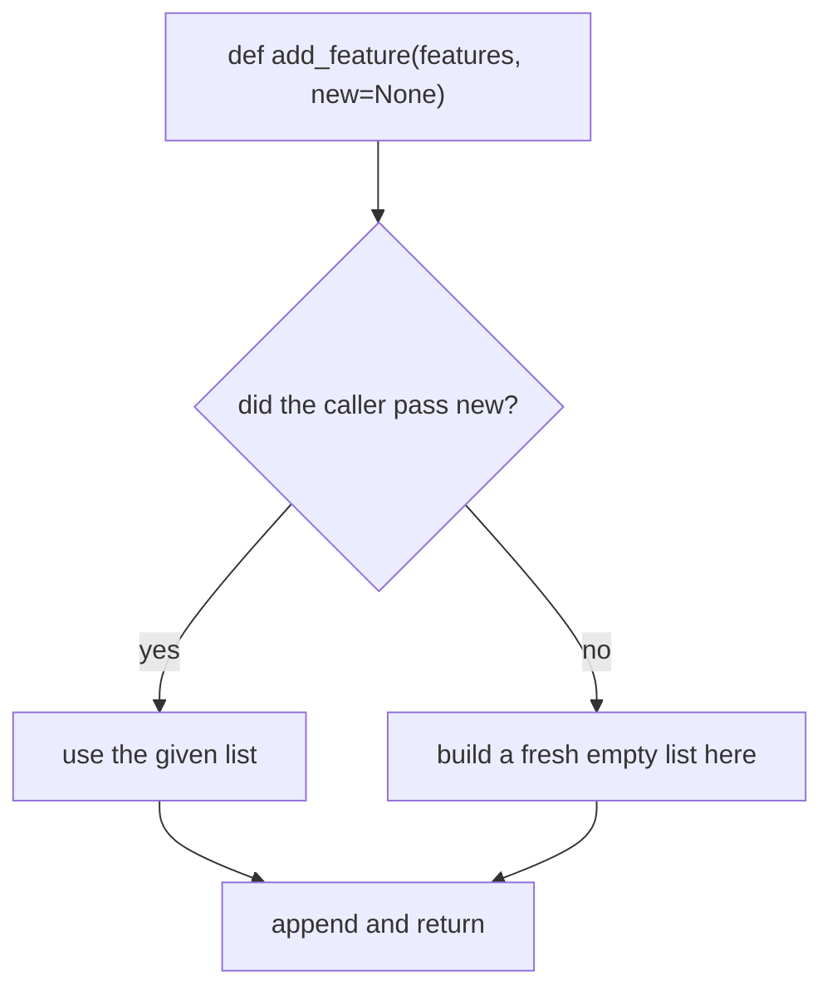
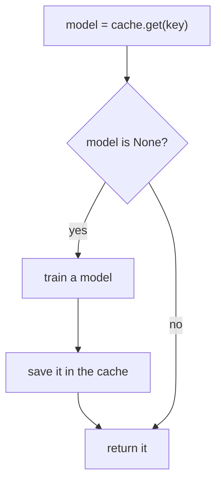
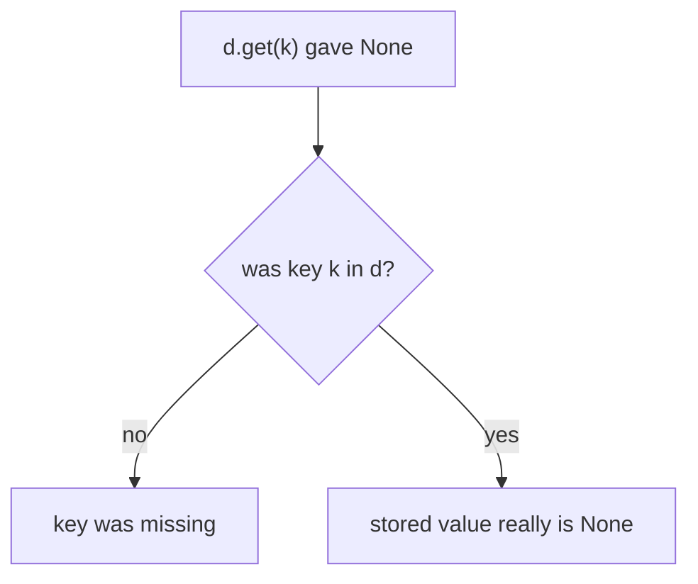

# None

## Status
- Status: Learning
- Prerequisites: Functions, return, truthy/falsy
- Last studied: Day 2
- Confidence: Building

---

# None

This is a **small but very important Python concept**. `None` is Python's way of saying "no value" — and it appears everywhere: functions that return nothing, missing data, cache misses. You don't need to spend hours on it; understand what it is and how to test for it correctly.

---

## 1. The problem they solve

Try this:

```python
def find_user(users, name):
    for u in users:
        if u["name"] == name:
            return u
    # what if no user matches?
```

A function must return **something** — Python functions always return a value. So what should "not found" look like?

```python
print(find_user([], "saumitra"))
```

Output:

```text
None
```

Without a `return`, the function returned `None` — Python's "no value" placeholder.

Now make it explicit:

```python
def find_user(users, name):
    for u in users:
        if u["name"] == name:
            return u
    return None          # explicit "not found"
```

That's the problem this topic solves — knowing what "no value" means and how to test for it.

---

# 2. `None` — the core concept

`None` is Python's "no value":

- every function without an explicit `return` returns `None`
- it's the standard "not found / missing / absent" value
- it is a **singleton** — there is exactly one None object in the whole program

```python
def f():
    pass

print(f())              # None

print(print("hi"))      # hi → None (print returns None)
```

Output:

```text
None
hi
None
```

### Important:

```text
no return        → None
bare return      → None
print() returns  → None
```

### Where None shows up without you noticing

```python
a = [1, 2]
print(a.append(3))    # None — append mutates and returns nothing
print(a.sort())       # None — sort also returns nothing
d = {"k": "v"}
print(d.update({"x": 1}))   # None
```

Output:

```text
None
None
None
```

Many mutating methods return `None` — a classic interview question is why `a = a.sort()` breaks.

---

# 3. What actually happens internally

This is very important.

- A function with no `return` (or a bare `return`) implicitly returns `None`.
- `None` is a **singleton**: `None is None` is always True. There is no second None object.
- `type(None)` → `<class 'NoneType'>` — None is its own type.
- `None` is falsy: `bool(None)` → False.

Because it's a singleton:

```python
a = None
b = None
a is b    # True — same object
```

Every `None` you ever see is THE SAME object. That's why `is` works perfectly for None.

### The implicit return

```python
def f():
    return          # explicit "return nothing"

def g():
    pass            # no return at all

print(f() is None)   # True
print(g() is None)   # True
```

Output:

```text
True
True
```

Both return the same None object.

### NoneType — the type of None

```python
print(type(None))
print(type(None).__name__)
```

Output:

```text
<class 'NoneType'>
NoneType
```

`None` is the **only instance** of `NoneType`. You can't create another one:

```python
NoneType = type(None)
x = NoneType()     # the only value it can produce is None
print(x is None)   # True
```

---

# 4. Practical example

```python
def find_user(users, name):
    for u in users:
        if u["name"] == name:
            return u
    return None          # explicit "not found"

user = find_user(data, "saumitra")
if user is not None:
    print(user["age"])
else:
    print("not found")
```

Trace:

```text
user found   → user is not None → print age
user missing → user is None     → print "not found"
```

The caller checks with `is not None` — the idiomatic way to test for None.

### Another pattern — early return with None

```python
def get_scaling_params(column):
    if column.empty:
        return None          # "no data — caller decides"
    return column.mean(), column.std()
```

```python
params = get_scaling_params(feature)
if params is None:
    print("skip scaling — no data")
else:
    mean, std = params
    scaled = (feature - mean) / std
```

`None` as a "no result" sentinel makes functions honest: they say clearly when they can't produce an answer.

---

# 5. `is None` vs `== None` — the important rule

```python
if x is None:       # ✅ correct, idiomatic
if x == None:       # ⚠️ works, but wrong idiom
```

Why `is`?

```text
is  → identity: "is this THE None object?"
==  → value:     "does x equal None?" → calls x.__eq__(None)
```

**📊 Diagram — always test None with is**


- There is exactly one None, so identity is exact.
- `==` can be overridden by a custom `__eq__` — `is` can never be fooled.
- Every linter and interviewer expects `is`.

### Important:

> Never test None with `==`. Always use `is` / `is not`.

### Why `==` can lie

```python
class Weird:
    def __eq__(self, other):
        return True     # claims to equal EVERYTHING

w = Weird()
print(w == None)   # True — the __eq__ lies
print(w is None)   # False — identity is honest
```

Output:

```text
True
False
```

`== None` says True here — but `w` is clearly not None. Only `is` tells the truth.

---

# 6. `None` is falsy

```python
bool(None)   # False
```

So `if not model:` catches None. But be careful — `0`, `""`, `[]` are also falsy:

```python
if not model:    # wrong if model could legitimately be 0 or ""
if model is None: # correct when you mean "no model"
```

```text
not x      → catches None, 0, "", [], ... (everything falsy)
x is None  → catches ONLY None
```

Choose deliberately.

### The practical difference

```python
model_score = 0.0      # a legitimate value!
if not model_score:
    print("no model?")     # prints — WRONG, 0.0 is a real score

if model_score is None:
    print("no model?")     # doesn't print — correct
```

---

# 7. Why is it called a "singleton"?

Because there is exactly **one** None object in memory. Every assignment of None points to that same object:

```python
a = None
b = None
c = a
a is b    # True
b is c    # True
```

Conceptually:

```text
a ──→ None (the one and only None object)
b ──→ None (same object)
c ──→ None (same object)
```

This is why `is` works perfectly for None — no matter how many names you create, there's only one object to point to.

### Contrast with other values

```python
x = 300
y = 300
x is y    # False — two separate int objects (300 isn't cached)
```

Output:

```text
False
```

None is unique among values — there is genuinely only one of it.

---

# 8. Working with None — the mutable default fix

None as a sentinel default is the standard pattern:

```python
def add_feature(features, new=None):     # not new=[]
    if new is None:
        new = []
    new.append(features)
    return new
```

Why `None` and not `[]`?

```text
[] is mutable and shared across calls → the default-argument bug
None is immutable, falsy, and unambiguous → perfect sentinel
```

Trace:

```text
add_feature("x")  → new is None → new = [] → append → return ["x"]
add_feature("y")  → new is None → new = [] → append → return ["y"]  (fresh!)
```

**📊 Diagram — None default gives a fresh list each call**



Without the fix, the second call would return `["x", "y"]` — the shared default.

### None as a "not provided" sentinel

```python
def train(model, epochs=None, lr=None):
    if epochs is None:
        epochs = 100           # default
    if lr is None:
        lr = 0.01              # default
    print(f"training {epochs} epochs, lr={lr}")

train(model)                    # both defaults
train(model, epochs=50)         # only lr default
train(model, lr=0.1)            # only epochs default
```

Output:

```text
training 100 epochs, lr=0.01
training 50 epochs, lr=0.01
training 100 epochs, lr=0.1
```

`None` distinguishes "not provided" from "explicitly set".

---

# 9. `None` vs other falsy values — comparison

| Value  | Meaning                    | Test               |
| ------ | -------------------------- | ------------------ |
| `None` | "no value / not found"     | `x is None`        |
| `0`    | the number zero            | `x == 0`           |
| `""`   | empty string               | `x == ""`          |
| `[]`   | empty list                 | `not x` / `len(x)` |

They are all falsy, but they mean different things — never test `None` with `not x` if `0` or `""` could be legitimate values.

### The meaning table

```text
None → ABSENCE (there is no value at all)
0    → a real number (the value is zero)
""   → a real string (the value is empty text)
[]   → a real list (the value is an empty collection)
```

```python
config = {"epochs": 0}
if not config.get("epochs"):        # 0 is falsy → "missing"?
    print("epochs missing")         # WRONG — it's 0, and 0 is meaningful

if config.get("epochs") is None:    # correct
    print("epochs missing")         # doesn't print
```

---

# 10. Combining — caching pattern

The classic ML-flavored combination:

```python
def get_model(key):
    model = cache.get(key)      # returns None when key is absent
    if model is None:           # cache miss
        model = train_model()
        cache[key] = model
    return model
```

Trace:

```text
first call   → cache has no key → model is None → train → store → return
second call  → cache has key    → model is not None → return cached
```

**📊 Diagram — getting None back means cache miss**



`dict.get` returning None is how "cache miss" is detected.

### The lazy-computation pattern

```python
def get_features(path):
    if path not in feature_cache:
        feature_cache[path] = compute_features(path)   # expensive!
    return feature_cache[path]
```

vs the None-based version:

```python
def get_features(path):
    features = feature_cache.get(path)
    if features is None:
        features = compute_features(path)
        feature_cache[path] = features
    return features
```

Both work; the None version avoids double lookups.

---

# 11. The dict.get trap

`d.get(key)` returns None in **two different situations**:

```python
d = {"a": None, "b": 1}

print(d.get("a"))    # None — the value IS None
print(d.get("z"))    # None — the key is missing entirely
```

Output:

```text
None
None
```

Both give None. If the distinction matters:

```python
"a" in d      # True — key exists
"z" in d      # False — key missing
```

### Important:

```text
d.get(k) → None means "missing OR value is None"
"k" in d  → tells you the key exists
```

**📊 Diagram — two reasons d.get hands back None**



### The `.get(k, default)` alternative

```python
d = {"a": None}

print(d.get("a", "fallback"))   # None — key exists, value is None
print(d.get("z", "fallback"))   # fallback — key missing
```

Output:

```text
None
fallback
```

`get` with a default only helps for **missing keys**, not for stored-None values.

---

# 12. Bare `return` vs no `return`

Both return None:

```python
def f():
    return          # returns None

def g():
    pass            # also returns None (implicit)
```

```python
print(f())
print(g())
```

Output:

```text
None
None
```

A bare `return` means "stop here, return nothing" — and nothing is None.

### Early exit with bare return

```python
def process(items):
    if not items:
        return          # stop early — returns None implicitly
    for item in items:
        handle(item)
```

The bare `return` is a clean early exit that still returns None.

---

# 13. Very important distinction — None vs falsy

```text
None  → "no value"        → test with is None
0     → zero              → test with == 0
""    → empty string      → test with == "" or not x
[]    → empty list        → test with not x
```

`not x` catches ALL of them at once. `is None` catches only None. Choose deliberately:

```python
if not model:        # any falsy → skip
if model is None:    # specifically no model → train one
```

### The decision flowchart

```text
Do you mean "any empty/falsy/zero value"?  → if not x:
Do you mean "specifically no value"?       → if x is None:
Do you mean "zero specifically"?           → if x == 0:
```

---

# 14. Common mistakes

- Using `== None` / `!= None` → always use `is` / `is not`
- `if not x:` when `0` or `""` are legitimate values → use `is None`
- Confusing "missing key" with "value is None" in dicts
- Using `None` as a sentinel when the data itself can legitimately be None
- `a = a.append(x)` → `a` becomes None (append returns None)

### The append trap

```python
a = [1, 2]
a = a.append(3)     # append returns None!
print(a)            # None
```

Output:

```text
None
```

Mutating methods return None — never reassign the result.

---

# 15. Where you'll actually see this

* "not found" returns — user lookup, config lookup, cache lookup
* missing data — raw data often comes through as None before becoming NaN
* lazy loading / caching — `if model is None: train it`
* mutable default argument fixes — `def f(x=None)`
* functions returning nothing — `print()`, `.append()`, `.sort()` all return None

In ML: `cache.get(key)` misses, missing config values, and "no result" from search functions — all `None`, all checked with `is`.

### Pandas connection (preview)

```python
df.fillna(value)        # fill None/NaN with a value
df.isna().sum()         # count missing values
```

None often arrives from raw data (missing cells) and becomes `NaN` in Pandas — same "missing" concept, different spelling. You'll meet this in the Pandas chapter.

---

# 16. What you need to remember

Memorize this mental model:

```text
None = "no value" placeholder
        ↓
singleton: every None is THE SAME object
        ↓
so identity testing is exact: x is None
        ↓
None is falsy — but so are 0, "", []
```

And:

```text
x is None       → correct test
x == None       → wrong idiom
type(None)      → NoneType
bool(None)      → False
d.get(k)        → None means "missing OR None" — use in to distinguish
```

---

# 17. PREDICT drills

Say the answer before reading it.

### Drill 1

```python
def f():
    pass

print(f())
```

**Answer:** `None` — no return statement means implicit None.

### Drill 2

```python
x = None
if x == None:
    print("none")
```

**Answer:** Works, but the correct idiom is `if x is None:` — identity, not value.

### Drill 3

```python
a = None
b = None
print(a is b)
```

**Answer:** `True` — None is a singleton; both names point to the same object.

### Drill 4 — the trap

```python
d = {"a": None}
print(d.get("a"), d.get("z"))
```

**Answer:** `None None` — `get` returns None both when the value is None and when the key is missing. Use `"a" in d` to distinguish.

### Drill 5 — trickier

```python
x = 0
if x is None:
    print("none")
else:
    print("not none")
```

**Answer:** `not none` — `0` is falsy but is NOT None. That's why you need `is None` when `0` is a legitimate value.

### Drill 6 — trickier

```python
def f():
    return

print(f() is None)
```

**Answer:** `True` — a bare `return` returns None.

### Drill 7 — hardest

```python
class Weird:
    def __eq__(self, other):
        return True

w = Weird()
print(w == None)
print(w is None)
```

**Answer:** `True` then `False` — `==` calls the lying `__eq__`; `is` checks identity and can't be fooled.

---

# 18. Experiment

1. `print(f())` where `f` has a bare `return` — confirm None.
2. `print(print("hi"))` — confirm print returns None.
3. `d = {"a": None}; d.get("a")` vs `d.get("b")` — both None; try `"b" in d`.
4. `a = [1]; a = a.append(2); print(a)` — the append trap.
5. `print(bool(None))`, `print(type(None))` — confirm falsy and NoneType.

---

# 19. Interview questions

**Q: Why use `x is None` instead of `x == None`?**
Short: None is a singleton, so identity testing is exact.
Strong: `==` delegates to `x.__eq__`, which a custom class could override to return True for None — `is` bypasses all that and is faster. It's the idiom because it's semantically "same object", not "equal value".

**Q: What does a function with no return statement return?**
None — implicitly. Every function call yields a value; if no return executes, that value is None.

**Deep follow-up: How do you distinguish "key absent" from "value is None" in a dict?**
`d.get(k)` returns None for both. Use `"k" in d` (or `.keys()`) to check existence, or `.get(k, sentinel)` with a unique sentinel.

**Q: Why is None used as the default for mutable arguments?**
It's immutable, a singleton (reliable identity check), and falsy — the perfect "not provided" marker that can never accumulate shared state.

---

# 20. Follow-up chain

1. What's the difference between a function returning None and not returning? (none — bare return also returns None)
2. Why does `a.sort()` return None but `sorted(a)` return a list? (mutating vs pure — design choice)
3. What is the difference between None and NaN (NumPy/Pandas)? (None = Python's absence; NaN = numeric "not a number" — Pandas converts between them)
4. Can you create a second None? (No — NoneType's only instance is None)
5. Why is `None` used as a default in `dict.get`? (it signals "missing" — but beware the trap)

### None vs NaN preview

```python
import numpy as np

print(np.nan is None)      # False — different things
print(np.nan == np.nan)    # False — NaN is not equal to itself!
print(None == None)        # True — None equals itself
```

Output:

```text
False
False
True
```

NaN is a float that isn't equal to anything (even itself) — None is a real object that equals itself. Different tools for "missing", depending on the data type.

---

# 21. Cheat sheet

```text
CONCEPT
→ "no value" singleton; test with is None; falsy

MENTAL MODEL
→ None = placeholder for absence; exactly one object exists

KEY SYNTAX
→ x is None / x is not None

IMPORTANT RULE
→ never == None; use is

COMMON TRAP
→ d.get() can't tell "absent" from "None";
→ 0/"" are falsy but not None — don't use `not x`

ML CONNECTION
→ cache-miss checks, "not found" returns, missing-data sentinels

INTERVIEW LINE
→ "None is a singleton representing no value; because there is
→ exactly one None object, identity testing with is is exact,
→ idiomatic, and immune to __eq__ overrides."
```

---

# Quick mastery test

Before moving on, you should be able to answer these:

### Q1

What is printed?

```python
def f():
    pass

print(f())
```

**Answer:** `None` — no return statement means implicit None.

### Q2

What is the correct check?

```python
x = None
if x == None:
    print("none")
```

**Answer:** Works, but the correct idiom is `if x is None:` — identity, not value.

### Q3

What is printed?

```python
a = None
b = None
print(a is b)
```

**Answer:** `True` — None is a singleton; both names point to the same object.

### Q4 — the trap

```python
d = {"a": None}
print(d.get("a"), d.get("z"))
```

**Answer:** `None None` — `get` returns None both when the value is None and when the key is missing. Use `"a" in d` to distinguish.

### Q5 — trickier

```python
x = 0
if x is None:
    print("none")
else:
    print("not none")
```

**Answer:** `not none` — `0` is falsy but is NOT None. That's why you need `is None` when `0` is a legitimate value.

### Q6 — hardest

```python
a = [1, 2]
a = a.append(3)
print(a)
```

**Answer:** `None` — `append` mutates the list and returns None; reassigning `a` to that result destroys your list reference.

---

## Your level for this topic

You **do not need more depth than this right now**.

If you understand:

```python
None    → "no value", singleton, falsy
is None → correct test (never == None)
d.get() → None means "missing or None" — use in to distinguish
0/""    → falsy but NOT None — don't use `not x` for None checks
```

and can write a `find_user` that returns None on "not found", **mark None complete.**