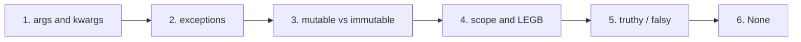

# Day 2 — Python Core

## Objective

Build the programmer-level understanding of Python: flexible function arguments, failure handling, object/reference behavior, name lookup rules, truthiness, and `None`. These are the concepts that separate "syntax user" from "programmer who reasons about code".

## Topics

1. [`*args` / `**kwargs`](./01-args-kwargs.md) — variable-length arguments, packing & unpacking
2. [Exception Handling](./02-exceptions.md) — `try/except/else/finally`, `raise`, propagation
3. [Mutability & Copying](./03-mutability-copy.md) — mutable vs immutable, references, `is` vs `==`, shallow/deep copy
4. [Scope & LEGB](./04-scope-legb.md) — name lookup order, `global`, `nonlocal`
5. [Truthy / Falsy](./05-truthy-falsy.md) — what `if x:` really checks
6. [`None`](./06-none.md) — Python's "no value" singleton

**📊 Diagram — the Day 2 path, step by step**



## Learning Order

```text
args/kwargs          (function arguments)
    ↓
exceptions           (code that survives failure)
    ↓
mutability/copy      (references, objects, copying)
    ↓
scope/LEGB           (where names live)
    ↓
truthy/falsy         (what counts as true)
    ↓
None                 (no value)
```

## Prerequisites

- Day 1 basics: variables, data types, conditions, loops
- Functions and control flow
- Data structures: list, tuple, dict, set, str

## Previously Covered

- Day 1: variables, data types, I/O, operators, conditions, loops, strings
- Day 2 Part 1: lists, tuples, sets, dicts, indexing/slicing, functions, file handling, lambda/map/filter/reduce, comprehensions, modules & imports

The full combined day reference (with the integrated practice set) lives in [../../day2-python-core.md](../../day2-python-core.md).

## Next

[Day 3](../Day3/topics.md) — lambda, map/filter/reduce, recursion, iterators, generators, modules/packages, `__name__` / `__main__`
