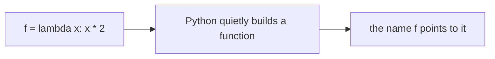
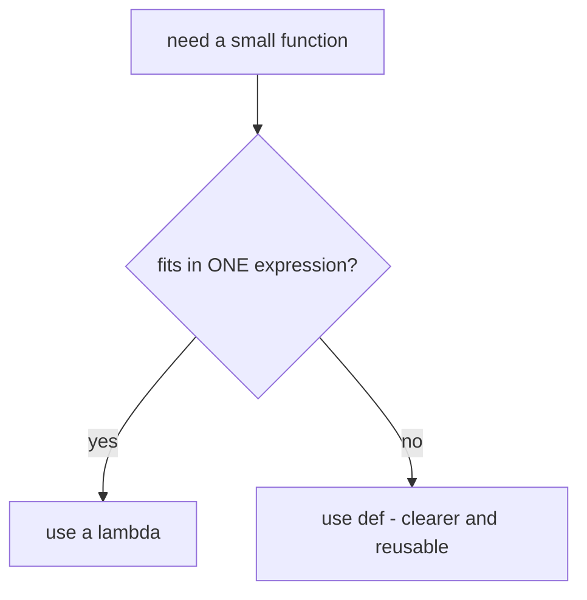
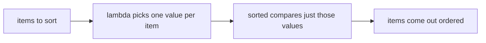

# Lambda Functions

## Status
- Status: New / Learning
- Prerequisites: Functions, return, scope (LEGB)
- Last studied: Day 3
- Confidence: Building

---

# Lambda Functions

This is a **small but very useful Python concept**. You will see it everywhere in real code — in `sorted(..., key=...)`, inside `map`/`filter`, in Pandas `apply`. You don't need to spend hours on it. Understand the basic idea, when to use it, and when NOT to use it.

---

## 1. The simple idea

Sometimes you need a function for **one tiny task**, and writing a full function feels like too much work.

Look at this:

```python
def double(x):
    return x * 2
```

You wrote a name (`double`), a `def` keyword, a `return`... and you probably use it only once.

Wouldn't it be nice to write a small function **directly where you need it**, without giving it a name?

That is exactly what `lambda` is.

> **Lambda = a function written in one line, without a name.**

---

## 2. Why do we need this?

Because Python has many places that ask you for "a small function" as an argument.

For example, `sorted()` can take a `key` function that decides how to sort:

```python
students = [("ram", 22), ("shyam", 19), ("karan", 24)]

by_age = sorted(students, key=lambda s: s[1])
print(by_age)
```

Output:

```text
[('shyam', 19), ('ram', 22), ('karan', 24)]
```

Let's break it down:

- Each student is a tuple like `("ram", 22)`.
- The `key` function decides: "what value should I use to compare two students?"
- `lambda s: s[1]` says: "take the second item of the tuple" — the age.
- So sorting happened by age.

If we had to write this with a normal function:

```python
def age_of(student):
    return student[1]

by_age = sorted(students, key=age_of)
```

That works too. But lambda lets us write the same thing **in one line, right where it is needed**.

---

## 3. How to read a lambda

```text
lambda  s : s[1]
│       │  │  │
│       │  │  └── the expression (this is returned)
│       │  └───── colon
│       └──────── parameter(s)
└──────────────── the keyword "lambda"
```

**The most important thing:** whatever expression you write after the colon is **automatically returned**. There is no `return` keyword.

```python
square = lambda x: x * x

print(square(5))    # 25
```

It's just like writing:

```python
def square(x):
    return x * x
```

Same function. Shorter writing.

---

## 4. Let's see what Python actually does

When Python sees this line:

```python
f = lambda x: x * 2
```

1. It evaluates the lambda expression.
2. It creates a **function object** — the same kind of object a `def` creates.
3. It points the name `f` to that object.

**📊 Diagram — what happens on `f = lambda ...`**



So `f` is a normal function:

```python
print(f(4))          # 8
print(type(f))       # <class 'function'>
```

The only small difference — it has no real name:

```python
print(f.__name__)    # '<lambda>'
```

---

## 5. Syntax — the small rules

```python
f = lambda x: x * 2              # one parameter
g = lambda x, y: x + y           # two parameters
h = lambda: "hello"              # no parameters
k = lambda *args: sum(args)      # *args works too
```

### The one rule that limits lambda

A lambda can only contain **one expression**. It cannot contain statements like `if`, `for`, or multiple lines.

```python
lambda x:                      # ❌ ERROR — statements not allowed
    if x > 0:
        return x
```

If your logic needs multiple lines — use a normal `def`. Lambda is for the one-liner case.

### Conditional expressions are still allowed

Because a conditional expression (`x if ... else ...`) is still one expression:

```python
grade = lambda score: "pass" if score >= 40 else "fail"

print(grade(60))    # pass
print(grade(30))    # fail
```

**📊 Diagram — lambda or def?**



---

## 6. Where lambda is actually used

### 6.1 Sorting with a key

```python
names = ["Aarav", "isha", "Vikram", "devan"]

print(sorted(names))                            # ['Aarav', 'Vikram', 'devan', 'isha']
print(sorted(names, key=lambda n: n.lower()))   # ['Aarav', 'devan', 'isha', 'Vikram']
```

**Why the difference?** By default Python compares strings by their exact bytes — uppercase letters come before lowercase. The lambda converts each name to lowercase before comparing, so the sorting becomes case-insensitive.

### 6.2 Finding the maximum by some value

```python
models = [("rf", 0.91), ("xgb", 0.94), ("lr", 0.87)]

best = max(models, key=lambda m: m[1])
print(best)    # ('xgb', 0.94)
```

### 6.3 A lambda that remembers something (closure)

A lambda defined inside a function can see that function's variables:

```python
def multiplier(factor):
    return lambda x: x * factor

double = multiplier(2)
triple = multiplier(3)

print(double(10))    # 20
print(triple(10))    # 30
```

Each call to `multiplier` creates a lambda that **remembers its own** `factor`. This is a closure — you will meet closures properly in Python Internals.

### 6.4 Lambdas with default arguments

Default arguments work exactly like in `def` — they are evaluated **once, at creation time**:

```python
f = lambda a=1, b=2: a + b
print(f())          # 3
print(f(10))        # 12  — a=10, b stays 2
print(f(b=100))     # 101
```

**This trick is the standard fix for the late-binding trap** (see Mistake 2 below).

### 6.5 Lambda as a key everywhere — the full picture

The `key=` parameter appears in many places, and lambda is the natural fit:

```python
data = [("apple", 3), ("kiwi", 2), ("fig", 1)]

print(sorted(data, key=lambda t: t[1]))         # sort by number
print(min(data, key=lambda t: t[1]))            # smallest number
print(max(data, key=lambda t: t[1]))            # biggest number

words = ["hello", "world", "python"]
print(sorted(words, key=len))                   # ['hello', 'world', 'python'] (all length 5)
```

**Technical note:** `sorted()` calls the `key` function **once per item**, stores the results, and sorts by them — not by repeatedly comparing with the key. That's why `key=lambda` is fast even on big lists.

**📊 Diagram — how sorted uses key=lambda**



---

## 7. Common mistakes

### Mistake 1 — putting multiple statements in a lambda

```python
f = lambda x: print(x); x + 1     # ❌ confusing, only the first part runs as the body
```

Anything beyond one expression → use `def`.

### Mistake 2 — the late-binding trap (important!)

```python
funcs = [lambda: i for i in range(3)]

print([f() for f in funcs])
```

**PREDICT** the output.

Answer: `[2, 2, 2]` — NOT `[0, 1, 2]`.

Why? All three lambdas are looking at the **same variable** `i`. When the loop ends, `i` is 2 — and all three lambdas see 2. The lambda captured the variable, not the value.

Fix: capture the value with a default argument:

```python
funcs = [lambda i=i: i for i in range(3)]
print([f() for f in funcs])    # [0, 1, 2]
```

### Mistake 3 — making code unreadable

```python
# ❌ nobody can read this
result = sorted(data, key=lambda d: (d["y"] - d["x"]) / max(1, d["z"]))
```

If the logic is more than a couple of words — give it a name with `def`. A name is documentation.

---

## 7.5 Technical deep dive — what a lambda really is inside

A lambda is an **expression**; `def` is a **statement**. Both produce the same kind of object — a function. The differences are at creation time:

```python
f = lambda x: x * 2

print(type(f))          # <class 'function'>
print(f.__name__)       # '<lambda>'  — no real name
print(f.__doc__)        # None        — no docstring
```

**Compilation:** Python compiles a lambda into a **code object**, exactly like a `def`. You can inspect it:

```python
f = lambda x, y: x + y
print(f.__code__.co_argcount)        # 2 — number of parameters
print(f.__code__.co_varnames)        # ('x', 'y') — parameter names
print(f.__code__.co_name)            # '<lambda>' — the name in bytecode
```

**Why the "one expression" rule exists:** the lambda body is compiled as a single expression that is evaluated and returned. There is no place for statements (like `if`, `for`, `return`) in that compiled shape. The moment you need statements, the language forces you to use `def` — this is a design decision, not a performance one.

**Late binding — the internals:** when a lambda (or `def`) references a variable from an enclosing scope, it captures the **variable cell**, not the value. In a loop:

```python
funcs = [lambda: i for i in range(3)]
```

all three lambdas share **one** `i` cell. After the loop, that cell holds `2`, so all three return `2`. The default-argument fix `lambda i=i: i` evaluates `i` **at creation time** and binds the current value as a default, so each lambda gets its own snapshot. This is the single most-asked lambda question in interviews.

**Memory:** a lambda object is roughly the same size as a `def` function object — no meaningful saving. Its advantage is only convenience and locality, never performance.

---

## 8. ML connection

- Sorting models or features by importance: `max(models, key=lambda m: m[1])`.
- Pandas: `df.apply(lambda row: ...)` for quick per-row logic.
- `map` / `filter` with lambdas — the next topic.
- Config files often pass small lambdas (custom metrics, custom transforms).

---

## 9. PREDICT drills

Say the answer before reading it.

### Drill 1

```python
f = lambda x, y: x ** y
print(f(2, 5))
```

**Answer:** `32` — 2 raised to the power 5.

### Drill 2

```python
pairs = [(3, "c"), (1, "a"), (2, "b")]
print(sorted(pairs, key=lambda p: p[1]))
```

**Answer:** `[(1, 'a'), (2, 'b'), (3, 'c')]` — sorted by the string in position 1.

### Drill 3 — trap

```python
g = lambda: print("hi")
result = g()
print(result)
```

**Answer:** `hi` then `None` — `print` returns `None`, and lambda returns whatever its expression returns.

### Drill 4

```python
add = lambda a=1, b=2: a + b
print(add())
print(add(b=10))
```

**Answer:** `3` then `11` — default arguments work exactly like in `def`.

### Drill 5 — trickier

```python
funcs = [lambda: i for i in range(3)]
print([f() for f in funcs])
```

**Answer:** `[2, 2, 2]` — late binding. All share the final `i`. Fix: `lambda i=i: i`.

### Drill 6

```python
f = lambda a, b=5: a * b
print(f(4))
```

**Answer:** `20` — default arguments work exactly like `def`.

### Drill 7 — trap

```python
words = ["apple", "kiwi", "fig"]
print(sorted(words, key=len))
```

**Answer:** `['fig', 'kiwi', 'apple']` — `len` is already a function; no lambda needed.

### Drill 8 — trickier

```python
f = lambda *args: sum(args)
print(f(1, 2, 3))
```

**Answer:** `6` — lambdas support `*args` too.

### Drill 9 — trap

```python
f = lambda x: x * 2 if x > 0 else 0
print(f(-3))
```

**Answer:** `0` — the conditional expression is a single expression, so it is allowed.

### Drill 10 — trickier

```python
def make():
    return lambda x: x + 1

g = make()
print(g(10))
```

**Answer:** `11` — a function can return a lambda; the lambda keeps working after `make` returns (closure).

---

## 10. Experiment

1. Check `type(lambda x: x)` and `(lambda x: x).__name__`.
2. Write a lambda that returns the absolute difference of two numbers, and sort a list of tuples by it.
3. Build `multiplier(factor)` and create two multipliers — verify each remembers its own factor.
4. Try `lambda x: x + 1; x * 2` and observe what happens.
5. Inspect `f.__code__.co_argcount` and `f.__code__.co_varnames` on your own lambda.
6. Reproduce the late-binding trap, then fix it with `lambda i=i: i` — print both results.

---

## 11. Interview questions

**Q: What is a lambda in Python?**
Short: an anonymous, one-line function.
Strong: a lambda is an expression that creates a function object. It has no name, no statements, and automatically returns its single expression. It is the same type as a `def` function and is mainly used inline (e.g., `key=` in sorting).

**Q: When would you NOT use a lambda?**
Whenever the logic needs multiple statements, is reused with a meaningful name, or hurts readability — use `def`.

**Deep follow-up: What is the late-binding trap?**
Closures capture variables, not values. All lambdas created in a loop share the same loop variable. Fix with a default argument: `lambda i=i: i`.

**Q: Can a lambda be recursive?**
Technically yes — bind it to a name first: `fact = lambda n: 1 if n <= 1 else n * fact(n - 1)`. But recursion needs a readable name and a base case, so a `def` is almost always the better choice.

**Q: Lambda vs `def` — which is faster?**
No meaningful difference — both compile to the same kind of function object. Lambda's value is convenience (inline, one expression), never speed.

---

## 12. Follow-up chain

1. Does a lambda have a docstring? (No — and `__name__` is `'<lambda>'`.)
2. Can a lambda return a tuple? (Yes — any expression: `lambda: (1, 2)`.)
3. Can a lambda call other functions? (Yes — `lambda x: len(x) > 5`.)
4. Where does a lambda look up names? (LEGB — same as `def`. See [Scope & LEGB](../Day2/04-scope-legb.md).)

---

## 13. Cheat sheet

```text
CONCEPT
→ anonymous one-line function

MENTAL MODEL
→ lambda params: expr  =  a function that returns expr

KEY SYNTAX
→ lambda x, y: x + y
→ sorted(data, key=lambda d: d[1])
→ max(models, key=lambda m: m[1])

IMPORTANT RULE
→ one expression only; no statements; no return keyword

COMMON TRAP
→ late binding in loops: lambda: i captures the variable, not the value

ML CONNECTION
→ key functions, pandas apply, model sorting

INTERVIEW LINE
→ "A lambda is an anonymous function expression with an implicit
→ single return; prefer def when the logic is non-trivial."
```

---

## 14. Quick mastery test

### Q1

```python
f = lambda a, b=5: a * b
print(f(4))
```

**Answer:** `20`.

### Q2

```python
words = ["apple", "kiwi", "fig"]
print(sorted(words, key=len))
```

**Answer:** `['fig', 'kiwi', 'apple']` — `len` itself is a valid key function; no lambda needed.

### Q3

```python
f = lambda x: x * 2 if x > 0 else 0
print(f(-3))
```

**Answer:** `0` — conditional expressions are allowed inside a lambda.

### Q4 — trickier

```python
f = lambda *args: sum(args)
print(f(1, 2, 3))
```

**Answer:** `6` — lambdas support `*args` too.

### Q5 — trap

```python
f = lambda x: x if x > 0 else -x
print(f(-5))
```

**Answer:** `5` — absolute value via a conditional expression.

### Q6 — trickier

```python
pairs = [(1, 10), (2, 5), (3, 20)]
print(max(pairs, key=lambda p: p[0] * p[1]))
```

**Answer:** `(3, 20)` — the key is computed as the product (3×20 = 60, the largest).

### Q7 — trap

```python
f = lambda x, y=2: x ** y
print(f(3))
```

**Answer:** `9` — `3**2`; defaults behave like `def`.

---

## 15. Your level for this topic

If you can write a lambda for `key=`, explain why it can't contain statements, and explain the late-binding trap — mark **Lambda Functions complete**.

Next: [map / filter / reduce](./02-map-filter-reduce.md) — where lambdas become genuinely useful.