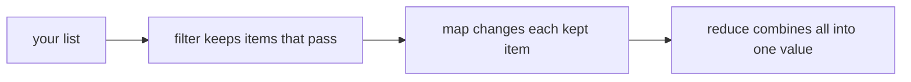
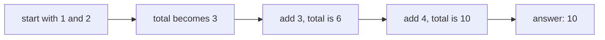
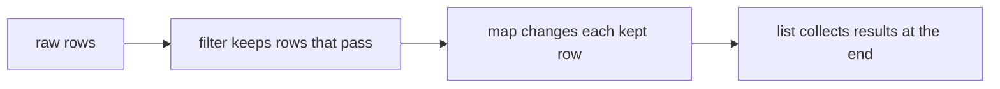

# map / filter / reduce

## Status
- Status: New / Learning
- Prerequisites: Lambda functions, lists, functions
- Last studied: Day 3
- Confidence: Building

---

# map, filter, reduce

This is a **small but very common pattern** in Python. The simple idea: three functions that process a whole collection without writing a `for` loop. You don't need to spend hours on it. Understand what each one does, when to use it, and how it connects to [lambda](./01-lambda.md).

---

## 1. The simple idea

Let's say you have a list of numbers, and you want to double each one.

The normal way (with a loop):

```python
numbers = [1, 2, 3, 4]

doubled = []
for n in numbers:
    doubled.append(n * 2)

print(doubled)    # [2, 4, 6, 8]
```

That works. But this pattern — "take every item, do something, collect the results" — is so common that Python gives you shortcuts.

Three of them:

```text
map     → apply a function to EVERY item → a new collection
filter  → KEEP only the items that pass a test
reduce  → combine ALL items into ONE value
```

That's the whole idea. Let's see each one.

**📊 Diagram — map, filter, reduce as one assembly line**



---

## 2. map — apply a function to every item

### What it does

> map takes every item from a collection, passes it through a function, and collects the results.

```python
def double(x):
    return x * 2

numbers = [1, 2, 3, 4]

result = map(double, numbers)
print(result)    # <map object at 0x...>
```

**Wait — what is that?** It's not a list. `map` is **lazy** — it doesn't compute everything immediately. To see the results, convert it to a list:

```python
print(list(result))    # [2, 4, 6, 8]
```

### The usual way — with a lambda

```python
numbers = [1, 2, 3, 4]

result = list(map(lambda x: x * 2, numbers))
print(result)    # [2, 4, 6, 8]
```

Let's break it down:

- `map(function, collection)` — first argument is the function, second is the collection.
- `lambda x: x * 2` is the function applied to each item.
- `list(...)` converts the lazy map object into a real list.

### Let's trace it

```text
map(lambda x: x * 2, [1, 2, 3, 4])

item 1  → 1 * 2 → 2
item 2  → 2 * 2 → 4
item 3  → 3 * 2 → 6
item 4  → 4 * 2 → 8

result: [2, 4, 6, 8]
```

### More than one collection

`map` can take multiple collections — it pairs them up:

```python
a = [1, 2, 3]
b = [10, 20, 30]

result = list(map(lambda x, y: x + y, a, b))
print(result)    # [11, 22, 33]
```

### map without lambda

You can pass any function:

```python
words = ["apple", "kiwi", "fig"]
print(list(map(len, words)))    # [5, 4, 3]

print(list(map(str.upper, ["hi", "there"])))    # ['HI', 'THERE']
```

### map with dicts

`map` works on any iterable — dicts iterate over their keys:

```python
ages = {"ram": 22, "shyam": 19, "karan": 24}
print(list(map(lambda k: (k, ages[k]), ages)))   # [('ram', 22), ('shyam', 19), ('karan', 24)]

# or use .items()
print(list(map(lambda kv: kv[1] * 2, ages.items())))    # [44, 38, 48]
```

### map stops at the shortest collection

```python
a = [1, 2, 3, 4]
b = [10, 20]
print(list(map(lambda x, y: x + y, a, b)))    # [11, 22] — stops at the shorter one
```

---

## 3. filter — keep only the items that pass a test

### What it does

> filter passes every item through a function. If the function returns True, the item is kept. Otherwise it is dropped.

```python
numbers = [1, 2, 3, 4, 5, 6]

evens = list(filter(lambda x: x % 2 == 0, numbers))
print(evens)    # [2, 4, 6]
```

Let's trace it:

```text
filter(lambda x: x % 2 == 0, [1, 2, 3, 4, 5, 6])

1 → 1 % 2 == 0 → False → dropped
2 → 2 % 2 == 0 → True  → kept
3 → False → dropped
4 → True  → kept
5 → False → dropped
6 → True  → kept

result: [2, 4, 6]
```

### The important difference from map

```text
map     → keeps the RESULT of the function
filter  → keeps the ITEM, only if the function says True
```

Contrast:

```python
list(map(lambda x: x % 2 == 0, [1, 2, 3, 4]))
# [False, True, False, True]      ← the test results

list(filter(lambda x: x % 2 == 0, [1, 2, 3, 4]))
# [2, 4]                           ← the items that passed
```

### filter with truthiness

`filter` doesn't need the function to return exactly `True`/`False` — it uses truthiness (see [Truthy / Falsy](../Day2/05-truthy-falsy.md)):

```python
words = ["", "hello", "", "world", " "]
print(list(filter(None, words)))    # ['hello', 'world', ' ']
```

Passing `None` as the function means: "keep items that are truthy". Empty strings are falsy, so they are removed.

### filter with dicts

```python
people = [{"name": "ram", "age": 22}, {"name": "shyam", "age": 17}, {"name": "karan", "age": 24}]
adults = list(filter(lambda p: p["age"] >= 18, people))
print(adults)    # [{'name': 'ram', 'age': 22}, {'name': 'karan', 'age': 24}]
```

---

## 4. reduce — combine everything into one value

### What it does

> reduce takes all the items and combines them step by step into a single value.

This one is NOT built-in — you need to import it:

```python
from functools import reduce

numbers = [1, 2, 3, 4]

total = reduce(lambda a, b: a + b, numbers)
print(total)    # 10
```

### Let's trace it step by step — this is important

```text
reduce(lambda a, b: a + b, [1, 2, 3, 4])

step 1: a = 1, b = 2  → 1 + 2 = 3
step 2: a = 3, b = 3  → 3 + 3 = 6
step 3: a = 6, b = 4  → 6 + 4 = 10

result: 10
```

Notice the pattern — the previous result becomes the next `a`:

```text
[1, 2, 3, 4]
   ↓
(1+2) → 3
   ↓
(3+3) → 6
   ↓
(6+4) → 10
```

**📊 Diagram — reduce: the running total**



### Another example — finding the biggest value

```python
from functools import reduce

numbers = [4, 9, 2, 7]

biggest = reduce(lambda a, b: a if a > b else b, numbers)
print(biggest)    # 9
```

Trace:

```text
a=4, b=9 → 9
a=9, b=2 → 9
a=9, b=7 → 9
```

### The optional initial value

```python
total = reduce(lambda a, b: a + b, [1, 2, 3], 100)
print(total)    # 106
```

With an initial value, the first `a` is the initial value:

```text
a=100, b=1 → 101
a=101, b=2 → 103
a=103, b=3 → 106
```

### reduce with strings

```python
words = ["hello", " ", "world"]
print(reduce(lambda a, b: a + b, words))    # 'hello world'

longest = reduce(lambda a, b: a if len(a) > len(b) else b, ["apple", "kiwi", "fig"])
print(longest)    # 'apple'
```

---

## 5. The honest comparison

| Function | What it does | Output size |
|---|---|---|
| `map` | apply a function to every item | same size as input |
| `filter` | keep items that pass a test | same or smaller |
| `reduce` | combine all items into one | exactly one value |

### The "when to use what" rule

```text
want to transform every item      → map
want to remove some items         → filter
want to collapse everything       → reduce
```

### And the honest truth about reduce

In real code, `reduce` is the least used of the three. Most of the time `sum()`, `max()`, or a simple loop is clearer:

```python
reduce(lambda a, b: a + b, numbers)   # ← this
sum(numbers)                          # ← is just this
```

Prefer the built-in. Use `reduce` when you genuinely need custom combination logic.

---

## 6. map/filter vs list comprehensions

You already learned comprehensions (Day 2 Part 1). Many of these operations have a comprehension version:

```python
# map
list(map(lambda x: x * 2, numbers))
[x * 2 for x in numbers]

# filter
list(filter(lambda x: x % 2 == 0, numbers))
[x for x in numbers if x % 2 == 0]
```

Which should you use?

```text
simple logic → comprehension (more Pythonic, easier to read)
already have a function name → map / filter (e.g., map(len, words))
need to pass a function around → map / filter
```

Both are fine. The comprehension version is generally preferred for readability.

---

## 7. Common mistakes

### Mistake 1 — forgetting that map/filter are lazy

```python
result = map(double, numbers)
print(result)     # <map object at 0x...> — NOT a list!

result = list(map(double, numbers))   # ✅ this is the list
```

### Mistake 2 — filter keeps items, not test results

```python
list(filter(lambda x: x % 2 == 0, [1, 2, 3, 4]))   # [2, 4] ✅
```

If you want the test results themselves → use `map`.

### Mistake 3 — forgetting to import reduce

```python
reduce(lambda a, b: a + b, [1, 2, 3])   # ❌ NameError
from functools import reduce            # ✅ import first
```

### Mistake 4 — using reduce where a built-in exists

```python
reduce(lambda a, b: a + b, nums)   # use sum(nums) instead
reduce(lambda a, b: max(a, b), nums)  # use max(nums) instead
```

---

## 7.5 Technical deep dive — how map/filter are implemented

`map` and `filter` are not Python functions that loop internally — they return **iterator objects** (the waiter from the [iterators](./04-iterators.md) topic). That is why they are lazy:

```python
m = map(lambda x: x * 2, [1, 2, 3])
print(type(m))        # <class 'map'>
print(iter(m))        # <map object> — iter(m) returns itself, it IS an iterator
print(next(m))        # 2 — produces one value at a time, on demand
```

Same for `filter`:

```python
f = filter(lambda x: x > 1, [1, 2, 3])
print(type(f))        # <class 'filter'>
print(next(f))        # 2
```

Consequences you can now explain technically:

```text
lazy        → nothing computed until consumed (list(), for, next())
single-use  → once consumed, the map/filter object is empty
chaining    → map(f, filter(g, data)) works with no intermediate list
```

**📊 Diagram — filter feeds map, one item at a time**



Trace of `map(lambda x: x*2, [1,2,3])` internally — it holds the function and the source iterator, and each `next()` call pulls one item, applies the function, and returns the result. `filter` pulls one item, checks truthiness, and either returns it or pulls the next one (it can skip many items in one `next()`).

**reduce is different** — it is a plain C function that actively loops over the iterable and folds it into one value. It is not lazy; it returns the final value immediately. That is why it lives in `functools` and not among the built-ins that return iterators.

---

## 8. ML connection

- `map` — quick transformations of feature lists: `list(map(float, raw_values))`.
- `filter` — removing bad samples: `list(filter(lambda r: r["age"] >= 0, rows))`.
- `map` with `len` — checking lengths of text samples before tokenization.
- In Pandas, `map`/`apply` do the same idea on a whole column.

```python
raw = ["1.5", "2.5", "abc", "4.0"]

valid = list(filter(lambda s: s.replace(".", "").isdigit(), raw))
clean = list(map(float, valid))

print(clean)    # [1.5, 2.5, 4.0]
```

---

## 9. PREDICT drills

Say the answer before reading it.

### Drill 1

```python
print(list(map(lambda x: x ** 2, [1, 2, 3])))
```

**Answer:** `[1, 4, 9]`.

### Drill 2

```python
print(list(filter(lambda x: x > 2, [1, 2, 3, 4])))
```

**Answer:** `[3, 4]` — only the items greater than 2 are kept.

### Drill 3 — trap

```python
print(map(lambda x: x * 2, [1, 2, 3]))
```

**Answer:** `<map object at 0x...>` — not a list! It's lazy. Wrap in `list(...)`.

### Drill 4

```python
from functools import reduce

print(reduce(lambda a, b: a * b, [1, 2, 3, 4]))
```

**Answer:** `24` — 1×2×3×4, combined step by step.

### Drill 5 — trickier

```python
words = ["cat", "", "dog", ""]
print(list(filter(len, words)))
```

**Answer:** `['cat', 'dog']` — `len` returns 0 for empty strings, and 0 is falsy, so empty strings are dropped.

### Drill 6 — trickier

```python
print(list(map(lambda x, y: x * y, [1, 2, 3], [10, 10, 10])))
```

**Answer:** `[10, 20, 30]` — map pairs items from both lists.

### Drill 7 — trap

```python
words = ["hello", "", "world"]
m = map(str.upper, words)
print(list(m))
print(list(m))
```

**Answer:**

```text
['HELLO', '', 'WORLD']
[]
```

map returns an iterator — single-use, like any waiter. Second `list()` finds it exhausted.

### Drill 8 — trickier

```python
from functools import reduce

nums = [3, 1, 4, 1, 5]
print(reduce(lambda a, b: a if a > b else b, nums))
```

**Answer:** `5` — the max found by folding, one comparison at a time.

---

## 10. Experiment

1. Use `map` with a normal `def` function — then with a lambda. Notice nothing changes.
2. `filter` a list of dicts: keep only rows where `"age" >= 18`.
3. Use `reduce` to find the longest string in a list.
4. Compare `list(map(...))` with a comprehension — verify they give the same result.
5. Consume a `map` object with `next()` step by step — verify it is a single-use iterator.
6. Chain `map` over `filter` — verify no intermediate list is created (use `type()` on the result before `list()`).

---

## 11. Interview questions

**Q: Difference between map and filter?**
Short: map transforms every item; filter keeps only items that pass a test.
Strong: map returns the results of applying a function to each item (same size); filter returns only the items for which the function is truthy (smaller or same). Both are lazy and need `list()` to materialize.

**Q: What does reduce do?**
Combines all items into one value using a function, carrying the accumulated result forward. It lives in `functools`.

**Deep follow-up: Why is reduce not built-in?**
Because most reduce use-cases have clearer built-ins (`sum`, `max`, `min`) or clearer loop/comprehension equivalents — Python prefers readability.

**Q: What is the difference between `list(map(...))` and a comprehension?**
Both produce the same list. `map` is lazy and pairs naturally with an existing function (`map(len, words)`); a comprehension is an expression that can include conditions and is generally more readable. For simple logic, prefer the comprehension.

**Q: Can map and filter be chained? How does memory behave?**
Yes: `list(map(f, filter(g, data)))`. No intermediate list is built — the filter feeds one item at a time to the map. Each layer is a separate lazy iterator, so memory stays constant.

---

## 12. Follow-up chain

1. What is laziness and why do map/filter objects not show their values? (they compute on demand — see [Iterators](./04-iterators.md))
2. When is a comprehension better than map/filter? (simple logic, readability)
3. Can you chain map and filter? (Yes: `filter(f, map(g, data))`)

---

## 13. Cheat sheet

```text
CONCEPT
→ map: apply function to every item
→ filter: keep items that pass a test
→ reduce: combine all items into one value

MENTAL MODEL
→ map transforms, filter selects, reduce collapses

KEY SYNTAX
→ list(map(fn, items))
→ list(filter(fn, items))
→ reduce(fn, items)      # from functools import reduce

IMPORTANT RULE
→ map/filter are lazy — always list(...) to materialize
→ filter keeps ITEMS, map returns RESULTS

COMMON TRAP
→ forgetting list() around map/filter; forgetting the reduce import

ML CONNECTION
→ transforming and cleaning feature lists

INTERVIEW LINE
→ "map transforms every element, filter keeps elements passing
→ a predicate, reduce folds a collection into one value;
→ all avoid explicit loops."
```

---

## 14. Quick mastery test

### Q1

```python
print(list(filter(lambda x: x % 3 == 0, range(1, 10))))
```

**Answer:** `[3, 6, 9]`.

### Q2

```python
from functools import reduce

print(reduce(lambda a, b: a + b, ["a", "b", "c"]))
```

**Answer:** `'abc'` — strings can be combined too.

### Q3 — trap

```python
print(list(filter(lambda x: x > 2, [1, 2, 3])))
print(list(map(lambda x: x > 2, [1, 2, 3])))
```

**Answer:** `[3]` and `[False, False, True]` — filter returns items, map returns test results.

### Q4 — trickier

```python
nums = [1, 2, 3, 4, 5]
result = list(map(lambda x: x * 2, filter(lambda x: x % 2 == 0, nums)))
print(result)
```

**Answer:** `[4, 8]` — filter first keeps `[2, 4]`, then map doubles them.

### Q5 — trap

```python
print(list(filter(None, [0, 1, "", "x", [], [1], None])))
```

**Answer:** `[1, 'x', [1]]` — only truthy items survive; `0`, `""`, `[]`, `None` are falsy.

### Q6 — trickier

```python
from functools import reduce

nums = [1, 2, 3, 4, 5]
print(reduce(lambda a, b: a + b, filter(lambda x: x % 2 == 1, nums), 100))
```

**Answer:** `109` — filter keeps `[1, 3, 5]`, reduce sums them to 9, plus initial 100.

---

## 15. Your level for this topic

If you can explain what each of the three does, remember to wrap `map`/`filter` in `list()`, and explain why `reduce` is often replaced by built-ins — mark **map / filter / reduce complete**.

Next: [Recursion](./03-recursion.md) — functions calling themselves.