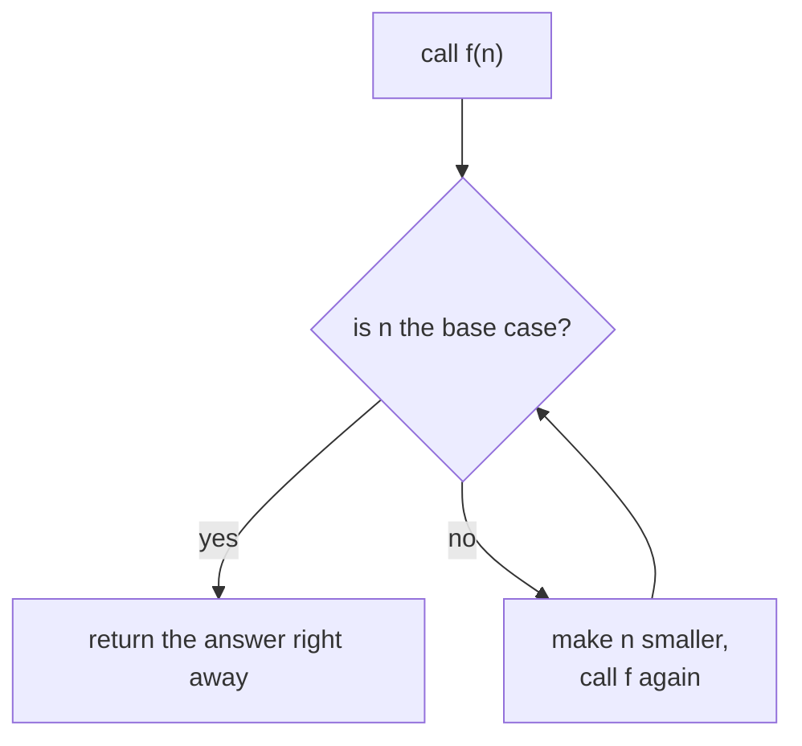
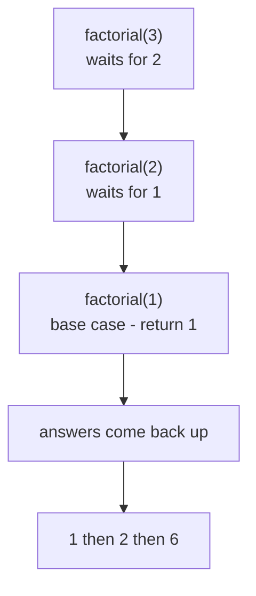
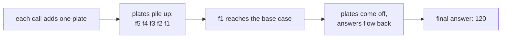

# Recursion

## Status
- Status: New / Learning
- Prerequisites: Functions, return, call stack basics, conditions
- Last studied: Day 3
- Confidence: Building

---

# Recursion

This is an **important concept**, but the idea itself is very simple. Don't be afraid of the name — "recursion" just means **a function that calls itself**. You don't need to spend hours on it; understand the base case, understand the call stack, and practice tracing small examples.

---

## 1. The simple idea

A function that calls itself:

```python
def countdown(n):
    print(n)
    countdown(n - 1)
```

That's recursion — the function `countdown` calls `countdown` inside its own body.

But wait — this version never stops. It will keep printing forever until Python gives up. That's the one thing every recursion needs:

> **Recursion = a function that calls itself, with a STOP condition.**

The stop condition is called the **base case**.

---

## 2. Why do we need this?

Some problems are naturally "self-similar" — the problem at a bigger size looks exactly like the problem at a smaller size.

For example:

- Factorial: `5! = 5 × 4 × 3 × 2 × 1` — and `4! = 4 × 3 × 2 × 1`. Notice `5! = 5 × 4!`.
- Finding files inside folders — every folder contains folders.
- Navigating trees (decision trees in ML!) — every branch contains branches.

For these, recursion lets you write the solution **in the shape of the problem itself**:

```text
5! = 5 × 4!
4! = 4 × 3!
3! = 3 × 2!
2! = 2 × 1!
1! = 1          ← the base case
```

Beautiful — the problem keeps shrinking until it hits something we know directly.

---

## 3. The two parts of every recursive function

```python
def factorial(n):
    if n == 1:            # 1) BASE CASE — the stop condition
        return 1
    return n * factorial(n - 1)   # 2) RECURSIVE CALL — the problem shrinks
```

Let's look at these two parts:

```text
BASE CASE
→ the smallest version of the problem, answered directly
→ without it, the function never stops

RECURSIVE CALL
→ the function calls itself with a SMALLER input
→ each call gets closer to the base case
```

**📊 Diagram — every recursive function: ask, shrink, stop**



---

## 4. Let's trace `factorial(5)` step by step

This is the most important part. Don't skip it.

```python
def factorial(n):
    if n == 1:
        return 1
    return n * factorial(n - 1)

factorial(5)
```

**Call 1:** `factorial(5)`

```text
n = 5 → not 1 → return 5 * factorial(4)   → WAITS for the answer
```

`factorial(4)` is called. The first call **pauses** — it can't finish until it knows `factorial(4)`.

**Call 2:** `factorial(4)`

```text
n = 4 → return 4 * factorial(3)   → waits
```

**Call 3:** `factorial(3)`

```text
n = 3 → return 3 * factorial(2)   → waits
```

**Call 4:** `factorial(2)`

```text
n = 2 → return 2 * factorial(1)   → waits
```

**Call 5:** `factorial(1)`

```text
n = 1 → BASE CASE → return 1      → no more calls!
```

Now the answers start **flowing back up** (this is called unwinding):

```text
factorial(1) → 1
factorial(2) → 2 * 1    → 2
factorial(3) → 3 * 2    → 6
factorial(4) → 4 * 6    → 24
factorial(5) → 5 * 24   → 120
```

**Answer: 120.**

The full picture:

```text
factorial(5)
  └─ factorial(4)
       └─ factorial(3)
            └─ factorial(2)
                 └─ factorial(1) → 1  ← base case
            ← 2
       ← 6
  ← 24
← 120
```

**📊 Diagram — factorial(3): calls go down, answers come up**



Think of it like a stack of plates: you keep placing plates (calls) on top, and only when you reach the base case do you start removing them — from the top down.

---

## 5. What Python actually does — the call stack

Every time a function is called, Python creates a **frame** on the call stack — a small record holding the function's parameters and local variables.

During `factorial(5)`:

```text
stack:                     (bottom → top)
[ factorial(5) ]
[ factorial(5) | factorial(4) ]
[ factorial(5) | factorial(4) | factorial(3) ]
[ factorial(5) | factorial(4) | factorial(3) | factorial(2) ]
[ factorial(5) | factorial(4) | factorial(3) | factorial(2) | factorial(1) ]
```

**📊 Diagram — the call stack: a stack of plates**



Each frame remembers its own `n`. That's why `factorial(5)` and `factorial(3)` don't confuse each other — they are separate frames with separate `n` values.

Then the stack unwinds — frames are removed one by one as each return value flows back.

### What if there's no base case?

```python
def forever():
    return forever()
```

```text
stack fills up: frame after frame...
eventually: RecursionError: maximum recursion depth exceeded
```

Python has a limit on how deep the stack can go (default around 1000). When you hit it, you get `RecursionError`. This is the safety net that stops an infinite recursion from crashing your machine.

You can check the limit:

```python
import sys
print(sys.getrecursionlimit())    # 1000 (typically)
```

---

## 6. Practical examples

### Example 1 — sum of a list (recursively)

```python
def list_sum(nums):
    if not nums:            # base case — empty list
        return 0
    return nums[0] + list_sum(nums[1:])

print(list_sum([1, 2, 3, 4]))    # 10
```

Trace:

```text
[1,2,3,4] → 1 + list_sum([2,3,4])
[2,3,4]   → 2 + list_sum([3,4])
[3,4]     → 3 + list_sum([4])
[4]       → 4 + list_sum([])
[]        → 0          ← base case
then: 4+0=4, 3+4=7, 2+7=9, 1+9=10
```

### Example 2 — Fibonacci

```python
def fib(n):
    if n <= 1:             # base cases
        return n
    return fib(n - 1) + fib(n - 2)

print(fib(6))    # 8
```

The sequence: 0, 1, 1, 2, 3, 5, 8, 13...

**Honest warning:** this version is slow for large `n` — it recomputes the same values many times (exponential work). Real code uses loops or caching. We'll come back to this idea later.

### Example 3 — counting files in nested folders (the classic real use)

```python
def count_files(folder):
    total = 0
    for item in folder:              # folder is a dict: name -> list or files
        if isinstance(item, dict):   # it's a subfolder
            total += count_files(item)   # recursion — same problem, smaller
        else:
            total += 1
    return total
```

This is where recursion genuinely shines — trees of folders, trees of decisions, trees of any kind.

### Example 4 — reversing a string

```python
def reverse(s):
    if len(s) <= 1:          # base case
        return s
    return reverse(s[1:]) + s[0]

print(reverse("hello"))    # 'olleh'
```

Trace: `"hello"` → `reverse("ello") + "h"` → ... → `"olleh"`.

### Example 5 — checking a palindrome

```python
def is_palindrome(s):
    if len(s) <= 1:              # base case — empty or one char
        return True
    if s[0] != s[-1]:
        return False
    return is_palindrome(s[1:-1])

print(is_palindrome("racecar"))    # True
print(is_palindrome("hello"))      # False
```

### Example 6 — power (the interview classic)

```python
def power(base, exp):
    if exp == 0:               # base case — anything to the power 0 is 1
        return 1
    return base * power(base, exp - 1)

print(power(2, 3))    # 8
```

### Example 7 — counting steps of a halving loop (binary-search-shaped)

```python
def steps_to_zero(n):
    if n == 0:
        return 0
    return 1 + steps_to_zero(n // 2)

print(steps_to_zero(8))    # 4  (8→4→2→1→0)
```

---

## 7. Recursion vs loops

Almost anything you write with recursion can also be written with a loop:

```python
# loop version
def factorial_loop(n):
    result = 1
    for i in range(2, n + 1):
        result *= i
    return result
```

So when to use which?

```text
loops       → default choice; no depth limit; faster
recursion   → when the problem is naturally tree-shaped,
              or when the recursive version is MUCH clearer
```

**A rule of thumb:**

> If the data structure is a tree (folders, decision trees, JSON) — recursion is natural.
> If the problem is a simple linear count — use a loop.

---

## 8. Common mistakes

### Mistake 1 — missing the base case

```python
def countdown(n):
    print(n)
    countdown(n - 1)      # ❌ never stops → RecursionError
```

Fix: add the stop condition.

### Mistake 2 — base case never reached

```python
def factorial(n):
    if n == 1:
        return 1
    return n * factorial(n + 1)    # ❌ n grows — never reaches 1
```

The recursive call must move **toward** the base case.

### Mistake 3 — forgetting to return

```python
def factorial(n):
    if n == 1:
        return 1
    factorial(n - 1)     # ❌ missing return — result is lost
```

Without `return`, the function returns `None` and the multiplication breaks.

### Mistake 4 — recursion depth on big inputs

```python
list_sum(list(range(2000)))    # ❌ RecursionError — too deep
```

For large inputs, loops win. Recursion depth is limited; iteration is not.

---

## 8.5 Technical deep dive — frames, memory, and the depth limit

**What a frame holds.** Each recursive call creates a stack frame containing: the function's parameters, local variables, the return address (where to resume), and the enclosing code object. For `factorial(n)` the frame holds `n` plus the slot for the return value. That is why `factorial(10)` holds ten separate `n` values — they do not overwrite each other.

**Memory per frame.** A Python frame is a heap-allocated object (tens of bytes — roughly ~100 bytes for a simple frame). `factorial(1000)` therefore consumes on the order of 100 KB just for frames. Recursion is not free — it trades memory for the clarity of the "problem-shaped" solution.

**The depth limit.** Python deliberately caps recursion depth to protect the C stack:

```python
import sys
print(sys.getrecursionlimit())     # 1000 (typical default)
```

You can raise it, but this is dangerous — it can crash the interpreter with a C-level stack overflow instead of a clean `RecursionError`:

```python
sys.setrecursionlimit(10_000)      # works, but risky
```

**Tail recursion.** Some languages convert `return f(n-1)` (a call as the very last operation) into a loop automatically — "tail call optimization". Python does NOT do this. A "tail recursive" Python function still consumes one frame per call and hits the limit. So if you write recursion in Python, you must accept the depth cost — and choose loops when depth may be large.

**Memoization — the fix for slow recursion.** Naive `fib(n)` calls `fib(n-1)` and `fib(n-2)`, and each of those recomputes everything again — the call tree has ~2^n nodes. Caching results makes it linear:

```python
def fib(n, memo=None):
    if memo is None:
        memo = {}
    if n in memo:
        return memo[n]
    if n <= 1:
        return n
    memo[n] = fib(n - 1, memo) + fib(n - 2, memo)
    return memo[n]

print(fib(50))    # 12586269025 — instant, vs. naive version that would never finish
```

This is the classic "recursion is elegant, memoization makes it practical" story — and it is exactly how dynamic programming works.

---

## 9. ML connection

- **Decision trees** are naturally recursive: a tree is a root + subtrees. `predict()` on a tree calls itself on child nodes.
- **JSON / nested configs** — walking nested data uses recursion.
- **Backtracking-style algorithms** (search, combinatronics) — recursion is the natural shape.
- Real ML code prefers **iteration** for loops over data, but recursion appears wherever data is **tree-shaped**.

```python
def tree_depth(node):
    if not node.get("children"):
        return 1
    return 1 + max(tree_depth(c) for c in node["children"])
```

---

## 10. PREDICT drills

Say the answer before reading it.

### Drill 1

```python
def f(n):
    if n <= 0:
        return 0
    return n + f(n - 1)

print(f(4))
```

**Answer:** `10` — 4+3+2+1+0.

### Drill 2

```python
def f(n):
    if n == 0:
        return ""
    return "x" + f(n - 1)

print(f(3))
```

**Answer:** `'xxx'` — the base case returns an empty string, and each call adds one "x" in front.

### Drill 3 — trap

```python
def f(n):
    return n * f(n - 1)

print(f(5))
```

**Answer:** `RecursionError` — no base case; it never stops.

### Drill 4 — trap

```python
def f(n):
    if n <= 0:
        return 0
    f(n - 1)

print(f(3))
```

**Answer:** `None` — the recursion happens but the result is never returned.

### Drill 5 — trickier

```python
def f(n):
    if n <= 0:
        return 0
    if n % 2 == 0:
        return f(n - 1)
    return n + f(n - 1)

print(f(5))
```

**Answer:** `9` — it sums only odd numbers: 5+3+1+0.

### Drill 6

```python
def f(s):
    if len(s) <= 1:
        return s
    return f(s[1:]) + s[0]

print(f("ab"))
```

**Answer:** `'ba'` — reverse: `f("b") + "a"` → `"ba"`.

### Drill 7 — trap

```python
def f(n):
    if n == 0:
        return 1
    return n * f(n)

print(f(3))
```

**Answer:** `RecursionError` — the call passes the same `n` again; the base case is never reached.

### Drill 8 — trickier

```python
def f(n):
    if n < 10:
        return n
    return n % 10 + f(n // 10)

print(f(987))
```

**Answer:** `24` — sum of digits: 7+8+9.

---

## 11. Experiment

1. Write `countdown(n)` with a base case and trace it by hand.
2. Rewrite `factorial` with a loop — compare.
3. Count how many frames the stack holds during `factorial(10)` (imagine the stack diagram).
4. Call `f(1500)` with the loop version vs recursion — see which one fails.
5. Write `is_palindrome` recursively and test it on `"racecar"` and `"hello"`.
6. Add memoization to `fib` and compare `fib(40)` speed against the naive version.

---

## 12. Interview questions

**Q: What is recursion?**
Short: a function that calls itself.
Strong: recursion solves a problem by reducing it to the same problem at a smaller size, until a base case answers directly. Each call creates a stack frame; results flow back as the stack unwinds.

**Q: What happens without a base case?**
Infinite recursion — the stack fills up and Python raises `RecursionError` (default limit ~1000).

**Deep follow-up: Why is naive Fibonacci slow?**
It recomputes the same subproblems repeatedly — exponential time. Fix with memoization or iteration.

**Deep follow-up: Recursion vs iteration?**
Iteration has no depth limit and no call overhead; recursion is clearer for tree-shaped problems. Python doesn't optimize tail recursion, so loops are usually preferred.

**Q: What is memoization?**
Caching the results of subproblems so each is computed once. It turns exponential recursion (naive Fibonacci) into linear time. It is the foundation of dynamic programming.

**Q: Can you raise the recursion limit?**
Yes — `sys.setrecursionlimit(n)` — but exceeding it can crash the interpreter with a C stack overflow instead of a clean `RecursionError`. Prefer iteration for deep problems.

---

## 13. Follow-up chain

1. What is a stack frame? (a record of a function call: params + locals)
2. Why does `return` matter in the recursive call? (without it, the result disappears)
3. When will you see recursion in ML? (decision trees, nested data)
4. What is memoization? (caching results of subproblems — the fix for slow Fibonacci)

---

## 14. Cheat sheet

```text
CONCEPT
→ a function that calls itself, with a stop condition

MENTAL MODEL
→ shrink the problem until the base case answers directly,
→ then unwind with the accumulated results

KEY SYNTAX
→ def f(n):
→     if base_case: return answer
→     return work + f(smaller_input)

IMPORTANT RULE
→ every recursive function needs a base case
→ the recursive call must move toward the base case

COMMON TRAP
→ missing return; base case never reached; RecursionError on big inputs

ML CONNECTION
→ decision trees, nested data walking

INTERVIEW LINE
→ "Recursion reduces a problem to smaller copies of itself until
→ a base case answers directly, then unwinds the call stack."
```

---

## 15. Quick mastery test

### Q1

```python
def power(base, exp):
    if exp == 0:
        return 1
    return base * power(base, exp - 1)

print(power(2, 3))
```

**Answer:** `8` — 2×2×2, with the base case 2⁰=1.

### Q2 — trap

```python
def mystery(n):
    if n == 0:
        return 0
    return 1 + mystery(n // 2)

print(mystery(8))
```

**Answer:** `4` — counts how many times 8 can be halved until 0: 8→4→2→1→0 is four steps.

### Q3 — trickier

```python
def f(n):
    if n < 10:
        return n
    return n % 10 + f(n // 10)

print(f(1234))
```

**Answer:** `10` — sums the digits: 4+3+2+1.

### Q4

```python
def power(base, exp):
    if exp == 0:
        return 1
    return base * power(base, exp - 1)

print(power(3, 3))
```

**Answer:** `27` — 3×3×3.

### Q5 — trickier

```python
def countdown(n):
    if n == 0:
        print("done")
        return
    print(n)
    countdown(n - 1)

countdown(3)
```

**Answer:**

```text
3
2
1
done
```

The print happens as the stack builds; there is no unwinding output because nothing is returned upward.

---

## 16. Your level for this topic

If you can explain the two parts of recursion, draw the stack for `factorial(4)`, and say why naive Fibonacci is slow — mark **Recursion complete**.

Next: [Iterators](./04-iterators.md) — how `for` loops actually work under the hood.