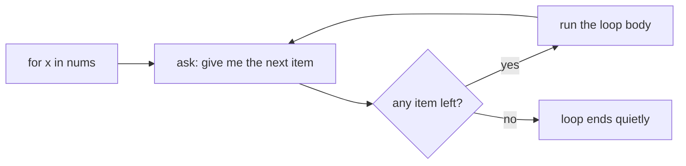
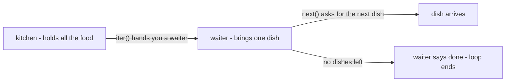
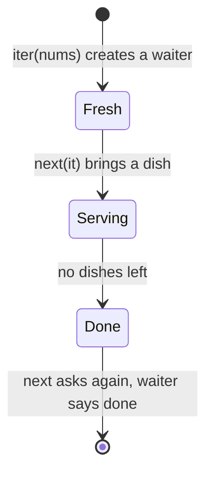

# Iterators

## Status
- Status: New / Learning
- Prerequisites: Lists, for loops (no OOP needed for this file)
- Last studied: Day 3
- Confidence: Building

---

# Iterators

## 1. The simple idea — start with real life

Think of a restaurant.

```text
KITCHEN (the list)          WAITER (the iterator)
  has all the food            brings ONE dish at a time
  [idli, dosa, chai]          on your request
```

A list is like the kitchen — it holds everything.

An **iterator** is like the waiter — his job is to bring you **one item at a time**, only when you ask.

You have used `for` loops many times:

```python
for x in [1, 2, 3]:
    print(x)
```

Have you ever wondered — **how does Python actually get those values?** It doesn't know the list's length in advance. It uses a waiter (iterator) and asks for one value at a time.

That's the whole idea of this topic.

---

## 2. The two functions: `iter()` and `next()`

Only two things to remember:

```text
iter(thing)   →  asks the thing: "give me your waiter (iterator)"
next(waiter)  →  asks the waiter: "give me the next item"
                 if no items left → it says "I'm done" (StopIteration)
```

Let's do it by hand:

```python
nums = [1, 2, 3]        # the kitchen (list)

it = iter(nums)         # get the waiter (iterator)
print(it)               # <list_iterator object at 0x...> — a waiter object

print(next(it))         # 1  — waiter brings the first dish
print(next(it))         # 2  — brings the next one
print(next(it))         # 3  — brings the last one
print(next(it))         # ❌ StopIteration — "no more dishes, I'm done"
```

Trace:

```text
iter([1,2,3])  →  waiter
next(it)       →  1
next(it)       →  2
next(it)       →  3
next(it)       →  StopIteration ("done")
```

**Important:** `StopIteration` is not a real error. It's just the waiter's polite way of saying "I'm done". The `for` loop understands this and stops quietly.

---

## 3. So what does a `for` loop actually do?

Nothing magical. This:

```python
for x in nums:
    print(x)
```

is exactly the same as writing this by hand:

```python
it = iter(nums)               # 1. get the waiter
while True:
    try:
        x = next(it)          # 2. ask for the next item
    except StopIteration:     # 3. if waiter says "done"...
        break                 #    ...exit the loop
    print(x)                  # 4. use the item
```

Mental model:

```text
for x in coll:
    ↓
iter(coll) → waiter
    ↓
next() → one item → use it → next() → one item → use it → ...
    ↓
waiter says "done" → loop ends
```

**📊 Diagram — what a for loop really does**



That is ALL a `for` loop is. If you get this, iterators are no longer scary.

---

## 4. Iterable vs iterator — two different roles

This is where people get confused. Let's make it simple.

```python
nums = [1, 2, 3]

print(iter(nums))     # <list_iterator object> — this is a WAITER (iterator)
print(nums)           # [1, 2, 3] — the list itself is a KITCHEN (iterable)
```

```text
ITERABLE (kitchen)      ITERATOR (waiter)
───────────────         ─────────────────
holds the items         brings items one at a time
can be used again       single-use (once done, done forever)
e.g., list, str,        e.g., list_iterator, range's iterator
tuple, dict, file
```

**📊 Diagram — kitchen vs waiter**



**The single-use rule is the most important thing in this topic:**

```python
it = iter([1, 2, 3])

print(list(it))    # [1, 2, 3]  — waiter served everything
print(list(it))    # []         — empty! the waiter is done, nothing left
```

The waiter remembers where he is. Once every dish is served, he's finished. If you want to serve again, get a **new** waiter: `iter(nums)` again.

**📊 Diagram — one waiter, three moments**



---

## 5. The `range` case — lazy magic

```python
r = range(5)
print(type(r))          # <class 'range'>
print(len(r))           # 5 — range KNOWS its length

it = iter(r)
print(next(it))         # 0
print(next(it))         # 1
```

`range` is not a list. It's a smart object that produces numbers **only when asked**. A huge `range(10**9)` uses almost no memory, because it never creates all the numbers at once. The waiter makes each number fresh on request.

---

## 6. You don't need OOP for this topic

The old version of this file had a section where you build your own iterator using `class`. **Skip that for now** — you'll learn it after OOP.

And guess what? There's an **easier way** to build your own iterator — using `yield` (generators). That's the very next topic. So relax: this topic is about *understanding* how `for` works, not about building iterators by hand.

---

## 7. Common mistakes

### Mistake 1 — using the same iterator twice

```python
it = iter([1, 2, 3])

print(list(it))    # [1, 2, 3]
print(list(it))    # [] — done! single-use
```

Fix: make a fresh iterator: `iter(nums)` again.

### Mistake 2 — confusing the kitchen with the waiter

```python
nums = [1, 2, 3]
print(next(nums))    # ❌ TypeError — a list is NOT an iterator
```

The list holds items; it doesn't serve them. Call `iter(nums)` first.

### Mistake 3 — forgetting that a `for` loop eats the iterator

```python
it = iter([1, 2, 3])
for x in it:
    pass
print(list(it))    # [] — the loop already consumed everything
```

### Mistake 4 — thinking iterables get "used up"

```python
nums = [1, 2, 3]
for x in nums:
    print(x)
for x in nums:     # works fine!
    print(x)
```

The list is the kitchen — it never gets empty. Every `for` loop creates a **fresh waiter**, so you can loop the same list as many times as you want. Only waiters (iterators) get used up.

---

## 8. ML connection

- `map` / `filter` return iterators — that's why they don't compute everything at once (see [map/filter/reduce](./02-map-filter-reduce.md)).
- **Files are iterables** — reading a huge CSV line by line:

```python
with open("data.csv") as f:
    for line in f:          # one line at a time — no giant list in memory
        process(line)
```

- Big ML datasets are fed to models **one batch at a time** (same idea — waiter brings one batch on request, not all data at once). This is how memory stays small.
- Generators (next topic) build on exactly this idea.

---

## 9. PREDICT drills

Say the answer before reading it.

### Drill 1

```python
nums = [1, 2, 3]
it = iter(nums)
print(next(it))
print(next(it))
```

**Answer:**

```text
1
2
```

### Drill 2 — trap

```python
it = iter([1, 2, 3])
print(list(it))
print(list(it))
```

**Answer:**

```text
[1, 2, 3]
[]
```

The iterator is single-use — the second `list()` finds the waiter already done.

### Drill 3

```python
print(next(iter("ab")))
```

**Answer:** `'a'` — strings are iterable too; their waiter brings characters.

### Drill 4 — trap

```python
nums = [1, 2]
for x in nums:
    print(x)
for x in nums:
    print(x)
```

**Answer:**

```text
1
2
1
2
```

The list is an iterable, not an iterator — each `for` creates a fresh waiter, so it can be looped twice.

### Drill 5 — trickier

```python
s = "abc"
it = iter(s)
next(it)
for ch in it:
    print(ch)
```

**Answer:**

```text
b
c
```

The first `next(it)` took `'a'`; the for loop continued from where the waiter was.

---

## 10. Experiment

1. Call `iter()` on a list, a string, a dict, a set — print what type of waiter each gives.
2. Use `next()` by hand on a `range` iterator.
3. Check: does a `dict` serve its keys first? (yes — and `.items()` gives key-value pairs)
4. Make an iterator from a list, run one `for` loop over it, then try to loop it again — observe.

---

## 11. Interview questions

**Q: Difference between iterable and iterator?**
Short: an iterable can give you an iterator; an iterator gives values one at a time.
Strong: an iterable has `iter()`; an iterator has `next()` and raises `StopIteration` when finished. Iterators are single-use and lazy; iterables can be looped repeatedly.

**Q: How does a `for` loop work internally?**
It calls `iter()` to get an iterator, repeatedly calls `next()` until `StopIteration`, then exits.

**Deep follow-up: Why are iterators memory-efficient?**
They produce one value at a time instead of building the whole collection — essential for streaming and huge datasets.

---

## 12. Follow-up chain

1. What is `StopIteration`? (the "I'm done" signal — the for loop catches it and stops)
2. Are strings iterable? (yes — characters, one at a time)
3. What does `iter()` actually do? (asks the object for its iterator)
4. Why is `map` lazy? (it returns an iterator, not a list)

---

## 13. Cheat sheet

```text
CONCEPT
→ a waiter object that gives one value at a time, on request

MENTAL MODEL
→ iter(kitchen) → waiter → next(waiter) → one value → StopIteration = done

KEY SYNTAX
→ it = iter(coll)
→ next(it)

IMPORTANT RULE
→ iterators are single-use and lazy; iterables can be looped again and again

COMMON TRAP
→ using an iterator twice; calling next() on a plain list

ML CONNECTION
→ streaming data batch by batch, reading files line by line, map/filter internals

INTERVIEW LINE
→ "A for loop calls iter() to get an iterator, then next() until
→ StopIteration; iterators are lazy and single-use."
```

---

## 14. Your level for this topic

If you can explain: the waiter idea, the single-use rule, and what a `for` loop does internally — mark **Iterators complete**.

No OOP needed here. Next: [Generators](./05-generators.md) — the easy way to make your own waiter using `yield`.
