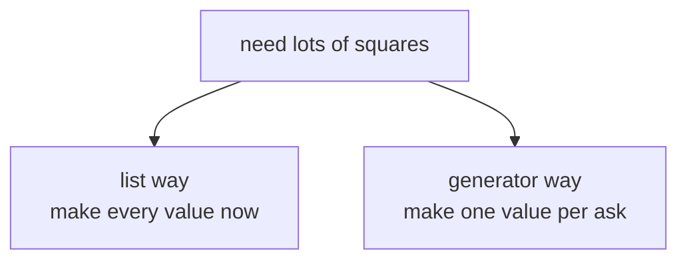
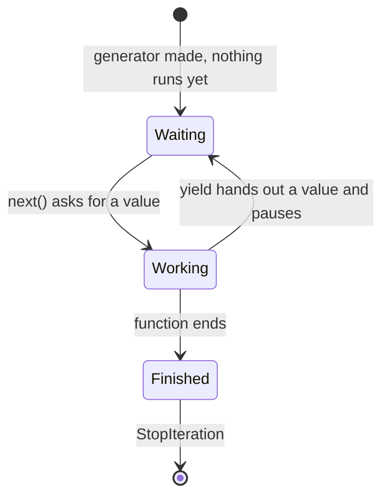
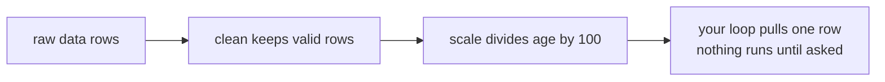

# Generators

## Status
- Status: New / Learning
- Prerequisites: Iterators, functions, yield
- Last studied: Day 3
- Confidence: Building

---

# Generators

This is an **important concept** with a simple core idea: a function that gives values **one at a time**, pausing between them. It's like an iterator (the "waiter" from the last topic), but written in a much simpler way — using `yield`. You don't need to spend hours on it; understand `yield`, the pause-and-resume behavior, and the memory benefit.

---

## 1. The simple idea

A normal function returns **one value** and then it's done:

```python
def give_numbers():
    return [1, 2, 3]      # all at once
```

A generator function gives values **one by one**, pausing after each:

```python
def give_numbers():
    yield 1               # pause here
    yield 2               # resume here
    yield 3
```

The magic word is `yield`. Let's see what happens when we call it:

```python
g = give_numbers()
print(g)    # <generator object give_numbers at 0x...>
```

**Nothing ran yet.** The body doesn't execute until you ask for values — exactly like an iterator.

---

## 2. Why do we need this?

Because sometimes you don't want all values at once.

**The classic problem — huge data.**

```python
# normal way: builds a list of 10 million numbers in memory
def squares(n):
    result = []
    for i in range(n):
        result.append(i * i)
    return result

squares(10_000_000)    # memory-heavy
```

vs.

```python
# generator: produces one value at a time, on demand
def squares(n):
    for i in range(n):
        yield i * i

squares(10_000_000)    # basically no memory
```

Same results, completely different memory behavior. The generator doesn't build the whole list — it computes each value **only when asked**.

**📊 Diagram — list makes everything now, generator waits**



---

## 3. yield vs return — the crucial difference

```text
return   → the function ENDS. One value. Everything is forgotten.

yield    → the function PAUSES. The value is sent out.
           Next time you ask, the function RESUMES from exactly
           where it left off — local variables are remembered.
```

Let's prove it:

```python
def counter():
    print("starting...")
    x = 1
    yield x              # pause 1
    x += 1
    yield x              # pause 2
    x += 1
    yield x              # pause 3

c = counter()

print(next(c))    # starting... / 1
print(next(c))    # 2   — resumed after the FIRST yield
print(next(c))    # 3
print(next(c))    # StopIteration — no more yields
```

Trace:

```text
first next():  "starting..." printed, x=1, yield 1 → PAUSE
second next(): resumes right after yield 1, x=2, yield 2 → PAUSE
third next():  resumes after yield 2, x=3, yield 3 → PAUSE
fourth next(): nothing left to yield → StopIteration
```

**📊 Diagram — generator life cycle: waiting, working, done**



**The function's memory survives between calls** — `x` is remembered because the function is paused, not finished.

---

## 4. Generators are iterators

Remember the previous topic? A generator **is** an iterator — it's a waiter you write yourself. It follows the same rules:

```python
g = (x for x in range(3))    # generator (more on this in a moment)

print(iter(g))    # <generator object> — iter(g) returns itself
print(next(g))    # 0
print(next(g))    # 1
```

So everything you learned about iterators applies:

- single-use (once exhausted, it's done)
- lazy (values on demand)
- works in `for` loops, `list()`, `sum()`, etc.

```python
def first_three():
    yield 10
    yield 20
    yield 30

print(list(first_three()))    # [10, 20, 30]
print(sum(first_three()))     # 60
```

---

## 5. Generator expressions

Just like list comprehensions, there are generator expressions — with parentheses instead of brackets:

```python
squares_list = [x * x for x in range(10)]      # list comprehension → list
squares_gen  = (x * x for x in range(10))      # generator expression → generator

print(type(squares_list))    # <class 'list'>
print(type(squares_gen))     # <class 'generator'>
```

**The difference is laziness:**

```python
big = [x * x for x in range(10_000_000)]    # builds 10M items in memory
big = (x * x for x in range(10_000_000))    # computes on demand
```

**Trap:** `sum()` works on generators; but if you need the values twice, you must recreate the generator — it's single-use.

---

## 6. Practical example — reading a file line by line

```python
def read_lines(path):
    with open(path) as f:
        for line in f:
            yield line.strip()

for line in read_lines("data.csv"):
    print(line)
```

One line is in memory at a time — perfect for huge files.

**Compare with the naive version:**

```python
lines = open("data.csv").readlines()   # whole file in memory ❌
```

---

## 7. Common mistakes

### Mistake 1 — expecting a generator to run immediately

```python
def greet():
    print("hello!")
    yield 1

g = greet()
print(g)    # <generator object> — "hello!" NOT printed yet
next(g)     # now it runs
```

A generator function body runs only when you iterate it.

### Mistake 2 — reusing a generator

```python
g = (x for x in range(5))

print(sum(g))    # 10
print(sum(g))    # 0 — exhausted! single-use
```

### Mistake 3 — `return` with a value in a generator

```python
def g():
    yield 1
    return "done"      # this value is NOT yielded — it ends the generator

list(g())    # [1]  — "done" is not included
```

`return` in a generator just stops it (and can pass a value to `StopIteration` — rarely used).

### Mistake 4 — `len()` on a generator

```python
g = (x for x in range(5))
print(len(g))    # ❌ TypeError: object of type 'generator' has no len()
```

Generators don't know their length — they haven't produced values yet. Convert to a list if you need a length (and lose the memory benefit).

---

## 7.5 Technical deep dive — how yield works inside

A generator function is **not executed when called**. Calling it returns a generator object that carries:

```text
gi_frame   → the paused execution frame (locals + where it stopped)
gi_code    → the compiled code object
gi_running → True while the body is executing
gi_yieldfrom → (advanced) the sub-generator, if yield from is used
```

You can inspect all of it:

```python
def gen():
    x = 10
    yield x
    x += 5
    yield x

g = gen()
print(g.gi_frame.f_locals)    # {} — nothing has run yet
next(g)
print(g.gi_frame.f_locals)    # {'x': 10} — paused right after yield, x remembered
print(g.gi_code.co_name)      # 'gen'
```

**The pause-and-resume mechanism.** When execution hits `yield`, the interpreter stores the current position (the instruction pointer) and all locals inside the frame, and returns the value to the caller. The frame is kept alive on the heap — that is why the function "remembers" between `next()` calls. On the next `next()`, execution resumes from exactly that instruction. When the function ends (or `return` is hit), the frame is released and the generator raises `StopIteration` — the same "I'm done" signal you saw with iterators.

**Why this saves memory.** A list stores every value at once; a generator stores only the frame (a few dozen bytes) plus the current value. For a 10-million-element sequence, that is the difference between ~80 MB and ~0.1 MB.

**Generator protocol summary** — a generator IS an iterator:

```text
iter(g)  → g itself (a generator is its own iterator)
next(g)  → one value, or StopIteration when finished
for x in g → works exactly like any iterator
single-use → once exhausted, it is done forever
```

---

## 8. ML connection

- **Streaming datasets:** feeding data to a model one batch at a time.
- **Data pipelines:** generators can chain transformations lazily:

```python
def clean(rows):
    for row in rows:
        if row.get("age", 0) > 0:
            yield row

def scale(rows):
    for row in rows:
        yield {**row, "age": row["age"] / 100}

pipeline = scale(clean(raw_data))    # lazy — nothing computed yet
for row in pipeline:                 # computed as consumed
    ...
```

**📊 Diagram — clean then scale, one row at a time**



- **Batch generation for training loops** — later in Deep Learning you'll see data loaders that behave exactly like this: produce the next batch on demand.
- Memory efficiency is why generators matter at ML scale.

---

## 9. PREDICT drills

Say the answer before reading it.

### Drill 1

```python
def gen():
    yield 1
    yield 2

g = gen()
print(next(g))
print(next(g))
```

**Answer:**

```text
1
2
```

### Drill 2 — trap

```python
def gen():
    yield 1
    yield 2

g = gen()
print(list(g))
print(list(g))
```

**Answer:**

```text
[1, 2]
[]
```

Generators are single-use iterators.

### Drill 3

```python
g = (x for x in range(4) if x % 2 == 0)
print(list(g))
```

**Answer:** `[0, 2]` — generator expressions support conditions like comprehensions.

### Drill 4 — trap

```python
def gen():
    x = 0
    while x < 3:
        yield x
        x += 1

g = gen()
print(next(g))
print(next(g))
```

**Answer:**

```text
0
1
```

The `while` loop state persists between yields.

### Drill 5 — trickier

```python
def gen():
    yield 1
    return
    yield 2        # unreachable

print(list(gen()))
```

**Answer:** `[1]` — `return` ends the generator before `yield 2`.

### Drill 6

```python
g = (x * x for x in range(4) if x % 2 == 1)
print(list(g))
```

**Answer:** `[1, 9]` — squares of odd numbers only; generator expressions support conditions.

### Drill 7 — trap

```python
def gen():
    x = 0
    while True:
        yield x
        x += 1

g = gen()
print([next(g) for _ in range(3)])
```

**Answer:** `[0, 1, 2]` — an infinite stream; you control how many values to pull.

### Drill 8 — trickier

```python
def gen():
    yield 1
    yield 2

g = gen()
for v in g:
    pass
print(next(g))
```

**Answer:** `StopIteration` — the `for` loop already consumed the generator.

---

## 10. Experiment

1. Write a generator that yields even numbers forever (`while True` + `yield`) — then take the first 5 using a loop with a break. (This is an infinite stream — a real iterator use case.)
2. Compare memory: `[x for x in range(10**7)]` vs `(x for x in range(10**7))` — watch the size difference.
3. Chain two generators (one feeding the other) and see when each runs.
4. Try `len()` on a generator — observe the error.
5. Inspect `g.gi_frame.f_locals` before and after a `next()` — watch the locals appear.
6. Build the file-reading generator and run it on any text file — confirm one line at a time.

---

## 11. Interview questions

**Q: What is a generator?**
Short: a function that yields values one at a time, pausing between each.
Strong: a generator function uses `yield` instead of `return`; calling it returns a generator object (an iterator) whose body runs lazily, pausing and resuming between `next()` calls. It's single-use and memory-efficient.

**Q: yield vs return?**
`return` ends the function and sends one value; `yield` pauses the function, sends a value, and the function resumes from that exact point on the next `next()` call.

**Deep follow-up: How does a generator remember its state?**
The generator frame (locals, instruction pointer) is kept alive between `next()` calls — the function is paused, not destroyed.

**Deep follow-up: When would you prefer a generator over a list?**
Large or infinite sequences, streaming, and pipelines where you don't need all values at once.

**Q: What is the difference between an iterator and a generator?**
A generator is one specific way to write an iterator (with `yield`). All generators are iterators, but not all iterators are generators — `iter([1,2,3])` is an iterator written in C, not a generator. Generators are the Pythonic way to create custom iterators without writing a class with `__iter__`/`__next__`.

**Q: Are generators faster or slower than lists?**
Slower per-value (they pause/resume the frame and keep it alive) — the benefit is memory, not speed. Use them when you don't need everything at once; use lists for small data you'll access repeatedly.

---

## 12. Follow-up chain

1. Are generators iterables? (Yes — and they are their own iterators.)
2. Can you use `for` directly on a generator? (Yes — same as any iterator.)
3. What is an infinite generator? (e.g., `while True: yield ...` — consumed with `break`)
4. Where do data loaders in ML use this idea? (batch-by-batch training data)

---

## 13. Cheat sheet

```text
CONCEPT
→ functions that yield values lazily, one at a time

MENTAL MODEL
→ yield pauses the function; next() resumes it from where it paused

KEY SYNTAX
→ def g(): yield value
→ (x for x in ...)        # generator expression
→ next(g), list(g), for v in g

IMPORTANT RULE
→ generators are single-use, lazy iterators

COMMON TRAP
→ expecting the body to run at call time; reusing a generator; len()

ML CONNECTION
→ streaming datasets, lazy data pipelines, batch generators

INTERVIEW LINE
→ "A generator is a lazy iterator written with yield; it pauses
→ after each value and resumes on demand, so it never holds the
→ whole sequence in memory."
```

---

## 14. Quick mastery test

### Q1

```python
def squares(n):
    for i in range(n):
        yield i * i

print(list(squares(3)))
```

**Answer:** `[0, 1, 4]`.

### Q2 — trap

```python
g = (x for x in range(3))
print(next(g))
print(list(g))
```

**Answer:**

```text
0
[1, 2]
```

The first `next` consumed `0`; `list()` collects the rest.

### Q3 — trickier

```python
def gen():
    x = 0
    while True:
        yield x
        x += 2

g = gen()
print([next(g) for _ in range(3)])
```

**Answer:** `[0, 2, 4]` — an infinite stream of even numbers, taken 3 values.

### Q4 — trap

```python
def gen():
    yield 1
    yield 2

g = gen()
for v in g:
    pass
print(next(g))
```

**Answer:** `StopIteration` — the `for` loop already consumed the generator.

### Q5

```python
def gen():
    for i in range(3):
        yield i * i

print(sum(gen()))
```

**Answer:** `5` — 0+1+4; generators work directly with built-ins like `sum`.

### Q6 — trickier

```python
def gen():
    yield "a"
    yield "b"

g = gen()
first = next(g)
print(first, list(g))
```

**Answer:** `a ['b']` — the first `next` consumed `'a'`; `list` takes the rest.

---

## 15. Your level for this topic

If you can explain the yield/resume behavior, the single-use rule, and why generators save memory — mark **Generators complete**.

Next: [Modules, Packages & import](./06-modules-packages.md) — organizing code into multiple files.

---

## 16. Doubts

### Q1 — How do I know something is a generator and what is not?

**Date:** Day 3 (Iterators / Generators)

#### 1. The simple idea — the chef who cooks one dish at a time

Remember the waiter from the iterators topic? The kitchen holds all the food, and the waiter brings one dish at a time.

Now meet a **new kind of waiter** — the **generator**.

The generator is a special waiter who **cooks each dish only when you ask**. He doesn't cook everything in advance. He cooks, serves, pauses... and when you ask again, he resumes cooking.

So the whole question is just: **"Is this thing a waiter who cooks on demand?"**

```text
A generator        →  a special waiter who makes values on demand (with yield)
A list, tuple, etc →  the kitchen itself — it holds everything already made
map / filter / range → different waiters — they also serve on demand, but they are NOT generators
```

That's the simple idea. Now let's learn how to tell them apart.

#### 2. The two things called "generator" — don't mix them up

There are two different things, and people mix them up all the time:

```text
GENERATOR FUNCTION          GENERATOR OBJECT
─────────────────           ────────────────
a function with yield       what calling that function RETURNS
e.g., def gen(): yield 1    e.g., g = gen()
                             also: (x for x in ...) creates one directly
```

**The most important rule:** calling a generator function does NOT run it. It just hands you a generator object. The body runs only when you ask for values — the chef starts cooking only when the customer asks.

```python
def gen():
    print("cooking starts...")   # ← this never prints at call time
    yield 1

g = gen()          # no output yet — the chef hasn't started
next(g)            # "cooking starts..." then 1
```

#### 3. How to check — the three reliable ways

**Way 1 — just look at the source.** Does the function have `yield` inside? Then it's a generator function. Is it written as `(x for x in ...)` with round brackets? Then it's a generator expression → generator. That's 90% of the answer.

**Way 2 — ask Python with `inspect` (the teacher's method):**

```python
import inspect

def gen():
    yield 1

g = gen()

print(inspect.isgeneratorfunction(gen))   # True  → the FUNCTION is a generator function
print(inspect.isgenerator(g))             # True  → the OBJECT is a generator
```

**Way 3 — the 3-second trick.** Generators have a special badge that nothing else has — `gi_frame`:

```python
g = (x for x in range(3))
nums = [1, 2, 3]

print(hasattr(g, "gi_frame"))     # True  → it's a generator
print(hasattr(nums, "gi_frame"))  # False → it's just a list
```

```text
ONLY generators have:  gi_frame, gi_code, gi_running
and the methods:       send(), close(), throw()
```

If you see `gi_frame` on it — it's a generator. No exceptions.

#### 4. The trap — "lazy" does NOT mean "generator"

This is the most common confusion. Many things are lazy (they make values on demand), but only `yield`-things are generators:

```python
nums = [1, 2, 3]

print(type(range(5)))                 # <class 'range'>       → NOT a generator
print(type(map(str, nums)))           # <class 'map'>         → NOT a generator
print(type(filter(None, nums)))       # <class 'filter'>      → NOT a generator
print(type(iter(nums)))               # <class 'list_iterator'> → NOT a generator
print(type((x for x in nums)))        # <class 'generator'>   → YES, a generator
```

```text
range / map / filter / iter(list)  → lazy waiters, but a DIFFERENT kind of waiter
(x for x in ...) and yield-functions → generators — the special waiter
```

They all serve one value at a time (lazy). But "generator" is the **specific name** for the waiter made by `yield` or `( )`. The others are just their own types.

#### 5. The one-line summary

> If it has `yield` in its source, or it was made with `(x for x in ...)`, it's a generator.
> Everything else — even if lazy — is not.

#### 6. PREDICT drill

Say the answer before reading it.

```python
import types

a = (x * x for x in range(3))
b = [x * x for x in range(3)]
c = map(lambda x: x * x, range(3))

print(type(a) is types.GeneratorType)   # 1. ?
print(type(b) is types.GeneratorType)   # 2. ?
print(type(c) is types.GeneratorType)   # 3. ?
```

**Answer:**

```text
True     ← ( ) with for → generator
False    ← [ ] with for → list
False    ← map object, not a generator
```

#### 7. Your level for this doubt

If you can explain the chef-on-demand idea, say which things are generators vs just lazy, and use the `gi_frame` trick — mark this doubt **complete**. Next time someone asks you "is this a generator?", you'll answer before they finish the sentence.