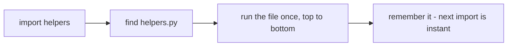
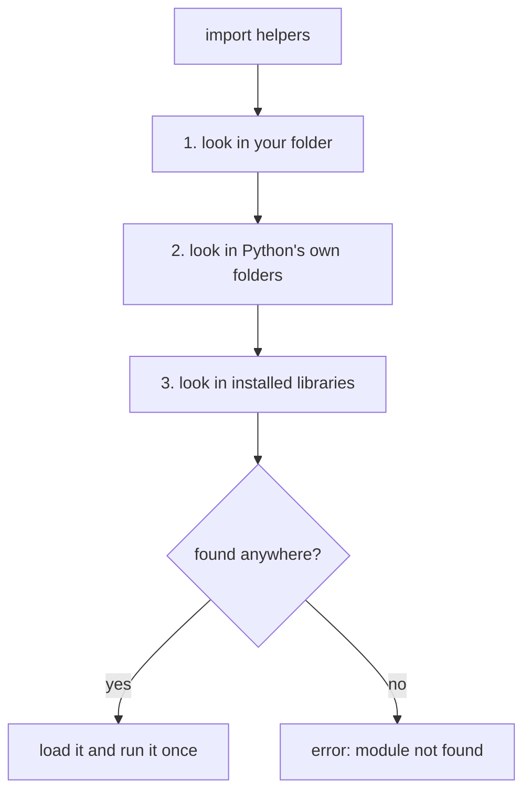
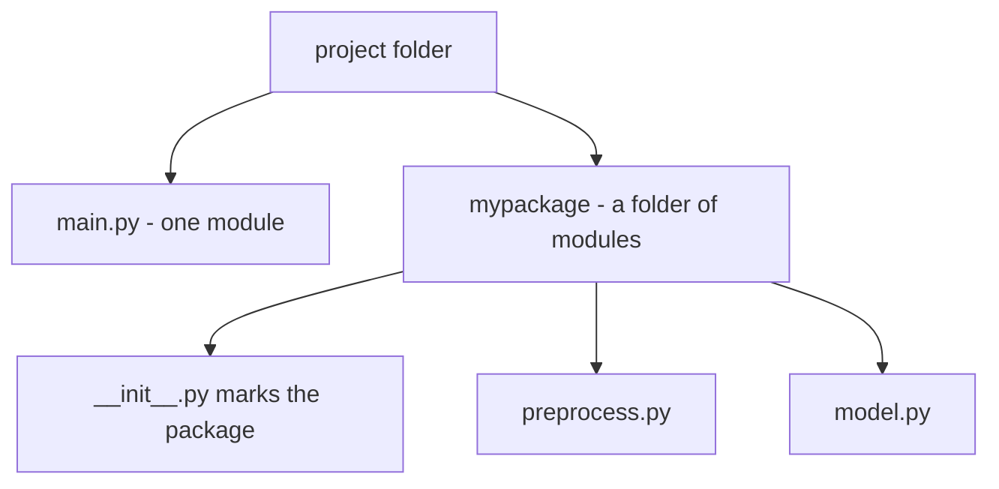

# Modules, Packages & import

## Status
- Status: New / Learning
- Prerequisites: Functions, scope (module-level), file handling basics
- Last studied: Day 3
- Confidence: Building

---

# Modules, Packages & import

This is an **important organizational concept** with a simple idea: split your code into multiple files, and use `import` to use code from one file inside another. You don't need to spend hours on it; understand what a module is, the import forms, and how packages organize modules.

---

## 1. The simple idea

Everything you've written so far probably lives in one file. That works for small programs — but real projects need organization:

```text
one big file (1000 lines)      → impossible to navigate
several small files            → each file does one thing
```

A **module** is simply **a Python file**. `utils.py` is a module. `model.py` is a module. The name of the module is the file name without `.py`.

A **package** is simply **a folder of modules** — with one special file inside that tells Python it's a package.

That's the whole idea.

---

## 2. Why do we need this?

Three reasons:

1. **Organization** — related functions live together. Data cleaning in one file, model code in another.
2. **Reuse** — write a function once, `import` it everywhere. No copy-pasting.
3. **Teamwork / size** — real ML projects are dozens of files; nobody works in one giant file.

---

## 3. How it works — your first import

Say you have two files in the same folder:

```python
# helpers.py
def double(x):
    return x * 2

def greet(name):
    return f"hello {name}"
```

```python
# main.py
import helpers

print(helpers.double(4))        # 8
print(helpers.greet("ram"))     # hello ram
```

Let's trace what happens:

```text
import helpers
    ↓
Python finds helpers.py
    ↓
Python RUNS the whole file (top to bottom)
    ↓
defs are created → helpers.double, helpers.greet now exist
    ↓
main.py can use them as helpers.xxx
```

**The important detail:** when you import a module, Python actually **executes that file**. So if `helpers.py` has code at the top level (like `print(...)`), it runs on import. Later (in the `__name__` topic) we'll learn how to control this.

---

## 4. The import forms

There are several ways to import. Let's see them side by side:

```python
# Form 1 — import the whole module
import helpers
helpers.double(4)

# Form 2 — import specific names
from helpers import double
double(4)

# Form 3 — import with an alias (nickname)
import helpers as h
h.double(4)

# Form 4 — import everything (be careful!)
from helpers import *
double(4)          # name available directly
```

### Which one to use?

```text
import helpers          → clear; always know where a name came from
from helpers import x   → short; good for a few names
import helpers as h     → shorter typing; common for libraries (np, pd)
from helpers import *   → ❌ avoid — dumps everything into your namespace
```

**The `import numpy as np` pattern** — you'll see this constantly in ML:

```python
import numpy as np
import pandas as pd
import matplotlib.pyplot as plt
```

Same idea — modules, with aliases.

---

## 5. What happens internally — the import process

When you write `import helpers`, Python does three things:

```text
1. SEARCH   → look for helpers.py in the search paths
2. EXECUTE  → run the file (create its namespace)
3. CACHE    → remember it — import again later is instant
```

**📊 Diagram — what happens on import**



**The search paths** — Python looks in:

```text
1. the current folder (where main.py runs)
2. PYTHONPATH (if set)
3. the standard library folder
4. site-packages (installed libraries like numpy)
```

You can see them:

```python
import sys
print(sys.path)
```

**📊 Diagram — where Python looks for a module, in order**



**Caching is important:** a module is executed **only once** per program, even if you import it in ten files. The second import just reuses the cached module. This is why module-level setup code (like a config object) runs once.

---

## 6. Packages — folders of modules

A folder of modules becomes a **package** when it contains a file called `__init__.py`:

```text
project/
├── main.py
└── mypackage/
    ├── __init__.py        ← makes mypackage a package
    ├── preprocess.py
    └── model.py
```

**📊 Diagram — a module is a file, a package is a folder**



```python
# main.py
import mypackage.preprocess
import mypackage.model

from mypackage.preprocess import clean_data
from mypackage import model
```

The `__init__.py` file can be empty — its existence is what makes the folder a package. (In older Python versions it was required; modern Python 3.3+ treats folders as packages even without it, but it's still the standard convention.)

### What goes in `__init__.py`

It is the package's setup file — it runs when the package is first imported. Common uses:

```python
# mypackage/__init__.py
from .preprocess import clean_data      # re-export the important names
from .model import train                # so users can write: from mypackage import train
```

```python
# main.py
from mypackage import train             # short, convenient
from mypackage.preprocess import clean_data
```

You can also define `__all__` to control `from mypackage import *`:

```python
# mypackage/__init__.py
__all__ = ["clean_data", "train"]       # only these names get imported by *
```

### Relative imports inside a package

Inside a package, use dot-imports to refer to sibling modules:

```python
# mypackage/model.py
from . import preprocess          # 'from the current package'
from .preprocess import clean_data
```

`from . import x` means "from the current package"; `from .. import x` means "from the parent package". This keeps imports working no matter where the package lives on disk.

### A realistic ML project layout

```text
ml_project/
├── main.py
├── config.py
├── data/
│   ├── __init__.py
│   └── loader.py
├── preprocessing/
│   ├── __init__.py
│   └── clean.py
└── models/
    ├── __init__.py
    └── trainer.py
```

```python
# main.py
from data.loader import load_data
from preprocessing.clean import clean_data
from models.trainer import train
```

This is the pattern every real project follows — one responsibility per file, import the pieces you need.

---

## 7. Common mistakes

### Mistake 1 — file name clashes with a built-in

```python
# math.py
def double(x): ...
```

```python
import math          # ❌ imports YOUR math.py, not the standard library!
```

This silently breaks `math.sqrt` code that expected the standard library. Don't name files after built-ins.

### Mistake 2 — circular imports

```python
# a.py
import b          # b needs a...

# b.py
import a          # ...and a needs b
```

A imports B, B imports A — Python gets confused, and you get errors. Fix by restructuring (move the shared code to a third module).

### Mistake 3 — code that runs on import

```python
# helpers.py
print("helpers loaded!")
result = expensive_computation()    # runs on EVERY import ❌
```

Put code inside functions — it should run only when called. (The `__name__` guard in the next topic solves this properly.)

### Mistake 4 — `from x import *` everywhere

It works, but you can't tell where any name came from, and it can silently overwrite your own names. Import explicitly.

---

## 7.5 Technical deep dive — the import machinery

**`sys.modules` — the cache.** When Python imports a module, it first checks the `sys.modules` dict:

```python
import sys
import helpers

print("helpers" in sys.modules)    # True — cached after import
print(sys.modules["helpers"])      # <module 'helpers' from '.../helpers.py'>
```

Importing the same module in ten files costs almost nothing — the second import just looks it up in this dict. This is why module-level setup runs **once per program**, not once per import statement.

**Finders and loaders.** `import helpers` is handled by import machinery that works in two stages:

```text
1. FINDER  → walks sys.path entries, asks each finder "do you know 'helpers'?"
              → finds the file, creates a module spec (name, location)
2. LOADER  → executes the file's code in a fresh module namespace,
              then registers the module in sys.modules
```

You can watch the path search:

```python
import sys
print(sys.path)     # ['', ...standard library..., '...site-packages']
```

The empty string `''` is the current directory — that's why a local `math.py` shadows the standard `math` module (Mistake 1).

**Import errors.** `ModuleNotFoundError` is raised when no finder can locate the module:

```python
import nonexistent_xyz    # ModuleNotFoundError: No module named 'nonexistent_xyz'
```

**Circular imports under the hood.** When `a.py` imports `b` and `b` imports `a`, the second import finds `a` in `sys.modules` — but `a` is only **partially initialized** (its top-level code hasn't finished). So `b` gets a half-built module, and any attribute access to it fails with `AttributeError`/`ImportError`. The fix is restructuring: move the shared code into a third module, or do the import inside a function so it happens after both modules are fully loaded.

---

## 8. ML connection

- Every ML project is a package: `data/`, `preprocessing/`, `models/`, `evaluation/` — each a folder of modules.
- Libraries themselves are packages: `numpy`, `pandas`, `sklearn` — you import modules of them.
- Config modules: a `config.py` that holds paths and hyperparameters, imported everywhere.
- The import system is why project structure matters — clean imports = clean projects.

---

## 9. PREDICT drills

Say the answer before reading it.

### Drill 1

```python
# helpers.py
def double(x):
    return x * 2

# main.py
import helpers
print(helpers.double(5))
```

**Answer:** `10` — module functions are called as `module.name()`.

### Drill 2

```python
# main.py
from helpers import double
print(double(3))
```

**Answer:** `6` — the name is imported directly.

### Drill 3 — trap

```python
# helpers.py
print("running!")

# main.py
import helpers
import helpers
```

**Answer:**

```text
running!
```

Only once — the module is cached after the first import.

### Drill 4 — trap

```python
import numpy as np
print(np.zeros(3))
```

**Answer:** `[0. 0. 0.]` — the alias `np` is just a shorter name for the module.

### Drill 5 — trickier

```python
# main.py
import math
print(type(math))
```

**Answer:** `<class 'module'>` — a module is an object, and `math` is the name pointing to it.

### Drill 6 — trap

```python
import sys
import math
print("math" in sys.modules)
print(math is sys.modules["math"])
```

**Answer:**

```text
True
True
```

After importing, the module object lives in `sys.modules` — the same object every importer sees.

### Drill 7 — trickier

```python
# mypackage/__init__.py  (empty)
# main.py
import mypackage
print(type(mypackage))
```

**Answer:** `<class 'module'>` — a package is just a module whose "file" is a folder (with `__init__.py`).

### Drill 8 — trap

```python
# mymod.py
x = 42

# main.py
import mymod
import mymod as m
print(mymod is m)
```

**Answer:** `True` — both names refer to the same cached module object; the second import is a no-op lookup.

---

## 10. Experiment

1. Create `helpers.py` and `main.py` — practice all four import forms.
2. Check `sys.path` and find where numpy is installed.
3. Create a small package with `__init__.py` and import from it.
4. Try `import` of a file named `math.py` — observe the problem.
5. Check `sys.modules` after importing — verify the same object is reused on a second import.
6. Put `__all__` in a module and verify `from module import *` only brings the listed names.

---

## 11. Interview questions

**Q: What is a module? What is a package?**
Short: a module is a Python file; a package is a folder of modules.
Strong: a module is any `.py` file that can be imported; a package is a directory of modules (marked by `__init__.py`). Importing executes the module once and caches it.

**Q: What happens when you import a module?**
Python searches `sys.path`, executes the file top to bottom, and caches it. Subsequent imports are instant.

**Deep follow-up: What are circular imports and how do you avoid them?**
A imports B while B imports A — the partially-initialized module breaks. Avoid by restructuring dependencies or importing inside functions.

**Q: What is `__all__`?**
A list in a module/package that defines which names `from module import *` brings in. Without it, `*` imports all public names; with it, only the listed ones. It also signals the public API of the module.

**Q: `import x` vs `from x import y` — what differs internally?**
Both run the same finder/loader and share the same cached module object. `import x` binds the name `x` in your namespace; `from x import y` copies the attribute `y` into your namespace at import time. If `y` is later reassigned inside `x`, your local copy does not change.

---

## 12. Follow-up chain

1. Why does the current folder come first in the search path? (so local modules win — which is also why name clashes happen)
2. What is `__init__.py` for? (marks a folder as a package)
3. What runs when a module is imported? (the whole file — hence the `__name__` guard next)
4. Why is `import numpy as np` the ML convention? (short, consistent alias)

---

## 13. Cheat sheet

```text
CONCEPT
→ module = a .py file; package = a folder of modules

MENTAL MODEL
→ import finds the file, runs it once, caches it; then
→ module.name gives you access

KEY SYNTAX
→ import helpers
→ from helpers import double
→ import numpy as np

IMPORTANT RULE
→ imported modules run once; put real logic in functions

COMMON TRAP
→ naming files after built-ins; circular imports; code on import

ML CONNECTION
→ project structure: data/, preprocessing/, models/ packages

INTERVIEW LINE
→ "A module is a Python file; a package is a directory of modules.
→ Importing executes and caches the module once."
```

---

## 14. Quick mastery test

### Q1

```python
from helpers import double, greet
print(greet(double(2)))
```

**Answer:** `hello 4` — both names were imported.

### Q2 — trap

```python
import numpy as np
import numpy as n
print(np is n)
```

**Answer:** `True` — both aliases point to the same cached module object.

### Q3 — trickier

```python
import sys
print("math" in sys.modules)
```

**Answer:** `False` (usually) — `sys.modules` shows what has already been imported; math may not be loaded yet.

### Q4

```python
import math
print(math.floor(3.7))
```

**Answer:** `3` — floor rounds down.

### Q5 — trap

```python
# helpers.py
def double(x):
    return x * 2

# main.py
import helpers
from helpers import double
print(double is helpers.double)
```

**Answer:** `True` — `from ... import` binds the same function object.

### Q6 — trickier

```python
import sys
sys.path.insert(0, "/fake/path")   # pretend to add a search path
import math
print(sys.path[0])
```

**Answer:** `'/fake/path'` — `sys.path` is a mutable list; the first entry is searched first. (A nonexistent path is harmless — the finder simply won't find anything there.)

---

## 15. Your level for this topic

If you can explain what a module is, the four import forms, and why importing runs the file once — mark **Modules, Packages & import complete**.

Next: [`__name__` and `__main__`](./07-name-main.md) — the guard that keeps your scripts clean.

---

## 16. Doubts

### C1 — "I ran `from helper import printer as p` and got an error. What's wrong?"

**Date:** Day 3 (Modules / Packages)

```python
# test.py
from helper import printer as p

for i in range(10):
    p()
```

#### 1. The simple idea — the waiter can only search the room he's in

Think of importing as a waiter asked to find a file. The waiter **does not search the whole building** — he first checks the room he's standing in (your current folder), then a few fixed corridors (Python's install folders).

```text
Your command was:  from helper import printer as p
The waiter asked:  "Where is helper.py?"  →  NOT in this room → "No module named 'helper'"
```

That's the whole error. Your code is correct. The file just isn't where Python is looking.

#### 2. The exact error and why

```text
ModuleNotFoundError: No module named 'helper'
```

```text
helper.py lives in:   CORE_PYTHON\PRACTICE_QUESTIONS\helper.py
You ran the code from: a folder where helper.py is NOT there
→ Python's "current room" didn't contain helper.py → error
```

#### 3. The fix — three easy ways

**Way 1 (simplest) — run your script from the folder where helper.py lives:**

```text
cd CORE_PYTHON\PRACTICE_QUESTIONS
python test.py
→ hi  (printed 10 times)
```

**Way 2 — put helper.py next to your script.** The waiter looks in the current folder first, so the file just needs to be in the same room as your script.

**Way 3 — if you can't move files, tell Python where to look:**

```python
import sys
sys.path.append(r"E:\Machine learning\CORE_PYTHON\PRACTICE_QUESTIONS")
from helper import printer as p
```

#### 4. PREDICT drill

Where you run `python test.py` — guess the result before reading:

```text
Run from: CORE_PYTHON\PRACTICE_QUESTIONS  → ?
Run from: CORE_PYTHON                     → ?
Run from: E:\Machine learning (root)      → ?
```

**Answer:**

```text
PRACTICE_QUESTIONS → prints "hi" 10 times   (helper.py is right there)
CORE_PYTHON        → ModuleNotFoundError     (helper.py is one folder away)
root               → ModuleNotFoundError     (helper.py is deep inside)
```

#### 5. The trap — "my code ran fine yesterday!"

The same script works from one folder and fails from another. The code never changed — only **where** you ran it from. When you see `ModuleNotFoundError`, the first question is always: *"where am I running this from, and where is the module file?"*

#### 6. Connect to ML

Real ML projects have dozens of files (`data_loader.py`, `model.py`, `utils.py`). People write `from utils import load_data` and the whole training script crashes because they ran it from the wrong folder. Knowing this one rule — *Python imports search the current folder first* — saves hours of debugging.

#### 7. Your level for this doubt

If you can explain that `ModuleNotFoundError` means "Python can't find the file from where you ran it", and you can fix it by running from the right folder — mark this doubt **complete**.