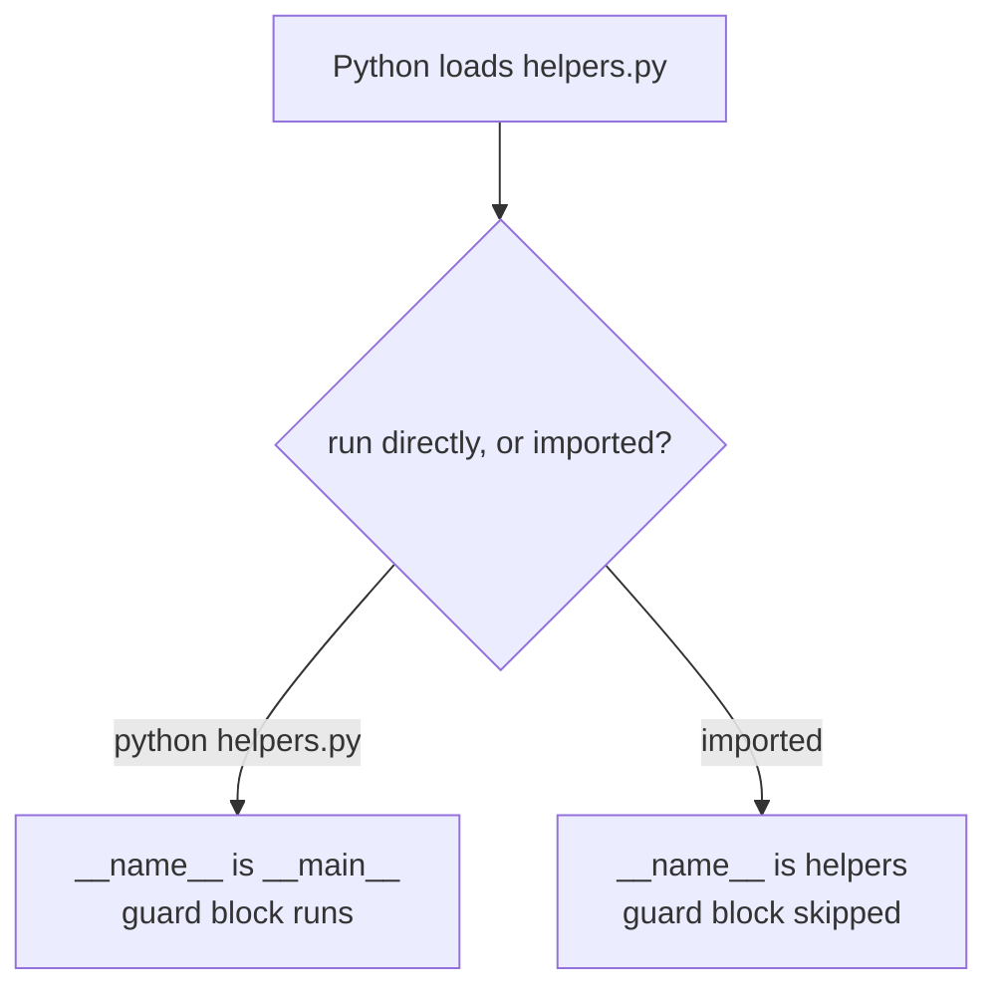
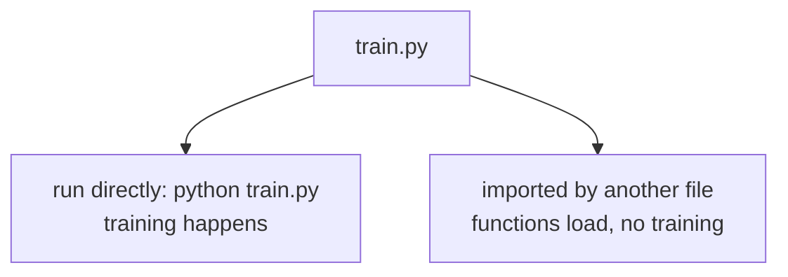

# `__name__` and `__main__`

## Status
- Status: New / Learning
- Prerequisites: Modules & import, `__name__` special attribute
- Last studied: Day 3
- Confidence: Building

---

# `__name__` and `__main__`

This is a **small but very important** Python concept. Every Python file has a hidden variable called `__name__`, and it tells you whether the file is being **run directly** or **imported**. The famous `if __name__ == "__main__":` line uses it. You don't need to spend hours on it; understand the two situations and the guard pattern.

---

## 1. The simple idea

Every Python file has a built-in variable called `__name__`.

```python
print(__name__)
```

What do you think it prints when you run this file directly?

```text
__main__
```

Now — a file can be used in two ways:

```text
1. RUN DIRECTLY   → python myfile.py
2. IMPORTED       → import myfile (from another file)
```

The value of `__name__` tells you which one is happening:

```text
file run directly   → __name__ == "__main__"
file imported       → __name__ == "filename" (the module name)
```

That's the entire concept.

---

## 2. Why do we need this?

Here's the problem:

```python
# helpers.py
print("helpers loaded!")

def double(x):
    return x * 2

# main.py
import helpers
print(helpers.double(4))
```

Run `main.py`:

```text
helpers loaded!
8
```

Now run `helpers.py` directly (`python helpers.py`):

```text
helpers loaded!
```

The file printed its message even though you just wanted the function. Now imagine that print was actually 100 lines of training code — **importing the module would run all of it**. Bad.

We need a way to say:

> "Only run this code when the file is run directly — NOT when it's imported."

That's exactly what the `__name__` check does.

---

## 3. Let's see it in action

```python
# helpers.py
print("helpers loaded!")

def double(x):
    return x * 2

if __name__ == "__main__":
    print("helpers.py is being RUN DIRECTLY")
```

**Case 1 — run `python helpers.py`:**

```text
helpers loaded!
helpers.py is being RUN DIRECTLY
```

**Case 2 — import from main.py:**

```text
helpers loaded!
```

The guard block did NOT run — because when imported, `__name__` is `"helpers"`, not `"__main__"`.

Trace:

```text
run directly   → __name__ = "__main__"     → guard block runs
imported       → __name__ = "helpers"      → guard block skipped
```

**📊 Diagram — when does the guard block run?**



---

## 4. The standard pattern

Every well-written Python file that can be both imported and run directly ends with:

```python
def main():
    print("main program logic")
    ...

if __name__ == "__main__":
    main()
```

The `main()` function holds the program logic; the guard calls it only when run directly.

```python
# train.py
import pandas as pd

def load_data(path):
    return pd.read_csv(path)

def train(path):
    data = load_data(path)
    print("training on", len(data), "rows")
    ...

if __name__ == "__main__":
    train("data.csv")
```

Now:

```text
python train.py            → trains
from train import train    → only loads the function, does NOT train
```

**📊 Diagram — same file, two lives**



---

## 5. What happens internally

When Python runs a file, it sets two things at the very top:

```text
run directly:
    __name__ = "__main__"

imported:
    __name__ = "module_name"
```

You can prove it:

```python
# mymod.py
print("inside mymod, __name__ =", __name__)
```

```python
# main.py
import mymod
```

Output:

```text
inside mymod, __name__ = mymod
```

And when you run `python mymod.py` directly:

```text
inside mymod, __name__ = __main__
```

**The dunder note:** `__name__` is a special (dunder = double underscore) attribute that Python maintains automatically. `__main__` is just the name given to the module that is currently being executed — usually your entry file.

---

## 5.5 Technical deep dive — how CPython decides

The value of `__name__` is not magic — it is decided by **how the interpreter starts running a file**:

```text
python myfile.py      → the interpreter creates a module object named "__main__"
                        and executes myfile.py inside it
import myfile         → the import machinery creates a module object named "myfile"
                        and executes the file inside it
python -m mypackage   → runs the package's __main__.py as the __main__ module
```

You can prove it — `__main__` is a real module object:

```python
import __main__

print(__main__.__name__)        # __main__
print(__main__.__file__)        # the file you ran (or '<stdin>' in the REPL)
print(__name__ is __main__.__name__)    # True — they are the same value
```

**Interactive mode:** in the REPL, `__name__` is `'__main__'` too — the REPL itself is the `__main__` module. That is why notebooks never need the guard: every cell runs inside `__main__`.

**`python -m module` vs `python module.py`.** Both execute the module as the entry point with `__name__ == "__main__"`, but `-m` also adds the current directory to `sys.path` first — which is why `python -m mypackage` works for packages while `python mypackage/` does not. For a single file, they are equivalent in behavior.

**What `if __name__ == "__main__":` actually checks.** At runtime this is a plain boolean comparison of two strings: the module's `__name__` attribute against the literal `"__main__"`. Nothing special at the bytecode level — the value of `__name__` is simply different in the two execution modes described above.

---

## 6. Common mistakes

### Mistake 1 — no guard at all

```python
# utils.py
train_model(X, y)     # ❌ runs when someone imports utils!
```

Any top-level code runs on import. Put it behind the guard.

### Mistake 2 — writing the guard with the wrong comparison

```python
if __name__ == "main":        # ❌ missing underscores — never True
if __name__ == "__main__":    # ✅ correct
```

### Mistake 3 — testing with `== "__main__"` inside a package module

If a module inside a package is the entry point, it still gets `__main__` when run directly — so the guard works. The confusion only arises when you expect `__name__` to be the file path — it's not; it's the module name.

### Mistake 4 — thinking the guard "protects" the whole file

```python
if __name__ == "__main__":
    import pandas as pd      # ❌ import here = unavailable outside
```

Imports inside the guard are only available in that block. Keep imports at the top.

---

## 7. ML connection

- Every training/inference script in real projects ends with the guard — so the file can be imported for its functions without triggering a training run.
- Notebooks don't need it, but **every `.py` entry point should have it**:

```python
# train.py
if __name__ == "__main__":
    trainer = Trainer(config)
    trainer.run()
```

- It's how libraries stay safe: `import sklearn` never runs sklearn's demo code.

---

## 8. PREDICT drills

Say the answer before reading it.

### Drill 1

```python
# run this file directly: python file.py
print(__name__)
```

**Answer:** `__main__`.

### Drill 2

```python
# mymod.py
print(__name__)

# main.py
import mymod
```

Run `main.py`:

**Answer:** `mymod` — the imported module's `__name__` is its module name.

### Drill 3 — trap

```python
if __name__ == "__main__":
    print("A")
print("B")
```

Run directly:

**Answer:**

```text
A
B
```

Both run — the guard only controls its own block.

### Drill 4

```python
if __name__ == "__main__":
    print("runs directly")
```

Import this file instead:

**Answer:** (nothing) — the guard block is skipped when imported.

### Drill 5 — trickier

```python
def main():
    print("hello")

if __name__ == "__main__":
    main()
```

Import the module and call `main()` yourself:

**Answer:** `hello` — the guard didn't run it, but the function is available for you to call.

### Drill 6

```python
def f():
    return __name__

print(f())
```

Run directly:

**Answer:** `__main__` — `__name__` is a module-level name, visible inside functions too.

### Drill 7 — trap

```python
# mymod.py
if __name__ == "__main__":
    print("direct")
else:
    print("imported")
```

Import mymod from another file:

**Answer:** `imported` — the module's `__name__` is `'mymod'` when imported.

### Drill 8 — trickier

```python
import __main__
print(__main__.__name__)
```

Run this file directly:

**Answer:** `__main__` — the running file IS the `__main__` module; `import __main__` returns it.

---

## 9. Experiment

1. Create `mymod.py` printing `__name__` — run it directly, then import it. Observe the two values.
2. Put a training-style function behind the guard and import it from another file — verify it does NOT run.
3. Remove the guard, import the module — watch the side effects run.
4. Run `python -m mymod` vs `python mymod.py` — verify both print `__main__`.
5. `import __main__` and print `__main__.__file__` — see which file the REPL/script reports.

---

## 10. Interview questions

**Q: What does `if __name__ == "__main__":` do?**
Short: runs the block only when the file is executed directly, not when imported.
Strong: `__name__` is `"__main__"` for the file being run directly and the module name otherwise; the guard lets a file serve both as a runnable script and as an importable module without side effects.

**Q: Why is `__name__` set to `"__main__"`?**
It's the name Python gives to the entry module — the one that starts execution.

**Deep follow-up: What happens if you omit the guard?**
All top-level code executes on import — importing a training script would run the training.

**Q: What is the difference between `python file.py` and `python -m file`?**
Both run the file as the `__main__` module with `__name__ == "__main__"`. `-m` additionally inserts the current directory at the front of `sys.path`, which is what makes running packages (`python -m mypackage`) possible.

**Q: Is `__name__` a global variable?**
It is a module-level name set automatically by the interpreter, so functions in the module can read it via the global scope — but it is not a built-in, and you should never reassign it (it would break the guard).

---

## 11. Follow-up chain

1. Is `__name__` the file path? (No — it's the module name or `"__main__"`.)
2. Does the guard appear in notebooks? (Not needed — cells run directly.)
3. Where do you see it in ML repos? (Every `train.py`, `inference.py`, `app.py` entry point.)

---

## 12. Cheat sheet

```text
CONCEPT
→ __name__ tells you how a file is being used

MENTAL MODEL
→ run directly → "__main__"; imported → module name

KEY SYNTAX
→ if __name__ == "__main__":
→     main()

IMPORTANT RULE
→ put runnable logic behind the guard so imports stay side-effect-free

COMMON TRAP
→ missing underscores; no guard at all; imports inside the guard

ML CONNECTION
→ train.py / inference.py entry points

INTERVIEW LINE
→ "The guard lets a file be both a script and an importable
→ module — its top-level logic runs only when executed directly."
```

---

## 13. Quick mastery test

### Q1

```python
# run directly
print(__name__ == "__main__")
```

**Answer:** `True`.

### Q2 — trap

```python
if __name__ == "__main__":
    print("inside")
```

Imported — what prints?

**Answer:** nothing.

### Q3 — trickier

```python
def f():
    return __name__

print(f())
```

Run directly:

**Answer:** `__main__` — `__name__` is accessible everywhere in the module.

### Q4

```python
# mymod.py
if __name__ == "__main__":
    print("direct")
else:
    print("imported")
```

Import mymod:

**Answer:** `imported`.

### Q5 — trickier

```python
# mymod.py
print("top level", __name__)

def f():
    return __name__

if __name__ == "__main__":
    print("inside guard")
```

Run mymod directly:

**Answer:**

```text
top level __main__
inside guard
```

The top-level print runs (as always), and the guard block runs too because it was run directly.

### Q6

```python
import __main__
print(__main__ is sys.modules["__main__"])
```

Run directly:

**Answer:** `True` — `__main__` is a real module registered in `sys.modules`, and your running file is it.

---

## 14. Your level for this topic

If you can explain the two values of `__name__` and why the guard exists — mark **`__name__` / `__main__` complete**.

This finishes Day 3. Next: **OOP** (separate `OOPS/` folder) — classes, objects, inheritance, and friends.