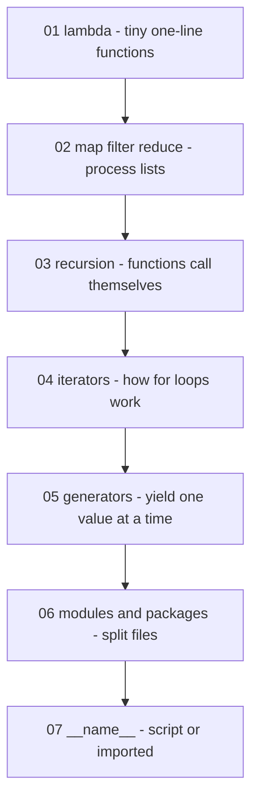

# Day 3 — Python Core (Part 3): Functional Tools, Recursion, Iteration & Modules

## Objective

Finish the Python core foundations before OOP and NumPy: write small anonymous functions, transform collections with `map`/`filter`/`reduce`, reason about recursion through the call stack, understand how iteration actually works (iterators → generators), and organize real code into modules with the `__name__ == "__main__"` guard.

## Topics

1. [Lambda Functions](./01-lambda.md)
2. [map / filter / reduce](./02-map-filter-reduce.md)
3. [Recursion](./03-recursion.md)
4. [Iterators](./04-iterators.md)
5. [Generators](./05-generators.md)
6. [Modules, Packages & import](./06-modules-packages.md)
7. [`__name__` and `__main__`](./07-name-main.md)

## Learning Order

```text
lambda                 (tiny one-expression functions)
    ↓
map / filter / reduce  (uses lambdas on collections)
    ↓
recursion              (functions calling themselves)
    ↓
iterators              (how for loops actually work)
    ↓
generators             (lazy iterators with yield)
    ↓
modules & packages     (organizing code into files)
    ↓
__name__ / __main__    (script vs importable module)
```

**📊 Diagram — Day 3 roadmap: learn in this order**



## Prerequisites

- [Day 2](../Day2/topics.md): functions, `*args`/`**kwargs`, scope & LEGB, exceptions, mutability, truthy/falsy, `None`
- Day 1 basics: variables, data types, conditions, loops, strings, lists

## Previously Covered

- Day 1: variables, data types, I/O, operators, conditions, loops, strings
- Day 2 Part 1: lists, tuples, sets, dicts, indexing/slicing, functions, file handling, comprehensions
- Day 2 Part 2: exceptions, mutability/copy, scope/LEGB, truthy/falsy, `None`

## Next

- **OOP** — separate `OOPS/` folder (classes, objects, inheritance, encapsulation, polymorphism, abstraction, magic methods)
- Then Python Internals (memory model, closures, decorators) and the **NumPy transition**

## Notes

- The `map.py` practice file in `../PYTHON_CODE_BASICS/` already experiments with `lambda` + `map`.
- Generators and iterators become essential for streaming datasets and memory-efficient data pipelines in ML.