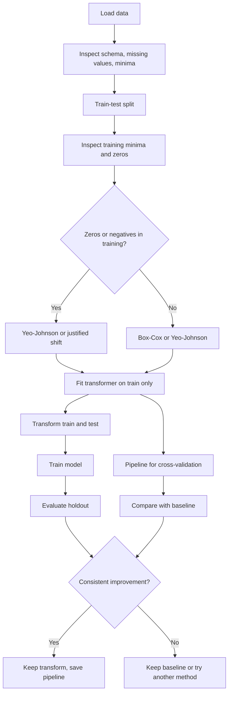

# Day 31 - Power Transformer: Box-Cox and Yeo-Johnson

> **Course:** CampusX - 100 Days of Machine Learning, Day 31
> **Official notebook:** `reference_notebooks/reference_notebook.ipynb` (22 cells)
> **Personal notebook:** `my_notebook.ipynb` (42 cells)
> **Dataset:** `datasets/concrete_data.csv` (1030 rows, 9 columns)
> **Central question:** When a numerical feature has a long tail, can we change its spacing so that a model's job becomes easier without deleting observations or pretending the feature has become perfectly normal?

### How to read this chapter

**Part A** is the complete learning chapter. It explains the problem, the statistics, both transformations, the Scikit-learn API, the concrete-strength experiment, practical decisions, and essential interview preparation. It is sufficient to understand and implement the topic.

**Part B** is optional advanced reading. It contains the full likelihood derivation, leverage mathematics, implementation internals, the source-fidelity audit, extended comparisons, and additional interview and examination questions.

**Source labels.** *Official* means the CampusX notebook and its saved output. *Personal* means `my_notebook.ipynb`, reproduced in this environment. *Supplementary* means an explanation or experiment added here and not spoken verbatim in the lecture. Hand calculations are shown step by step.

---

# Part A - Main Learning Chapter

## 1. The problem: a long tail changes the arithmetic

### 1.1 A small example

Ten monthly incomes, in thousands of rupees:

$$
10,\ 11,\ 12,\ 13,\ 14,\ 15,\ 16,\ 17,\ 18,\ 90.
$$

Nine values lie between 10 and 18. One value is 90. The sum is

$$
126+90=216,
\qquad
\bar{x}=\frac{216}{10}=21.6.
$$

The sorted middle values are 14 and 15, so the median is 14.5. The mean has moved far to the right because the single large value enters the sum. This is **right skew**: a long tail extends toward larger values. Left skew is the mirror image.

The mean and median are not the only issue. A feature with a long tail can make several kinds of model work harder:

- **Linear regression.** A row far from the centre of the feature space has high **leverage**. If that row also has a large residual, it can pull the fitted surface strongly.
- **Distance-based models.** k-nearest neighbours, k-means, and support-vector machines compare coordinates. A difference of 80 in one feature can overwhelm a difference of 2 in another.
- **Functional form.** A linear model assumes the target changes additively with each feature. A curved relationship, such as diminishing returns from curing age, may be represented better after a nonlinear transform.
- **Trees.** A decision tree splits on order, such as "Age $\le 28$". A strictly increasing transform preserves order, so the possible axis-aligned partitions are largely unchanged. Trees usually gain much less from a marginal power transform.

### 1.2 What a power transform does and does not do

A power transform **does**:

- change the numerical spacing of values;
- compress or expand a tail;
- preserve the ordering of observations;
- change the influence of extreme values on squared error and distances;
- estimate its shape parameter from training data.

It **does not**:

- delete observations;
- prove that an extreme value is an error;
- guarantee a normal distribution;
- guarantee a better model;
- fix every nonlinear relationship;
- repair every regression assumption;
- replace validation.

The distinction matters. OLS does not assume that the feature $X$ is normal. Its standard assumptions concern the conditional errors: zero mean, constant variance, independence, and, for exact finite-sample inference, normality. A skewed feature can create high-leverage rows and can make the fitted relationship sensitive, but skewness alone does not make the coefficient estimator invalid. A power transform may improve the functional form or reduce leverage; whether it improves prediction is an empirical question.

### 1.3 A precise leverage picture

This subsection is a supplementary explanation.

For ordinary least squares with design matrix $X$, including an intercept column, the fitted values are

$$
\hat{y}=Hy,
\qquad
H=X(X^{\top}X)^{-1}X^{\top}.
$$

The diagonal entry $h_{ii}$ is the leverage of observation $i$. Leverage measures how unusual row $i$'s feature values are relative to the other rows. It depends on $X$, not on $y$. In simple linear regression,

$$
h_{ii}=\frac{1}{n}+\frac{(x_i-\bar{x})^2}{\sum_{j=1}^{n}(x_j-\bar{x})^2}.
$$

For $x=(1,2,3,4,10)$, $\bar{x}=4$ and $\sum(x_j-\bar{x})^2=50$. The observation at $x=10$ has

$$
h_{10}=\frac15+\frac{(10-4)^2}{50}=0.2+0.72=0.92.
$$

A row with an extreme $x$ therefore has high leverage. High leverage is not the same as a large residual:

- high leverage, small residual: the row sits at an unusual $x$ position and can still constrain the slope strongly;
- low leverage, large residual: the row is poorly predicted but has limited ability to move the line;
- high leverage, large residual: the row is **influential** and can change the coefficients substantially.

Cook's distance combines the two ideas. One common form is

$$
D_i=\frac{e_i^2}{p\,\mathrm{MSE}}\cdot\frac{h_{ii}}{(1-h_{ii})^2},
$$

where $e_i$ is the residual, $p$ is the number of estimated parameters, and MSE is the mean squared error. Exact scaling conventions differ. The important point is that influence is not the same as a large feature value, and not the same as a large residual.

---

## 2. Measuring skewness

### 2.1 Population and sample skewness

For a random variable $X$ with mean $\mu$ and standard deviation $\sigma$, population skewness is the third standardised central moment:

$$
\gamma_1=\frac{\mathbb{E}[(X-\mu)^3]}{\sigma^3}.
$$

Cubing preserves the sign: large positive deviations contribute positively and large negative deviations contribute negatively. Dividing by $\sigma^3$ removes units.

The **biased** sample estimator is

$$
g_1=\frac{\frac{1}{n}\sum_{i=1}^{n}(x_i-\bar{x})^3}{\left(\frac{1}{n}\sum_{i=1}^{n}(x_i-\bar{x})^2\right)^{3/2}}.
$$

The **adjusted Fisher-Pearson** estimator, used by `pandas.Series.skew()`, is

$$
G_1=\frac{n}{(n-1)(n-2)}\sum_{i=1}^{n}\left(\frac{x_i-\bar{x}}{s}\right)^3,
$$

where $s$ is the sample standard deviation with $n-1$. `scipy.stats.skew` returns $g_1$ by default (`bias=True`) and $G_1$ with `bias=False`. The two libraries can therefore report different numbers for the same column. The difference is an estimator choice, not an error.

### 2.2 Worked calculation

For $x=(1,2,3,4,10)$:

$$
\bar{x}=\frac{1+2+3+4+10}{5}=4.
$$

Deviations are $-3,-2,-1,0,6$. Squared deviations are $9,4,1,0,36$, with sum $50$. Cubed deviations are $-27,-8,-1,0,216$, with sum $180$.

Biased skewness:

$$
g_1=\frac{180/5}{(50/5)^{3/2}}
=\frac{36}{10^{3/2}}
\approx1.1384.
$$

Adjusted skewness, with $s^2=50/4=12.5$ and $s=3.5355$:

$$
G_1=\frac{5}{4\cdot3}\sum\left(\frac{x_i-4}{3.5355}\right)^3
=\frac{5}{12}\cdot\frac{180}{44.194}
\approx1.697.
$$

Both values say the sample is right-skewed. The adjusted value is larger because it corrects a small-sample bias.

### 2.3 Rules of thumb and Q-Q plots

A common convention is:

- $|g_1|<0.5$: approximately symmetric;
- $0.5\le|g_1|<1$: moderate skew;
- $|g_1|\ge1$: strong skew.

These are conventions, not laws. A feature with skewness 0.7 can be perfectly usable. A multimodal distribution can have skewness near zero while being clearly non-normal. Always inspect a histogram or density plot alongside the number.

A **Q-Q plot** compares sample quantiles with theoretical quantiles from a reference distribution, here the normal distribution. If the sample is close to normal, the points lie close to the reference line. Curvature indicates a shape difference; deviations at the ends indicate tail differences. A Q-Q plot is diagnostic evidence, not proof.

---

## 3. The power family and the meaning of lambda

### 3.1 Definition

For $x>0$, the core power expression is

$$
T_\lambda(x)=\frac{x^\lambda-1}{\lambda},
\qquad \lambda\neq0.
$$

The parameter $\lambda$ controls curvature:

| $\lambda$ | Expression | Effect on a right tail |
|---:|---|---|
| $1$ | $x-1$ | a shift; shape unchanged |
| $0.5$ | $2(\sqrt{x}-1)$ | moderate compression |
| $0$ | $\ln x$ | strong logarithmic compression |
| $-1$ | $1-1/x$ | very strong compression; may pile values near a boundary |
| $2$ | $(x^2-1)/2$ | expansion; usually the wrong direction for a right tail |

The subtraction and division by $\lambda$ make the family continuous at $\lambda=0$ and anchor every member at $T_\lambda(1)=0$. They do not make likelihood comparisons valid by themselves; the Jacobian in Section 4.2 does that.

### 3.2 The lambda = 0 limit

Substitute $x^\lambda=e^{\lambda\ln x}$:

$$
\begin{aligned}
\frac{x^\lambda-1}{\lambda}
&=\frac{e^{\lambda\ln x}-1}{\lambda} \\
&=\ln x\cdot\frac{e^{\lambda\ln x}-1}{\lambda\ln x}.
\end{aligned}
$$

Let $u=\lambda\ln x$. As $\lambda\to0$, $u\to0$, and

$$
\lim_{u\to0}\frac{e^u-1}{u}=1.
$$

Therefore

$$
\lim_{\lambda\to0}\frac{x^\lambda-1}{\lambda}=\ln x.
$$

The logarithm is not an unrelated trick. It is the continuous member of the power family at $\lambda=0$.

### 3.3 Monotonicity and inverse

Differentiate for $x>0$:

$$
\frac{d}{dx}\left(\frac{x^\lambda-1}{\lambda}\right)=x^{\lambda-1}>0.
$$

For $\lambda=0$, the derivative of $\ln x$ is $1/x>0$. The transform is strictly increasing for every $\lambda$, so ranks are preserved. A negative $\lambda$ does not reverse the order; it compresses large values.

Solve $y=(x^\lambda-1)/\lambda$ for $x$:

$$
x=(\lambda y+1)^{1/\lambda}\quad(\lambda\neq0),
\qquad
x=e^{y}\quad(\lambda=0).
$$

The inverse matters when a model predicts in transformed space but the business needs original units.

---

## 4. Box-Cox

### 4.1 Formula and domain

$$
T_\lambda(x)=
\begin{cases}
\dfrac{x^\lambda-1}{\lambda}, & \lambda\neq0,\\
\ln x, & \lambda=0,
\end{cases}
\qquad x>0.
$$

The input must be **strictly positive**. Zero is not allowed because $\ln(0)$ is undefined and the likelihood derivation uses $\ln x$. Negative values are not allowed in the standard real-valued Box-Cox family. This is a mathematical domain restriction, not a Scikit-learn inconvenience.

If a feature contains zeros, the options are:

1. use Yeo-Johnson, which supports zero;
2. apply a documented positive shift chosen from the training data and applied consistently to future data;
3. reconsider whether zero has a special meaning that deserves separate encoding.

Adding $10^{-6}$ to a zero makes it positive but changes the data. Adding a tiny number to a negative value does not make it positive: $-2+10^{-6}$ is still negative. A shift must be justified and recorded.

### 4.2 How lambda is chosen

The fitted $\lambda$ is not chosen by looking at a histogram. It is estimated by maximum likelihood under the working model that the **transformed** observations are approximately normal.

Let $z_i(\lambda)=T_\lambda(x_i)$ and suppose

$$
z_i(\lambda)\sim\mathcal{N}(\mu,\sigma^2).
$$

A change of variables from $x$ to $z$ contributes a Jacobian. Since

$$
\frac{dz}{dx}=x^{\lambda-1},
\qquad
\log\left|\frac{dz}{dx}\right|=(\lambda-1)\ln x,
$$

the log-likelihood of the original observations is

$$
\begin{aligned}
\ell(\lambda,\mu,\sigma^2)
&=-\frac{n}{2}\ln(2\pi)
-\frac{n}{2}\ln\sigma^2 \\
&\quad-\frac{1}{2\sigma^2}\sum_{i=1}^{n}(z_i-\mu)^2
+(\lambda-1)\sum_{i=1}^{n}\ln x_i.
\end{aligned}
$$

The last term is the Jacobian. Without it, transformations that stretch or shrink the scale would be compared on different density scales.

For fixed $\lambda$, the maximum-likelihood estimates of the normal parameters are

$$
\hat{\mu}=\bar{z},
\qquad
\hat{\sigma}^2=\frac{1}{n}\sum_{i=1}^{n}(z_i-\bar{z})^2.
$$

Substituting these gives the **profile log-likelihood**, up to additive constants:

$$
\ell_p(\lambda)
=-\frac{n}{2}\ln\left(\frac{1}{n}\sum_{i=1}^{n}(z_i(\lambda)-\bar{z}(\lambda))^2\right)
+(\lambda-1)\sum_{i=1}^{n}\ln x_i.
$$

Maximising $\ell_p$ over $\lambda$ gives the estimate. SciPy's `stats.boxcox` performs this scalar optimisation; Scikit-learn's `PowerTransformer` calls SciPy and stores the result in `lambdas_`.

The criterion is a univariate normal-density fit for each feature. The target and the regression coefficients are not part of this optimisation. A good $\lambda$ is therefore a hypothesis to validate, not a guarantee of a better model.

### 4.3 Worked example

For the sample $(1,2,3,4,10)$:

```python
import numpy as np
from scipy import stats

x = np.array([1.0, 2.0, 3.0, 4.0, 10.0])
z, lam = stats.boxcox(x)

print(lam)   # -0.120722...
print(z)     # [0. 0.664939 1.028877 1.276502 2.01026]
```

The fitted value is $\hat{\lambda}\approx-0.1207$. The transformed sample is

$$
0,\ 0.6649,\ 1.0289,\ 1.2765,\ 2.0103.
$$

Skewness before is $1.1384$; after is $0.0275$. The transform has almost eliminated the asymmetry.

A profile-log-likelihood grid for the same sample, differing from the full log-likelihood by an additive constant:

| $\lambda$ | Profile log-likelihood |
|---:|---:|
| $-1.00$ | $-5.1039$ |
| $-0.50$ | $-4.3001$ |
| $-0.25$ | $-4.1248$ |
| $0.00$ | $-4.12195$ |
| $0.25$ | $-4.2955$ |
| $0.50$ | $-4.6379$ |
| $1.00$ | $-5.7565$ |

The grid is nearly flat between $-0.25$ and $0$, which is why the exact optimiser returns $-0.1207$ while a coarse grid might suggest $0$. The likelihood, not the eye, chooses the estimate.

Applying the inverse:

```python
from scipy.special import inv_boxcox
print(np.round(inv_boxcox(z, lam), 6))   # [1. 2. 3. 4. 10.]
```

The transform is reversible up to floating-point precision.

### 4.4 Interpreting lambda

- $\lambda\approx1$: close to a shift; the original shape was already acceptable under the normal model.
- $\lambda\approx0$: a log-like compression was preferred.
- $\lambda\approx0.5$: a square-root-like compression was preferred.
- $\lambda<0$: the tail was strong enough that the optimiser wanted stronger-than-log compression.

These are clues, not a complete description of the data.

For fixed $\lambda$, the same input maps to very different values. At $x=100$:

| $\lambda$ | Calculation | Result |
|---:|---|---:|
| $1$ | $(100-1)/1$ | $99$ |
| $0.5$ | $(10-1)/0.5$ | $18$ |
| $0$ | $\ln 100$ | $4.6052$ |
| $-1$ | $(0.01-1)/(-1)$ | $0.99$ |

---

## 5. Yeo-Johnson

### 5.1 Formula

$$
T_\lambda(x)=
\begin{cases}
\dfrac{(x+1)^\lambda-1}{\lambda}, & x\ge0,\ \lambda\neq0,\\
\ln(x+1), & x\ge0,\ \lambda=0,\\
-\dfrac{(1-x)^{2-\lambda}-1}{2-\lambda}, & x<0,\ \lambda\neq2,\\
-\ln(1-x), & x<0,\ \lambda=2.
\end{cases}
$$

For $x\ge0$, the definition is Box-Cox applied to $x+1$, which makes zero legal and gives `log1p` at $\lambda=0$. For $x<0$, a mirrored branch keeps the function defined and smooth at zero.

### 5.2 Continuity at zero

Both branches give $T_\lambda(0)=0$. The derivative from the right is $(0+1)^{\lambda-1}=1$. From the left, differentiating

$$
-\frac{(1-x)^{2-\lambda}-1}{2-\lambda}
$$

gives $(1-x)^{1-\lambda}$, which is also $1$ at $x=0$. The function and its first derivative match at zero; the piecewise definition is not arbitrary.

### 5.3 Special cases

**$\lambda=1$ is the identity.** For $x\ge0$:

$$
\frac{(x+1)^1-1}{1}=x.
$$

For $x<0$:

$$
-\frac{(1-x)^1-1}{1}=-(1-x-1)=x.
$$

So Yeo-Johnson with $\lambda=1$ changes nothing. Box-Cox with $\lambda=1$ returns $x-1$, a shift.

**$\lambda=2$ in the negative branch.** Direct substitution would give $0/0$. The limit is

$$
-\ln(1-x).
$$

**$\lambda=0$ in the non-negative branch** is $\ln(x+1)$, exactly `np.log1p(x)`.

### 5.4 Worked mixed-sign example

Let $x=(-3,-1,0,1,3,10)$:

| $x$ | $\lambda=1$ | $\lambda=0$ | $\lambda=2$ | $\lambda=0.5$ |
|---:|---:|---:|---:|---:|
| $-3$ | $-3$ | $-7.5$ | $-1.3863$ | $-4.6667$ |
| $-1$ | $-1$ | $-1.5$ | $-0.6931$ | $-1.2190$ |
| $0$ | $0$ | $0$ | $0$ | $0$ |
| $1$ | $1$ | $0.6931$ | $1.5$ | $0.8284$ |
| $3$ | $3$ | $1.3863$ | $7.5$ | $2.0000$ |
| $10$ | $10$ | $2.3979$ | $60$ | $4.6332$ |

At $\lambda=1$ the output equals the input. At $\lambda=2$ the positive side expands strongly, which is usually the wrong direction for a right tail but illustrates how the parameter changes curvature.

### 5.5 Inverse and comparison

For $x\ge0$:

$$
x=(\lambda y+1)^{1/\lambda}-1\quad(\lambda\neq0),
\qquad
x=e^{y}-1\quad(\lambda=0).
$$

For $x<0$:

$$
x=1-\left[1-(2-\lambda)y\right]^{1/(2-\lambda)}\quad(\lambda\neq2),
\qquad
x=1-e^{-y}\quad(\lambda=2).
$$

Scikit-learn's `inverse_transform` applies these formulas after undoing the standardisation step.

| Property | Box-Cox | Yeo-Johnson |
|---|---|---|
| Allowed input | Strictly positive | All real numbers |
| Zero allowed | No | Yes |
| Negative allowed | No | Yes |
| Non-negative branch | $(x^\lambda-1)/\lambda$ | $((x+1)^\lambda-1)/\lambda$ |
| Negative branch | undefined | mirrored formula |
| $\lambda=1$ result | $x-1$ | $x$ |
| Anchor | $T_\lambda(1)=0$ | $T_\lambda(0)=0$ |
| Scikit-learn default | No | Yes |
| Practical advantage | simpler interpretation | broader domain |

The difference is coverage, not "Yeo-Johnson is always better". For strictly positive data with a stable Box-Cox estimate, the two often give similar results. When zeros or negatives are genuine, Box-Cox is simply unavailable. Box-Cox maps $x=1$ to 0, while Yeo-Johnson maps $x=0$ to 0; their transformed values therefore do not share an origin.

---

## 6. Using PowerTransformer correctly

### 6.1 Creating, fitting, and transforming

```python
from sklearn.preprocessing import PowerTransformer

pt = PowerTransformer(method="yeo-johnson", standardize=True)
```

At this point the object is **configured but not fitted**. No data has been read and no $\lambda$ exists. `method`, `standardize`, and `copy` are hyperparameters chosen by the user.

After `pt.fit(X_train)`, the public fitted attributes are:

- `pt.lambdas_`: one estimated $\lambda$ per feature, shape `(n_features,)`;
- `pt.n_features_in_`: number of columns seen during fitting;
- `pt.feature_names_in_`: column names when the input is a DataFrame with string column names.

The object also contains `_scaler`, an internal `StandardScaler` used when `standardize=True`. The leading underscore marks it as a private implementation detail. It is useful for inspection, but production code should rely on `transform`, `inverse_transform`, and `get_params`.

```python
X_train_t = pt.fit_transform(X_train)   # fit on train, transform train
X_test_t  = pt.transform(X_test)        # apply train parameters to test
```

- `fit(X)` learns parameters and returns the estimator.
- `transform(X)` applies parameters and returns data.
- `fit_transform(X)` does both on the same data.
- `inverse_transform(Z)` reverses the transform, including the scaler.

Using `fit_transform(X_test)` would estimate new lambdas from the test set, which is leakage. The correct pattern is always train-fit, test-transform.

### 6.2 What fit learns

For each feature column independently:

1. Validate that the column is numeric; non-finite values other than NaN are rejected. In the installed version, NaN is allowed and ignored while estimating $\lambda$.
2. If the method is Box-Cox, verify that the minimum is strictly positive. Otherwise raise a `ValueError`.
3. Estimate $\lambda$ by maximising the profile log-likelihood under the normal model, using SciPy's scalar optimiser.
4. Apply the transform to the column with the estimated $\lambda$.
5. After all columns are transformed, if `standardize=True`, fit a `StandardScaler` on the transformed training matrix.

Pseudocode:

```text
fit(X):
    validate X (2D, numeric)
    for each column j:
        if method == box-cox and min(X[:, j]) <= 0:
            raise ValueError
        lambda[j] = argmax_lambda profile_loglik(X[:, j], lambda)
        Z[:, j] = power_transform(X[:, j], lambda[j])
    if standardize:
        scaler.fit(Z)
    store lambda, scaler
    return self
```

`transform(X)` checks that the object is fitted and that the number of columns matches, applies the stored $\lambda_j$ to each column, applies the stored scaler if needed, and returns the matrix. `inverse_transform(Z)` reverses the order: first undo the scaler, then apply the inverse power transform.

### 6.3 standardize=True is the default

The power step is followed by

$$
z_{\text{scaled}}=\frac{T_\lambda(x)-\mu_T}{\sigma_T},
$$

where $\mu_T$ and $\sigma_T$ are the mean and population standard deviation of the **power-transformed training feature**. The default output is therefore not the raw Box-Cox or Yeo-Johnson value; it is a standardised version of it.

Demonstration on the official concrete training split (`random_state=42`, Cement column):

```text
raw Yeo-Johnson transform: mean = 9.464559, std = 1.024432
after standardize=True:   mean = 0.0,      std = 1.0
```

If the goal is to inspect the shape alone, use `standardize=False`. Do not add a second `StandardScaler` by reflex; check whether the transformer already did it.

### 6.4 Version-dependent behaviour

In the installed Scikit-learn 1.9.1, `PowerTransformer` permits NaN during input validation and the optimiser ignores NaNs when estimating $\lambda$. Older versions rejected NaN in `fit`. Check `sklearn.__version__` and the current documentation. A model such as `LinearRegression` still cannot train on NaN, so missing values must be handled explicitly.

Box-Cox with a non-positive value raises:

```text
ValueError: The Box-Cox transformation can only be applied to strictly positive data
```

The error is raised at fit or transform time, pointing at the transformer rather than at the offending row. Check `(X_train <= 0).sum()` before fitting.

A constant column has zero variance. In Scikit-learn 1.9.1, Yeo-Johnson assigns $\lambda=1$ to a constant feature and the internal scaler maps it to all zeros; Box-Cox raises `ValueError: Data must not be constant.` Other versions may behave differently. Drop or handle constant features explicitly.

### 6.5 Why the estimator is stateful

A fixed `FunctionTransformer(np.log1p)` carries no learned parameter: the same function is applied to every dataset. `PowerTransformer` learns $\lambda$ and the scaler statistics from the training sample. The fitted state must travel with the model: save the whole pipeline, not just the regression coefficients, or future data will be transformed differently.

```python
from sklearn.pipeline import Pipeline
from sklearn.linear_model import LinearRegression
import joblib

pipe = Pipeline([
    ("power", PowerTransformer(method="yeo-johnson")),
    ("model", LinearRegression())
])
pipe.fit(X_train, y_train)
joblib.dump(pipe, "concrete_pipe.pkl")
```

Later:

```python
pipe = joblib.load("concrete_pipe.pkl")
prediction = pipe.predict(new_rows)
```

The loaded pipeline carries the lambdas and scaler statistics. If only the regression model were saved, `new_rows` would be raw while the model expects transformed inputs.

---

## 7. The concrete-strength experiment

### 7.1 Data and domain constraint

The dataset has 1030 rows and 9 columns:

```text
Cement, Blast Furnace Slag, Fly Ash, Water, Superplasticizer,
Coarse Aggregate, Fine Aggregate, Age, Strength
```

`Strength` is the target. There are no missing values. The minimum values reveal the important preprocessing constraint:

| Feature | Minimum | Zeros |
|---|---:|---:|
| Cement | 102.0 | 0 |
| Blast Furnace Slag | 0.0 | 471 |
| Fly Ash | 0.0 | 566 |
| Water | 121.8 | 0 |
| Superplasticizer | 0.0 | 379 |
| Coarse Aggregate | 801.0 | 0 |
| Fine Aggregate | 594.0 | 0 |
| Age | 1.0 | 0 |

Three features contain zeros. Box-Cox cannot be applied to them directly. The course's workaround is to add a tiny constant ($10^{-6}$ in the official notebook; $10^{-4}$ in the personal notebook). This makes the zeros positive but changes their values. Yeo-Johnson avoids the shift entirely because it supports zero.

### 7.2 Split and baseline

The official notebook uses `test_size=0.2, random_state=42`. The personal notebook uses `random_state=34`. The difference is deliberate but makes the scores non-comparable across the two files. Always record the split.

Baseline: `LinearRegression` on the original features. Cross-validation is run on the **full dataset**, so its folds include rows that also appear in the holdout; the holdout score itself comes from a model fitted only on `X_train`. The CV means are rough stability checks, not clean estimates of performance on completely unseen data. A clean protocol runs cross-validation inside `X_train` or uses nested cross-validation and evaluates the untouched test set once.

| Experiment | Holdout $R^2$ | CV mean $R^2$ (full `X`) |
|---|---:|---:|
| Official baseline (rs=42, 5-fold default) | 0.627553 | 0.460994 |
| Personal baseline (rs=34, 10-fold) | 0.530427 | 0.278207 |

The holdout differs substantially between the two splits. Cross-validation means are lower and vary widely. Do not treat one split as the truth; the split is part of the experiment.

### 7.3 Fitted lambdas

The table reports the **training-split** fits: Box-Cox from cell 12 (`X_train` plus $10^{-6}$, `random_state=42`) and Yeo-Johnson from cell 16 (`X_train`, same split).

| Feature | Box-Cox $\lambda$ | Yeo-Johnson $\lambda$ |
|---|---:|---:|
| Cement | 0.1770 | 0.1743 |
| Blast Furnace Slag | 0.0251 | 0.0157 |
| Fly Ash | $-0.0390$ | $-0.1614$ |
| Water | 0.7727 | 0.7713 |
| Superplasticizer | 0.0988 | 0.2539 |
| Coarse Aggregate | 1.1298 | 1.1301 |
| Fine Aggregate | 1.7820 | 1.7831 |
| Age | 0.0666 | 0.0199 |

Interpretation:

- **Age** has $\lambda\approx0.07$ (Box-Cox) or $0.02$ (Yeo-Johnson): a strongly log-like compression, consistent with its very strong right skew (skewness 3.329 before).
- **Cement**, **Blast Furnace Slag**, **Fly Ash**, and **Superplasticizer** receive small lambdas, indicating compression of right tails.
- **Water** is near 0.77: mild transformation, consistent with its nearly symmetric distribution.
- **Coarse Aggregate** and **Fine Aggregate** have $\lambda>1$: the optimiser chooses a mild expansion; their original distributions are already close to symmetric or slightly left-skewed, so there is little tail compression to do.

Do not interpret $\lambda>1$ as "the transform should always compress". The likelihood chooses what fits the normal model.

### 7.4 Scores

| Experiment | Official holdout $R^2$ (rs=42) | Official CV mean (5-fold, full `X`) | Personal holdout $R^2$ (rs=34) | Personal CV10 (10-fold, full `X`) |
|---|---:|---:|---:|---:|
| Baseline | 0.6276 | 0.4610 (5-fold) | 0.5304 | 0.2782 |
| Box-Cox | 0.8048 | 0.6659* | 0.7526 | 0.6400 |
| Yeo-Johnson | 0.8162 | 0.6835* | 0.7596 | 0.6518 |

Preprocessing: official Box-Cox uses the $10^{-6}$ shift; personal Box-Cox uses $10^{-4}$; Yeo-Johnson uses raw features in both. All holdout scores use the 80/20 split within their respective random state.

\*The official Box-Cox and Yeo-Johnson CV cells transform the **entire** `X` before calling `cross_val_score`, so those numbers are affected by leakage. The Box-Cox CV cell also uses a different shift ($10^{-7}$) from the holdout cell ($10^{-6}$). The personal notebook fixes the **preprocessing** leakage with a `Pipeline`; its CV numbers are leakage-safe with respect to the transformer, although they are still computed on the full dataset, so the holdout rows participate in the folds. A pipeline-based 5-fold Box-Cox run in this environment gives 0.6595 (vs the official 0.6659), and a pipeline-based 5-fold Yeo-Johnson run gives 0.6737 (vs the official 0.6835). The leakage effect here is small but real, and the shift difference is part of the Box-Cox discrepancy.

### 7.5 Why the holdout improvement is large

The official holdout $R^2$ rises from 0.6276 to 0.8048 for Box-Cox and 0.8162 for Yeo-Johnson. The personal split shows the same direction: $0.5304 \to 0.7526 \to 0.7596$. The improvement is therefore not an artefact of one particular split. The pipeline-based CV results tell a similar story more conservatively.

Why can a feature transformation help a linear model this much?

1. **Functional form.** A linear model is linear in its coefficients, but each raw feature enters as $x_j$. Concrete strength is not an additive linear function of cement, slag, water, age, and the other ingredients. The effect of age is strongly diminishing, and concrete strength is known to depend on the water-to-cement ratio rather than on water alone. A power transform replaces $x_j$ with a curved function of $x_j$. The model is still linear in its coefficients, but it can now represent curvature in the original feature. A $\lambda$ near zero for Age is consistent with a log-like diminishing-returns shape. This is a modelling explanation, not proof that the true relationship is a power law.

2. **Leverage and influence.** Several mixture variables have long right tails or many zeros. A row with an extreme feature value can have high leverage in the raw design matrix. Compressing the tail changes the relative distances between rows in that coordinate. That can reduce the ability of a few rows to dominate the least-squares fit.

3. **Residual behaviour.** If the raw-scale relationship has increasing variance or a few very large residuals, the squared-error fit is dominated by those observations. A transform can stabilise the spread and make the residual pattern closer to the assumptions used for inference. The experiment does not report residual diagnostics, so this remains a plausible mechanism rather than a demonstrated one.

4. **The two methods are similar because they fit closely related power families.** Box-Cox and Yeo-Johnson estimate similar lambdas for Cement, Water, and the aggregates. Where they differ most, Fly Ash and Superplasticizer, the features contain many zeros and the two methods treat the boundary differently.

What the experiment does **not** prove:

- It does not prove that the features are now normal. The MLE criterion uses normality as a working model for choosing $\lambda$; OLS does not require normal features.
- It does not isolate the effect of the shift. Box-Cox adds $10^{-6}$ to every feature, so zero-inflated features change even before $\lambda$ is applied. Yeo-Johnson handles zeros natively. The comparison is between complete workflows.
- It does not prove that normality is the reason for the improvement. The gain can come from functional form, leverage, and residual behaviour.
- It does not prove that the same transform will help another model or dataset. A tree is largely invariant to a monotone transform.
- It does not prove that the holdout difference is statistically significant. One split of 206 rows is a small evaluation.

A careful interpretation: the power transform changed the representation in a way that made this linear model fit this dataset better on the holdout split, and the pipeline-based CV was directionally consistent. The fitted lambdas are consistent with a diminishing-returns relationship. That is a strong practical result, but it is not a licence to claim "we normalised the features, therefore the model improved".

The next step in a real analysis would be residual diagnostics: residuals versus fitted values, residual Q-Q plots, influence measures, and a comparison on identical folds.

### 7.6 Distribution changes

Skewness before and after Yeo-Johnson on the official training split (`random_state=42`, 824 rows; using `scipy.stats.skew`, biased estimator, `standardize=False`):

| Feature | Before | After | Change |
|---|---:|---:|---|
| Cement | 0.492 | $-0.021$ | nearly symmetric |
| Blast Furnace Slag | 0.801 | $-0.024$ | nearly symmetric |
| Fly Ash | 0.565 | 0.254 | reduced, still mild |
| Water | 0.092 | 0.005 | already symmetric |
| Superplasticizer | 0.896 | $-0.155$ | strongly reduced |
| Coarse Aggregate | $-0.041$ | $-0.020$ | unchanged |
| Fine Aggregate | $-0.240$ | $-0.014$ | slightly reduced |
| Age | 3.329 | $-0.002$ | dramatically reduced |

The largest shape change is **Age**, followed by **Superplasticizer**, **Blast Furnace Slag**, and **Cement**. Water, Coarse Aggregate, and Fine Aggregate were already close to symmetric and change little.

### 7.7 Corrections to the official notebook

These are practical, not theoretical, corrections:

1. **Leakage in the Box-Cox and Yeo-Johnson CV cells.** Cells 14 and 17 call `fit_transform(X)` on the full dataset and then pass the transformed matrix to `cross_val_score`. The transformer has already seen every row, including the rows that later serve as validation folds. Use a `Pipeline` so each fold fits its own transformer:

```python
from sklearn.pipeline import Pipeline
from sklearn.model_selection import cross_val_score

pipe = Pipeline([
    ("power", PowerTransformer(method="yeo-johnson")),
    ("model", LinearRegression())
])
scores = cross_val_score(pipe, X, y, cv=5, scoring="r2")
```

This fixes the transformer leakage. It does not fix holdout reuse: if `X_test` is part of `X`, its rows appear in the CV folds. For a clean final estimate, run this on `X_train, y_train` and touch `X_test` once.

2. **Inconsistent shift.** The Box-Cox holdout uses $10^{-6}$, while the Box-Cox CV cell uses $10^{-7}$. The shift is part of the transformation; use one documented value consistently.

3. **Target selection.** `X = df.drop(...)`, `y = df.iloc[:, -1]` works here because `Strength` is last, but it silently breaks if the column order changes. Prefer `y = df["Strength"]`.

4. **Implicit default method.** Cell 16 uses `PowerTransformer()` without `method="yeo-johnson"`; the default is Yeo-Johnson. State the method explicitly in teaching code.

5. **Plot titles.** The official before/after plots title only the column name. When adapting them, label the "after" panel with the method actually used.

6. **The side-by-side lambda table is mislabeled.** Cell 14 fits a full-data Box-Cox transformer, but cell 17 later overwrites `pt` with a Yeo-Johnson transformer fitted on the full dataset. Cell 20 then prints that `pt.lambdas_` under the column name `box_cox_lambdas`. Both columns in cell 20 are therefore Yeo-Johnson: one full-data fit and one training fit. Report the actual training Box-Cox lambdas from cell 12 and the training Yeo-Johnson lambdas from cell 16 separately, as Section 7.3 does.

These corrections matter beyond this notebook: they are the same mistakes that turn a promising preprocessing experiment into an unreproducible one.

---

## 8. Reading the plots and examples

### 8.1 Histograms

- **X-axis:** feature value.
- **Y-axis:** count or density.
- **Before:** a long right tail means a few observations extend far above the bulk.
- **After:** a useful transform reduces the tail and moves the bulk toward the centre.

Histogram shape depends on bin width and sample size. A bell-like histogram is not proof of normality. Compare the same bins before and after, and report skewness as a numerical summary.

### 8.2 Q-Q plots

- **X-axis:** theoretical quantiles from the normal distribution.
- **Y-axis:** observed sample quantiles.
- **Straight line:** the sample is consistent with the reference distribution.
- **Curvature:** the distribution differs in shape.
- **End deviations:** tail differences; a few extreme points can dominate.

Q-Q plots are more sensitive to tail behaviour than a histogram, but they are still descriptive. They do not replace formal tests, and formal tests are not automatically useful on large samples where trivial deviations become "significant".

### 8.3 What can and cannot be concluded

Can conclude:

- the marginal distribution changed;
- skewness decreased if the summary statistic says so;
- the transform is monotone and preserves ranks;
- the model's validation score changed on the evaluated split.

Cannot conclude:

- the feature is exactly normal;
- the regression errors are normal;
- outliers were removed;
- the model will generalise better;
- the same transform will help another model or dataset;
- a prettier histogram justifies the transformation by itself.

### 8.4 A before-and-after summary

The table uses the official split (`random_state=42`, 824 train / 206 test) and the Yeo-Johnson fit from cell 16.

| Question | Before | After Yeo-Johnson | Interpretation |
|---|---|---|---|
| Age skewness | 3.329 | $-0.002$ | shape changed dramatically |
| Age ordering | original ranks | same ranks | monotone transform |
| Number of rows | 824 train | 824 train | no observations deleted |
| Model input scale | original units | standardized transform | coefficients not comparable |
| Test $R^2$ | 0.6276 baseline | 0.8162 | better fit on this 206-row split |

The table separates five different questions: shape changed, order preserved, rows preserved, scale changed, and performance changed. A single "the data became normal" statement would blur all five.

### 8.5 Small worked examples

**Fixed lambda.** For $x=100$:

$$
T_1(100)=99,\quad
T_{0.5}(100)=18,\quad
T_0(100)=4.6052,\quad
T_{-1}(100)=0.99.
$$

**Estimated lambda.** For $(1,2,3,4,10)$: $\hat\lambda=-0.120722$, transformed values $(0,0.6649,1.0289,1.2765,2.0103)$, skewness $1.1384\to0.0275$, inverse returns the original sample.

**Production pipeline.** Fit and save the complete pipeline. The loaded object carries the lambdas and scaler statistics. If only the regression model is saved, raw new rows are fed to a model that expects transformed inputs.

**Edge cases.** Box-Cox with a zero raises a domain error; Yeo-Johnson accepts zero and negative values; a constant feature has zero variance and must be handled explicitly.

---

## 9. Practical workflow, comparisons, and limitations

### 9.1 Workflow



The recommended workflow chooses the method and fits every parameter on the training portion only. The test set is touched only by `transform` and a final evaluation. The course experiment compares methods on the holdout, so its holdout scores are model-selection evidence rather than a pristine final test.

### 9.2 Comparisons

| Method | What it changes | Learns from data? | Main caution |
|---|---|---|---|
| `StandardScaler` | centre and scale | yes | affine; shape and skew unchanged |
| `MinMaxScaler` | range to $[0,1]$ | yes | a single outlier compresses the rest |
| `FunctionTransformer(np.log1p)` | fixed log-like spacing | no | user must choose the function |
| `PowerTransformer` | power-family spacing | yes, one $\lambda$ per feature | domain and leakage constraints |
| `QuantileTransformer` | empirical quantiles to a target distribution | yes | aggressive, can distort ties and overfit small samples |

`StandardScaler` computes $z=(x-\mu)/\sigma$. It shifts and rescales but does not change skewness. `PowerTransformer` applies a nonlinear power function first; with `standardize=True` it then standardises. Scaling answers "what units?"; a power transform answers "what shape?"

`MinMaxScaler` maps values to $[0,1]$ using the minimum and range. A single outlier still occupies an extreme position and compresses the rest. A power transform changes the spacing, so the outlier's relative distance can shrink.

`FunctionTransformer(np.log1p)` applies a fixed function and learns nothing. It is transparent and reproducible, but the user must choose the function. `PowerTransformer` estimates $\lambda$ per feature, which is more flexible but adds a fitted parameter that must be stored and reused. For non-negative data, the $\lambda=0$ Yeo-Johnson branch is `log1p`.

`QuantileTransformer(output_distribution="normal")` maps empirical quantiles to a normal distribution. It is nonparametric and can make almost any continuous sample approximately normal, but it changes the spacing aggressively, can distort ties, and may overfit small samples. `PowerTransformer` stays within a parametric power family, which is more constrained and often more interpretable, but cannot represent every distribution.

A feature transform is not a target transform. Transforming the target changes the loss and the meaning of predictions. If the target is transformed, predictions must be inverse-transformed before computing business metrics; `TransformedTargetRegressor` can manage this.

### 9.3 Assumptions

1. The transformed feature is approximately normal under the MLE working model used to estimate $\lambda$; this is a modelling device, not an OLS requirement.
2. The relationship between the transformed feature and the target is more suitable for the model than the original relationship; this is an empirical claim.
3. The training sample is representative; lambdas estimated on a biased sample will not transfer.
4. For Box-Cox, all inputs are strictly positive, or a documented shift is used.
5. The input is numeric and finite; missing values are handled separately.
6. Preprocessing is fitted on training data only.

### 9.4 Limitations

- **No guarantee of normality.** The power family is restricted.
- **No outlier removal.** Extreme values remain; their influence may shrink.
- **Instability on small samples.** A few points can move $\lambda$ substantially.
- **Interpretation changes.** Coefficients refer to transformed units.
- **Monotone transforms do not help trees much.** Order-based splits are preserved.
- **Marginal transforms do not fix conditional problems.** Residual non-normality, heteroscedasticity, and nonlinearity require their own diagnostics.
- **Domain restrictions.** Box-Cox fails on zeros and negatives.
- **Leakage risk.** Fitting before splitting contaminates evaluation.
- **Version differences.** NaN handling and optimiser details can change across library versions.

### 9.5 Common mistakes

**Mistake 1 - Fitting on the full dataset.**

```python
# Wrong
X_all = PowerTransformer().fit_transform(X)
X_train, X_test, y_train, y_test = train_test_split(X_all, y)
```

The transformer has seen the test rows. Correct:

```python
X_train, X_test, y_train, y_test = train_test_split(X, y, random_state=42)
pt = PowerTransformer()
X_train_t = pt.fit_transform(X_train)
X_test_t = pt.transform(X_test)
```

**Mistake 2 - Box-Cox on zeros or negatives.** Check `(X <= 0).sum()`. Use Yeo-Johnson or a documented shift.

**Mistake 3 - Forgetting `standardize=True`.** The output is standardised, not the raw power value. Use `standardize=False` to inspect the raw transform.

**Mistake 4 - Cross-validating a pre-transformed matrix.** Put the transformer inside the pipeline.

**Mistake 5 - Adding a second scaler.** `PowerTransformer` already standardises by default.

**Mistake 6 - Interpreting coefficients on the original scale.** A coefficient of 3.2 on transformed Age is not "3.2 strength units per year". Invert predictions, not coefficients, when communicating in original units.

**Mistake 7 - Concluding success from a prettier histogram.** Compare validation performance against a baseline.

**Mistake 8 - Transforming every numeric column automatically.** Inspect each feature; already-symmetric features may not benefit, and trees may not need the change.

**Mistake 9 - Cross-validating on the full dataset after a holdout split.** A pipeline fits each fold's transformer correctly, but the folds include the holdout rows. Use `X_train, y_train` for model selection and reserve `X_test` for one final evaluation.

### 9.6 Decision scenarios

**A feature contains zeros and negatives.** Box-Cox is unavailable. Use Yeo-Johnson if a power transform is justified. Do not add a constant unless the shift has a meaningful interpretation and is chosen from the training data.

**A feature is right-skewed and the model is a random forest.** A monotone transform preserves order, so axis-aligned splits are largely unchanged. The transform is unlikely to help much; test it, but prefer spending effort on features, hyperparameters, or the data.

**Histograms look better but CV is worse.** Do not keep the transform. The objective is generalisation, not visual symmetry. Check fold-level variation, residual diagnostics, and whether the transformed relationship is actually more linear.

**A feature has one extreme value.** A power transform may reduce its influence, but it does not decide whether the value is an error. Investigate the observation first.

**Production inference.** Save the fitted pipeline, not just the model. New data must receive exactly the same lambdas and scaling.

---

## 10. Essential interview and examination preparation

### 10.1 Interview questions

**Q1. What is a power transformation, and why use one?**

A power transformation is a family of nonlinear, strictly increasing functions controlled by $\lambda$. It changes the numerical spacing of a feature, compressing or expanding its tail. It is used when the shape of a feature makes a model's job harder, for example when a linear model struggles with a curved relationship or a distance-based method is dominated by a long-tailed feature. It is not a universal preprocessing step: inspect the feature, establish a baseline, and validate the transformed workflow.

**Q2. What are Box-Cox and Yeo-Johnson?**

Both are power-transformation families whose $\lambda$ is estimated from data by maximum likelihood. Box-Cox requires strictly positive inputs. Yeo-Johnson extends the family to zero and negative inputs using a piecewise definition. In Scikit-learn both are available through `PowerTransformer`; the default is Yeo-Johnson.

**Q3. Why can a skewed feature hurt a model?**

It depends on the model. In OLS, the loss is squared **residual** error, not squared feature values. A long-tailed feature matters because rows far from the centre have high leverage; if such a row also has a large residual, it can strongly influence the coefficients. Skewness of $X$ is not an OLS assumption violation. OLS does not require $X$ to be normal, and coefficients can be unbiased without it. Normality is used for exact finite-sample inference about errors. Distance-based methods do let a long-tailed feature dominate distances. A power transform changes spacing and leverage and can linearise the relationship; whether it improves prediction is an empirical question.

**Q4. Does a power transform remove outliers?**

No. It changes numerical spacing but keeps every row. An outlier may become less influential, particularly if it is a high-leverage point whose extreme $x$ value is compressed, but it is still in the data and still enters the loss. Influence depends on leverage and residual size, not on the feature value alone. A transform is not a cleaning tool.

**Q5. Why is the logarithm related to Box-Cox?**

The logarithm is the limit of $(x^\lambda-1)/\lambda$ as $\lambda\to0$. Writing $x^\lambda=e^{\lambda\ln x}$ and using $(e^u-1)/u\to1$ proves it. The log is not an unrelated alternative; it is the continuous $\lambda=0$ member of the family.

**Q6. Why does Yeo-Johnson support zero and negatives?**

It uses one branch for $x\ge0$, based on $x+1$, and a mirrored branch for $x<0$, based on $1-x$. The branches match in value and first derivative at zero, so the function is smooth across the real line.

**Q7. If a feature looks normal after transformation, are regression assumptions satisfied?**

No. The marginal distribution of a feature is not the distribution of the regression errors. Normality of inputs is not required for OLS coefficient estimation, and a feature transform does not guarantee linearity, constant variance, independence, or zero conditional mean. Residual diagnostics are still required.

**Q8. What does `fit` learn, and why must it be fitted on training data only?**

It learns one $\lambda$ per feature by maximum likelihood. If `standardize=True`, it also learns the mean and population standard deviation of each power-transformed training feature. Fitting on the full dataset would let test rows influence the lambdas and scaler, producing leakage. The canonical pattern is `fit_transform` on training data and `transform` on test data.

**Q9. Why does a fitted $\lambda>1$ not mean "the tail is expanding"?**

The likelihood chooses the value that best fits the normal model for that feature. For an already symmetric or slightly left-skewed feature, a $\lambda>1$ can be preferred. The sign and magnitude of $\lambda$ describe the selected curvature, not a universal rule about tails.

**Q10. Why might a random forest gain little?**

Axis-aligned trees split on the order of feature values. A strictly increasing transform preserves order, so the possible partitions are essentially unchanged. The forest may still change slightly through randomness or regularisation, but the distribution-shape benefit is small.

### 10.2 Numerical questions

**Numerical 1.** For $x=81$, compute Box-Cox at $\lambda=1,0.5,0$.

$$
T_1(81)=80,\quad
T_{0.5}(81)=\frac{9-1}{0.5}=16,\quad
T_0(81)=\ln81\approx4.3944.
$$

**Numerical 2.** For the sample $(1,2,3,4,10)$, compute the mean, biased skewness, and transformed sample at $\hat\lambda=-0.120722$.

Mean $=4$. Biased skewness $=1.1384$. Transformed sample: $(0,0.6649,1.0289,1.2765,2.0103)$, skewness $0.0275$. The inverse returns the original sample.

**Numerical 3.** A feature has minimum 0 and maximum 500, with many zeros. Can Box-Cox be applied?

No. Box-Cox requires strictly positive values. Options: Yeo-Johnson, which supports zero; or a documented positive shift chosen from the training data and applied consistently to future data. A shift changes the data and the estimated $\lambda$; it must be recorded.

**Numerical 4.** A transformer fitted on 8 features gives lambdas $(0.05,0.98,0.48,-0.70,1.13,1.78,0.02,0.77)$. Interpret each approximately.

0.05: log-like; 0.98: nearly identity (shifted); 0.48: square-root-like; $-0.70$: stronger-than-log compression; 1.13 and 1.78: mild expansion; 0.02: log-like; 0.77: mild compression. These are approximations; the exact effect depends on the feature's scale and distribution.

### 10.3 Analytical questions

**Analytical 1.** A feature is strongly right-skewed. The model is a decision tree. Would you apply a power transform?

Probably not as a priority. A decision tree splits on order, and a strictly increasing transform preserves order, so the set of possible axis-aligned partitions is essentially unchanged. I would check whether the transform changes anything empirically, but I would not expect a large gain. For a linear or distance-based model, the same feature might benefit substantially.

**Analytical 2.** A histogram becomes beautifully symmetric after Yeo-Johnson, but test $R^2$ falls from 0.72 to 0.69. What is the correct conclusion and next step?

The transformation changed the marginal distribution but did not improve generalisation on this evaluation. A prettier histogram is not the objective. Verify the split and folds, compare paired fold scores, inspect residuals, and check whether the transformed relationship is actually more suitable. If the drop is consistent, keep the baseline or try another justified transformation.

**Analytical 3.** You must deploy a model that uses `PowerTransformer`. What must be saved, and what can go wrong?

Save the complete fitted pipeline, not just the regression coefficients. The transformer stores the lambdas and the internal scaler statistics; without them, new data are transformed differently. Common failures: manually scaling before calling the pipeline, using a different feature order, applying Box-Cox to new data containing zeros, or refitting the transformer on production data.

---

## 11. Revision summary

- A long tail makes the mean sensitive to a few values and can create high-leverage rows in a regression. Squared-error loss applies to residuals, not directly to feature values.
- Skewness is the third standardised central moment. Population and adjusted sample estimators differ; use the number as a screening statistic, not a proof.
- Power transforms change numerical spacing while preserving order. $\lambda$ controls curvature. The logarithm is the $\lambda=0$ limit.
- Box-Cox requires strictly positive inputs. Yeo-Johnson extends the family to all real values with a piecewise definition continuous at zero.
- $\lambda$ is estimated per feature by maximum likelihood under a normal model, including a Jacobian term. Scikit-learn stores the estimates in `lambdas_`.
- `standardize=True` is the default: the output is the standardised power-transformed feature, not the raw power value.
- Fit on training data only; transform test and future data with the same object. Use a `Pipeline` to enforce this during cross-validation.
- The concrete-strength experiment shows a large holdout improvement: $0.6276\to0.8048$ for Box-Cox and $0.8162$ for Yeo-Johnson on the official split; the personal split shows $0.5304\to0.7526$ and $0.7596$. Age skewness falls from 3.329 to about zero.
- The official notebook's transformed CV cells leak preprocessing information; the personal notebook fixes that part with a pipeline, though its CV still uses the full dataset.
- A better-looking histogram does not prove a better model. Compare complete workflows with proper validation.

**Formulas to remember.**

$$
T_\lambda(x)=\frac{x^\lambda-1}{\lambda}\ (\lambda\neq0),
\qquad
T_0(x)=\ln x,
\qquad
x=(\lambda y+1)^{1/\lambda}.
$$

$$
\ell_p(\lambda)
=-\frac{n}{2}\ln\left(\frac{1}{n}\sum_i(z_i-\bar z)^2\right)
+(\lambda-1)\sum_i\ln x_i.
$$

**Mastery checklist.**

- [ ] I can explain right and left skew and compute skewness for a small sample.
- [ ] I can derive the $\lambda=0$ Box-Cox limit.
- [ ] I can state both formulas, their domains, and their inverses.
- [ ] I can explain the four Yeo-Johnson branches and continuity at zero.
- [ ] I can explain the profile likelihood and the Jacobian.
- [ ] I can compute transformed values and interpret fitted lambdas.
- [ ] I can distinguish `fit`, `transform`, `fit_transform`, and `inverse_transform`.
- [ ] I can explain `standardize=True` and verify it numerically.
- [ ] I can build a leakage-safe pipeline.
- [ ] I can interpret the concrete-strength scores, lambdas, and skewness changes.
- [ ] I can diagnose the official notebook's CV leakage and mislabeled lambda table.

---

# Part B - Advanced Reading and Reference

## 12. Full likelihood derivation

Let $z_i=T_\lambda(x_i)$ and assume $z_i\sim\mathcal{N}(\mu,\sigma^2)$. The density of $x_i$ is obtained by the change-of-variables formula:

$$
p_X(x_i)=p_Z(z_i)\left|\frac{dz_i}{dx_i}\right|.
$$

Because the transform is strictly increasing for $x>0$, the absolute Jacobian is

$$
\left|\frac{dz_i}{dx_i}\right|=x_i^{\lambda-1}.
$$

The log-likelihood is therefore

$$
\begin{aligned}
\ell(\lambda,\mu,\sigma^2)
&=-\frac{n}{2}\ln(2\pi)
-\frac{n}{2}\ln\sigma^2 \\
&\quad-\frac{1}{2\sigma^2}\sum_{i=1}^{n}(z_i-\mu)^2
+(\lambda-1)\sum_{i=1}^{n}\ln x_i.
\end{aligned}
$$

For fixed $\lambda$, maximise over $\mu$ and $\sigma^2$:

$$
\hat\mu=\bar z,
\qquad
\hat\sigma^2=\frac{1}{n}\sum_{i=1}^{n}(z_i-\bar z)^2.
$$

Substitution gives the profile log-likelihood:

$$
\ell_p(\lambda)
=-\frac{n}{2}\ln\hat\sigma^2(\lambda)
+(\lambda-1)\sum_{i=1}^{n}\ln x_i
+\text{constant}.
$$

The estimate is

$$
\hat\lambda=\arg\max_\lambda \ell_p(\lambda).
$$

The Jacobian is not cosmetic. Without it, stretching the data changes the density scale and makes likelihoods incomparable. The normalisation $(x^\lambda-1)/\lambda$ is also not the Jacobian: it makes the family continuous at $\lambda=0$ and anchors it at $T_\lambda(1)=0$. The Jacobian comes from the change-of-variables calculation. Both matter, for different reasons.

For Yeo-Johnson, the same derivation uses the piecewise derivative of the four-branch formula. The stored $\lambda$ is still the maximiser of the corresponding profile likelihood.

**What the criterion is not.** Each feature is fitted as its own univariate normal-density problem. The regression coefficients and the target are not part of the optimisation. The criterion asks which $\lambda$ makes this feature's marginal distribution closest to normal, not which $\lambda$ minimises regression error. A good $\lambda$ is a hypothesis to validate.

## 13. Leverage, residuals, and influence

For OLS with design matrix $X$ including an intercept,

$$
H=X(X^{\top}X)^{-1}X^{\top},
\qquad
\hat y=Hy.
$$

The leverage $h_{ii}$ is the $i$-th diagonal entry of $H$. It measures how unusual row $i$'s feature values are. In simple linear regression,

$$
h_{ii}=\frac{1}{n}+\frac{(x_i-\bar x)^2}{\sum_j(x_j-\bar x)^2}.
$$

The residual is $e_i=y_i-\hat y_i$. High leverage and a large residual are different properties. Cook's distance is one common influence measure:

$$
D_i=\frac{e_i^2}{p\,\mathrm{MSE}}\cdot\frac{h_{ii}}{(1-h_{ii})^2}.
$$

Exact scaling conventions differ, but the structure is the same: influence grows with residual size and leverage.

For $x=(1,2,3,4,10)$:

$$
h_{10}=0.92,
\qquad
h_{4}=0.20.
$$

The observation at $x=10$ is a high-leverage point. If its $y$ value lies on the line through the other four, the fit is unchanged; if it deviates even slightly, it can move the line substantially.

**OLS assumptions.** OLS does not assume that $X$ is normal or symmetric. The standard assumptions concern the conditional errors: zero mean, constant variance, independence, and, for exact finite-sample tests and intervals, normality, together with linearity in the parameters and no perfect collinearity. Skewness in $X$ can create high-leverage rows and can make the fitted relationship sensitive, but it does not by itself make the coefficient estimator invalid. A power transform can reduce leverage and change the functional form; whether it improves prediction is empirical.

## 14. Yeo-Johnson details

The four branches are:

$$
T_\lambda(x)=
\begin{cases}
\dfrac{(x+1)^\lambda-1}{\lambda}, & x\ge0,\ \lambda\neq0,\\
\ln(x+1), & x\ge0,\ \lambda=0,\\
-\dfrac{(1-x)^{2-\lambda}-1}{2-\lambda}, & x<0,\ \lambda\neq2,\\
-\ln(1-x), & x<0,\ \lambda=2.
\end{cases}
$$

At $x=0$, both branches give $0$. The right derivative is $1$; the left derivative is also $1$, so the function and its first derivative match. This is why the piecewise definition is smooth rather than arbitrary.

The inverse branches are:

$$
x=(\lambda y+1)^{1/\lambda}-1\quad(\lambda\neq0,\ x\ge0),
\qquad
x=e^{y}-1\quad(\lambda=0,\ x\ge0),
$$

and

$$
x=1-\left[1-(2-\lambda)y\right]^{1/(2-\lambda)}\quad(\lambda\neq2,\ x<0),
\qquad
x=1-e^{-y}\quad(\lambda=2,\ x<0).
$$

Scikit-learn applies these after undoing the standardisation step.

**Anchor difference.** Box-Cox maps $x=1$ to $0$; Yeo-Johnson maps $x=0$ to $0$. The zeros in the concrete data are therefore handled without a shift by Yeo-Johnson, and its transformed values do not share Box-Cox's origin.

## 15. PowerTransformer internals

The fitted public state is:

- `lambdas_`: one $\lambda$ per feature;
- `n_features_in_`: expected number of columns;
- `feature_names_in_`: names when fitted on a DataFrame with string columns.

The private `_scaler` is a `StandardScaler` used when `standardize=True`. It is not part of the public API and may change between versions. Reading it is useful for learning; production code should use `transform`, `inverse_transform`, and `get_params`.

The fitting loop is column-wise. SciPy computes the profile log-likelihood as a function of $\lambda$ and performs a scalar search, Brent-style in the installed implementation. Scikit-learn loops over columns and stores the results. It does not use a grid search by default, and it does not use the test set.

`fit` returns the estimator. `transform` returns data. `fit_transform` does both on the same data. `inverse_transform` reverses the scaler and the power transform.

In Scikit-learn 1.9.1, NaN is allowed during validation and ignored while estimating $\lambda$; older versions may reject it. A downstream model usually cannot train on NaN, so missing values must be handled explicitly. Box-Cox raises a `ValueError` for non-positive data. A constant feature is version-dependent: Yeo-Johnson assigns $\lambda=1$ and the scaler maps it to zeros; Box-Cox raises `ValueError: Data must not be constant.` Handle constant features explicitly.

## 16. Experiment audit and source fidelity

The official repository contains **one** notebook for this day (`day31.ipynb`), so there is one personal notebook. No notebooks were merged.

| Official cell(s) | Source topic | Notes section |
|---|---|---|
| 0-1 | Imports | Part A, Section 7 |
| 2-6 | Load concrete data; shape; missing values; describe | Part A, Section 7.1 |
| 7 | Separate X and y | Part A, Section 7.2 |
| 8 | Train/test split (`random_state=42`) | Part A, Section 7.2 |
| 9 | Baseline `LinearRegression` and $R^2$ | Part A, Section 7.2 |
| 10 | Baseline cross-validation | Part A, Section 7.2 |
| 11 | Histograms and Q-Q plots before transformation | Part A, Section 8 |
| 12 | Box-Cox with $10^{-6}$ shift; lambdas | Part A, Sections 4 and 7.3 |
| 13 | `LinearRegression` after Box-Cox; $R^2$ | Part A, Section 7.4 |
| 14 | Cross-validation on pre-transformed full data (leakage) | Part A, Section 7.7 |
| 15 | Before/after Box-Cox plots | Part A, Section 8 |
| 16 | Yeo-Johnson; $R^2$; lambdas | Part A, Sections 5 and 7.3 |
| 17 | Cross-validation on pre-transformed full data (leakage) | Part A, Section 7.7 |
| 18-19 | Yeo-Johnson before/after plots | Part A, Section 8 |
| 20 | Side-by-side lambdas; the `box_cox_lambdas` column is actually the full-data Yeo-Johnson fit from cell 17 (mislabeled), while the other column is the training-split Yeo-Johnson fit from cell 16 | Part A, Section 7.7 |
| 21 | Empty trailing cell | - |

**Transcript coverage.** The Hindi auto-transcript covers why transformations are used, Box-Cox positivity, Yeo-Johnson for negatives, `standardize=True` default, one $\lambda$ per column, the concrete dataset motivation, and the qualitative result that transformations improve the distributions and scores. The spoken score numbers are noisy and partly garbled; the notes use the **saved official notebook outputs** (0.6276, 0.4610, 0.8048, 0.6659, 0.8162, 0.6835) as the authoritative course numbers, and label reproduced personal numbers separately.

**Additions beyond the course.** The derivations of the profile likelihood and Jacobian, the leverage/residual/influence explanation, the public-vs-private API distinction, the Box-Cox versus Yeo-Johnson anchor difference, the small-sample numerical example, the skewness table, the leakage analysis of the official CV cells, the distinction between preprocessing leakage and holdout reuse, the cell-20 mislabeled-lambda analysis, the expansion of why the concrete experiment improves, the comparison with `QuantileTransformer`, and the interview/exam sections are supplementary explanations. They are consistent with the course implementation but are not spoken verbatim in the lecture.

**Reproducibility note.** The official notebook outputs were produced by the course author in a different environment. The personal notebook uses `random_state=34`, ten folds, and a $10^{-4}$ shift, so its scores differ from the official `random_state=42`, five-fold, $10^{-6}$ experiment. Both are reported separately; neither is presented as the other's output. The hand calculations, lambdas, scores, skewness values, and the pipeline-based CV figures in this chapter were re-verified in this environment with Python 3.14.2, NumPy 2.5.3, pandas 3.0.5, SciPy 1.18.1, and Scikit-learn 1.9.1; the verification scripts are not part of the notes.

## 17. Extended interview bank

### Level 1 - Foundations

**Q1. Define skewness and explain why it is unit-free.**

Skewness is the third standardised central moment, $\gamma_1=\mathbb{E}[(X-\mu)^3]/\sigma^3$. Cubing preserves the sign of deviations, and dividing by $\sigma^3$ cancels the units, so values from different features are comparable.

**Q2. Why is the median more robust than the mean?**

The mean uses every value in a sum, so one extreme value can move it substantially. The median depends only on the middle order statistic, so it moves less when a tail changes.

**Q3. What is the difference between a power transform and standardisation?**

Standardisation is affine: it changes centre and scale but not shape. A power transform is nonlinear: it changes spacing and can reduce skew. `PowerTransformer(standardize=True)` does both, power first and standardisation second.

### Level 2 - Mechanics

**Q4. What does `lambdas_` contain?**

One estimated $\lambda$ per feature, in the column order seen during fitting. It is a fitted parameter, not a quality score, and it is not directly comparable across different methods or datasets.

**Q5. What is the difference between `fit_transform` and `transform`?**

`fit_transform` learns parameters from the data it receives and applies them. `transform` applies parameters already learned. Using `fit_transform` on test data re-estimates the parameters and causes leakage.

**Q6. Why does a pipeline prevent preprocessing leakage?**

`cross_val_score` clones the pipeline for each fold. The clone's transformer is fitted only on that fold's training rows, then applied to the validation rows. Passing a pre-transformed matrix to cross-validation has already leaked information before the pipeline sees it.

**Q7. How do you inspect fitted lambdas?**

```python
pd.DataFrame({
    "feature": X_train.columns,
    "lambda": pt.lambdas_
})
```

The order matches the training columns.

### Level 3 - Mathematics

**Q8. Derive the $\lambda=0$ limit.**

$$
\frac{x^\lambda-1}{\lambda}
=\ln x\cdot\frac{e^{\lambda\ln x}-1}{\lambda\ln x}
\to\ln x,
$$

because $(e^u-1)/u\to1$ as $u\to0$.

**Q9. Why is the transform monotone, and why does that matter?**

The derivative is $x^{\lambda-1}>0$ for $x>0$, and $1/x>0$ at $\lambda=0$. The transform is strictly increasing, so ranks are preserved. Tree splits based on order are largely unchanged, while distances and squared errors change.

**Q10. Give the inverse transform.**

For $\lambda\neq0$, $x=(\lambda y+1)^{1/\lambda}$; for $\lambda=0$, $x=e^y$. The inverse is needed to return predictions or transformed values to original units.

**Q11. Why can a fitted $\lambda>1$ occur on a symmetric feature?**

The likelihood chooses the value that best fits the normal model for that feature. For an already symmetric or slightly left-skewed feature, a mild expansion can be preferred. The sign and magnitude describe the selected curvature, not a universal rule about tails.

**Q12. Compute the Box-Cox value of 64 at $\lambda=1,0.5,0$.**

$$
T_1(64)=63,\quad
T_{0.5}(64)=\frac{8-1}{0.5}=14,\quad
T_0(64)=\ln64\approx4.1589.
$$

### Level 4 - Internal working

**Q13. What does `fit` learn?**

One $\lambda$ per feature by maximum likelihood. With `standardize=True`, it also learns the mean and population standard deviation of each power-transformed training feature.

**Q14. Why is `PowerTransformer` stateful?**

Because it learns parameters from data and stores them. Future data must be transformed with the same lambdas and scaler. A `FunctionTransformer(np.log1p)` is stateless: it applies a fixed function with no learned parameter.

**Q15. How does the optimiser work?**

For each feature, SciPy computes the profile log-likelihood as a function of $\lambda$ and performs a scalar search (Brent-style in the installed implementation). Scikit-learn loops over columns and stores the results. It does not use a grid search by default.

**Q16. Does `PowerTransformer` accept NaN?**

In the installed Scikit-learn 1.9.1, it allows NaN during validation and ignores NaNs when estimating $\lambda$; older versions may reject them. Even if the transformer passes NaNs through, the downstream model usually cannot, so handle missing values explicitly.

### Level 5 - Programming

**Q17. Why `fit_transform` on train and `transform` on test?**

`fit_transform` learns parameters from the training data and applies them. `transform` applies already-learned parameters. Fitting on the test set would leak test information into the lambdas and scaler.

**Q18. What happens if Box-Cox receives a zero?**

`PowerTransformer(method="box-cox")` raises a `ValueError` stating that the transformation can only be applied to strictly positive data. Use Yeo-Johnson or a documented positive shift.

**Q19. Spot the bug.**

```python
pt = PowerTransformer()
X_trans = pt.fit_transform(X)
scores = cross_val_score(LinearRegression(), X_trans, y, cv=5)
```

The transformer is fitted on all rows, so validation rows influence the lambdas. The CV estimate is optimistic. Correct version:

```python
pipe = Pipeline([
    ("power", PowerTransformer()),
    ("model", LinearRegression())
])
scores = cross_val_score(pipe, X, y, cv=5, scoring="r2")
```

The pipeline fits the transformer separately in each training fold. This repairs the transformer leakage, but if `X` still contains the holdout rows, those rows also participate in the folds. A clean final estimate passes `X_train, y_train` here and evaluates on `X_test` only once.

### Level 6 - Scenarios

**Q20. A feature has zeros and negatives. What do you do?**

First inspect the meaning and minimum. Box-Cox is unavailable. If a power transform is justified, use Yeo-Johnson. A shift is possible only if it has a defensible interpretation and is chosen from the training data; do not add a tiny constant to negative values and assume the problem is solved.

**Q21. The histograms look better, but CV is worse. What do you do?**

Do not keep the transform. Compare fold-level scores, check whether the difference exceeds normal variation, inspect residuals, and compare against the baseline. The objective is generalisation, not visual normality.

**Q22. A baseline $R^2$ is 0.62 and the transformed model is 0.63. Is that enough?**

One split is not enough. A 0.01 difference can easily arise from sampling variation, especially with a few hundred test rows. Use the **same folds** for both workflows so the comparison is paired, report the fold-level differences and their standard deviation, and keep an untouched test set for the final decision.

**Q23. How would you deploy this?**

Fit the complete pipeline on the training data, save it with `joblib` or `pickle`, and load it for inference. New rows go through the same transformer and model. Never save only the regression coefficients while transforming features separately.

### Level 7 - Advanced

**Q24. Is lambda stable?**

Not necessarily. On small samples or data with a few extreme values, a small change in the sample can move $\lambda$ substantially. Check stability by refitting on bootstrap samples or comparing $\lambda$ across cross-validation folds:

```python
lambdas = []
for train_idx, _ in KFold(5, shuffle=True, random_state=0).split(X):
    pt = PowerTransformer(method="yeo-johnson")
    pt.fit(X.iloc[train_idx])
    lambdas.append(pt.lambdas_)

lambdas = np.array(lambdas)
print(lambdas.mean(axis=0), lambdas.std(axis=0))
```

If a feature's $\lambda$ has a large standard deviation across folds, a fixed log or square root may be more defensible because it is a transparent choice that does not pretend to be estimated precisely.

**Q25. Can a power transform fix heteroscedasticity?**

Not automatically. It can stabilise variance in some settings, but it is not a general remedy. Inspect residual plots; use weighted least squares, robust methods, or a different model if the variance structure is the problem.

**Q26. Can it fix a nonlinear relationship?**

Sometimes, if the nonlinearity is well approximated by a power curve. It cannot represent interactions or arbitrary nonlinearity. A spline, polynomial, tree, or nonlinear model may be more appropriate.

**Q27. How does it interact with feature correlations?**

A nonlinear transform applied feature by feature changes correlations and the geometry of the feature space. A relationship that was linear in the original features may become nonlinear after transformation, and vice versa. Validate the complete workflow.

**Q28. What if the target is skewed?**

Transforming the target changes the loss and the interpretation. If you use it, invert predictions before reporting original-unit errors, and check whether the model's error assumptions still make sense.

**Q29. Why not always use QuantileTransformer?**

It is more flexible but nonparametric: it can overfit small samples, distort ties, and change spacing aggressively. It also has no simple $\lambda$ to interpret. `PowerTransformer` is more constrained and interpretable but cannot represent every distribution. Compare them empirically.

**Q30. What is the difference between making a feature normal and making the model better?**

The first is a property of the marginal distribution; the second is a property of generalisation. A transform can improve the first and hurt the second. Always evaluate the model's validation performance, not only the histogram.

## 18. Extended examination questions

**Theory 1. Explain the purpose and working of the Box-Cox transformation.**

Box-Cox is a one-parameter family $T_\lambda(x)=(x^\lambda-1)/\lambda$ for $x>0$, with the continuous extension $\ln x$ at $\lambda=0$. It changes the spacing of a positive feature so that a long tail is compressed. $\lambda$ is estimated by maximum likelihood under the model that the transformed data are approximately normal; the likelihood includes the Jacobian term $(\lambda-1)\sum\ln x_i$. The transform is strictly increasing, so it preserves order, but it changes distances and squared-error influence. It does not delete observations or guarantee normality, and it is undefined for zero and negative inputs.

**Theory 2. Derive the profile log-likelihood used to estimate lambda.**

Start with $z_i=T_\lambda(x_i)\sim N(\mu,\sigma^2)$. The log-density of $x_i$ is the log-density of $z_i$ plus $\ln|dz/dx|=(\lambda-1)\ln x_i$. Summing gives the likelihood. For fixed $\lambda$, maximise over $\mu,\sigma^2$ to get $\hat\mu=\bar z$ and $\hat\sigma^2=\frac1n\sum(z_i-\bar z)^2$. Substituting gives the profile likelihood $-\frac n2\ln(\hat\sigma^2)+(\lambda-1)\sum\ln x_i$ up to constants. Maximising over $\lambda$ gives the estimate.

**Theory 3. Compare Box-Cox and Yeo-Johnson.**

Box-Cox is defined for strictly positive values; Yeo-Johnson extends the family to all real values with separate branches for $x\ge0$ and $x<0$. The non-negative branch is Box-Cox applied to $x+1$; the negative branch is mirrored to keep the function and derivative continuous at zero. Yeo-Johnson at $\lambda=1$ is the identity; Box-Cox at $\lambda=1$ is $x-1$. Yeo-Johnson is the Scikit-learn default because it handles zeros and negatives without a shift. The trade-off is a more complex formula and a less transparent interpretation of $\lambda$.

**Theory 4. Discuss the assumptions and limitations of power transformations.**

The estimation assumes the transformed feature is approximately normal under the MLE criterion; it does not require the original feature to be normal. The transform is monotone, so it preserves ranks. It cannot guarantee normality, remove outliers, fix residual heteroscedasticity, or make an arbitrary relationship linear. It is unstable on small samples, changes coefficient interpretation, and has domain restrictions. It must be fitted on training data only. It often helps linear and distance-based models more than trees.

**Numerical 5 (hypothetical).** A baseline CV mean is 0.61 with fold scores $(0.70,0.65,0.60,0.58,0.52)$. A transformed pipeline gives $(0.72,0.68,0.63,0.61,0.55)$. Is the transform convincingly better?

The means are 0.61 and 0.638, a difference of 0.028, but the population standard deviation of the fold scores is about 0.06 in both workflows. The improvement is consistent in direction across folds, which is more informative than the mean alone, but five folds are still a small sample. Use the same folds, inspect the paired differences, and confirm on a held-out test set before deciding.

## 19. References and further reading

**Course sources**

1. CampusX, *100 Days of Machine Learning*, Day 31 - Power Transformer. Official repository: https://github.com/campusx-official/100-days-of-machine-learning
2. Official notebook: `vendor/100-days-of-machine-learning/day31-power-transformer/day31.ipynb` (local read-only copy).
3. Lecture transcript: `ML_Notes_Videos_31_40/transcripts/31_transcript.txt` (auto-generated; used for topic fidelity, not exact numbers).

**Documentation**

4. Scikit-learn, `PowerTransformer`: https://scikit-learn.org/stable/modules/generated/sklearn.preprocessing.PowerTransformer.html
5. Scikit-learn, preprocessing and power transforms: https://scikit-learn.org/stable/modules/preprocessing.html
6. SciPy, `scipy.stats.boxcox`: https://docs.scipy.org/doc/scipy/reference/generated/scipy.stats.boxcox.html
7. SciPy, `scipy.stats.yeojohnson`: https://docs.scipy.org/doc/scipy/reference/generated/scipy.stats.yeojohnson.html

**Statistical foundations**

8. Box, G. E. P. and Cox, D. R. (1964). "An Analysis of Transformations." *Journal of the Royal Statistical Society: Series B*, 26, 211-252.
9. Yeo, I. K. and Johnson, R. A. (2000). "A New Family of Power Transformations to Improve Normality or Symmetry." *Biometrika*, 87(4), 954-959.
10. Hastie, T., Tibshirani, R., and Friedman, J. *The Elements of Statistical Learning* - feature transformation and regression diagnostics.
