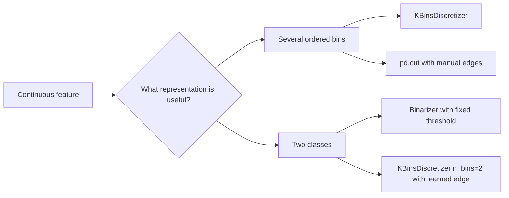
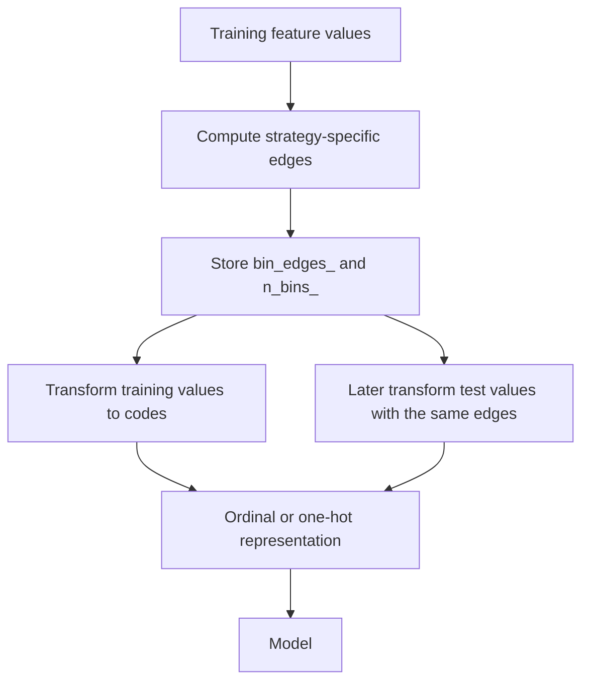
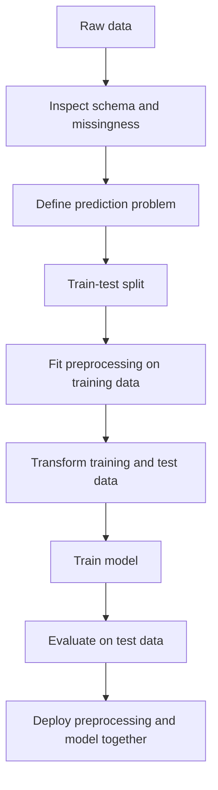

# Day 32 - Binning and Binarization

> **Course:** CampusX - 100 Days of Machine Learning, Day 32
> **Official notebooks:** `reference_notebooks/day32.ipynb` (27 cells) and `reference_notebooks/binarization.ipynb` (21 cells)
> **Personal notebooks:** `BINNING_BINERIZATION.ipynb` (23 cells) and `BINNERZATION.ipynb` (20 cells)
> **Dataset:** `datasets/train.csv` - 891 rows before cleaning; the selected modelling table has 714 complete rows
> **Central question:** A continuous feature contains more information than a small set of bins. When does reducing it to intervals, or to one binary flag, help a model, and when does it destroy useful information?

Binning is a feature-engineering operation, not a model. It changes the representation the model sees. A binning result is therefore only as trustworthy as the split, the fitted edges, and the evaluation procedure around it.

**Source labels.**

- **Official** - saved output in the CampusX notebook, possibly produced with an older scikit-learn version.
- **Rerun** - reproduced in this environment with Python 3.14.2, pandas 3.0.5, NumPy 2.5.3, and scikit-learn 1.9.1, using `DAY_32/datasets/train.csv`.
- **Supplementary** - an explanation or experiment added here, not original course output.

Where official and rerun results differ, both are reported. The most important issue in this day is not a version detail: the official notebooks use an unseeded decision tree, so many saved scores are one random realisation rather than a stable property of the data.

### How to read this chapter

**Part A** teaches the problem, the three binning strategies, binarization, the Scikit-learn API, the two official notebooks, the result audit, practical workflow, and essential interview/exam material. It is sufficient to understand and implement the topic.

**Part B** is optional advanced reading: formal edge algorithms, boundary semantics, implementation internals, full source-fidelity audit, extended comparisons, and additional practice.

---

# Part A - Main Learning Chapter

## 1. The problem: a continuous column is not always the best representation

### 1.1 A decision tree already has thresholds

A decision tree can split a continuous feature at a threshold. For a feature $x$, a split has the form

$$
x \le t \quad \text{versus} \quad x > t.
$$

The tree chooses $t$ from the observed values, typically at a midpoint between adjacent sorted values. If Age has 571 training values, there are many candidate thresholds. A deep tree can keep splitting until its leaves are very pure. That flexibility is powerful, but it can also fit noise.

Binning replaces the original value with a small interval label:

$$
x \longmapsto b \in \{0,1,\ldots,B-1\}.
$$

The tree can now split only between bin labels. If $B=15$, the possible cut points are the 14 boundaries between bins, not hundreds of arbitrary ages. The tree has less freedom. Sometimes that is useful regularisation; sometimes it removes exactly the distinction the model needed.

### 1.2 The two questions binning answers

Discretization separates two questions:

1. **Where should the boundaries be?** This is the binning algorithm: equal width, equal frequency, k-means, or manual domain rules.
2. **How should a bin be represented after it is created?** This is the encoding: ordinal code, one-hot vector, or another representation.

These questions are independent. `KBinsDiscretizer` combines them because it learns edges and encodes the resulting bins. You can also learn edges yourself and encode them with `pd.cut`, `OrdinalEncoder`, or `OneHotEncoder`.

### 1.3 Binning versus binarization

**Binning** (discretization) maps a continuous value to one of several ordered intervals:

$$
x \longmapsto \{0,1,\ldots,B-1\}.
$$

**Binarization** is the special case with two outcomes, usually defined by a fixed threshold:

$$
x \longmapsto
\begin{cases}
1, & x > t,\\
0, & x \le t.
\end{cases}
$$

Binarization is a one-bit discretization. It is not the same operation as `KBinsDiscretizer(n_bins=2)`: `KBinsDiscretizer` learns two bin boundaries from data, whereas `Binarizer` uses a threshold supplied by the user. A fixed domain threshold and a learned median can produce different splits and have different leakage properties.



---

## 2. Foundations: values, intervals, and encodings

### 2.1 Continuous, discrete, and categorical

A **continuous** variable can take values on a continuum: age, fare, temperature, income. A **discrete** variable takes separated values: number of siblings, number of rooms, counts. A **categorical** variable names groups: city, colour, ticket class.

Binning turns a continuous or ordered discrete variable into an **ordered categorical** variable. The bins have a natural order: bin 0 is lower than bin 1, which is lower than bin 2. That order matters. Treating the bin labels as unordered categories throws away information; treating them as equally spaced numbers adds an assumption that may not be true.

For example, if income bins are `[0,20k)`, `[20k,50k)`, `[50k,100k)`, and `[100k,∞)`, the numeric codes 0, 1, 2, 3 preserve order, but the distances between adjacent codes are not equal in income. A linear model using the codes assumes that moving from 0 to 1 has the same effect as moving from 2 to 3. That assumption should be checked, not assumed.

### 2.2 Bin edges and intervals

For $B$ bins, an ordered set of edges is

$$
e_0 < e_1 < \cdots < e_B.
$$

The $B$ intervals are defined between consecutive edges. The exact inclusion rule matters at boundaries. Many textbook descriptions write

$$
(e_0,e_1],\ (e_1,e_2],\ \ldots,\ (e_{B-1},e_B],
$$

which is the default convention of `pandas.cut`: right-closed intervals. `KBinsDiscretizer` uses a different boundary convention during transformation: a value equal to an internal edge goes to the higher-numbered bin. This explains why `pd.cut` labels do not always match the numeric codes produced by `KBinsDiscretizer`.

### 2.3 Ordinal and one-hot encoding

After bins are created, each bin can be represented in two common ways.

**Ordinal encoding** uses one number per observation:

$$
\text{income bin} \in \{0,1,2,3\}.
$$

This is compact and preserves order. It is usually the natural representation for a decision tree, because a tree can split on `bin <= 1` or `bin <= 2`.

**One-hot encoding** creates one column per bin:

$$
[1,0,0,0],\ [0,1,0,0],\ \ldots
$$

This avoids imposing equal numeric distances between bins. It is useful for linear models and distance-based methods, but it increases the number of columns and can create many constant columns when some bins are empty.

For the two-feature Titanic example, ordinal binning with 15 bins produces 2 columns. One-hot binning with 15 bins produces 30 columns before any feature selection.

### 2.4 Unsupervised and supervised discretization

`KBinsDiscretizer` is **unsupervised**: it looks only at the feature values, not at the target. Equal-width, equal-frequency, and k-means binning are all unsupervised.

**Supervised discretization** uses the target to choose boundaries. A decision-tree stump, for example, can search for the split that best separates the classes. This can produce bins that are more predictive, but it also increases the risk of overfitting and target leakage if the boundaries are chosen outside the training folds.

The course demonstrates unsupervised binning. The distinction still matters in interviews: a bin boundary chosen using the target is not a neutral preprocessing rule, and it must be learned inside every training fold.

---

## 3. Equal-width binning

### 3.1 Definition

Equal-width binning divides the range from the minimum to the maximum into $B$ intervals of equal width. Let

$$
x_{\min}=\min_i x_i,\qquad x_{\max}=\max_i x_i.
$$

The width is

$$
w=\frac{x_{\max}-x_{\min}}{B}.
$$

The edges are

$$
e_k=x_{\min}+kw,\qquad k=0,1,\ldots,B.
$$

For a value inside the range, the bin index is approximately

$$
b(x)=\left\lfloor\frac{x-x_{\min}}{w}\right\rfloor.
$$

At the maximum value, the expression gives $B$, which is not a valid bin index, so it is clamped to $B-1$:

$$
b(x)=\min\left(\left\lfloor\frac{x-x_{\min}}{w}\right\rfloor,\ B-1\right).
$$

`KBinsDiscretizer` extends the effective outer intervals to $-\infty$ and $+\infty$ during transformation, so values below the training minimum go to bin 0 and values above the training maximum go to bin $B-1$.

### 3.2 Worked example

Suppose a feature has values

$$
10,20,30,40,50,60,70,80,90,100
$$

and we choose $B=5$. The range is $100-10=90$, so

$$
w=\frac{90}{5}=18.
$$

The edges are

$$
10,\ 28,\ 46,\ 64,\ 82,\ 100.
$$

The assignments are:

| Value | Bin index | Interval interpretation |
|---:|---:|---|
| 10 | 0 | below 28 |
| 20 | 0 | below 28 |
| 30 | 1 | 28 to below 46 |
| 40 | 1 | 28 to below 46 |
| 50 | 2 | 46 to below 64 |
| 60 | 2 | 46 to below 64 |
| 70 | 3 | 64 to below 82 |
| 80 | 3 | 64 to below 82 |
| 90 | 4 | 82 and above |
| 100 | 4 | 82 and above |

The bins have equal width, but they do not necessarily have equal counts. Here the values are evenly spaced, so the counts happen to be equal. Real data rarely behaves so neatly.

### 3.3 Why equal width can fail on a skewed feature

Consider twelve values

$$
1,2,3,4,5,6,7,8,9,10,11,100
$$

and $B=3$. The range is $100-1=99$, so

$$
w=\frac{99}{3}=33,
$$

and the edges are

$$
1,\ 34,\ 67,\ 100.
$$

The bin counts are:

| Bin | Interval | Count |
|---:|---|---:|
| 0 | values below 34 | 11 |
| 1 | 34 to below 67 | 0 |
| 2 | 67 and above | 1 |

One extreme value, 100, stretches the range and makes almost every observation fall into the first bin. The middle bin is empty. A model receives almost no information from this representation. This is the central weakness of equal-width binning on skewed data.

For the official Titanic training split, Age ranges from 0.42 to 80. With $B=15$:

$$
w=\frac{80-0.42}{15}=5.3053\ldots
$$

The first few equal-width edges would be approximately

$$
0.42,\ 5.725,\ 11.031,\ 16.336,\ldots
$$

Age is concentrated between roughly 20 and 40, while a few values are very young or very old, so equal width would put most passengers in a few bins. The official notebook uses quantile binning instead.

### 3.4 Properties

**Strengths**

- Simple to explain and implement.
- Edges do not depend on individual order statistics, so they are easy to reproduce if the min and max are fixed.
- Works reasonably when the feature is roughly uniformly distributed.
- Can be specified without looking at the data if the domain range is known.

**Weaknesses**

- Highly sensitive to outliers and skew.
- Can create empty or nearly empty bins.
- Does not adapt to where the observations actually are.
- The minimum and maximum may be sample-specific, so edges can change across datasets.
- A value just below a boundary and a value just above it become completely different codes even though they may be almost identical.

---

## 4. Equal-frequency (quantile) binning

### 4.1 Definition

Equal-frequency binning chooses edges so that each bin contains approximately the same number of observations. If there are $n$ observations and $B$ bins, the target count per bin is approximately $n/B$.

The edges are quantiles of the training distribution:

$$
e_k=Q\left(\frac{k}{B}\right),\qquad k=0,1,\ldots,B,
$$

where $Q(p)$ is the $p$-quantile. The first edge is the minimum and the last edge is the maximum. The interior edges are the $1/B,2/B,\ldots,(B-1)/B$ quantiles.

For example, with $B=4$, the edges are the minimum, the 25th percentile, the median, the 75th percentile, and the maximum.

### 4.2 Quantiles are not unique without a convention

A quantile is not always a single observed value. For a sorted sample $x_{(1)}\le\cdots\le x_{(n)}$, the $p$-quantile can be defined by different interpolation rules. NumPy and scikit-learn support several methods. The default in this environment's `KBinsDiscretizer` is `quantile_method='averaged_inverted_cdf'`.

Different conventions can produce slightly different edges, especially for small samples or tied values. A quantile is a position in the sorted distribution, and an interpolation rule decides what value to report when the position falls between two observations.

### 4.3 Worked example

Take the values

$$
1,2,3,4,5,6,7,8,9,10,11,100
$$

and $B=3$. The quantile edges are approximately

$$
1,\ 4.5,\ 8.5,\ 100.
$$

The bin counts are:

| Bin | Interval | Count |
|---:|---|---:|
| 0 | values below 4.5 | 4 |
| 1 | 4.5 to below 8.5 | 4 |
| 2 | 8.5 and above | 4 |

The outlier 100 is isolated in the last bin, but it no longer determines the width of every bin. The bins are balanced in count rather than in width.

Contrast this with equal width on the same data:

| Strategy | Edges | Counts |
|---|---|---|
| Uniform | 1, 34, 67, 100 | 11, 0, 1 |
| Quantile | 1, 4.5, 8.5, 100 | 4, 4, 4 |

This is the clearest practical reason to prefer quantile binning for skewed features: it spends bins where the observations are, rather than where the range is largest.

### 4.4 Ties make exact equal frequency impossible

Suppose the values are

$$
1,1,1,1,2,2,3,8,9,10.
$$

The one-third quantile may be 1 because 40% of the observations are already equal to 1. The two-thirds quantile may be 3. The requested three bins may collapse to two usable bins because two edges are identical.

This is not a bug in the data; it is a fundamental limitation. If many observations have the same value, no cut point can split that tied group without splitting identical values arbitrarily. `KBinsDiscretizer` removes bins whose width is too small and warns. The fitted attribute `n_bins_` then reports the number of bins actually used, which can be smaller than the requested `n_bins`.

### 4.5 The official 15-bin Titanic example

The official notebook uses:

```python
kbin_age = KBinsDiscretizer(n_bins=15, encode='ordinal', strategy='quantile')
kbin_fare = KBinsDiscretizer(n_bins=15, encode='ordinal', strategy='quantile')
```

After fitting on `X_train`, the official saved Age edges are:

$$
0.42,\ 6,\ 16,\ 19,\ 21,\ 23,\ 25,\ 28,\ 30,\ 32,\ 35,\ 38,\ 42,\ 47,\ 54,\ 80.
$$

The official saved Fare edges are:

$$
0.0,\ 7.25,\ 7.775,\ 7.8958,\ 8.1583,\ 10.5,\ 13,\ 14.4542,\ 18.75,\ 26,\ 26.55,\ 31.275,\ 51.4792,\ 76.2917,\ 108.9,\ 512.3292.
$$

Both lists have 16 edges, which is correct for 15 bins. The first and last values are the training minimum and maximum. The interior edges are quantiles.

A **Rerun** check of the counts on the 571 training rows gives:

| Bin | Age count | Fare count |
|---:|---:|---:|
| 0 | 38 | 34 |
| 1 | 26 | 30 |
| 2 | 44 | 31 |
| 3 | 29 | 57 |
| 4 | 42 | 36 |
| 5 | 41 | 33 |
| 6 | 46 | 45 |
| 7 | 35 | 37 |
| 8 | 37 | 34 |
| 9 | 41 | 34 |
| 10 | 36 | 45 |
| 11 | 38 | 40 |
| 12 | 36 | 38 |
| 13 | 41 | 38 |
| 14 | 41 | 39 |

The counts are close to $571/15\approx38.07$, but they are not exactly equal. Ties and interpolation explain the differences. The Fare bin 3 count of 57 is substantially above the target because many passengers paid similar fares. Quantile binning balances counts as well as the data's ties allow; it cannot split identical fares between two bins.

### 4.6 The n_bins_ attribute

After fitting, `KBinsDiscretizer` exposes:

- `bin_edges_`: one array of edges per feature.
- `n_bins_`: the actual number of bins per feature after removing degenerate bins.
- `n_features_in_`: the number of input features.

The official notebook displays only `bin_edges_`. A **Supplementary** check with this environment gives `n_bins_ = [15]` for both official features, so no bins were removed in this case. On tied or constant data, `n_bins_` can be smaller.

The shape of `bin_edges_` is often surprising. For one feature it is an object array of length 1:

```python
array([array([0.42, 6. , 16. , ..., 54. , 80. ])], dtype=object)
```

To get the numeric edge list for the first feature, use:

```python
trf.named_transformers_['first'].bin_edges_[0]
```

Do not use `bin_edges_[0][0]` unless you intentionally want the first individual edge value.

### 4.7 Properties

**Strengths**

- Adapts to the distribution and gives each bin a useful number of observations.
- Handles skew better than equal width.
- Useful for features such as income or fare where a few large values would otherwise dominate.
- Makes histogram-like models and some naive Bayes variants easier to specify.

**Weaknesses**

- Edges depend on the training sample, so they must be learned inside the training fold.
- Ties and duplicate values can reduce the number of usable bins.
- New data outside the training range are clipped into the first or last bin.
- Equal-frequency bins may have very different widths, which can be surprising to users.
- Quantiles are not inherently interpretable as domain thresholds unless they happen to align with meaningful boundaries.

---

## 5. K-means binning and manual alternatives

### 5.1 One-dimensional clustering

K-means binning treats the feature values as points on a line and runs k-means clustering with $B$ clusters. The cluster centres partition the line into $B$ regions. For one-dimensional data, the boundary between adjacent clusters is the midpoint between their centres.

The algorithm alternates:

1. Assign each point to its nearest centre.
2. Recompute each centre as the mean of the points assigned to it.

This repeats until the assignments stop changing or an iteration limit is reached.

### 5.2 Worked example

Take

$$
1,2,3,10,11,12
$$

and $B=2$. The natural clusters are the low group and the high group. Their centres are approximately 2 and 11, so the boundary is

$$
\frac{2+11}{2}=6.5.
$$

The edges are

$$
1,\ 6.5,\ 12.
$$

The assignments are:

| Value | Bin |
|---:|---:|
| 1 | 0 |
| 2 | 0 |
| 3 | 0 |
| 10 | 1 |
| 11 | 1 |
| 12 | 1 |

A **Rerun** with `random_state=0` gives exactly these edges and assignments. `inverse_transform` returns the centres of the resulting intervals, approximately 3.75 and 9.25, not the original cluster means 2 and 11. `KBinsDiscretizer` stores bin boundaries and reconstructs bin centres, not the original observations.

### 5.3 Why k-means binning is different

K-means binning is neither equal width nor equal frequency. It looks for groups of values that are close together in the one-dimensional space. It may produce:

- bins of very different widths,
- bins of very different counts,
- a solution that depends on initialisation and the random state,
- an empty cluster if the data have fewer distinct groups than requested.

`KBinsDiscretizer` sorts the resulting clusters so that bin 0 is the lowest-value interval. This ordering is essential: the cluster labels produced by k-means are arbitrary, but an ordinal encoding must preserve the feature's order.

It can be useful when a feature has natural clusters, such as a mixture of low-spending and high-spending customers, or when equal-width and equal-frequency boundaries cut through dense groups. It is less interpretable than explicit domain edges, and it is not guaranteed to find the globally optimal clustering. Set `random_state` for reproducible results.

### 5.4 Manual domain binning

Sometimes the best edges come from domain knowledge, not from an algorithm:

- Age groups: `0-17`, `18-25`, `26-40`, `41-60`, `60+`.
- Income bands defined by a tax or benefits system.
- BMI categories.
- Test-score bands such as pass, merit, distinction.

Manual binning is interpretable and stable, but it can be wrong if the domain assumptions do not match the data. It should be documented and treated as part of the model specification.

In pandas, manual edges can be applied with:

```python
edges = [0, 18, 26, 41, 61, float("inf")]
income_bin = pd.cut(income, bins=edges, right=False, labels=False)
```

Always check how boundary values are assigned. Changing `right=True` to `right=False` changes whether a value equal to an edge belongs to the lower or upper interval.

### 5.5 Supervised split points

A supervised method chooses boundaries using the target. For a binary target, a decision-tree stump can search each candidate split and select the one that reduces impurity most. This can produce highly predictive bins, but the boundaries are learned from the labels.

If supervised binning is used, it must be fitted on the training data only. Fitting it on the full dataset before cross-validation leaks target information into the validation folds. This is the same principle as fitting a scaler, an imputer, or a target encoder on training data only.

`KBinsDiscretizer` does not implement supervised binning. A supervised alternative would require a custom transformer that learns boundaries during `fit(X, y)` and applies them during `transform(X)`.

---

## 6. Inside KBinsDiscretizer

### 6.1 The object before and after fitting

Before fitting, a `KBinsDiscretizer` stores only hyperparameters:

```python
kb = KBinsDiscretizer(
    n_bins=15,
    encode="ordinal",
    strategy="quantile"
)
```

At this point there are no learned edges. The object is a specification, not a fitted transformer. Calling `transform` before `fit` raises a `NotFittedError`.

After fitting, scikit-learn adds attributes whose names end with an underscore:

| Attribute | Meaning |
|---|---|
| `bin_edges_` | One array of edges per feature |
| `n_bins_` | Actual number of bins per feature |
| `n_features_in_` | Number of input features seen during fit |

The trailing underscore is a scikit-learn convention: it signals a value learned from data. `n_bins` without the underscore is the requested hyperparameter; `n_bins_` with the underscore is the fitted result.

### 6.2 The fit stage

The fit stage examines the training values only. It does not look at the target.

For `strategy='uniform'`, the edges are evenly spaced between the minimum and maximum:

$$
e_k=x_{\min}+k\frac{x_{\max}-x_{\min}}{B}.
$$

For `strategy='quantile'`, the edges are quantiles:

$$
e_k=Q\left(\frac{k}{B}\right).
$$

For `strategy='kmeans'`, the values are clustered into $B$ groups. The cluster centres are sorted, and the internal edges are the midpoints between adjacent centres. The first and last edges are the training minimum and maximum.

For a constant feature, there is no meaningful range. A **Rerun** check shows that `KBinsDiscretizer` warns that the feature is constant, produces one bin with edges `[-inf, inf]`, and transforms every value to 0. The correct response is usually to drop the constant feature.

### 6.3 The transform stage and boundary convention

For each feature $j$, the fitted transformer has edges

$$
e_{j,0}<e_{j,1}<\cdots<e_{j,B_j}.
$$

The implementation uses the interior edges, not the outer minimum and maximum, to assign a bin:

```python
Xt[:, j] = np.searchsorted(
    bin_edges[j][1:-1],
    Xt[:, j],
    side="right"
)
```

With `side="right"`, a value equal to an interior edge goes to the higher-numbered bin. Values below the first interior edge go to bin 0. Values above the last interior edge go to the last bin. The outer edges are used mainly for `inverse_transform` and for describing the range; during transformation, the effective outer limits are $-\infty$ and $+\infty$.

This produces a left-closed convention for interior boundaries. A worked comparison:

| Value | Official Age edges | KBinsDiscretizer code | pd.cut default label |
|---:|---|---:|---|
| 0.42 | minimum | 0 | `NaN` because the lowest edge is excluded |
| 6.00 | interior edge | 1 | `(0.42, 6.0]` |
| 16.00 | interior edge | 2 | `(6.0, 16.0]` |
| 80.00 | maximum | 14 | `(54.0, 80.0]` |

The difference at 6.00 and 16.00 is not a rounding issue. It comes from two different boundary conventions. `pd.cut` defaults to right-closed intervals and excludes the lowest edge; `KBinsDiscretizer` puts a value equal to an interior edge in the higher bin. The official `pd.cut` labels are useful for human-readable display, but they are not a byte-for-byte reproduction of the numeric codes.

A **Supplementary** exact equivalent for a single feature's fitted edges is:

```python
edges = kb.bin_edges_[0]
codes = np.clip(
    np.digitize(X[:, 0], edges[1:-1], right=False),
    0,
    len(edges) - 2,
)
```

This uses the same interior-edge convention and clamps values outside the training range to the first or last bin. `pd.cut(..., include_lowest=True)` fixes only the minimum; it does not align every interior boundary with `KBinsDiscretizer`.

### 6.4 Out-of-range values are clipped

Suppose the training edges are

$$
0,\ 6.667,\ 13.333,\ 20.
$$

A **Supplementary** test gives:

```python
kb.transform([[-100], [5], [100]])
# [[0.], [0.], [2.]]
```

Values below the training range go to bin 0; values above it go to the last bin. This is convenient in production because it never produces an out-of-range code, but it also means an extreme new observation is treated like an ordinary observation in the nearest edge bin. Monitoring the fraction of out-of-range values is important.

### 6.5 Encodings

`encode` controls the representation of the binned output.

| `encode` | Output | Shape | Typical use |
|---|---|---|---|
| `'ordinal'` | Numeric bin code per feature | `(n_samples, n_features)` | Trees, ordinal models, compact storage |
| `'onehot'` | Sparse CSR matrix | `(n_samples, sum(n_bins_))` | Linear models, distance-based models |
| `'onehot-dense'` | Dense array | `(n_samples, sum(n_bins_))` | Small data, code that needs a dense array |

The default is `'onehot'`, not `'ordinal'`. The official notebooks explicitly set `encode='ordinal'`, which is appropriate for decision trees and makes the output easy to inspect.

A **Rerun** check shows that `encode='ordinal'` returns a NumPy array with dtype `float64` in this environment, even though the values look like integers. If you need integer storage, cast explicitly after checking that there are no missing values. The one-hot form returns a SciPy sparse matrix by default; use `.toarray()` only when the matrix is small enough to fit densely in memory.

### 6.6 Inverse transform

`inverse_transform` converts bin codes back to a representative value in each bin. With edges

$$
1,\ 6.5,\ 12,
$$

the reconstructed values for codes 0 and 1 are the interval centres:

$$
\frac{1+6.5}{2}=3.75,\qquad \frac{6.5+12}{2}=9.25.
$$

This is not the original data. If the original values were 1, 2, and 3, the inverse transformation returns 3.75 for all three. Binning is lossy: it discards within-bin variation. This is what makes it a form of regularisation, and also what makes it unsuitable when precise values matter.

### 6.7 Duplicate edges and constant features

A **Supplementary** example with many repeated values:

```python
X = np.array([1, 1, 1, 1, 2, 2, 3, 8, 9, 10]).reshape(-1, 1)
kb = KBinsDiscretizer(n_bins=3, encode="ordinal", strategy="quantile")
kb.fit(X)
```

The requested 3 bins collapse to 2 usable bins. The warning is:

```text
Bins whose width are too small (i.e., <= 1e-8) in feature 0 are removed.
Consider decreasing the number of bins.
```

The one-third quantile is 1, the two-thirds quantile is 3, and the repeated 1 values make one edge duplicate. The fitted `n_bins_` is `[2]`, and the codes use only 0 and 1. The transformer does not pretend to have created three meaningful bins.

This behaviour matters in production. If you request 20 bins for a feature with only a few distinct values, you may silently receive fewer bins. Check `n_bins_` after fitting, and do not assume that the number of output columns equals `n_bins`.

### 6.8 Missing values and parameters

Both `KBinsDiscretizer` and `Binarizer` reject `NaN` with a `ValueError` in this environment. The official notebooks call `dropna` before fitting. In a real pipeline, decide explicitly how to handle missing values:

- Drop rows only if the missingness is small and not systematically related to the target.
- Impute before binning, and fit the imputer on training data only.
- Create a separate missing-indicator bin if missingness itself is informative.
- Do not silently coerce missing values to zero, because zero may be a meaningful value.

| Parameter | Meaning | Notes |
|---|---|---|
| `n_bins` | Requested number of bins | Can be reduced by duplicate edges |
| `strategy` | `uniform`, `quantile`, or `kmeans` | Controls edge computation |
| `encode` | Output representation | Default `'onehot'` |
| `subsample` | Maximum training rows used to estimate edges | Default 200,000; matters for large data |
| `random_state` | Randomness for k-means and subsampling | Set it for reproducibility |
| `dtype` | Output dtype | Default depends on input; ordinal output is often float |
| `quantile_method` | Quantile interpolation convention | Newer scikit-learn parameter |

The `subsample` parameter exists so that fitting does not require scanning an arbitrarily large dataset when estimating quantiles. When `n_samples > subsample`, the edges are estimates from a subsample, not exact quantiles of the entire training set.

### 6.9 Data flow



The critical split is between **fit** and **transform**. The edges are learned once from the training data. The test data never influence them.

---

## 7. The official binning notebook

### 7.1 Data selection and split

The official `day32.ipynb` starts with:

```python
df = pd.read_csv('train.csv', usecols=['Age', 'Fare', 'Survived'])
df.dropna(inplace=True)
```

The raw file has 891 rows and 12 columns. Selecting three columns and dropping rows with missing values leaves

$$
714 \text{ rows} \times 3 \text{ columns}.
$$

Age is the only selected column with missing values in this file: 177 of the 891 values are missing. Fare and Survived have none. Therefore `dropna` removes 177 rows.

`X = df.iloc[:, 1:]` takes Age and Fare; `y = df.iloc[:, 0]` takes Survived. This relies on the column order produced by `usecols`. Name-based selection is safer:

```python
X = df[['Age', 'Fare']]
y = df['Survived']
```

The split is:

```python
X_train, X_test, y_train, y_test = train_test_split(
    X, y, test_size=0.2, random_state=42
)
```

This gives 571 training rows and 143 test rows. `random_state=42` makes the split reproducible; it does **not** make the decision tree reproducible.

### 7.2 Baseline

The official baseline is:

```python
clf = DecisionTreeClassifier()
clf.fit(X_train, y_train)
y_pred = clf.predict(X_test)
accuracy_score(y_test, y_pred)
```

The saved **Official** holdout accuracy is

$$
0.6293706293706294.
$$

The saved **Official** 10-fold cross-validation mean is

$$
0.6289123630672926.
$$

The model has no `random_state`. A **Rerun** on the same split produced different values across repeated fits, for example 0.622377, 0.629371, 0.636364, and 0.643357. The number of leaves also changed. The precision of the saved number is misleading: it is one run of a stochastic model, not a stable constant.

The default tree has no maximum depth. It grows until its stopping rules are satisfied, producing roughly 197-200 leaves on this split. That is a very flexible model for 571 training rows.

### 7.3 Constructing the transformers

The official code creates two separate transformers:

```python
kbin_age = KBinsDiscretizer(
    n_bins=15,
    encode='ordinal',
    strategy='quantile'
)
kbin_fare = KBinsDiscretizer(
    n_bins=15,
    encode='ordinal',
    strategy='quantile'
)
```

Why two objects instead of one? `KBinsDiscretizer` can accept a two-column matrix and fit separate edges for each column. A single object would work. The course instead assigns one transformer to each column and combines them with `ColumnTransformer`. Both designs are valid. Two objects make the per-feature mapping explicit and allow different strategies for different features; one object is shorter.

The `ColumnTransformer` is:

```python
trf = ColumnTransformer([
    ('first', kbin_age, [0]),
    ('second', kbin_fare, [1])
])
```

Each tuple means:

1. `'first'` / `'second'`: a name used to retrieve the fitted transformer.
2. `kbin_age` / `kbin_fare`: the transformer object.
3. `[0]` / `[1]`: the selected column positions.

The order of the tuples determines the order of the transformed columns. Output column 0 is binned Age; output column 1 is binned Fare. If the tuple order were reversed, the output order would reverse and the manual DataFrame labels would be wrong.

Using names would be clearer:

```python
ColumnTransformer([
    ('age_bin', kbin_age, ['Age']),
    ('fare_bin', kbin_fare, ['Fare'])
])
```

Positional selection is valid when the column order is known and stable.

### 7.4 Fitting and transforming

```python
X_train_trf = trf.fit_transform(X_train)
X_test_trf = trf.transform(X_test)
```

The first line does two things:

1. Each selected transformer learns edges from the training column.
2. Each transformer applies those edges to the training column.

The second line applies the already-learned edges to the test column. It does not recompute edges. This is the same `fit_transform` on training and `transform` on test pattern used for scaling and imputation.

`trf` returns a NumPy array, not a DataFrame. The rows are in the same order as `X_train`, and the columns are in transformer order:

```text
output[:, 0] = binned Age
output[:, 1] = binned Fare
```

The original column names are not preserved. If you want names, use `get_feature_names_out()` or `set_output(transform="pandas")` in an appropriate scikit-learn version, while checking the exact column names produced.

### 7.5 Inspecting edges and building the output table

```python
trf.named_transformers_['first'].bin_edges_
```

The output is an object array containing the Age edge array. The official output includes 16 edges from 0.42 to 80. The 16 edges define 15 bins.

Why `named_transformers_` rather than `transformers`? `ColumnTransformer` stores fitted transformers in `named_transformers_`, a dictionary-like object keyed by the names from the tuples. It is available after fitting. The fitted transformer is the same kind of `KBinsDiscretizer` object that was passed in, but now it has `bin_edges_`.

The official notebook displays the same `bin_edges_` in two consecutive cells. This duplication has no effect; both cells show the same fitted state.

The official code combines the original and transformed values:

```python
output = pd.DataFrame({
    'age': X_train['Age'],
    'age_trf': X_train_trf[:, 0],
    'fare': X_train['Fare'],
    'fare_trf': X_train_trf[:, 1]
})
```

The Series and array entries have the same row order, so the columns line up. If the array rows were reordered independently of the Series index, pandas would not align them; here they are produced in the same order.

The labels are created with `pd.cut`:

```python
output['age_labels'] = pd.cut(
    x=X_train['Age'],
    bins=trf.named_transformers_['first'].bin_edges_[0].tolist()
)
```

This is a display convenience, not the same operation as the fitted transformer. As shown in Section 6.3:

- A value at the training minimum is excluded by the default `pd.cut` convention and becomes `NaN`, while `KBinsDiscretizer` assigns 0.
- A value at an interior edge is placed in the lower `pd.cut` interval, while `KBinsDiscretizer` assigns the higher code.

A **Rerun** count on the official split found one Age value exactly at 0.42 and six Fare values exactly at 0.0. Those seven training rows receive `NaN` labels from `pd.cut` but valid codes from `KBinsDiscretizer`. The official sample of five rows does not happen to show them, so the discrepancy is easy to miss.

The official output sample shows, for example:

| age | age_trf | fare | fare_trf | age_labels | fare_labels |
|---:|---:|---:|---:|---|---|
| 4.00 | 0.0 | 29.125 | 10.0 | (0.42, 6.0] | (26.55, 31.275] |
| 22.00 | 4.0 | 10.5167 | 5.0 | (21.0, 23.0] | (10.5, 13.0] |
| 39.00 | 11.0 | 13.00 | 6.0 | (38.0, 42.0] | (10.5, 13.0] |

The sample rows are consistent because none lies exactly on a problematic boundary. The table demonstrates the mapping, but it is not proof of exact boundary agreement.

### 7.6 The binned model

```python
clf = DecisionTreeClassifier()
clf.fit(X_train_trf, y_train)
y_pred2 = clf.predict(X_test_trf)
accuracy_score(y_test, y_pred2)
```

The saved **Official** accuracy is

$$
0.6363636363636364.
$$

Compared with the official baseline 0.6293706293706294, this is an increase of

$$
0.6363636363636364-0.6293706293706294
=0.006993006993007
=\frac{1}{143}.
$$

The test set has 143 rows, so the difference is exactly **one correct prediction**. That is not enough evidence to conclude that binning is better. The tree is unseeded, the test set is small, and the two models differ in both representation and random tie-breaking.

A **Supplementary** seeded comparison on the same split is more informative but still dataset-specific:

- baseline `DecisionTreeClassifier(random_state=0)` holdout accuracy: 0.6224;
- 15-bin quantile holdout accuracy: 0.6364;
- baseline tree leaves: about 198;
- binned tree leaves: 148.

The binned tree is smaller, which is consistent with the intended regularisation effect. It does not prove that binning will help on another dataset.

### 7.7 The cross-validation bug

The official cell is:

```python
X_trf = trf.fit_transform(X)
np.mean(cross_val_score(DecisionTreeClassifier(), X, y, cv=10, scoring='accuracy'))
```

The transformed matrix is stored in `X_trf`, but `cross_val_score` receives `X`, the original unbinned features. The saved value, 0.6275625978090766, is therefore a cross-validation score of the **baseline** representation, not the binned representation. It is also an unseeded tree score.

This is a variable-tracing bug, not a subtle statistical issue. The correct call would pass the transformed matrix, but even that would be the wrong experimental design because `trf.fit_transform(X)` was fitted on all data before cross-validation. The correct design is a pipeline fitted inside each fold.

The `discretize` function repeats the same mistake:

```python
X_trf = trf.fit_transform(X)
print(np.mean(cross_val_score(DecisionTreeClassifier(), X, y, cv=10)))
```

The printed value, 0.6303208137715179 for `bins=5, strategy='kmeans'`, is another baseline score. The histograms on the right are produced from `X_trf`, so the visual shows binning even though the score does not. The mismatch between the visual and the number is a valuable debugging lesson: read which variable is passed to the scoring function, not just which variable was created.

A **Supplementary** leakage-safe pipeline:

```python
pipe = Pipeline([
    ('pre', ColumnTransformer([
        ('age_bin', KBinsDiscretizer(
            n_bins=15, encode='ordinal', strategy='quantile'
        ), ['Age']),
        ('fare_bin', KBinsDiscretizer(
            n_bins=15, encode='ordinal', strategy='quantile'
        ), ['Fare']),
    ])),
    ('model', DecisionTreeClassifier(random_state=0)),
])

scores = cross_val_score(pipe, X, y, cv=10, scoring='accuracy')
```

With this environment and the official split data, a seeded run gives:

| Model | 10-fold CV mean |
|---|---:|
| Baseline tree, `random_state=0` | 0.6303 |
| 15-bin quantile pipeline, `random_state=0` | 0.6753 |

A repeated 5x10-fold check gives approximately 0.6255 for the baseline and 0.6597 for the quantile pipeline. These are **Supplementary** results, not official outputs. They suggest that binning helped this particular tree on this particular dataset; they do not establish a general rule. The source notebook's printed CV values cannot be used for this comparison because they were computed on the wrong representation.

### 7.8 The personal binning notebook

The local notebook follows the same idea but differs in several details:

- It reads the copied root `train.csv` rather than the folder-relative dataset.
- It uses `random_state=34`, not 42, so its train/test split and quantile edges differ.
- It uses `cv=15` for one baseline score and `cv=14` for the pipeline comparison.
- Its Age edges begin at 0.67, not 0.42, because the training split is different.
- It fixes the cross-validation design by putting `ColumnTransformer` inside a `Pipeline`.
- In the holdout experiment it creates `clf_trans` but fits `clf` by mistake. The metric still comes from a model fitted on the transformed training data because `clf` is refitted on `X_train_trans`; however, the unused variable is confusing and should be corrected when the notebook is polished.

Its saved values are one run of an unseeded tree:

| Local experiment | Saved value |
|---|---:|
| Baseline holdout | 0.6923 |
| Baseline CV, `cv=15` | 0.6346 |
| Binned holdout | 0.6573 |
| Leakage-safe binned pipeline, `cv=14` | 0.6835 |
| `discretize(10, 'quantile')` pipeline | 0.6709 |

These numbers are not directly comparable with the official numbers because the split seed and cross-validation fold count differ. The local pipeline is the better evaluation pattern. Its `discretize` function also fits the transformer on all `X` for the histograms; that is acceptable for a visualisation after the CV score has been computed, but it must not be used to generate the score itself.

The first markdown cell of the local notebook contains repeated draft text. It does not affect execution, but it should be cleaned later without changing the code or the learning content.

---

## 8. Binarization

### 8.1 Definition

Binarization maps every value to 0 or 1 using a threshold $t$:

$$
z=
\begin{cases}
1, & x>t,\\
0, & x\le t.
\end{cases}
$$

The comparison is strict. A value exactly equal to the threshold belongs to the 0 group.

For `Binarizer` in scikit-learn, the default threshold is 0.0:

```python
from sklearn.preprocessing import Binarizer

binarizer = Binarizer(threshold=0.0)
```

A **Supplementary** check gives:

| Input | Output at threshold 0 |
|---:|---:|
| -1 | 0 |
| 0 | 0 |
| 0.5 | 1 |
| 1 | 1 |

The operation is applied elementwise. It does not standardise, rank, or learn a data-dependent cutoff.

### 8.2 The family example

The official binarization notebook constructs:

```python
df['family'] = df['SibSp'] + df['Parch']
```

SibSp counts siblings and spouses aboard; Parch counts parents and children aboard. Their sum is the number of family members aboard, excluding the passenger. A value of 0 means the passenger is travelling alone. The distribution on the 714 complete rows is:

| Family value | Count |
|---:|---:|
| 0 | 404 |
| 1 | 139 |
| 2 | 93 |
| 3 | 27 |
| 4 | 11 |
| 5 | 22 |
| 6 | 12 |
| 7 | 6 |

There are 310 passengers with a positive family value and 404 with zero. The survival rate in this dataset is approximately 32.2% for the zero group and 51.6% for the positive group. That is an association, not proof of causation; family size may be confounded with sex, class, and age.

`Binarizer(threshold=0)` maps:

- `family = 0` to 0;
- every positive family value to 1.

The name "family" is potentially confusing: output 0 means "alone", while 1 means "with family", not "has a family value of one". If the desired feature is "travelling alone", invert the flag:

```python
alone = 1 - binarizer.transform(X[['family']])
```

or write an explicit custom transformer. `Binarizer` only implements $x>t$; it does not provide a direction parameter.

If the domain meaning is "at least two family members", use a threshold between 1 and 2, such as 1.5. If it is "at least one", use 0. The threshold must be chosen from the problem definition, not from the test set.

### 8.3 When binarization is useful

Binarization is appropriate when the problem genuinely has a two-state distinction:

- an image pixel is bright or dark;
- a word count is present or absent;
- income is above or below a policy threshold;
- a passenger is alone or travelling with family;
- a sensor reading is above or below a safety limit.

In these cases, the threshold has a domain meaning, and the loss of the exact value is acceptable or desirable.

Binarization is usually a poor default when the exact magnitude matters. Turning age into "over 30 or not" discards the difference between 5 and 25 and the difference between 31 and 80. A tree may still benefit from the simpler split, but a linear model may not, and the choice of threshold can dominate the result.

### 8.4 Binarizer internals

`Binarizer` is a transformer with almost no learned state. Its parameters are:

| Parameter | Default | Meaning |
|---|---:|---|
| `threshold` | 0.0 | The cut point; values strictly greater become 1 |
| `copy` | True | Whether to copy the input before transforming |

`fit` validates the input and records `n_features_in_` and, when available, feature names. It does not learn a threshold from the data. The threshold is a hyperparameter supplied by the user.

Therefore:

```python
Binarizer(threshold=0).fit(X_train).transform(X_test)
```

and

```python
Binarizer(threshold=0).fit_transform(X_test)
```

produce the same values, because the transformation does not depend on training statistics. Fitting on the full dataset is not a leakage problem **when the threshold is fixed independently of the data**. If the threshold was estimated from the full dataset, the estimation step is the leakage, not the `Binarizer.fit` call.

This is different from `KBinsDiscretizer`, which learns data-dependent edges. `Binarizer` gives you control; it also gives you the responsibility to choose the threshold correctly.

### 8.5 copy=False can mutate the input

`copy=False` is an optimisation, not a model behaviour. With a pandas DataFrame and numeric input, a **Rerun** confirms:

```python
X = pd.DataFrame({'a': [-1, 0, 1], 'b': [-2, 3, 4]})
before = X.copy(deep=True)
Binarizer(copy=False).fit_transform(X)
# X has changed: negatives become 0, positives become 1
not X.equals(before)  # True
```

With `copy=True` (the default), the original DataFrame remains unchanged. In the official binarization notebook, `Binarizer(copy=False)` is placed inside a `ColumnTransformer`. A **Rerun** of that exact pattern shows that `X_train` is mutated: after the transform, the `family` column contains only 0 and 1, not the original counts 0-7.

This has several consequences:

- If later code expects the raw `family` column, it will receive corrupted data.
- If you compute a baseline after applying the transformer, the baseline may accidentally use the binarized column.
- If the same DataFrame object is reused across experiments, the side effect can be hidden.

For reproducible experiments, prefer the default `copy=True`. Use `copy=False` only when you have measured that the copy is a bottleneck and you are certain that the original data are no longer needed.

### 8.6 ColumnTransformer behaviour

The official transformer is:

```python
trf = ColumnTransformer(
    [('bin', Binarizer(copy=False), ['family'])],
    remainder='passthrough'
)
```

The output is a NumPy array with columns:

```text
[family_binarized, Age, Fare]
```

The transformed column comes first because it is the first tuple. `remainder='passthrough'` keeps Age and Fare and appends them in their original order. If `remainder='drop'` were used, only the binary family column would remain.

`ColumnTransformer` selects columns by name here, which is safer than positional selection. It applies `Binarizer.fit_transform` to the selected column during training and `Binarizer.transform` to the selected column during testing. The order of the selected columns is preserved.

The output array is float here because it is concatenated with the float Age and Fare columns. A standalone `Binarizer` on an integer DataFrame may return integer dtype. Do not rely on the dtype without checking it.

### 8.7 Binarizer versus KBinsDiscretizer(n_bins=2)

Both can produce two groups, but they are not equivalent:

| Property | Binarizer | KBinsDiscretizer(n_bins=2) |
|---|---|---|
| Threshold | User supplies it | Learned from training data |
| Fit-dependent state | None | Edges, `bin_edges_`, `n_bins_` |
| Default strategy | Not applicable | Quantile |
| Reproducibility | Fixed if threshold fixed | Depends on strategy and sampling |
| Leakage risk | Only if threshold is data-derived | Always if edges are fitted on full data |
| Typical use | Domain threshold, image pixels | Data-driven low/high split |

If the threshold is a meaningful fixed value such as zero, `Binarizer` is the clearer tool. If you want the data to decide the split, `KBinsDiscretizer(n_bins=2, strategy='quantile')` is appropriate, but it must be fitted inside the training fold.

### 8.8 A leakage-safe binarization pipeline

```python
pipe = Pipeline([
    ('pre', ColumnTransformer(
        [('family_bin', Binarizer(threshold=0.0), ['family'])],
        remainder='passthrough'
    )),
    ('model', DecisionTreeClassifier(random_state=0)),
])

scores = cross_val_score(pipe, X, y, cv=10, scoring='accuracy')
```

The binary threshold is fixed at zero, so the transformer is stateless. The pipeline still matters because it keeps the transformation and the model together, prevents accidental use of a pre-transformed test set, and makes the evaluation procedure explicit. If the threshold were learned, the transformer would need a custom `fit` that uses only the training fold.

---

## 9. The official binarization notebook and results

### 9.1 Data and feature construction

The official `binarization.ipynb` loads:

```python
df = pd.read_csv('train.csv')[
    ['Age', 'Fare', 'SibSp', 'Parch', 'Survived']
]
df.dropna(inplace=True)
```

The selected data contain 714 complete rows. Then:

```python
df['family'] = df['SibSp'] + df['Parch']
df.drop(columns=['SibSp', 'Parch'], inplace=True)
```

The final model frame has columns Age, Fare, family, and Survived. `X` contains the first three; `y` contains Survived.

The split is again 80/20 with `random_state=42`: 571 training rows and 143 test rows. The train/test shapes are `(571, 3)` and `(143, 3)`.

### 9.2 Baseline

```python
clf = DecisionTreeClassifier()
clf.fit(X_train, y_train)
y_pred = clf.predict(X_test)
accuracy_score(y_test, y_pred)
```

The saved **Official** holdout accuracy is 0.6293706293706294. The saved **Official** 10-fold CV mean is 0.6429381846635367.

The local `BINNERZATION` notebook uses the same split seed but reports a baseline holdout of 0.6223776223776224 and a 14-fold CV mean of 0.65406162464986. These differences come from the unseeded tree and the different fold count. They are not evidence that the dataset changed; the CSV files have the same SHA-256.

### 9.3 The binarization transform

```python
from sklearn.preprocessing import Binarizer

trf = ColumnTransformer(
    [('bin', Binarizer(copy=False), ['family'])],
    remainder='passthrough'
)

X_train_trf = trf.fit_transform(X_train)
X_test_trf = trf.transform(X_test)
```

The transformed training array has 571 rows and 3 columns, in the order:

```text
family_binary, Age, Fare
```

The official output shows family values of 1.0 for passengers with any family member aboard and 0.0 for passengers travelling alone. The original family counts 2, 5, 7, and so on are no longer available in the transformed array.

Because `copy=False` is used, `X_train` itself is also modified. This is not merely theoretical: a **Rerun** of the exact DataFrames shows that the original `family` column is overwritten. If a later cell needed the raw family size, it would be too late.

### 9.4 The binarized model

```python
clf = DecisionTreeClassifier()
clf.fit(X_train_trf, y_train)
y_pred2 = clf.predict(X_test_trf)
accuracy_score(y_test, y_pred2)
```

The saved **Official** accuracy is 0.6363636363636364. Again, this differs from the baseline by exactly one test prediction:

$$
0.6363636363636364-0.6293706293706294
=\frac{1}{143}.
$$

The binarized tree does not have a lower leaf count in a meaningful way: a **Supplementary** rerun shows about 190-193 leaves, compared with roughly 190 for the baseline. Binarization did not simplify the tree as much as one might hope, because the two continuous features still provide many possible splits.

### 9.5 The cross-validation cell

The official code is:

```python
X_trf = trf.fit_transform(X)
np.mean(cross_val_score(DecisionTreeClassifier(), X_trf, y, cv=10, scoring='accuracy'))
```

The saved **Official** value is 0.6304186228482003, compared with the baseline CV of 0.6429381846635367.

This cell fits the transformer on **all** of `X`, then cross-validates on the already transformed matrix. Because `Binarizer` has no learned threshold, the threshold is the fixed default 0, this is not the same kind of edge leakage as fitting a quantile transformer on all data. The binary rule is identical for every sample regardless of the training fold. The cell is still poor workflow:

- it teaches preprocessing outside the cross-validation loop;
- it mutates `X` through `copy=False`;
- it would become genuine leakage if the threshold were estimated from the data;
- it makes the evaluation code depend on an object fitted outside the fold.

For a fixed domain threshold, a pipeline is still preferable because it documents the order of operations and protects against later changes to the threshold. For a learned threshold, a pipeline is mandatory.

A **Supplementary** leakage-safe seeded comparison on the same data gives:

| Model | 10-fold CV mean |
|---|---:|
| Baseline tree with raw family, `random_state=0` | 0.6541 |
| Binarized family pipeline, `random_state=0` | 0.6262 |

A repeated 5x10-fold check gives approximately 0.6399 for the baseline and 0.6205 for the binarized version. On this dataset and model, binarization reduced cross-validated accuracy. The one-row holdout improvement is not enough to overturn that evidence. The result is still specific to this model and these features; it is not a universal statement that binarization is bad.

### 9.6 Why baseline CV differs from holdout

The holdout and cross-validation numbers answer different questions:

- The holdout is one 143-row test set. Its accuracy has granularity $1/143\approx0.699$ percentage points.
- The 10-fold CV averages ten fits on different 90/10 splits of the 714 rows. Each fold's validation set has about 71 rows, and the training sets overlap across folds.
- The unseeded tree changes between fits, so the CV mean also has random variation.

The official baseline holdout 0.62937 and CV 0.64294 are not contradictory. They are estimates from different partitions and different random fits. A careful report would include the CV standard deviation, the confusion matrix, and a fixed model seed.

### 9.7 The local BINNERZATION notebook

The local notebook follows the official workflow and adds a leakage-safe pipeline at the end:

```python
pipe = Pipeline([
    ('pre', trf),
    ('mdoel', DecisionTreeClassifier())
])
score = np.mean(cross_val_score(pipe, X, y, cv=14, scoring='accuracy'))
```

The saved score is 0.630252100840336, compared with its baseline 14-fold CV of 0.65406162464986. The same qualitative conclusion appears: binarizing family did not improve this cross-validated tree.

The local notebook also uses `Binarizer(copy=False)`, so its `X_train` is mutated. Its markdown correctly notes that `copy=False` changes the original column and `copy=True` forms a new result. The markdown's spelling and the `'mdoel'` key are harmless, but the key should eventually be corrected for clarity.

The local notebook has no separate binarized holdout accuracy; it compares the baseline holdout with the pipeline CV. Those two numbers are not directly comparable. The official notebook does compare two holdout accuracies, but the difference is one test row.

---

## 10. Results, reproducibility, and interpretation

### 10.1 Complete result table

The following table separates **Official** saved output from **Rerun** and **Supplementary** checks. Do not compare rows with different splits, fold counts, or model random states as if they were one controlled experiment.

| Notebook / experiment | Representation | Split / CV | Saved value | Source |
|---|---|---|---:|---|
| Official binning baseline | Raw Age, Fare | 80/20, seed 42 | 0.62937 | Official |
| Official binning baseline | Raw Age, Fare | 10-fold CV | 0.62891 | Official |
| Official binning model | 15-bin quantile | 80/20, seed 42 | 0.63636 | Official |
| Official binning "CV" | Raw Age, Fare passed to CV | 10-fold CV | 0.62756 | Official, wrong representation |
| Official `discretize(5, kmeans)` print | Raw Age, Fare passed to CV | 10-fold CV | 0.63032 | Official, wrong representation |
| Official binarization baseline | Raw Age, Fare, family | 80/20, seed 42 | 0.62937 | Official |
| Official binarization baseline | Raw Age, Fare, family | 10-fold CV | 0.64294 | Official |
| Official binarization model | Binary family, raw Age, Fare | 80/20, seed 42 | 0.63636 | Official |
| Official binarization CV | Binary family, raw Age, Fare | 10-fold CV | 0.63042 | Official |
| Local binning baseline | Raw Age, Fare | 80/20, seed 34 | 0.69231 | Local saved |
| Local binning baseline | Raw Age, Fare | 15-fold CV | 0.63463 | Local saved |
| Local binning model | 15-bin quantile | 80/20, seed 34 | 0.65734 | Local saved |
| Local binning pipeline | 15-bin quantile | 14-fold CV | 0.68347 | Local saved |
| Local binning `discretize(10, quantile)` | 10-bin quantile pipeline | 14-fold CV | 0.67087 | Local saved |
| Local binarization baseline | Raw Age, Fare, family | 80/20, seed 42 | 0.62238 | Local saved |
| Local binarization baseline | Raw Age, Fare, family | 14-fold CV | 0.65406 | Local saved |
| Local binarization pipeline | Binary family, raw Age, Fare | 14-fold CV | 0.63025 | Local saved |
| Supplementary binning baseline | Raw Age, Fare | 10-fold CV, model seed 0 | 0.63026 | Rerun / supplementary |
| Supplementary binning model | 15-bin quantile pipeline | 10-fold CV, model seed 0 | 0.67529 | Rerun / supplementary |
| Supplementary binning repeated | Raw vs 15-bin quantile | 5x10-fold, model seed 0 | 0.62552 vs 0.65970 | Rerun / supplementary |
| Supplementary binarization baseline | Raw family | 10-fold CV, model seed 0 | 0.65415 | Rerun / supplementary |
| Supplementary binarization pipeline | Binary family | 10-fold CV, model seed 0 | 0.62617 | Rerun / supplementary |
| Supplementary binarization repeated | Raw vs binary | 5x10-fold, model seed 0 | 0.63988 vs 0.62052 | Rerun / supplementary |

The supplementary values are not the course's outputs. They demonstrate a fair comparison and show why the official CV cell cannot support a conclusion about binning.

### 10.2 Why the official comparisons are fragile

There are four separate sources of instability:

1. **The model is unseeded.** `DecisionTreeClassifier()` has no `random_state`. Repeated fits on the same data can choose different splits when features or values tie.
2. **The split seed and the model seed are different things.** `train_test_split(random_state=42)` fixes which rows are in train and test. It does not fix the tree.
3. **The test set is small.** With 143 rows, one changed prediction changes accuracy by 0.00699. The official binning holdout difference is exactly one row.
4. **The CV call uses the wrong representation in the binning notebook.** A score computed on raw `X` cannot tell us whether binned `X_trf` is better.

A **Rerun** of the official split produced multiple unseeded tree accuracies in the range 0.6224-0.6434. The exact saved value 0.6293706293706294 is one point in that distribution, not a fixed property. Reporting sixteen decimal places for a stochastic estimate of a 143-row test set is false precision.

### 10.3 What one test row means

With 143 test observations, the possible accuracy values are fractions with denominator 143. The difference

$$
\frac{91}{143}-\frac{90}{143}=\frac{1}{143}\approx0.006993
$$

is the difference between 0.63636 and 0.62937. This is why the official holdout comparison cannot establish that binning or binarization improved the model. The correct interpretation is:

> On this one split and this one random tree fit, the binned model happened to classify one additional test passenger correctly.

It is not:

> Binning improves decision trees by 0.7 percentage points.

The second claim requires repeated splits, controlled seeds, and preferably confidence intervals or paired tests.

### 10.4 Accuracy is not the whole story

The target is imbalanced: 290 of 714 passengers survived, about 40.6%. A trivial classifier that predicts "did not survive" for everyone would achieve about 59.4% accuracy. The tree's 62-64% is better than that baseline, but accuracy alone does not say whether the model identifies survivors or merely predicts the majority class well.

A proper evaluation should include:

- a confusion matrix;
- precision, recall, and F1 for the survival class;
- ROC-AUC or PR-AUC;
- calibration if predicted probabilities are used;
- cross-validated means and standard deviations;
- a fixed model seed and documented scikit-learn version.

Binning can change all of these metrics in different directions. A representation that improves accuracy by predicting the majority class more often may reduce recall for the minority class.

### 10.5 Binning reduced tree size in the supplementary experiment

On the official split with a seeded tree:

| Model | Test accuracy | Leaves |
|---|---:|---:|
| Raw Age and Fare | 0.6224 | about 198 |
| 15-bin quantile Age and Fare | 0.6364 | 148 |

The binned tree has substantially fewer leaves. This is the expected mechanism: fewer possible split points constrain the tree, so it cannot carve the feature space into as many small regions. The smaller tree may generalise better, but it may also miss a real threshold that lies between two bin edges.

The holdout difference is still one row. The cross-validated repeated result is stronger evidence for this dataset, but it is not a universal law. A different dataset, a different model, or a different number of bins could reverse the conclusion.

### 10.6 Binarization did not improve the supplementary cross-validation

On the binarization data with a seeded tree:

| Model | 10-fold CV mean | Repeated 5x10 CV mean |
|---|---:|---:|
| Raw family counts | 0.6541 | 0.6399 |
| Binary family > 0 | 0.6262 | 0.6205 |

The raw family count carries information that the binary flag does not: the difference between one family member and three may matter, and the tree can split the count at more than one threshold. The binary feature discards that granularity. On this dataset, the loss outweighed any regularisation benefit.

This is a useful counterexample to "simpler is always better". Simpler representations reduce variance but can increase bias. The correct question is whether the discarded information was signal or noise.

### 10.7 The official and local notebooks are not one experiment

The official and local notebooks differ in:

- split seed: 42 versus 34 for binning;
- CV fold count: 10 versus 14 or 15;
- model random state: unseeded in both;
- local binarization and official binarization use the same split seed but different CV folds;
- local binning reads the root dataset path.

Therefore their scores cannot be arranged in one table as if only the representation changed. The local notebooks demonstrate the workflow; they do not provide a controlled replication of the official output.

---

## 11. Practical workflow, comparisons, and mistakes

### 11.1 Where binning belongs

A typical workflow is:



Binning belongs in the preprocessing stage, after the split and before the model. It is not a property of the raw dataset; it is a property of the training sample used to fit the edges.

The official notebooks call `dropna` before the split, then split, then fit the binner on `X_train`. Dropping rows before the split is common in a course demonstration, but in a production workflow consider whether missingness is informative. If missingness is related to the target, dropping rows can change the population being evaluated. The safer pattern is often to split first and fit an imputer on the training data.

### 11.2 Fit on training, transform test

The contract is:

```python
# training
X_train_binned = transformer.fit_transform(X_train)

# test
X_test_binned = transformer.transform(X_test)
```

- `fit_transform` learns edges from `X_train` and applies them to `X_train`.
- `transform` applies the already-learned edges to `X_test`.
- The test set must not influence the edges.
- The same fitted transformer object must be used for both.

Passing `X_test` to `fit_transform` would allow the test distribution to influence the bins. Even though binning is unsupervised, this is still a violation of the evaluation contract: the representation would not be reproducible from training data alone.

### 11.3 Pipelines make the contract executable

A pipeline packages the transformer and the model:

```python
pipe = Pipeline([
    ('preprocess', ColumnTransformer([
        ('age_bin', KBinsDiscretizer(
            n_bins=15, encode='ordinal', strategy='quantile'
        ), ['Age']),
        ('fare_bin', KBinsDiscretizer(
            n_bins=15, encode='ordinal', strategy='quantile'
        ), ['Fare']),
    ])),
    ('model', DecisionTreeClassifier(random_state=0)),
])
```

During `cross_val_score(pipe, X, y, cv=10)`, each fold:

1. clones the pipeline;
2. fits the binner on that fold's training rows;
3. transforms that fold's training and validation rows;
4. fits the tree on the transformed training rows;
5. scores the transformed validation rows.

The bin edges are therefore different in each fold, which is correct: each fold simulates a model trained on a different sample. This is the pattern missing from the official binning CV cell.

### 11.4 Leakage taxonomy for this day

| Leakage type | Example in Day 32 | Consequence |
|---|---|---|
| Preprocessing leakage | Fit quantile edges on all `X` before CV | Validation distribution influences bins |
| Target leakage | Choose a supervised bin threshold on all labels | Bins encode validation labels |
| Evaluation leakage | Tune threshold on the test set | Test score is optimistic |
| Workflow leakage | Reuse a transformed matrix without tracking its fit | Hard to reproduce; hidden test information |
| Mutation | `Binarizer(copy=False)` overwrites `X_train` | Later experiments use corrupted data |

The first three are statistical leakage. The last is a software-state bug. Both can invalidate a conclusion, but they require different fixes.

### 11.5 What to save for production

A deployed binning model needs:

- the fitted edges or the fitted transformer;
- the threshold for `Binarizer`;
- the column order and selected columns;
- the imputation rules for missing values;
- the model parameters and random state;
- the training data version and scikit-learn version;
- a monitoring rule for out-of-range values and distribution drift.

If you save only the model and recompute edges at inference time from new data, the representation changes and the model becomes inconsistent. Save the fitted preprocessing object together with the model, for example with `joblib` or `pickle`, and load the pair as one artifact.

### 11.6 Monitoring in production

Binning creates fixed intervals. New data can:

- fall below the training minimum;
- fall above the training maximum;
- concentrate in one bin;
- make a previously empty bin common;
- change the meaning of a bin because of inflation or policy changes.

`KBinsDiscretizer` clips out-of-range values into the first or last bin. That is safe for code execution but dangerous for interpretation: a new extreme value looks ordinary. Monitor the fraction of values outside the training range and the distribution of bin codes. If the distribution has shifted substantially, retrain and re-fit the edges on a new training window.

### 11.7 Common mistakes

**Mistake 1 - Fitting the binner on all data before cross-validation.**

```python
# Wrong
trf = ColumnTransformer([...])
X_all = trf.fit_transform(X)
scores = cross_val_score(model, X_all, y, cv=10)
```

The edges have already seen every validation row. Use a pipeline.

**Mistake 2 - Creating the transformed matrix but scoring the original matrix.**

```python
# Wrong: X_trf is created but X is passed
X_trf = trf.fit_transform(X)
cross_val_score(model, X, y, cv=10)
```

This is the bug in the official binning notebook. The score is a baseline score, not a binned score.

**Mistake 3 - Using `fit_transform` on the test set.** This learns new edges from the test set. Use `trf.transform(X_test)`.

**Mistake 4 - Forgetting `remainder='passthrough'`.** Only the selected column survives; Age and Fare disappear.

**Mistake 5 - Assuming `pd.cut` labels equal `KBinsDiscretizer` codes.** They use different boundary conventions. Test boundary values explicitly.

**Mistake 6 - Assuming quantile bins have exactly equal counts.** Ties and interpolation can produce counts that differ from $n/B$. The official Fare bin 3 has 57 observations while the target is about 38.

**Mistake 7 - Assuming `n_bins_` equals `n_bins`.** Duplicate edges can remove bins. Requested 3 bins can produce 2 usable bins.

**Mistake 8 - Reusing a DataFrame after `Binarizer(copy=False)`.** The original column may be overwritten. Use the default `copy=True`.

**Mistake 9 - Treating `Binarizer` as a learned median splitter.** It uses the threshold you supply. It does not compute a median or an optimal cut.

**Mistake 10 - Choosing a threshold on the test set.** This is leakage. Use training data or a validation set, then evaluate once on test.

**Mistake 11 - Forgetting that the default encoding is one-hot.** `KBinsDiscretizer()` without `encode` returns a sparse matrix, often with many more columns than expected.

**Mistake 12 - Passing a Series instead of a 2D column.** Use `X[['Age']]`, not `X['Age']`, when calling the transformer directly.

**Mistake 13 - Assuming binning always helps a tree.** A tree can already split continuous values. Binning may regularise or may destroy a useful threshold.

**Mistake 14 - Comparing holdout and CV values as if they were the same experiment.** A 143-row holdout and a 10-fold CV mean are different estimates.

**Mistake 15 - Reporting sixteen decimal places for a random model.** The tree is unseeded and the test set is small. Report a sensible precision and include uncertainty.

**Mistake 16 - Forgetting to handle missing values before binning.** Both transformers reject NaN. Fit an imputer or drop rows deliberately.

**Mistake 17 - Binning a constant feature and expecting information.** A constant feature produces one bin and a warning. Drop it.

**Mistake 18 - Interpreting `inverse_transform` as recovery of the original data.** It returns a representative value, usually a bin centre.

### 11.8 Debugging procedure

When a binning experiment looks wrong, check these items in order:

1. **Shape before and after.** Does `fit_transform` return the number of rows you expect? Does `ColumnTransformer` preserve the passthrough columns?
2. **Column order.** Did you label the output columns in transformer order?
3. **Missing values.** Did `dropna` remove the rows you intended? Which column caused the loss?
4. **Edges.** Print `bin_edges_[0]`. Are they sorted? Are there 16 values for 15 bins? Do they match the training range?
5. **Actual bin count.** Print `n_bins_`. Did duplicate values remove bins?
6. **Boundary agreement.** Transform a small array containing the minimum, an interior edge, and the maximum. Compare with `pd.cut`.
7. **Fit state.** Is `transform` being called before `fit`? Is the test set accidentally fitted?
8. **Mutation.** Did `copy=False` change the raw DataFrame? Compare a saved copy.
9. **Pipeline path.** Trace which object reaches `cross_val_score`: raw `X`, transformed `X_trf`, or a pipeline?
10. **Seeds.** Set the split seed and the model seed. Repeat the CV with a second seed to see how stable the difference is.
11. **Metric denominator.** How many test rows? What is one prediction worth in accuracy?
12. **Class balance.** Does the accuracy hide poor minority-class recall?

A useful small test is:

```python
probe = pd.DataFrame({
    'Age': [0.42, 6.0, 16.0, 80.0],
    'Fare': [0.0, 7.25, 31.275, 512.3292],
})
print(trf.named_transformers_['first'].bin_edges_[0])
print(trf.transform(probe))
```

If the probe values are valid numbers but the codes are surprising, the boundary convention is usually the explanation.

---

## 12. Essential interview and examination preparation

### 12.1 Interview questions

**Q1. What is discretization?**

Discretization maps a continuous or ordered numeric feature into a finite set of intervals. Each interval is represented by a label or code. It reduces the resolution of the feature, which can simplify the model and reduce overfitting, but it also discards the exact value and the variation within each bin.

**Q2. What is the difference between binning and binarization?**

Binning produces several ordered bins, while binarization produces exactly two values using a threshold. Binning can preserve coarse magnitude and order across multiple levels. Binarization keeps only which side of one cut point a value lies on. Binarization is a special case, but its typical implementation uses a fixed user threshold, whereas `KBinsDiscretizer` learns its edges from data.

**Q3. What is a bin edge?**

A bin edge is a boundary between intervals. For $B$ bins there are $B+1$ edges, including the minimum and maximum. The interior edges are the actual cut points used during transformation. A value equal to an interior edge must be assigned consistently; `KBinsDiscretizer` assigns it to the higher bin, while `pandas.cut` defaults to the lower right-closed interval.

**Q4. Why might we bin a continuous feature?**

We might bin to reduce the influence of outliers, capture nonlinear relationships with a linear model, create interpretable bands, regularise a flexible model, satisfy an algorithm that expects categorical or discrete inputs, or handle a feature whose exact value is unreliable. We should not bin automatically. A decision tree can already split continuous features, and binning can remove useful thresholds.

**Q5. What are the main parameters of `KBinsDiscretizer`?**

`n_bins` sets the requested number of bins. `strategy` chooses `'uniform'`, `'quantile'`, or `'kmeans'`. `encode` chooses `'ordinal'`, `'onehot'`, or `'onehot-dense'`. `subsample` limits the number of rows used to estimate edges on large datasets. `random_state` controls k-means and subsampling. `dtype` controls the output type. The fitted attributes are `bin_edges_`, `n_bins_`, and `n_features_in_`.

**Q6. What is the difference between `ordinal`, `onehot`, and `onehot-dense`?**

`ordinal` returns one ordered numeric code per feature. `onehot` returns a sparse binary matrix with one column per bin. `onehot-dense` returns the same information as a dense NumPy array. Ordinal is compact and natural for trees; one-hot avoids imposing equal distances and is often useful for linear models; dense one-hot is convenient for small data but can use a lot of memory.

**Q7. What is the difference between `n_bins` and `n_bins_`?**

`n_bins` is the requested hyperparameter set by the user. `n_bins_` is the actual number of bins learned during fitting. They can differ when duplicate edges are removed, when the feature is constant, or when there are too few distinct values. The trailing underscore follows the scikit-learn convention for fitted attributes.

**Q8. What does `Binarizer(threshold=t)` do?**

It returns 1 when a value is strictly greater than `t`, and 0 otherwise. The comparison is strict, so a value equal to the threshold becomes 0. The default threshold is 0.0. `Binarizer` does not learn the threshold from data; the threshold is a user-supplied hyperparameter.

**Q9. What is the difference between `fit_transform` and `transform`?**

`fit_transform` learns any fitted state from the input and then applies the transformation. `transform` applies already-learned state without changing it. For `KBinsDiscretizer`, `fit_transform(X_train)` learns the edges; `transform(X_test)` reuses them. For a stateless `Binarizer`, the numerical result is the same, but the workflow distinction still matters because `fit` validates the input.

**Q10. How do you choose between equal-width and equal-frequency binning?**

Use equal width when the feature is roughly uniform and the range is meaningful. Use equal frequency when the feature is skewed or when you want each bin to contain enough observations. Equal width is easier to explain and stable if the domain range is fixed; equal frequency adapts to the data but makes the edges sample-dependent and can be affected by ties.

**Q11. Why do quantile bins not always have equal counts?**

Quantiles are positions in a sorted sample, not guarantees that every interval contains exactly the same number of distinct observations. If many observations have the same value, a cut cannot split the tied group. Interpolation also means the reported edge may not correspond to an observed value. The resulting counts can differ from $n/B$.

**Q12. Is k-means binning the same as running k-means clustering on the dataset?**

No. It is one-dimensional k-means applied separately to each feature. The clusters are groups of values on the feature's line, and the bin edges are the midpoints between adjacent cluster centres. It does not use the target and does not cluster rows using all features together.

**Q13. How is `KBinsDiscretizer(n_bins=2)` different from `Binarizer`?**

`KBinsDiscretizer(n_bins=2)` learns one boundary from the training data. The default strategy is quantile, so the boundary is approximately the median; uniform or k-means would use different rules. `Binarizer` uses a fixed threshold supplied by the user. The former is data-dependent and must be fitted inside the training fold; the latter is stateless with respect to the data, but the threshold can still be chosen badly or from the full dataset.

**Q14. Why do `pd.cut` labels not always match `KBinsDiscretizer` codes?**

They use different boundary conventions. `pd.cut` defaults to right-closed intervals and excludes the lowest edge unless `include_lowest=True`. `KBinsDiscretizer` uses `np.searchsorted(..., side='right')`, so an interior-edge value goes to the higher bin. The labels can look sensible while the integer codes differ at the boundaries.

**Q15. How does binning cause data leakage?**

If the bin edges are learned from the full dataset before the train/test split or before cross-validation, the representation has seen the validation or test distribution. The model's evaluation is then not a simulation of training on data that excludes the evaluation rows. Even though binning is unsupervised, the edges are a fitted parameter and must be learned on training data only.

**Q16. The official binning notebook creates `X_trf` but passes `X` to `cross_val_score`. What is wrong?**

The printed score is a baseline score on the original features. `X_trf` is never used by the scoring call. The code therefore does not measure the binned representation at all. The histogram after the call may show binned values, which makes the mismatch especially misleading.

**Q17. Is the official binarization CV cell leakage?**

The transformer has a fixed threshold of 0, so `Binarizer` learns no data-dependent cutoff. Calling `fit_transform` on all `X` does not leak a learned threshold in the way a quantile binner would. However, the cell fits preprocessing outside the CV loop, mutates `X` through `copy=False`, and teaches a pattern that would leak if the threshold were estimated from data. The safer and clearer design is a pipeline.

**Q18. Why is `Binarizer(copy=False)` dangerous?**

It may write the binarized values into the original input array or DataFrame. A **Rerun** confirms that `X_train` is mutated when the official `ColumnTransformer` is used. Any later code that expects the raw family counts then sees only 0 and 1. Use `copy=True` unless you have measured a performance need and have verified that the original data are no longer needed.

**Q19. Why is the official holdout improvement not evidence that binning works?**

The test set has 143 rows. The difference between 0.62937 and 0.63636 is one correct prediction. The tree is unseeded, the test set is small, and the course does not compare multiple splits. A one-row difference can easily arise from random tie-breaking.

**Q20. How does `KBinsDiscretizer` assign a value to a bin?**

After fitting, each feature has sorted edges. During transform, the implementation searches the interior edges with `np.searchsorted(..., side='right')`. The result is the number of interior edges less than or equal to the value. Values below the first interior edge get 0; values equal to an interior edge go to the higher bin; values above the last interior edge go to the last bin.

**Q21. What is the memory trade-off between ordinal and one-hot binning?**

Ordinal encoding stores one numeric code per feature per row. One-hot encoding stores one value per bin per feature per row, usually in a sparse matrix so that only the active bin is stored. With 15 bins and two features, ordinal uses 2 values per row; one-hot uses up to 30 values per row in a dense representation, or 2 nonzeros per row in a sparse representation.

**Q22. How does binning affect a decision tree?**

Binning restricts the candidate thresholds to bin boundaries. That reduces the tree's flexibility and can reduce overfitting, but it can also remove a useful threshold that lies inside a bin. In the supplementary experiment, the raw tree had about 198 leaves and the 15-bin tree had 148, with slightly better holdout accuracy and better repeated CV on this dataset. The result is plausible but not universal.

**Q23. What is the computational complexity of fitting and transforming?**

For uniform binning, fitting is essentially a minimum and maximum scan, $O(nd)$ for $n$ rows and $d$ features, plus edge construction. Quantile binning requires sorting or selection by feature, commonly $O(nd\log n)$ depending on the implementation. K-means binning runs a one-dimensional clustering per feature and adds iterative cost. Transforming is $O(nd\log B)$ or $O(nd)$ depending on the search implementation.

**Q24. You have a heavily skewed income feature and a logistic regression. How would you represent it?**

I would start with quantile or domain-informed binning and one-hot encoding. Logistic regression cannot capture a nonlinear income effect from a raw linear term, so bins can represent a stepwise relationship. Quantile bins keep enough observations in each bin; domain edges may be more interpretable but can leave some bins sparse. I would compare raw income plus splines or transformations as alternatives.

**Q25. Design a leakage-safe pipeline for the Titanic experiment.**

```python
pre = ColumnTransformer([
    ('age_bin', KBinsDiscretizer(
        n_bins=15, encode='ordinal', strategy='quantile'
    ), ['Age']),
    ('fare_bin', KBinsDiscretizer(
        n_bins=15, encode='ordinal', strategy='quantile'
    ), ['Fare']),
])

pipe = Pipeline([
    ('pre', pre),
    ('model', DecisionTreeClassifier(random_state=0)),
])

scores = cross_val_score(pipe, X, y, cv=10, scoring='accuracy')
```

If the target is imbalanced, I would also report F1, recall, and ROC-AUC. If I wanted to tune `n_bins` or the strategy, I would put that search inside the CV loop or use nested CV.

**Q26. When should you not bin a feature?**

Do not bin when the exact value is important for the decision, the model can already model nonlinearity or thresholds well, the data are too small to estimate stable edges, the resulting bins are unstable across samples, the binning would create many one-hot columns and overfit, the boundaries would be arbitrary and hard to defend, or the feature is already discrete with meaningful values.

**Q27. How would you monitor a deployed binning model?**

Track the distribution of bin codes, the fraction of values below and above the training range, missingness, and model performance when labels arrive. If a bin that was rare becomes common, or if many values are clipped into the edge bins, the representation may no longer match the training distribution. Retrain and re-fit the edges on a suitable training window, and version the transformer with the model.

**Q28. What is supervised discretization, and why is it risky?**

Supervised discretization chooses bin boundaries using the target, for example by finding split points that maximise class separation. It can produce bins that are more predictive than unsupervised bins, but it uses label information. If the boundaries are chosen on the full dataset, the validation folds contain information from their own labels through the edges, causing target leakage.

**Q29. Why might two quantile runs produce different edges?**

Possible reasons: different quantile interpolation methods; different training samples or split seeds; different scikit-learn versions; subsampling for large datasets; duplicate values that change how degenerate bins are removed; k-means random initialisation if the strategy is k-means.

**Q30. What happens to a constant feature or a feature with fewer distinct values than bins?**

A constant feature produces a warning and a single bin, usually with edges `[-inf, inf]`; all values become 0. A feature with fewer distinct values than requested bins can produce duplicate edges; the zero-width bins are removed and `n_bins_` is smaller than `n_bins`. Drop constant features and check `n_bins_` for low-cardinality features.

### 12.2 Numerical questions

**Numerical 1. Equal-width edges.**

The training Age minimum is 0.42 and the maximum is 80. Use $B=5$.

$$
w=\frac{80-0.42}{5}=\frac{79.58}{5}=15.916.
$$

The edges are:

$$
0.42,\ 16.336,\ 32.252,\ 48.168,\ 64.084,\ 80.
$$

Assign these values: 0.42, 6, 16, 32.252, 64.084, 80.

| Value | Internal-edge comparison | Bin |
|---:|---|---:|
| 0.42 | below 16.336 | 0 |
| 6 | below 16.336 | 0 |
| 16 | below 16.336 | 0 |
| 32.252 | equal to the second interior edge | 2 |
| 64.084 | equal to the fourth interior edge | 4 |
| 80 | above all interior edges | 4 |

The exact edge value goes to the higher bin under `KBinsDiscretizer`'s convention. `pd.cut` with default settings would assign the minimum to `NaN` and would put an interior-edge value in the lower interval.

**Numerical 2. Uniform versus quantile counts.**

Use the twelve values

$$
1,2,3,4,5,6,7,8,9,10,11,100
$$

and $B=3$.

**Uniform:** width $=(100-1)/3=33$, edges $1,34,67,100$.

- Bin 0: values below 34: 11 values.
- Bin 1: 34 to below 67: 0 values.
- Bin 2: 67 and above: 1 value (100).

**Quantile:** the one-third and two-thirds quantiles are 4.5 and 8.5 under the interpolation used by this environment. Edges $1,4.5,8.5,100$.

- Bin 0: 1,2,3,4: 4 values.
- Bin 1: 5,6,7,8: 4 values.
- Bin 2: 9,10,11,100: 4 values.

The quantile strategy spends its bins on the dense part of the data and isolates the outlier. The uniform strategy creates an empty middle bin and leaves almost all observations in the first bin.

**Numerical 3. Boundary conventions.**

Use edges

$$
0,\ 7,\ 14,\ 21
$$

and values 0, 7, 14, 21.

**KBinsDiscretizer:** interior edges are 7 and 14. Using `searchsorted(..., side='right')`:

| Value | Code |
|---:|---:|
| 0 | 0 |
| 7 | 1 |
| 14 | 2 |
| 21 | 2 |

**pd.cut default:** intervals are $(0,7]$, $(7,14]$, $(14,21]$; the lowest edge is excluded.

| Value | Label | Integer code |
|---:|---|---:|
| 0 | NaN | NaN |
| 7 | (0,7] | 0 |
| 14 | (7,14] | 1 |
| 21 | (14,21] | 2 |

With `include_lowest=True`, 0 becomes part of the first interval, so 0 and 7 receive code 0. The interior boundary 7 still differs from `KBinsDiscretizer`, which assigns code 1. With `right=False`, 0 maps to code 0, 7 to code 1, 14 to code 2, and 21 falls outside the last interval unless the last edge is extended.

**Numerical 4. Metric granularity.**

A test set has 143 rows. The two accuracies are

$$
\frac{90}{143}=0.6293706293706294,
\qquad
\frac{91}{143}=0.6363636363636364.
$$

Their difference is

$$
\frac{1}{143}=0.006993006993007.
$$

One additional correct prediction produces the entire reported improvement. A rough binomial standard error at $p\approx0.63$ and $n=143$ is

$$
\sqrt{\frac{0.63(1-0.63)}{143}}
=\sqrt{\frac{0.2331}{143}}
\approx0.0404.
$$

A 95% normal-approximation interval is roughly $\pm0.079$, much wider than the one-row difference. The interval is approximate because the model fits are not independent binomial trials, but it illustrates the scale of the uncertainty.

**Numerical 5. Binarizer thresholds.**

For family values 0, 1, 2, 3:

| Threshold $t$ | Rule | Output |
|---:|---|---|
| 0 | $x>0$ | 0, 1, 1, 1 |
| 0.5 | $x>0.5$ | 0, 1, 1, 1 |
| 1 | $x>1$ | 0, 0, 1, 1 |
| 1.5 | $x>1.5$ | 0, 0, 1, 1 |

At threshold 0, output 0 means "alone" and 1 means "with family". To create an "alone" indicator, use $1-\text{output}$, giving 1, 0, 0, 0.

**Numerical 6. Shapes through preprocessing.**

Assume 143 test rows.

**Binning:** `X` has two features (Age, Fare), each binned into 15 ordinal bins.

- `encode='ordinal'`: output shape $(143,2)$.
- `encode='onehot'` or `'onehot-dense'`: output shape $(143,30)$; the default one-hot form is sparse.

**Binarization:** `X` has three columns (Age, Fare, family); the family column is binarized and the other two are passed through.

- `remainder='passthrough'`: output shape $(143,3)$ in the order `family_binary`, Age, Fare.
- `remainder='drop'`: output shape $(143,1)$.

**Duplicate edges:** if `n_bins=3` collapses to `n_bins_=2` for a single feature, the ordinal output has one column with codes 0 and 1, not three columns.

### 12.3 Analytical questions

**Analytical 1. Audit the official binning notebook.**

The official notebook:

- correctly selects columns and drops missing rows;
- correctly fits on `X_train` and transforms `X_test`;
- correctly inspects `bin_edges_`;
- incorrectly uses `pd.cut` labels as if they were exact reproductions of the fitted codes;
- incorrectly creates `X_trf` but scores `X` in the CV cell;
- incorrectly repeats the same mistake inside `discretize`;
- uses an unseeded tree, so its holdout comparison is not reproducible.

The most serious learning error is the CV bug, because it gives the impression that binned cross-validation was performed when it was not. The fix is a pipeline with the transformer inside, a fixed model seed, and an explicit comparison on the same folds.

**Analytical 2. Choose a representation for a skewed feature.**

Suppose Fare is strongly right-skewed and the model is a decision tree. I would compare:

1. raw Fare;
2. 5, 10, and 15 equal-frequency bins with ordinal encoding;
3. equal-width bins as a baseline;
4. possibly k-means bins if the fare distribution has natural groups.

I would use the same split, the same tree seed, and repeated cross-validation. I would report mean accuracy and its variability, but also inspect the confusion matrix and the number of leaves. If binning reduces performance, I would keep the continuous feature. If it improves stability without a large loss of minority-class recall, I would consider it. I would not choose the number of bins by looking at the test set.

**Analytical 3. A production scenario.**

A model is trained on fares from 0 to 512. In production, a new fare of 2,000 arrives. `KBinsDiscretizer` puts it in the highest bin, so the model treats it like an ordinary first-class fare near 512. The code does not fail, but the interpretation may be wrong. I would:

- log the fraction of values outside the training range;
- add a separate "above training range" indicator if extreme values are meaningful;
- monitor bin distributions and model performance;
- retrain with a new training window if the fare distribution has shifted;
- save the fitted transformer with the model so the edges do not change silently.

**Analytical 4. Binarize family or keep the count?**

The family count ranges from 0 to 7. A tree can split it at multiple thresholds, so it can distinguish alone, one family member, and larger families. Binarizing at 0 keeps only "alone versus with family" and discards the difference between one and several members. In the supplementary CV, the binary version performed worse. I would keep the count for a tree unless there is a strong domain reason to collapse it.

---

## 13. Revision summary

1. **Discretization** maps a continuous or ordered feature to intervals; it is lossy but can regularise or simplify a model.
2. **Binning** produces several ordered bins; **binarization** produces two values using a threshold.
3. **Equal-width** edges are evenly spaced and sensitive to outliers; **equal-frequency** edges are quantiles and adapt to the distribution.
4. **Quantile bins** can have unequal counts because of ties and interpolation; `n_bins_` may be smaller than `n_bins`.
5. **K-means binning** clusters each feature separately and forms edges between cluster centres; it needs a random state for reproducibility.
6. **`KBinsDiscretizer`** learns edges in `fit`, stores `bin_edges_`, and applies them in `transform`.
7. **Boundary conventions matter:** `KBinsDiscretizer` sends an interior-edge value to the higher bin; `pd.cut` defaults to a right-closed lower interval and excludes the minimum.
8. **`Binarizer`** applies a fixed threshold with a strict greater-than comparison; it does not learn a median split.
9. **`copy=False`** can mutate the input DataFrame; use `copy=True` unless the side effect is understood and safe.
10. **`ColumnTransformer`** output order is transformer order, then passthrough columns; it returns an array, not a DataFrame.
11. **A pipeline** fits bin edges separately in every cross-validation fold; this is the correct leakage-safe design.
12. **The official binning CV cell** scores raw `X`, not the binned `X_trf`; its printed CV value is not a binned result.
13. **The official holdout differences** are one test row and are not evidence of a general improvement.
14. **The official tree is unseeded**, so its saved scores are one random realisation; fixed seeds and repeated CV are required for fair comparisons.
15. **A fixed-threshold `Binarizer` is stateless**, but a data-derived threshold must still be learned on training data only.

**Pre-model checklist.**

- [ ] Is binning justified for this feature and model, or would the continuous feature be better?
- [ ] Are missing values handled before binning?
- [ ] Is the strategy (`uniform`, `quantile`, `kmeans`) appropriate for the distribution?
- [ ] Is the number of bins justified, not chosen from the test set?
- [ ] Are the fitted edges inspected and stored?
- [ ] Is `n_bins_` equal to the requested number, or were bins removed?
- [ ] Are the bin counts sensible, or are some bins empty?
- [ ] Is the encoding (`ordinal` or one-hot) appropriate for the model?
- [ ] Is the transformer inside a pipeline so it refits per fold?
- [ ] Is the model random state fixed?
- [ ] Are the metrics appropriate for class imbalance?
- [ ] Are out-of-range and missing values monitored in production?
- [ ] Is the fitted transformer saved with the model?

---

# Part B - Advanced Reading and Reference

## 14. Formal edge algorithms and boundary semantics

### 14.1 Uniform edges

For $B$ bins,

$$
w=\frac{x_{\max}-x_{\min}}{B},
\qquad
e_k=x_{\min}+kw.
$$

The implementation extends the outer intervals to $-\infty$ and $+\infty$ at transform time, so the first and last edges describe the training range rather than hard clipping limits.

### 14.2 Quantile edges and interpolation

For sorted observations $x_{(1)}\le\cdots\le x_{(n)}$, a quantile method defines $Q(p)$ by interpolating between order statistics. Different methods produce different edges when the target position falls between observations. In this environment, the default `quantile_method='averaged_inverted_cdf'` is used. For exact reproduction, record the scikit-learn version and the quantile method.

When $n$ is larger than `subsample`, the edges are estimated from a subsample rather than the full training set. This is a performance trade-off: the fitted edges are still fixed for transformation, but they are not exact quantiles of all training rows.

### 14.3 K-means edges

One-dimensional k-means alternates assignment and centre updates. After convergence, the centres $c_1<\cdots<c_B$ are sorted. The interior edges are

$$
e_k=\frac{c_k+c_{k+1}}{2},
$$

with $e_0=x_{\min}$ and $e_B=x_{\max}$. The result depends on initialisation, so `random_state` is part of the experimental configuration.

### 14.4 Exact boundary semantics

`KBinsDiscretizer` uses

```python
np.searchsorted(interior_edges, x, side="right")
```

so the code counts interior edges less than or equal to $x$. This means:

- $x<e_1$: code 0;
- $x=e_k$ for an interior edge: code $k$;
- $x>e_{B-1}$: code $B-1$.

`pd.cut` defaults to right-closed intervals $(e_{k-1},e_k]$ and excludes the lowest edge. `include_lowest=True` includes the minimum but does not change interior-edge behaviour. `right=False` changes the closure direction and can push the maximum outside the last interval. There is no single flag that makes `pd.cut` identical to `KBinsDiscretizer` for every boundary; use the transformer's own output when exact codes matter.

### 14.5 Inverse transform

For edges $e_0,\ldots,e_B$, the representative value for bin $k$ is

$$
\frac{e_k+e_{k+1}}{2}.
$$

This is a bin centre, not an original observation. For k-means binning, it is the midpoint of the interval, not necessarily the original cluster centre.

### 14.6 Complexity

| Strategy | Fit cost | Transform cost | Memory |
|---|---|---|---|
| Uniform | $O(nd)$ | $O(nd\log B)$ or $O(nd)$ | $O(nd)$ dense |
| Quantile | $O(nd\log n)$ typical | $O(nd\log B)$ | $O(nd)$ dense |
| K-means | Iterative $O(ndB)$ per iteration | $O(nd\log B)$ | $O(nd)$ dense |
| One-hot | Same fit | Sparse output | $O(n\sum B_j)$ sparse |

## 15. Implementation internals and data flow

`KBinsDiscretizer` is a stateful transformer. The fitted state is the edge array and the actual bin counts. The `fit` stage is column-wise: each feature is processed independently, even when a single transformer receives multiple columns. `transform` uses the stored interior edges and does not recompute them.

`ColumnTransformer` is a meta-estimator. During `fit`, it selects columns for each tuple, fits the corresponding transformer, and stores the fitted object in `named_transformers_`. During `transform`, it applies each fitted transformer to its selected columns, concatenates the outputs in tuple order, and appends passthrough columns in their original order.

`Binarizer` is stateless with respect to the data: `fit` validates the input and records metadata, but the threshold is a hyperparameter. This is why fitting it on all data does not leak a learned cutoff. The risk shifts to the threshold-selection step: if the threshold is estimated from the full dataset, that estimation is the leakage.

`Pipeline` clones each step for every cross-validation fold. The clone's `fit_transform` is called on the training rows, and `transform` is called on the validation rows. This is the mechanism that makes the bin edges fold-specific.

## 16. Full source-fidelity audit

### 16.1 Official `day32.ipynb` - 27 cells

| Cell(s) | Content | Covered in |
|---:|---|---|
| 0-1 | pandas, NumPy, plotting, model and preprocessing imports | Part A, Section 7.1 |
| 2-3 | Load Age, Fare, Survived; drop missing rows | Part A, Section 7.1 |
| 4-5 | Shape and head; 714 rows | Part A, Section 7.1 |
| 6-8 | Build X, y; train/test split; inspect training rows | Part A, Sections 7.1-7.2 |
| 9-12 | Baseline tree; holdout accuracy; 10-fold CV | Part A, Sections 7.2 and 10 |
| 13-15 | `KBinsDiscretizer`; `ColumnTransformer`; fit/transform | Part A, Sections 7.3-7.4 |
| 16-17 | Inspect Age `bin_edges_` twice | Part A, Section 7.5 |
| 18-20 | Build output table; `pd.cut` labels; sample | Part A, Section 7.5 |
| 21-22 | Binned tree; holdout accuracy | Part A, Section 7.6 |
| 23 | Flawed CV: passes X, not X_trf | Part A, Section 7.7 |
| 24 | `discretize` function with the same CV bug | Part A, Section 7.7 |
| 25 | `discretize(5, 'kmeans')`; score and histograms | Part A, Section 7.7 |
| 26 | Empty cell | - |

### 16.2 Official `binarization.ipynb` - 21 cells

| Cell(s) | Content | Covered in |
|---:|---|---|
| 0-1 | Imports | Part A, Section 9.1 |
| 2-3 | Load selected columns; drop missing rows | Part A, Section 9.1 |
| 4-8 | Inspect data; build family; drop SibSp, Parch | Part A, Sections 8.2 and 9.1 |
| 9-11 | Build X, y; train/test split; inspect training rows | Part A, Section 9.1 |
| 12-13 | Baseline holdout and 10-fold CV | Part A, Sections 9.2 and 10 |
| 14-16 | Import and construct `Binarizer`; fit/transform | Part A, Section 9.3 |
| 17 | DataFrame view of transformed training data | Part A, Section 9.3 |
| 18 | Binarized model holdout | Part A, Section 9.4 |
| 19 | Fit on all X; CV on transformed data | Part A, Sections 9.5 and 12 |
| 20 | Empty cell | - |

### 16.3 Personal `BINNING_BINERIZATION.ipynb` - 23 cells

| Cell(s) | Content | Covered in |
|---:|---|---|
| 0 | Repeated draft markdown on discretization | Part A, Sections 7.8 and 13 |
| 1-2 | Imports; load root train.csv | Part A, Section 7.8 |
| 3-5 | Drop missing; build X, y; split with seed 34 | Part A, Section 7.8 |
| 6-8 | Baseline tree; holdout; 15-fold CV | Part A, Section 7.8 |
| 9-12 | Two `KBinsDiscretizer` objects; `ColumnTransformer`; fit/transform; edges | Part A, Section 7.8 |
| 13-14 | Output table and head | Part A, Section 7.8 |
| 15-16 | Holdout with `clf_trans` typo; accuracy | Part A, Sections 7.8 and 13 |
| 17 | Leakage-safe pipeline with `cv=14` | Part A, Section 7.8 |
| 18-19 | `discretize` pipeline; `discretize(10, 'quantile')` | Part A, Section 7.8 |
| 20 | Custom-domain binning stub | Part A, Section 5.4 |
| 21-22 | Empty/blank cells | - |

### 16.4 Personal `BINNERZATION.ipynb` - 20 cells

| Cell(s) | Content | Covered in |
|---:|---|---|
| 0 | Markdown notes on binarization, threshold, copy | Part A, Sections 8 and 11 |
| 1-2 | Imports | Part A, Section 9.7 |
| 3-9 | Load selected columns; drop missing; build and inspect family; drop source columns | Part A, Section 9.7 |
| 10-11 | Build X, y; split with seed 42 | Part A, Section 9.7 |
| 12-13 | Baseline holdout and 14-fold CV | Part A, Section 9.7 |
| 14 | Markdown note about family/travelling alone | Part A, Sections 8.2 and 9.7 |
| 15-17 | Binarizer import, transformer, fit/transform | Part A, Section 9.7 |
| 18 | DataFrame view of transformed data | Part A, Section 9.7 |
| 19 | Pipeline with `cv=14`; binarized score | Part A, Section 9.7 |

The personal notebooks are mapped one-to-one to the official notebooks. They are not merged, concatenated, or replaced by this chapter. The notes explain their differences while preserving their implementations.

### 16.5 Source fidelity notes

- Official `day32.ipynb` and `binarization.ipynb` are kept read-only in `vendor/`.
- The two personal notebooks remain separate and are not merged.
- Official outputs are labelled separately from reruns.
- Unseeded tree variability is acknowledged wherever official scores are quoted.
- The official binning CV bug is explained, not repeated.
- The official `pd.cut` boundary mismatch is explained.
- The `Binarizer(copy=False)` mutation is explained.
- The local notebook typos and duplicate markdown are noted for later polish without changing the code.
- No dataset values, outputs, or experimental results are invented.

## 17. Extended comparisons

### 17.1 Binning versus binarization

| Dimension | Binning | Binarization |
|---|---|---|
| Output | Several ordered bins | Two values |
| Information kept | Coarse magnitude and order | Only which side of one threshold |
| Number of parameters | Bin edges and strategy | One threshold (plus copy choice) |
| Learned from data | Yes for `KBinsDiscretizer` | No for `Binarizer` |
| Main risk | Loss of within-bin information; edge leakage | Arbitrary threshold; loss of magnitude |
| Typical use | Nonlinearity, skew, interpretable bands | Domain-meaningful two-state split |
| Example | Age bands, fare bands | Family present or absent, pixel bright or dark |

Binning is a multi-level discretization. Binarization is a one-bit discretization. Binarization is not automatically a "simpler version of binning" that preserves the same modelling options; it removes the possibility of intermediate groups.

### 17.2 Uniform, quantile, and k-means

| Property | Uniform | Quantile | K-means |
|---|---|---|---|
| Edge rule | Equal width | Equal approximate count | Cluster boundaries |
| Uses distribution | Only min and max | Full distribution | Full distribution |
| Handles skew | Poorly | Well | Often well |
| Bin counts | Can be very unequal | Approximately equal | Can be unequal |
| Bin widths | Equal | Unequal | Unequal |
| Outlier effect | Large | Limited to end bins | Can form its own cluster |
| Random state | Not needed | Usually not needed | Needed for reproducibility |
| Interpretability | High | Moderate | Lower |
| Typical weakness | Empty bins | Ties and duplicate edges | Local optima |

For a skewed feature such as Fare, equal width is usually the worst of the three. Most passengers paid low fares, while a few paid extremely high fares. Equal width spends most of its bins on the empty high-fare range. Quantile binning spends bins where the passengers are. K-means may find a more natural split between dense fare groups, but it is less predictable.

### 17.3 Tools

| Tool | Learns edges? | Output | Boundary behaviour | Best for |
|---|---|---|---|---|
| `KBinsDiscretizer` | Yes | Ordinal, sparse one-hot, or dense one-hot | Interior edge goes higher | Data-driven binning inside a pipeline |
| `Binarizer` | No | Two values per feature | Strictly greater than threshold | Fixed domain threshold |
| `pd.cut` | No, unless you compute edges yourself | Categorical intervals or integer codes | Right-closed by default | Manual domain bins and readable labels |

`pd.cut` is excellent for analysis and presentation. It is not a drop-in replacement for `KBinsDiscretizer` when exact boundary semantics matter.

### 17.4 Ordinal versus one-hot

| Property | Ordinal | One-hot |
|---|---|---|
| Columns per feature | 1 | Number of bins |
| Preserves order | Yes | No |
| Imposes equal spacing | Yes | No |
| Works naturally with trees | Yes | Yes, but less compact |
| Works naturally with linear models | Sometimes | Often |
| Memory | Small | Can be large; sparse helps |
| Interpretability of coefficient | One-unit change between bins | Separate effect per bin |

For a decision tree, ordinal encoding is usually the sensible default because a tree can split an ordered code at a threshold. For a linear model, one-hot encoding avoids the assumption that the difference between bin 0 and bin 1 has the same effect as the difference between bin 2 and bin 3. For a distance-based model, one-hot may still be questionable because all bins are equally far apart; the right representation depends on the meaning of the bins.

### 17.5 Continuous versus binned by model

| Model type | Continuous feature | Ordinal bins | One-hot bins |
|---|---|---|---|
| Decision tree | Strong; can choose thresholds | Can regularise; loses fine thresholds | Usually unnecessary |
| Logistic regression | Linear effect only | Imposes a stepwise ordinal effect | Captures nonlinear step effects |
| K-nearest neighbours | Sensitive to scale and noise | Coarser, possibly more stable | High-dimensional; can dilute distance |
| Naive Bayes | Distribution assumption may be poor | Often useful for categorical likelihoods | Common for categorical naive Bayes |
| Random forest | Strong; many thresholds | May reduce overfitting | Usually unnecessary |

The tree's ability to split continuous values is exactly why binning is not automatically beneficial for trees. Binning is a constraint. A constraint helps when the model is overfitting and hurts when the fine-grained threshold is real.

### 17.6 Fixed versus learned thresholds

| Threshold source | Example | Leakage risk | Reproducibility |
|---|---|---|---|
| Domain rule | Family > 0, pixel > 127 | Low if fixed before analysis | High |
| Training-only estimate | Median of training fare | Low if computed inside fold | Depends on training sample |
| Full-data estimate | Median of all fares | High | High but invalid evaluation |
| Test-set tuned | Threshold chosen to maximise test accuracy | Very high | Invalid |

A fixed threshold is not automatically good: it can be wrong for the problem. A learned threshold is not automatically bad: it can adapt. The requirement is that the learning happens on training data and is repeated inside every validation fold.

## 18. Extended interview bank

### Level 1 - Foundations

**Q1. Is discretization a model or a preprocessing step?**

It is a preprocessing step. It transforms features before the model sees them. The model still learns from the resulting codes.

**Q2. What is the difference between ordinal and one-hot bin encoding?**

Ordinal encoding uses one ordered numeric code per bin. One-hot encoding uses a separate binary column for each bin. Ordinal preserves order and is compact; one-hot avoids imposing equal spacing and is often better for linear models.

**Q3. Why can the same edges produce different labels in two libraries?**

Because libraries choose different inclusion rules at boundaries. The numeric codes may agree in the middle of a bin but differ exactly at an edge. Always test boundary values.

### Level 2 - Mechanics

**Q4. Which parameter has no effect on equal-width binning?**

The random state usually has no effect for uniform or quantile binning on a small dataset, because those strategies are deterministic. It matters for k-means and for subsampling.

**Q5. What is the default encoding of `KBinsDiscretizer`?**

The default is `'onehot'`. This is a common source of shape surprises.

**Q6. Why would 3 requested bins produce 2 actual bins?**

If two quantile edges are identical because of repeated values, the intervening zero-width bin is removed. The transformer warns and reports the reduced count.

**Q7. How would you encode "travelling alone" from a family-size column?**

`Binarizer(threshold=0)` returns 1 for family sizes greater than zero, which means "not alone". If the desired positive class is "alone", invert the result: `1 - binarized`. Alternatively, use a custom transformer that tests equality with zero.

**Q8. Why is `fit_transform(X_test)` dangerous for `KBinsDiscretizer`?**

It would learn new edges from the test distribution, making the evaluation depend on the test set and breaking the training-only contract.

### Level 3 - Mathematics and applied reasoning

**Q9. What should you check after fitting a quantile binner?**

Check `n_bins_`, `bin_edges_`, and the actual `np.bincount` of transformed codes. Do not assume the requested bins were all created.

**Q10. Why must k-means clusters be sorted before encoding?**

K-means labels are arbitrary. Ordinal encoding must preserve the feature's low-to-high order, so the clusters are ordered by their centres before the bin codes are assigned.

**Q11. Which is appropriate for a policy threshold: `Binarizer` or `KBinsDiscretizer`?**

A policy threshold is a domain rule, so `Binarizer` is natural. A learned median split is better expressed with `KBinsDiscretizer` or a custom threshold estimator.

**Q12. Can `pd.cut(include_lowest=True)` make labels identical to `KBinsDiscretizer` codes?**

It fixes the minimum-value exclusion, but it does not change the interior-edge behaviour. For a full match, implement the same rule explicitly or use the fitted transformer's own output.

### Level 4 - Debugging and leakage

**Q13. Is fitting `Binarizer` on all data leakage?**

Not if the threshold is a fixed domain value, because the transformer learns no data-dependent parameter. It becomes leakage if the threshold is estimated from the full dataset. The general pattern of fitting preprocessing on all data is still poor practice because it is easy to change the threshold later without noticing the leak.

**Q14. What is the correct experiment for the official binning CV bug?**

Put the `ColumnTransformer` and the model in a `Pipeline`, then pass the pipeline to `cross_val_score`. The pipeline will fit the binner on each fold's training rows and transform both parts of the fold.

**Q15. When would the official binarization CV pattern become leakage?**

When the threshold is chosen from the full dataset, for example the median family size or a threshold tuned to maximise accuracy on all labels.

**Q16. Is mutation the same as leakage?**

No. Mutation is a software-state bug. Leakage is an evaluation problem in which information from outside the training sample influences the learned representation or model. Both can invalidate an experiment, but the fixes are different.

**Q17. What would a stronger binning experiment look like?**

Use a leakage-safe pipeline, fix the model seed, compare baseline and binned models on the same folds, repeat with several seeds or repeated CV, and report mean, standard deviation, and confusion matrices. Then check whether the direction of the effect is stable.

### Level 5 - Internals and performance

**Q18. What happens to a value outside the training range?**

It is effectively clipped into the first or last bin because the transform uses $-\infty$ and $+\infty$ as the outer limits. This is safe for execution but should be monitored.

**Q19. Which encoding is better for a tree?**

Ordinal is usually preferred for a tree because the bins are ordered and the tree can split at a code threshold. One-hot would make the tree evaluate many equivalent binary splits and is usually less efficient.

**Q20. Would you bin for a random forest?**

Usually not by default. A random forest already averages many trees and has its own randomisation; binning can still help with interpretability or very noisy features, but it is not an automatic improvement.

**Q21. Why does `subsample` exist?**

For very large datasets, estimating exact quantiles can be expensive. `subsample` lets the transformer estimate edges from a bounded sample, trading exactness for speed.

### Level 6 - Design and scenarios

**Q22. Would you use ordinal or one-hot for income bands in a logistic regression?**

One-hot, because ordinal codes impose equal spacing between income bands, which is usually false. A linear model with ordinal bins assumes that moving from band 0 to 1 has the same effect as moving from band 2 to 3.

**Q23. Why not fit the preprocessing once and reuse it for all CV folds?**

Because each fold must simulate training without the validation rows. Fitting once on all data lets the validation distribution influence the edges and produces an optimistic estimate.

**Q24. Is a decision tree a reason to avoid binning?**

Not necessarily, but it removes the tree's main advantage: the ability to choose fine thresholds. Use binning with a tree when you want regularisation or interpretability, and test it rather than assuming it helps.

**Q25. Should you update bin edges every day using the latest data?**

Only through a controlled retraining process. Continuously re-fitting on incoming data changes the meaning of the codes and can create feedback loops or leakage. Use a training schedule, validation, and versioning.

### Level 7 - Advanced

**Q26. Does `KBinsDiscretizer` perform supervised discretization?**

No. It is unsupervised. A supervised version would need a custom transformer that uses `y` during `fit` and only `X` during `transform`.

**Q27. Does `KBinsDiscretizer` use `random_state` for quantile binning?**

It can use it for subsampling when the dataset is larger than `subsample`. For small data with no subsampling, quantile binning is deterministic given the values and the quantile method.

**Q28. Should you increase the number of bins when ties collapse bins?**

No. More bins cannot create distinctions that the data do not contain. With many repeated values, increasing `n_bins` may just produce more degenerate bins and warnings. Consider treating the feature as categorical or using domain bins.

**Q29. What if one strategy wins on CV but loses on the holdout?**

That can happen with small data. Do not choose based on a single holdout. Use repeated CV or nested CV for model selection, and reserve the test set for a final, limited evaluation. Report both results and the uncertainty rather than hiding the conflict.

**Q30. How would you compare two binning strategies correctly?**

Use the same rows, the same train/test split, the same model, the same model seed, and the same evaluation procedure. Put each strategy in its own pipeline and run the same cross-validation folds. Report mean and standard deviation across folds or repeats, plus a confusion matrix and the metric that matches the decision cost. Check that the preprocessing is fitted inside each fold. Finally, test whether the difference is stable across reasonable choices of bin count and seed.

## 19. Extended examination questions

**Theory 1. Why is binning not guaranteed to improve a decision tree?**

A decision tree can already split a continuous feature at any useful threshold. Binning restricts the tree to a small set of cut points. This can reduce variance by preventing the tree from fitting very narrow intervals, but it can also increase bias by hiding a real threshold inside a bin. The effect depends on the data, the number of bins, the tree depth, and the evaluation procedure. In the Day 32 experiment, 15-bin quantile binning reduced the number of leaves from about 198 to 148 and improved repeated cross-validation in a supplementary check, but the official holdout difference was only one test row.

**Theory 2. Explain why fitting quantile bin edges on all data before cross-validation is leakage.**

The edges are a fitted parameter: they depend on the values in the dataset. If they are computed on all rows, the edges encode information about the validation rows' distribution. The model is then evaluated on a representation that was partly shaped by the validation data, so the cross-validation score is not an honest simulation of training on data that exclude the validation fold. The same argument applies to imputers, scalers, target encoders, and supervised binning.

**Theory 3. Why can `pd.cut` labels disagree with `KBinsDiscretizer` codes?**

They use different conventions at boundaries. `pd.cut` defaults to right-closed intervals and, without `include_lowest=True`, excludes the lowest edge. `KBinsDiscretizer` assigns values using the interior edges with `side='right'`, so a value exactly equal to an interior edge goes to the higher-numbered bin. The outer minimum and maximum are mainly used for inverse transformation and range description, not for assignment.

**Theory 4. Compare equal-width and equal-frequency binning for a right-skewed feature such as Fare.**

Equal-width binning uses the same width for every interval. On a right-skewed feature, the maximum can be hundreds of times the median, so most observations fall into the first bin and the high-value bins are empty or nearly empty. Equal-frequency binning places edges at quantiles, so each bin contains approximately the same number of observations. It handles skew better, but its edges depend on the training sample, ties can prevent exact equal counts, and the resulting bins can have very different widths.

**Theory 5. What does `Binarizer(copy=False)` do, and why can it be dangerous?**

`Binarizer(copy=False)` tells the transformer that it may write into the input rather than making a copy. With numeric pandas or NumPy input, it can overwrite the original values. In the official binarization notebook, this changes the `family` column of `X_train` from counts 0-7 to binary 0/1. If later code needs the raw counts, or if a baseline is computed after the transform, the experiment can silently use corrupted data.

**Theory 6. When would you choose ordinal encoding and when one-hot encoding after binning?**

Ordinal encoding is compact, preserves order, and works naturally with decision trees because a tree can split an ordered code at a threshold. One-hot encoding avoids assuming equal distances between bin codes and is often better for linear models, where the effect of each band may be different. One-hot increases dimensionality and can create sparse or constant columns.

**Theory 7. What is wrong with the official binning CV cell, and how would you repair it?**

The cell computes `X_trf = trf.fit_transform(X)` but passes the original `X` to `cross_val_score`. The saved score therefore measures the raw features, not the binned representation. In addition, fitting `trf` on all of `X` before CV violates the training-only preprocessing contract. The repair is to put the transformer and model in a `Pipeline` and pass the pipeline, raw `X`, and `y` to `cross_val_score`.

**Theory 8. A model improves from 0.62937 to 0.63636 on a 143-row test set. What can you conclude?**

Very little. Both values correspond to integer counts: 90 and 91 correct predictions out of 143. The difference is exactly one test row, or

$$
\frac{1}{143}\approx0.00699.
$$

The tree is unseeded and the test set is small. A one-row change can come from random tie-breaking. A defensible conclusion requires repeated splits or repeated cross-validation, a fixed model seed, the same folds for both representations, and uncertainty estimates.

## 20. References and glossary

### 20.1 Course references

- **Day 32 official video:** `https://youtu.be/kKWsJGKcMvo`, linked from the vendor `readme.md`.
- **Official binning notebook:** `vendor/100-days-of-machine-learning/day32-binning-and-binarization/day32.ipynb`.
- **Official binarization notebook:** `vendor/100-days-of-machine-learning/day32-binning-and-binarization/binarization.ipynb`.
- **Official dataset:** `vendor/100-days-of-machine-learning/day32-binning-and-binarization/train.csv`; copied to `DAY_32/datasets/train.csv`.
- **Transcript:** `ML_Notes_Videos_31_40/transcripts/32_transcript.txt`; Hindi auto-transcript, noisy, used for topic orientation only.

The dataset is the course-provided Titanic subset. The local file and the official file have the same SHA-256:

```text
7D118FEF8B6CCF7F81111877BC388536F7B1E498A655E3D649D19AAA010E9F6F
```

The root `E:\MACHINE_LEARNING\train.csv` used by the existing personal notebooks has the same hash.

### 20.2 Technical references

- scikit-learn, `KBinsDiscretizer`: `https://scikit-learn.org/stable/modules/generated/sklearn.preprocessing.KBinsDiscretizer.html`
- scikit-learn, `Binarizer`: `https://scikit-learn.org/stable/modules/generated/sklearn.preprocessing.Binarizer.html`
- scikit-learn, preprocessing and discretization: `https://scikit-learn.org/stable/modules/preprocessing.html#discretization`
- scikit-learn, `ColumnTransformer`: `https://scikit-learn.org/stable/modules/generated/sklearn.compose.ColumnTransformer.html`
- scikit-learn, `Pipeline`: `https://scikit-learn.org/stable/modules/generated/sklearn.pipeline.Pipeline.html`
- pandas, `cut`: `https://pandas.pydata.org/docs/reference/api/pandas.cut.html`
- NumPy, `searchsorted`: `https://numpy.org/doc/stable/reference/generated/numpy.searchsorted.html`

These references describe the current APIs. The official notebook outputs were produced with an older environment; where behaviour differs, the rerun in this chapter is the source for the current environment.

### 20.3 Glossary

| Term | Meaning |
|---|---|
| **Binning** | Mapping a numeric feature to a finite set of ordered intervals |
| **Discretization** | A synonym for binning, especially in feature-engineering contexts |
| **Binarization** | Mapping a value to 0 or 1 using a threshold |
| **Bin edge** | A boundary between two adjacent bins |
| **Bin code** | The integer label assigned to a bin |
| **Equal-width** | Binning with intervals of equal numeric width |
| **Equal-frequency / quantile** | Binning with approximately equal observation counts |
| **Quantile** | A value at a specified position in the sorted distribution |
| **K-means binning** | One-dimensional clustering of a feature, with edges between cluster centres |
| **Ordinal encoding** | Representing ordered bins by one numeric code |
| **One-hot encoding** | Representing each bin by a separate binary column |
| **Fitted attribute** | A value learned during `fit`, named with a trailing underscore |
| **Leakage** | Use of information outside the training sample in a way that makes evaluation optimistic |
| **Pipeline** | A sequence of preprocessing and model steps fitted as one estimator |
| **Cross-validation** | Repeatedly fitting and validating on different folds |
| **Out-of-range value** | A value below the training minimum or above the training maximum |
| **Degenerate bin** | A bin with zero or near-zero width, often removed |
| **Inverse transform** | Mapping bin codes back to representative values, usually bin centres |

### 20.4 Final checklist

Before leaving Day 32, I should be able to:

- derive equal-width and quantile edges by hand;
- explain why Fare is usually better served by quantile than uniform binning;
- interpret `bin_edges_` and `n_bins_`;
- explain the boundary conventions of `KBinsDiscretizer`, `pd.cut`, and `np.digitize`;
- write a leakage-safe binning pipeline;
- explain why the official CV cell is wrong;
- explain the difference between `Binarizer` and `KBinsDiscretizer(n_bins=2)`;
- explain the `copy=False` mutation;
- evaluate a binning result without overclaiming from one test row;
- answer the interview questions with reasons and caveats.

Day 32 is not primarily about memorising three strategy names. It is about learning that a representation is part of the model, that fitted transformations must respect the train/test boundary, and that a score is only meaningful when the data flow and random state are understood.
