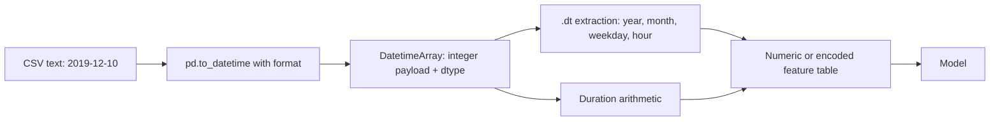
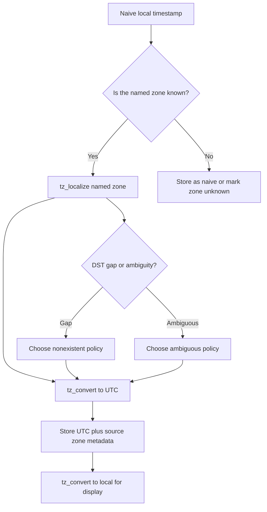
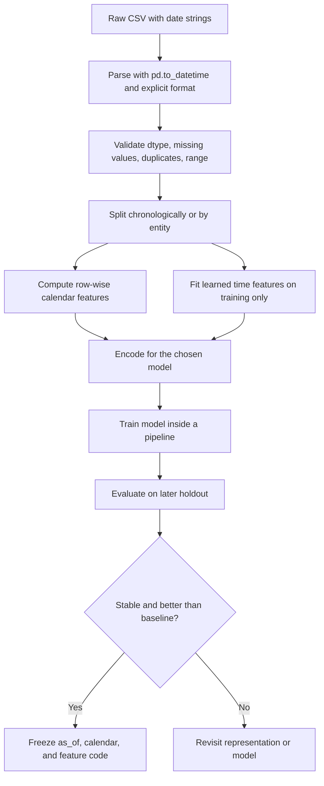

# Day 34 — Working with Dates and Time

> CampusX 100 Days of Machine Learning, Day 34.
> Official notebook covered: **one** (`reference_notebooks/working-with-dates-and-time.ipynb`, 42 cells).
> Existing personal notebook preserved: `DATE_TIME.ipynb` (28 cells). No notebook, dataset, `vendor/`, or `reference_notebooks/` file was modified while writing these notes.

A date column looks harmless. It arrives as text, fits comfortably in a spreadsheet, and seems to contain only one fact per row. In reality a single value such as `2019-12-10` is a compressed record of several different kinds of information: an instant on the timeline, a calendar position, a day of the week, a week number, a quarter, a semester, and a possible business event. The purpose of Day 34 is to unpack that record correctly, with pandas, and then turn the unpacked pieces into machine-learning features.

This chapter is deliberately deeper than the notebook. The notebook is a compact code walk-through: 42 cells, two CSV files, and a sequence of extraction commands. The chapter explains why each command exists, what pandas stores internally, what the saved outputs actually prove, where the notebook's old outputs are version-dependent, and how to move from the notebook's row-wise extraction to a leakage-safe feature pipeline.

### How this chapter is organised

The chapter follows the official notebook's order but does not merely repeat it:

1. learning objectives and the practical problem;
2. prerequisites: calendar arithmetic, timestamps, time zones, and durations;
3. the two datasets and the first inspection cells;
4. parsing text with `pd.to_datetime` and pandas datetime internals;
5. `.dt` extraction for dates, weeks, quarters, and semesters;
6. elapsed time and `Timedelta`;
7. time-of-day extraction and time differences;
8. feature-engineering patterns and leakage-safe workflow;
9. period arithmetic, time zones, and DST;
10. comparisons, limitations, worked examples, plots, mistakes, interviews, exams, coverage, and references.

Throughout, every numerical output is labelled in one of two ways:

- **Official** — the output saved inside the official notebook. The notebook metadata records Python 3.8.3, but not the pandas version. The official outputs therefore belong to an older environment that cannot be reconstructed exactly from the file alone.
- **Rerun** — a fresh execution in this workspace with Python 3.14.2, pandas 3.0.5, and NumPy 2.5.3. Rerun values are used only where the official saved output cannot be reproduced, and the difference is stated explicitly.

The official notebook contains **no chart output**. Every saved result is a table, a text stream, or a scalar. There is therefore no official graph to interpret; Section 16 explains how to read the tabular outputs as if they were plots and what cannot be concluded from them.

---

# 1. Learning objectives

By the end of this chapter I should be able to:

1. Explain why a date or timestamp column must be converted from `object` to a datetime dtype before calendar features can be extracted.
2. Describe what a `datetime64` value stores, what `NaT` means, and why the resolution (`ns`, `us`, `ms`, `s`) matters.
3. Use `pd.to_datetime` with an explicit `format`, `errors`, `dayfirst`, and `utc` when the data requires it, and explain what the function returns for a scalar, a list, and a Series.
4. Use the `.dt` accessor correctly and distinguish attributes such as `.dt.month` from methods such as `.dt.month_name()`.
5. Extract year, month number, month name, day of month, day of week, day name, weekend flag, week of year, quarter, and semester.
6. Explain the conventions behind `dayofweek` (Monday = 0), ISO week numbering, calendar quarters, and academic semesters.
7. Compute a duration by subtracting two timestamps, extract whole days, and convert a duration to seconds, minutes, hours, or an approximate number of months.
8. Explain why dividing by `np.timedelta64(1, 'M')` is not ordinary calendar arithmetic and why it fails in current pandas.
9. Parse a timestamp that contains both date and time, extract hour/minute/second, and represent time-of-day cyclically.
10. Distinguish a `Timestamp` (an instant) from a `Period` (an interval) and from a `Timedelta` (a duration).
11. Localise and convert time zones, explain naive versus aware datetimes, and diagnose DST gaps and ambiguous times.
12. Build date features inside a leakage-safe workflow, using a fixed reference instant and a train/test split rather than `datetime.today()` at prediction time.
13. Recognise when date features are deterministic (safe to compute row by row) and when they depend on learned statistics or future information (a leakage risk).
14. Interpret the official notebook's saved outputs without pretending that a 2021 run is a 2026 run or that a random `sample(5)` is a fixed result.
15. Answer interview and examination questions about parsing, extraction, durations, periods, time zones, and leakage with precise reasoning.

The real objective is not memorising a list of `.dt` attributes. It is learning to ask: *what does this date value mean, which part of it is an instant, which part is a calendar label, which part is a duration, and which part is safe to use at prediction time?*

---

# 2. Why dates and times are a feature-engineering problem

## 2.1 A date is a compressed record

Take the string `2019-12-10`. Read as a calendar date, it tells us:

- the year is 2019;
- the month is December, month number 12;
- the day of the month is 10;
- the day of the week is Tuesday;
- it is in ISO week 50;
- it is in calendar quarter 4;
- it is in the second half of the calendar year, which the notebook calls semester 2;
- it is not a weekend under a Saturday/Sunday definition;
- it is day 344 of a 365-day year.

All of that is latent in one text value. A model cannot use the text directly for arithmetic, and a linear model cannot interpret the string `December` as a number. Feature engineering turns the compressed record into explicit columns that a model can use.

The same value also has a second meaning: it is an instant. If the column were `2019-12-10 14:35:00`, it would locate an event at a particular moment. The date-only version locates the event at midnight at the start of that day, in whatever time zone the data producer intended. That time-zone intention is usually undocumented, which is one of the central pitfalls of the topic.

## 2.2 The two datasets

The official notebook uses two deliberately different files.

**`orders.csv`** is an e-commerce order table. It has 1,000 rows and four columns:

| Column | Meaning in the data | dtype at load |
|---|---|---|
| `date` | order date, stored as text such as `2019-12-10` | `object` |
| `product_id` | product identifier | `int64` |
| `city_id` | city identifier | `int64` |
| `orders` | number of orders recorded for that row | `int64` |

The order dates run from **2018-07-10** to **2019-12-16**. There are 1,000 rows but only **394 distinct dates**, because several rows can share the same date. There are 818 distinct products and 31 distinct cities (coded 0 through 30). The `orders` count ranges from 1 to 1,004 with a mean of 17.497. These facts are not needed for the extraction mechanics, but they matter for interpretation: the file is a transactional table, not a complete daily calendar.

**`messages.csv`** is a chat/message table with 1,000 rows and two columns:

| Column | Meaning in the data | dtype at load |
|---|---|---|
| `date` | timestamp such as `2013-12-15 00:50:00` | `object` |
| `msg` | message text (mostly Russian/Ukrainian in this file) | `object` |

The messages run from **2012-01-01 02:58:00** to **2017-01-18 00:11:00**. There are 999 distinct timestamps, so exactly one timestamp is repeated. All 1,000 seconds are zero; 21 messages have minute zero. The text is irrelevant to the lesson, but it is useful to see that a timestamp column can arrive with a free-text companion and that the date semantics must be understood before the text is discarded.

The local files use LF line endings, while the vendor copies use CRLF. The byte hashes therefore differ, but parsing both versions with pandas produces equal DataFrames. The datasets themselves are official and were not altered.

## 2.3 What can go wrong if the strings are left alone

If `date` remains an `object` column:

- `date['date'].dt.year` fails, because the `.dt` accessor is only available on datetime-like data;
- subtraction from another date does not produce a duration;
- sorting is lexicographic in some operations, which happens to work for ISO-style `YYYY-MM-DD` strings but fails for `DD/MM/YYYY` or mixed formats;
- date ranges and resampling are unavailable;
- comparisons with `pd.Timestamp` are not vectorised in the intended way;
- month names and week numbers cannot be extracted consistently;
- a model that receives the raw string must either drop it or encode it as an arbitrary high-cardinality category.

The notebook's first substantive action is therefore not feature extraction. It is dtype conversion. That order is not cosmetic: conversion creates the object that supports every later operation.

## 2.4 The four questions to ask of every date column

Before writing code, ask:

1. **What is the semantic unit?** Is each value an instant, a calendar day, a month, or a billing period?
2. **What time zone is implied?** Is the value UTC, local time, or a naive local time with no documented zone?
3. **What is the task's reference time?** Is a recency feature measured from today, from the order date, from a prediction date, or from the end of the training window?
4. **Which features are safe at prediction time?** A row-wise extraction from the event's own timestamp is usually safe; an aggregate that uses future rows, or a recency calculated with the eventual test date, is not.

The notebook answers only the first question partially and the second not at all. The notes will make those omissions explicit.

---

# 3. Prerequisites, explained rather than listed

This section builds the concepts that the notebook assumes. It is intentionally more detailed than the code cells, because most date bugs are conceptual rather than syntactic.

## 3.1 Calendar units and leap years

The Gregorian calendar is not a fixed-duration system. A year has 365 days, except a leap year has 366. The leap-year rule is:

$$
\text{leap}(Y)=
\begin{cases}
1, & Y \bmod 400 = 0,\\
1, & Y \bmod 4 = 0 \text{ and } Y \bmod 100 \neq 0,\\
0, & \text{otherwise}.
\end{cases}
$$

Here $Y$ is the calendar year and $\bmod$ is the remainder operator. The rule gives 2000 and 2024 as leap years, and 1900 and 2100 as non-leap years. The extra day is inserted as 29 February.

Month lengths are also irregular:

| Month | Days | Month | Days |
|---:|---:|---:|---:|
| 1 January | 31 | 7 July | 31 |
| 2 February | 28 or 29 | 8 August | 31 |
| 3 March | 31 | 9 September | 30 |
| 4 April | 30 | 10 October | 31 |
| 5 May | 31 | 11 November | 30 |
| 6 June | 30 | 12 December | 31 |

This irregularity is why a “month” is not a fixed number of days. It is also why `Timedelta` cannot represent calendar months exactly. A duration of 30 days is not a month in January, February, or March; it is merely 30 days.

The day-of-year number is the count of days from 1 January. For a non-leap year:

$$
\operatorname{doy}(m,d)=\sum_{k=1}^{m-1} L_k + d,
$$

where $L_k$ is the length of month $k$ and $d$ is the day of the month. For 10 December 2019:

$$
31+28+31+30+31+30+31+31+30+31+30+10 = 344.
$$

The rerun confirms `pd.Timestamp('2019-12-10').dayofyear == 344`.

## 3.2 Instants, timestamps, and the Unix epoch

A **timestamp** is a label for an instant. In computing, an instant is often represented as an offset from a reference instant called the **Unix epoch**: 1970-01-01 00:00:00 UTC. If $t$ is the number of seconds since the epoch, then:

$$
\text{UTC instant} = \text{1970-01-01 00:00:00 UTC} + t \text{ seconds}.
$$

Pandas' classic `datetime64[ns]` representation stores an integer number of nanoseconds since that epoch. If $t_{\mathrm{ns}}$ is the stored integer, the civil UTC time is obtained by adding $t_{\mathrm{ns}}/10^9$ seconds to the epoch. Negative values represent instants before 1970.

The signed 64-bit nanosecond range is:

$$
-2^{63} \le t_{\mathrm{ns}} \le 2^{63}-1,
$$

which corresponds approximately to **1677-09-21 00:12:43.145224193** through **2262-04-11 23:47:16.854775807** (the exact pandas bounds were verified in this environment). This is the famous “pandas cannot represent dates outside 1677–2262 with nanosecond resolution” limitation. It matters for historical data, far-future forecasts, and scientific timestamps.

The stored integer is not the same thing as the displayed string. `2019-12-10` is a human-readable rendering of an integer; the integer is the actual payload. That is why two dates can be subtracted efficiently: the computer subtracts integers, not calendars.

## 3.3 Durations are not dates

A **date/timestamp** answers “when?”. A **duration** answers “how long?”. The two are different types:

| Concept | Example | pandas type |
|---|---|---|
| Instant | `2019-12-10 14:30:00` | `Timestamp` |
| Array of instants | a date column | `datetime64[ns]` Series |
| Duration | 498 days 16 hours | `Timedelta` |
| Calendar interval | March 2024 | `Period` |
| Calendar offset | “one month later” | `DateOffset` |

Subtracting two timestamps gives a duration. Adding a duration to a timestamp gives another timestamp. Adding a calendar offset to a timestamp gives a timestamp adjusted by the calendar rules. These operations are not interchangeable.

A fixed duration is unambiguous: 3,600 seconds is one hour. A calendar offset is not: “one month after 31 January” could be 28 or 29 February, depending on the year. “One year after 29 February 2024” is 28 February 2025 in pandas' `DateOffset` behaviour. The notes verify these examples rather than assuming them.

## 3.4 Time zones, offsets, and DST

A **time zone** is a set of rules that maps local civil time to UTC. The rules include a standard offset and, in many regions, daylight-saving transitions.

For a local time $t_{\mathrm{local}}$ and a UTC offset $o$ (positive east of UTC), the UTC instant is:

$$
t_{\mathrm{UTC}} = t_{\mathrm{local}} - o.
$$

For example, India Standard Time has $o=+05{:}30$. A local time of 12:30 IST corresponds to:

$$
12{:}30 - 5{:}30 = 07{:}00 \text{ UTC}.
$$

New York has $o=-05{:}00$ in winter (EST) and $o=-04{:}00$ in summer (EDT). On 10 March 2024, the clock jumps from 01:59:59 EST to 03:00:00 EDT. The local times 02:00–02:59 do not exist. On 3 November 2024, the clock falls back from 01:59:59 EDT to 01:00:00 EST, so the local time 01:00–01:59 occurs twice.

A time-zone-aware timestamp stores the instant plus the zone information. A naive timestamp stores a wall-clock reading with no zone. The two are not safely comparable across zones. The notebook's timestamps are naive, so its elapsed-time calculations are only meaningful under the assumption that all rows share the same unspecified local zone.

## 3.5 Naive and aware datetimes

**Naive** means “no time-zone information”. `datetime.datetime(2021, 4, 21, 16, 2, 16)` is naive. Pandas' `pd.Timestamp('2021-04-21 16:02:16')` is naive as well. Arithmetic between naive timestamps is allowed, but the result is an elapsed wall-clock duration, not a guaranteed UTC duration.

**Aware** means “attached to a time zone”. `pd.Timestamp('2021-04-21 16:02:16', tz='Asia/Kolkata')` is aware. Arithmetic between aware timestamps converts through UTC, so a DST transition is handled correctly.

The key API distinction is:

- `tz_localize` attaches a zone to naive local times;
- `tz_convert` changes an already-aware timestamp to another zone;
- calling `tz_convert` on a naive value raises `TypeError`;
- localising an ambiguous or nonexistent local time requires an explicit policy.

These rules are easy to state and easy to violate. Section 12 works through them with verified examples.

## 3.6 Calendar arithmetic

Calendar arithmetic includes operations such as:

- adding one month;
- finding the first day of the next quarter;
- finding the last business day of a month;
- counting whole months between two dates;
- checking whether a year is a leap year.

These operations cannot always be represented as a fixed `Timedelta`. Pandas provides `DateOffset`, `Period`, and `offsets` for them. The important distinction is:

$$
\text{fixed duration} \neq \text{calendar offset}.
$$

A `Timedelta` of 30 days is always 30 days. A `DateOffset(months=1)` is one calendar month, whose length may be 28, 29, 30, or 31 days. The notebook's month calculation uses a fixed approximation, which is acceptable for a rough recency feature but not for exact billing or age calculations.

## 3.7 Vectorised operations and the `.dt` accessor

Pandas columns are arrays. The `.dt` accessor applies a datetime operation to every element without a Python-level loop:

```python
date["year"] = date["date"].dt.year
```

Conceptually:

$$
\text{year}_i = \operatorname{year}(t_i)
$$

for each row $i$. The operation is vectorised through pandas' datetime array implementation. This is both faster and less error-prone than `apply(lambda x: x.year)`.

The `.dt` accessor is available only when the Series dtype is datetime-like. If the column is `object`, pandas raises an `AttributeError`. The practical rule is: convert first, extract second.

## 3.8 Formula summary

| Quantity | Expression | Meaning |
|---|---|---|
| Leap year | $\text{leap}(Y)$ as above | 366-day year |
| Day of year | $\sum_{k<m}L_k+d$ | 1-based day count |
| Quarter | $Q=\lceil M/3\rceil$ | 1–4 |
| Semester (calendar) | $S=\lceil M/6\rceil$ | 1–2 |
| Weekend flag | $w_i=\mathbf{1}[d_i\in\{\text{Sat},\text{Sun}\}]$ | 0 or 1 |
| Elapsed duration | $\Delta_i=t_{\text{ref}}-t_i$ | `Timedelta` |
| Whole days | $\lfloor \Delta_i/\text{1 day}\rfloor$ | `.dt.days` for positive durations |
| Approx. months | $\Delta_{\text{days}}/30.4375$ | not exact calendar months |
| Cyclical hour | $\sin(2\pi h/24),\ \cos(2\pi h/24)$ | smooth periodic encoding |

Every symbol is defined where it is used later; the table is a map, not a substitute for the explanations.

---

# 4. The data and the official notebook

## 4.1 Files and provenance

The official folder in the vendor repository is:

```text
vendor/100-days-of-machine-learning/day34-handling-date-and-time/
├── messages.csv
├── orders.csv
├── readme.md
└── working-with-dates-and-time.ipynb
```

The local day folder contains:

```text
DAY_34/
├── DATE_TIME.ipynb                         # existing personal notebook, preserved
├── Datasets/
│   ├── messages.csv
│   └── orders.csv
├── reference_notebooks/
│   └── working-with-dates-and-time.ipynb   # copied official reference, 42 cells
├── README.md
└── notes.md                                # this document
```

The reference notebook in `DAY_34/reference_notebooks/` is byte-identical to the vendor notebook (SHA-256 `51ccd35a40915d7af5d7db90c0143b0b381de8fca7b37493663ae372470b4063`). The local datasets are content-identical to the vendor datasets after line-ending normalisation: both parse to 1,000 rows and equal DataFrames.

## 4.2 Official cell map

The notebook has **42 cells**: 32 code cells, 10 Markdown cells, and one empty trailing code cell. The cell indices below are zero-based, matching the JSON order.

| Cells | Topic |
|---:|---|
| 0–5 | Imports, load data, inspect heads and dtypes |
| 6 | Markdown heading “Working with Dates” |
| 7–8 | Convert order dates to datetime; inspect dtype |
| 9–24 | Extract year, month, day, weekday, weekend, week, quarter, semester |
| 25–29 | Elapsed time in days and approximate months |
| 30–35 | Convert message timestamps; extract hour, minute, second, time |
| 36–40 | Elapsed time in seconds, minutes, hours |
| 41 | Empty trailing cell |

## 4.3 First inspection: cells 0–5

Cell 0 imports the two libraries:

```python
import numpy as np
import pandas as pd
```

Cell 1 loads the files:

```python
date = pd.read_csv('orders.csv')
time = pd.read_csv('messages.csv')
```

The variable names are worth noticing. `date` is a DataFrame of orders, not a date; `time` is a DataFrame of messages, not a time. The later `import datetime` creates a module whose name is different from the `time` DataFrame, but the naming still makes the code harder to read. A clearer production version would use `orders` and `messages`. The notes preserve the official names when quoting the notebook so that the cell outputs remain recognisable.

Cell 2 calls `date.head()`. The official saved output is:

| Index | date | product_id | city_id | orders |
|---:|---|---:|---:|---:|
| 0 | 2019-12-10 | 5628 | 25 | 3 |
| 1 | 2018-08-15 | 3646 | 14 | 157 |
| 2 | 2018-10-23 | 1859 | 25 | 1 |
| 3 | 2019-08-17 | 7292 | 25 | 1 |
| 4 | 2019-01-06 | 4344 | 25 | 3 |

Cell 3 calls `time.head()`. The saved output shows a date-time string and a message. The first five timestamps are:

| Index | date | hour | minute | second |
|---:|---|---:|---:|---:|
| 0 | 2013-12-15 00:50:00 | 0 | 50 | 0 |
| 1 | 2014-04-29 23:40:00 | 23 | 40 | 0 |
| 2 | 2012-12-30 00:21:00 | 0 | 21 | 0 |
| 3 | 2014-11-28 00:31:00 | 0 | 31 | 0 |
| 4 | 2013-10-26 23:11:00 | 23 | 11 | 0 |

The message text in the official output is Russian/Ukrainian. It is not used in any calculation, and this chapter does not reproduce it. The important observation is that the timestamp has a date part and a time part, both stored as text.

Cell 4 calls `date.info()`. The official output is:

```text
<class 'pandas.core.frame.DataFrame'>
RangeIndex: 1000 entries, 0 to 999
Data columns (total 4 columns):
 #   Column      Non-Null Count  Dtype
---  ------      --------------  -----
 0   date        1000 non-null   object
 1   product_id  1000 non-null   int64
 2   city_id     1000 non-null   int64
 3   orders      1000 non-null   int64
dtypes: int64(3), object(1)
memory usage: 31.4+ KB
```

Cell 5 calls `time.info()`:

```text
<class 'pandas.core.frame.DataFrame'>
RangeIndex: 1000 entries, 0 to 999
Data columns (total 2 columns):
 #   Column  Non-Null Count  Dtype
---  ------  --------------  -----
 0   date    1000 non-null   object
 1   msg     1000 non-null   object
dtypes: object(2)
memory usage: 15.8+ KB
```

## 4.4 What the inspection establishes

The outputs establish five facts:

1. Both files have 1,000 rows and no missing values in the inspected columns.
2. The date columns are `object`, which in this context means Python strings.
3. The numeric order columns are already `int64`; only the date needs conversion.
4. The message text is also `object`, but that is expected because it is free text.
5. The order file has three numeric columns in addition to the date; the message file has only the date and the message.

The inspection does **not** establish that the date strings are in one consistent format. It does not establish a time zone. It does not establish that the dates are unique. Those questions require additional checks, which the official notebook never performs. A production workflow should check them explicitly; Section 17 lists the checks.

## 4.5 Version and output labelling

The official notebook metadata records Python 3.8.3. The saved dtype is `datetime64[ns]`. In the rerun environment (pandas 3.0.5, NumPy 2.5.3), the same call returns `datetime64[us]` for these inputs because pandas now infers a sufficient resolution rather than always forcing nanoseconds. This is not an error; it is a version-dependent representation. The values are the same, but the dtype string and the available range differ.

The official `today` value is **2021-04-21 16:02:16.791379**. A rerun on 2026-11-03 produces a different elapsed-day count. The official saved numbers are therefore historical snapshots, not reproducible constants. Later sections label every such output.

---

# 5. Parsing text into datetime

## 5.1 Why `pd.to_datetime` is the entry point

`pd.to_datetime` converts strings, numbers, lists, arrays, Series, and DataFrames into pandas datetime objects. It is the bridge between a CSV's text representation and the datetime dtype that supports `.dt` operations.

The official conversion is cell 7:

```python
# Converting to datetime datatype
date['date'] = pd.to_datetime(date['date'])
```

Read the execution from the inside out:

1. `date['date']` selects a Series of strings.
2. `pd.to_datetime(...)` parses each string and returns a new Series with datetime dtype.
3. The assignment `date['date'] = ...` replaces the original column with the new Series.

The original strings are not mutated in place. The column is rebound to a new Series object. That distinction matters if another variable still references the old Series.

Cell 8 confirms the change:

```text
<class 'pandas.core.frame.DataFrame'>
RangeIndex: 1000 entries, 0 to 999
Data columns (total 4 columns):
 #   Column      Non-Null Count  Dtype
---  ------      --------------  -----
 0   date        1000 non-null   datetime64[ns]
 1   product_id  1000 non-null   int64
 2   city_id     1000 non-null   int64
 3   orders      1000 non-null   int64
dtypes: datetime64[ns](1), int64(3)
memory usage: 31.4 KB
```

The official output reports `datetime64[ns]`; the rerun reports `datetime64[us]`. The column is now datetime-like, so `.dt` is available.

## 5.2 Syntax and important arguments

The function is large, but the arguments that matter in daily work are:

| Argument | Meaning | When to use it |
|---|---|---|
| `arg` | scalar, list-like, Series, or DataFrame to parse | always |
| `format` | explicit strftime format, or `"mixed"` | when the format is known or ambiguous |
| `errors` | `"raise"` or `"coerce"` | to fail loudly or to turn bad values into `NaT` |
| `dayfirst` | interpret `03/04/2024` as 3 April | non-US data |
| `yearfirst` | interpret the first component as year | formats such as `24/03/04` |
| `utc` | parse and localise to UTC | when all timestamps share a known zone |
| `unit` | unit for numeric epoch values | when the input is an integer timestamp |
| `origin` | reference instant for numeric values | usually `"unix"` |
| `exact` | require an exact format match | strict ingestion |
| `cache` | cache parsed unique values | repeated identical strings |

A safe explicit call looks like:

```python
orders["date"] = pd.to_datetime(
    orders["date"],
    format="%Y-%m-%d",
    errors="raise",
)
```

The explicit `format` is both faster and stricter. If a value does not match, `errors="raise"` stops the pipeline instead of silently producing `NaT`.

## 5.3 What the parser does

For a string such as `2019-12-10`, the parser:

1. tokenises the string into year, month, and day;
2. validates the calendar (month 1–12, day valid for that month);
3. constructs a `Timestamp` at 00:00:00;
4. converts the timestamp to the internal integer representation;
5. returns a Series with a datetime dtype.

For `2013-12-15 00:50:00`, it additionally parses hour, minute, and second. For a string with an offset such as `2013-12-15T00:50:00+05:30`, it can construct an aware timestamp if the format includes the offset.

The parser is not a database. It does not know whether `03/04/2024` means 3 April or 4 March unless you tell it. It does not know whether a bare date is midnight in UTC, New York, or Kolkata. It does not know whether a duplicated timestamp is a data error or a legitimate repeat. Those are semantic decisions for the analyst.

## 5.4 The official conversion: input, operation, output

| Stage | Value |
|---|---|
| Input | `date['date']` is a Series of 1,000 strings such as `2019-12-10` |
| Operation | `pd.to_datetime` parses each string to midnight |
| Output | a Series of 1,000 `Timestamp` values with dtype `datetime64[ns]` (official) or `datetime64[us]` (rerun) |
| Interpretation | the column can now be used for `.dt` extraction and date arithmetic |

The first values after conversion are still displayed as `2019-12-10`, because pandas renders a date-only timestamp without a time component when all times are midnight. The display does not mean the dtype is still text. `date.info()` is the reliable check.

## 5.5 Parsing formats

The format string uses the same directives as Python's `strptime`:

| Directive | Meaning | Example |
|---|---|---|
| `%Y` | four-digit year | 2024 |
| `%m` | zero-padded month | 03 |
| `%d` | zero-padded day | 09 |
| `%H` | 24-hour hour | 14 |
| `%M` | minute | 35 |
| `%S` | second | 07 |
| `%f` | fractional second | 123456 |
| `%z` | UTC offset | +0530 |
| `%Z` | time-zone name | UTC |
| `%b` | abbreviated month name | Mar |
| `%B` | full month name | March |
| `%a` | abbreviated weekday | Tue |
| `%A` | full weekday | Tuesday |

Examples verified in this environment:

```python
pd.to_datetime("2019-12-10", format="%Y-%m-%d")
# Timestamp('2019-12-10 00:00:00')

pd.to_datetime("10/12/2019", format="%d/%m/%Y")
# Timestamp('2019-12-10 00:00:00')

pd.to_datetime("2019-12-10 14:35:07", format="%Y-%m-%d %H:%M:%S")
# Timestamp('2019-12-10 14:35:07')
```

If the format is omitted, pandas attempts to infer it. Inference is convenient for a quick exploration and dangerous for production ingestion. It can change behaviour between versions, and it can interpret ambiguous day/month orders differently from what the data producer intended.

## 5.6 Invalid dates and `errors`

Two policies are useful:

```python
# Stop at the first invalid value
pd.to_datetime(["2024-02-30"], errors="raise")
# DateParseError: day 30 must be in range 1..29 for month 2 in year 2024

# Convert invalid values to NaT and continue
pd.to_datetime(["2024-02-30", "2024-02-29"], errors="coerce")
# [NaT, Timestamp('2024-02-29 00:00:00')]
```

`NaT` is the datetime analogue of `NaN`: a missing datetime value. It propagates through datetime arithmetic: `Timestamp(...) - NaT` gives `NaT`, and `.dt.year` on `NaT` gives `NaN` or `NaT` depending on the operation.

`errors="coerce"` is appropriate when bad rows are expected and will be audited. It is not appropriate as a way to make an error message disappear. A production pipeline should count the coerced values and investigate them.

## 5.7 Performance and mixed formats

Parsing is expensive relative to arithmetic. Three practical rules:

1. **Specify `format`.** It avoids repeated inference and is usually faster.
2. **Parse once.** Convert at ingestion, then reuse the datetime column.
3. **Use `format="mixed"` only when necessary.** It parses each element individually and is slower than a single consistent format.

Example with mixed formats:

```python
pd.to_datetime(
    pd.Series(["2024-01-02", "03/04/2024"]),
    format="mixed",
    dayfirst=True,
)
# [Timestamp('2024-02-01'), Timestamp('2024-04-03')]
```

The first string is unambiguously ISO; the second is interpreted with `dayfirst=True`. Without `format="mixed"`, pandas may warn that it could not infer a single format.

## 5.8 Time-zone parsing

If the input strings contain an offset, `pd.to_datetime` can preserve it:

```python
pd.to_datetime("2024-03-10 01:30:00+05:30")
# Timestamp('2024-03-10 01:30:00+0530', tz='UTC+05:30')
```

If the input strings are naive but the data is known to be UTC, use `utc=True`:

```python
pd.to_datetime(["2024-03-10 01:30:00"], utc=True)
# DatetimeIndex(['2024-03-10 01:30:00+00:00'], dtype='datetime64[us, UTC]', freq=None)
```

If the data is known to be local time in a named zone, parse naive first and then `tz_localize`:

```python
naive = pd.to_datetime(["2024-03-10 01:30:00"])
aware = naive.dt.tz_localize("America/New_York")
```

Do not use `utc=True` merely to “make the dtype aware” if the values are actually local wall-clock times. That would relabel 01:30 New York as 01:30 UTC, shifting every instant by five hours.

## 5.9 Common traps in parsing

- **Ambiguous day/month order.** `03/04/2024` is 3 April with `dayfirst=True` and 4 March with `dayfirst=False`. The rerun confirms both.
- **Two-digit years.** `24` may mean 2024 or 1924; specify the century policy.
- **Mixed formats in one column.** Use `format="mixed"` or clean the column first.
- **Silent coercion.** `errors="coerce"` turns bad values into `NaT`; count them.
- **Time-zone assumptions.** A naive column is not UTC by default.
- **Locale-dependent month names.** Prefer numeric formats when the source locale is uncertain.
- **Out-of-bounds dates.** Dates outside the nanosecond range become `NaT` or raise, depending on the operation and resolution.

---

# 6. Pandas datetime internals

## 6.1 Storage

A pandas datetime Series is backed by a `DatetimeArray`, which stores an integer array plus a dtype that encodes the unit and, optionally, the time zone. For a naive `datetime64[ns]` Series, each element is an `int64` count of nanoseconds since the epoch; `NaT` is represented by the minimum integer value.

That design explains several behaviours:

- subtraction is fast integer arithmetic;
- sorting is chronological;
- `.dt.year` is a vectorised operation over the integer array;
- the representable range is finite;
- adding a fixed `Timedelta` is exact;
- adding a calendar month requires special logic because the integer offset is not constant.

## 6.2 Resolution

Pandas can store datetimes at several resolutions: seconds, milliseconds, microseconds, or nanoseconds. The resolution affects range and precision:

| Resolution | Approximate range | Precision |
|---|---|---|
| `datetime64[s]` | very wide | 1 second |
| `datetime64[ms]` | wide | 1 millisecond |
| `datetime64[us]` | wide | 1 microsecond |
| `datetime64[ns]` | 1677–2262 | 1 nanosecond |

The official notebook's saved output is `datetime64[ns]`. The rerun with pandas 3.0.5 returns `datetime64[us]` for these inputs, including date-only strings and strings with seconds. Supplying a value with nine fractional digits causes pandas to choose `datetime64[ns]` in the rerun. The lesson is not “always expect ns” or “always expect us”; the lesson is to inspect the dtype and avoid hard-coding a resolution assumption.

## 6.3 `Timestamp`, `DatetimeIndex`, and Series

Three related objects appear constantly:

- **`Timestamp`** — a scalar instant, analogous to Python's `datetime.datetime` but with nanosecond support and pandas arithmetic.
- **`DatetimeIndex`** — an index of timestamps, used for time-series indexing and resampling.
- **datetime Series** — a column of timestamps with the `.dt` accessor.

`pd.to_datetime` returns different types depending on its input:

```python
pd.to_datetime("2024-01-01")                 # Timestamp
pd.to_datetime(["2024-01-01", "2024-01-02"]) # DatetimeIndex
pd.to_datetime(pd.Series(["2024-01-01"]))    # Series
```

This is why the official code assigns the result back to a column: it passes a Series, so it receives a Series.

## 6.4 `NaT`

`NaT` (“not a time”) is the missing-value sentinel for datetime data. It behaves like `NaN` in many ways:

- `pd.isna(pd.NaT)` is `True`;
- arithmetic with `NaT` generally produces `NaT`;
- comparisons with `NaT` are false;
- `.dt` extraction on `NaT` produces missing values.

`NaT` is not the same as an empty string, a zero timestamp, or 1970-01-01. Treating it as any of those creates silent errors. A date column with missing values needs an explicit policy: drop, impute, or add a missing indicator.

## 6.5 The `.dt` accessor

`.dt` is a namespace for datetime properties and methods. The most useful members are:

| Member | Kind | Result |
|---|---|---|
| `.dt.year` | attribute | integer year |
| `.dt.month` | attribute | integer month 1–12 |
| `.dt.day` | attribute | integer day 1–31 |
| `.dt.hour` | attribute | integer hour 0–23 |
| `.dt.minute` | attribute | integer minute 0–59 |
| `.dt.second` | attribute | integer second 0–59 |
| `.dt.microsecond` | attribute | integer microsecond 0–999999 |
| `.dt.dayofweek` | attribute | Monday = 0 through Sunday = 6 |
| `.dt.day_name()` | method | English weekday name |
| `.dt.month_name()` | method | English month name |
| `.dt.quarter` | attribute | 1–4 |
| `.dt.days_in_month` | attribute | 28–31 |
| `.dt.dayofyear` | attribute | 1–365/366 |
| `.dt.is_month_end` | attribute | boolean |
| `.dt.is_leap_year` | attribute | boolean |
| `.dt.time` | attribute | `datetime.time` objects |
| `.dt.date` | attribute | `datetime.date` objects |
| `.dt.isocalendar()` | method | DataFrame with ISO year, week, day |
| `.dt.strftime(fmt)` | method | formatted strings |

The attribute/method distinction is a common source of syntax errors. `date['date'].dt.month_name` returns a bound method object, not a Series of names; the call must be `date['date'].dt.month_name()`. Conversely, `.dt.month()` is wrong because `month` is an attribute.

## 6.6 `.dt` is stateless, but the surrounding pipeline is not

Most `.dt` extractions are deterministic row-wise functions: the year of a timestamp does not depend on any other row. That makes them safe to compute before or after a train/test split, as long as the same transformation is applied to both parts.

Not every date feature is stateless. Examples of stateful or time-dependent features include:

- recency measured from “today”;
- a rolling count of orders in the last 30 days;
- a target encoding of a week number;
- holiday flags based on a calendar that changes by year;
- bin edges for time-of-day learned from the training set.

Those features need the same discipline as any other learned preprocessing: fit or define the rule on training data, then apply it unchanged to validation, test, and production data. Section 13 develops the workflow.

## 6.7 From text to model: the data flow

The whole topic can be summarised as one pipeline. The string is parsed once, the datetime array supports extraction, and the extracted table is what the model sees.



The diagram separates two branches: calendar extraction and duration arithmetic. Both branches consume the parsed datetime array. Neither branch should consume the raw string repeatedly, because repeated parsing is slower and can produce inconsistent interpretations if the format is ambiguous.

---

# 7. Extracting calendar features (official cells 9–24)

The official notebook builds a feature table one column at a time. The first five rows after all extractions can be summarised as:

| date | year | month_no | month_name | day | dow | dow_name | weekend | week | quarter | semester |
|---|---:|---:|---|---:|---:|---|---:|---:|---:|---:|
| 2019-12-10 | 2019 | 12 | December | 10 | 1 | Tuesday | 0 | 50 | 4 | 2 |
| 2018-08-15 | 2018 | 8 | August | 15 | 2 | Wednesday | 0 | 33 | 3 | 2 |
| 2018-10-23 | 2018 | 10 | October | 23 | 1 | Tuesday | 0 | 43 | 4 | 2 |
| 2019-08-17 | 2019 | 8 | August | 17 | 5 | Saturday | 1 | 33 | 3 | 2 |
| 2019-01-06 | 2019 | 1 | January | 6 | 6 | Sunday | 1 | 1 | 1 | 1 |

This table is the official output, assembled from the individual `head()` calls. It is the single most useful reference for the extraction section.

## 7.1 Year: cell 10

```python
date['date_year'] = date['date'].dt.year

date.sample(5)
```

Input: the datetime Series `date['date']`.
Operation: extract the calendar year from each timestamp.
Output: an integer Series assigned to `date_year`.
Interpretation: all five sampled rows are from 2018 or 2019, which matches the dataset's range.

The official saved sample is:

| Index | date | date_year |
|---:|---|---:|
| 202 | 2018-11-21 | 2018 |
| 999 | 2019-10-15 | 2019 |
| 871 | 2018-12-26 | 2018 |
| 841 | 2019-11-17 | 2019 |
| 235 | 2018-10-05 | 2018 |

`sample(5)` uses a random state that is not fixed in the notebook. A rerun can therefore show different indices and values. The sample does not prove anything about the full distribution; it is only a quick visual check. The verified full counts are 355 rows in 2018 and 645 rows in 2019.

## 7.2 Month number and month name: cells 12–13

```python
date['date_month_no'] = date['date'].dt.month
date.head()

date['date_month_name'] = date['date'].dt.month_name()
date.head()
```

The month number is an integer from 1 to 12. The month name is a string such as `December`. The official first five rows show 12, 8, 10, 8, 1 and December, August, October, August, January.

The full month distribution is:

| Month | Count | Month | Count |
|---:|---:|---:|---:|
| 1 | 58 | 7 | 111 |
| 2 | 42 | 8 | 115 |
| 3 | 49 | 9 | 68 |
| 4 | 55 | 10 | 129 |
| 5 | 42 | 11 | 146 |
| 6 | 65 | 12 | 120 |

Month name is redundant with month number in the sense that it carries the same information. It is useful for human-readable tables and for models that treat month as a nominal category, but it should not be used together with month number in a linear model without a reason. For a tree model, either can work; for a linear model, a cyclical encoding is usually better because December and January are adjacent in time but far apart as integers 12 and 1.

The month name method returns English names in the default pandas locale. If the analysis is locale-sensitive, do not rely on the displayed name; use the numeric month and a controlled mapping.

## 7.3 Day of month: cell 15

```python
date['date_day'] = date['date'].dt.day
date.head()
```

The day of the month is 1–31. It is not the day of the year and it is not the day of the week. For 2019-12-10 it is 10. For 2019-12-10 the day-of-year is 344, which shows why the two features answer different questions.

Day-of-month is rarely a strong standalone feature, but it can capture payroll cycles, billing cycles, month-end effects, and salary-day behaviour. It can also be noisy because month lengths differ.

## 7.4 Day of week: cells 16–17

```python
date['date_dow'] = date['date'].dt.dayofweek
date.head()

date['date_dow_name'] = date['date'].dt.day_name()
date.drop(columns=['product_id','city_id','orders']).head()
```

`dayofweek` uses the convention **Monday = 0, Tuesday = 1, ..., Sunday = 6**. The official output confirms:

- 2019-12-10 is Tuesday, so `date_dow = 1`;
- 2018-08-15 is Wednesday, so `date_dow = 2`;
- 2018-10-23 is Tuesday, so `date_dow = 1`;
- 2019-08-17 is Saturday, so `date_dow = 5`;
- 2019-01-06 is Sunday, so `date_dow = 6`.

The video transcript briefly wonders why the sequence starts with Tuesday. It does not: the rows are not sorted by date, and the first row simply happens to be a Tuesday. The numeric convention is Monday-based. A Sunday-based convention would map Sunday to 0; pandas does not use that convention for `dayofweek`.

`day_name()` returns the English name. It is convenient for display and for grouping, but a model should usually receive a numeric or one-hot representation, not an arbitrary string. If the model is a tree, integer day-of-week can work, but the split at 6 versus 0 does not know that Sunday and Monday are adjacent. Cyclical encoding (Section 9.6) solves that for linear and distance-based models.

## 7.5 Weekend flag: cell 18

```python
date['date_is_weekend'] = np.where(
    date['date_dow_name'].isin(['Sunday', 'Saturday']),
    1,
    0,
)
```

Read the expression in three layers:

1. `date['date_dow_name'].isin(['Sunday', 'Saturday'])` returns a boolean Series: `True` for Saturday or Sunday, `False` otherwise.
2. `np.where(condition, 1, 0)` returns an integer array: 1 where the condition is true, 0 otherwise.
3. The result is assigned to `date_is_weekend`.

The mathematical form is:

$$
w_i =
\begin{cases}
1, & \text{if } d_i \in \{\text{Saturday},\text{Sunday}\},\\
0, & \text{otherwise}.
\end{cases}
$$

The official first five rows are 0, 0, 0, 1, 1, matching Tuesday, Wednesday, Tuesday, Saturday, Sunday.

The full distribution is 284 weekend rows and 716 weekday rows. If weekends were uniformly distributed at $2/7$ of the data, the expected count would be:

$$
1000 \times \frac{2}{7} = 285.714\ldots
$$

The observed 284 is very close, but closeness does not prove that orders are independent of the weekend. It only shows that the marginal calendar distribution is not strongly skewed. A model can still find a weekend effect in the conditional distribution.

Two improvements are worth knowing:

```python
# Equivalent and simpler
date["date_is_weekend"] = (date["date"].dt.dayofweek >= 5).astype(int)

# Keep the name-based version if the definition is configurable
weekend_days = ["Saturday", "Sunday"]
date["date_is_weekend"] = date["date"].dt.day_name().isin(weekend_days).astype(int)
```

The second version makes the definition explicit. In some countries the weekend is Friday–Saturday, so hard-coding Saturday/Sunday is a domain assumption, not a universal truth.

## 7.6 Week of year: cells 19–20

```python
date['date_week'] = date['date'].dt.week
date.drop(columns=['product_id','city_id','orders']).head()
```

The official saved output gives week numbers 50, 33, 43, 33, and 1 for the first five dates. The values are consistent with ISO week numbering: 2019-12-10 is in ISO week 50, 2018-08-15 in week 33, 2018-10-23 in week 43, 2019-08-17 in week 33, and 2019-01-06 in week 1.

There are three common week conventions:

| Convention | Week starts | First week | Example for 2019-01-06 |
|---|---|---|---|
| ISO 8601 (`%V`) | Monday | week containing first Thursday | week 1 |
| `%U` | Sunday | week 1 starts on first Sunday | week 01 |
| `%W` | Monday | week 1 starts on first Monday | week 00 |

The rerun confirms the ambiguity:

```python
orders["date"].dt.strftime("%V").head()  # ['50','33','43','33','01']
orders["date"].dt.strftime("%U").head()  # ['49','32','42','32','01']
orders["date"].dt.strftime("%W").head()  # ['49','33','43','32','00']
```

Only `%V` matches the official ISO-like values. `%U` and `%W` can differ by one around the new year.

`dt.week` was removed from pandas. In pandas 3.0.5 the official cell raises:

```text
AttributeError: 'DatetimeProperties' object has no attribute 'week'
```

The current replacement is:

```python
week = date['date'].dt.isocalendar().week
```

`isocalendar()` returns a DataFrame with `year`, `week`, and `day` columns; `.week` is a `UInt32` Series. The rerun's first five values are 50, 33, 43, 33, 1, exactly matching the official output. Using `isocalendar()` is preferable to `strftime('%V')` because it returns an integer-like value rather than a zero-padded string.

A year has 52 or 53 ISO weeks. A 53-week year occurs when a year has 53 Thursdays, equivalently when 1 January is a Thursday, or it is a Wednesday in a leap year. The week number is therefore not a complete time index on its own; the ISO year is also needed. `isocalendar()` provides both.

## 7.7 Quarter: cells 21–22

```python
date['quarter'] = date['date'].dt.quarter
date.drop(columns=['product_id','city_id','orders']).head()
```

Calendar quarters are:

| Quarter | Months |
|---:|---|
| 1 | January–March |
| 2 | April–June |
| 3 | July–September |
| 4 | October–December |

The formula is:

$$
Q=\left\lceil \frac{M}{3} \right\rceil,
$$

where $M$ is the month number and $\lceil\cdot\rceil$ is the ceiling function. For $M=12$:

$$
Q=\left\lceil \frac{12}{3} \right\rceil=4.
$$

The official first five values are 4, 3, 4, 3, 1, matching December, August, October, August, January.

The full distribution is:

| Quarter | Count |
|---:|---:|
| 1 | 149 |
| 2 | 162 |
| 3 | 294 |
| 4 | 395 |

The counts are not balanced because the dataset starts in July 2018 and ends in December 2019. Quarter 4 contains two October–December periods, while quarter 1 contains only one January–March period. A naive comparison of quarter counts would therefore be misleading.

Quarter is an ordinal feature with a meaningful order. A tree can split on it directly. A linear model may benefit from one-hot encoding or from a cyclical representation if the effect is seasonal. The notebook stores it as an integer.

## 7.8 Semester: cells 23–24

```python
date['semester'] = np.where(date['quarter'].isin([1,2]), 1, 2)
```

The notebook defines semester as a calendar half-year:

- quarters 1 and 2 (January–June) → semester 1;
- quarters 3 and 4 (July–December) → semester 2.

The formula is:

$$
S =
\begin{cases}
1, & Q \in \{1,2\},\\
2, & Q \in \{3,4\}.
\end{cases}
$$

The official first five values are 2, 2, 2, 2, 1, matching quarters 4, 3, 4, 3, 1.

The full distribution is 311 rows in semester 1 and 689 in semester 2. As with quarter, the imbalance reflects the date range rather than a behavioural effect.

This “semester” is a calendar convention, not necessarily an academic one. A university may define:
- semester 1 as August–December;
- semester 2 as January–May;
- a summer term as a third period.

If the task is academic, the semester must come from the institution's academic calendar, not from `ceil(month/6)`. The notebook's version is a simple domain feature, useful for demonstration, not a universal definition.

## 7.9 A complete extracted row

For the date **2019-12-10**:

| Feature | Value | Derivation |
|---|---:|---|
| year | 2019 | calendar year |
| month_no | 12 | December |
| month_name | December | name of month 12 |
| day | 10 | day of month |
| dayofweek | 1 | Tuesday, Monday = 0 |
| day_name | Tuesday | name of weekday 1 |
| is_weekend | 0 | not Saturday or Sunday |
| week | 50 | ISO week |
| quarter | 4 | months 10–12 |
| semester | 2 | quarters 3–4 |
| dayofyear | 344 | 31+28+...+10 |

This row is a compact test case. If a pipeline produces a different value for any entry, something in the parsing or extraction is wrong.

## 7.10 Feature semantics and encoding

The notebook creates columns; it does not decide how a model should use them. That decision belongs to the modelling stage.

| Feature | Semantic type | Reasonable encodings | Caution |
|---|---|---|---|
| year | ordinal/time | numeric, or drop if only two years | extrapolation, trend confounding |
| month | cyclical ordinal | sin/cos, one-hot, numeric for trees | December/January adjacency |
| day | ordinal | numeric, one-hot if strong calendar effect | month-length irregularity |
| dayofweek | cyclical nominal/ordinal | one-hot, sin/cos, numeric for trees | weekend definition |
| is_weekend | binary | 0/1 | country-specific |
| week | cyclical ordinal | sin/cos, numeric, one-hot | 52/53 ambiguity, ISO year |
| quarter | ordinal | one-hot, numeric, sin/cos | fiscal vs calendar |
| semester | binary/ordinal | 0/1 or one-hot | academic calendar |
| hour | cyclical | sin/cos, bins | time zone |
| minute/second | mostly noise | usually drop | granularity |

A column being extractable does not make it useful. The notebook extracts `sec` even though every value is zero; that feature carries no information. A good workflow compares feature usefulness with validation, not with intuition alone.

---

# 8. Durations and elapsed time (official cells 25–29)

## 8.1 The reference instant

Cell 26 imports Python's datetime module and captures the current local time:

```python
import datetime

today = datetime.datetime.today()

today
```

The official saved output is:

```text
datetime.datetime(2021, 4, 21, 16, 2, 16, 791379)
```

This is a **naive** Python datetime: it has no time-zone information. It is also a historical snapshot. A rerun in 2026 produces a different value, so the elapsed-day outputs cannot be reproduced exactly.

The notebook was executed out of order: the `today` cell has execution count 26, while the following subtraction cell has execution count 64. The later cells therefore reuse the earlier `today` object. That is acceptable for a demonstration, but it is a reproducibility hazard. In a production pipeline, the reference instant should be an explicit parameter, such as the prediction date or the end of the training window.

## 8.2 Subtraction: cell 27

```python
today - date['date']
```

Input: a scalar `datetime.datetime` and a Series of `Timestamp` values.
Operation: subtract each order date from the reference instant.
Output: a Series of `Timedelta` values.
Official first rows:

```text
0     498 days 16:02:16.791379
1     980 days 16:02:16.791379
2     911 days 16:02:16.791379
3     613 days 16:02:16.791379
4     836 days 16:02:16.791379
Name: date, Length: 1000, dtype: timedelta64[ns]
```

The fractional part `16:02:16.791379` is the time of day of the reference instant. Because all order dates are midnight, every duration has the same time-of-day component. The whole-day part varies by row.

## 8.3 Whole days: cell 28

```python
(today - date['date']).dt.days
```

`.dt.days` returns the whole-day component of each duration. For positive durations it is the number of complete 24-hour periods. The official first rows are 498, 980, 911, 613, 836.

The formula for a positive duration $\Delta$ is:

$$
\text{days} = \left\lfloor \frac{\Delta}{\text{1 day}} \right\rfloor.
$$

If $\Delta$ is 498 days 16 hours, the floor is 498. The 16 hours are discarded. This is why `.dt.days` is not the same as a fractional day count. For a fractional value, divide by `pd.Timedelta(days=1)` instead:

```python
(today - orders["date"]) / pd.Timedelta(days=1)
```

The rerun gives 498.668... for the first row, which preserves the time-of-day fraction.

## 8.4 Approximate months: cell 29

```python
np.round((today - date['date']) / np.timedelta64(1, 'M'), 0)
```

The official output for the first five rows is 16.0, 32.0, 30.0, 20.0, 27.0.

A month is not a fixed duration. The expression uses NumPy's month unit, which in the old environment produced an approximate conversion. The first duration is 498 days 16:02:16.791379, or about 498.668 days. If one uses the average Gregorian month length:

$$
\frac{365.25}{12}=30.4375 \text{ days},
$$

then:

$$
\frac{498.668}{30.4375}=16.383\ldots,
$$

which rounds to 16. The official value is therefore consistent with an average month of about 30.44 days, not with exact calendar-month counting. The same approximation reproduces the other first-row values:

| Row | Days (fractional) | Divide by 30.4375 | Rounded |
|---:|---:|---:|---:|
| 0 | 498.668 | 16.383 | 16 |
| 1 | 980.668 | 32.219 | 32 |
| 2 | 911.668 | 29.952 | 30 |
| 3 | 613.668 | 20.162 | 20 |
| 4 | 836.668 | 27.488 | 27 |

This is a rough recency measure. It does not answer “how many whole calendar months have elapsed?”. For that, use calendar arithmetic.

## 8.5 The version trap

In pandas 3.0.5, dividing a `Timedelta` Series by `np.timedelta64(1, 'M')` raises:

```text
ValueError: Unit M is not supported. Only unambiguous timedelta values durations
are supported. Allowed units are 'W', 'D', 'h', 'm', 's', 'ms', 'us', 'ns'
```

At the NumPy array level, dividing by a month or year unit raises:

```text
TypeError: Cannot get a common metadata divisor for Numpy datetime metadata [us]
and [M] because they have incompatible nonlinear base time units.
```

The reason is conceptual, not a pandas bug. Months and years are nonlinear calendar units: their length depends on the starting date. A duration of 30 days is not necessarily one month. Modern pandas refuses to pretend otherwise.

Safe replacements:

```python
# Approximate months, explicitly documented as approximate
approx_months = (today - orders["date"]).dt.days / 30.4375

# Exact whole calendar months using a Period
order_period = orders["date"].dt.to_period("M")
reference_period = pd.Period(today, freq="M")
whole_months = (reference_period - order_period).apply(lambda x: x.n)

# Exact calendar offset for a single timestamp
later = pd.Timestamp("2024-01-31") + pd.DateOffset(months=1)
# Timestamp('2024-02-29 00:00:00')
```

The personal notebook uses a different explicit approximation:

```python
np.round((today - date['date']) / np.timedelta64(1, 'D') / 30.44, 0)
```

It divides by days first, then by 30.44. The result for the first rows is the same 16, 32, 30, 20, 27. This is a sensible workaround, but it is still an approximation, not a calendar-month count.

## 8.6 A complete worked example

Take the first order, **2019-12-10**, and the reference **2021-04-21 16:02:16.791379**.

**Step 1 — Count the days.**

From 2019-12-10 to 2020-01-01:

$$
31-10=21 \text{ days in December after the 10th},
$$

plus the transition to 1 January is 22 days from 10 December 00:00 to 1 January 00:00. Then 2020 is a leap year, so it contributes 366 days. From 2021-01-01 to 2021-04-21:

$$
31+28+31+20=110 \text{ days}.
$$

Total:

$$
22+366+110=498 \text{ days}.
$$

The reference time adds 16:02:16.791379, so the duration is 498 days 16:02:16.791379. The official output matches.

**Step 2 — Extract whole days.**

$$
\lfloor 498.668\ldots \rfloor = 498.
$$

**Step 3 — Approximate months.**

$$
\frac{498.668\ldots}{30.4375}=16.383\ldots \approx 16.
$$

The official output is 16.0.

**Step 4 — Interpret.**

The order is roughly 16 months old at the reference instant. It is not exactly “16 calendar months”, because the day-of-month and the time of day do not align. For a recency feature in a model, the approximation is often adequate. For a billing or legal calculation, it is not.

## 8.7 Alternatives for elapsed time

| Need | Recommended tool | Why |
|---|---|---|
| Whole days | `.dt.days` or `/ pd.Timedelta(days=1)` | fixed unit, exact |
| Total seconds | `/ pd.Timedelta(seconds=1)` | fixed unit, exact |
| Whole calendar months | `Period` subtraction or `relativedelta` | calendar-aware |
| Add one month | `pd.DateOffset(months=1)` | handles month ends |
| Add one business day | `pd.offsets.BDay(1)` | skips weekends |
| Age in years | calendar arithmetic, not 365-day division | leap years |
| Time since last event | fixed reference timestamp | reproducible |

`relativedelta` comes from the third-party `dateutil` library and provides calendar-aware differences. Pandas' `DateOffset` provides calendar-aware additions. Neither is a fixed `Timedelta`.

## 8.8 Recency as a feature

Elapsed time is often more useful than the raw date. For an order table, a recency feature might be:

$$
r_i = t_{\text{asof}} - t_i,
$$

where $t_i$ is the order timestamp and $t_{\text{asof}}$ is the prediction instant. The feature answers “how long ago did this event happen?”.

Three rules:

1. **Use one reference instant for all rows in a prediction request.** If each row uses a different “today”, the feature is inconsistent.
2. **Use the prediction instant, not the training run date.** A model trained in 2021 and deployed in 2026 must compute recency at prediction time, not at training time.
3. **Do not use the future.** In a time-series validation, the reference instant for a validation fold must be the fold's cutoff, not the end of the full dataset.

The notebook's `today` violates rules 1 and 2 if copied directly into production. It is fine for a demonstration; it is not a deployable feature definition.

---

# 9. Parsing and extracting time (official cells 30–35)

## 9.1 The time columns start as text

Cell 30 repeats `time.info()` before the conversion:

```text
<class 'pandas.core.frame.DataFrame'>
RangeIndex: 1000 entries, 0 to 999
Data columns (total 2 columns):
 #   Column  Non-Null Count  Dtype
---  ------  --------------  -----
 0   date    1000 non-null   object
 1   msg     1000 non-null   object
dtypes: object(2)
memory usage: 15.8+ KB
```

The repetition is deliberate. It shows that the earlier date conversion on the `date` DataFrame has no effect on the separate `time` DataFrame. Each DataFrame must be converted independently.

## 9.2 Converting the message timestamps: cells 31–32

```python
time['date'] = pd.to_datetime(time['date'])
```

After conversion, cell 32 reports:

```text
 0   date    1000 non-null   datetime64[ns]
 1   msg     1000 non-null   object
dtypes: datetime64[ns](1), object(1)
```

The timestamps include both a date and a time. The parser preserves the time component; it does not truncate to midnight. This is why the same `pd.to_datetime` call works for both files even though one contains dates and the other contains timestamps.

The official notebook does not specify a format. The strings are consistently `YYYY-MM-DD HH:MM:SS`, so inference succeeds. A stricter version would use:

```python
time["date"] = pd.to_datetime(
    time["date"],
    format="%Y-%m-%d %H:%M:%S",
    errors="raise",
)
```

## 9.3 Hour, minute, and second: cell 33

```python
time['hour'] = time['date'].dt.hour
time['min'] = time['date'].dt.minute
time['sec'] = time['date'].dt.second

time.head()
```

The official first five rows are:

| date | hour | min | sec |
|---|---:|---:|---:|
| 2013-12-15 00:50:00 | 0 | 50 | 0 |
| 2014-04-29 23:40:00 | 23 | 40 | 0 |
| 2012-12-30 00:21:00 | 0 | 21 | 0 |
| 2014-11-28 00:31:00 | 0 | 31 | 0 |
| 2013-10-26 23:11:00 | 23 | 11 | 0 |

The extraction is straightforward, but the interpretation is not:

- `hour` is 0–23 on a 24-hour clock; midnight is 0, not 24.
- `minute` is 0–59.
- `second` is 0–59; leap seconds are not represented in ordinary pandas timestamps.
- All 1,000 seconds in this file are zero. The `sec` column is constant and therefore useless as a feature. It should be dropped or at least flagged during feature selection.
- The hour distribution is not uniform. The verified counts are:

| Hour | Count |
|---:|---:|
| 0 | 396 |
| 1 | 258 |
| 2 | 23 |
| 14 | 1 |
| 16 | 1 |
| 22 | 62 |
| 23 | 259 |

The distribution is concentrated at 22:00–02:00. This could reflect real user behaviour, a timestamp-generation artefact, or a time-zone conversion. The data alone cannot distinguish these explanations. The notebook does not investigate.

## 9.4 Extracting the time part: cell 35

```python
time['time'] = time['date'].dt.time
time.head()
```

`.dt.time` returns a Python `datetime.time` object for each row. The rerun confirms that the resulting column has dtype `object`, because pandas has no vectorised “time-only” dtype. The displayed values are `00:50:00`, `23:40:00`, `00:21:00`, `00:31:00`, and `23:11:00`.

A `datetime.time` object is useful for display and for extracting components in Python, but it is not a numeric feature. To use time in a model, extract hour/minute/second or encode the time cyclically. Do not pass a column of `datetime.time` objects to a model and expect it to be treated as a number.

The `time` column also duplicates information already present in `hour`, `min`, and `sec`. Keeping both the raw object and its components is reasonable for inspection, but a model should receive a deliberate representation, not every derived column.

## 9.5 What time-of-day features can represent

Time of day can capture:

- business hours versus night;
- commuting patterns;
- meal times;
- shift schedules;
- bot activity at unusual hours;
- time-zone artefacts.

For a linear model, a raw integer hour is problematic because hour 23 and hour 0 are adjacent in time but far apart numerically. The standard fix is a cyclical encoding:

$$
h_{\sin}=\sin\left(\frac{2\pi h}{24}\right), \qquad
h_{\cos}=\cos\left(\frac{2\pi h}{24}\right),
$$

where $h\in\{0,1,\ldots,23\}$ is the hour. For $h=23$:

$$
h_{\sin}=\sin\left(\frac{46\pi}{24}\right)=-0.2588,
\qquad
h_{\cos}=\cos\left(\frac{46\pi}{24}\right)=0.9659.
$$

For $h=0$:

$$
h_{\sin}=0,\qquad h_{\cos}=1.
$$

For $h=6$:

$$
h_{\sin}=1,\qquad h_{\cos}=0.
$$

The two coordinates place the 24 hours on a circle, so 23 and 0 are close in the encoded space. The same idea can be applied to month, day-of-week, and week-of-year, with the appropriate period:

$$
m_{\sin}=\sin\left(\frac{2\pi m}{12}\right),\qquad
m_{\cos}=\cos\left(\frac{2\pi m}{12}\right)
$$

for month $m$, and

$$
d_{\sin}=\sin\left(\frac{2\pi d}{7}\right),\qquad
d_{\cos}=\cos\left(\frac{2\pi d}{7}\right)
$$

for day-of-week $d$.

Cyclical encoding is not always necessary. Trees can split on the raw values, and one-hot encoding is a valid alternative for nominal cycles. The choice depends on the model and on the validation evidence.

## 9.6 Time-zone semantics of the message file

The message timestamps are naive. The notebook does not document whether they are UTC, local time in one country, or local time in several countries. If the messages came from users in different zones, the hour distribution is a mixture and the “night activity” interpretation is unsafe.

A production workflow should ask:

1. Does the source provide an offset or a zone name?
2. If not, can the zone be inferred from the user's profile or the server's logs?
3. If not, should the analysis be restricted to date-level features that are less sensitive to zone?
4. Should the timestamps be stored as UTC with an explicit `unknown` flag?

Storing naive timestamps and silently treating them as UTC is a common and expensive mistake.

---

# 10. Time differences (official cells 36–40)

## 10.1 Subtracting a timestamp column

Cell 37 repeats the elapsed-time pattern for the message data:

```python
today - time['date']
```

The official first rows are:

```text
0     2684 days 15:12:16.791379
1     2548 days 16:22:16.791379
2     3034 days 15:41:16.791379
3     2336 days 15:31:16.791379
4     2733 days 16:51:16.791379
```

The last rows in the saved output include 3323, 2644, 3109, 3225, and 2497 days. These are large because the message file ends in 2017 while the reference instant is 2021.

The varying time-of-day components are not errors. They are the difference between the reference time (16:02:16.791379) and each message time. For example, a message at 00:50:00 produces a duration with 15:12:16.791379 because:

$$
16{:}02{:}16.791379 - 00{:}50{:}00 = 15{:}12{:}16.791379.
$$

## 10.2 Seconds, minutes, and hours: cells 38–40

```python
# in seconds
(today - time['date']) / np.timedelta64(1, 's')

# in minutes
(today - time['date']) / np.timedelta64(1, 'm')

# in hours
(today - time['date']) / np.timedelta64(1, 'h')
```

The official first five values are:

| Unit | Row 0 | Row 1 | Row 2 | Row 3 | Row 4 |
|---|---:|---:|---:|---:|---:|
| seconds | 2.319523e+08 | 2.202061e+08 | 2.621941e+08 | 2.018863e+08 | 2.361919e+08 |
| minutes | 3.865872e+06 | 3.670102e+06 | 4.369901e+06 | 3.364771e+06 | 3.936531e+06 |
| hours | 64431.204664 | 61168.371331 | 72831.687998 | 56079.521331 | 65608.854664 |

These are exact conversions of the same duration. The unit is fixed:

$$
1\ \text{day}=24\ \text{hours}=1440\ \text{minutes}=86400\ \text{seconds}.
$$

Dividing a `Timedelta` by `np.timedelta64(1, 's')` returns seconds as a float. The fractional part is preserved. This is different from `dt.days`, which truncates to whole days.

## 10.3 A complete worked example

Take row 0:

```text
duration = 2684 days 15:12:16.791379
```

**Seconds.**

$$
2684 \times 86400 = 231{,}897{,}600\ \text{seconds}.
$$

The time component is:

$$
15 \times 3600 + 12 \times 60 + 16.791379
= 54{,}000 + 720 + 16.791379
= 54{,}736.791379\ \text{seconds}.
$$

Total:

$$
231{,}897{,}600 + 54{,}736.791379
= 231{,}952{,}336.791379\ \text{seconds}.
$$

In scientific notation, this is $2.31952336791379\times 10^8$, displayed by pandas as `2.319523e+08`. The official output matches.

**Minutes.**

$$
\frac{231{,}952{,}336.791379}{60}
= 3{,}865{,}872.279856\ \text{minutes}.
$$

The official output is `3.865872e+06`. The rounding to six significant digits hides the fractional part.

**Hours.**

$$
\frac{231{,}952{,}336.791379}{3600}
= 64{,}431.204664\ \text{hours}.
$$

The official output is `64431.204664`.

**Whole days.**

The duration has 2684 complete days plus 15 hours. `.dt.days` returns 2684. It does not return 2684.63 or 2684.5. For a fractional age, divide by a day:

```python
(duration / pd.Timedelta(days=1)).iloc[0]
# 2684.633527...
```

## 10.4 Interpretation and limits

Elapsed time is a derived feature, not a property stored in the source. Its meaning depends entirely on the reference instant. The official notebook uses 2021-04-21 because that was “today” when the author ran it. A reader running the notebook in 2026 gets a different value for every row.

This is not a flaw in the arithmetic; it is a flaw in the feature definition. In production:

- define `as_of` explicitly;
- store it with the model or the prediction request;
- compute recency from `as_of`;
- never recompute historical training features with the current date;
- for time-series validation, use each fold's cutoff.

The message file also has a long gap between 2017 and 2021. The elapsed values are therefore large and dominated by the gap, not by differences among messages. A model trained on such a recency feature would mostly learn “all messages are old relative to 2021”, which is not useful unless the prediction task is also anchored in 2021.

---

# 11. Feature engineering patterns

## 11.1 Deterministic row-wise features

The safest date features depend only on the row's own timestamp:

- year, month, day;
- day of week, weekend;
- week, quarter, semester;
- hour, minute, second;
- day of year;
- is-month-end, is-quarter-end;
- days since a fixed event, when the event date is stored per row.

These features can be computed before or after a train/test split as long as the same function is applied to both parts. They do not learn from the target or from other rows.

## 11.2 Aggregates and windows

Many useful date features are not row-wise:

- number of orders in the last 7 days;
- average spend in the last 30 days;
- days since the previous order;
- days until the next holiday;
- count of messages in the same hour across the training set;
- target encoding of a week number.

These require a window or a reference population. They are where leakage enters.

A time-series-safe aggregate uses only information available at the prediction instant. For a row at time $t_i$:

$$
\text{count}_{i}^{(30)} =
\sum_{j} \mathbf{1}\left[t_i-30\ \text{days} \le t_j < t_i\right].
$$

The strict inequality on the right is important: the current event may be excluded or included depending on the definition, but future events must never be included. An expanding window uses all events before $t_i$:

$$
\text{count}_{i}^{(\text{expanding})} =
\sum_{j} \mathbf{1}\left[t_j < t_i\right].
$$

A rolling window with a centered alignment uses future rows and is therefore unsafe for forecasting unless the future is genuinely available at prediction time.

## 11.3 Calendar, fiscal, and holiday features

Calendar features are not universal:

- **Weekend** depends on country and work week.
- **Quarter** may be calendar or fiscal.
- **Semester** may be academic, with different start/end dates.
- **Holidays** depend on country, region, religion, and year.
- **Business days** depend on the holiday calendar, not just Monday–Friday.
- **DST** transitions depend on the time zone and can change by law.

A feature named `quarter` should be documented as calendar quarter unless the business uses a fiscal calendar. A feature named `is_weekend` should state which days are included. A holiday flag should come from a maintained calendar library or a controlled table, not from a hard-coded list that expires.

## 11.4 Time-of-day features

Useful representations:

| Representation | Example | Use |
|---|---|---|
| Raw hour | 23 | trees, simple baselines |
| Cyclical sin/cos | `(-0.259, 0.966)` | linear, distance-based models |
| Bins | night, morning, afternoon, evening | interpretable business features |
| Business-hours flag | 0/1 | service-level analysis |
| Seconds since midnight | 82,800 | continuous time-of-day |

Bins are a form of discretization. They are interpretable but lose resolution. A model may benefit from both a coarse bin and a cyclical encoding, but adding many redundant time features increases overfitting risk.

## 11.5 Recency, frequency, and monetary value

For transactional data, a common feature set is RFM:

- **Recency**: time since the last event;
- **Frequency**: number of events in a window;
- **Monetary**: total or average value in a window.

All three need a reference instant and a window definition. For a customer-level model, the features are usually computed per customer as of a cutoff date. For a row-level model, they must be computed without using the current row's future.

The notebook's order table has `orders` as a count-like column, but it does not have a customer identifier. It cannot support a true RFM analysis. It can support date-level aggregates such as orders per day, week, or quarter, but those aggregates must be constructed carefully if the task is forecasting.

## 11.6 Encoding choices

| Feature kind | Linear model | Tree model | Note |
|---|---|---|---|
| Year | numeric or drop | numeric | trend/extrapolation risk |
| Month | sin/cos or one-hot | numeric or one-hot | cyclical |
| Day of week | one-hot or sin/cos | numeric | adjacency |
| Weekend | 0/1 | 0/1 | binary |
| Week | sin/cos | numeric | 52/53 |
| Quarter | one-hot | numeric | ordinal |
| Semester | 0/1 | 0/1 | binary |
| Hour | sin/cos | numeric or bins | cyclical |
| Raw timestamp | usually not | not directly | use derived features |

A raw timestamp as a numeric feature (for example, nanoseconds since epoch) is almost always a bad idea for a linear model: the coefficient implies a fixed change per nanosecond, and the scale is enormous. For a tree, a raw timestamp can memorize time but cannot extrapolate beyond the training range. Derived calendar features are usually more useful.

## 11.7 A reusable extraction function

A production function should be explicit about its output and should not mutate the input:

```python
import numpy as np
import pandas as pd


def add_date_features(
    df: pd.DataFrame,
    date_col: str,
    *,
    weekend_days: tuple[str, ...] = ("Saturday", "Sunday"),
    as_of: pd.Timestamp | None = None,
) -> pd.DataFrame:
    """Return a copy with deterministic calendar features added."""
    out = df.copy()
    ts = pd.to_datetime(out[date_col], errors="raise")

    out[f"{date_col}_year"] = ts.dt.year
    out[f"{date_col}_month"] = ts.dt.month
    out[f"{date_col}_day"] = ts.dt.day
    out[f"{date_col}_dow"] = ts.dt.dayofweek
    out[f"{date_col}_is_weekend"] = ts.dt.day_name().isin(weekend_days).astype(int)
    out[f"{date_col}_week"] = ts.dt.isocalendar().week.astype("int64")
    out[f"{date_col}_quarter"] = ts.dt.quarter
    out[f"{date_col}_semester"] = np.where(ts.dt.quarter.isin([1, 2]), 1, 2)
    out[f"{date_col}_hour"] = ts.dt.hour
    out[f"{date_col}_minute"] = ts.dt.minute

    if as_of is not None:
        out[f"{date_col}_age_days"] = (as_of - ts).dt.days

    return out
```

Design notes:

- `df.copy()` avoids mutating the caller's DataFrame.
- `errors="raise"` fails loudly on bad dates.
- `weekend_days` is configurable rather than hard-coded.
- `as_of` is explicit and optional.
- The function returns a new DataFrame, which is easier to test.
- The ISO week is converted from `UInt32` to `int64` to avoid nullable-integer surprises in some estimators.
- `minute` is included because the message data has minute-level information; `second` is omitted because it is constant in this dataset. The function is a template, not a universal contract.

The function does not handle time zones, holidays, fiscal quarters, or academic semesters. Those require additional parameters and a documented calendar. Pretending otherwise would hide important assumptions.

## 11.8 Pipeline integration

Scikit-learn estimators expect a 2-D numeric array. A date column is usually parsed before the pipeline, then transformed by a custom transformer or a `FunctionTransformer`.

A simple pattern:

```python
from sklearn.base import BaseEstimator, TransformerMixin
from sklearn.pipeline import Pipeline
from sklearn.compose import ColumnTransformer
from sklearn.ensemble import RandomForestClassifier


class DateFeatures(BaseEstimator, TransformerMixin):
    def __init__(self, date_col: str, as_of: pd.Timestamp | None = None):
        self.date_col = date_col
        self.as_of = as_of

    def fit(self, X, y=None):
        self.feature_names_in_ = list(X.columns)
        return self

    def transform(self, X):
        ts = pd.to_datetime(X[self.date_col], errors="raise")
        features = pd.DataFrame(
            {
                "year": ts.dt.year,
                "month": ts.dt.month,
                "day": ts.dt.day,
                "dow": ts.dt.dayofweek,
                "weekend": ts.dt.dayofweek.ge(5).astype(int),
                "hour": ts.dt.hour,
            },
            index=X.index,
        )
        return features


date_pipe = Pipeline([
    ("date_features", DateFeatures("date")),
])

preprocess = ColumnTransformer([
    ("dates", date_pipe, ["date"]),
    ("numeric", "passthrough", ["product_id", "city_id", "orders"]),
])

model = Pipeline([
    ("preprocess", preprocess),
    ("classifier", RandomForestClassifier(random_state=0)),
])
```

The example assumes the model receives the raw `date` column and the other numeric columns. The transformer converts the date internally. In a real project, the numeric columns may need imputation and scaling as well.

Two warnings:

1. A `FunctionTransformer` that receives a NumPy array has no column names; a custom transformer that receives a DataFrame is easier for date work.
2. The date parsing should not depend on the target or on the test set. It is deterministic, so it can be inside the pipeline without leakage. A learned time-of-day bin edge or a target encoding cannot be treated the same way.

---

# 12. Period, timestamp, and time zones

## 12.1 Period versus Timestamp

A `Timestamp` is a point. A `Period` is an interval with a frequency.

```python
pd.Timestamp("2024-03-15")          # a point
pd.Period("2024-03", freq="M")      # the whole month of March 2024
```

The period has:

```python
p = pd.Period("2024-03", freq="M")
p.start_time   # Timestamp('2024-03-01 00:00:00')
p.end_time     # Timestamp('2024-03-31 23:59:59.999999')
```

The `end_time` uses the last representable instant before the next period. In the rerun it is `...999999` because the resolution is microseconds. With nanosecond resolution it would be `...999999999`. This is a representation detail, not a different month.

Periods are useful for:

- monthly aggregation;
- cohort analysis;
- billing periods;
- “same month last year” comparisons;
- counting whole periods between dates.

Timestamps are useful for:

- exact event time;
- elapsed durations;
- time-zone conversion;
- ordering events within a day.

Do not mix them without converting. A timestamp is not a period, and a period is not an instant.

## 12.2 Period arithmetic

Period subtraction counts whole periods:

```python
pd.Period("2024-03", freq="M") - pd.Period("2024-01", freq="M")
# <2 * MonthEnds>
```

This is a calendar-aware difference, not a fixed number of days. The offset has a `.n` attribute:

```python
(pd.Period("2024-03", freq="M") - pd.Period("2024-01", freq="M")).n
# 2
```

For a Series of order dates:

```python
order_month = orders["date"].dt.to_period("M")
asof_month = pd.Period("2021-04", freq="M")
months_between = (asof_month - order_month).apply(lambda x: x.n)
```

This gives whole calendar months, which is different from the notebook's approximate division.

Adding a calendar offset:

```python
pd.Timestamp("2024-01-31") + pd.DateOffset(months=1)
# Timestamp('2024-02-29 00:00:00')

pd.Timestamp("2024-02-29") + pd.DateOffset(years=1)
# Timestamp('2025-02-28 00:00:00')
```

Both examples were verified in the rerun. They show that calendar arithmetic clips to the end of the target month rather than overflowing into March.

## 12.3 Time-zone conversion

The two operations are different:

```python
naive = pd.to_datetime(["2024-03-10 01:30:00"])

# Attach a zone: the wall-clock reading stays 01:30, now interpreted as New York time.
aware = naive.dt.tz_localize("America/New_York")

# Convert an aware value: the instant stays the same, the displayed wall clock changes.
utc = aware.dt.tz_convert("UTC")
```

For the first value:

```text
aware = 2024-03-10 01:30:00-05:00
utc   = 2024-03-10 06:30:00+00:00
```

For the second value in the same input, `03:30:00` is already EDT:

```text
aware = 2024-03-10 03:30:00-04:00
utc   = 2024-03-10 07:30:00+00:00
```

The local clock jumps from 01:30 to 03:30, but the UTC instants are only one hour apart. This is the concrete meaning of a DST transition.

Converting an aware value to India Standard Time:

```python
pd.to_datetime(["2024-03-10 01:30:00"]).dt.tz_localize("UTC").dt.tz_convert("Asia/Kolkata")
# 2024-03-10 07:00:00+05:30
```

The offset is $+05{:}30$, so 01:30 UTC becomes 07:00 IST.

## 12.4 DST edge cases

**Nonexistent local time.** On 2024-03-10, New York skips 02:00–02:59.

```python
pd.to_datetime(["2024-03-10 02:30:00"]).dt.tz_localize(
    "America/New_York", nonexistent="raise"
)
# ValueError: 2024-03-10 02:30:00 is a nonexistent time due to daylight savings time
```

The rerun also confirms:

- `nonexistent="NaT"` produces `NaT`;
- `nonexistent="shift_forward"` produces 03:00 EDT;
- `nonexistent="shift_backward"` produces 01:59:59.999999 EST.

**Ambiguous local time.** On 2024-11-03, New York repeats 01:00–01:59.

```python
pd.to_datetime(["2024-11-03 01:30:00"]).dt.tz_localize(
    "America/New_York", ambiguous="raise"
)
# ValueError: Cannot infer dst time from 2024-11-03 01:30:00
```

The rerun confirms that `ambiguous="NaT"` produces `NaT`; `ambiguous=True` or `False` selects the daylight or standard interpretation, respectively.

A production ingestion pipeline should not silently choose a DST interpretation. It should either receive an explicit UTC offset from the source or maintain a documented policy for the ambiguous hour.

## 12.5 Storing time zones

Recommended practice:

1. Store timestamps in UTC in the data warehouse.
2. Keep the original zone name or offset as metadata if the local wall clock matters.
3. Convert to local time only for display or for features that are explicitly local (for example, “morning in the customer's time zone”).
4. Never compare a naive timestamp from one source with an aware timestamp from another without a documented conversion.
5. Test DST transition dates, not just ordinary dates.

For machine learning, the choice depends on the task:

- A global fraud model may need UTC features because the underlying process is global.
- A retail model may need local-time features because store hours are local.
- A messaging model may need both: UTC for ordering, local time for behaviour.

The notebook uses naive timestamps and therefore cannot support any of these distinctions.

## 12.6 Resampling and date ranges

A datetime index enables resampling:

```python
orders.set_index("date").resample("ME")["orders"].sum()
```

The `ME` frequency means month-end. The result has one row per month, with the sum of orders in that month. This is a period-like aggregation built from timestamps.

Date ranges:

```python
pd.date_range("2024-01-01", periods=3, freq="D")
# [2024-01-01, 2024-01-02, 2024-01-03]
```

A date range is useful for reindexing missing dates:

```python
full_days = pd.date_range(orders["date"].min(), orders["date"].max(), freq="D")
daily = orders.groupby("date")["orders"].sum().reindex(full_days, fill_value=0)
```

This turns an irregular transactional table into a regular daily series. It is a common precursor to forecasting. The fill value must be chosen deliberately: zero is correct for “no orders”, but not for “unknown”.

## 12.7 Time-zone decision flow

Time-zone handling is easier when the decision is made explicitly rather than inferred from the dtype.



The branch on the left is the dangerous one: if the zone is unknown, do not pretend it is UTC. A naive timestamp with an `unknown` marker is more honest than a wrong UTC timestamp, because the marker can trigger a follow-up question during data quality review.

---

# 13. Leakage-safe workflow

## 13.1 What leaks in date feature engineering

Date features can leak in several ways:

1. **Target leakage through dates.** A `cancel_date` or `churn_date` is known only after the outcome; using it as a feature predicts the past.
2. **Future leakage through aggregates.** A rolling count that includes future rows gives the model information it would not have at prediction time.
3. **Reference-time leakage.** Recency computed with the final dataset date instead of the prediction date makes training rows look older or newer than they will at serving time.
4. **Split leakage through time.** A random train/test split mixes past and future; for a temporal task, the test set should be later than the training set.
5. **Target encoding leakage.** Encoding a week or month with the target mean computed on the full dataset leaks the target into training.
6. **Calendar leakage.** A holiday calendar or fiscal calendar that was not known at prediction time is a subtle form of future information.
7. **Duplicate-entity leakage.** The same customer or product appears in train and test with different dates; the model memorises the entity rather than learning a temporal pattern.

The notebook's row-wise extractions do not leak because they use only the row's own timestamp. The notebook's `today` introduces a different problem: non-reproducibility and train-serving skew, not target leakage. Both are serious.

## 13.2 Split first, then fit or define

For a standard independent-row problem:

1. define the features and the target;
2. split into train and test;
3. fit any learned preprocessing on train only;
4. transform test with the fitted object;
5. train the model;
6. evaluate once on test.

For date features:

- deterministic row-wise features can be computed on the full data before the split, but it is simpler and safer to compute them after the split with the same function;
- learned bins, target encodings, and reference-dependent statistics must be fitted on train only;
- the reference instant for recency should be defined by the task, not by the split.

## 13.3 Time-series split

For temporal data, use a chronological split:

```text
Training window          Validation window
2018-07-10 .. 2019-06-30 2019-07-01 .. 2019-12-16
```

Or use expanding-window cross-validation:

```text
Fold 1: train [t0, t1)  validate [t1, t2)
Fold 2: train [t0, t2)  validate [t2, t3)
Fold 3: train [t0, t3)  validate [t3, t4)
```

Scikit-learn's `TimeSeriesSplit` implements this pattern. A random `KFold` is not appropriate when the rows are ordered in time and the task is forecasting.

For the orders file, a random split would allow the model to see December 2019 while validating on August 2018, which is not a realistic deployment scenario. A chronological split would train on 2018 and early 2019 and validate on late 2019.

## 13.4 Reference dates

Define an `as_of` timestamp per prediction:

```python
as_of = pd.Timestamp("2021-04-21 16:02:16.791379")
orders["age_days"] = (as_of - orders["date"]).dt.days
```

For training, each row's features should be computed as of the moment the prediction would have been made. For a churn model, that might be the end of each customer's observation window. For a next-purchase model, it might be the last order date. There is no universal `today`.

If the model is retrained periodically, the training script should receive the cutoff date as a parameter and record it in the model metadata. Otherwise, a rerun months later produces different features and the evaluation is not comparable.

## 13.5 Pipeline sketch

```python
from sklearn.model_selection import TimeSeriesSplit
from sklearn.pipeline import Pipeline
from sklearn.compose import ColumnTransformer
from sklearn.ensemble import HistGradientBoostingClassifier

split = TimeSeriesSplit(n_splits=5)

pipeline = Pipeline([
    ("features", ColumnTransformer([
        ("dates", DateFeatures("date", as_of=cutoff), ["date"]),
        ("numeric", "passthrough", ["product_id", "city_id", "orders"]),
    ])),
    ("model", HistGradientBoostingClassifier(random_state=0)),
])

for train_idx, valid_idx in split.split(X):
    X_train, X_valid = X.iloc[train_idx], X.iloc[valid_idx]
    y_train, y_valid = y.iloc[train_idx], y.iloc[valid_idx]
    pipeline.fit(X_train, y_train)
    score = pipeline.score(X_valid, y_valid)
```

The `cutoff` must be part of the fold definition, not a global constant chosen after looking at the validation data. In a real implementation, the transformer would receive the fold-specific cutoff, or the features would be precomputed with a column that records the correct as-of date per row.

## 13.6 Workflow diagram



The diagram separates deterministic features from learned features. Both paths end in the same model, but only the learned path has a fitting step that must respect the training boundary.

---

# 14. Comparisons and limitations

## 14.1 Representation comparison

| Representation | Example | Strengths | Weaknesses |
|---|---|---|---|
| Raw string | `2019-12-10` | human-readable, lossless | no date arithmetic, format ambiguity |
| `datetime64` | `2019-12-10 00:00:00` | fast arithmetic, `.dt`, sorting | time-zone semantics, range limits |
| Unix integer | `1575936000` | compact, portable | no calendar meaning without conversion |
| `Timestamp` scalar | one instant | precise, time-zone aware | not a column operation by itself |
| `Period` | `2024-03` | calendar interval, resampling | not an instant, limited time-zone support |
| `Timedelta` | `498 days` | exact fixed duration | cannot represent calendar months |
| `DateOffset` | `+1 month` | calendar-aware | not a fixed duration |
| Calendar features | year, month, dow | interpretable, model-ready | can lose information and leak if mishandled |
| Cyclical features | sin/cos | smooth periodic encoding | less interpretable |

## 14.2 API comparison

| Task | API | Notes |
|---|---|---|
| Parse strings | `pd.to_datetime` | vectorised, format-aware |
| Parse one string | `datetime.strptime` | Python standard library, scalar only |
| Format a timestamp | `.dt.strftime` | returns strings |
| Extract a component | `.dt.year`, `.dt.month`, ... | vectorised attributes |
| Extract a name | `.dt.day_name()`, `.dt.month_name()` | methods, English names |
| Week number | `.dt.isocalendar().week` | current replacement for removed `.dt.week` |
| Duration | subtraction | returns `Timedelta` |
| Fixed-duration conversion | divide by `np.timedelta64` or `pd.Timedelta` | use fixed units |
| Calendar months | `Period` or `DateOffset` | not a fixed duration |
| Time-zone attach | `.dt.tz_localize` | naive to aware |
| Time-zone convert | `.dt.tz_convert` | aware to aware |
| Regular date grid | `pd.date_range` | frequency aliases |
| Aggregation over time | `.resample` | needs a datetime index |

## 14.3 Model-family considerations

**Linear models.** Raw integer month, day-of-week, and hour impose a linear and often wrong geometry. Use cyclical encodings or one-hot encoding. Standardise numeric date features if the model is sensitive to scale. Avoid raw nanosecond timestamps.

**Tree models.** Trees can split on integer calendar features without scaling. They still cannot extrapolate a trend beyond the training range. A tree trained on 2018–2019 will not know what to do with 2026 unless the feature is expressed relative to a reference (for example, age in days) or the model is retrained.

**Distance-based models.** Cyclical encodings are important because the distance between hour 23 and hour 0 should be small. One-hot encoding also works but increases dimensionality.

**Neural networks.** Cyclical encodings, embeddings for high-cardinality categories, and normalised continuous time features are common. Raw timestamps are usually a poor input.

**Time-series models.** The timestamp is often the index, not a feature. Lagged values, rolling statistics, and Fourier terms for seasonality are more useful than a raw date column.

## 14.4 Limitations of the notebook's approach

The official notebook is a mechanics demonstration, not a complete feature-engineering solution. Its limitations:

- no explicit parsing format;
- no validation of invalid dates or duplicates;
- no time-zone handling;
- no train/test split;
- no model or evaluation;
- no treatment of the constant `sec` feature;
- no discussion of week conventions;
- no discussion of calendar versus fiscal quarter;
- no discussion of semester definitions;
- no leakage analysis;
- `dt.week` is removed in current pandas;
- `np.timedelta64(1, 'M')` is not valid in current pandas;
- `today` is not reproducible;
- `sample(5)` is not seeded;
- the outputs are from 2021 and cannot be reproduced exactly in 2026.

These are not reasons to discard the notebook. They are reasons to treat it as a first pass and to add the engineering layer that this chapter describes.

---

# 15. Worked examples

The examples below are deliberately varied: foundational, numerical, comparative, practical, and edge-case. Each one is small enough to verify by hand.

## Example 1 — Parse and extract a single date

**Input:** the string `2019-12-10`.

**Operation:**

```python
ts = pd.to_datetime("2019-12-10")
```

**Output:** `Timestamp('2019-12-10 00:00:00')`.

**Extraction:**

```python
ts.year          # 2019
ts.month         # 12
ts.day           # 10
ts.dayofweek     # 1
ts.day_name()    # 'Tuesday'
ts.quarter       # 4
ts.dayofyear     # 344
```

**Interpretation:** the date is a Tuesday in the fourth quarter, day 344 of a non-leap year. It is not a weekend. The week number is ISO week 50, which requires `ts.isocalendar().week` in current pandas.

This example is the unit test for the entire extraction section. If any value is wrong, the parsing or the calendar convention is wrong.

## Example 2 — Compute the day of week by hand

Pandas says 2019-12-10 is Tuesday (`dayofweek = 1`). A hand calculation can confirm it with Sakamoto's algorithm:

$$
w = \left(Y + \left\lfloor\frac{Y}{4}\right\rfloor - \left\lfloor\frac{Y}{100}\right\rfloor + \left\lfloor\frac{Y}{400}\right\rfloor + t_{m-1} + d\right) \bmod 7,
$$

where $Y$ is the year adjusted for January/February, $m$ is the month, $d$ is the day, and $t$ is the lookup table:

$$
t = [0,3,2,5,0,3,5,1,4,6,2,4].
$$

For 2019-12-10, $m=12$ so no year adjustment is needed. The table value is $t_{11}=4$. Then:

$$
w = (2019 + 504 - 20 + 5 + 4 + 10) \bmod 7
= 2522 \bmod 7
= 2.
$$

In Sakamoto's convention Sunday = 0, so $w=2$ is Tuesday. Pandas uses Monday = 0, so the same day is 1. The two conventions differ by one; the day is the same.

This example explains why the transcript's confusion about “starting with Tuesday” is only a confusion about row order and numbering, not a calendar inconsistency.

## Example 3 — Elapsed days between two dates

**Input:** order date 2019-12-10 and reference 2021-04-21.

**Operation:** count the days.

From 2019-12-10 to 2020-01-01: 22 days.
2020 is a leap year: 366 days.
From 2021-01-01 to 2021-04-21: 31 + 28 + 31 + 20 = 110 days.

Total:

$$
22 + 366 + 110 = 498\ \text{days}.
$$

The official duration is 498 days plus the reference time-of-day. `.dt.days` returns 498.

**Interpretation:** the order is 498 complete days old at the reference instant. If the reference time were earlier than the order time, the duration would be negative and `.dt.days` would not be a simple floor of a positive number.

## Example 4 — Approximate months from days

**Input:** 498.668 days.

**Operation:** divide by the average Gregorian month:

$$
\frac{498.668}{30.4375} = 16.383\ldots
$$

**Output:** 16 after rounding.

**Interpretation:** “about 16 months”. This is not the same as “16 calendar months”, because the day-of-month and time-of-day do not align. For a recency feature, the approximation may be fine. For an age or billing calculation, use a calendar-aware method.

## Example 5 — Weekend counts and the uniform benchmark

**Input:** 1,000 order dates.

**Operation:** count Saturday and Sunday.

**Output:** 284 weekend rows, 716 weekday rows.

**Uniform benchmark:**

$$
1000 \times \frac{2}{7} = 285.714\ldots
$$

The observed count is 1.714 below the uniform expectation. That is a small difference and does not by itself indicate a weekend effect. A hypothesis test or a model with a weekend feature would be needed to study the conditional relationship.

**Interpretation:** the weekend flag is balanced enough to be usable, but balance is not evidence of predictive value.

## Example 6 — Convert a duration to seconds, minutes, and hours

**Input:** 2684 days 15:12:16.791379.

**Seconds:**

$$
2684 \times 86400 + 15 \times 3600 + 12 \times 60 + 16.791379
= 231{,}952{,}336.791379.
$$

**Minutes:**

$$
\frac{231{,}952{,}336.791379}{60} = 3{,}865{,}872.279856.
$$

**Hours:**

$$
\frac{231{,}952{,}336.791379}{3600} = 64{,}431.204664.
$$

**Interpretation:** all three numbers describe the same duration at different scales. The choice of unit should match the model's scale and the business question. Seconds produce very large numbers; days are often more interpretable.

## Example 7 — Cyclical encoding of hour 23 and hour 0

**Hour 23:**

$$
\sin\left(\frac{2\pi \cdot 23}{24}\right) = -0.2588,\qquad
\cos\left(\frac{2\pi \cdot 23}{24}\right) = 0.9659.
$$

**Hour 0:**

$$
\sin(0)=0,\qquad \cos(0)=1.
$$

The Euclidean distance between the two encoded points is:

$$
\sqrt{(-0.2588-0)^2 + (0.9659-1)^2}
= \sqrt{0.06698 + 0.00116}
= 0.261.
$$

If hour were encoded as a raw integer, the distance between 23 and 0 would be 23, which is the opposite of the temporal reality. This is the core justification for cyclical encoding.

## Example 8 — Timestamp versus period

**Timestamp:**

```python
pd.Timestamp("2024-03-15")
# Timestamp('2024-03-15 00:00:00')
```

This is a point at midnight.

**Period:**

```python
pd.Period("2024-03", freq="M")
# Period('2024-03', 'M')
```

This is the interval from 2024-03-01 00:00:00 to 2024-03-31 23:59:59.999999.

**Difference:**

```python
pd.Period("2024-03", freq="M") - pd.Period("2024-01", freq="M")
# <2 * MonthEnds>
```

The result is two calendar months, not 60 days. The timestamp difference 2024-03-31 minus 2024-01-31 is 60 days, but the period difference is two month-ends. Both are correct for their respective semantics.

## Example 9 — Leap-year calendar arithmetic

```python
pd.Timestamp("2024-02-29") + pd.DateOffset(years=1)
# Timestamp('2025-02-28 00:00:00')

pd.Timestamp("2024-01-31") + pd.DateOffset(months=1)
# Timestamp('2024-02-29 00:00:00')
```

The first example clips 29 February to 28 February in a non-leap year. The second clips 31 January to the last day of February, which is 29 February in a leap year.

A fixed `Timedelta(days=365)` would give 2025-02-28 for the first example in this particular case, but it would give 2025-03-01 for a different starting date. Calendar arithmetic is not a fixed number of days.

## Example 10 — Time-zone conversion across a DST gap

**Input:** 2024-03-10 01:30:00, America/New_York.

**Localise:**

```python
pd.to_datetime(["2024-03-10 01:30:00"]).dt.tz_localize("America/New_York")
# 2024-03-10 01:30:00-05:00
```

**Convert to UTC:**

```python
# 2024-03-10 06:30:00+00:00
```

**Input:** 2024-03-10 03:30:00, America/New_York.

**Localise:**

```python
# 2024-03-10 03:30:00-04:00
```

**Convert to UTC:**

```python
# 2024-03-10 07:30:00+00:00
```

The wall clock jumped by two hours, but the UTC instants are one hour apart. A model that uses local hour without a time-zone feature will see a discontinuity that is an artefact of DST, not a behavioural change.

---

# 16. Reading the outputs and “graphs”

## 16.1 There are no plots in the official notebook

The official notebook has no `matplotlib`, `seaborn`, or `plotly` import, and none of its 42 cells produces an image. Every output is:

- a DataFrame table from `.head()` or `.sample()`;
- a text stream from `.info()`;
- a scalar from `today`;
- a Series of durations or numbers;
- an empty trailing cell.

Therefore there is no official graph to interpret. Any claim that a graph “shows” a pattern would be invented. The correct approach is to read the tables as summaries and to state clearly what they do and do not establish.

## 16.2 Tables that behave like plots

The saved tables contain enough information to reconstruct the marginal distributions. For the order dates:

| Feature | Distribution |
|---|---|
| Year | 2018: 355; 2019: 645 |
| Month | Jan 58, Feb 42, Mar 49, Apr 55, May 42, Jun 65, Jul 111, Aug 115, Sep 68, Oct 129, Nov 146, Dec 120 |
| Day of week | Mon 133, Tue 124, Wed 155, Thu 127, Fri 177, Sat 156, Sun 128 |
| Weekend | 284 weekend, 716 weekday |
| Quarter | Q1 149, Q2 162, Q3 294, Q4 395 |
| Semester | S1 311, S2 689 |

For the message times:

| Hour | Count |
|---:|---:|
| 0 | 396 |
| 1 | 258 |
| 2 | 23 |
| 14 | 1 |
| 16 | 1 |
| 22 | 62 |
| 23 | 259 |

If these counts were plotted as bar charts, the axes would be:

- horizontal axis: the extracted category (month, weekday, hour);
- vertical axis: row count;
- bar height: frequency.

The visible pattern would be a concentration of orders in late 2019 and a concentration of messages around midnight and late evening.

## 16.3 What the patterns could mean

**Orders by month.** The counts rise toward the end of the year. This could be seasonality, a promotional period, a data-extraction artefact, or simply the fact that the dataset covers more months in 2019 than in 2018. The dataset starts in July 2018, so the 2018 months are incomplete. A monthly count plot would overstate the late-year effect unless the exposure (number of days in the dataset per month) is accounted for.

**Weekend versus weekday.** 284 versus 716 is close to the 2:5 ratio expected from a uniform calendar. It does not show that weekends are unimportant; it shows that the marginal distribution is balanced.

**Messages by hour.** The concentration at 0–2 and 22–23 is striking. It could be real night-time activity, a time-zone offset, or a synthetic timestamp pattern. Without a documented time zone and source, the pattern cannot be interpreted as human behaviour.

## 16.4 What cannot be concluded

From the notebook's outputs alone, it cannot be concluded that:

- weekends cause more or fewer orders;
- quarter 4 causes more orders;
- semester 2 is more important;
- night-time messages are more likely to be spam;
- the timestamps are in UTC;
- the features improve a model;
- the dataset is representative of the business;
- 2019 is a “better” year than 2018.

Those are modelling and domain questions. The notebook provides feature-engineering mechanics, not evidence for causal or predictive claims.

## 16.5 If a plot is added later

A good date-feature plot should state:

1. the time window and the exposure;
2. the time zone;
3. the aggregation level (day, week, month);
4. whether missing periods are zero or unknown;
5. the number of observations behind each point.

A bad plot uses unequal time windows, mixes time zones, or draws a line through missing periods as if they were zero. Those choices can create apparent trends that are artefacts of the data preparation.

---

# 17. Common mistakes and debugging

## 17.1 Mistake catalogue

| Mistake | Symptom | Fix |
|---|---|---|
| Calling `.dt` on a string column | `AttributeError: Can only use .dt accessor with datetimelike values` | parse with `pd.to_datetime` first |
| Using `dt.week` | `AttributeError: 'DatetimeProperties' object has no attribute 'week'` | use `dt.isocalendar().week` |
| Dividing by `np.timedelta64(1, 'M')` | `ValueError: Unit M is not supported` | divide by days and a documented average, or use `Period` |
| Treating `03/04/2024` as unambiguous | wrong month/day | set `dayfirst` or `format` |
| Ignoring `NaT` after coercion | silent missing features | count `isna()` and audit |
| Using `today` in a feature | non-reproducible outputs | pass an explicit `as_of` |
| Using `sample()` without a seed | different rows each run | pass `random_state` |
| Assuming Monday is 0 in every library | off-by-one weekday | check the convention |
| Assuming Sunday is the start of the week | wrong weekend/week number | define the calendar explicitly |
| Treating month as 30 days | wrong age or billing | use calendar arithmetic |
| Mixing naive and aware timestamps | `TypeError` or wrong instant | localise or convert deliberately |
| Calling `tz_convert` on naive data | `TypeError: Cannot convert tz-naive timestamps` | call `tz_localize` first |
| Ignoring DST gaps | `ValueError` or wrong hour | specify `nonexistent`/`ambiguous` policy |
| Using a random split for time series | optimistic validation | use `TimeSeriesSplit` |
| Computing recency from the test date | leakage | use the prediction cutoff |
| Target-encoding a date on full data | leakage | fit encoding inside CV on train folds |
| Keeping constant features | noise, wasted capacity | drop `sec` when constant |
| Treating a raw timestamp as a linear feature | absurd coefficient scale | derive calendar features |
| Dropping time-zone metadata | irreproducible local features | store UTC plus zone metadata |

## 17.2 Debugging a failed conversion

Suppose `date['date'].dt.year` raises an `AttributeError`. Check in this order:

```python
date["date"].dtype
date["date"].head()
pd.to_datetime(date["date"], errors="coerce").isna().sum()
```

The first line tells you whether the column is datetime-like. The second shows the actual strings. The third counts values that cannot be parsed. Only after those checks should you change the code.

## 17.3 Debugging a week number

If the week number looks wrong:

1. Check whether the source uses ISO, Sunday-first, or Monday-first weeks.
2. Check the year boundary. 1 January can belong to the previous ISO year.
3. Compare `dt.isocalendar().week` with `dt.strftime("%V")`.
4. Check whether the expected value is 0-based or 1-based.

The rerun's comparison is:

```text
isocalendar: [50, 33, 43, 33, 1]
%V:          ['50','33','43','33','01']
%U:          ['49','32','42','32','01']
%W:          ['49','33','43','32','00']
```

Only the ISO column matches the official `dt.week` values for these rows.

## 17.4 Debugging elapsed time

If elapsed days are negative:

- the reference instant is earlier than the event;
- the event timestamp has a time-zone offset that the reference does not;
- the dates were parsed in the wrong order (`dayfirst` issue);
- the event is genuinely in the future relative to the chosen `as_of`.

If elapsed days are implausible:

- check the year range;
- check whether the timestamp is in seconds or milliseconds (epoch unit confusion);
- check whether the parser interpreted a two-digit year as 19xx;
- check whether `today` was captured at a different time than expected.

## 17.5 Debugging time zones

If a converted timestamp looks shifted by a round number of hours:

- you probably used `tz_localize` when you needed `tz_convert`, or vice versa;
- `tz_localize` changes the interpretation of the wall clock but keeps the displayed local time;
- `tz_convert` keeps the instant but changes the displayed wall clock.

If a timestamp is missing during a DST transition:

- the local time does not exist;
- choose `nonexistent="shift_forward"`, `"shift_backward"`, or `"NaT"` deliberately;
- document the choice.

If a timestamp is duplicated during a fall-back transition:

- the local time is ambiguous;
- choose `ambiguous=True` (DST) or `False` (standard), or use `NaT`;
- ideally, ingest UTC from the source instead of resolving ambiguity after the fact.

## 17.6 Debugging the notebook's outputs

The official outputs cannot be reproduced exactly because:

- `today` was 2021-04-21;
- `sample(5)` was unseeded;
- the dtype was `datetime64[ns]`;
- `dt.week` existed;
- `np.timedelta64(1, 'M')` was accepted.

To compare a rerun with the notebook:

1. fix the reference instant to the official value;
2. use `.dt.isocalendar().week` instead of `.dt.week`;
3. replace the month division with a documented approximation;
4. compare values, not dtype strings;
5. label the comparison as “rerun with equivalent operations”, not “official output reproduced”.

This is exactly the approach used in this chapter. The official values are quoted as official; the rerun values are used only to verify the semantics and to expose version differences.

---

# 18. Interview preparation

The questions below are grouped by level. They are not one-line trivia. Each answer explains the mechanism, the consequence, and the practical decision. The follow-up ladder at the end shows how an interviewer might probe deeper.

## Level 1 — Fundamentals

### Q1. What is the difference between a date and a timestamp?

A **date** identifies a calendar day, such as 2019-12-10. A **timestamp** identifies an instant, such as 2019-12-10 14:35:00, and may include a time zone. A date-only value parsed by pandas becomes a timestamp at midnight, which is a convention rather than a statement that the event happened exactly at midnight.

The distinction matters because date-level features (weekday, quarter, month) are stable across a day, while timestamp-level features (hour, minute, elapsed seconds) are not. If the source only has a date, extracting an hour would be meaningless: every value would be zero by construction.

### Q2. What does `datetime64[ns]` mean?

It is a NumPy/pandas datetime dtype whose unit is nanoseconds. Each value is stored as a signed 64-bit integer count of nanoseconds since 1970-01-01 00:00:00 UTC (for naive values, the epoch is still the reference, but no zone is attached). The nanosecond unit gives high precision but limits the representable range to roughly 1677–2262.

In current pandas the dtype may be `datetime64[us]` instead, depending on the input resolution and version. The important point is that the dtype encodes both the unit and the storage, and code should not assume a particular resolution without checking.

### Q3. What is `NaT`?

`NaT` means “not a time”. It is the missing-value sentinel for datetime and timedelta data, analogous to `NaN` for floats. It propagates through arithmetic: subtracting `NaT` from a timestamp gives `NaT`, and extracting `.dt.year` from `NaT` gives a missing value.

`NaT` is not 1970-01-01, not an empty string, and not zero. Treating it as a valid date creates silent errors, especially in elapsed-time features. A production pipeline should count missing timestamps and decide whether to drop, impute, or flag them.

### Q4. What is the difference between a naive and an aware datetime?

A naive datetime has no time-zone information. Its wall-clock reading is all the information it carries. An aware datetime is attached to a time zone or UTC offset, so it identifies an exact instant and can be converted to other zones.

Subtraction between two naive timestamps gives a wall-clock duration that may be wrong across DST transitions. Subtraction between two aware timestamps converts through UTC and is physically correct. The rule is: use aware timestamps when the instant matters; use naive timestamps only when the zone is genuinely irrelevant or documented.

### Q5. What is a `Timedelta`?

`Timedelta` is a duration, such as 498 days 16 hours. It is the result of subtracting two timestamps. It supports fixed-unit conversion (`days`, `seconds`, `microseconds`) and arithmetic with timestamps.

A `Timedelta` cannot represent a calendar month or year exactly, because those units have variable length. “One month” must be represented by a `DateOffset` or by period arithmetic, not by a fixed number of days.

## Level 2 — Conceptual reasoning

### Q6. Why must a date column be converted before extracting features?

Because the `.dt` accessor and date arithmetic require a datetime dtype. A column loaded from CSV is usually `object`, meaning strings. Pandas cannot know that `"2019-12-10"` is a date rather than an arbitrary label until it is parsed. Conversion validates the format, creates an integer-backed array, enables vectorised extraction, and makes sorting and subtraction well-defined.

Leaving the column as text also invites format-dependent bugs: ISO strings sort correctly lexicographically by accident, but `"10/12/2019"` does not. Conversion makes the semantics explicit.

### Q7. Why does pandas use Monday = 0 for `dayofweek`?

Pandas follows the ISO/NumPy convention: Monday is 0 and Sunday is 6. This is a library convention, not a universal calendar rule. Some countries and libraries use Sunday = 0 or Sunday = 1. The convention matters for weekend logic, weekly aggregation, and cyclical encoding.

A robust feature definition should not rely on an unexplained integer. If the business defines the week as Sunday–Saturday, encode that explicitly, for example with `day_name().isin(...)` or a mapping table.

### Q8. Why is “week of the year” ambiguous?

Because there are several definitions:

- ISO 8601 weeks start on Monday and week 1 contains the first Thursday;
- `%U` weeks start on Sunday;
- `%W` weeks start on Monday but week 1 starts on the first Monday;
- some business calendars use a 4-4-5 retail calendar.

The same date can therefore be week 1 in one convention and week 53 or week 0 in another. Around the new year, the ISO year can also differ from the calendar year. A week feature must document its convention and, for ISO weeks, include the ISO year.

### Q9. Why is “semester” not a universal feature?

Because semester boundaries are institutional. A university may start in August, January, or September; it may have a summer term; it may define semesters by credit load rather than by calendar. The notebook's `semester = ceil(month/6)` is a calendar half-year, not an academic semester.

If the task is academic, the semester should come from the registrar's calendar or from a date table. A hard-coded rule will be wrong for at least some institutions and years.

### Q10. Why might the `sec` column be useless?

Because every value in the message file is zero. A constant feature has zero variance and cannot distinguish rows. Keeping it adds a column with no information and may confuse coefficient interpretation or feature-importance rankings.

The general rule is not “never extract seconds”; it is “inspect the distribution after extraction”. If seconds vary and the task cares about sub-minute timing, the feature may be useful. If they are constant, drop them.

### Q11. Why is `datetime.today()` a poor feature source?

Because it changes every time the code runs. A model trained in 2021 and rerun in 2026 sees different recency values, so the training data and the evaluation are not comparable. In production, a feature computed from “today” at training time is also inconsistent with a prediction request made at a different time.

The fix is to pass an explicit `as_of` timestamp, store it with the model or request, and compute recency from that fixed reference. For training, each row should use the as-of date that would have been available when the prediction was made.

## Level 3 — Mathematical reasoning

### Q12. For 2019-12-10, compute the year, month, day, weekday, quarter, semester, day-of-year, and weekend flag.

- Year: 2019.
- Month: 12 (December).
- Day: 10.
- Weekday: Tuesday, which is `dayofweek = 1` under Monday = 0.
- Quarter: $\lceil 12/3\rceil = 4$.
- Semester under the notebook's rule: 2.
- Day-of-year: $31+28+31+30+31+30+31+31+30+31+30+10 = 344$.
- Weekend: 0, because Tuesday is not Saturday or Sunday.

This is the canonical test row. It exercises every extraction in the notebook.

### Q13. Compute the elapsed days from 2019-12-10 to 2021-04-21.

From 2019-12-10 to 2020-01-01: 22 days.
2020 is a leap year: 366 days.
From 2021-01-01 to 2021-04-21: 31 + 28 + 31 + 20 = 110 days.

Total:

$$
22 + 366 + 110 = 498\ \text{days}.
$$

If the reference time is 16:02:16.791379, the duration is 498 days 16:02:16.791379. `.dt.days` returns 498.

### Q14. Convert 2684 days 15:12:16.791379 to seconds.

$$
2684 \times 86400 = 231{,}897{,}600.
$$

$$
15 \times 3600 + 12 \times 60 + 16.791379
= 54{,}000 + 720 + 16.791379
= 54{,}736.791379.
$$

$$
231{,}897{,}600 + 54{,}736.791379
= 231{,}952{,}336.791379\ \text{seconds}.
$$

In scientific notation this is $2.31952336791379\times 10^8$, which pandas displays as `2.319523e+08`.

### Q15. Derive a cyclical encoding for hour and explain why it helps.

For hour $h\in\{0,\ldots,23\}$:

$$
h_{\sin}=\sin\left(\frac{2\pi h}{24}\right),\qquad
h_{\cos}=\cos\left(\frac{2\pi h}{24}\right).
$$

The pair lies on the unit circle. Hour 23 maps to approximately $(-0.2588, 0.9659)$; hour 0 maps to $(0,1)$; the Euclidean distance between them is about 0.261, which is small. A raw integer encoding would place 23 and 0 at distance 23, falsely implying that they are far apart.

The same construction works for any periodic feature: month with period 12, weekday with period 7, week with period approximately 52.1775. The period must match the calendar cycle.

### Q16. Explain leap-year arithmetic and `DateOffset` clipping.

The leap-year rule is: divisible by 400, or divisible by 4 but not by 100. A leap year has 366 days and 29 February.

Calendar offsets handle month-end clipping:

```python
pd.Timestamp("2024-01-31") + pd.DateOffset(months=1)
# 2024-02-29
```

There is no 31 February, so pandas clips to the last valid day of February. Similarly:

```python
pd.Timestamp("2024-02-29") + pd.DateOffset(years=1)
# 2025-02-28
```

A fixed 365-day `Timedelta` would give a different result for some starting dates, because it does not know about month lengths or leap years.

### Q17. Why does dividing by `np.timedelta64(1, 'M')` fail in current pandas?

Because a month is not a fixed duration. NumPy's `M` unit is a calendar unit whose length depends on the starting date. Modern pandas rejects division by it:

```text
ValueError: Unit M is not supported. Only unambiguous timedelta values durations
are supported.
```

The old notebook output is consistent with an average month of about 30.4375 days, but that is an approximation. For exact calendar months, use `Period` subtraction or `relativedelta`; for an approximate recency feature, divide by a documented average and state the approximation.

## Level 4 — Internal working

### Q18. How does pandas store a datetime Series?

It uses a `DatetimeArray` backed by an integer array plus a dtype that encodes the unit and optional time zone. For `datetime64[ns]`, each element is an `int64` nanosecond count since the epoch; `NaT` is the minimum integer. Operations such as subtraction and `.dt.year` are vectorised over that integer array.

The integer representation is why datetime operations are fast and why the representable range is limited. It is also why time-zone-aware values need extra metadata: the integer alone does not say which local zone it belongs to.

### Q19. What happens inside `pd.to_datetime`?

The function tokenises each input string according to an explicit or inferred format, validates the calendar fields, constructs a `Timestamp`, and stores it in the requested resolution. For a Series input it returns a Series; for a list it returns a `DatetimeIndex`; for a scalar it returns a `Timestamp`.

If parsing fails, the behaviour depends on `errors`: `"raise"` stops, `"coerce"` produces `NaT`. If the input contains an offset or `utc=True`, the result is time-zone-aware.

### Q20. How does the `.dt` accessor work?

`.dt` is a namespace that delegates datetime operations to the underlying `DatetimeArray`. It is available only for datetime-like Series. Accessing `.dt.year` applies the year extraction to every element in a vectorised loop; calling `.dt.month_name()` invokes a method that returns an array of strings.

It is not a Python `for` loop written by the user, and it is not a generic string accessor. That is why it fails on `object` dtype: the Series does not know that its elements are timestamps.

### Q21. What is the difference between `Timestamp`, `DatetimeIndex`, and a datetime Series?

- `Timestamp` is a scalar instant.
- `DatetimeIndex` is an index of instants, used for time-series indexing and resampling.
- A datetime Series is a column of instants with the `.dt` accessor.

`pd.to_datetime` returns different types depending on the input. A scalar becomes a `Timestamp`; a list becomes a `DatetimeIndex`; a Series becomes a Series. Confusing the return types leads to errors such as calling `.dt` on a `DatetimeIndex` or trying to assign a `Timestamp` to a column.

### Q22. How is a time zone represented in the dtype?

For an aware Series, the dtype includes the zone, for example `datetime64[us, UTC]` or `datetime64[ns, America/New_York]`. Internally, pandas stores the UTC instant plus the zone metadata needed to render local time. Conversion changes the displayed local time but not the underlying instant.

A naive Series has no zone in the dtype. It cannot be converted directly with `tz_convert`; it must first be localised with `tz_localize`.

### Q23. Why was `dt.week` removed, and what replaces it?

`dt.week` was ambiguous and deprecated because “week of year” depends on convention and because the ISO year can differ from the calendar year. It was removed in pandas 2.0. The replacement is:

```python
date["date"].dt.isocalendar().week
```

`isocalendar()` returns a DataFrame with `year`, `week`, and `day`, so it also provides the ISO year needed to disambiguate the turn of the year. The week values for the notebook's first five dates match the old `dt.week` output.

## Level 5 — Programming and syntax

### Q24. Write a strict parsing call for `orders.csv`.

```python
orders["date"] = pd.to_datetime(
    orders["date"],
    format="%Y-%m-%d",
    errors="raise",
)
```

`format` makes the parser strict and fast; `errors="raise"` prevents silent `NaT` values. If the source contains occasional bad rows, use `errors="coerce"` and audit the resulting missing values rather than hiding the problem.

### Q25. Write a robust weekend flag.

```python
weekend_days = ["Saturday", "Sunday"]
orders["is_weekend"] = (
    orders["date"].dt.day_name().isin(weekend_days).astype(int)
)
```

This is explicit about the definition and works even if the business later changes the weekend. A simpler equivalent under the Monday = 0 convention is:

```python
orders["is_weekend"] = orders["date"].dt.dayofweek.ge(5).astype(int)
```

The first version is easier to configure; the second is faster and clearer for the standard weekend.

### Q26. How do you compute age in days and in whole calendar months?

Days:

```python
age_days = (as_of - orders["date"]).dt.days
```

Whole calendar months:

```python
order_month = orders["date"].dt.to_period("M")
asof_month = pd.Period(as_of, freq="M")
age_months = (asof_month - order_month).apply(lambda x: x.n)
```

Approximate months:

```python
age_months_approx = (as_of - orders["date"]).dt.days / 30.4375
```

The first is exact in days; the second counts whole month boundaries; the third is a rough continuous measure. The choice depends on the business definition.

### Q27. How do you attach and convert a time zone?

```python
naive = pd.to_datetime(orders["date"])

# Attach a named zone to naive local wall-clock values
aware = naive.dt.tz_localize("Asia/Kolkata")

# Convert the same instants to UTC
utc = aware.dt.tz_convert("UTC")
```

`tz_localize` answers “what zone is this wall clock in?”. `tz_convert` answers “what is the same instant in another zone?”. Calling `tz_convert` on naive data raises `TypeError`; calling `tz_localize` on already-aware data also raises unless the zone is removed first.

### Q28. How do you parse a column with mixed formats?

```python
parsed = pd.to_datetime(
    orders["date"],
    format="mixed",
    dayfirst=True,
    errors="raise",
)
```

`format="mixed"` parses each element individually. It is slower than a single format and should be used only when the column genuinely contains multiple formats. A better long-term fix is to normalise the source format upstream.

### Q29. How do you put date features in a scikit-learn pipeline?

Use a custom transformer that receives a DataFrame and returns a numeric DataFrame:

```python
class DateFeatures(BaseEstimator, TransformerMixin):
    def __init__(self, date_col):
        self.date_col = date_col

    def fit(self, X, y=None):
        return self

    def transform(self, X):
        ts = pd.to_datetime(X[self.date_col], errors="raise")
        return pd.DataFrame({
            "year": ts.dt.year,
            "month": ts.dt.month,
            "dow": ts.dt.dayofweek,
            "weekend": ts.dt.dayofweek.ge(5).astype(int),
        }, index=X.index)
```

Then place it in a `ColumnTransformer` or at the start of a `Pipeline`. The transformer is deterministic, so it does not learn anything from the target; the pipeline still ensures that it is applied consistently to train and test.

## Level 6 — Practical scenarios

### Q30. How would you design a recency feature for an e-commerce churn model?

Define a prediction cutoff $t_{\text{asof}}$ per customer, then compute:

$$
r_i = t_{\text{asof}} - t_i,
$$

where $t_i$ is the customer's last order date. Use days or weeks, not raw nanoseconds. Compute the feature separately for each training snapshot so that the model sees the same relationship between “now” and the event that it will see at serving time.

Also consider frequency (orders in the last 30/90 days) and monetary value. All three features need the same cutoff and the same observation window. A feature computed from the full dataset's final date is a leakage risk.

### Q31. How would you analyse time-of-day behaviour when the time zone is unknown?

First, document the uncertainty. Then choose a defensible representation:

- use UTC if the source is a server log and the zone is known to be UTC;
- use local time only if the user's zone is known;
- if the zone is unknown, treat hour as a rough exploratory feature and avoid strong causal claims;
- test whether the hour distribution is an artefact of the timestamp generation (for example, all seconds zero).

The message file's concentration at midnight and late evening could be real or synthetic. Without a zone and source description, the correct conclusion is “the timestamps show this pattern under the unknown zone assumption”, not “users message more at night”.

### Q32. What are the main leakage risks in date features?

The main risks are:

1. target leakage from post-outcome dates (cancel date, churn date);
2. future leakage from rolling windows that include future rows;
3. reference-time leakage from using the final dataset date instead of the prediction cutoff;
4. random train/test splits that mix past and future;
5. target encoding of dates computed on the full data;
6. duplicate entities appearing in both train and test.

Row-wise extraction from the event's own timestamp is generally safe. Aggregates, encodings, and reference-dependent features need explicit fitting and cutoff logic.

### Q32b. What is train-serving skew in this context?

Train-serving skew is a mismatch between the feature computation used during training and the one used at prediction time. A common example is computing recency from `datetime.today()` during training but from the request timestamp at serving time. The model learns a relationship based on one definition and is deployed with another.

Other examples: a holiday calendar updated only in training, a time-zone conversion applied only in the notebook, or a `pd.to_datetime` format that accepts values in training but fails on new formats in production. The fix is to share one feature function between training and serving, with tests for both paths.

### Q33. How would you handle a date feature with very high cardinality?

A raw timestamp has almost as many distinct values as rows. Encoding it as a category would create a huge, sparse, overfitting-prone feature. Instead:

- extract meaningful calendar components;
- aggregate to day, week, or month;
- use cyclical encodings for periodic components;
- use target encoding only with out-of-fold estimation and smoothing;
- consider dropping the raw timestamp from the model and keeping it only as an index.

The goal is to preserve the temporal signal while removing identifier-like noise.

### Q34. How do you handle missing or irregular dates?

For missing dates:

- decide whether missing means “unknown”, “not applicable”, or “zero events”;
- add a missing indicator if the missingness may be informative;
- avoid imputing with the mean date, which has no meaning;
- consider dropping rows with missing timestamps if the timestamp is essential.

For irregular dates:

- reindex to a regular grid only when a zero count is meaningful;
- keep the original timestamps for event-level models;
- use time-based windows rather than row-count windows;
- document the exposure (number of days) when comparing periods.

### Q35. How would you validate a model that uses date features?

Use a validation design that respects time:

- chronological holdout for a final estimate;
- `TimeSeriesSplit` or expanding-window CV for model selection;
- grouped splits when entities repeat;
- a baseline without date features;
- a check that the date features do not use future information.

If the task is not temporal (for example, a cross-sectional snapshot), a random split may be acceptable, but the date features still need a fixed reference and a documented time zone.

## Level 7 — Advanced follow-ups

### Q36. When does a year have 53 ISO weeks?

An ISO year has 53 weeks when it has 53 Thursdays. Equivalently, 1 January is a Thursday, or 1 January is a Wednesday in a leap year. The week number alone is therefore not enough to identify a week; the ISO year is also required.

This is why `isocalendar()` returns both `year` and `week`. A feature that concatenates week numbers without the ISO year can confuse the last week of one year with the first week of the next.

### Q37. How do you handle a DST gap and an ambiguous hour?

For a nonexistent local time (spring forward), choose a policy:

- `nonexistent="raise"` to fail;
- `nonexistent="NaT"` to mark unknown;
- `nonexistent="shift_forward"` to move to the next valid time;
- `nonexistent="shift_backward"` to move to the last valid time before the gap.

For an ambiguous local time (fall back), choose:

- `ambiguous="raise"` to fail;
- `ambiguous="NaT"` to mark unknown;
- `ambiguous=True` for the daylight interpretation;
- `ambiguous=False` for the standard interpretation.

The best policy is usually to ingest UTC from the source rather than resolve ambiguity downstream.

### Q38. What happens with dates outside the nanosecond range?

A `datetime64[ns]` value outside approximately 1677–2262 cannot be represented. Depending on the operation and pandas version, the result may raise `OutOfBoundsDatetime` or become `NaT`. A lower-resolution dtype such as `datetime64[us]` or `datetime64[s]` can represent a wider range, at the cost of precision.

For historical or far-future data, check the range before conversion and choose a resolution deliberately. Do not assume that `pd.to_datetime` will always succeed.

### Q39. When would you use a `Period` instead of a `Timestamp` for a monthly cohort?

Use a `Period` when the unit of analysis is the month itself: monthly revenue, monthly cohorts, billing periods, or “same month last year”. A `Period('2024-03', 'M')` represents the entire month, so subtracting two periods counts whole months and grouping by period produces one row per month.

Use a `Timestamp` when the exact event time matters, when you need time-zone conversion, or when you need elapsed seconds. Mixing the two without conversion produces confusing results: a timestamp is a point, a period is an interval.

### Q40. How do date features interact with time-series cross-validation?

In `TimeSeriesSplit`, each fold trains on the past and validates on the future. Date features must be computed using only the information available at the fold's cutoff:

- recency must use the fold cutoff, not the end of the full dataset;
- rolling windows must not cross the cutoff;
- target encodings must be fitted on the training portion of the fold;
- holiday calendars must be the ones known at the cutoff.

A pipeline helps, but it does not automatically know the cutoff. The cutoff must be passed explicitly to the feature transformer or precomputed in a leakage-safe way.

## Worked interview problems

### Problem 1 — Design a feature table for the orders data

**Prompt:** You have `orders.csv` with `date`, `product_id`, `city_id`, and `orders`. You want to predict whether a city will have a high order volume next week. Design the date features and the validation scheme.

**Answer:**

1. Parse `date` with an explicit format.
2. Define the prediction unit: city-week. Aggregate orders by `city_id` and ISO week.
3. Create features from the week's starting date:
   - year, ISO week, month, quarter;
   - holiday flag for the city/country;
   - lagged order counts for the previous 1, 2, and 4 weeks;
   - rolling mean and standard deviation over the previous 4 weeks;
   - trend (difference from the previous week).
4. Define the target as next week's volume, shifted by one week within each city.
5. Split chronologically: train on earlier weeks, validate on later weeks.
6. Use only past information for the lags and rolling windows.

The key design decision is the unit of analysis. A row-level model would not answer the city-week question, and a random split would leak future weeks into training.

### Problem 2 — Debug a pipeline that fails on a date column

**Prompt:** A pipeline works in a notebook but fails in production with `AttributeError: Can only use .dt accessor with datetimelike values`.

**Answer:** The production data is still a string column, while the notebook had converted it. The fix is to parse inside the pipeline or at ingestion, not to rely on a notebook side effect.

Diagnosis:

```python
X["date"].dtype          # object in production, datetime64 in the notebook
X["date"].head()         # check the actual format
```

Fix:

```python
X["date"] = pd.to_datetime(X["date"], format="%Y-%m-%d", errors="raise")
```

Then put the conversion in a shared transformer so that training and serving use the same code. Add a test with a raw string input, not only with an already-parsed DataFrame.

### Problem 3 — Compare raw week number with a cyclical encoding

**Prompt:** A model using raw week number performs slightly worse than one using sin/cos week features. Does that prove cyclical encoding is better?

**Answer:** No. The comparison is confounded by model family, hyperparameters, random seed, and validation split. A difference on one holdout may be noise. To make a defensible claim:

1. use the same model and hyperparameters;
2. use repeated cross-validation or multiple time folds;
3. report mean and variance of the metric;
4. check whether the difference is larger than the fold-to-fold variation;
5. consider that the cyclical encoding may help a linear model but not a tree.

The correct conclusion is “under this validation design, the cyclical encoding performed better by this amount”, not “cyclical encoding always improves models”.

## Follow-up ladder

These short follow-ups test whether the reasoning is connected rather than memorised.

1. **Why not use the raw string as a categorical feature?**
   Because it has enormous cardinality, encodes no calendar structure, and cannot generalise to unseen dates. It also makes the model dependent on the exact text format.

2. **Why is `month_name()` a method while `month` is an attribute?**
   `month` is a stored component that can be read directly; `month_name()` performs a lookup and returns a string, so it is a method.

3. **Why does `dt.dayofweek` not include a `day_name` by default?**
   The numeric code is compact and locale-independent; the name is a display convenience provided by a separate method.

4. **Why is `week` not a complete seasonal feature?**
   Because 52/53 weeks do not align exactly with the solar year, and the ISO year can differ from the calendar year. A cyclical encoding with period 52.1775 or a Fourier term is often more appropriate.

5. **Why is a 30-day month approximation acceptable for recency but not for billing?**
   Recency is a noisy behavioural feature; a small approximation error is tolerable. Billing requires exact calendar boundaries and legal correctness.

6. **Why does `tz_localize` not change the displayed time?**
   Because it attaches an interpretation to the existing wall clock. `tz_convert` changes the display because it preserves the instant and expresses it in another zone.

7. **Why can two timestamps one hour apart in local time be two hours apart in UTC?**
   Because a DST transition changes the offset between local time and UTC. The local clock can jump forward or backward while the physical elapsed time is different.

8. **Why is `NaT` dangerous in a subtraction?**
   Because it propagates silently. A single missing date can turn a whole recency feature into missing without an error.

9. **Why is a random split inappropriate for time-series data?**
   Because it allows the model to train on future observations and validate on the past, which is not the deployment condition.

10. **Why can a tree not extrapolate a date trend?**
    Because a tree partitions the training range into thresholds. A value beyond the maximum training date falls into the last bin, so the model cannot learn a continuing trend.

11. **Why does `pd.to_datetime` return different types for different inputs?**
    Because it mirrors the input structure: scalar to `Timestamp`, list-like to `DatetimeIndex`, Series to Series. This is a pandas design convention.

12. **Why is the notebook's `today` output not reproducible?**
    Because it is the wall-clock time at execution. The saved value is 2021-04-21; a rerun in 2026 is a different instant.

---

# 19. Examination preparation

## 19.1 Short-answer questions

### Question 1. Define timestamp, duration, and period.

A **timestamp** is a point on the timeline. A **duration** is a length of time between two instants, represented by `Timedelta`. A **period** is a calendar interval with a frequency, such as a month, represented by `Period`. A timestamp answers “when”, a duration answers “how long”, and a period answers “which calendar interval”.

### Question 2. Why is `.dt` needed?

`.dt` is the pandas accessor that exposes datetime components and methods for a datetime-like Series. It applies the operation element-wise in a vectorised way. It is needed because a datetime Series is not a Python `datetime` object; its components must be extracted through the array-aware namespace.

### Question 3. What is an ISO week?

An ISO week is a week defined by ISO 8601. Weeks start on Monday, and week 1 is the week containing the first Thursday of the year. A year has 52 or 53 ISO weeks. The ISO year of a date near 1 January can differ from its calendar year.

### Question 4. How is a weekend flag constructed?

Using a boolean condition on the day of week or day name:

$$
w_i=\mathbf{1}[d_i\in\{\text{Saturday},\text{Sun}\}]
$$

and then converting the boolean to 0/1. The definition must be documented because not every culture uses Saturday/Sunday.

### Question 5. Distinguish naive and aware datetimes.

A naive datetime has no time-zone information; its wall-clock reading is all it carries. An aware datetime is attached to a zone or offset and identifies an exact instant. Aware arithmetic is safe across DST; naive arithmetic is only wall-clock arithmetic.

### Question 6. Why is month division not exact?

Because months have 28–31 days and years have 365 or 366. A fixed number of days cannot represent a calendar month. Dividing a duration by a month unit either uses an average (an approximation) or is rejected by modern pandas.

## 19.2 Long-answer questions

### Question 1. Explain the complete process of converting a text date column into calendar features.

**Model answer:**

1. **Inspect** the column dtype, sample values, missingness, duplicates, and format consistency.
2. **Parse** with `pd.to_datetime`, preferably with an explicit `format` and `errors="raise"`.
3. **Validate** the resulting dtype, `NaT` count, range, and time-zone semantics.
4. **Extract** calendar components with `.dt`: year, month, day, dayofweek, day_name, week, quarter, and any domain-specific fields.
5. **Encode** the components according to the model: numeric for trees, cyclical or one-hot for linear models, binary for flags.
6. **Respect the workflow**: row-wise deterministic features can be computed consistently on all rows; learned or reference-dependent features must be fitted or defined on training data only.
7. **Validate** the features with a baseline and a suitable split.

A concrete example is 2019-12-10: year 2019, month 12, day 10, weekday 1, week 50, quarter 4, semester 2, weekend 0, day-of-year 344.

### Question 2. Explain time-zone handling and DST pitfalls.

**Model answer:**

A time zone maps local civil time to UTC through an offset and DST rules. A naive timestamp has no zone; an aware timestamp does. `tz_localize` attaches a zone to naive local times, while `tz_convert` changes an aware timestamp to another zone.

DST creates two edge cases. In spring, a local hour may not exist; `nonexistent` controls whether pandas raises, returns `NaT`, or shifts. In autumn, a local hour may occur twice; `ambiguous` controls which occurrence is chosen. The safest production design stores UTC and keeps the source zone as metadata, converting to local only for display or for explicitly local features.

The notebook's timestamps are naive, so its hour features cannot be interpreted across zones.

### Question 3. Explain leakage-safe date feature engineering.

**Model answer:**

Leakage occurs when a feature uses information that would not be available at prediction time. For dates, the main risks are post-outcome dates, future aggregates, a final-date recency reference, random splits for temporal data, and target encoding on the full dataset.

The safe workflow is:

1. define the prediction instant and the observation window;
2. split chronologically or by entity;
3. compute deterministic row-wise features consistently;
4. fit learned transformations on training only;
5. compute lags and rolling features using only the past;
6. evaluate on a later holdout;
7. freeze the `as_of` and calendar definitions in the model metadata.

### Question 4. Compare `Timestamp`, `Timedelta`, `Period`, and `DateOffset`.

**Model answer:**

A `Timestamp` is an instant. A `Timedelta` is a fixed duration; it supports exact conversion between days, hours, minutes, and seconds but cannot represent calendar months exactly. A `Period` is a calendar interval with a frequency; subtracting periods counts whole periods. A `DateOffset` is a calendar rule for shifting a timestamp, such as “one month later”, and it clips to valid month ends.

Use `Timestamp` for event time, `Timedelta` for elapsed fixed time, `Period` for monthly aggregation and cohort work, and `DateOffset` for calendar arithmetic.

## 19.3 Numerical questions

### Question 1. For 2019-12-10, compute year, month, day, weekday, week, quarter, semester, day-of-year, and weekend flag.

**Solution:**

- Year 2019, month 12, day 10.
- Weekday: Tuesday, so `dayofweek = 1`.
- Week: ISO week 50.
- Quarter: $\lceil 12/3\rceil = 4$.
- Semester: 2.
- Day-of-year: 344.
- Weekend: 0.

### Question 2. Compute elapsed days from 2018-08-15 to 2021-04-21.

**Solution:**

From 2018-08-15 to 2019-08-15: 365 days.
From 2019-08-15 to 2020-08-15: 366 days (2020 is a leap year).
From 2020-08-15 to 2021-04-21:

- remaining August: 16 days (16–31 August);
- September: 30;
- October: 31;
- November: 30;
- December: 31;
- January: 31;
- February: 28;
- March: 31;
- April: 21.

Sum:

$$
16+30+31+30+31+31+28+31+21 = 249.
$$

Total:

$$
365+366+249=980\ \text{days}.
$$

The official first-row duration for this date is 980 days 16:02:16.791379, matching.

### Question 3. Convert 2684 days 15:12:16.791379 to seconds and minutes.

**Solution:**

Seconds:

$$
2684 \times 86400 + 15 \times 3600 + 12 \times 60 + 16.791379
= 231{,}952{,}336.791379.
$$

Minutes:

$$
\frac{231{,}952{,}336.791379}{60}
= 3{,}865{,}872.279856.
$$

### Question 4. Encode hour 23 and hour 0 cyclically and compare their distance with the raw integer distance.

**Solution:**

Hour 23:

$$
\sin(2\pi \cdot 23/24)=-0.2588,\qquad
\cos(2\pi \cdot 23/24)=0.9659.
$$

Hour 0:

$$
\sin(0)=0,\qquad \cos(0)=1.
$$

Euclidean distance:

$$
\sqrt{(-0.2588)^2+(0.9659-1)^2}
= \sqrt{0.06698+0.00116}
\approx 0.261.
$$

The raw integer distance is $|23-0|=23$. The cyclical encoding correctly places the two hours close together.

### Question 5. A local timestamp is 2024-03-10 01:30 in America/New_York. What is the UTC instant? What about 03:30?

**Solution:**

On 2024-03-10, New York is on EST (UTC−05:00) at 01:30:

$$
01{:}30 - (-05{:}00)=06{:}30\ \text{UTC}.
$$

At 03:30, the clock has sprung forward to EDT (UTC−04:00):

$$
03{:}30 - (-04{:}00)=07{:}30\ \text{UTC}.
$$

The local clock advances two hours, but the UTC instants are one hour apart. The 02:00–02:59 local hour does not exist.

### Question 6. A duration is 498.668 days. Estimate months using a 30.4375-day average and state the limitation.

**Solution:**

$$
\frac{498.668}{30.4375}=16.383\ldots
$$

Rounded: 16 months.

The limitation is that calendar months are not fixed: 16 calendar months from 2019-12-10 is not the same instant as 16 × 30.4375 days. The estimate is suitable for a rough recency feature, not for billing or age.

---

# 20. Connections, summary, and revision

## 20.1 Connection to the machine-learning workflow

```mermaid
flowchart LR
    A["Raw data with date strings"] --> B["Parse and validate datetimes"]
    B --> C["Understand calendar and time zone"]
    C --> D["Split train and test"]
    D --> E["Build date features"]
    E --> F["Encode for the model"]
    F --> G["Train and validate"]
    G --> H["Deploy with a fixed as_of"]
    H --> I["Monitor drift and date-format changes"]
```



The notebook covers the first two steps and the extraction part of the third. It does not cover splitting, encoding, validation, deployment, or monitoring. Those omissions are the difference between a code demonstration and a production feature pipeline.

Date features connect to earlier topics:

- **Missing-value handling**: dates can be missing; `NaT` needs a policy.
- **Encoding**: month, weekday, and hour need numeric or one-hot representations.
- **Feature scaling**: elapsed days may need scaling for linear models.
- ** pipelines**: date parsing and extraction should be part of the same reproducible workflow as imputation and scaling.
- **Data leakage**: recency, rolling windows, and target encoding are date-dependent leakage risks.
- **Model evaluation**: temporal data needs chronological validation.

## 20.2 Chapter summary

- A date is a compressed record of calendar and instant information; feature engineering unpacks it.
- CSV date columns are strings until `pd.to_datetime` parses them.
- `datetime64` stores an integer payload plus a unit and optional time zone; `NaT` is the missing sentinel.
- `.dt` exposes vectorised datetime components; attributes and methods are not interchangeable.
- Year, month, day, weekday, weekend, week, quarter, and semester are row-wise deterministic features.
- Week numbering is convention-dependent; `dt.week` is removed, and `isocalendar().week` is the current replacement.
- `dayofweek` is Monday = 0 in pandas; weekend definitions are cultural, not universal.
- Subtracting timestamps gives `Timedelta`; `.dt.days` truncates to whole days.
- Month division is approximate and rejected by modern pandas; use `Period` or `DateOffset` for calendar arithmetic.
- Time-of-day features should be cyclical or binned; a constant `sec` column is useless.
- A timestamp is an instant; a period is an interval; a duration is a length; a date offset is a calendar rule.
- Time-zone handling requires `tz_localize` for naive data and `tz_convert` for aware data; DST gaps and ambiguities need explicit policies.
- Recency must use a fixed `as_of`, not `datetime.today()` at training time.
- Date features are safe when row-wise and deterministic, but aggregates, target encodings, and reference dates can leak.
- The official notebook is a mechanics demonstration with old outputs; current pandas changes the dtype, week API, and month division.

## 20.3 Revision sheet

**Definitions.**

- **Timestamp**: an instant.
- **Timedelta**: a fixed duration.
- **Period**: a calendar interval with a frequency.
- **DateOffset**: a calendar-aware shift.
- **Naive**: no time zone.
- **Aware**: attached to a zone or offset.
- **ISO week**: Monday-based week containing the first Thursday.
- **NaT**: missing datetime.

**Formulas.**

- Leap year: divisible by 400, or by 4 and not 100.
- Quarter: $Q=\lceil M/3\rceil$.
- Semester (calendar): $S=\lceil M/6\rceil$.
- Weekend: $w=\mathbf{1}[d\in\{\text{Sat},\text{Sun}\}]$.
- Elapsed days: $\lfloor (t_{\text{ref}}-t_i)/\text{1 day}\rfloor$.
- Average month: $365.25/12=30.4375$ days.
- Cyclical encoding: $\sin(2\pi x/P)$, $\cos(2\pi x/P)$.
- UTC: $t_{\text{UTC}}=t_{\text{local}}-o$.

**API reminders.**

- `pd.to_datetime(arg, format=..., errors=..., dayfirst=..., utc=...)`.
- `.dt.year`, `.dt.month`, `.dt.day`, `.dt.dayofweek`, `.dt.day_name()`.
- `.dt.isocalendar().week`, `.dt.quarter`, `.dt.hour`.
- Subtraction → `Timedelta`; `/ np.timedelta64(1, 'D')` for days.
- `tz_localize`, `tz_convert`, `nonexistent`, `ambiguous`.
- `Period`, `to_period`, `DateOffset`, `date_range`, `resample`.

**Common mistakes.**

- `.dt` on strings.
- `dt.week` in modern pandas.
- Month division by `np.timedelta64(1, 'M')`.
- Unseeded `sample`.
- `today` as a feature.
- Monday/Sunday convention confusion.
- Naive/aware mixing.
- Random split for time series.
- Target encoding on full data.

**Interview points.**

- Why parse before extraction.
- Why datetime storage is integer-backed.
- Why a month is not 30 days.
- Why `dayofweek` starts on Monday.
- Why ISO weeks need an ISO year.
- Why DST makes local time non-monotonic.
- Why recency needs an explicit `as_of`.
- Why row-wise date features are usually safe but aggregates are not.

## 20.4 Mastery checklist

- [ ] I can explain the difference between a date, a timestamp, a duration, and a period.
- [ ] I can inspect a CSV date column and explain why it is `object`.
- [ ] I can parse dates with an explicit format and handle invalid values.
- [ ] I can explain `datetime64[ns]`, `datetime64[us]`, and `NaT`.
- [ ] I can use `.dt` attributes and methods correctly.
- [ ] I can extract and interpret year, month, day, weekday, weekend, week, quarter, and semester.
- [ ] I can explain the Monday = 0 convention and the ISO week rule.
- [ ] I can compute elapsed days, seconds, minutes, hours, and approximate months.
- [ ] I can explain why month division is not exact and what to use instead.
- [ ] I can extract time-of-day and encode it cyclically.
- [ ] I can distinguish `Timestamp`, `Timedelta`, `Period`, and `DateOffset`.
- [ ] I can localise and convert time zones and handle DST gaps/ambiguities.
- [ ] I can design a leakage-safe date feature workflow with an explicit `as_of`.
- [ ] I can explain the official notebook's outputs, including which are version-dependent.
- [ ] I can answer the Level 1–7 interview questions with reasoning.
- [ ] I can solve the numerical and analytical exam questions.

---

# 21. Source fidelity and coverage matrix

## 21.1 What was covered

The notes cover the single official Day 34 notebook, `working-with-dates-and-time.ipynb`, with **42 cells**. The reference copy in `DAY_34/reference_notebooks/` is byte-identical to the vendor notebook. The existing personal notebook `DATE_TIME.ipynb` has 28 cells and was preserved without modification; it is not merged into the official notebook or into these notes.

The official notebook has no plots and no model. Its outputs are tables, text streams, and scalars. The notes explain every extraction and every saved output, and they separate:

- **Official** outputs from the 2021 environment;
- **Rerun** outputs from pandas 3.0.5 / NumPy 2.5.3;
- **Supplementary** explanations that are not in the notebook (for example, ISO week conventions, DST, periods, leakage, and cycles).

The official `today` is 2021-04-21, so elapsed-time outputs are historical. A rerun in 2026 gives different day counts. The official notebook was also executed out of order: cell 26 defines `today` with execution count 26, while cell 27 uses it with execution count 64. The saved `today` is therefore reused across later cells rather than recomputed.

## 21.2 Coverage matrix: all 42 official cells

| Cell | Type | Content | Saved output | Covered in |
|---:|---|---|---|---|
| 0 | code | `import numpy as np`, `import pandas as pd` | none | 4.3, 5.1 |
| 1 | code | Load `orders.csv` and `messages.csv` | none | 4.3 |
| 2 | code | `date.head()` | 5-row order table | 4.3 |
| 3 | code | `time.head()` | 5-row message table | 4.3, 9.1 |
| 4 | code | `date.info()` | 4 columns; date `object` | 4.3, 4.4 |
| 5 | code | `time.info()` | 2 columns; both `object` | 4.3, 9.1 |
| 6 | markdown | “Working with Dates” | none | 7 |
| 7 | code | Convert order `date` with `pd.to_datetime` | none | 5.1, 5.4 |
| 8 | code | `date.info()` after conversion | date `datetime64[ns]` | 5.1, 5.4 |
| 9 | markdown | “1. Extract year” | none | 7.1 |
| 10 | code | `date_year`; `sample(5)` | 2018/2019 sample | 7.1 |
| 11 | markdown | “2. Extract Month” | none | 7.2 |
| 12 | code | `date_month_no`; `head()` | 12, 8, 10, 8, 1 | 7.2 |
| 13 | code | `date_month_name`; `head()` | December, August, October, August, January | 7.2 |
| 14 | markdown | “Extract Days” | none | 7.3 |
| 15 | code | `date_day`; `head()` | 10, 15, 23, 17, 6 | 7.3 |
| 16 | code | `date_dow`; `head()` | 1, 2, 1, 5, 6 | 7.4 |
| 17 | code | `date_dow_name`; `head()` | Tuesday, Wednesday, Saturday, Sunday | 7.4 |
| 18 | code | Weekend flag with `np.where` and `isin` | 0, 0, 0, 1, 1 | 7.5 |
| 19 | markdown | “Extract week of the year” | none | 7.6 |
| 20 | code | `dt.week`; `head()` | 50, 33, 43, 33, 1 | 7.6, 17.3 |
| 21 | markdown | “Extract Quarter” | none | 7.7 |
| 22 | code | `dt.quarter`; `head()` | 4, 3, 4, 3, 1 | 7.7 |
| 23 | markdown | “Extract Semester” | none | 7.8 |
| 24 | code | Semester with `np.where`; `head()` | 2, 2, 2, 2, 1 | 7.8 |
| 25 | markdown | “Extract Time elapsed between dates” | none | 8.1 |
| 26 | code | `import datetime`; `today` | 2021-04-21 16:02:16.791379 | 8.1, 8.8 |
| 27 | code | `today - date['date']` | 1000 `Timedelta` values | 8.2 |
| 28 | code | `.dt.days` | 498, 980, 911, 613, 836 | 8.3 |
| 29 | code | Approximate months with `np.round` | 16, 32, 30, 20, 27 | 8.4, 8.5 |
| 30 | code | `time.info()` before conversion | date `object` | 9.1 |
| 31 | code | Convert message `date` | none | 9.2 |
| 32 | code | `time.info()` after conversion | date `datetime64[ns]` | 9.2 |
| 33 | code | `hour`, `min`, `sec`; `head()` | 0/23/0/0/23; 50/40/21/31/11; all 0 | 9.3 |
| 34 | markdown | “Extract Time part” | none | 9.4 |
| 35 | code | `dt.time`; `head()` | `00:50:00`, `23:40:00`, ... | 9.4 |
| 36 | markdown | “Time difference” | none | 10.1 |
| 37 | code | `today - time['date']` | 1000 `Timedelta` values | 10.1 |
| 38 | code | Divide by seconds | 2.319523e+08, ... | 10.2 |
| 39 | code | Divide by minutes | 3.865872e+06, ... | 10.2 |
| 40 | code | Divide by hours | 64431.204664, ... | 10.2 |
| 41 | code | Empty trailing cell | none | 4.2 |

All 42 cells are mapped. There are 32 code cells (including the empty cell 41) and 10 Markdown cells.

## 21.3 Transcript caveats

A Hindi auto-transcript exists at `ML_Notes_Videos_31_40/transcripts/34_transcript.txt`. It is useful for topic orientation: it explains that dates and times contain hidden information, that CSV dates arrive as strings, and that the notebook is a code walk-through. It is not a reliable source for exact values.

Specific transcript issues:

- it says “December 12, 2019” where the notebook's row is 2019-12-10;
- it says “August 8, 2018” where the notebook's row is 2018-08-15;
- it confuses the `dayofweek` numbering with “the first day of the week”;
- it describes the month division as if it were exact calendar months;
- it does not discuss time zones in detail, beyond noting that they are rare.

The notes use the notebook's saved outputs and the verified rerun, not the transcript's spoken numbers.

## 21.4 What was not changed

- `DATE_TIME.ipynb` was not modified.
- `reference_notebooks/working-with-dates-and-time.ipynb` was not modified.
- `Datasets/orders.csv` and `Datasets/messages.csv` were not modified.
- `vendor/` was not modified.
- No extra notes or README copies were created.

---

# 22. References and glossary

## 22.1 Course sources

1. CampusX, *100 Days of Machine Learning*, Day 34 — Working with Dates and Time.
2. Official video link from the vendor `readme.md`: `https://youtu.be/J73mvgG9fFs`.
3. Official notebook: `vendor/100-days-of-machine-learning/day34-handling-date-and-time/working-with-dates-and-time.ipynb`.
4. Reference copy: `DAY_34/reference_notebooks/working-with-dates-and-time.ipynb` (42 cells, byte-identical to the vendor file).
5. Official datasets: `vendor/100-days-of-machine-learning/day34-handling-date-and-time/orders.csv` and `messages.csv`.
6. Local datasets: `DAY_34/Datasets/orders.csv` and `messages.csv` (LF line endings; content-identical after parsing).
7. Transcript: `ML_Notes_Videos_31_40/transcripts/34_transcript.txt` (Hindi auto-transcript; topic orientation only).

## 22.2 Technical references

- pandas, `pandas.to_datetime`: `https://pandas.pydata.org/docs/reference/api/pandas.to_datetime.html`
- pandas, datetime accessor: `https://pandas.pydata.org/docs/reference/api/pandas.Series.dt.html`
- pandas, `Series.dt.isocalendar`: `https://pandas.pydata.org/docs/reference/api/pandas.Series.dt.isocalendar.html`
- pandas, `Timestamp`: `https://pandas.pydata.org/docs/reference/api/pandas.Timestamp.html`
- pandas, `Timedelta`: `https://pandas.pydata.org/docs/reference/api/pandas.Timedelta.html`
- pandas, `Period`: `https://pandas.pydata.org/docs/reference/api/pandas.Period.html`
- pandas, time-zone handling: `https://pandas.pydata.org/docs/user_guide/timeseries.html#time-zone-handling`
- pandas, `DateOffset`: `https://pandas.pydata.org/docs/reference/api/pandas.DateOffset.html`
- pandas, `date_range`: `https://pandas.pydata.org/docs/reference/api/pandas.date_range.html`
- pandas, `resample`: `https://pandas.pydata.org/docs/reference/api/pandas.DataFrame.resample.html`
- NumPy, datetime units: `https://numpy.org/doc/stable/reference/arrays.datetime.html`
- Python, `datetime`: `https://docs.python.org/3/library/datetime.html`
- ISO 8601 date and time standard: `https://www.iso.org/iso-8601-date-and-time-format.html`
- IANA time-zone database: `https://www.iana.org/time-zones`

## 22.3 Glossary

| Term | Meaning |
|---|---|
| **Aware datetime** | A datetime attached to a time zone or UTC offset |
| **Calendar arithmetic** | Date arithmetic that respects month lengths, leap years, and offsets |
| **Cyclical encoding** | Representing a periodic feature as sin/cos coordinates |
| **DateOffset** | A calendar-aware shift such as one month or one business day |
| **DatetimeArray** | The integer-backed array behind a pandas datetime Series |
| **Day of week** | Weekday index; pandas uses Monday = 0 through Sunday = 6 |
| **DST** | Daylight saving time; a seasonal clock shift that creates gaps and repeats |
| **Epoch** | A reference instant, usually 1970-01-01 00:00:00 UTC |
| **ISO week** | Monday-based week containing the first Thursday of the year |
| **Naive datetime** | A datetime with no time-zone information |
| **NaT** | The missing-value sentinel for datetime data |
| **Period** | A calendar interval with a frequency, such as a month |
| **Recency** | Time elapsed since a reference event |
| **Resolution** | The unit stored by a datetime dtype (s, ms, us, ns) |
| **Semester** | A domain-defined half-year or academic term |
| **Timestamp** | A point on the timeline |
| **Timedelta** | A fixed duration between two instants |
| **Time zone** | A set of rules mapping local time to UTC |
| **UTC** | Coordinated Universal Time, the reference for time-zone offsets |

## 22.4 Final connection

Day 34 is often described as a “small topic”, but it contains several of the most consequential distinctions in applied machine learning: point versus interval, fixed duration versus calendar offset, naive versus aware time, row-wise feature versus future aggregate, and reproducible reference versus “today”.

The official notebook demonstrates the mechanics in 42 short cells. The durable skill is not remembering that `dayofweek` starts on Monday. It is being able to look at a date column and ask:

1. What instant or interval does each value represent?
2. Which time zone was intended, and is it documented?
3. Which parts are calendar labels, which are durations, and which are identifiers?
4. Which features are safe at prediction time, and which depend on the future?
5. What reference instant makes the features reproducible?
6. Which conventions (week, quarter, semester, weekend) does the business actually use?

If those questions are answered before the code is written, the code becomes simple. If they are skipped, even a correct `pd.to_datetime` call can produce a model that is confidently wrong.
