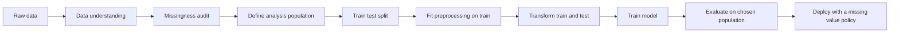
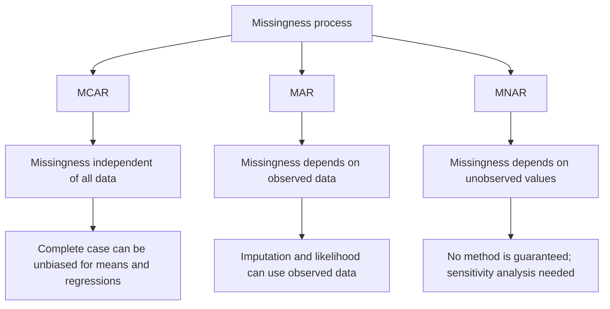
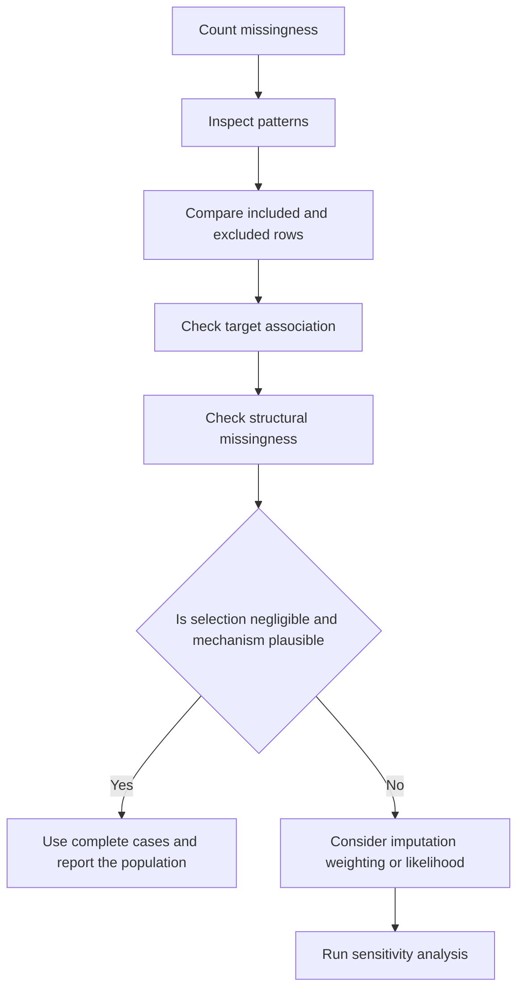
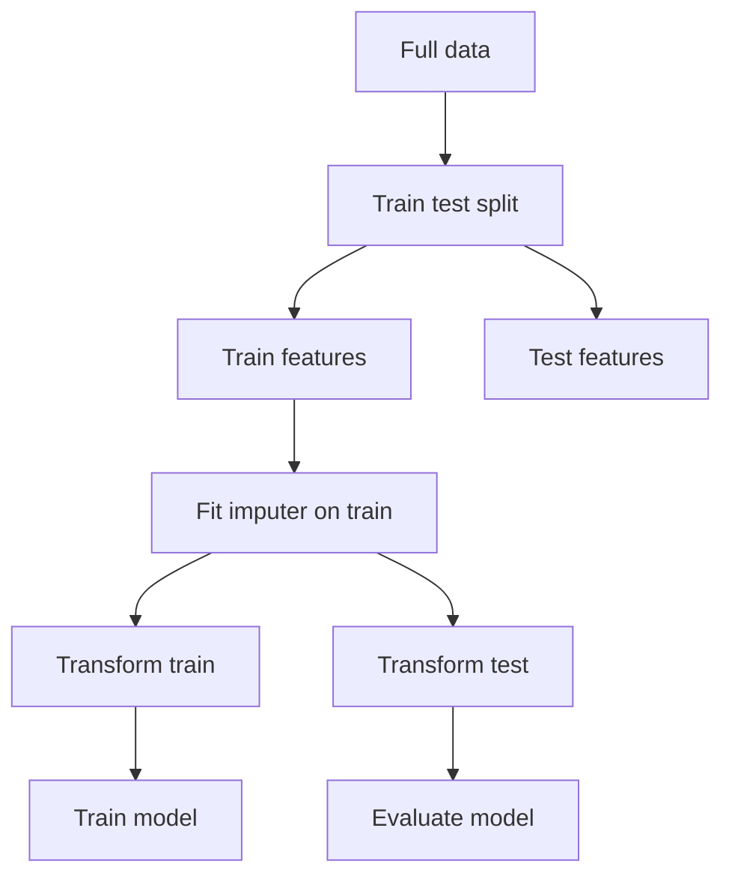

# Day 35 — Complete-Case Analysis and Missing-Data Mechanisms

> **Course:** CampusX — 100 Days of Machine Learning, Day 35
> **Official notebook:** `reference_notebooks/day35.ipynb` (20 cells; byte-identical to `vendor/100-days-of-machine-learning/day35-complete-case-analysis/day35.ipynb`)
> **Personal notebook:** `missing_data.ipynb` (20 cells; preserved unchanged)
> **Datasets:** `datasets/data_science_job.csv` and the root compatibility copy `data_science_job.csv` — both 19,158 rows and 13 columns, with identical parsed values
> **Transcript:** `ML_Notes_Videos_31_40/transcripts/35_transcript.txt` exists but is a noisy auto-transcript; it is used only for broad topic orientation, never for exact numbers
> **Central question:** When rows contain missing values, is deleting every incomplete row a harmless convenience — or does it silently change the population, the estimator, and the question the model is answering?

Complete-case analysis looks like the simplest missing-data method: keep rows that are complete, discard the rest. The simplicity is real, but so is the statistical cost. This chapter treats deletion as an estimator with assumptions, not as a neutral file-cleaning step. The course notebook demonstrates the mechanical recipe and a visual check. This chapter supplies the missing theory: the mechanisms that make deletion valid or invalid, the algebra of the resulting bias, the loss of power, the diagnostics that should precede and follow deletion, and the alternatives that may answer a different — sometimes better — question.

**Source labels used in this chapter**

- **Official** — the saved output in the CampusX notebook. It may have been produced with an older pandas and matplotlib version.
- **Rerun** — a result reproduced in this environment with Python 3.14.2, pandas 3.0.5, NumPy 2.5.3, matplotlib 3.11.2, SciPy 1.18.1, and scikit-learn 1.9.1, using `DAY_35/datasets/data_science_job.csv`.
- **Supplementary** — an explanation, calculation, or diagnostic added for learning. It is not presented as original course output.

Where official and rerun values differ, both are reported. The dataset's parsed content and the saved official counts agree; the main source-fidelity issue is conceptual, not numerical: the notebook visually compares distributions but does not test a missingness mechanism, does not split into train and test, and does not train a model.

---

# 1. Learning objectives

After studying this chapter I should be able to:

1. **Explain the practical problem.** Describe why missing values appear, why naive deletion can change an analysis, and why the same deletion rule can be reasonable for one question and disastrous for another.
2. **Define the mechanisms.** Write the formal definitions of MCAR, MAR, and MNAR, explain the conditioning sets, and distinguish "missing at random" from "missing completely at random".
3. **Define complete-case analysis precisely.** Express listwise deletion with a row-availability indicator, write the complete-case mean and regression estimators, and distinguish listwise from pairwise and column-wise deletion.
4. **Derive the bias.** Show that the complete-case mean converges to $E[X\mid R=1]$, derive the selection-bias expression in terms of $\operatorname{Cov}(X,R)$, and state the conditions under which it vanishes.
5. **State regression conditions.** Explain why missingness that depends only on covariates can leave a correctly specified regression consistent, while missingness that depends on the outcome beyond the covariates generally biases it.
6. **Quantify the loss.** Compute retention, sample loss, standard-error inflation, power loss, and minimum detectable effect for the actual dataset counts.
7. **Diagnose before deleting.** Compute missingness counts, pattern frequencies, inclusion rates, included-versus-excluded comparisons, standardized mean differences, chi-square tests, and target associations; interpret their limitations.
8. **Implement correctly in pandas.** Explain `isnull`, `mean`, boolean masks, `dropna`, `shape`, `value_counts`, `pd.concat`, histogram overlays, and density plots at the level of execution, not just syntax.
9. **Read the course graphs.** Interpret each of the notebook's figures, state what pattern is visible, what conclusion is supported, and what cannot be concluded from a visual overlap.
10. **Choose an alternative when deletion is inappropriate.** Compare mean imputation, regression imputation, MICE, KNN imputation, inverse-probability weighting, full-information maximum likelihood, and model-native missing-value handling.
11. **Protect the workflow.** Apply the split-before-fitting rule, avoid imputation leakage, decide whether the evaluation population is the complete-case population or the full population, and document the dropped rows.
12. **Answer interview and examination questions.** Explain the reasoning, perform the arithmetic, and discuss assumptions, edge cases, and trade-offs.

---

# 2. The problem: a complete row is a selected row

## 2.1 One row from the dataset

The official notebook begins by loading the table and displaying five rows. The first row is:

| enrollee_id | city | city_development_index | gender | relevent_experience | enrolled_university | education_level | major_discipline | experience | company_size | company_type | training_hours | target |
|---:|---|---:|---|---|---|---|---|---:|---|---|---:|---:|
| 8949 | city_103 | 0.920 | Male | Has relevent experience | no_enrollment | Graduate | STEM | 20.0 | NaN | NaN | 36.0 | 1.0 |

This row has two missing fields: `company_size` and `company_type`. If the analysis uses those fields, complete-case analysis deletes the row. If the analysis does not use those fields, the row is complete for the analysis and remains. The same CSV row is therefore "incomplete" or "complete" depending on the analysis variables, not on some absolute property of the row.

The second displayed row has no missing fields. The third row has missing `gender`, `company_size`, and `company_type`. The fourth row has missing `gender`, `enrolled_university`, and `company_size`. So even the first five rows contain different missingness patterns.

## 2.2 What the naive workflow does

A common workflow is:

```python
df = pd.read_csv("data_science_job.csv")
df = df.dropna()
model.fit(df[features], df["target"])
```

The second line is the entire missing-data strategy. It is rarely stated as an assumption, yet it makes several strong claims:

1. Rows with any missing value are exchangeable with rows that are complete.
2. Removing them does not change the target relationship being estimated.
3. The remaining sample is large enough for the intended precision.
4. The deployment population will also consist only of complete rows, or the model will never see an incomplete row.

None of these claims follows from the fact that `dropna()` runs without an error. Complete-case analysis is a **selection mechanism**: it selects a subset of rows, and every estimate computed on that subset is conditional on selection.

## 2.3 The two distinct losses

Deleting rows causes two different kinds of damage:

- **Bias:** the selected rows are not representative of the population of interest, so the estimator targets a different quantity. This is a correctness problem.
- **Variance:** even when selection is random, fewer rows means less information, wider confidence intervals, and lower power. This is an efficiency problem.

A method can suffer both at once. Under MCAR, complete-case analysis is unbiased for many estimands but inefficient. Under MAR or MNAR, it can be biased as well. The course notebook concentrates on the efficiency side: it measures how many rows survive and checks whether the marginal distributions look similar. The statistical theory in this chapter explains when that visual check is enough and when it is misleading.

## 2.4 The question determines the population

Suppose the target is "will this enrollee look for a new job?" Two different questions are possible:

- **Question A:** Among enrollees whose profile is complete on the five low-missing fields, what is the relationship between those fields and the target?
- **Question B:** Among all enrollees, what is the relationship between those fields and the target?

Complete-case analysis answers Question A directly. It answers Question B only if the complete rows are representative, or if the regression relationship is unchanged by selection. In deployment, if the system receives incomplete profiles, neither answer is directly operational unless the model can handle missing inputs.

This is why "Is CCA valid?" is an incomplete question. The correct question is: **valid for which estimand, in which population, under which missingness mechanism?**

## 2.5 Where the topic sits in the ML workflow

Missing-data handling is part of data cleaning and feature preprocessing, but its assumptions affect evaluation and deployment:



The important ordering is:

1. Audit missingness **before** deciding what to delete.
2. Define the population the model is supposed to serve.
3. Split before learning any imputation parameters.
4. If deletion is used, decide whether the test set is filtered too; that changes the estimand.
5. At deployment, the model must be able to handle the missingness patterns that will actually arrive.

A `Pipeline` can enforce train-only fitting for imputers, scalers, and encoders. It cannot decide for you whether deleting incomplete rows changes the population.

## 2.6 Connection to previous days

- **Day 31 (power transforms)** changed the numerical representation of a feature without deleting observations. Complete-case analysis removes observations entirely.
- **Day 32 (binning)** reduced a continuous feature to intervals. Both binning and deletion discard information, but deletion discards whole rows and can change the joint distribution, not only one feature's resolution.
- **Day 33 (mixed variables)** showed that missingness can be structural: a numeric component is missing because the original value was alphabetic. Structural missingness is not the same as a lost measurement and should not automatically trigger deletion.
- **Day 29 (pipelines)** provides the mechanism for leakage-safe imputation. Day 35 explains why the choice of missing-data method matters before the pipeline is built.
- **Days 36–40** continue with numerical imputation, categorical imputation, missing indicators, KNN imputation, and iterative imputation. Day 35 is the baseline against which those methods are compared.

---

# 3. The dataset and what is actually missing

## 3.1 Shape, columns, and meaning

The dataset has **19,158 rows and 13 columns**. A rerun gives:

```text
(19158, 13)
```

The columns are:

| Column | Role | Type in the file | Missing values |
|---|---|---|---:|
| `enrollee_id` | Identifier for the enrollee | integer | 0 |
| `city` | City code | string | 0 |
| `city_development_index` | Development index of the city | float | 479 |
| `gender` | Reported gender | string | 4,508 |
| `relevent_experience` | Whether the enrollee has relevant experience (spelling as in the file) | string | 0 |
| `enrolled_university` | University enrollment status | string | 386 |
| `education_level` | Highest education level | string | 460 |
| `major_discipline` | Field of study | string | 2,813 |
| `experience` | Years of experience | float | 65 |
| `company_size` | Size of current employer | string | 5,938 |
| `company_type` | Type of current employer | string | 6,140 |
| `training_hours` | Training hours completed | float | 766 |
| `target` | Job-change target: 1 if looking for a job change, 0 otherwise | float | 0 |

The file uses the spelling `relevent_experience`; it is not a typo introduced in this chapter. The target has 4,777 positives and 14,381 negatives, so the positive rate is

$$
\frac{4777}{19158}=0.2493475\ldots\approx 24.93\%.
$$

The dataset is an HR-analytics job-change table distributed with the CampusX course. The course repository's `readme.md` contains only a video link, so the exact upstream provenance is not documented inside the repository; the column structure matches the widely used Kaggle "HR Analytics: Job Change of Data Scientists" dataset. The local copies are the authoritative files for this lesson.

## 3.2 Missingness counts

The official cell 3 computes:

```python
df.isnull().mean() * 100
```

The saved output is:

| Column | Missing count | Missing percentage |
|---|---:|---:|
| `enrollee_id` | 0 | 0.000000 |
| `city` | 0 | 0.000000 |
| `city_development_index` | 479 | 2.500261 |
| `gender` | 4,508 | 23.530640 |
| `relevent_experience` | 0 | 0.000000 |
| `enrolled_university` | 386 | 2.014824 |
| `education_level` | 460 | 2.401086 |
| `major_discipline` | 2,813 | 14.683161 |
| `experience` | 65 | 0.339284 |
| `company_size` | 5,938 | 30.994885 |
| `company_type` | 6,140 | 32.049274 |
| `training_hours` | 766 | 3.998330 |
| `target` | 0 | 0.000000 |

Every percentage is a count divided by 19,158, then multiplied by 100. For example,

$$
\frac{479}{19158}=0.02500261\ldots,
\qquad
0.02500261\ldots\times100=2.500261\%.
$$

The percentages are not additive across columns: a row can be missing in more than one column. The sum of the column missing counts is

$$
479+4508+386+460+2813+65+5938+6140+766=21555.
$$

That is a count of missing **cells**, not missing rows.

## 3.3 The five columns selected by the course

The official cell 5 builds a list of columns whose missing fraction is strictly between 0 and 0.05:

```python
cols = [var for var in df.columns
        if df[var].isnull().mean() < 0.05
        and df[var].isnull().mean() > 0]
```

The result is:

```text
['city_development_index',
 'enrolled_university',
 'education_level',
 'experience',
 'training_hours']
```

Their missing counts and fractions are:

| Column | Missing | Fraction | Percentage |
|---|---:|---:|---:|
| `city_development_index` | 479 | 0.02500261 | 2.500261% |
| `enrolled_university` | 386 | 0.02014824 | 2.014824% |
| `education_level` | 460 | 0.02401086 | 2.401086% |
| `experience` | 65 | 0.00339284 | 0.339284% |
| `training_hours` | 766 | 0.03998330 | 3.998330% |

The filter excludes:

- columns with exactly zero missing values, because `> 0` is false;
- columns with 5% or more missing values, because `< 0.05` is false;
- the high-missing columns `gender` (23.53%), `major_discipline` (14.68%), `company_size` (30.99%), and `company_type` (32.05%).

This is a **heuristic column-selection rule**, not a statistical theorem. It keeps columns that are almost complete and excludes columns that would cause large deletion. The rule has three consequences:

1. It avoids deleting most rows for a column with 32% missing.
2. It discards the information in the high-missing columns entirely.
3. It makes the analysis population depend on an arbitrary 5% cutoff.

The cutoff is not a law. A column with 4.9% missing can still be strongly related to the target, and a column with 5.1% missing can be cheap to impute. The right decision depends on the estimand, the mechanism, and the cost of being wrong.

## 3.4 The missingness pattern

A missingness pattern records which columns are missing in a row. The five selected columns have 20 distinct patterns. The largest are:

| Pattern (columns missing) | Rows |
|---|---:|
| complete on all five | 17,182 |
| `training_hours` only | 718 |
| `city_development_index` only | 448 |
| `education_level` only | 327 |
| `enrolled_university` only | 268 |
| `enrolled_university` + `education_level` | 88 |
| `experience` only | 48 |
| `education_level` + `training_hours` | 19 |
| `city_development_index` + `training_hours` | 12 |
| `city_development_index` + `enrolled_university` | 10 |

The remaining patterns are smaller. The number of rows with exactly $k$ missing selected fields is:

| Number of missing selected fields | Rows |
|---:|---:|
| 0 | 17,182 |
| 1 | 1,809 |
| 2 | 155 |
| 3 | 11 |
| 4 | 1 |
| 5 | 0 |

The number of incomplete rows is the sum of the last four entries:

$$
1809+155+11+1=1976.
$$

This matches

$$
19158-17182=1976.
$$

The sum of individual missing cells in the selected columns is

$$
479+386+460+65+766=2156.
$$

The difference

$$
2156-1976=180
$$

is the number of "extra" missing cells contributed by rows with more than one missing selected field. This is why column missing counts cannot simply be added to obtain the number of rows that will be deleted.

## 3.5 Is the missingness independent across columns?

If the five missingness events were independent, the probability that a row is complete would be

$$
\prod_{j=1}^{5}(1-\pi_j),
$$

where $\pi_j$ is the missing fraction of column $j$. Using the observed fractions:

$$
(1-0.02500261)(1-0.02014824)(1-0.02401086)(1-0.00339284)(1-0.03998330)
=0.8920960\ldots
$$

The observed complete-case fraction is

$$
\frac{17182}{19158}=0.8968577\ldots
$$

The observed retention is **higher** than the independence prediction by

$$
0.8968577-0.8920960=0.0047617,
$$

or about 0.48 percentage points. Equivalently, the independence model predicts about

$$
19158\times(1-0.8920960)=2068
$$

lost rows, while the actual number lost is 1,976 — about 92 fewer. This indicates a weak **negative association** among the missingness indicators in this sample: missingness in one selected column slightly reduces the chance that another selected column is also missing. The pairwise missingness correlations are small, so the effect is modest, but the example shows why the product formula is only an approximation when missingness is not independent.

## 3.6 What the target looks like

The target is complete for every row:

| Target | Count | Share |
|---:|---:|---:|
| 0 | 14,381 | 75.07% |
| 1 | 4,777 | 24.93% |

Complete-case analysis on the five features keeps 17,182 rows. If the target is attached to those rows after filtering, the retained positives and negatives are:

| Group | Full data | Retained | Lost | Retention |
|---|---:|---:|---:|---:|
| Negative (`target=0`) | 14,381 | 12,917 | 1,464 | 89.82% |
| Positive (`target=1`) | 4,777 | 4,265 | 512 | 89.28% |
| All rows | 19,158 | 17,182 | 1,976 | 89.69% |

The positive class loses a slightly larger fraction than the negative class. The prevalence changes from

$$
\frac{4777}{19158}=24.9348\%
$$

to

$$
\frac{4265}{17182}=24.8225\%.
$$

The difference is about 0.11 percentage points. It is small in this dataset, but the direction matters: if the positive class were rare, a slightly higher loss rate among positives could materially change class balance and the choice of evaluation metric.

---

# 4. Foundations: how to represent missingness

## 4.1 The full-data notation

Let:

- $Y_i$ be the outcome for row $i$;
- $X_i=(X_{i1},\dots,X_{ip})$ be the analysis variables for row $i$;
- $Z_i$ be auxiliary variables that may be observed but are not necessarily in the model;
- $M_{ij}=1$ if variable $j$ is missing for row $i$, and $M_{ij}=0$ otherwise;
- $R_i=1$ if row $i$ is complete on the variables required by the analysis, and $R_i=0$ otherwise.

For a set of analysis variables $S$,

$$
R_i=\prod_{j\in S}(1-M_{ij}).
$$

Complete-case analysis uses only the rows with $R_i=1$. The number of such rows is

$$
n_{cc}=\sum_{i=1}^{n}R_i.
$$

The complete-case mean of a variable $X$ is

$$
\hat{\mu}_{cc}
=
\frac{1}{n_{cc}}\sum_{i=1}^{n}R_iX_i
=
\frac{\sum_{i:R_i=1}X_i}{n_{cc}}.
$$

This is an ordinary sample mean, but computed on a **selected** sample. The selection is the whole statistical issue.

## 4.2 The three missingness mechanisms

The mechanisms are defined by the conditional probability that a value is missing, given the data. The notation $X_{\mathrm{obs}}$ means the values that are actually observed for a row, and $X_{\mathrm{mis}}$ means the values that are missing.

### MCAR: missing completely at random

**Definition.** Missingness is MCAR if

$$
P(R=1\mid Y,X,Z)=P(R=1).
$$

Equivalently, the availability indicator is independent of the data:

$$
R\perp (Y,X,Z).
$$

A missing value is MCAR when the fact that it is missing carries no information about the value itself or about any other variable. Examples:

- A laboratory sample is dropped by accident, independent of the patient's characteristics.
- A sensor fails at random times, independent of the measured temperature.
- A survey page is lost by a printer, independent of the respondent's answers.

MCAR is a strong assumption. It is also the assumption that makes complete-case analysis easiest to justify for descriptive statistics.

### MAR: missing at random

**Definition.** Missingness is MAR if

$$
P(R=1\mid Y,X,Z)
=
P(R=1\mid Y_{\mathrm{obs}},X_{\mathrm{obs}},Z_{\mathrm{obs}}).
$$

In words: after conditioning on the observed data, the probability of missingness does not depend on the missing values. The name is misleading. MAR does **not** mean that missingness is unrelated to the data. It may depend strongly on observed variables. It means that, given what we observed, the unobserved values add no further information about why the value is missing.

Examples:

- Older respondents are less likely to report income, and age is observed. Missingness depends on age, not on the unobserved income within an age group.
- Patients in a more severe disease stage are more likely to have a missing lab test, and disease stage is recorded.
- A city with a lower development index is less likely to have a recorded index value, and the city code is observed.

MAR is the standard assumption for multiple imputation and likelihood-based methods. It is not automatically enough for complete-case analysis.

### MNAR: missing not at random

**Definition.** Missingness is MNAR if the probability of missingness depends on the missing value itself, even after conditioning on all observed data:

$$
P(R=1\mid Y,X,Z)
\neq
P(R=1\mid Y_{\mathrm{obs}},X_{\mathrm{obs}},Z_{\mathrm{obs}}).
$$

Examples:

- High-income respondents refuse to report income. The missing value itself drives the missingness.
- Patients with the worst outcomes are too ill to attend the follow-up visit.
- A product's price is missing precisely when the price is above a threshold that the seller does not want to disclose.
- A test score is missing because the student scored below a cutoff and the score was suppressed.

MNAR cannot be fully tested from the observed data alone, because the data needed to test it are exactly the data that are missing. It requires subject-matter assumptions, external information, or sensitivity analysis.

## 4.3 The mechanism hierarchy



The diagram is a hierarchy of **assumptions**, not a hierarchy of **methods**. MCAR implies MAR; MAR implies MNAR is not needed. The reverse implications do not hold. A method that assumes MAR can still be used when data are MCAR, but a method that assumes MCAR can fail when data are only MAR.

## 4.4 MAR is not "missingness is random"

The phrase "missing at random" often causes two mistakes.

**Mistake 1: "MAR means the missing values are a random sample."** That is MCAR, not MAR. Under MAR, missingness can depend on observed variables. For example, if older people are less likely to report income, the observed income values are not a random sample of all incomes; they are a random sample **within age groups**, if the MAR assumption holds.

**Mistake 2: "MAR means complete-case analysis is unbiased."** Not in general. MAR is a condition about the missingness model. Complete-case analysis is a particular estimator. Whether it is unbiased depends on the estimand and on which variables drive selection. Section 6 makes this precise.

## 4.5 A subtle point: MAR with only one variable

Suppose the only variable in the analysis is $X$, and some values of $X$ are missing. There are no other observed variables. Then MAR says

$$
P(R=1\mid X)=P(R=1\mid X_{\mathrm{obs}}).
$$

For a row with $X$ missing, $X_{\mathrm{obs}}$ is empty, so the right-hand side is a constant. Thus MAR collapses to MCAR for that variable. MAR becomes useful when there are auxiliary variables or a multivariate model: missingness in $X$ can depend on observed $Z$ or on observed components of $X$. This is why "MAR" in a real analysis always needs a statement of **which variables are in the conditioning set**.

## 4.6 Missingness patterns

Three pattern descriptions are useful:

- **Univariate missingness:** only one variable has missing values. Complete-case analysis deletes rows missing that variable.
- **Monotone missingness:** variables can be ordered so that, once a variable is missing, all later variables are also missing. This pattern arises in longitudinal studies with dropout.
- **Arbitrary (non-monotone) missingness:** any variable can be missing in any combination. The Day 35 dataset is arbitrary: the pattern table has 20 combinations.

The pattern matters for algorithms. Some imputation methods exploit monotonicity; others do not. Complete-case analysis ignores the pattern except through the row indicator $R_i$.

## 4.7 Structural missingness is different

A missing value can be **structural**: it is absent by design, not lost. Examples:

- A numeric component of a mixed variable is missing because the original value was alphabetic (Day 33).
- A question about pregnancy is not applicable to a male respondent.
- A `company_size` field is missing because the person is not employed.

Structural missingness should not be treated as a measurement failure. Deleting those rows can remove an entire subgroup. In the Day 35 table, a missing `company_type` may mean "not currently employed" rather than "unknown employer type". The data dictionary would be needed to distinguish these cases; the course notebook does not provide one. This is a limitation of the dataset, not a flaw in the code.

## 4.8 Why the mechanism matters for the estimator

The same observed data can be consistent with different mechanisms. The mechanism determines:

- whether the complete-case sample is representative;
- whether an imputation model can recover the missing values;
- whether the missingness probability can be estimated;
- whether the analysis needs a sensitivity analysis.

A useful discipline is to write the assumption explicitly before choosing a method. For example:

> "We assume that missingness in the five selected columns is independent of the target and of the unobserved values, conditional on the observed city, gender, and experience. Under this assumption, complete-case regression of the target on the five columns is consistent. We check inclusion rates by observed variables and compare complete and incomplete rows, but we cannot test the conditional independence of the unobserved values."

That statement is more useful than "we dropped missing values."

---

# 5. Complete-case analysis: definition and estimators

## 5.1 Definition

**Complete-case analysis** (CCA), also called **listwise deletion** or **casewise deletion**, keeps only the rows for which every variable required by the analysis is observed, and discards all other rows. If the analysis uses variables $S$, the retained set is

$$
\mathcal{C}=\{i:R_i=1\},
\qquad
R_i=\prod_{j\in S}(1-M_{ij}).
$$

The sample size becomes $n_{cc}=|\mathcal{C}|$. Every subsequent statistic — mean, proportion, regression coefficient, correlation, model score — is computed on $\mathcal{C}$.

The method is **not** the same as:

- **Pairwise deletion:** for each pair of variables, use all rows where both are observed. Different statistics use different subsets, and the resulting covariance matrix may be inconsistent.
- **Available-case analysis:** use whatever data are available for each statistic, without requiring a common complete subset.
- **Column deletion:** remove an entire variable, keeping all rows. The course's 5% rule first removes high-missing columns, then applies row deletion to the remaining columns.

## 5.2 The complete-case mean

For a single variable $X$,

$$
\hat{\mu}_{cc}
=
\frac{1}{n_{cc}}\sum_{i=1}^{n}R_iX_i.
$$

If $n_{cc}=0$, the estimator is undefined. If $n_{cc}$ is small, the estimator is unstable even if it is unbiased. The estimator is a ratio of two random quantities: the sum of observed values and the number of observed rows. Its asymptotic limit is

$$
\hat{\mu}_{cc}
\;\xrightarrow{p}\;
\frac{E[R X]}{E[R]}
=
E[X\mid R=1].
$$

The last equality holds because $E[RX]=E[X\mid R=1]P(R=1)$ and $E[R]=P(R=1)$. This limit is the key to the bias analysis in Section 6.

## 5.3 The complete-case regression

For a linear regression

$$
Y_i=\beta_0+\beta_1^{\top}X_i+\varepsilon_i,
\qquad
E[\varepsilon_i\mid X_i]=0,
$$

the complete-case ordinary least-squares estimator is

$$
\hat{\beta}_{cc}
=
\left(\sum_{i:R_i=1}X_iX_i^{\top}\right)^{-1}
\left(\sum_{i:R_i=1}X_iY_i\right),
$$

where the first column of $X_i$ is 1 for the intercept. This is the usual OLS formula applied to the complete rows. It estimates the regression of $Y$ on $X$ **within the complete-case population**. Whether that equals the regression in the full population depends on the selection mechanism.

## 5.4 The complete-case proportion

For a binary variable $X\in\{0,1\}$,

$$
\hat{p}_{cc}
=
\frac{1}{n_{cc}}\sum_{i=1}^{n}R_iX_i
=
\frac{\text{number of observed 1s among complete rows}}{n_{cc}}.
$$

The same selection logic applies: $\hat{p}_{cc}$ estimates $P(X=1\mid R=1)$, not necessarily $P(X=1)$.

## 5.5 Multiple variables and retention

For multiple analysis variables, a row must be complete on **all** of them. The retention probability is

$$
P(R=1)
=
P(M_1=0,\dots,M_p=0).
$$

If the missingness indicators are independent,

$$
P(R=1)=\prod_{j=1}^{p}(1-\pi_j),
$$

where $\pi_j=P(M_j=1)$. In general, independence fails, and the exact retention must be computed from the joint pattern distribution.

The Day 35 dataset illustrates both calculations:

- independent approximation: $0.8920960$, or 89.21% retention;
- observed retention: $0.8968577$, or 89.69% retention.

The difference is small here, but it can be large when missingness clusters in the same rows. If the same 30% of rows are missing in every column, retention is 70%, not $(0.7)^5=16.8\%$. The pattern table, not the marginal missing percentages, determines the true loss.

## 5.6 What the course actually computes

The official notebook does not apply CCA to all 13 columns. It:

1. computes missingness percentages;
2. selects five columns with $0<\text{missing fraction}<0.05$;
3. drops rows incomplete on those five columns;
4. compares the marginal distributions of the retained and original data;
5. compares category proportions for two categorical variables.

So the course performs **column selection followed by row deletion**, not pure listwise deletion on the full table. This distinction is essential. If the notebook had called `df.dropna()` on all 13 columns, the retention would be 8,434 rows, or 44.02%, as computed in Section 12. The five-column choice is what keeps 89.69% of the rows.

## 5.7 Why the output has five columns

`new_df = df[cols].dropna()` selects the five columns first, then drops rows. Therefore `new_df` has five columns, not thirteen. The target is not included. If the goal were to train a model, `new_df` would need the target attached by the same row mask:

```python
mask = df[cols].notna().all(axis=1)
model_df = df.loc[mask, cols + ["target"]].copy()
```

If instead one wrote `new_df["target"] = df["target"]`, pandas would align on the index and could silently introduce missing values if the indices did not match. The safe pattern is to apply one explicit mask to the full table.

---

# 6. When complete-case analysis is unbiased

## 6.1 The mean under MCAR

Assume MCAR: $R\perp X$. Condition on the set of rows that are complete, or equivalently on $n_{cc}$. Within the complete rows, the observed $X$ values are a random sample from the same distribution as the full data, because selection did not depend on $X$. Therefore

$$
E[\hat{\mu}_{cc}\mid n_{cc}>0]
=
E[X\mid R=1]
=
E[X]
=
\mu.
$$

The estimator is unbiased for the population mean. Its conditional variance is

$$
\operatorname{Var}(\hat{\mu}_{cc}\mid n_{cc})
=
\frac{\sigma^2}{n_{cc}},
$$

where $\sigma^2=\operatorname{Var}(X)$. The unconditional variance is approximately

$$
\operatorname{Var}(\hat{\mu}_{cc})
\approx
\frac{\sigma^2}{n\,P(R=1)}
=
\frac{\sigma^2}{E[n_{cc}]}.
$$

The approximation treats $n_{cc}$ as random; the exact unconditional variance follows from the law of total variance:

$$
\operatorname{Var}(\hat{\mu}_{cc})
=
E\left[\frac{\sigma^2}{n_{cc}}\right]
+
\operatorname{Var}\left(E[X]\right)
=
E\left[\frac{\sigma^2}{n_{cc}}\right],
$$

where the second term is zero because the conditional mean is constant. For large $n$, $E[1/n_{cc}]\approx 1/E[n_{cc}]$, giving the approximation above.

## 6.2 Deriving the selection bias

Let $p(X)=P(R=1\mid X)$ be the probability that a row with value $X$ is complete. Then

$$
E[X\mid R=1]
=
\frac{E[X\,1\{R=1\}]}{P(R=1)}
=
\frac{E[X\,p(X)]}{E[p(X)]}.
$$

Use the covariance identity

$$
E[X\,p(X)]
=
E[X]E[p(X)]+\operatorname{Cov}(X,p(X)).
$$

Then

$$
E[X\mid R=1]
=
E[X]
+
\frac{\operatorname{Cov}(X,p(X))}{E[p(X)]}.
$$

Since $E[p(X)]=P(R=1)$,

$$
\boxed{
\text{Bias}(\hat{\mu}_{cc})
=
E[X\mid R=1]-E[X]
=
\frac{\operatorname{Cov}(X,R)}{P(R=1)}
}
$$

because $\operatorname{Cov}(X,p(X))=\operatorname{Cov}(X,R)$. This is an exact population expression. It says:

- if complete-case probability is constant in $X$, the covariance is zero and the mean is unbiased;
- if high values of $X$ are more likely to be complete, the covariance is positive and the complete-case mean is too high;
- if high values of $X$ are less likely to be complete, the covariance is negative and the complete-case mean is too low.

The magnitude is scaled by $1/P(R=1)$. If only 10% of rows are complete, even a moderate covariance can produce a large bias.

## 6.3 A numerical selection-bias example

Suppose $X$ takes only two values:

- $X=0$ with probability 0.6;
- $X=1$ with probability 0.4.

The population mean is

$$
\mu=0.6\cdot0+0.4\cdot1=0.4.
$$

Suppose the completeness probabilities are

$$
p(0)=0.9,
\qquad
p(1)=0.5.
$$

High values are less likely to be complete. The overall completeness probability is

$$
P(R=1)=0.6\cdot0.9+0.4\cdot0.5=0.54+0.20=0.74.
$$

Among complete rows,

$$
P(X=1\mid R=1)
=
\frac{0.4\cdot0.5}{0.74}
=
\frac{0.20}{0.74}
=
0.270270\ldots
$$

So the complete-case mean is $0.2703$, and the bias is

$$
0.2703-0.4=-0.1297.
$$

Using the covariance formula:

$$
\operatorname{Cov}(X,R)
=
E[XR]-E[X]E[R]
=
0.4\cdot0.5-0.4\cdot0.74
=
0.20-0.296
=
-0.096.
$$

Then

$$
\text{Bias}
=
\frac{-0.096}{0.74}
=
-0.1297.
$$

The two calculations agree. The example shows that a 26% loss of complete cases (0.74 retention) can produce a 32% relative bias in the mean ($0.1297/0.4$).

## 6.4 The regression condition

For the regression $E[Y\mid X]=\beta_0+\beta_1^{\top}X$, complete-case OLS is consistent if

$$
R\perp Y\mid X.
$$

In words: conditional on the covariates in the model, the probability that a row is complete does not depend on the outcome. If this holds, then

$$
E[Y\mid X,R=1]
=
E[Y\mid X]
=
\beta_0+\beta_1^{\top}X.
$$

The complete-case regression therefore estimates the same conditional mean function. The proof is the conditional expectation identity:

$$
E[Y\mid X,R=1]
=
E[\,E[Y\mid X,R]\mid X,R=1\,].
$$

If $R\perp Y\mid X$, then $E[Y\mid X,R]=E[Y\mid X]$, so the inner expectation is $\beta_0+\beta_1^{\top}X$, and the outer expectation is the same.

This condition is weaker than MCAR and weaker than MAR in one sense, but it must be checked against the **specific model**. It holds when:

- missingness is MCAR;
- missingness depends only on $X$, the covariates included in the model;
- missingness depends on other observed variables $Z$, but $R\perp Y\mid X,Z$ and the model includes the relevant $Z$ (or they do not affect $Y$).

It fails when:

- missingness depends on $Y$ after conditioning on $X$;
- missingness depends on an unobserved variable $U$ that also affects $Y$;
- missingness depends on $X$ through a nonlinear function that is not captured by the model, and the model is misspecified.

## 6.5 Missingness in the outcome versus missingness in a predictor

The distinction is crucial and often confused.

### Missing outcome $Y$, missingness depends on $X$

Suppose $Y$ is missing more often for older people, and age $X$ is observed. Conditional on age, missingness is unrelated to $Y$. Then $R\perp Y\mid X$, and complete-case regression of $Y$ on $X$ is consistent. The complete cases have a different age distribution from the full sample, but within each age the outcome distribution is unchanged.

### Missing outcome $Y$, missingness depends on $Y$

Suppose people with very low outcomes do not return for follow-up. Then $R$ depends on $Y$ even after conditioning on $X$. Complete-case regression is biased, because the observed outcomes are truncated. This is MNAR unless the dependence is fully explained by observed variables.

### Missing predictor $X$, missingness depends on $X$

Suppose income $X$ is missing more often for high incomes, and the model is $Y=\beta_0+\beta_1X+\varepsilon$. Conditional on $X$, missingness is determined; $R\perp Y\mid X$ holds if missingness depends only on $X$. Complete-case regression can still estimate the slope consistently, even though the complete-case **mean of $X$** is biased. This is a subtle but important distinction: selection on a covariate changes the distribution of that covariate, but not necessarily the conditional relationship between $Y$ and that covariate.

### Missing predictor $X$, missingness depends on $Y$

Suppose people with high $Y$ are less likely to report $X$. Then $R$ depends on $Y$ beyond $X$, so the complete-case regression is biased. This is the case where imputation using $Y$ can help under MAR, but complete-case analysis cannot.

### Missing predictor $X$, missingness depends on another predictor $Z$

Suppose $X$ is missing more often in a particular city $Z$, and $Z$ also affects $Y$. If the model includes $Z$ or if $Z$ does not affect $Y$, the regression can be consistent. If $Z$ affects $Y$ but is omitted, the selection can create omitted-variable bias.

## 6.6 A table of validity conditions

| Missing variable | Selection depends on | Complete-case mean of $X$ | Complete-case regression $Y$ on $X$ |
|---|---|---|---|
| $X$ | nothing (MCAR) | unbiased | unbiased |
| $X$ | $X$ itself | biased | often consistent if $R\perp Y\mid X$ |
| $X$ | $Y$ | biased | generally biased |
| $X$ | observed $Z$ | biased unless $X\perp R\mid Z$ | consistent if $R\perp Y\mid X,Z$ and model includes relevant $Z$ |
| $X$ | unobserved $U$ | generally biased | generally biased |
| $Y$ | $X$ | may be biased for the marginal mean of $Y$ | consistent if $R\perp Y\mid X$ |
| $Y$ | $Y$ | biased | generally biased |

The table is a guide, not a substitute for the estimand. A complete-case mean and a complete-case regression are different estimators with different conditions.

## 6.7 What "unbiased" does and does not mean

An estimator is unbiased if its sampling distribution is centred on the target parameter over repeated samples. This does not mean:

- that a single estimate is close to the truth;
- that the estimator has low variance;
- that the estimator is robust to model misspecification;
- that the target parameter is the one the decision-maker needs.

Complete-case analysis can be unbiased for the complete-case population mean while being biased for the full-population mean. It can be unbiased for a regression slope while giving a misleading descriptive table. Always state the estimand.

## 6.8 Finite-sample versus asymptotic language

The derivations above are population limits. In a finite sample:

- the complete-case mean can deviate from the population mean by sampling error even under MCAR;
- the ratio form of the estimator can introduce a small finite-sample bias when $n_{cc}$ is random;
- tests and confidence intervals computed on $n_{cc}$ observations are valid under MCAR, but their power is lower than the full-data tests;
- the normal approximation may be poor if $n_{cc}$ is small or the variable is very skewed.

The asymptotic statements are the right first-order guide, but they are not a guarantee for a single dataset.

---

# 7. The cost: sample size, standard errors, and power

## 7.1 Retention and loss in the actual dataset

The official cell 8 computes

```python
len(df[cols].dropna()) / len(df)
```

and the saved output is

```text
0.8968577095730244
```

That is 89.6858% retention. The number of rows lost is

$$
19158-17182=1976.
$$

The loss fraction is

$$
1-0.8968577=0.1031423,
$$

or 10.3142%. The per-column missing fractions do not add to this because rows can be missing in more than one selected column.

## 7.2 Standard-error inflation

For a sample mean, the standard error is

$$
\widehat{SE}(\hat{\mu})
=
\frac{s}{\sqrt{n}}.
$$

If the complete-case sample has size $n_{cc}=(1-r)n$, where $r$ is the loss fraction, then the standard error on the complete cases is

$$
\widehat{SE}_{cc}
=
\frac{s_{cc}}{\sqrt{n_{cc}}}
\approx
\frac{s}{\sqrt{(1-r)n}}
=
\frac{\widehat{SE}_{full}}{\sqrt{1-r}}.
$$

The inflation factor is

$$
\frac{\widehat{SE}_{cc}}{\widehat{SE}_{full}}
=
\frac{1}{\sqrt{1-r}}.
$$

For $r=0.103142$,

$$
\frac{1}{\sqrt{0.896858}}
=
1.055938.
$$

The standard error is about 5.59% larger than it would be with the full sample, assuming the variance is unchanged. A 95% confidence interval is about 5.59% wider.

## 7.3 How much extra data would be needed?

To achieve the same standard error as the full sample using only complete cases, the required full-sample size would need to be larger by

$$
\frac{1}{1-r}
=
\frac{1}{0.896858}
=
1.115004.
$$

That is about 11.5% more rows recruited, if the same fraction is lost. The complete-case analysis itself cannot recover the lost rows; this calculation describes the cost in data-collection terms.

## 7.4 Power and minimum detectable effect

For a two-sample $t$-test with equal group sizes, the approximate sample size per group for power $1-\beta$ and two-sided significance $\alpha$ is

$$
n_{\text{per group}}
\approx
\frac{2(z_{1-\alpha/2}+z_{1-\beta})^2}{d^2},
$$

where $d$ is the standardized effect size (mean difference divided by standard deviation). If complete-case analysis multiplies the available sample by $1-r$, the minimum detectable effect for fixed power increases by

$$
\frac{1}{\sqrt{1-r}}.
$$

For $r=0.103142$, the minimum detectable effect is about 5.59% larger than with the full sample. For example, if the full sample could detect $d=0.20$, the complete-case sample can detect about

$$
0.20\times1.055938=0.211188.
$$

The loss is moderate here. For larger loss fractions, it becomes severe:

| Loss fraction $r$ | Retention $1-r$ | SE inflation $1/\sqrt{1-r}$ | Extra sample needed $1/(1-r)$ |
|---:|---:|---:|---:|
| 5% | 0.95 | 1.026 | 1.053 |
| 10.31% | 0.8969 | 1.056 | 1.115 |
| 25% | 0.75 | 1.155 | 1.333 |
| 50% | 0.50 | 1.414 | 2.000 |
| 75% | 0.25 | 2.000 | 4.000 |
| 90% | 0.10 | 3.162 | 10.000 |

The table is a reminder that the cost of deletion is nonlinear. Losing the first 10% is manageable; losing 75% can make an otherwise adequate study unable to answer its question.

## 7.5 The variance is not the only cost

Even when the standard error is acceptable, deletion can:

- change the class balance, affecting accuracy, recall, and threshold choice;
- remove rare subgroups entirely;
- change the distribution of covariates, affecting model extrapolation;
- make the train and test populations different if only one is filtered;
- create a model that cannot score incomplete rows at deployment;
- hide a data-quality problem that should be fixed at the source.

The 10.31% loss in this dataset is not catastrophic, but the selection diagnostics in Section 8 show that it is not obviously MCAR. The correct conclusion is not "the loss is small, so CCA is fine"; it is "the loss is moderate, and the selection pattern needs to be justified for the intended estimand."

## 7.6 A note on effective sample size

For a proportion $\hat p$, the variance is

$$
\operatorname{Var}(\hat p)=\frac{p(1-p)}{n}.
$$

With complete cases,

$$
\operatorname{Var}(\hat p_{cc})=\frac{p_{cc}(1-p_{cc})}{n_{cc}}.
$$

If the complete-case prevalence $p_{cc}$ differs from the full prevalence $p$, both the numerator and denominator change. In this dataset, the target prevalence changes from 0.24935 to 0.24822, a small difference, so the variance effect is dominated by $n_{cc}$. In a dataset with stronger selection, the prevalence change can matter as much as the sample-size loss.

---

# 8. Diagnostics before and after deleting rows

## 8.1 What to inspect before deletion

A missing-data audit should answer five questions:

1. **How much is missing?** Counts and percentages by column, plus the joint pattern.
2. **Where is it missing?** Which rows, which groups, which time periods, which sensors?
3. **Is missingness related to observed variables?** Compare inclusion rates across groups and included-versus-excluded values.
4. **Is missingness related to the target?** Compare target prevalence among included and excluded rows, when the target is observed.
5. **Is the missingness structural or measurement-related?** Read the data dictionary; distinguish "not applicable" from "unknown" from "lost".

The course notebook answers question 1 and partially answers question 3 with visual distribution comparisons. It does not answer questions 4 and 5, and it does not test a mechanism.

## 8.2 Missingness counts and percentages

The basic pandas audit is:

```python
missing_count = df.isna().sum()
missing_pct = df.isna().mean().mul(100)
audit = pd.DataFrame({
    "missing": missing_count,
    "percent": missing_pct
}).sort_values("percent", ascending=False)
```

`df.isna()` and `df.isnull()` are aliases. `sum()` adds the Boolean indicators down each column; `mean()` divides by the number of rows. The result is a Series indexed by column name. Sorting by percentage makes the high-missing columns visible.

A compact pattern audit is:

```python
patterns = df[cols].isna().value_counts()
patterns
```

The result is a MultiIndex Series whose index records the missing/complete status of every selected column and whose values are row counts. Sorting by count shows the dominant patterns. The Day 35 pattern table in Section 3.4 is the readable version of this output.

## 8.3 Inclusion rates by group

For a categorical variable $G$, the inclusion rate in group $g$ is

$$
\widehat{P}(R=1\mid G=g)
=
\frac{\text{number of complete rows in group }g}{\text{number of rows in group }g}.
$$

A large difference across groups is evidence that missingness is related to $G$. It does not prove MAR or MNAR, but it rejects the simple MCAR claim that inclusion is independent of $G$.

For the Day 35 selected columns, a rerun gives:

| Group variable | Level | Rows | Included | Inclusion rate |
|---|---|---:|---:|---:|
| `gender` | Female | 1,238 | 1,142 | 92.25% |
| `gender` | Male | 13,221 | 12,006 | 90.81% |
| `gender` | Other | 191 | 161 | 84.29% |
| `relevent_experience` | Has relevant experience | 13,792 | 12,513 | 90.73% |
| `relevent_experience` | No relevant experience | 5,366 | 4,669 | 87.01% |
| `enrolled_university` | Full time course | 3,757 | 3,449 | 91.80% |
| `enrolled_university` | Part time course | 1,198 | 1,101 | 91.90% |
| `enrolled_university` | no enrollment | 13,817 | 12,632 | 91.42% |
| `education_level` | Graduate | 11,598 | 10,650 | 91.83% |
| `education_level` | High School | 2,017 | 1,845 | 91.47% |
| `education_level` | Masters | 4,361 | 4,022 | 92.23% |
| `education_level` | Phd | 414 | 380 | 91.79% |
| `education_level` | Primary School | 308 | 285 | 92.53% |

The `gender` and `relevent_experience` differences are noticeable. A chi-square test of independence between inclusion and these observed categories gives:

| Group variable | Chi-square statistic | Degrees of freedom | p-value |
|---|---:|---:|---:|
| `gender` | 12.7992 | 2 | 0.001662 |
| `relevent_experience` | 57.2556 | 1 | $3.83\times10^{-14}$ |
| `enrolled_university` | 0.7754 | 2 | 0.6786 |
| `education_level` | 1.3747 | 4 | 0.8486 |
| `major_discipline` | 3.8444 | 5 | 0.5720 |
| `company_size` | 6.7358 | 7 | 0.4569 |
| `company_type` | 2.2413 | 5 | 0.8149 |

These are **supplementary** tests, not part of the official notebook. They test whether inclusion is associated with the observed category. They do not identify the mechanism. A small p-value says the complete-case group is compositionally different; it does not say whether the missing values themselves depend on the outcome. With $n=19{,}158$, even small differences can be statistically significant, so effect sizes and practical relevance matter.

## 8.4 Included versus excluded rows

A more direct diagnostic compares the rows that survive with the rows that are deleted. For a numeric variable $X$, compare:

- mean and median in each group;
- standard deviation and interquartile range;
- standardized mean difference;
- a Welch $t$-test or a Kolmogorov–Smirnov test;
- quantiles and an ECDF plot.

For the Day 35 selected columns, a rerun gives:

| Variable | Included mean | Excluded mean | Difference | Pooled SD | Standardized difference | Welch p-value |
|---|---:|---:|---:|---:|---:|---:|
| `city_development_index` | 0.831076 | 0.804560 | +0.026515 | 0.127337 | +0.2082 | $1.11\times10^{-13}$ |
| `experience` | 10.0440 | 8.8854 | +1.1586 | 6.4836 | +0.1787 | $1.57\times10^{-13}$ |
| `training_hours` | 65.0559 | 67.0306 | -1.9747 | 60.4402 | -0.0327 | 0.2765 |
| `target` | 0.248225 | 0.259109 | -0.010884 | 0.4351 | -0.0250 | 0.2952 |

The standardized mean difference is

$$
d
=
\frac{\bar X_{inc}-\bar X_{exc}}{s_{pooled}},
\qquad
s_{pooled}
=
\sqrt{\frac{s_{inc}^2+s_{exc}^2}{2}}.
$$

By the usual conventions, $|d|\approx0.2$ is a small difference, $0.5$ is medium, and $0.8$ is large. The city-development difference is about 0.21 (small-to-moderate), and the experience difference is about 0.18 (small). The training-hours difference is negligible. The target difference is negligible.

The Kolmogorov–Smirnov test compares the entire distributions, not only the means:

| Variable | KS statistic | KS p-value |
|---|---:|---:|
| `city_development_index` | 0.0997 | $2.26\times10^{-12}$ |
| `experience` | 0.0802 | $4.45\times10^{-10}$ |
| `training_hours` | 0.0240 | 0.5239 |
| `target` | 0.0109 | 0.9832 |

Again, the city-development and experience distributions differ detectably; training hours and target do not. These results argue against strict MCAR. They are consistent with a mechanism in which missingness depends on observed variables such as city development or experience, which is a MAR-like pattern. But they do not prove MAR, because the missing values themselves are not observed.

## 8.5 Why comparing overlapping samples is misleading

A common mistake is to compare the original sample mean with the complete-case mean using an independent two-sample test. The complete-case sample is a subset of the original sample, so the two samples are not independent. The correct comparisons are:

1. **Included versus excluded** — disjoint groups, suitable for a two-sample test.
2. **Paired difference on common rows** — for a variable that is observed in both the original and complete-case data, the values are identical for retained rows, so the only difference is the contribution of deleted rows.
3. **Full-sample estimate versus complete-case estimate** — descriptive, with a paired or influence-based standard error, not an independent two-sample test.

The table in Section 8.4 uses included versus excluded rows, which is the cleanest comparison. The table of original versus complete-case means in Section 12 is descriptive; it should not be given an independent-samples p-value.

## 8.6 Target association

If the target is observed for all rows, compare its distribution in included and excluded rows:

| Group | Rows | Positives | Prevalence |
|---|---:|---:|---:|
| Included | 17,182 | 4,265 | 24.8225% |
| Excluded | 1,976 | 512 | 25.9109% |

The difference is

$$
0.259109-0.248225=0.010884,
$$

or about 1.09 percentage points. The pooled two-proportion test is equivalent to the chi-square test here: $\chi^2=1.0643$ with 1 degree of freedom and $p=0.3022$. The unpooled two-proportion $z$-test gives $p\approx0.295$. There is no strong evidence that the target prevalence differs between included and excluded rows in this sample. That is reassuring for target-related selection, but it is not proof that the missingness is unrelated to the target: the target is binary, the test has limited power for small differences, and the missing values could still depend on the target within covariate strata.

## 8.7 Missingness indicators and the target

A useful diagnostic is to compare the missingness rate of each selected column between the two target classes:

| Column | Missing rate, target 0 | Missing rate, target 1 |
|---|---:|---:|
| `city_development_index` | 2.4963% | 2.5120% |
| `enrolled_university` | 1.8288% | 2.5748% |
| `education_level` | 2.4755% | 2.1771% |
| `experience` | 0.2921% | 0.4815% |
| `training_hours` | 4.0122% | 3.9565% |

The differences are small. `enrolled_university` has the largest relative difference: 1.83% missing among negatives versus 2.57% among positives, a difference of 0.75 percentage points. This does not establish target-dependent missingness, but it is the kind of pattern that a formal missingness model would examine.

## 8.8 Little's MCAR test

Little's (1988) test is a global test of MCAR against the alternative that missingness depends on the observed data. It compares the observed means and covariances with the values expected under MCAR, using a chi-square statistic. It is available in R's `naniar` package and in some Python implementations, but it is not part of pandas.

The test has important limitations:

- it assumes multivariate normality;
- it tests MCAR against a broad alternative, not a specific MAR model;
- it can reject MCAR because of a small departure that is practically unimportant;
- it cannot distinguish MAR from MNAR;
- it may have low power in small samples or many missingness patterns.

A non-significant result is not proof of MCAR; a significant result is evidence that a simpler complete-case justification is inadequate. The test should be one diagnostic among several, not a gatekeeper.

## 8.9 Visual diagnostics

Common visual tools are:

- **Missingness matrix:** one row per observation, one column per variable, with missing cells highlighted. It shows whether missingness clusters in rows or time.
- **Missingness heatmap:** pairwise co-missingness; values near 1 mean two columns tend to be missing together.
- **Missingness dendrogram:** clusters variables by co-missingness, useful for deciding whether a group of variables should be handled together.
- **Histogram or density overlay:** compares the marginal distribution before and after deletion.
- **ECDF plot:** compares the entire cumulative distribution; often more sensitive than a histogram.
- **Box plot by inclusion status:** shows shifts in median and spread.

The `missingno` library provides matrix, heatmap, and dendrogram plots:

```python
import missingno as msno

msno.matrix(df[cols])
msno.heatmap(df[cols])
msno.dendrogram(df[cols])
```

These calls are optional; they are not part of the official notebook and are not required to run it. The pandas-only pattern table is sufficient to see the joint missingness structure.

## 8.10 Visual diagnostics have limits

A histogram overlay can look almost identical while the tails differ, or while a small subgroup is systematically removed. The eye is good at seeing large shifts in the bulk of a distribution and poor at seeing small shifts in the tails, changes in quantiles, or changes in a conditional relationship. In Day 35:

- the training-hours histograms overlap almost exactly;
- the city-development histograms overlap closely but the included group has a slightly higher mean and a slightly different lower tail;
- the experience histograms overlap closely but the included group has more experienced rows;
- the categorical proportions shift by about 1.4 percentage points for the largest categories.

The visual check supports "the marginal distributions are not dramatically different", not "the missingness is MCAR" and not "all downstream estimates are unbiased."

## 8.11 A diagnostic sequence

A practical sequence is:



The decision is not a single p-value. It combines the size of the loss, the strength of the selection, the plausibility of the mechanism, the intended estimand, and the consequences of being wrong.

---

# 9. Reading the official notebook, cell by cell

The official notebook has 20 cells. It is deliberately short: load, inspect, filter, drop, plot, compare. The following walkthrough explains what each cell does and what it does not do.

## 9.1 Cell 0 — imports

```python
import numpy as np
import pandas as pd
import matplotlib.pyplot as plt
```

`numpy` is imported but not used in the visible notebook. `pandas` provides the DataFrame and the missing-value methods. `matplotlib.pyplot` provides the figure and plotting functions. No random seed is set, so any `sample()` call is not reproducible unless the global random state happens to be fixed elsewhere.

## 9.2 Cell 1 — load the CSV

```python
df = pd.read_csv('data_science_job.csv')
```

The official notebook uses a relative path, so it assumes the CSV is in the notebook's working directory. The personal notebook uses the absolute path

```python
df = pd.read_csv(r'E:\MACHINE_LEARNING\DAY_35\data_science_job.csv')
```

The root compatibility copy and the `datasets/` copy have identical parsed content; their bytes differ only because of line endings. The `r` prefix makes the Windows path a raw string, so backslashes are not interpreted as escape sequences.

## 9.3 Cell 2 — `df.head()`

`head()` returns the first five rows. In a Jupyter notebook, the DataFrame is rendered as HTML and also as plain text. The saved output shows 13 columns and the first five enrollee IDs: 8949, 29725, 11561, 33241, 666.

What to observe:

- `company_size` and `company_type` are missing in several of the first five rows;
- `gender` is missing in rows 2 and 3;
- `enrolled_university` is missing in row 3;
- the target is present in all five rows;
- the columns have mixed types: numeric IDs and indices, strings for categories, floats for `experience` and `training_hours`.

`head()` is a display method, not an audit. It cannot tell you the missingness rate or whether the first rows are representative.

## 9.4 Cell 3 — missing percentages

```python
df.isnull().mean() * 100
```

Execution:

1. `df.isnull()` creates a Boolean DataFrame of the same shape, with `True` where a value is missing.
2. `.mean()` computes the mean of each column. Because `True` is 1 and `False` is 0, the mean is the missing fraction.
3. `* 100` converts the fraction to a percentage.

The output is the table in Section 3.2. The highest missing rates are `company_type` (32.05%) and `company_size` (30.99%); the lowest nonzero rate is `experience` (0.34%).

## 9.5 Cell 4 — shape

```python
df.shape
```

The output is `(19158, 13)`. `shape` is a tuple `(rows, columns)`. It is not a method; it is an attribute. `len(df)` returns the number of rows, and `len(df.columns)` returns the number of columns. The shape is the denominator for every missing percentage.

## 9.6 Cell 5 — select low-missing columns

```python
cols = [var for var in df.columns
        if df[var].isnull().mean() < 0.05
        and df[var].isnull().mean() > 0]
```

This is a list comprehension. For each column name `var`:

- `df[var]` selects the Series;
- `.isnull().mean()` computes the missing fraction;
- the two comparisons implement the interval $0<\text{fraction}<0.05$;
- `and` combines the conditions;
- only the names satisfying both conditions are appended to `cols`.

The result has five names. The rule is strict: a column with exactly 5% missing is excluded; a column with exactly 0% missing is excluded. The order follows the original column order, not the missingness ranking.

## 9.7 Cell 6 — sample rows

```python
df[cols].sample(5)
```

`sample(5)` draws five rows without replacement by default. The official output shows rows with indices 15056, 11474, 7940, 11338, and 552. One of them (11338) has a missing `enrolled_university`. The sample is random and no `random_state` is set, so the exact rows are not reproducible from the saved notebook alone. The pedagogical point is that the selected columns still contain missing values; filtering columns does not filter rows.

## 9.8 Cell 7 — education counts

```python
df['education_level'].value_counts()
```

The output is:

```text
Graduate          11598
Masters            4361
High School        2017
Phd                 414
Primary School      308
Name: education_level, dtype: int64
```

`value_counts()` sorts by count in descending order and **drops missing values by default**. The five counts sum to 18,698, not 19,158:

$$
11598+4361+2017+414+308=18698.
$$

The difference is the 460 missing education values. To include missingness as a category, use:

```python
df['education_level'].value_counts(dropna=False)
```

## 9.9 Cell 8 — retention fraction

```python
len(df[cols].dropna()) / len(df)
```

Execution:

1. `df[cols]` selects the five columns.
2. `.dropna()` removes rows with any missing value among those five columns. The default is `axis=0`, `how='any'`.
3. `len(...)` counts the remaining rows.
4. Dividing by `len(df)` gives the fraction of the original rows retained.

The output is `0.8968577095730244`. Multiply by 100 for 89.6858%.

## 9.10 Cell 9 — shapes before and after

```python
new_df = df[cols].dropna()
df.shape, new_df.shape
```

The output is:

```text
((19158, 13), (17182, 5))
```

The original has 19,158 rows and 13 columns. The complete-case table has 17,182 rows and 5 columns. The row loss is 1,976; the column loss is 8. The target is not in `new_df`.

`dropna()` returns a new DataFrame; it does not modify `df` unless `inplace=True` is used. The original `df` remains available for comparison.

## 9.11 Cell 10 — histograms of the complete-case numeric columns

```python
new_df.hist(bins=50, density=True, figsize=(12, 12))
plt.show()
```

`DataFrame.hist` plots one histogram for each numeric column. `new_df` has five columns, but `enrolled_university` and `education_level` are string columns, so only three numeric columns are plotted: `city_development_index`, `experience`, and `training_hours`. A 2-by-2 layout is created for three plots, leaving one empty axes. The saved output says `<Figure size 864x864 with 4 Axes>`, which is consistent with three data axes plus one unused axes in the grid. This is a useful detail: the number of axes is not the number of columns, and `hist` silently ignores non-numeric columns.

`bins=50` sets the number of bins. `density=True` normalizes each histogram so that the total area is 1. This makes the y-axis a density, not a count. `figsize=(12, 12)` sets the figure size in inches.

## 9.12 Cell 11 — training-hours histogram overlay

```python
fig = plt.figure()
ax = fig.add_subplot(111)

df['training_hours'].hist(bins=50, ax=ax, density=True, color='red')

new_df['training_hours'].hist(bins=50, ax=ax, color='green',
                              density=True, alpha=0.8)
```

`fig.add_subplot(111)` creates a single axes in a 1-by-1 grid. The first histogram is red; the second is green with transparency 0.8. Because the green histogram is drawn after the red one, it covers the red wherever the bars overlap. `density=True` is essential: without it, the red histogram (19,158 rows) would be much taller than the green histogram (17,182 rows), and the comparison would be about sample size rather than shape.

The saved figure shows almost complete overlap. The red is visible only as thin edges around some bars. This is the visual evidence the course uses for "the distribution did not change much."

## 9.13 Cell 12 — training-hours density overlay

```python
fig = plt.figure()
ax = fig.add_subplot(111)

df['training_hours'].plot.density(color='red')
new_df['training_hours'].plot.density(color='green')
```

`Series.plot.density` estimates a kernel density and plots a smooth curve. The red and green curves are almost identical; the green is drawn second and hides most of the red. The curve is right-skewed, with a long tail beyond 200 hours and a peak below 50.

A density plot is a smoothed histogram. It can make small differences look smaller, especially in the tails, and the smoothing bandwidth is chosen automatically. It is a useful exploratory view, not a formal test.

## 9.14 Cell 13 — city-development histogram overlay

The same histogram overlay for `city_development_index`. The distribution is strongly left-skewed: most values are near 0.9, with a secondary cluster around 0.6 and a long left tail. The red and green bars overlap closely. The included group has a slightly higher mean, consistent with the rerun difference of +0.0265.

## 9.15 Cell 14 — city-development density overlay

The density curves show a sharp peak near 0.92 and a smaller peak near 0.62. The curves nearly coincide. The visual similarity does not mean the two groups are identical: the included mean is 0.8311 and the excluded mean is 0.8046, a statistically detectable difference, but the bulk of the distribution is shared, so the curves look close.

## 9.16 Cell 15 — experience histogram overlay

`experience` is discrete, with spikes at integer years and a large spike at 20. The red and green histograms overlap closely. The included group has a mean of 10.04 years versus 8.89 years for the excluded group; the difference is visible mainly as slightly taller bars at higher experience values, not as a dramatic shift.

## 9.17 Cell 16 — experience density overlay

The density curve is multimodal because experience is discrete. The peak at 20 is a top-coding artifact: 20 is the maximum recorded value, so many rows pile up there. The red and green curves nearly coincide. A density plot on a discrete variable can be misleading; a bar chart of counts by integer value is more faithful.

## 9.18 Cell 17 — enrolled-university proportions

```python
temp = pd.concat([
    df['enrolled_university'].value_counts() / len(df),
    new_df['enrolled_university'].value_counts() / len(new_df)
], axis=1)
temp.columns = ['original', 'cca']
```

The output is:

| Category | Original | CCA | Difference |
|---|---:|---:|---:|
| `no_enrollment` | 0.721213 | 0.735188 | +0.013975 |
| `Full time course` | 0.196106 | 0.200733 | +0.004627 |
| `Part time course` | 0.062533 | 0.064079 | +0.001546 |

The original proportions sum to 0.979852, not 1, because 386 rows have missing `enrolled_university` and `value_counts()` drops them by default. The CCA proportions sum to 1 because `new_df` has no missing values in that column. The largest shift is about 1.40 percentage points for `no_enrollment`.

## 9.19 Cell 18 — education-level proportions

The output is:

| Category | Original | CCA | Difference |
|---|---:|---:|---:|
| Graduate | 0.605387 | 0.619835 | +0.014448 |
| Masters | 0.227633 | 0.234082 | +0.006449 |
| High School | 0.105282 | 0.107380 | +0.002097 |
| Phd | 0.021610 | 0.022116 | +0.000506 |
| Primary School | 0.016077 | 0.016587 | +0.000510 |

The original proportions sum to 0.975989 because 460 education values are missing. The largest shift is Graduate, about 1.44 percentage points. The CCA sample is slightly more educated, which is consistent with the small selection differences seen elsewhere.

## 9.20 Cell 19 — empty cell

The final cell is empty. It contains no code and no output. It is part of the official notebook and is mapped in the coverage matrix for completeness; it has no analytical content.

## 9.21 What the notebook does not do

The notebook does not:

- compute a confidence interval for the retention fraction;
- test MCAR;
- compare included and excluded rows;
- check the target prevalence before and after deletion;
- use a train/test split;
- train a model or evaluate predictive performance;
- impute missing values or compare CCA with an alternative;
- document the analysis population in a data dictionary;
- handle the possibility that missingness is structural.

These omissions are appropriate for a short teaching demonstration, but they matter in a real analysis. The rest of this chapter supplies them.

---

# 10. Pandas syntax and execution, in detail

## 10.1 `isnull`, `isna`, and Boolean aggregation

`df.isnull()` returns a Boolean DataFrame. `df.isna()` is an alias. The result has the same shape and index/columns as `df`.

```python
mask = df.isnull()
mask.shape          # (19158, 13)
mask.dtypes         # bool for every column
```

Aggregating a Boolean DataFrame:

- `mask.sum()` counts `True` values per column;
- `mask.mean()` computes the fraction of `True` values per column;
- `mask.mean(axis=1)` computes the missing fraction per row;
- `mask.any(axis=1)` is `True` for rows with at least one missing value;
- `mask.all(axis=1)` is `True` for rows with every value missing.

The default `axis=0` means "reduce over rows, producing one number per column." This is why `df.isnull().mean()` returns a Series indexed by column.

## 10.2 Operator precedence in the column filter

The condition

```python
df[var].isnull().mean() < 0.05 and df[var].isnull().mean() > 0
```

is parsed as

```python
(df[var].isnull().mean() < 0.05) and (df[var].isnull().mean() > 0)
```

because comparison operators bind more tightly than `and`. The `and` returns the second operand if the first is truthy, but in an `if` condition it is used as a Boolean. For a list comprehension, it is clearer to write the conditions separately or use a helper function.

A vectorized alternative is:

```python
missing = df.isna().mean()
cols = missing[(missing > 0) & (missing < 0.05)].index.tolist()
```

The parentheses around each comparison are required because `&` binds more tightly than the comparisons in pandas expressions. This version computes the missing fractions once instead of twice.

## 10.3 `dropna` semantics

The signature of `DataFrame.dropna` is approximately:

```python
DataFrame.dropna(axis=0, how='any', thresh=None, subset=None, inplace=False)
```

- `axis=0` drops rows; `axis=1` drops columns.
- `how='any'` drops a row if any selected value is missing; `how='all'` drops only if all are missing.
- `thresh=k` keeps rows with at least `k` non-missing values.
- `subset` restricts the check to specific columns or rows.
- `inplace=True` modifies the original object and returns `None`; the course uses the default `False`, returning a new DataFrame.

Examples:

```python
df.dropna()                       # drop rows with any missing value in all 13 columns
df[cols].dropna()                 # drop rows with any missing value in the five selected columns
df.dropna(subset=cols)            # same row filter, but keeps all 13 columns
df.dropna(axis=1)                 # drop columns with any missing value
df.dropna(axis=1, how='all')      # drop columns that are entirely missing
df.dropna(thresh=10)              # keep rows with at least 10 non-missing values
```

The difference between `df[cols].dropna()` and `df.dropna(subset=cols)` is important:

- the first returns a 5-column table;
- the second returns a 13-column table with the same rows removed.

If the target is needed, the second form is usually safer because it preserves the target and all other columns.

## 10.4 Row masks versus row deletion

A Boolean row mask is often more flexible than `dropna`:

```python
complete = df[cols].notna().all(axis=1)
model_df = df.loc[complete, cols + ["target"]].copy()
```

`notna()` is the negation of `isna()`. `.all(axis=1)` is `True` only when all five values are present. `df.loc[complete, ...]` selects rows and columns by label. `.copy()` avoids a later `SettingWithCopyWarning` if the result is modified.

This pattern separates the **selection rule** from the **subsetting operation**. It makes it easy to:

- count the retained rows;
- compare included and excluded rows;
- attach the target;
- reuse the same mask on a test set;
- document the population.

## 10.5 `shape`, `len`, and indexing

`df.shape` is a tuple `(n_rows, n_cols)`. `df.shape[0]` is the row count; `df.shape[1]` is the column count. `len(df)` is also the row count. `df.columns` is an Index; `len(df.columns)` is the column count. These are cheap metadata operations; they do not copy the data.

## 10.6 `value_counts` and missing values

`Series.value_counts()` returns counts sorted by frequency. Its important arguments are:

```python
df["education_level"].value_counts(
    normalize=False,   # True returns proportions
    sort=True,         # sort by count
    ascending=False,   # descending order
    dropna=True        # exclude missing values by default
)
```

With `normalize=True`, the proportions are relative to the **non-missing** count by default. With `dropna=False`, missing values are included as a separate category. The official notebook computes proportions manually as `value_counts() / len(df)`, which uses the full row count as the denominator. That is why the original column sums to less than 1 when values are missing.

## 10.7 `pd.concat` alignment

`pd.concat([series1, series2], axis=1)` combines Series into a DataFrame by aligning their indices. In the course code:

```python
df['enrolled_university'].value_counts() / len(df)
new_df['enrolled_university'].value_counts() / len(new_df)
```

Both Series are indexed by category. `concat` aligns on the category labels; categories present in one Series but absent in the other become `NaN`. Here all three categories are present in both, so the table is complete. If a category had been entirely removed by CCA, the table would show `NaN` for that category in the CCA column, which is itself useful information.

`axis=1` means "concatenate as columns." `axis=0` would stack the Series vertically. The default join is `outer`, which keeps the union of indices; `join='inner'` would keep only shared categories.

## 10.8 Histograms and density plots

`DataFrame.hist` and `Series.hist` share parameters:

- `bins`: number of bins or explicit edges;
- `density`: normalize to a probability density;
- `alpha`: transparency;
- `ax`: the axes to draw on;
- `figsize`: figure size for a new figure.

`Series.plot.density` computes a kernel density estimate. It is a pandas plotting method, not a Matplotlib primitive; it uses Matplotlib under the hood. The `color` argument is passed through. If `ax` is not supplied, pandas uses the current axes, which is the axes created by `fig.add_subplot(111)` in the course cells.

A density estimate is not a histogram with infinite data. It depends on a bandwidth. A small bandwidth produces a spiky curve; a large bandwidth oversmooths. The default is a rule of thumb, not a statement about the true distribution.

## 10.9 `sample` and reproducibility

`df.sample(5)` draws a random sample without replacement. The result depends on the global random state. To make it reproducible:

```python
df[cols].sample(5, random_state=42)
```

The official notebook does not set a seed, so the displayed rows are one realization. This is harmless for a teaching demo but important for reproducible reports.

## 10.10 Copies, views, and chained assignment

`df[cols]` returns a new DataFrame, usually a copy. `df[cols].dropna()` returns another new DataFrame. The original `df` is unchanged. If you assign into a slice:

```python
new_df = df[cols].dropna()
new_df["target"] = df["target"]   # aligns by index, but may be fragile
```

pandas aligns by index, so this can work if the indices match, but it is safer to use a single mask on the full table. Chained assignment such as

```python
df[df["target"] == 1]["experience"] = 0
```

may trigger `SettingWithCopyWarning` and may not modify the original object. Use `.loc`:

```python
df.loc[df["target"] == 1, "experience"] = 0
```

## 10.11 `groupby` for inclusion diagnostics

A compact way to compute inclusion rates is:

```python
df["included"] = df[cols].notna().all(axis=1)
df.groupby("gender")["included"].agg(["count", "sum", "mean"])
```

`count` is the number of non-missing `included` values (all rows, because the indicator is never missing); `sum` is the number of included rows; `mean` is the inclusion rate. The same pattern works for any categorical variable.

For a numeric variable, compare included and excluded rows:

```python
for col in ["city_development_index", "experience", "training_hours"]:
    inc = df.loc[df["included"], col].dropna()
    exc = df.loc[~df["included"], col].dropna()
    print(col, inc.mean(), exc.mean())
```

The `.dropna()` calls are necessary because the numeric variable itself may be missing in some excluded rows. The comparison is then between rows where the variable is observed, split by inclusion status.

## 10.12 Reproducing the official numbers

The official counts are reproduced by:

```python
df = pd.read_csv("datasets/data_science_job.csv")
print(df.shape)                       # (19158, 13)
print((df.isnull().mean() * 100))     # table in Section 3.2
cols = [c for c in df.columns
        if 0 < df[c].isnull().mean() < 0.05]
print(cols)
print(len(df[cols].dropna()) / len(df))  # 0.8968577095730244
print(df[cols].dropna().shape)           # (17182, 5)
```

The expression `0 < df[c].isnull().mean() < 0.05` is a chained comparison in Python; it is equivalent to the two separate comparisons and is easier to read. It is not a pandas vectorized expression; it operates on a scalar per column.

---

# 11. Interpreting the graphs and tables

## 11.1 A figure-by-figure summary

| Figure | Variables | What is plotted | Visible pattern | Supported conclusion | What cannot be concluded |
|---|---|---|---|---|---|
| Cell 10 | Three numeric selected columns | Histograms, 50 bins, density | CDI is left-skewed with peaks near 0.62 and 0.92; experience is discrete with a spike at 20; training hours is right-skewed | The complete-case numeric distributions are non-normal and have different shapes | Nothing about the excluded rows, because they are not plotted |
| Cell 11 | `training_hours` | Red original histogram + green CCA histogram | Almost complete overlap; red visible only at edges | The marginal training-hours distribution changes little after deletion | The tails and conditional relationships may still differ |
| Cell 12 | `training_hours` | Red and green density curves | Curves nearly coincide; green covers red | The smoothed marginal distribution is similar | A density plot can hide tail and subgroup differences |
| Cell 13 | `city_development_index` | Red original + green CCA histogram | Close overlap; included group slightly shifted right | The marginal CDI distribution changes modestly | The excluded group's mean is lower; the visual bulk hides a detectable difference |
| Cell 14 | `city_development_index` | Density curves | Sharp peak near 0.92; smaller peak near 0.62; curves nearly coincide | The smoothed distributions are similar | The lower tail and the mean difference are not obvious |
| Cell 15 | `experience` | Red original + green CCA histogram | Integer spikes; close overlap | The marginal experience distribution changes little | The included group has more experienced rows on average |
| Cell 16 | `experience` | Density curves | Multimodal curve with a peak at 20 | The smoothed distributions are similar | Density smoothing is inappropriate for a discrete variable with top-coding |
| Cell 17 | `enrolled_university` | Category proportions | CCA is slightly more `no_enrollment` | The category mix changes by about 1.4 percentage points | Whether the change is practically important |
| Cell 18 | `education_level` | Category proportions | CCA is slightly more Graduate | The category mix changes by about 1.4 percentage points | Whether the change affects the target relationship |

## 11.2 The visual message of the course

The course's visual message is: after deleting 10.31% of rows, the marginal distributions of the three continuous selected variables and the category proportions of the two categorical selected variables look very similar. That is a reasonable exploratory check. It supports the claim that the deletion did not cause a **large marginal shift** in these particular variables.

## 11.3 What the visual check cannot establish

It cannot establish:

1. **MCAR.** MCAR is about independence from all variables, including the target and unobserved variables. Marginal similarity is compatible with selection on the target or on an unobserved variable.
2. **Unbiased regression.** A regression coefficient depends on the joint distribution, not only on the marginal distributions of each feature.
3. **Unbiased subgroup analysis.** The bulk may overlap while a small subgroup is systematically removed.
4. **No tail effects.** Histograms with 50 bins can hide changes in the extreme tails.
5. **No class-balance effect.** The target is not plotted in the notebook.
6. **Deployment validity.** Even if the complete-case distribution is similar, the model cannot score incomplete rows unless an imputation method is added.

The rerun diagnostics in Section 8 show that the included and excluded rows differ detectably in city development and experience, even though the histograms look close. This is exactly the kind of nuance that a visual check can miss.

## 11.4 Why the category proportions shift

The CCA sample is slightly more likely to be `no_enrollment` (73.52% vs 72.12%) and slightly more likely to be Graduate (61.98% vs 60.54%). These shifts are small but consistent: deleting rows with missing `enrolled_university` or `education_level` changes the category mix because the missingness is not independent of the categories. The CCA proportions sum to 1 because the missing categories are gone; the original proportions sum to less than 1 because the missing rows are still in the denominator.

## 11.5 Why the density curves look identical

The density curves are normalized and smoothed. When two distributions share the same bulk, their KDE curves can be nearly indistinguishable even if their means differ by a statistically detectable amount. The curves are useful for shape, not for precise mean comparisons. For a mean comparison, use the numeric summaries and the included-versus-excluded table.

---

# 12. Worked numerical examples with the actual counts

## 12.1 Example 1 — retention and loss

The dataset has $n=19{,}158$ rows. Complete cases on the five selected columns number $n_{cc}=17{,}182$.

Retention:

$$
\frac{17182}{19158}
=
0.8968577096.
$$

Loss:

$$
1-0.8968577096
=
0.1031422904.
$$

Counts lost:

$$
19158-17182=1976.
$$

Percentage lost:

$$
0.1031422904\times100=10.31422904\%.
$$

This is the number reported by cell 8 and cell 9. The denominator is the original row count, not the number of non-missing cells.

## 12.2 Example 2 — missing cells versus missing rows

The five selected columns have missing counts:

$$
479,\ 386,\ 460,\ 65,\ 766.
$$

Their sum is

$$
479+386+460+65+766=2156.
$$

The number of rows with at least one missing selected value is 1,976. The difference is

$$
2156-1976=180.
$$

Those 180 extra missing cells belong to rows with more than one missing selected value. The row counts by number of missing selected fields are:

$$
1809+155+11+1=1976.
$$

The complete rows are 17,182, and

$$
17182+1976=19158.
$$

This is a consistency check on the pattern table.

## 12.3 Example 3 — independent versus observed retention

If the five missingness events were independent, the retention probability would be

$$
\prod_{j=1}^{5}(1-\pi_j)
=
(0.9749974)(0.9798518)(0.9759891)(0.9966072)(0.9600167)
=
0.8920960.
$$

The observed retention is 0.8968577. The observed retention is higher by 0.0047617, or 0.476 percentage points. The independence model predicts $19158\times0.107904=2068$ lost rows; the observed loss is 1,976. The difference of 92 rows is due to the weak dependence among the missingness indicators.

## 12.4 Example 4 — standard-error inflation

The loss fraction is $r=0.1031423$. The standard-error inflation factor is

$$
\frac{1}{\sqrt{1-r}}
=
\frac{1}{\sqrt{0.8968577}}
=
1.055938.
$$

If the full-sample standard error of a mean were $SE=1.00$, the complete-case standard error would be about 1.056. The 95% confidence interval would be about 5.59% wider, assuming the variance is unchanged. The extra sample needed to recover the full-sample precision is

$$
\frac{1}{1-r}
=
1.115004,
$$

or 11.50% more rows.

## 12.5 Example 5 — power loss

Suppose a two-sample comparison is designed to detect a standardized effect $d=0.20$ with 80% power at a two-sided 5% level. The approximate sample size per group is

$$
n
\approx
\frac{2(1.96+0.8416)^2}{0.20^2}
=
\frac{2(2.8016)^2}{0.04}
=
\frac{2(7.8490)}{0.04}
=
392.45.
$$

So about 393 per group. If complete-case analysis retains 89.69% of rows, the available sample per group is effectively $0.8969n$. To retain the same power, the detectable effect becomes

$$
d_{cc}
=
d\sqrt{\frac{n}{n_{cc}}}
=
0.20\times1.055938
=
0.211188.
$$

The study can no longer detect a 0.20 effect with the same power; it needs a 0.211 effect. The increase is 5.59%, matching the standard-error inflation.

## 12.6 Example 6 — selection bias in a two-point distribution

This is the example from Section 6.3, repeated with all steps:

- $P(X=1)=0.4$, $P(X=0)=0.6$;
- $p(1)=0.5$, $p(0)=0.9$;
- $P(R=1)=0.74$;
- $P(X=1\mid R=1)=0.20/0.74=0.2703$;
- population mean $=0.4$;
- complete-case mean $=0.2703$;
- bias $=-0.1297$;
- covariance $=0.20-0.296=-0.096$;
- bias $=-0.096/0.74=-0.1297$.

The example demonstrates that a moderate loss fraction can create a large bias when the selection probability is strongly related to the variable.

## 12.7 Example 7 — mean imputation variance

Suppose a variable has $n=100$ observations, $n_{obs}=80$ observed and $n_{mis}=20$ missing. The observed sample variance is $s_{obs}^2=25$. If the missing values are replaced by the observed mean, the imputed sample variance is

$$
s_{imp}^2
=
\frac{1}{n-1}
\left[
\sum_{i\in obs}(X_i-\bar X_{obs})^2
+
\sum_{i\in mis}(\bar X_{obs}-\bar X_{obs})^2
\right].
$$

The second sum is zero, and the first sum is $(n_{obs}-1)s_{obs}^2=79\cdot25=1975$. Therefore

$$
s_{imp}^2
=
\frac{1975}{99}
=
19.9495.
$$

The variance shrinks from 25 to 19.95, a 20.2% reduction. The sample standard deviation shrinks from 5 to 4.466. Mean imputation preserves the sample mean but understates variability. This is why single mean imputation is not a substitute for a proper multiple-imputation analysis.

## 12.8 Example 8 — all-column deletion counterexample

If the course had used all 13 columns in `dropna()`, the retention would be 8,434 rows:

$$
\frac{8434}{19158}=0.440234,
$$

or 44.02%. The loss would be

$$
19158-8434=10724,
$$

or 55.98%. The target prevalence in the all-column complete cases would be

$$
\frac{1394}{8434}=0.165283,
$$

or 16.53%, compared with 24.93% in the full data. The positive retention would be

$$
\frac{1394}{4777}=0.291815,
$$

or 29.18%, versus 48.95% for negatives. This is a dramatic selection effect. It shows why the choice of analysis columns is not a cosmetic decision: dropping high-missing columns changes which rows survive and can change the target relationship. The course's five-column choice avoids this particular collapse, but it is still a choice that should be justified.

## 12.9 Example 9 — target prevalence after deletion

The full target prevalence is

$$
\frac{4777}{19158}=0.2493475.
$$

The complete-case target prevalence (attaching the target to the 17,182 retained rows) is

$$
\frac{4265}{17182}=0.2482249.
$$

The absolute change is

$$
0.2493475-0.2482249=0.0011226,
$$

or 0.1123 percentage points. The relative change is

$$
\frac{0.0011226}{0.2493475}=0.004502,
$$

or 0.45%. In this dataset, the change is small. In a dataset where missingness is related to the target, the same calculation could show a large shift.

## 12.10 Example 10 — categorical proportion change

For `enrolled_university`, the original `no_enrollment` proportion is 0.721213 and the CCA proportion is 0.735188. The absolute change is

$$
0.735188-0.721213=0.013975,
$$

or 1.3975 percentage points. The relative change is

$$
\frac{0.013975}{0.721213}=0.019377,
$$

or 1.94%. For `education_level`, the Graduate proportion changes from 0.605387 to 0.619835, an absolute change of 0.014448 (1.4448 percentage points) and a relative change of 2.39%. These are small but not zero; the CCA sample is slightly more likely to be in the largest categories.

## 12.11 Example 11 — included versus excluded target difference

The included target mean is 0.248225; the excluded target mean is 0.259109. The difference is

$$
0.248225-0.259109=-0.010884.
$$

A two-proportion standard error is

$$
SE
=
\sqrt{
\frac{0.248225(1-0.248225)}{17182}
+
\frac{0.259109(1-0.259109)}{1976}
}
=
\sqrt{0.000010861+0.000097152}
=
0.010393.
$$

The 95% confidence interval is approximately

$$
-0.010884\pm1.96(0.010393)
=
(-0.03125,\ 0.00949),
$$

which includes zero. The unpooled two-proportion test gives p ≈ 0.295; the pooled chi-square test gives p ≈ 0.302. There is no strong evidence of a target-prevalence difference, but the confidence interval is wide enough to include a 3-percentage-point difference in either direction. "Not significant" is not "no difference."

## 12.12 Example 12 — city-development difference

The included mean is 0.831076, the excluded mean is 0.804560, and the difference is 0.026515. The pooled standard deviation is 0.127337, so the standardized difference is

$$
d=\frac{0.026515}{0.127337}=0.20823.
$$

The Welch standard error is approximately

$$
SE
=
\sqrt{
\frac{0.122308^2}{17182}
+
\frac{0.132174^2}{1497}
}
=
\sqrt{8.706\times10^{-7}+1.167\times10^{-5}}
=
0.003541.
$$

The 95% confidence interval is

$$
0.026515\pm1.96(0.003541)
=
(0.01957,\ 0.03346),
$$

which excludes zero. The difference is statistically detectable but small in standardized terms. This is a good illustration of why "statistically significant" and "practically important" are different questions.

---

# 13. A decision framework for complete-case analysis

## 13.1 When CCA is reasonable

Complete-case analysis is reasonable when all of the following hold:

1. **The estimand is the complete-case population**, or the selection is plausibly unrelated to the analysis variables.
2. **The missingness mechanism is MCAR**, or for regression the weaker condition $R\perp Y\mid X$ holds.
3. **The loss is small enough** for the required precision and power.
4. **The selected rows remain representative** of important subgroups and of the target distribution.
5. **The model will only be applied to complete rows**, or an imputation method will be added at prediction time.
6. **The dropped rows are documented**, with counts, reasons, and a comparison to the retained rows.

These conditions are demanding. In practice, CCA is often acceptable for a quick baseline or when the missingness is genuinely random and the loss is small. It is rarely acceptable as an unexamined default for a consequential model.

## 13.2 When CCA is not reasonable

Complete-case analysis is usually inappropriate when:

- the missingness is MNAR;
- the missingness is related to the target beyond the covariates;
- a key subgroup is disproportionately deleted;
- the loss is large relative to the sample size;
- the deployment population includes incomplete rows;
- the missingness is structural and deleting rows removes a meaningful category;
- the analysis requires a full-population descriptive statement;
- a regulatory or scientific standard requires accounting for missing-data uncertainty.

## 13.3 A decision table

| Situation | Recommended default | Why |
|---|---|---|
| MCAR, less than 5% loss, descriptive baseline | CCA, reported as complete-case analysis | Simple, unbiased for means under MCAR, low cost |
| MCAR, 10–20% loss | CCA or multiple imputation | CCA is unbiased but less efficient; MI recovers information |
| MAR, missingness depends on observed covariates | Multiple imputation or likelihood; CCA only if regression condition holds | CCA may be biased for descriptive estimands and for target-related selection |
| MAR, missingness in outcome depends on covariates | CCA regression can be consistent; imputation can improve efficiency | $R\perp Y\mid X$ may hold |
| MAR, missingness in predictor depends on outcome | Imputation or likelihood using the outcome; CCA is biased | Selection on $Y$ |
| MNAR | Sensitivity analysis; pattern-mixture or selection model | No method is guaranteed without assumptions |
| Structural missingness | Missing indicator or explicit category | Deletion would remove a meaningful group |
| Deployment with incomplete rows | Imputation or model-native handling; CCA only for complete inputs | CCA cannot score incomplete rows |

## 13.4 The 5% rule is a heuristic, not a theorem

A common rule of thumb says "if less than 5% of values are missing, complete-case analysis is fine." The rule is a useful starting point, not a guarantee. Its problems:

- 5% missing in a variable strongly related to the target can bias a regression;
- 5% missing concentrated in a rare subgroup can remove that subgroup;
- 5% missing in a small dataset can still cause a meaningful power loss;
- 20% missing under MCAR can be handled by CCA if the sample is large enough and the estimand is descriptive.

The right question is not "is the missingness below 5%?" but "what is the selection mechanism, what is the estimand, and how much precision is needed?"

## 13.5 Reporting standards

When using CCA, report:

- the analysis variables and the complete-case definition;
- the number and percentage of rows removed;
- the missingness count and percentage for each analysis variable;
- the missingness pattern or a summary of the dominant patterns;
- a comparison of included and excluded rows on key variables and the target;
- the assumed mechanism and its justification;
- a sensitivity analysis or a comparison with an imputation-based estimate;
- the limitations of the complete-case population.

A reader should be able to tell whether the analysis answers the full-population question or only the complete-case question.

---

# 14. Alternatives to complete-case analysis

## 14.1 Mean, median, and mode imputation

**Mean imputation** replaces a missing numeric value with the observed mean. **Median imputation** uses the median; **mode imputation** uses the most frequent category.

Advantages:

- simple and fast;
- preserves the sample size;
- easy to explain.

Disadvantages:

- distorts the distribution (too little variance);
- attenuates correlations and regression coefficients;
- ignores relationships with other variables;
- single imputation understates uncertainty;
- can create impossible values for bounded variables.

Mean imputation is a baseline, not a strong method. It is often used in teaching to show why "filling the hole" is not enough.

## 14.2 Regression imputation

Fit a model of the missing variable on the observed variables, then predict the missing values. This uses relationships between variables and can preserve more structure than mean imputation.

Advantages:

- uses auxiliary information;
- can be more accurate than mean imputation under MAR;
- relatively easy to implement.

Disadvantages:

- assumes the imputation model is correct;
- deterministic predictions have too little variance;
- single imputation does not propagate uncertainty;
- can create implausible values;
- must be fit on training data only.

## 14.3 Multiple imputation by chained equations (MICE)

MICE iteratively models each variable with missing values as a function of the others, generating multiple imputed datasets. The analysis is run on each dataset and combined with Rubin's rules.

Advantages:

- handles arbitrary missingness patterns;
- uses all observed information;
- propagates imputation uncertainty;
- flexible for mixed variable types.

Disadvantages:

- assumes MAR;
- computationally heavier;
- requires compatible imputation and analysis models;
- can be unstable with many variables or small samples;
- needs careful diagnostics and reporting.

## 14.4 K-nearest-neighbour imputation

KNN imputation fills a missing value using the average of its $k$ nearest observed neighbours in feature space.

Advantages:

- captures local structure;
- no explicit parametric model;
- available in scikit-learn as `KNNImputer`.

Disadvantages:

- sensitive to feature scaling;
- sensitive to the choice of $k$;
- expensive for large datasets;
- distance metrics degrade with many missing features;
- no natural uncertainty quantification.

## 14.5 Missing indicators

A missing indicator is a binary feature equal to 1 when the original value is missing. It can be added to a model even when the original value is imputed.

Advantages:

- lets the model learn from the missingness pattern;
- useful when missingness itself is informative;
- simple to implement.

Disadvantages:

- increases dimensionality;
- can be redundant with the imputed value;
- does not solve MNAR by itself;
- must be available at prediction time.

## 14.6 Inverse-probability weighting (IPW)

IPW fits a model for the probability of being complete, then weights complete cases by the inverse of that probability:

$$
\hat{\mu}_{IPW}
=
\frac{1}{n}\sum_{i=1}^{n}
\frac{R_iX_i}{\hat p(X_i)},
$$

where $\hat p(X_i)=P(R_i=1\mid X_i)$. The weights make the complete cases represent the full population, if the model for $\hat p$ is correct and the probabilities are bounded away from zero (positivity).

Advantages:

- targets the full-population estimand;
- uses complete cases only, so no imputation model for $X$;
- transparent weighting interpretation.

Disadvantages:

- requires a correct missingness model;
- unstable when some $\hat p$ are near zero;
- can have high variance;
- does not use partial information from incomplete rows beyond the weight model.

## 14.7 Full-information maximum likelihood (FIML)

FIML estimates the model parameters directly from the observed-data likelihood, integrating over the missing values. It uses all observed information under a parametric model and MAR.

Advantages:

- efficient under MAR;
- no explicit imputation;
- propagates uncertainty through the likelihood.

Disadvantages:

- requires a joint distributional model;
- can be complex to implement;
- sensitive to model misspecification;
- less familiar to many practitioners.

## 14.8 Model-native missing-value handling

Some gradient-boosted tree implementations learn a default direction for missing values. This is a convenient engineering solution, but it is not a free lunch:

- the split direction is learned from training data and may encode missingness;
- missingness can be informative, but it can also be an artifact;
- the model may not generalize to new missingness patterns;
- feature importance and interpretation become harder;
- it does not provide a principled estimate of the full-population mean.

## 14.9 Comparison table

| Method | Uses all rows? | Handles MAR? | Handles MNAR? | Uncertainty | Main assumption | Main risk |
|---|---|---|---|---|---|---|
| Complete-case | No | Only under special conditions | No | Usual complete-case SE | MCAR or $R\perp Y\mid X$ | Selection bias, power loss |
| Mean/median/mode | Yes | Partially | No | Understated if single | Missingness unrelated to value given fill | Distortion, attenuation |
| Regression imputation | Yes | Yes | No | Understated if single | Correct imputation model | Overconfidence, implausible values |
| MICE | Yes | Yes | No | Yes, with Rubin's rules | MAR, correct models | Computational and model complexity |
| KNN | Yes | Approximately | No | Not inherent | Local similarity | Scaling, $k$, cost |
| Missing indicator | Yes, with a base model | Partially | Partially | Depends on base model | Missingness is informative and available at prediction | Extra dimensions, leakage |
| IPW | Complete cases only | Yes | No | Weighted SE | Correct missingness model, positivity | Unstable weights |
| FIML | Yes | Yes | No | Likelihood-based | Correct joint model, MAR | Misspecification |
| Tree-native | Yes | Approximately | No | Model-dependent | Missingness handled by splits | Opaque, pattern-dependent |

## 14.10 Why not always impute?

Imputation is not automatically better than CCA. It adds assumptions about the imputation model, can create false precision, and can distort relationships if the model is wrong. If the missingness is truly MCAR and the loss is small, CCA is simpler and more transparent. The best method depends on the estimand, the mechanism, the amount of missingness, and the cost of each type of error.

---

# 15. Practical workflow and leakage cautions

## 15.1 Split before fitting imputation parameters

Any quantity learned from data — a mean, a median, a regression coefficient, a nearest-neighbour structure, a missingness probability — must be learned from the training portion only. Otherwise the test set influences the preprocessing, and the evaluation is optimistic.

The correct sequence is:



## 15.2 Where CCA fits in the sequence

Complete-case analysis has no learned parameters, so it may look exempt from the leakage rule. It is not entirely exempt, because:

- the choice of columns and the missingness threshold are design decisions that may be influenced by the full data;
- if the test set is filtered, the evaluation population changes;
- if the training set is filtered but the test set is not, the model is trained on a different population from the one it is evaluated on;
- if the missingness filter uses the target, it is a target-dependent selection and must be inside the training folds.

A defensible pattern is:

```python
complete_train = X_train[analysis_cols].notna().all(axis=1)
complete_test = X_test[analysis_cols].notna().all(axis=1)

X_train_cc = X_train.loc[complete_train, analysis_cols]
y_train_cc = y_train.loc[complete_train]
X_test_cc = X_test.loc[complete_test, analysis_cols]
y_test_cc = y_test.loc[complete_test]
```

This evaluates the model on the complete-case test population. If the goal is the full test population, CCA is not enough; you need imputation or a model-native missing-value method.

## 15.3 Leakage through imputation

A common mistake is:

```python
df = df.fillna(df.mean())      # uses test rows
X_train, X_test = train_test_split(df)
```

or:

```python
imputer.fit(df)                # fits on train + test
X_train = imputer.transform(X_train)
X_test = imputer.transform(X_test)
```

Both leak test information into the training pipeline. The correct pattern is:

```python
imputer.fit(X_train)
X_train_imputed = imputer.transform(X_train)
X_test_imputed = imputer.transform(X_test)
```

or, more safely, put the imputer in a `Pipeline` and cross-validate the whole pipeline.

## 15.4 Leakage through target-dependent selection

If rows are deleted based on a variable that is derived from the target, the selection is target-dependent. For example, deleting rows where a post-outcome field is missing can remove exactly the cases the model is supposed to predict. The filter must be part of the training procedure, not a global preprocessing step.

## 15.5 Leakage through missing indicators

A missing indicator is usually safe if the missingness is known at prediction time. It is not safe if the indicator is created using information that will not be available when the model is deployed. For example, an indicator for "lab test missing because the patient deteriorated" may be a consequence of the outcome, not a pre-outcome feature.

## 15.6 Cross-validation

For cross-validation, the imputer or CCA filter should be applied inside each fold. A `Pipeline` handles the imputer automatically:

```python
from sklearn.pipeline import Pipeline
from sklearn.impute import SimpleImputer
from sklearn.linear_model import LogisticRegression

pipe = Pipeline([
    ("imputer", SimpleImputer(strategy="median")),
    ("model", LogisticRegression(max_iter=1000))
])
```

For CCA, there is no scikit-learn transformer that drops rows inside a pipeline by default; row deletion changes the number of samples and is awkward in `Pipeline`. You can use a custom transformer or filter the training fold explicitly, but you must ensure the validation fold is treated consistently.

## 15.7 Deployment

At deployment, the model receives new rows. If those rows can be incomplete, a CCA-only model cannot score them. Options:

- require complete inputs and reject incomplete rows (a product decision with its own bias);
- impute at prediction time using training statistics;
- use a model that handles missing values natively;
- include missing indicators;
- monitor the missingness rate and its relationship to predictions.

The deployment policy should be part of the model documentation, not an afterthought.

## 15.8 A checklist for the workflow

1. Audit missingness before deleting.
2. Define the analysis population and the estimand.
3. Split before fitting any preprocessing.
4. If using CCA, apply the same row filter consistently and report the population.
5. If using imputation, fit on training data only.
6. If using weighting, fit the missingness model on training data only.
7. Evaluate on the population the model will serve.
8. Compare at least one alternative method.
9. Document the missingness assumptions and the sensitivity of the conclusions.

---

# 16. Common mistakes and debugging

## 16.1 Dropping all columns by accident

`df.dropna()` drops rows with any missing value in **all** columns. In this dataset, that leaves 8,434 rows (44.02%), not 17,182. Always specify the analysis columns:

```python
df.dropna(subset=cols)
```

or use a mask on `df[cols]`.

## 16.2 Dropping columns instead of rows

`df.dropna(axis=1)` removes columns that contain missing values. With `how='any'`, it would remove most of the 13 columns. Use `axis=0` for rows; use `axis=1` only when the intent is column deletion.

## 16.3 Using the wrong threshold comparison

The filter `df[var].isnull().mean() < 0.05` excludes a column with exactly 5% missing. If the intended rule is "5% or less", use `<=`. The difference matters at the boundary. Also, a fraction of 0.05 is 5%, not 0.05%; mixing fractions and percentages is a common bug.

## 16.4 Forgetting that `value_counts` drops missing values

`df["education_level"].value_counts()` sums to 18,698, not 19,158. Dividing by `len(df)` gives proportions that sum to 0.975989, not 1. That is correct if the denominator is the full sample, but it is easy to misread. Use `value_counts(dropna=False)` when missingness itself is a category, or use `normalize=True` and state the denominator.

## 16.5 Treating the complete-case table as the full table

`new_df` has only five columns and no target. A model trained on `new_df` alone has no outcome. If the target is needed, apply the same row mask to the full table:

```python
mask = df[cols].notna().all(axis=1)
model_df = df.loc[mask, cols + ["target"]].copy()
```

## 16.6 Comparing overlapping samples with an independent test

The original and complete-case samples overlap. A two-sample test that assumes independence is invalid for comparing them. Compare included versus excluded rows, or use a paired/influence-based approach.

## 16.7 Concluding MCAR from similar histograms

Similar marginal histograms do not prove MCAR. They are compatible with selection on the target, selection on an unobserved variable, or selection on a subgroup that is small relative to the bulk. Use inclusion-rate comparisons, target comparisons, pattern diagnostics, and subject-matter reasoning.

## 16.8 Ignoring the target

The official notebook's figures do not show the target. A complete-case analysis that looks harmless for features can still change the class balance or the target relationship. Always compute the target prevalence before and after deletion, and compare model performance on the relevant population.

## 16.9 Forgetting the structural missingness

A missing value can mean "not applicable". Deleting those rows removes a meaningful group. Check the data dictionary and the pattern by group before deleting.

## 16.10 Not setting a random seed

`df.sample(5)` is not reproducible without `random_state`. The same applies to train/test splits and stochastic imputers. Set seeds for reproducibility, and report them.

## 16.11 Using `inplace=True` carelessly

`df.dropna(inplace=True)` modifies the original DataFrame and returns `None`. If later code expects the original data, the comparison becomes impossible. Prefer explicit assignments:

```python
df_complete = df.dropna(subset=cols).copy()
```

## 16.12 Chained assignment

`df[df["target"] == 1]["experience"] = 0` may not modify `df` and may emit a warning. Use `.loc`.

## 16.13 Ignoring the cost of lost positives

In an imbalanced dataset, a small overall loss can be a large loss for the positive class. Compute retention by target, not only overall retention.

## 16.14 Multiple testing

If you test inclusion rates for many variables, some p-values will be small by chance. Adjust for multiple comparisons or treat the tests as exploratory. The Day 35 chi-square tests are descriptive diagnostics, not confirmatory hypothesis tests.

## 16.15 Assuming "not significant" means "no difference"

A non-significant target comparison can be due to low power. Report confidence intervals, not only p-values. In the Day 35 target comparison, the 95% CI includes differences of about plus or minus 3 percentage points.

## 16.16 Density plots on discrete data

A KDE on a discrete variable such as `experience` can produce a misleading smooth curve. Use a bar chart or a table of counts for discrete variables.

## 16.17 Ignoring the difference between `NaN` and a category

`NaN` is not a category unless you explicitly make it one. `value_counts(dropna=True)` hides it; `groupby` drops it by default; many models cannot handle it. Decide explicitly whether missingness is a category, a structural absence, or a value to impute.

## 16.18 Forgetting to re-check the index

After filtering, the index has gaps. If you later concatenate or assign by index, alignment can produce unexpected `NaN`s. Use `.reset_index(drop=True)` when a clean positional index is needed, and be explicit about index alignment.

## 16.19 Using CCA at prediction time without a policy

A model trained on complete cases may still receive incomplete rows in production. Define the policy: reject, impute, or use a native missing-value model. Do not let the serving code fail silently.

## 16.20 Reporting only the retained count

"The final dataset has 17,182 rows" is not enough. Report the original count, the lost count, the lost percentage, the mechanism assumption, and the comparison of included and excluded rows.

---

# 17. Interview preparation, Levels 1–7

The questions below are ordered from recall to research-level judgement. Answers are explanatory, not one-line definitions. Where a formula is used, the symbols are defined.

## Level 1 — Definitions and vocabulary

### Q1. What is complete-case analysis?

Complete-case analysis keeps only the rows for which every variable required by the analysis is observed, and discards all other rows. It is also called listwise deletion or casewise deletion. The estimator is computed on the selected subset, so its target is the complete-case population unless additional assumptions make that population representative of the full population.

### Q2. Define MCAR, MAR, and MNAR.

MCAR means the probability of missingness is independent of all data: $P(R=1\mid Y,X,Z)=P(R=1)$. MAR means the probability of missingness depends only on observed data: $P(R=1\mid Y,X,Z)=P(R=1\mid Y_{\mathrm{obs}},X_{\mathrm{obs}},Z_{\mathrm{obs}})$. MNAR means the probability of missingness depends on the unobserved values even after conditioning on the observed data. MCAR is a special case of MAR; MNAR is the complement of MAR.

### Q3. What is the difference between listwise and pairwise deletion?

Listwise deletion uses one common subset of rows that are complete on all analysis variables. Pairwise deletion uses, for each pair of variables, all rows where both are observed. Pairwise deletion uses more data but can produce an inconsistent covariance matrix and different sample sizes for different statistics. Listwise deletion is simpler and internally consistent, but it can lose more rows.

### Q4. What does `df.dropna()` do by default?

`df.dropna()` drops rows (`axis=0`) that contain any missing value (`how='any'`) across all columns. It returns a new DataFrame and leaves the original unchanged unless `inplace=True`. In the Day 35 dataset, applying it to all 13 columns would retain 8,434 of 19,158 rows, not 17,182.

### Q5. Why is complete-case analysis not an imputation method?

Imputation fills in missing values and keeps the rows. Complete-case analysis removes the rows. The two approaches answer different questions: CCA restricts the population, while imputation attempts to recover information about the full population under a model. CCA can be unbiased for the complete-case population without any imputation model, but it cannot score incomplete rows at deployment.

### Q6. What is structural missingness?

Structural missingness is missing by design or by the meaning of the variable, not because a measurement was lost. Examples include a numeric component that does not exist for an alphabetic code, or a pregnancy question that does not apply to a male respondent. Structural missingness should usually be represented by an explicit category or indicator, not deleted as if it were a random loss.

## Level 2 — Mechanics and pandas

### Q7. How does `df.isnull().mean() * 100` compute the missing percentage?

`df.isnull()` creates a Boolean DataFrame with `True` for missing values. `.mean()` averages each column, treating `True` as 1 and `False` as 0, so it returns the missing fraction per column. Multiplying by 100 converts the fraction to a percentage. The default `axis=0` reduces over rows, producing one value per column.

### Q8. Why does the course select only five columns?

The course keeps columns with a missing fraction strictly between 0 and 0.05. This excludes columns with no missing values (no need to delete) and columns with 5% or more missing (which would cause large deletion). The five selected columns are `city_development_index`, `enrolled_university`, `education_level`, `experience`, and `training_hours`. The rule is a heuristic, not a statistical requirement.

### Q9. Why does `df[cols].dropna()` return a five-column table?

Because `df[cols]` selects the five columns first, and `dropna()` only removes rows. The resulting DataFrame has the same five columns and fewer rows. It does not include `target` or the high-missing columns. If the target is needed, use `df.dropna(subset=cols)` or a row mask on the full table.

### Q10. Why does `new_df.hist()` produce four axes when `new_df` has five columns?

`DataFrame.hist` plots only numeric columns. `enrolled_university` and `education_level` are string columns, so they are skipped. The three numeric columns are placed in a 2-by-2 grid; the fourth cell is an unused axes. The saved official output reports four axes, which is consistent with three plots plus one empty panel. This is a silent layout behavior, not an error.

### Q11. Why use `density=True` in the overlays?

`density=True` normalizes each histogram so that its total area is 1. Without it, the original sample (19,158 rows) would have taller bars than the complete-case sample (17,182 rows), and the comparison would reflect sample size rather than distribution shape. Density normalization makes the two histograms comparable on the same scale.

### Q12. Why do the original category proportions sum to less than 1?

`value_counts()` drops missing values by default, but the denominator is `len(df)`, which includes rows with missing categories. For `enrolled_university`, the three observed counts sum to 18,772, while the denominator is 19,158, so the proportions sum to 0.979852. The missing 386 rows are excluded from the numerator but not the denominator.

## Level 3 — Mathematics and assumptions

### Q13. Derive the bias of the complete-case mean.

Let $p(X)=P(R=1\mid X)$. Then

$$
E[X\mid R=1]=\frac{E[Xp(X)]}{E[p(X)]}.
$$

Using $E[Xp(X)]=E[X]E[p(X)]+\operatorname{Cov}(X,p(X))$ and $E[p(X)]=P(R=1)$,

$$
E[X\mid R=1]-E[X]
=
\frac{\operatorname{Cov}(X,R)}{P(R=1)}.
$$

The bias is zero when the covariance is zero, which holds under MCAR. If high values are more likely to be complete, the covariance is positive and the complete-case mean is biased upward.

### Q14. Under what condition is complete-case regression unbiased?

Complete-case OLS for $E[Y\mid X]$ is consistent if $R\perp Y\mid X$: conditional on the covariates in the model, the probability of being complete does not depend on the outcome. This holds under MCAR, when missingness depends only on the included covariates, or when missingness depends on other observed variables that are included and sufficient to explain the outcome. It fails when missingness depends on $Y$ beyond $X$, or on an unobserved variable that affects $Y$.

### Q15. Why is MAR not sufficient for complete-case analysis of a mean?

MAR allows missingness to depend on observed variables. If missingness depends on $X$ itself (and $X$ is the variable whose mean is being estimated), the complete-case mean is biased even though the mechanism is MAR with respect to the observed data. For example, if a fully observed variable $Z$ drives missingness and $X$ is correlated with $Z$, the complete-case mean of $X$ is biased under MAR. MAR is sufficient for likelihood and imputation methods that use the observed data, not for arbitrary complete-case estimators.

### Q16. How much does 10.31% loss inflate the standard error?

The inflation factor is $1/\sqrt{1-r}$, where $r=0.103142$. This gives $1/\sqrt{0.896858}=1.055938$. The standard error is about 5.59% larger, and the minimum detectable effect for fixed power is about 5.59% larger. The extra sample needed to recover full precision is $1/(1-r)=1.115$, or 11.5% more rows.

### Q17. What happens to the variance under mean imputation?

If $n_{obs}$ values are observed and $n_{mis}$ values are replaced by the observed mean, the imputed sample variance is approximately

$$
s_{imp}^2=\frac{n_{obs}-1}{n-1}s_{obs}^2.
$$

The variance shrinks by a factor of about $n_{obs}/n$. In the example with 80 observed and 20 missing, the variance drops from 25 to 19.95, a 20.2% reduction. Mean imputation preserves the mean but understates variability and attenuates relationships with other variables.

### Q18. What is the difference between a complete-case estimand and a full-population estimand?

A complete-case estimand is defined on the subset of rows that would be complete, for example $E[X\mid R=1]$. A full-population estimand is defined on all rows, for example $E[X]$. Complete-case analysis estimates the former directly; it estimates the latter only under additional assumptions such as MCAR, or under a regression condition that makes the conditional relationship invariant to selection. The distinction matters for reporting and deployment.

## Level 4 — Diagnostics

### Q19. How would you diagnose whether missingness is MCAR?

Start with counts and percentages, then inspect the joint missingness pattern. Compare inclusion rates across observed groups using chi-square tests, and compare included versus excluded rows on numeric variables using means, standardized differences, and KS tests. Compare target prevalence in included and excluded rows. Consider Little's MCAR test if its assumptions are plausible. None of these proves MCAR; they can only find evidence against it or show that the selection is small.

### Q20. Why are similar histograms not proof of MCAR?

Histograms show marginal distributions. MCAR requires independence from all variables, including the target and unobserved variables. Two groups can have similar marginal histograms while differing in their conditional relationships, their tails, or their target prevalence. In Day 35, the histograms look similar, but included and excluded rows differ detectably in city development and experience. Marginal similarity is a weak diagnostic.

### Q21. How do you compare included and excluded rows?

Create the inclusion indicator $R_i$, then for each numeric variable compare means, medians, standard deviations, and quantiles between $R=1$ and $R=0$, using a standardized mean difference and a Welch or KS test. For categorical variables, compare the distribution with a chi-square test. For the target, compare prevalence and report a confidence interval. These comparisons are descriptive; they do not identify the mechanism.

### Q22. What is Little's MCAR test?

Little's test compares the observed means and covariances with the values expected under MCAR, producing a chi-square statistic. It tests MCAR against a general alternative that missingness depends on observed data. It assumes multivariate normality and does not distinguish MAR from MNAR. It is a useful global diagnostic but not a definitive test.

### Q23. How can you check whether missingness is related to the target?

If the target is observed for all rows, compare its mean or prevalence between included and excluded rows, and compare the missingness rate of each feature across target classes. Use a two-proportion test or chi-square test, and report a confidence interval. If the target itself is missing for some rows, the analysis is harder: the missing target is part of the missing-data problem, and CCA on the target changes the population.

### Q24. What should be reported when rows are dropped?

Report the original sample size, the number and percentage dropped, the missingness counts and percentages by analysis variable, the dominant missingness patterns, a comparison of included and excluded rows on key variables and the target, the assumed mechanism, and a sensitivity analysis or comparison with an alternative method. Also state whether the evaluation population is the complete-case population or the full population.

## Level 5 — Applied scenarios

### Q25. A key predictor has 20% missing values and the data are MCAR. Should you use CCA or imputation?

Under MCAR, CCA is unbiased for many estimands but loses 20% of the rows. The standard error inflates by $1/\sqrt{0.8}=1.118$, and the minimum detectable effect increases by about 11.8%. If the sample is large and the analysis is descriptive, CCA may be acceptable. If the sample is small or precision matters, multiple imputation can recover information and is usually preferable. The decision also depends on whether the model must score incomplete rows at deployment.

### Q26. A feature has only 2% missing values, but missingness is strongly related to the target. Is CCA safe?

Not necessarily. A small missingness rate can still produce a large bias if the missingness is strongly related to the target or to the variable being analyzed. The 2% figure describes the amount, not the mechanism. Compare target prevalence in included and excluded rows, and consider imputation or a missing indicator. If the missingness is a consequence of the target, even imputation may be difficult; a sensitivity analysis is needed.

### Q27. The target itself is missing for some rows. Can you use CCA?

You can delete rows with missing targets, but that changes the target population and can bias the estimated relationship if the missingness is related to the target or to the predictors. If the target is missing at random given the predictors, complete-case regression can be consistent under $R\perp Y\mid X$, but the marginal target prevalence is biased. If the target is missing not at random, deletion is especially dangerous. In supervised learning, unlabeled rows cannot be used for standard supervised training without semi-supervised methods.

### Q28. Your model will receive incomplete rows at deployment. Is a CCA-trained model sufficient?

No. A model trained only on complete rows has no learned rule for incomplete inputs unless the model itself handles missing values. You need an imputation step, a missing indicator, or a model-native missing-value method. You can still train on complete cases and impute at prediction time, but the imputation model must be fit on training data and must handle the same patterns seen in deployment.

### Q29. A column has 32% missing values but is potentially useful. Should you drop the column or impute it?

It depends on the information content and the mechanism. If the column is important and the missingness is MAR, imputation with an indicator may be better than dropping it. If the column is mostly noise or structurally missing for a large group, dropping it may be reasonable. The course's 5% rule drops it automatically; that is a heuristic, not a universal answer. Compare models with and without the column on a proper validation split.

### Q30. Is 10% loss always acceptable?

No. The acceptability depends on the estimand, the mechanism, the sample size, the class balance, and the consequences of bias. Ten percent loss under MCAR in a large sample may be a minor efficiency cost. Ten percent loss concentrated in a key subgroup or related to the target can be a serious bias. Report the selection diagnostics, not just the percentage.

## Level 6 — Advanced

### Q31. Explain CCA as a selection model.

CCA can be viewed as a model in which the probability of being observed is $P(R=1\mid Y,X)$. The method uses only rows with $R=1$, so it implicitly assumes that the distribution of $(Y,X)$ among those rows is the distribution of interest, or that the selection is ignorable for the estimand. For regression, the key assumption is $R\perp Y\mid X$; for a mean, the key assumption is $R\perp X$. The selection-model framing makes the assumption explicit and shows why different estimands need different conditions.

### Q32. How does inverse-probability weighting correct CCA?

IPW estimates the probability of being complete, $\hat p(X)=P(R=1\mid X)$, and weights each complete row by $1/\hat p(X)$. The weighted mean

$$
\hat{\mu}_{IPW}=\frac{1}{n}\sum_{i=1}^{n}\frac{R_iX_i}{\hat p(X_i)}
$$

is consistent for $E[X]$ if the missingness model is correct and $\hat p(X)$ is bounded away from zero. The weights make the complete cases represent the full population. The method can be unstable when some probabilities are near zero, and it requires a model for missingness.

### Q33. Compare FIML, MICE, and CCA under MAR.

Under MAR, FIML and MICE use the observed data to estimate the full-population model. FIML integrates over the missing values in a joint likelihood; MICE iteratively imputes and combines multiple datasets. Both can be consistent and efficient if their models are correct. CCA is consistent only for special estimands and conditions, such as a regression with $R\perp Y\mid X$; it is generally biased for full-population means under MAR and can be inefficient. CCA is simpler but makes a stronger selection assumption.

### Q34. What does "ignorable missingness" mean?

In likelihood-based inference, missingness is ignorable if the missingness mechanism depends only on observed data (MAR) and the parameters of the missingness model are distinct from the parameters of the data model. Under ignorability, the observed-data likelihood can be maximized without modeling the missingness process explicitly. Ignorability is not the same as MCAR; it is a weaker condition that allows missingness to depend on observed data. It is also not a guarantee that a particular ad hoc method such as CCA is unbiased.

### Q35. When can missingness itself be a useful feature?

Missingness can be useful when it is known at prediction time and is related to the target, or when it distinguishes a meaningful subgroup. For example, a missing income field may indicate refusal, which is informative. A missing indicator can capture this. The indicator must not be a consequence of the outcome if the outcome is not available at prediction time; in that case it is leakage. Missingness features should be validated like any other feature.

## Level 7 — Research and edge cases

### Q36. Prove or disprove: "If the complete-case and full-sample histograms look the same, CCA is unbiased."

The statement is false. Histograms estimate marginal distributions. Unbiasedness of a complete-case mean requires $E[X\mid R=1]=E[X]$, which is a condition on the selection probability; similar marginal histograms do not establish it. For regression, unbiasedness requires $R\perp Y\mid X$, which is a conditional independence condition that marginal plots cannot verify. Visual similarity is consistent with bias in a conditional relationship or in a subgroup.

### Q37. What is an MNAR sensitivity analysis?

An MNAR sensitivity analysis asks how the conclusion would change under plausible departures from MAR. Two common approaches are:

- **Selection models:** model the missingness probability as a function of the missing value, with a sensitivity parameter.
- **Pattern-mixture models:** model the distribution separately for each missingness pattern, with assumptions about the unobserved pattern.

The goal is not to estimate a single "true" answer but to show the range of conclusions compatible with plausible assumptions. Report the sensitivity parameter and the resulting range.

### Q38. What is the difference between monotone and arbitrary missingness?

Monotone missingness can be ordered so that once a variable is missing, all later variables are also missing; it often arises in longitudinal dropout. Arbitrary missingness allows any pattern. Some methods, such as certain sequential imputation schemes, exploit monotonicity; others, such as MICE, handle arbitrary patterns. The Day 35 dataset is arbitrary, with 20 patterns.

### Q39. Can multiple imputation be worse than CCA?

Yes. If the imputation model is badly misspecified, multiple imputation can introduce bias and false precision. If the missingness is MCAR and the loss is small, CCA may be simpler and more transparent. Multiple imputation also adds computational cost and requires compatible analysis and imputation models. The choice should be justified by the mechanism, the estimand, and validation, not by the sophistication of the method.

### Q40. What is the role of positivity in IPW?

Positivity requires that every row has a positive probability of being complete: $P(R=1\mid X)>0$ for all $X$ in the target population. If some groups have zero probability of being observed, no weighting scheme can recover them, because there are no complete cases to represent those groups. Near-zero probabilities produce unstable weights and high variance. Positivity is an identification condition, not just a numerical convenience.

## Progressive follow-ups

1. **Follow-up to Q13:** If $X$ is binary and $P(R=1\mid X=1)=0.5$, $P(R=1\mid X=0)=0.9$, and $P(X=1)=0.4$, what is the complete-case mean and the bias? *Answer:* $P(R=1)=0.74$, $P(X=1\mid R=1)=0.2703$, bias $-0.1297$, as in Section 6.3.
2. **Follow-up to Q14:** Does the condition $R\perp Y\mid X$ hold if missingness depends on $X$ only? *Answer:* Yes. Conditional on $X$, missingness is determined by $X$ and carries no additional information about $Y$, so complete-case regression can be consistent. The complete-case distribution of $X$ is still selected, so descriptive means of $X$ can be biased.
3. **Follow-up to Q19:** Why is a significant chi-square test of inclusion versus gender not proof of MAR? *Answer:* It shows that inclusion is associated with an observed variable; MAR is a statement about the missing values conditional on observed data. The test cannot see the missing values, so it cannot distinguish MAR from MNAR.
4. **Follow-up to Q27:** If the target is missing and the missingness depends on the predictors, is CCA regression always valid? *Answer:* It is valid under $R\perp Y\mid X$; if missingness depends on $X$ only, that condition holds. The marginal target mean is still biased because the complete cases have a different $X$ distribution.
5. **Follow-up to Q39:** When would you prefer CCA to MICE in a production model? *Answer:* When the missingness is MCAR, the loss is small, the model only needs to serve complete rows, and simplicity and auditability matter more than efficiency. In a regulated or high-stakes setting, the assumption should still be documented and tested.

## Worked interview problems

### Problem 1 — Retention and power

A dataset has 19,158 rows. Complete cases on five features number 17,182. A two-group comparison was powered to detect $d=0.25$ with the full sample. What effect can it detect after deletion at the same power?

*Solution.* Retention is $17182/19158=0.896858$. The minimum detectable effect scales by $1/\sqrt{0.896858}=1.055938$. The new detectable effect is $0.25\times1.055938=0.263985$. The loss of 10.31% of rows costs about 5.6% in detectable effect size.

### Problem 2 — Missing outcome versus missing predictor

A model predicts salary $Y$ from education $X$. In sample A, salary is missing more often for older people, and age is observed. In sample B, education is missing more often for high-salary people. In which sample is complete-case regression more likely to be biased?

*Solution.* Sample A: missingness in $Y$ depends on age, which is observed and can be included; if $R\perp Y\mid X,\text{age}$, complete-case regression can be consistent. Sample B: missingness in $X$ depends on $Y$, so $R$ is not independent of $Y$ given $X$; complete-case regression is generally biased. Sample B is the more dangerous case for CCA.

### Problem 3 — Deployment population

A hospital trains a model on complete cases and deploys it to all patients, including those with missing lab values. The model's test AUC is 0.85 on complete cases. Is that a valid estimate of deployment performance?

*Solution.* Not necessarily. The test set is the complete-case population, which may differ from the deployment population. The model also has no rule for incomplete inputs. A valid evaluation would either restrict deployment to complete cases, impute using training statistics, or use a model that handles missingness. The 0.85 estimate should be labelled as complete-case performance, not overall deployment performance.

---

# 18. University examination practice

## 18.1 Short-answer questions

### S1. Define complete-case analysis and state one advantage and one disadvantage.

Complete-case analysis keeps rows that are complete on all analysis variables and drops the rest. Advantage: it is simple, transparent, and unbiased for the complete-case mean under MCAR. Disadvantage: it loses information and can be biased when missingness depends on the outcome or on unobserved variables.

### S2. Distinguish MCAR from MAR.

MCAR requires missingness to be independent of all data. MAR allows missingness to depend on observed data but not on the missing values after conditioning on what is observed. MCAR is a special case of MAR. MAR is the usual assumption for multiple imputation and likelihood methods; MCAR is the stronger assumption that makes complete-case descriptive statistics unbiased.

### S3. Why can the complete-case mean be biased even when the loss is only 2%?

Because bias depends on the selection probability, not only on the amount of missingness. If the 2% of missing rows are systematically different from the observed rows, the complete-case mean can differ substantially from the full-population mean. A small amount of MNAR data can be more damaging than a large amount of MCAR data.

### S4. State the condition under which complete-case regression is consistent.

A sufficient condition is $R\perp Y\mid X$: conditional on the covariates in the model, the probability of being complete does not depend on the outcome. This holds under MCAR or when missingness depends only on the included covariates. It fails when missingness depends on the outcome beyond the covariates or on an unobserved confounder.

### S5. What is the difference between `df.dropna()` and `df.dropna(subset=cols)`?

`df.dropna()` checks all columns and returns a DataFrame with only the columns that remain after row deletion (all columns, but only complete rows). `df.dropna(subset=cols)` checks only the specified columns for missingness but keeps all columns in the returned DataFrame. The second form is useful when the target and other columns must be preserved.

### S6. Why do the original category proportions in cell 17 sum to less than 1?

Because `value_counts()` drops missing categories, while the denominator `len(df)` includes the rows with missing categories. The missing rows are in the denominator but not in any numerator, so the observed proportions sum to the non-missing fraction, 0.979852 for `enrolled_university`.

### S7. What does `density=True` do in a histogram?

It normalizes the histogram so that the total area under the bars is 1. The y-axis becomes a density rather than a count. This makes histograms from samples of different sizes comparable, which is necessary when overlaying the original and complete-case distributions.

### S8. Why is visual similarity of distributions not proof of MCAR?

Because marginal distributions do not capture conditional relationships, tail behavior, subgroup composition, or the relationship with the target. MCAR is an independence condition on the full data, including unobserved variables. A visual check can show that a marginal shift is small, but it cannot verify the independence condition.

## 18.2 Long-answer questions

### L1. Explain the three missingness mechanisms and their implications for complete-case analysis.

**Answer structure.**

1. **Definitions.** MCAR: $P(R=1\mid Y,X,Z)=P(R=1)$. MAR: $P(R=1\mid Y,X,Z)=P(R=1\mid Y_{\mathrm{obs}},X_{\mathrm{obs}},Z_{\mathrm{obs}})$. MNAR: the probability depends on the missing values even after conditioning on the observed data.
2. **Hierarchy.** MCAR implies MAR; MAR is the complement of MNAR. MCAR is stronger than MAR.
3. **Implications for CCA.** Under MCAR, the complete-case mean is unbiased and complete-case regression is consistent. Under MAR, CCA can be biased for a mean; for regression it is consistent only under the additional condition $R\perp Y\mid X$. Under MNAR, CCA is generally biased and no method is guaranteed without assumptions.
4. **Implications for other methods.** MAR is the standard assumption for multiple imputation, FIML, and IPW. MNAR requires sensitivity analysis or a selection/pattern-mixture model.
5. **Example.** If high earners refuse to report income, the mechanism is MNAR; deleting the missing rows gives a downward-biased mean income. If older people are less likely to report income and age is observed, the mechanism may be MAR; imputation using age can help, but CCA of income alone can still be biased.

### L2. Derive the bias of the complete-case mean and discuss its consequences.

**Answer structure.**

1. Define $p(X)=P(R=1\mid X)$.
2. Write $E[X\mid R=1]=E[Xp(X)]/E[p(X)]$.
3. Use the covariance identity to obtain $E[X\mid R=1]=E[X]+\operatorname{Cov}(X,p(X))/E[p(X)]$.
4. Conclude $\text{Bias}=\operatorname{Cov}(X,R)/P(R=1)$.
5. Discuss: zero covariance under MCAR; positive covariance when high values are more likely to be complete; negative covariance when high values are less likely; the bias is scaled by $1/P(R=1)$, so heavy deletion amplifies it.
6. Give the two-point numerical example from Section 6.3.
7. Connect to practice: a small missingness rate can produce a large bias if the selection is strong; a large MCAR loss produces variance but not bias.

### L3. A dataset has 19,158 rows and 13 columns. Five columns have missing fractions between 0.34% and 4.0%. The complete-case table on those five columns has 17,182 rows. Discuss whether complete-case analysis is appropriate.

**Answer structure.**

1. Compute retention: $17182/19158=89.69\%$, loss 10.31%.
2. Compute standard-error inflation: $1/\sqrt{0.896858}=1.056$, a 5.6% increase.
3. Check selection: included and excluded rows differ in city development (0.831 vs 0.805, SMD 0.21) and experience (10.04 vs 8.89, SMD 0.18), so strict MCAR is questionable.
4. Check target: prevalence 24.82% vs 25.91%, difference -1.09 percentage points, p about 0.30; no strong evidence of target-related selection, but the CI includes meaningful differences.
5. Interpret: the loss is moderate, the marginal distributions are similar, but the selection is not random with respect to observed covariates. CCA may be acceptable if the estimand is the complete-case population and the model does not need to serve incomplete rows; otherwise imputation or weighting should be considered.
6. Report: original and retained counts, missingness by column, included-versus-excluded comparison, target comparison, mechanism assumption, and sensitivity analysis.

### L4. Compare complete-case analysis with multiple imputation and inverse-probability weighting.

**Answer structure.**

1. **CCA:** deletes incomplete rows; estimates the complete-case estimand; unbiased for means under MCAR; regression consistent under $R\perp Y\mid X$; simple; inefficient; cannot score incomplete rows.
2. **Multiple imputation:** fills missing values $m$ times under a model, analyzes each completed dataset, and combines estimates with Rubin's rules; assumes MAR; uses all observed information; propagates imputation uncertainty; more complex; requires compatible models.
3. **IPW:** models the probability of being complete and weights complete cases by the inverse probability; assumes MAR and positivity; targets the full-population estimand; can be unstable with extreme weights; does not impute.
4. **Trade-offs:** CCA is transparent but can be biased; MI is efficient but model-dependent; IPW is transparent about selection but sensitive to the weight model. The choice depends on the estimand, mechanism, sample size, and deployment.
5. **Practical recommendation:** compare at least two methods and report whether conclusions change.

### L5. Explain the role of missingness in the ML workflow, including leakage.

**Answer structure.**

1. Missingness audit before deletion or imputation.
2. Define the population the model will serve.
3. Split before fitting imputation parameters.
4. Fit imputers on training data only; transform test data with the fitted imputer.
5. If using CCA, decide whether the test set is filtered; this changes the estimand.
6. If using missing indicators, ensure they are available at prediction time.
7. Evaluate on the deployment population, not only the complete-case population.
8. Document the missingness policy and monitor it in production.

## 18.3 Numerical questions with worked answers

### N1. Missingness union

In a dataset of 19,158 rows, five columns have missing counts 479, 386, 460, 65, and 766. The number of rows with at least one missing value is 1,976. Compute the sum of missing cells, the number of extra missing cells, and the number of rows with exactly one missing selected value.

**Solution.**

Sum of missing cells:

$$
479+386+460+65+766=2156.
$$

Extra missing cells beyond one per incomplete row:

$$
2156-1976=180.
$$

The rows with exactly one missing selected value are the incomplete rows minus the rows with two or more missing values. From the pattern table, rows with two or more missing values number

$$
155+11+1=167.
$$

Therefore rows with exactly one missing value number

$$
1976-167=1809.
$$

This also equals the count in the pattern table for one missing field.

### N2. Retention and standard-error inflation

A dataset has $n=19{,}158$ rows. Complete cases number 17,182. Compute the retention fraction, the loss fraction, the standard-error inflation factor, and the extra sample needed to recover full precision.

**Solution.**

Retention:

$$
\frac{17182}{19158}=0.896858.
$$

Loss:

$$
1-0.896858=0.103142.
$$

Standard-error inflation:

$$
\frac{1}{\sqrt{0.896858}}=1.055938.
$$

Extra sample factor:

$$
\frac{1}{0.896858}=1.115004.
$$

The complete-case standard error is about 5.59% larger, and about 11.5% more data would be needed for the same precision.

### N3. Selection bias

A binary variable $X$ has $P(X=1)=0.4$. The probability of being complete is 0.5 when $X=1$ and 0.9 when $X=0$. Compute the population mean, the complete-case mean, and the bias.

**Solution.**

Population mean:

$$
\mu=0.4.
$$

Overall completeness:

$$
P(R=1)=0.4(0.5)+0.6(0.9)=0.74.
$$

Complete-case distribution:

$$
P(X=1\mid R=1)=\frac{0.4(0.5)}{0.74}=0.2703.
$$

Complete-case mean:

$$
0.2703.
$$

Bias:

$$
0.2703-0.4=-0.1297.
$$

The negative bias means the complete-case mean understates the population mean because high values are less likely to be observed.

### N4. Mean imputation variance

A variable has 100 observations, 80 observed and 20 missing. The observed variance is 25. If the missing values are replaced by the observed mean, compute the imputed variance and the percentage reduction.

**Solution.**

The observed sum of squared deviations is $(80-1)(25)=1975$. The imputed sum is the same, because the filled values equal the mean and contribute zero. The imputed variance is

$$
\frac{1975}{99}=19.9495.
$$

The reduction is

$$
\frac{25-19.9495}{25}=0.20202,
$$

or 20.2%. The imputed standard deviation is $\sqrt{19.9495}=4.466$, compared with 5 for the observed data.

### N5. Target prevalence change

The full data have 4,777 positives out of 19,158. The complete-case data have 4,265 positives out of 17,182. Compute the two prevalences and the absolute and relative changes.

**Solution.**

Full prevalence:

$$
\frac{4777}{19158}=0.249348.
$$

Complete-case prevalence:

$$
\frac{4265}{17182}=0.248225.
$$

Absolute change:

$$
0.248225-0.249348=-0.001123,
$$

or -0.1123 percentage points. Relative change:

$$
\frac{-0.001123}{0.249348}=-0.00450,
$$

or -0.45%. The complete-case sample slightly underrepresents positives.

### N6. All-column deletion

If `df.dropna()` is applied to all 13 columns, 8,434 rows remain. Compute the retention and loss fractions, and compare with the five-column retention of 17,182 rows.

**Solution.**

All-column retention:

$$
\frac{8434}{19158}=0.440234.
$$

All-column loss:

$$
1-0.440234=0.559766.
$$

Five-column retention:

$$
\frac{17182}{19158}=0.896858.
$$

The all-column deletion loses 55.98% of the rows, compared with 10.31% for the five-column analysis. The difference is entirely due to the high-missing columns such as `company_type` and `company_size`.

## 18.4 Analytical questions

### A1. A colleague says: "The histograms overlap, so the missingness is MCAR and we can drop the rows." Critique the statement.

The statement confuses a marginal visual check with a conditional independence assumption. Overlapping histograms show that the marginal distributions of the plotted variables are similar, not that missingness is independent of the target, of unobserved variables, or of the joint distribution. MCAR requires $R\perp(Y,X,Z)$. A better analysis would compare included and excluded rows, check target prevalence, inspect the missingness pattern, and state the estimand. If the goal is a full-population mean or a deployment model, CCA may still be inappropriate even when the histograms overlap.

### A2. Why can complete-case regression be consistent when missingness depends on a covariate, while the complete-case mean of that covariate is biased?

The regression estimand is a conditional mean, $E[Y\mid X]$. If missingness depends only on $X$, then conditional on $X$ the selection is deterministic or independent of $Y$, so $E[Y\mid X,R=1]=E[Y\mid X]$. The slope can be estimated consistently. The complete-case mean of $X$ targets $E[X\mid R=1]$, which differs from $E[X]$ when selection depends on $X$. The two estimands are different, so there is no contradiction.

### A3. When would you prefer a missing indicator to imputation?

A missing indicator is useful when the fact of missingness is itself informative and is available at prediction time. For example, a missing income field may indicate refusal, which may correlate with the target. The indicator lets the model use that information without assuming a value for the missing observation. However, the indicator does not replace the missing value for analyses that need the actual value, and it can be leakage if the missingness is a consequence of the outcome. In practice, a missing indicator is often combined with imputation rather than used alone.

---

# 19. Revision sheet and checklist

## 19.1 Key formulas

| Concept | Formula | Meaning |
|---|---|---|
| Complete-case mean | $\hat\mu_{cc}=\frac{1}{n_{cc}}\sum R_iX_i$ | Mean over complete rows |
| Complete-case regression | $\hat\beta_{cc}=(\sum R_iX_iX_i^{\top})^{-1}\sum R_iX_iY_i$ | OLS on complete rows |
| Selection bias | $\text{Bias}=\frac{\operatorname{Cov}(X,R)}{P(R=1)}$ | Difference between complete-case and full mean |
| Retention | $\frac{n_{cc}}{n}$ | Fraction of rows kept |
| SE inflation | $\frac{1}{\sqrt{1-r}}$ | Ratio of complete-case to full-sample SE |
| Extra sample | $\frac{1}{1-r}$ | Data multiplier for equal precision |
| Mean imputation variance | $s_{imp}^2=\frac{n_{obs}-1}{n-1}s_{obs}^2$ | Variance under mean filling |
| IPW mean | $\hat\mu_{IPW}=\frac{1}{n}\sum\frac{R_iX_i}{\hat p(X_i)}$ | Weighted complete-case mean |
| Standardized mean difference | $d=\frac{\bar X_1-\bar X_0}{s_{pooled}}$ | Effect size for inclusion comparison |

## 19.2 Decision rules

- **MCAR + small loss + descriptive estimand:** CCA is defensible.
- **MCAR + large loss or precision-critical:** CCA is unbiased but inefficient; consider MI.
- **MAR + mean estimand:** CCA is generally biased; use MI, FIML, or IPW.
- **MAR + regression:** CCA is consistent only if $R\perp Y\mid X$.
- **MNAR:** no method is guaranteed; use sensitivity analysis.
- **Structural missingness:** use an explicit category or indicator, not deletion.
- **Deployment with incomplete rows:** CCA alone is insufficient.
- **Always:** audit, compare included and excluded rows, report the population, and avoid leakage.

## 19.3 Code checklist

```python
# 1. Audit
df.isna().sum()
df.isna().mean().mul(100).sort_values(ascending=False)

# 2. Pattern
df[cols].isna().value_counts()

# 3. Select columns
cols = [c for c in df.columns if 0 < df[c].isna().mean() < 0.05]

# 4. Row mask
complete = df[cols].notna().all(axis=1)

# 5. Retain target safely
model_df = df.loc[complete, cols + ["target"]].copy()

# 6. Compare included and excluded
df.assign(included=complete).groupby("included")["target"].agg(["count", "mean"])

# 7. Report retention
print(len(model_df), len(model_df) / len(df))
```

## 19.4 Interpretation checklist

- What is the estimand: complete-case population or full population?
- What is the missingness mechanism, and what is the evidence?
- How much data is lost, and how does that affect precision?
- Are included and excluded rows different on key variables?
- Is the target prevalence different?
- Is the missingness structural?
- Can the model score incomplete rows at deployment?
- Is the imputation or weighting fitted on training data only?
- Is the evaluation population the same as the deployment population?
- Is a sensitivity analysis reported?

## 19.5 One-paragraph summary

Complete-case analysis is listwise deletion. It is simple and can be unbiased for complete-case estimands under MCAR, and for regressions under the weaker condition that missingness is independent of the outcome given the covariates. It loses sample size, inflates standard errors, and can bias full-population estimates when missingness depends on the target or on unobserved variables. The Day 35 dataset loses 1,976 of 19,158 rows (10.31%) when the five low-missing columns are used, and the resulting standard-error inflation is about 5.59%. The marginal distributions look similar, but included and excluded rows differ in city development and experience, so strict MCAR is not supported. Complete-case analysis is a reasonable baseline, not a universal solution; imputation, weighting, likelihood, and sensitivity analysis are the alternatives when the selection assumption is doubtful.

---

# 20. Coverage matrix for the 20 official cells

| Cell | Type | Content | Covered in | Status |
|---:|---|---|---|---|
| 0 | code | Import NumPy, pandas, matplotlib | 9.1 | Covered |
| 1 | code | Read `data_science_job.csv` | 9.2 | Covered |
| 2 | code | `df.head()` display | 9.3 | Covered |
| 3 | code | `df.isnull().mean()*100` | 3.2, 9.4 | Covered |
| 4 | code | `df.shape` | 3.1, 9.5 | Covered |
| 5 | code | Select columns with 0 < missing < 0.05 | 3.3, 9.6 | Covered |
| 6 | code | `df[cols].sample(5)` | 9.7 | Covered |
| 7 | code | `education_level.value_counts()` | 9.8 | Covered |
| 8 | code | Retention fraction | 7.1, 9.9 | Covered |
| 9 | code | `new_df = df[cols].dropna()` and shapes | 5.7, 9.10 | Covered |
| 10 | code | `new_df.hist(bins=50, density=True)` | 9.11, 11.1 | Covered |
| 11 | code | `training_hours` histogram overlay | 9.12, 11.1 | Covered |
| 12 | code | `training_hours` density overlay | 9.13, 11.1 | Covered |
| 13 | code | `city_development_index` histogram overlay | 9.14, 11.1 | Covered |
| 14 | code | `city_development_index` density overlay | 9.15, 11.1 | Covered |
| 15 | code | `experience` histogram overlay | 9.16, 11.1 | Covered |
| 16 | code | `experience` density overlay | 9.17, 11.1 | Covered |
| 17 | code | `enrolled_university` proportion table | 9.18, 11.4 | Covered |
| 18 | code | `education_level` proportion table | 9.19, 11.4 | Covered |
| 19 | code | Empty cell | 9.20 | Covered |

All 20 official cells are mapped. The table distinguishes the mechanical walkthrough (Section 9) from the conceptual interpretation (Sections 3, 5, 7, and 11). No official cell contains a hidden computation beyond what is listed; cell 19 is empty.

---

# 21. Personal notebook: mapping and observations

The personal notebook `missing_data.ipynb` has 20 cells: three Markdown cells (0–2) and 17 code cells (3–19). It is preserved unchanged. Its logic matches the official notebook, with these differences:

| Personal cells | Content | Difference from official |
|---|---|---|
| 0–2 | Markdown notes on complete-case analysis, MCAR, and the 5% heuristic | The statement "CCA requires MCAR" is a simplification; MCAR is sufficient for means, but regression can be consistent under the weaker $R\perp Y\mid X$ condition. The "less than 5%" rule is a heuristic, not a theorem. |
| 3 | Imports | Same imports as the official notebook. |
| 4 | `pd.read_csv(r'E:\MACHINE_LEARNING\DAY_35\data_science_job.csv')` | Uses the root compatibility copy via an absolute path; the official notebook uses a relative path. |
| 5 | `df.head(3)` | Three rows instead of five; no saved output. |
| 6 | `df.isnull().mean()*100` | Same computation. |
| 7 | `cols = [...]` | Same 5% selection rule. |
| 8 | `len(df[cols].dropna()) / len(df)` | Same retention fraction. |
| 9 | `new_df = df[cols].dropna(); df.shape, new_df.shape` | Same shapes. |
| 10 | `new_df.hist(...)` | Same histogram grid. |
| 11–13 | Combined histogram + density plots for `training_hours`, `experience`, and `city_development_index` | The personal notebook puts the histogram and density in one 1-by-2 figure per variable; the official notebook uses separate cells. The statistical content is the same. |
| 14 | `df[cols].sample(3)` | Three rows instead of five; no saved output. |
| 15 | `df[cols].isnull().sum()` | Extra missing-count check; not in the official notebook. |
| 16–17 | Value counts for `enrolled_university` and `education_level` | Extra checks; the official notebook computes the proportion tables directly. |
| 18–19 | Proportion tables | Same tables as official cells 17–18; saved outputs are present. |

The personal notebook's saved outputs for cells 18 and 19 match the official values. The index name appears in the personal output (`enrolled_university`, `education_level`) because of the pandas version, while the official output shows an unnamed index. This is a display difference, not a data difference.

The personal notebook does not add a train/test split, a model, a statistical test, or an imputation comparison. Its Markdown notes are a useful summary, but the full theory and diagnostics are in this chapter.

---

# 22. References and further reading

## Textbooks and papers

1. Rubin, D. B. (1976). Inference and missing data. *Biometrika*, 63(3), 581–592. The foundational paper distinguishing MCAR, MAR, and MNAR.
2. Little, R. J. A., and Rubin, D. B. (2019). *Statistical Analysis with Missing Data* (3rd ed.). Wiley. The standard reference for likelihood, Bayesian, and multiple-imputation methods.
3. Little, R. J. A. (1988). A test of missing completely at random for multivariate data with missing values. *Journal of the American Statistical Association*, 83(404), 1198–1202. The MCAR test discussed in Section 8.8.
4. Seaman, S. R., and White, I. R. (2013). Review of inverse probability weighting for dealing with missing data. *Statistical Methods in Medical Research*, 22(3), 278–295. IPW assumptions and diagnostics.
5. van Buuren, S. (2018). *Flexible Imputation of Missing Data* (2nd ed.). CRC Press. https://stefvanbuuren.name/fimd/ — the MICE reference.
6. White, I. R., Royston, P., and Wood, A. M. (2011). Multiple imputation using chained equations: issues and guidance for practice. *Statistics in Medicine*, 30(4), 377–399.
7. Allison, P. D. (2001). *Missing Data*. Sage. A short applied introduction.
8. Sterne, J. A. C., et al. (2009). Multiple imputation for missing data in epidemiological and clinical research: potential and pitfalls. *BMJ*, 338, b2393.

## Software documentation

9. pandas — `DataFrame.dropna`: https://pandas.pydata.org/docs/reference/api/pandas.DataFrame.dropna.html
10. pandas — `DataFrame.isna`: https://pandas.pydata.org/docs/reference/api/pandas.DataFrame.isna.html
11. pandas — `DataFrame.hist`: https://pandas.pydata.org/docs/reference/api/pandas.DataFrame.hist.html
12. pandas — `Series.plot.density`: https://pandas.pydata.org/docs/reference/api/pandas.Series.plot.density.html
13. scikit-learn — imputation of missing values: https://scikit-learn.org/stable/modules/impute.html
14. missingno — missingness visualization: https://github.com/ResidentMario/missingno

## Course material

15. CampusX, *100 Days of Machine Learning*, Day 35 — Complete Case Analysis. Official notebook: `vendor/100-days-of-machine-learning/day35-complete-case-analysis/day35.ipynb`.
16. CampusX course dataset `data_science_job.csv`, distributed with Day 35. The column structure matches the Kaggle "HR Analytics: Job Change of Data Scientists" dataset; the course repository's readme contains only a video link, so the local copies are treated as the authoritative source for this lesson.

---

*End of Day 35 notes. The next day, Day 36, begins the imputation sequence: univariate numerical imputation, where the missing values are filled rather than deleted, and the assumptions and leakage rules change accordingly.*

