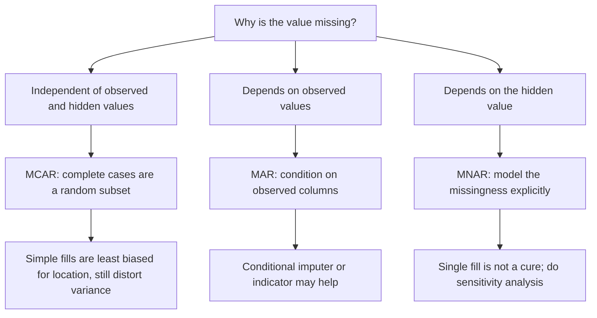
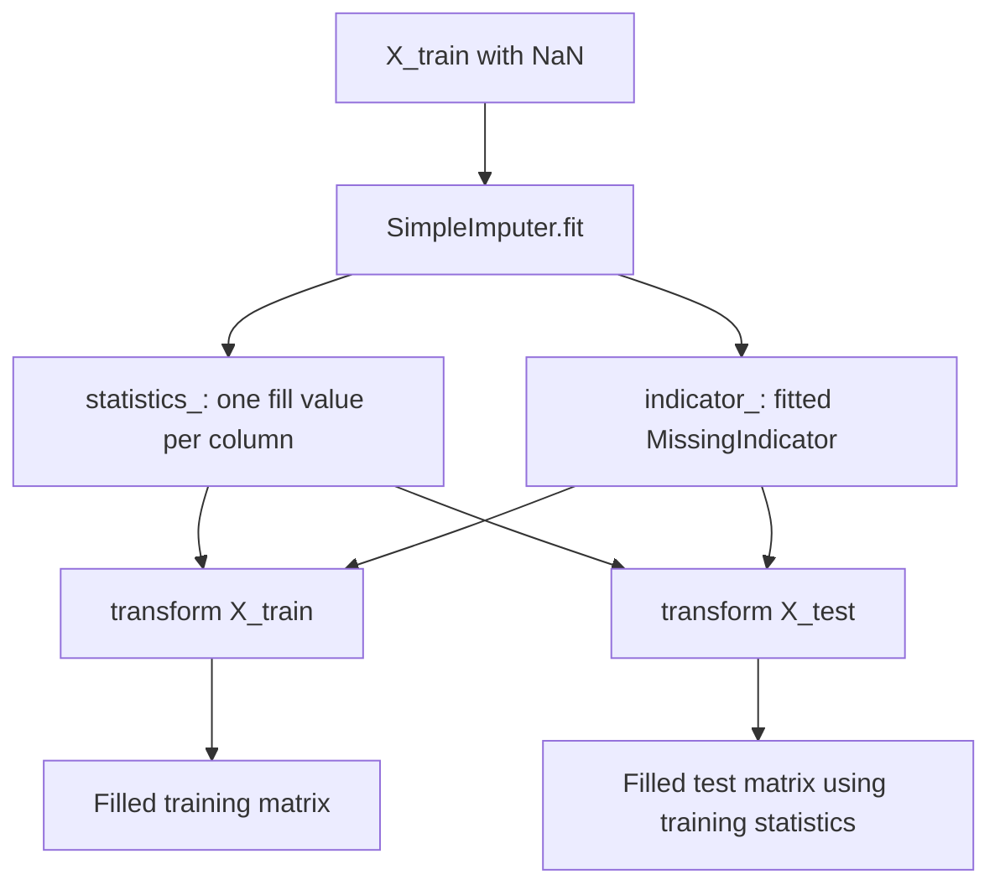
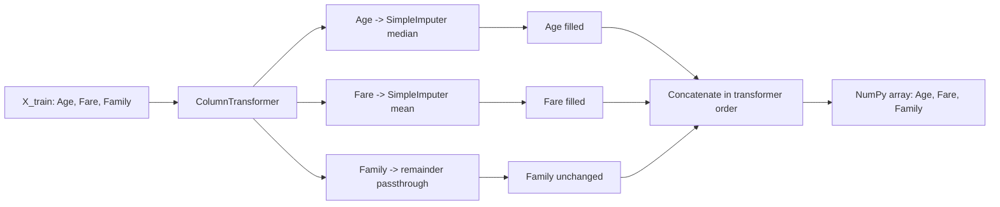
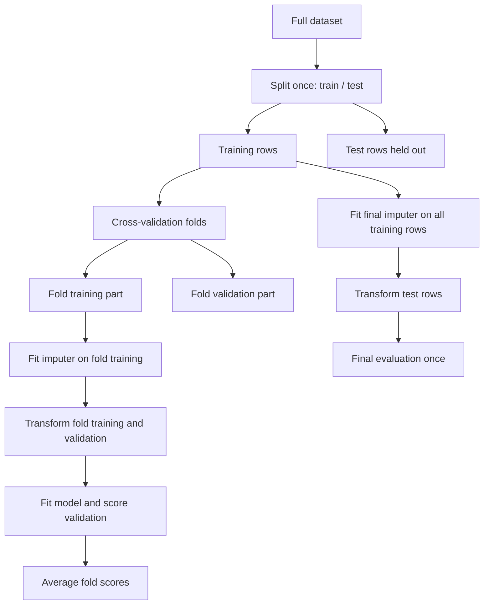
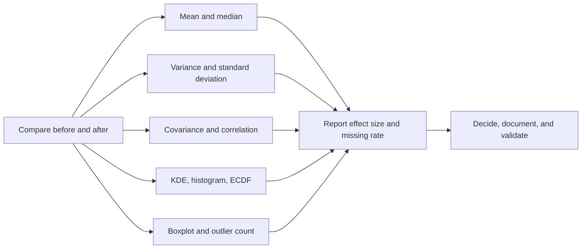

# Day 36 — Imputing Numerical Data

> **Unified study chapter for the two official Day 36 notebooks:**
> `mean-median-imputation.ipynb` and `arbitrary-value-imputation.ipynb`.
>
> This document teaches the statistical reasoning, the exact behaviour of the
> scikit-learn objects, the numerical evidence produced by the course, and the
> practical decisions that surround numerical imputation. The original notebooks
> remain separate; this chapter is the common map across both of them.

**Course context.** CampusX 100 Days of Machine Learning, Day 36.
**Dataset.** `datasets/titanic_toy.csv`.
**Primary library.** scikit-learn `SimpleImputer`, with `ColumnTransformer` used
to route different columns to different imputers.

---

## How to use this chapter

Read this chapter in four passes.

1. **First pass — the problem.** Sections 1–4 explain what missing numerical
   data does to a dataset and why “just fill the blank” is a modelling decision,
   not a harmless edit.
2. **Second pass — the theory.** Sections 5–10 derive what mean, median, and
   arbitrary-value imputation actually do to a mean, variance, covariance,
   correlation, and distribution.
3. **Third pass — the implementation.** Sections 11–15 connect the formulas to
   `SimpleImputer`, `ColumnTransformer`, pandas, and leakage-safe pipelines.
4. **Fourth pass — the evidence and practice.** Sections 16–22 walk through both
   official notebooks cell by cell, compare the methods, and prepare interview
   and exam answers.

Every number taken from a saved notebook output is labelled **Official**.
Numbers reproduced by rerunning the same code in the local environment are
labelled **Rerun**. Additional demonstrations are labelled **Supplementary**.
This distinction matters: the saved notebooks were produced with an older
environment, and a few printed results are not guaranteed to be stable across
pandas or scikit-learn versions.

---

## Table of contents

1. The learning problem
2. Source map and notebook inventory
3. The dataset and the missingness pattern
4. Why missing numerical data is dangerous
5. Missingness mechanisms
6. Complete-case analysis versus imputation
7. Statistical foundations
8. Mean imputation
9. Median imputation
10. Arbitrary-value imputation
11. Missingness indicators
12. `SimpleImputer` internals
13. `ColumnTransformer` and data flow
14. Pandas versus scikit-learn workflows
15. Leakage, pipelines, and evaluation
16. Official notebook 1: mean and median imputation
17. Official notebook 2: arbitrary-value imputation
18. Controlled numerical examples
19. Reading the plots and diagnostics
20. Comparing the methods
21. Common mistakes and debugging
22. Interview preparation, Levels 1–7
23. Exam-style theory and numerical questions
24. Revision sheet
25. Cell coverage matrices
26. References

---

## 1. The learning problem

### 1.1 The practical question

Suppose a dataset contains an age column with 177 blanks. A model cannot multiply
a blank by a coefficient. Something must be supplied. The beginner asks:

> Which value should I put in the blank?

The better question is:

> What do I want the filled column to represent, and what will the downstream
> model infer from the values that I invent?

Those two questions are different. The first asks for a recipe. The second asks
for the assumptions behind the recipe. Day 36 is about the second question.

Numerical imputation is the replacement of a missing numeric value with a
number. The number can be a summary statistic, a constant, a prediction from
other columns, or a value learned by a more elaborate algorithm. This day studies
three families:

- **Mean imputation:** replace a missing value with the mean of the observed
  values in the training data.
- **Median imputation:** replace a missing value with the median of the observed
  values in the training data.
- **Arbitrary-value imputation:** replace a missing value with a deliberately
  chosen constant that is outside the meaningful range of the variable, such as
  `99` for age or `999` for fare.

The course also demonstrates a fourth idea implicitly: the fact that a value was
missing can itself be useful. That leads to **missingness indicators**, studied
directly on Day 38 but introduced here because it changes how we interpret the
first three methods.

### 1.2 What “missing” means in this dataset

The Titanic toy dataset has two numeric predictors with blanks:

| Column | Missing count | Missing percentage | Complete count |
|---|---:|---:|---:|
| `Age` | 177 | 19.8653% | 714 |
| `Fare` | 45 | 5.0505% | 846 |
| `Family` | 0 | 0.0000% | 891 |
| `Survived` | 0 | 0.0000% | 891 |

The percentages use the full 891-row dataset. They are calculated by
`df.isnull().mean()`, because the mean of a Boolean column is the proportion of
`True` values.

The missing values are not evenly distributed across rows. Six rows miss both
`Age` and `Fare`; 171 rows miss only `Age`; 39 rows miss only `Fare`. Therefore,
dropping every row with at least one missing predictor leaves 675 rows, only
75.76% of the data.

### 1.3 What the course actually demonstrates

The two official notebooks perform an **audit**, not a full predictive modelling
experiment. They:

1. load the data;
2. split it into training and test sets;
3. compute summary statistics on the training set;
4. fill missing values in the training set;
5. compare variance, covariance, correlation, KDE plots, and boxplots before and
   after filling;
6. repeat the split to recover a clean `X_train`;
7. fit scikit-learn imputers on the training set;
8. inspect the learned statistics;
9. transform both training and test sets.

They do **not** train a classifier on the imputed data and they do **not** report
accuracy. So any claim such as “mean imputation gives 80% accuracy here” would be
invented. This chapter also avoids that claim. The lesson is about the geometry
and statistics of the filled column, and about the API used to apply it safely.

### 1.4 The central warning

Imputation does not recover the values that were lost. It creates plausible or
convenient numbers. Those numbers change:

- the sample mean;
- the sample variance and standard deviation;
- the covariance and correlation between columns;
- the shape of the distribution;
- the distances used by KNN, PCA, clustering, and regularized models;
- the splits chosen by a decision tree;
- the confidence that a statistical test appears to provide.

A filled dataset looks complete. That visual completeness is precisely why
imputation is dangerous: it can hide the uncertainty that the missing values
created.

---

## 2. Source map and notebook inventory

### 2.1 Official sources

| Official notebook | Main question | Cells | Local reference copy |
|---|---|---:|---|
| `mean-median-imputation.ipynb` | What do mean and median filling do to the data? | 30 | `reference_notebooks/mean-median-imputation.ipynb` |
| `arbitrary-value-imputation.ipynb` | What happens when missing values become sentinel constants? | 23 | `reference_notebooks/arbitrary-value-imputation.ipynb` |

Both local reference notebooks and the local dataset were checked against the
read-only vendor repository. Their file hashes match the official copies. They
are preserved for inspection and must not be modified.

### 2.2 Why there are two notebooks

The course separates the two ideas because they answer different questions.

- The first notebook uses statistics that come from the observed data. The
  filling value is intended to be a central representative value.
- The second notebook uses constants chosen by the analyst. The filling value is
  intended to be a recognizable sentinel, not a central value.

The notebooks share the same dataset, the same split seed, and almost the same
workflow. Keeping them separate makes the contrast visible. The never-merge rule
also means that the two official notebooks must remain distinct files, even
though this one chapter teaches both.

### 2.3 The existing personal notebook

`univariate_imputation.ipynb` is a small existing personal stub with three cells.
It is separate work and is preserved exactly as it is. It is not a replacement
for either official notebook, and this chapter does not silently absorb or
rewrite it.

### 2.4 What is in the local folder

```text
DAY_36/
├── univariate_imputation.ipynb
├── notes.md
├── README.md
├── datasets/
│   └── titanic_toy.csv
└── reference_notebooks/
    ├── mean-median-imputation.ipynb
    └── arbitrary-value-imputation.ipynb
```

No additional notebook should be created just to repeat the course. The two
reference notebooks remain the practical record.

---

## 3. The dataset and the missingness pattern

### 3.1 Structure

The dataset has 891 rows and four columns:

| Column | Meaning | Type in the file | Role in the notebook |
|---|---|---|---|
| `Age` | Passenger age in years | floating point, with `NaN` | Numeric feature to impute |
| `Fare` | Ticket fare | floating point, with `NaN` | Numeric feature to impute |
| `Family` | Family-related count | integer | Complete feature, passed through |
| `Survived` | Survival indicator | integer 0/1 | Target, removed from `X` |

`X = df.drop(columns=['Survived'])` leaves the three predictors.
`y = df['Survived']` stores the target. The target is never imputed in these
notebooks because it is complete.

### 3.2 The missingness table

**Official output of `df.isnull().mean()`:**

```text
Age         0.198653
Fare        0.050505
Family      0.000000
Survived    0.000000
dtype: float64
```

The exact fractions are:

$$
\frac{177}{891}=0.198653,\qquad
\frac{45}{891}=0.050505.
$$

`Age` is missing for almost one in five passengers. That is large enough that
dropping those rows can change which population the model describes. `Fare` is
missing for about one in twenty passengers, which is smaller but still material
when fare is predictive.

### 3.3 Train/test split and missingness

The notebooks use:

```python
X_train, X_test, y_train, y_test = train_test_split(
    X, y, test_size=0.2, random_state=2
)
```

`test_size=0.2` means 20% of the rows are held out:

- training set: 712 rows;
- test set: 179 rows.

The split is not stratified. That is acceptable for this statistical audit, but
for a real classification experiment `stratify=y` is usually preferable so that
the class proportion is preserved in both sets. The notebook's purpose is not to
compare model accuracy, so this omission should be named rather than copied
blindly.

**Official training-set missing proportions:**

```text
Age        0.207865
Fare       0.050562
Family     0.000000
```

**Official test-set missing proportions:**

```text
Age        0.162011
Fare       0.050279
Family     0.000000
```

The training set happens to have a slightly higher age-missing rate than the
test set. This is random variation, not a designed property. It is one reason all
summary statistics must be learned from the training set: the test set can have a
different missingness pattern, and using it to choose a fill value would leak
information.

The joint pattern within the training set is:

| Pattern | Count | Consequence for covariance |
|---|---:|---|
| `Age` observed, `Fare` observed | 534 | Both variables available |
| `Age` missing, `Fare` observed | 142 | Age can be filled while Fare is available |
| `Age` observed, `Fare` missing | 30 | Fare can be filled while Age is available |
| Both missing | 6 | Neither original value is available |

The count 534 is the number of complete `Age`–`Fare` pairs in the training set,
which is also the pairwise sample size used by `cov()` and `corr()` for the
original columns. This detail becomes essential when comparing correlations
before and after imputation.

### 3.4 Descriptive statistics

**Official full-data summary from the rerun:**

| Statistic | Age | Fare |
|---|---:|---:|
| Observed count | 714 | 846 |
| Mean | 29.699118 | 32.279338 |
| Standard deviation | 14.526497 | 50.305796 |
| Minimum | 0.42 | 0.00 |
| 25th percentile | 20.125 | 7.8958 |
| Median | 28.00 | 14.4542 |
| 75th percentile | 38.00 | 31.20625 |
| Maximum | 80.00 | 512.3292 |

These are full-data numbers. The imputation experiments use the training split,
so their exact means and medians differ slightly.

**Official training-set values (printed in cell 13 context):**

| Statistic | Age | Fare |
|---|---:|---:|
| Mean | 29.78590425531915 | 32.61759689349112 |
| Median | 28.75 | 14.4583 |
| Sample variance, `ddof=1` | 204.34951339046142 | 2448.1979137063163 |
| Sample standard deviation | 14.295087036827073 | 49.479267513841755 |
| Observed count | 564 | 676 |
| Missing count | 148 | 36 |

The training mean of `Age` is a little above the full-data mean. The training
median of `Age` is 28.75, above the full median of 28.00. These differences are a
warning: an imputation statistic is an estimate from a particular sample. It is
not a universal constant.

### 3.5 Why `Fare` is especially awkward

`Fare` is strongly right-skewed. Most passengers paid relatively little, while a
few paid extremely large amounts. Its full-data maximum is 512.3292, its median
is 14.4542, and its mean is 32.279338. The mean is more than twice the median
because the long right tail pulls it upward.

That has two consequences:

1. A mean fill places missing fares near 32.62, which is not the typical fare.
2. A median fill places missing fares at the most typical region, but creates a
   large artificial spike at 14.4583.

Neither choice recreates the unknown fares. The course shows both and lets the
diagnostics expose the trade-off.

There are also seven genuine zero fares in the training set. Zero is a valid
observed value, not a missing-value code. Replacing `0` with a missing marker
would be a data-cleaning mistake unless the dataset documentation explicitly
defines zero as “not recorded.” This is why understanding the domain matters more
than memorizing an API argument.

---

## 4. Why missing numerical data is dangerous

### 4.1 The mechanical problem

Most numerical learning algorithms operate on vectors and matrices. A linear
model computes a weighted sum. A distance-based method subtracts one point from
another. A decision tree compares a feature with a threshold. A neural network
multiplies a matrix by a weight matrix. `NaN` propagates through these operations
or causes an error.

Filling is one way to make the matrix rectangular and finite. Dropping is another.
Neither is free.

### 4.2 The statistical problem

Suppose the missing values are not a random sample of all values. Then the
observed rows are a selected subpopulation. A statistic computed only on those
rows estimates the subpopulation's statistic, not necessarily the full
population's statistic.

In this dataset, passengers with missing `Age` have:

- mean `Fare` 22.578653 versus 34.736845 for passengers with observed `Age`;
- mean `Family` 0.745763 versus 0.943978;
- survival rate 0.293785 versus 0.406162.

These are **Rerun** descriptive comparisons of the full data, not causal claims.
They show that “missing Age” is associated with other observable differences.
If we drop the missing-age rows, we remove a group with lower fare, smaller
family counts, and lower survival. The remaining sample is not a random 80% of
the original population.

This does not prove that the missingness mechanism is MAR or MNAR. It does prove
that complete-case analysis can change the composition of the sample. That is
enough to make dropping a substantive decision.

### 4.3 The information problem

There are two kinds of information in a missing value:

1. **The unknown value itself.** We do not know whether a missing age was 5 or
   70.
2. **The fact that it was missing.** The missingness may carry information about
   the passenger, the measurement process, or the data collection system.

Mean and median imputation address only the first problem, and they address it
with a guess that is usually too smooth. They discard the second kind of
information unless a missingness indicator is added.

### 4.4 The evaluation problem

If imputation is performed before the train/test split, the fill statistic is
computed partly from test data. That is data leakage. The model's test score can
then look better than it will on genuinely unseen data, because the test rows
influenced the preprocessing.

Even if imputation is done after the split, evaluating a model on a single filled
test set can understate uncertainty. The filled values are treated as if they were
known. A proper sensitivity analysis can compare several imputation strategies or
repeat the imputation under a model of the missingness.

### 4.5 The “complete data” illusion

A filled dataset has no visual blanks. A colleague can open it and forget that
19.9% of `Age` was invented. Every downstream table, plot, and model then inherits
the imputation assumptions without recording them.

Practical defence:

- keep a boolean mask of which values were originally missing;
- record the imputation method and the fitted statistics;
- save the fitted imputer with the model;
- compare at least one alternative strategy;
- report missingness rates alongside model results;
- never describe an imputed value as observed.

---

## 5. Missingness mechanisms

The reason a value is missing determines which imputation methods are defensible.
The standard taxonomy uses three labels. They are assumptions about a data-
generating process, not facts that can be proved from a single dataset.

### 5.1 MCAR: missing completely at random

A value is **missing completely at random** if its missingness is independent of
both the observed values and the unobserved value itself.

A useful example is a laboratory instrument that randomly fails to record a
measurement, independent of the sample's properties. Formally, if `M` is the
missingness indicator and `X` is the complete data,

$$
P(M \mid X_{\mathrm{obs}}, X_{\mathrm{mis}}) = P(M).
$$

Under MCAR, complete cases are a random subset of the full sample. The observed
mean is an unbiased estimate of the full-data mean, but the sample size is
smaller, so precision is lost. Mean or median imputation can preserve a central
location approximately, but still distorts variance and distribution shape.

MCAR is a strong assumption. In real observational data it is rarely exactly
true. It is nevertheless a useful baseline because it isolates the effect of
reduced sample size from the effect of selection bias.

### 5.2 MAR: missing at random

A value is **missing at random** if missingness can depend on observed variables
but not on the unobserved value after conditioning on those observed variables.

For example, suppose older passengers are less likely to have their age recorded,
but among passengers of the same recorded fare, family size, and ticket class the
missingness is unrelated to age. If the relevant observed variables are in the
model, the missingness is MAR conditional on them.

Formally,

$$
P(M \mid X_{\mathrm{obs}}, X_{\mathrm{mis}})
=
P(M \mid X_{\mathrm{obs}}).
$$

MAR does not mean “the data are missing randomly” in everyday language. It means
“conditional on what we observed, the remaining missingness is ignorable for the
model we are willing to specify.” A model-based imputer such as `IterativeImputer`
or `KNNImputer` tries to exploit the observed variables to predict the missing
ones under an MAR-like assumption.

Mean imputation that ignores the other columns is not a conditional imputer. If
missing age is related to fare or family, a single overall mean is the wrong
conditional prediction. This is a key limitation of the simple methods shown in
the official notebooks.

### 5.3 MNAR: missing not at random

A value is **missing not at random** if missingness depends on the unobserved
value itself, even after conditioning on the observed data.

Examples:

- High-income respondents refuse to report income, so the probability of missing
  income depends on the hidden income value.
- Very old patients are less likely to have a recorded age, so missingness
  depends on age itself.
- Passengers who paid nothing may have a blank fare because the recording system
  treated zero as “no entry.”

MNAR is the hardest case. No imputation method can fully correct it without an
explicit model of the missingness process or external information. A missingness
indicator can sometimes help a model learn that a value was absent, but it cannot
invent the hidden value. A sensitivity analysis comparing plausible MNAR
scenarios is often more honest than a single filled dataset.

### 5.4 The three mechanisms in one picture



The diagram is a reasoning aid, not a test. In practice, the mechanism is unknown.
The analyst must state an assumption, choose a method consistent with it, and
report the sensitivity of conclusions.

### 5.5 A common misconception

**Misconception:** “The values are missing randomly, so the mean is always the
correct fill.”

**Correction:** MCAR makes the observed mean an unbiased estimate of the population
mean, but it does not make every missing value equal to the mean. Imputing the mean
still reduces variance, distorts the distribution, and understates uncertainty.
Under MAR, the appropriate conditional mean may depend on other columns, so the
unconditional mean can be biased for the rows that are missing.

---
## 6. Complete-case analysis versus imputation

### 6.1 What complete-case analysis does

Complete-case analysis, also called listwise deletion, keeps only rows for which
every required variable is observed. In this dataset, requiring complete `Age` and
complete `Fare` leaves 675 of 891 rows:

$$
\frac{675}{891}=0.757576.
$$

So 24.24% of the rows are discarded. On the training split, the corresponding
counts are 534 complete pairs out of 712 rows.

Dropping rows is not always wrong. If missingness is MCAR and the complete cases
are numerous, listwise deletion is simple, transparent, and avoids inventing
values. It can be the least misleading choice when the missingness rate is tiny.
But it is a modelling decision with consequences.

### 6.2 The bias of complete cases

Let the full population be divided into a group with missing values and a group
with observed values. Let `π` be the fraction missing, `μ_obs` the mean among
observed rows, and `μ_mis` the mean among rows that would have been missing. The
full mean is

$$
\mu = (1-\pi)\mu_{\mathrm{obs}} + \pi\mu_{\mathrm{mis}}.
$$

The complete-case mean estimates `μ_obs`, so its bias for the full mean is

$$
\mu_{\mathrm{obs}}-\mu
= \mu_{\mathrm{obs}} - \left[(1-\pi)\mu_{\mathrm{obs}}+\pi\mu_{\mathrm{mis}}\right]
= \pi(\mu_{\mathrm{obs}}-\mu_{\mathrm{mis}}).
$$

If the missing and observed groups have the same mean, the bias is zero. If the
missing group differs, the bias is proportional to both the missingness rate and
the between-group difference. A small missingness rate can still cause a large
bias when the groups differ sharply.

For `Age`, the missing group is not a random copy of the observed group: its mean
fare is 22.58 rather than 34.74, and its survival rate is 0.294 rather than 0.406.
That does not prove the missing ages are unusual, but it shows that the rows are
not exchangeable on other measured variables.

### 6.3 The variance cost of dropping

Dropping rows also reduces sample size, which increases standard errors. If the
complete-case sample has `n_cc` rows and the original sample has `N` rows, a
simple mean's standard error scales roughly as

$$
\operatorname{SE}(\bar{x}_{\mathrm{cc}})
\approx \frac{s}{\sqrt{n_{\mathrm{cc}}}}
\quad\text{versus}\quad
\operatorname{SE}(\bar{x})
\approx \frac{s}{\sqrt{N}}.
$$

The ratio is `sqrt(N/n_cc)`. With 675 of 891 rows, the complete-case standard
error is about 1.149 times as large as the full-sample standard error, before
accounting for any selection bias. The loss of precision is real even under MCAR.

### 6.4 The imputation alternative

Imputation keeps all rows but invents values. It trades bias and variance in a
different way:

- Under MCAR, mean imputation preserves the sample mean of the observed values
  but understates variance and gives a false impression of precision.
- Under MAR, an unconditional mean can be biased because it ignores the observed
  predictors that explain the missing values.
- Under MNAR, no single fill is guaranteed to be unbiased.

There is no universal winner. The correct comparison is between explicit
assumptions and the sensitivity of the final conclusion.

### 6.5 A decision table

| Situation | Dropping rows | Mean/median fill | Conditional or model-based fill |
|---|---|---|---|
| Very few missing, MCAR | Often acceptable | Acceptable for a baseline | Usually unnecessary |
| Many missing, MCAR | Large precision loss | Keeps rows but distorts variance | Can improve variance estimate |
| MAR with strong predictors | Biased if missingness is selective | Unconditional fill may be biased | Preferred if predictors are reliable |
| MNAR | Can be badly biased | Usually biased | Needs a missingness model or sensitivity analysis |
| Missingness itself predictive | Discards useful signal | Discards signal unless indicator added | Indicator or model can use it |

The table is a starting point, not an automatic rule. Domain knowledge and
validation decide the final choice.

---

## 7. Statistical foundations

The rest of the chapter uses a small set of statistical ideas repeatedly. This
section defines them carefully, because most imputation mistakes come from using a
formula without understanding what it measures.

### 7.1 The sample mean

For observed values `x_1, ..., x_n`, the sample mean is

$$
\bar{x} = \frac{1}{n}\sum_{i=1}^{n} x_i.
$$

The mean is the centre of mass of the data. If one value is extremely large, the
mean moves toward it. This is why `Fare` has mean 32.28 but median 14.45: the
large fares pull the mean upward.

The mean is the constant `c` that minimizes the sum of squared deviations:

$$
\bar{x} = \arg\min_c \sum_{i=1}^{n}(x_i-c)^2.
$$

To see why, differentiate the sum with respect to `c`:

$$
\frac{d}{dc}\sum_{i=1}^{n}(x_i-c)^2
= -2\sum_{i=1}^{n}(x_i-c)
= -2\left(\sum_i x_i - nc\right).
$$

Setting the derivative to zero gives `c = (1/n) Σx_i = x̄`. The second derivative
is positive, so this is a minimum.

The mean is therefore the right summary when squared error is the loss we care
about. It is not automatically the right fill for every model.

### 7.2 The sample median

Sort the observed values as `x_(1) ≤ x_(2) ≤ ... ≤ x_(n)`. For odd `n`, the
median is the middle value. For even `n`, standard statistical software uses the
average of the two middle values:

$$
\operatorname{median}(x)=
\begin{cases}
x_{((n+1)/2)}, & n \text{ odd},\\
\dfrac{x_{(n/2)}+x_{(n/2+1)}}{2}, & n \text{ even}.
\end{cases}
$$

The median is the constant that minimizes the sum of absolute deviations:

$$
\operatorname{median}(x)
= \arg\min_c \sum_{i=1}^{n}|x_i-c|.
$$

For values strictly between two adjacent ordered observations, the derivative of
the absolute-deviation objective is the number of points below `c` minus the
number above `c`. At a median, this subgradient contains zero. Moving `c` toward a
dense cluster reduces the total absolute distance, so the median settles where
half the points are on each side.

Consequences:

- the median is resistant to extreme values;
- the median is a better summary of a skewed distribution's typical value;
- the median does not use the magnitudes of the distant points;
- the median can be non-unique in discrete data, and software must choose a
  convention.

### 7.3 Sample variance and standard deviation

The sample variance with `ddof=1` is

$$
s^2 = \frac{1}{n-1}\sum_{i=1}^{n}(x_i-\bar{x})^2.
$$

The denominator `n-1` is used because the sample mean has already been estimated
from the same data. Dividing by `n` gives the maximum-likelihood variance under a
normal model, but dividing by `n-1` gives an unbiased estimator of the population
variance under independent sampling.

The standard deviation is `s = sqrt(s²)`. It is in the same units as the data, so
for `Age` a standard deviation of about 14.30 years is easier to interpret than a
variance of 204.35 years squared.

Variance measures spread around the mean. A fill method can leave the mean nearly
unchanged while shrinking the variance drastically, which is exactly what mean
imputation does.

The sum of squared deviations is

$$
S = \sum_{i=1}^{n}(x_i-\bar{x})^2 = (n-1)s^2.
$$

Keeping `S` separate from `s²` makes the imputation derivations shorter.

### 7.4 Why `ddof=1` matters in this notebook

`X_train['Age'].var()` uses pandas' default `ddof=1`. The official values are
therefore sample variances, not population variances. If we filled with the
observed mean and kept the same count `N`, the new sample variance would be

$$
s_{\mathrm{fill}}^2 = \frac{(n-1)s_{\mathrm{obs}}^2}{N-1}.
$$

Using `ddof=0` would instead give a ratio of `n/N`. Mixing the two conventions
produces small numerical discrepancies that look like bugs. The derivations in
this chapter consistently use `ddof=1`, matching the notebook.

### 7.5 Skewness

Skewness measures asymmetry. A common sample definition is

$$
g_1 = \frac{1}{n}\sum_{i=1}^{n}
\left(\frac{x_i-\bar{x}}{s}\right)^3.
$$

Positive values indicate a longer right tail; negative values indicate a longer
left tail. Zero is consistent with symmetry, but zero skewness does not prove a
distribution is normal.

For the training data, **Rerun** values are:

| Column | Skewness before filling | After mean fill | After median fill |
|---|---:|---:|---:|
| `Age` | 0.330111 | 0.370697 | 0.420880 |
| `Fare` | 4.549077 | 4.668110 | 4.675178 |

Mean and median filling do not remove the long fare tail. They add a large point
mass near the centre and can even increase measured skewness. This is a crucial
observation: filling blanks does not make a skewed variable symmetric.

For arbitrary values, the effect is much larger. **Rerun** values are:

| Column | Fill | Skewness |
|---|---:|---:|
| `Age` | 99 | 0.8785 |
| `Age` | -1 | 0.1867 |
| `Fare` | 999 | 3.8291 |
| `Fare` | -1 | 4.5974 |

A sentinel can increase or decrease skewness depending on which side of the
distribution it sits and how far away it is. It never recovers the original
distribution.

### 7.6 Covariance

For paired observations `(x_i, y_i)`, the sample covariance is

$$
s_{xy} = \frac{1}{n-1}\sum_{i=1}^{n}(x_i-\bar{x})(y_i-\bar{y}).
$$

Covariance measures the direction of linear co-movement. A positive covariance
means that values above the mean in `x` tend to occur with values above the mean
in `y`. A negative covariance means the opposite. The magnitude depends on the
units, so it is hard to compare across variables.

Changing values in one column changes both its mean and its deviations. Filling
missing values can therefore change the covariance even when the observed values
are untouched. The exact effect depends on which rows are filled and what else is
missing in those rows.

### 7.7 Correlation

The Pearson correlation is

$$
r_{xy} = \frac{s_{xy}}{s_x s_y},
\qquad -1 \le r_{xy} \le 1.
$$

It standardizes covariance by the two standard deviations. Filling changes the
numerator and both denominators, so the correlation can move in a direction that
is not obvious from the variance change alone.

**Official training-set values for the original columns:**

| Pair | Covariance | Correlation |
|---|---:|---:|
| `Age`, `Fare` | 70.719262 | 0.092644 |

**Official values after mean and median filling:**

| Pair | Covariance | Correlation |
|---|---:|---:|
| `Age_mean`, `Fare` | 52.788341 | 0.086078 |
| `Age_median`, `Fare` | 53.553455 | 0.086982 |

The correlation between age and fare is weak in all three versions. Mean and
median filling reduce the covariance and slightly reduce the correlation in this
particular sample. That is not a law. It is a consequence of the missingness
pattern and the fill values.

**Official values for the arbitrary fills:**

| Pair | Covariance | Correlation |
|---|---:|---:|
| `Age_99`, `Fare` | -101.671097 | -0.066273 |
| `Age_minus1`, `Fare` | 125.558364 | 0.142022 |

The sign of the `Age_99` covariance is the opposite of the original sign. The
arbitrary constant did not merely shrink a relationship; it reversed the measured
direction. Section 17 derives this result numerically.

### 7.8 Pairwise deletion in pandas

`DataFrame.cov()` and `DataFrame.corr()` do not require every row to be complete
across all columns. By default, they use **pairwise complete observations** for
each pair. For the original `Age` and `Fare`, the calculation uses the 534 rows
where both are observed in the training set.

After filling, the filled columns have no missing values, but the other column
may still have missing values. For example, `Age_mean` is complete, while `Fare`
still has 36 missing values. The covariance of `Age_mean` and `Fare` therefore
uses the 676 rows where `Fare` is observed, not all 712 rows. This is why the
before/after covariance comparison is not a controlled experiment with a single
fixed sample size.

The lesson is not that pandas is wrong. The lesson is that `cov()` and `corr()`
have their own missing-data policy. Always inspect the effective sample size
before interpreting a change.

### 7.9 Quartiles, IQR, and boxplot fences

A boxplot summarizes:

- `Q1`, the 25th percentile;
- the median, the 50th percentile;
- `Q3`, the 75th percentile;
- the interquartile range `IQR = Q3 - Q1`;
- whiskers, conventionally extending to the most extreme observations within
  `Q1 - 1.5 IQR` and `Q3 + 1.5 IQR`;
- points beyond the fences, drawn individually as potential outliers.

The fences are a visualization convention, not a universal definition of a
statistical outlier. A value outside the fence is unusual relative to the middle
50% of the data, but it may be a genuine extreme observation.

This matters here because filling creates a large point mass at one value. That
changes `Q1`, `Q3`, and the fences. The number of points drawn as outliers can
change even though the largest and smallest genuine values did not change.

### 7.10 What the plots can and cannot show

A KDE plot estimates a smooth density from the sample. It can reveal:

- a spike at the fill value;
- loss of mass in the tails;
- shifts in the centre;
- multimodality.

It cannot show:

- which observations were imputed;
- whether the missing values were MCAR, MAR, or MNAR;
- whether the imputed values are correct;
- whether a downstream model will perform better.

A boxplot can reveal changes in quartiles and flagged extremes. It cannot show the
shape of the full distribution, and its outlier count is sensitive to the IQR
rule. A histogram can show the point mass more directly, but bin width changes the
picture. No single plot is sufficient evidence for choosing an imputation method.

---
## 8. Mean imputation: derivation and consequences

### 8.1 The estimator and the estimate

Mean imputation replaces every missing entry in a column with the arithmetic mean of the observed entries of that same column. If the observed values are $x_1,\dots,x_n$, the fill value is

$$
c_{\mathrm{mean}}=\bar{x}=\frac{1}{n}\sum_{i=1}^{n}x_i.
$$

The word **observed** matters. The mean is computed after excluding the missing entries, not after treating them as zero. `pandas.Series.mean()` skips `NaN` by default, and `SimpleImputer(strategy="mean")` does the same during `fit`.

The estimate is a single scalar per column. It is stored in the imputer, not recomputed row by row. That is why the object is called an estimator: it estimates a parameter from data and keeps it for later use.

A small example makes the distinction concrete. Consider

$$
(10,\;20,\;\mathrm{NaN},\;40,\;50).
$$

The observed values are $10,20,40,50$, so $n=4$, $m=1$, $N=5$, and

$$
\bar{x}=\frac{10+20+40+50}{4}=30.
$$

Mean imputation produces

$$
(10,\;20,\;30,\;40,\;50).
$$

Nothing about the four observed values changed. Only the blank became $30$.

### 8.2 Mean preservation

Let the missing count be $m$ and the total count be $N=n+m$. After filling every missing entry with $c$, the new mean is

$$
\bar{x}'=\frac{1}{N}\left(\sum_{i=1}^{n}x_i+mc\right)
=\frac{n\bar{x}+mc}{N}.
$$

For mean imputation, $c=\bar{x}$, so

$$
\bar{x}'=\frac{n\bar{x}+m\bar{x}}{N}=\bar{x}.
$$

Mean imputation therefore preserves the sample mean of the column exactly, provided the same column and the same set of rows are used. This is its one clean theoretical property. It is also why mean imputation can look harmless when someone checks only the mean before and after.

The preservation is narrower than it first appears:

- it preserves the mean of the imputed column, not the mean of every other column;
- it preserves the mean only when the fill value is computed from the same rows that are later averaged;
- it says nothing about variance, covariance, correlation, or distribution shape;
- it does not preserve a conditional mean for a subgroup unless the subgroup mean happens to equal the overall mean.

### 8.3 Variance shrinkage: the exact result

Let the observed sample variance be

$$
s^2=\frac{1}{n-1}\sum_{i=1}^{n}(x_i-\bar{x})^2.
$$

After filling $m$ entries with $c$, the new mean is $\bar{x}'=\bar{x}+\frac{m}{N}(c-\bar{x})$. The new sum of squared deviations is

$$
S'=\sum_{i=1}^{n}(x_i-\bar{x}')^2+m(c-\bar{x}')^2.
$$

Use the identity

$$
\sum_{i=1}^{n}(x_i-\bar{x}')^2=(n-1)s^2+n(\bar{x}-\bar{x}')^2.
$$

Because

$$
\bar{x}-\bar{x}'=-\frac{m}{N}(c-\bar{x}),
\qquad
c-\bar{x}'=\frac{n}{N}(c-\bar{x}),
$$

we get

$$
S'=(n-1)s^2+\frac{nm^2}{N^2}(c-\bar{x})^2+\frac{mn^2}{N^2}(c-\bar{x})^2.
$$

The two fractions combine because $nm^2+mn^2=nm(n+m)=nmN$:

$$
S'=(n-1)s^2+\frac{nm}{N}(c-\bar{x})^2.
$$

The new sample variance is therefore

$$
s'^2=\frac{S'}{N-1}
=\frac{(n-1)s^2+\frac{nm}{N}(c-\bar{x})^2}{N-1}.
$$

For mean imputation, $c=\bar{x}$, the second term vanishes, and

$$
s'^2=\frac{n-1}{N-1}s^2.
$$

This is the exact variance-shrinkage formula for mean imputation with `ddof=1`. The ratio depends only on the observed count and the total count:

$$
\frac{s'^2}{s^2}=\frac{n-1}{N-1}.
$$

For `Age`, $n=564$, $m=148$, $N=712$:

$$
\frac{s'^2}{s^2}=\frac{563}{711}=0.791842,
\qquad
s'^2=0.791842\times 204.349513=161.812625.
$$

This matches the official output $161.81262452718673$ up to rounding. For `Fare`, $n=676$, $m=36$, $N=712$:

$$
\frac{s'^2}{s^2}=\frac{675}{711}=0.949367,
\qquad
s'^2=0.949367\times 2448.197914=2324.238526.
$$

The standard deviation shrinks by the square root of these ratios:

$$
\frac{s'}{s}=\sqrt{\frac{n-1}{N-1}}.
$$

For `Age`, $\sqrt{563/711}=0.889855$, so the standard deviation falls from $14.295087$ to about $12.7207$. For `Fare`, $\sqrt{675/711}=0.974355$, so it falls from $49.479268$ to about $48.2099$.

#### A `ddof=0` version

If someone uses the population variance with denominator $n$, the ratio becomes $n/N$ instead of $(n-1)/(N-1)$. For `Age`:

$$
\frac{n}{N}=\frac{564}{712}=0.792135
\quad\text{versus}\quad
\frac{n-1}{N-1}=0.791842.
$$

The difference is small but real. Mixing conventions in a report can produce a discrepancy that looks like a bug. The notebook uses pandas' default `ddof=1`, so every derivation here uses $N-1$.

### 8.4 What variance shrinkage means

Variance is not a cosmetic statistic. It enters:

- the standard error of a mean, $s/\sqrt{N}$;
- the denominator of a correlation;
- the scaling of a standardized feature;
- the variance of a regression coefficient;
- the spread used by distance-based algorithms;
- the sampling distribution used by statistical tests.

Mean imputation makes the column look more precise than it is. The filled entries are not new measurements; they are copies of a single estimate. The formula treats them as if they were independent observations, so the sample variance falls and the apparent standard error falls. That is a false gain in precision.

The shrinkage is largest when the missing rate is large. For `Age`, 20.79% of the training rows are filled, and the variance ratio is 0.7918, a 20.82% reduction. For `Fare`, only 5.06% are filled, and the variance ratio is 0.9494, a 5.06% reduction. This is why the course says the `Fare` result is less alarming: very little of the column was invented.

A useful approximation for small missingness is

$$
\frac{n-1}{N-1}\approx 1-\frac{m}{N-1}.
$$

The fractional variance loss is approximately the missing fraction. The approximation is close here: $148/711=0.20816$ versus the exact loss $1-0.791842=0.208158$.

### 8.5 Covariance: the exact effect

Variance describes one column. Covariance describes a pair. The effect of imputation on covariance is more subtle because the filled rows may differ systematically in the other variable.

Assume, for the derivation, that $y$ is observed on every row that matters and $x$ has $m$ missing entries. Let:

- $n$ be the number of rows where both $x$ and $y$ are observed;
- $m$ be the number of rows where $x$ is filled and $y$ is observed;
- $N=n+m$;
- $\bar{x}$ be the observed mean of $x$;
- $\bar{y}$ be the mean of $y$ over all $N$ rows;
- $\bar{y}_m$ be the mean of $y$ over the $m$ filled rows;
- $e=\bar{y}_m-\bar{y}$;
- $d=\bar{x}-c$;
- $C_{\mathrm{obs}}=\sum_{\mathrm{obs}}(x_i-\bar{x})(y_i-\bar{y})$.

After filling, the new $x$-mean is $\bar{x}'=\bar{x}-\frac{m}{N}d$. The new cross-product is

$$
C'=\sum_{\mathrm{obs}}(x_i-\bar{x}')(y_i-\bar{y})
+m(c-\bar{x}')(\bar{y}_m-\bar{y}).
$$

Now use three facts:

$$
\sum_{\mathrm{obs}}(y_i-\bar{y})=-me,
\qquad
\bar{x}-\bar{x}'=\frac{m}{N}d,
\qquad
c-\bar{x}'=-\frac{n}{N}d.
$$

Substituting:

$$
C'=C_{\mathrm{obs}}+\frac{m}{N}d(-me)
+m\left(-\frac{n}{N}d\right)e.
$$

The two correction terms are $-\frac{m^2}{N}de$ and $-\frac{mn}{N}de$, whose sum is $-mde$ because $m+n=N$. Therefore

$$
C'=C_{\mathrm{obs}}-mde.
$$

The new covariance is $C'/(N-1)$. This formula is exact under the stated setup. It says that filling changes covariance by a term proportional to:

- the number of filled rows $m$;
- how far the fill value is from the observed mean, $d$;
- how different the filled rows are in $y$, $e$.

If the filled rows have the same $y$-mean as the rest ($e=0$), or if the fill value equals the observed mean ($d=0$), the covariance numerator is unchanged. But the denominator still changes from $n-1$ to $N-1$, so the covariance value can still shrink.

#### The idealized mean-imputation case

If $y$ is complete and $c=\bar{x}$, then $d=0$ and $C'=C_{\mathrm{obs}}$. The covariance becomes

$$
s'_{xy}=\frac{C_{\mathrm{obs}}}{N-1}
=\frac{n-1}{N-1}s_{xy}.
$$

The covariance shrinks by the same ratio as the $x$-variance. The correlation, however, is

$$
r'=\frac{s'_{xy}}{s'_x s_y}
=\frac{\frac{n-1}{N-1}s_{xy}}
{\sqrt{\frac{n-1}{N-1}}\,s_x\,s_y}
=\frac{s_{xy}}{s_x s_y}=r.
$$

In this idealized case, mean imputation leaves the Pearson correlation unchanged. This is a useful theoretical benchmark, but it is not what the official Titanic comparison shows, because `Fare` is also missing and pandas uses pairwise-complete rows.

#### The actual Titanic case

For `Age` versus `Fare`, the original pairwise-complete sample has $n=534$ rows, not 712. The other 178 training rows have at least one of the two variables missing. When `Age` is filled, the pairwise sample for `Age` versus `Fare` grows from 534 to 676 rows, because the 142 rows with missing `Age` but observed `Fare` become usable. That changes the sample composition, not just the values.

The exact ingredients are:

| Quantity | Value |
|---|---:|
| Observed `Age`—`Fare` pairs, $n$ | 534 |
| Rows with `Age` missing but `Fare` observed, $m$ | 142 |
| Pairs after filling `Age`, $N$ | 676 |
| Observed pair mean of `Age`, $\bar{x}$ | 29.681030 |
| Mean `Fare` over all 676 pairs, $\bar{y}$ | 32.617597 |
| Mean `Fare` over the 142 filled rows, $\bar{y}_m$ | 21.816196 |
| $e=\bar{y}_m-\bar{y}$ | $-10.801400$ |
| Observed cross-product, $C_{\mathrm{obs}}$ | 37,693.366647 |

For mean imputation, the fill value is the mean over all 564 observed ages, $c=29.785904$, not the pair-complete mean $29.681030$. Thus

$$
d=29.681030-29.785904=-0.104874.
$$

The correction is

$$
-mde=-142(-0.104874)(-10.801400)=-160.857.
$$

So

$$
C'=37,693.366647-160.857=37,532.510,
\qquad
s'_{xy}=\frac{37,532.510}{675}=55.603719.
$$

This matches the official covariance $55.603719$ for `Age_mean` and `Fare`. The small nonzero $d$ exists because the mean used by the imputer is computed over 564 ages, while the covariance pair uses only the 534 rows where `Fare` is also observed.

For median imputation, $c=28.75$, so

$$
d=29.681030-28.75=0.931030,
$$

and

$$
-mde=-142(0.931030)(-10.801400)=+1,427.8.
$$

Thus

$$
C'=37,693.367+1,427.8=39,121.2,
\qquad
s'_{xy}=\frac{39,121.2}{675}=57.957599.
$$

This matches the official covariance for `Age_median` and `Fare`.

For arbitrary fill $c=99$:

$$
d=29.681030-99=-69.318970,
$$

and

$$
-mde=-142(-69.318970)(-10.801400)=-106,321.4.
$$

Thus

$$
C'=37,693.367-106,321.4=-68,628.0,
\qquad
s'_{xy}=\frac{-68,628.0}{675}=-101.671097.
$$

The sign has reversed. The arbitrary constant did not merely weaken the relationship; it changed its measured direction.

For $c=-1$:

$$
d=29.681030-(-1)=30.681030,
$$

and

$$
-mde=-142(30.681030)(-10.801400)=+47,058.5,
$$

so

$$
C'=37,693.367+47,058.5=84,751.9,
\qquad
s'_{xy}=\frac{84,751.9}{675}=125.558364.
$$

This is larger than the original covariance, even though the fill value is outside the observed range on the low side.

### 8.6 Correlation: what actually changes

Correlation is covariance standardized by both standard deviations:

$$
r'_{xy}=\frac{s'_{xy}}{s'_x s'_y}.
$$

For the `Age`—`Fare` pair after filling `Age`, the pairwise sample is the same 676 rows for all four versions. The `Fare` standard deviation over those rows is $49.479268$. The `Age` standard deviations and correlations are:

| Version | $s'_x$ | $s'_{xy}$ | $r'_{xy}$ |
|---|---:|---:|---:|
| `Age` original (534 pairs) | 14.359617 | 70.719262 | 0.092644 |
| `Age_mean` | 12.760186 | 55.603719 | 0.088069 |
| `Age_median` | 12.765757 | 57.957599 | 0.091757 |
| `Age_99` | 31.005419 | $-101.671097$ | $-0.066273$ |
| `Age_minus1` | 17.867572 | 125.558364 | 0.142022 |

The mean and median versions slightly reduce the correlation. The arbitrary versions change it much more, and $99$ reverses its sign. The table also shows that the original correlation is computed on 534 rows, while the filled correlations are computed on 676 rows. The comparison is therefore not a controlled experiment with a fixed sample. This is exactly the point of Section 7.8: pandas' pairwise deletion policy must be inspected before interpreting a before/after change.

A common interview claim is "mean imputation always reduces correlation." The idealized derivation in Section 8.5 shows that this is not universally true. It reduces correlation when the fill changes the covariance numerator relative to the variance denominator, or when the pairwise sample changes. It can leave correlation unchanged in a complete-two-column MCAR setup. The correct statement is: mean imputation reduces variance, and its effect on correlation depends on the missingness pattern and the other column's missingness.

### 8.7 Distribution shape

Variance and covariance are moments. A distribution is more than its moments. Mean imputation adds a point mass at $\bar{x}$. If the missing fraction is $m/N$, then a fraction $m/N$ of the filled column sits exactly at one value. The rest of the distribution is unchanged.

For `Age`, 148 of 712 training values become $29.785904$. That is 20.79% of the column at a single point. For `Fare`, 36 of 712 values become $32.617597$, or 5.06%. The `Age` KDE therefore shows a visible spike; the `Fare` KDE looks almost unchanged because the spike is small relative to the existing spread and the other 676 values dominate.

The spike has consequences beyond appearance:

- a histogram bin containing the fill value gains a large count;
- the empirical CDF has a jump of size $m/N$ at the fill value;
- a boxplot's quartiles move toward the fill value;
- a KDE may show a narrow peak whose width is controlled by the kernel bandwidth, not by real variation;
- a distance-based model sees many identical points;
- a tree can split at the fill value and isolate the imputed group.

The distribution is not "recovered." It is a mixture of the observed distribution and a point mass. That mixture is the model's new reality.

### 8.8 Assumptions

Mean imputation is defensible only under a specific set of assumptions:

1. **The missingness is MCAR, or the missing rows have the same conditional mean as the observed rows.** If missingness depends on the hidden value, the observed mean is not an unbiased estimate of the missing group's mean.
2. **The mean is a meaningful summary.** For a symmetric, roughly unimodal distribution, the mean is a reasonable centre. For a heavy-tailed or skewed distribution, the mean may be far from the typical value.
3. **The fill value is estimated from training data only.** The statistic must not see test rows.
4. **The downstream model can tolerate a point mass and a variance reduction.** Linear models may absorb some of it; distance-based and tree models may behave differently.
5. **The missing rate is small enough that the invented fraction does not dominate.** The course's informal threshold is under 5%; this is a heuristic, not a law.

The first assumption is the hardest. The data cannot prove MCAR. The analyst must state it and test sensitivity.

### 8.9 When mean imputation is a reasonable baseline

Mean imputation is reasonable when:

- the column is roughly symmetric;
- the missing rate is low;
- the goal is a quick baseline, not a final production model;
- the downstream model is linear and the missingness is plausibly MCAR;
- the imputation is inside a pipeline so cross-validation remains honest;
- the analyst reports the variance shrinkage and the missing rate.

It is a poor default when:

- the column is strongly skewed, as `Fare` is;
- the missing rate is high, as `Age` is;
- missingness is likely informative;
- the model relies on distances or on the shape of the feature distribution;
- the analysis claims precision that the filled values do not support.

### 8.10 A common misconception

**Misconception:** "Mean imputation is safe because it keeps the mean unchanged."

**Correction:** Keeping the mean unchanged is one moment. Mean imputation still reduces variance, creates a point mass, can change covariance and correlation, and can bias a conditional model. The mean is preserved; the information is not.

---

## 9. Median imputation

### 9.1 Definition and computation

The median is the middle order statistic. Sort the observed values:

$$
x_{(1)}\le x_{(2)}\le\cdots\le x_{(n)}.
$$

For odd $n$,

$$
\operatorname{median}(x)=x_{((n+1)/2)}.
$$

For even $n$, the usual convention is the average of the two middle values:

$$
\operatorname{median}(x)=\frac{x_{(n/2)}+x_{(n/2+1)}}{2}.
$$

pandas and NumPy use this interpolation convention by default. Other conventions exist, especially for quantiles, so two libraries can differ slightly on small or discrete samples.

For `Age`, the training median is $28.75$ because the two middle values average to $28.75$. For `Fare`, the training median is $14.4583$. For a small example $(10,20,\mathrm{NaN},40,50)$, the observed values are $10,20,40,50$, and the median is $(20+40)/2=30$.

### 9.2 Why the median minimizes absolute error

The median is the constant $c$ that minimizes the sum of absolute deviations:

$$
\operatorname{median}(x)=\arg\min_c\sum_{i=1}^{n}|x_i-c|.
$$

For $c$ strictly between two adjacent observations, the derivative of the objective is

$$
\frac{d}{dc}\sum_{i=1}^{n}|x_i-c|
=\#\{i:x_i<c\}-\#\{i:x_i>c\}.
$$

The derivative is negative while fewer than half the points are below $c$, zero when the counts balance, and positive after that. The minimum therefore occurs at a point where at least half the observations are on each side: a median. If $n$ is even, every $c$ between the two middle observations is optimal, and the interpolation convention chooses one of them.

This is the precise sense in which the median is robust. A single extreme value contributes one unit of absolute distance regardless of how far away it is. The mean minimizes squared distance, so an extreme value contributes its squared distance and can pull the solution arbitrarily far.

The breakdown point of the median is 50%: fewer than half the observations must be corrupted before the median can be driven arbitrarily far. The mean has a breakdown point of zero: one sufficiently extreme observation can move it arbitrarily.

### 9.3 Effect on mean, variance, and covariance

Median imputation does not preserve the mean unless the median equals the mean. The new mean is

$$
\bar{x}'=\bar{x}+\frac{m}{N}(q-\bar{x}),
$$

where $q$ is the median. For `Age`:

$$
\bar{x}'=29.785904+\frac{148}{712}(28.75-29.785904)
=29.570576.
$$

For `Fare`:

$$
\bar{x}'=32.617597+\frac{36}{712}(14.4583-32.617597)
=31.699430.
$$

The variance formula is the general one from Section 8.3:

$$
s'^2=\frac{(n-1)s^2+\frac{nm}{N}(q-\bar{x})^2}{N-1}.
$$

For `Age`:

$$
s'^2=\frac{563(204.349513)+117.235955(28.75-29.785904)^2}{711}
=161.989566.
$$

For `Fare`:

$$
s'^2=\frac{675(2448.197914)+34.179775(14.4583-32.617597)^2}{711}
=2340.091022.
$$

Both are close to the mean-imputation variances, but not identical. The median fill adds a small extra squared term because $q\neq\bar{x}$. The covariance formula from Section 8.5 applies with $c=q$:

$$
C'=C_{\mathrm{obs}}-mde,
\qquad d=\bar{x}_{\mathrm{pair}}-q.
$$

For `Age_median` and `Fare`, this gave $57.957599$, slightly above the mean-imputation covariance $55.603719$. The correlation was $0.091757$, slightly above the mean version's $0.088069$.

### 9.4 The official variance results

**Official output of cell 13 in `mean-median-imputation.ipynb`:**

```text
Original Age variable variance:  204.3495133904614
Age Variance after median imputation:  161.9895663346054
Age Variance after mean imputation:  161.81262452718673
Original Fare variable variance:  2448.197913706318
Fare Variance after median imputation:  2340.0910219753637
Fare Variance after mean imputation:  2324.2385256705547
```

The ordering is consistent with the theory:

- both fills shrink the variance;
- mean imputation shrinks `Age` slightly more than median imputation because its fill is closer to the mean;
- `Fare` is barely affected because only 5.06% of its values are filled;
- the differences between mean and median are small for these columns, so the choice cannot be justified by variance alone.

### 9.5 Why the median is often preferred for skewed data

For a right-skewed distribution, the mean is pulled toward the long right tail and the median stays near the bulk of the data. `Fare` is the textbook case:

- mean $32.617597$;
- median $14.4583$;
- maximum $512.3292$.

Filling a missing fare with the mean places it above the typical fare. Filling it with the median places it at the typical fare. For a variable where "typical" is the meaningful notion, the median is the better central summary.

The median also has a robustness advantage. If a few fares are data-entry errors, the median is less affected than the mean. But robustness is not the same as correctness: a robust estimate of the wrong quantity is still wrong.

### 9.6 The cost of the median

Median imputation creates a larger relative point mass at a value that may already be common. For `Fare`, the median $14.4583$ is near the low-fare mode. Adding 36 copies of it makes the spike sharper. The KDE can show a narrow peak that looks like a real concentration of passengers paying exactly that fare. It is an artifact of imputation.

The median also ignores the magnitudes of the tail values. That is the source of its robustness, but it is also a loss of information. A mean uses the fact that a fare of 500 is much larger than a fare of 50; the median treats both as "above the middle."

Median imputation does not solve MAR or MNAR. If missing fares are systematically different from observed fares, the median of the observed fares is still the wrong conditional estimate. It is a robust unconditional summary, not a model of missingness.

### 9.7 Mean or median?

| Situation | Mean | Median |
|---|---|---|
| Roughly symmetric distribution | Natural choice | Also acceptable |
| Strong skew or heavy tail | Pulled by extremes | Preferred |
| Outliers are genuine | Sensitive | Robust |
| Outliers are errors | Sensitive | Robust |
| Need to preserve the sample mean | Yes | No |
| Need a "typical" value | Sometimes | Often |
| Downstream squared-error model | May be natural | Still a valid baseline |
| Downstream absolute-error model | Less natural | Natural |

The course uses median for `Age` and mean for `Fare` in the scikit-learn section. That combination is not a universal rule; it is a demonstration that different columns can use different strategies. The notebook's earlier pandas section computes both for both columns, which is the right way to compare.

---

## 10. Arbitrary-value imputation

### 10.1 The sentinel idea

Arbitrary-value imputation replaces every missing entry with a constant chosen by the analyst. The constant is not intended to estimate the hidden value. It is intended to be a recognizable marker that says "this entry was missing."

For categorical data, the marker is often the string `"Missing"`. For numerical data, the marker is a number outside the meaningful range, such as:

- `99` for age;
- `999` for fare;
- `-1` for a non-negative quantity;
- `0` for a positive quantity, if zero is not a valid observed value.

The marker is sometimes called a **sentinel value**. A sentinel must satisfy four conditions:

1. **It is outside the valid range of the variable**, or at least clearly distinguishable from genuine values.
2. **It has a consistent meaning** across training, test, and production.
3. **It is documented** so that another analyst does not mistake it for a real measurement.
4. **It does not collide with a legitimate value.** If zero is a real fare, zero cannot be a missing marker.

The official notebook uses `99` and `-1` for `Age`, and `999` and `-1` for `Fare`. The training `Age` maximum is $71$, so `99` is outside the observed range. The training `Fare` maximum is $512.3292$, so `999` is outside the observed range. `-1` is outside both ranges because age and fare are non-negative in this dataset.

### 10.2 What the sentinel does to the mean

The new mean is the general fill formula:

$$
\bar{x}'=\bar{x}+\frac{m}{N}(c-\bar{x}).
$$

For `Age` with $c=99$:

$$
\bar{x}'=29.785904+\frac{148}{712}(99-29.785904)
=44.173104.
$$

For `Age` with $c=-1$:

$$
\bar{x}'=29.785904+\frac{148}{712}(-1-29.785904)
=23.386587.
$$

For `Fare` with $c=999$:

$$
\bar{x}'=32.617597+\frac{36}{712}(999-32.617597)
=81.479629.
$$

For `Fare` with $c=-1$:

$$
\bar{x}'=32.617597+\frac{36}{712}(-1-32.617597)
=30.917831.
$$

The mean is no longer a summary of the data. It is a mixture of the observed mean and the sentinel. Reporting it as "the average age" or "the average fare" would be misleading.

### 10.3 What the sentinel does to the variance

Use the general formula:

$$
s'^2=\frac{(n-1)s^2+\frac{nm}{N}(c-\bar{x})^2}{N-1}.
$$

For `Age`, $n=564$, $m=148$, $N=712$, $\bar{x}=29.785904$, $s^2=204.349513$:

| Fill $c$ | $c-\bar{x}$ | $(c-\bar{x})^2$ | $s'^2$ |
|---:|---:|---:|---:|
| Mean $29.785904$ | 0 | 0 | 161.812625 |
| Median $28.75$ | $-1.035904$ | 1.073100 | 161.989566 |
| $99$ | 69.214096 | 4,790.591 | 951.727557 |
| $-1$ | $-30.785904$ | 947.772 | 318.089620 |

For `Fare`, $n=676$, $m=36$, $N=712$, $\bar{x}=32.617597$, $s^2=2448.197914$:

| Fill $c$ | $c-\bar{x}$ | $(c-\bar{x})^2$ | $s'^2$ |
|---:|---:|---:|---:|
| Mean $32.617597$ | 0 | 0 | 2324.238526 |
| Median $14.4583$ | $-18.159297$ | 329.760 | 2340.091022 |
| $999$ | 966.382403 | 933,895.0 | 47,219.202652 |
| $-1$ | $-33.617597$ | 1,130.143 | 2378.567678 |

The variance grows quadratically with the distance between the sentinel and the observed mean. The coefficient is

$$
\frac{nm}{N(N-1)}.
$$

For `Age`, this coefficient is

$$
\frac{564\cdot148}{712\cdot711}=0.164854.
$$

Multiplying by $(99-29.785904)^2=4,790.591$ gives $789.915$, which is the increase over the mean-imputation variance:

$$
161.812625+789.914932=951.727557.
$$

For `Fare`, the coefficient is

$$
\frac{676\cdot36}{712\cdot711}=0.048073.
$$

Multiplying by $(999-32.617597)^2=933,895.0$ gives $44,894.964$, which is the increase over $2324.238526$:

$$
2324.238526+44,894.964126=47,219.202652.
$$

The sentinel does not merely fail to reduce variance. It can inflate variance by orders of magnitude. That is why the official output jumps from $2448$ to $47,219$ for `Fare_999`.

### 10.4 Covariance can reverse sign

The covariance formula from Section 8.5 is exact for the `Age`—`Fare` pair when `Age` is filled and `Fare` is observed. The ingredients are:

$$
C_{\mathrm{obs}}=37,693.366647,
\qquad m=142,
\qquad e=-10.801400.
$$

For $c=99$:

$$
d=29.681030-99=-69.318970,
$$

$$
C'=37,693.366647-142(-69.318970)(-10.801400)
=-68,628.0,
$$

$$
s'_{xy}=\frac{C'}{675}=-101.671097.
$$

The covariance sign is negative. For $c=-1$:

$$
d=30.681030,
$$

$$
C'=37,693.366647-142(30.681030)(-10.801400)
=84,751.9,
$$

$$
s'_{xy}=\frac{C'}{675}=125.558364.
$$

The covariance is positive and larger than the original. The two sentinels sit on opposite sides of the observed mean, and the missing-age rows have lower fares than average. A high sentinel makes the filled points look like "high age, low fare," which produces negative covariance. A low sentinel makes them look like "low age, low fare," which produces positive covariance.

This is the clearest demonstration that arbitrary-value imputation is not a neutral placeholder. It is a strong statement about the missing rows, encoded as a number.

### 10.5 Correlation after arbitrary filling

Using the same 676-row pairwise sample, the `Fare` standard deviation is $49.479268$. The `Age` standard deviations are $31.005419$ for `Age_99` and $17.867572$ for `Age_minus1`. Therefore:

$$
r_{99}=\frac{-101.671097}{31.005419\cdot49.479268}=-0.066273,
$$

$$
r_{-1}=\frac{125.558364}{17.867572\cdot49.479268}=0.142022.
$$

The original correlation was $0.092644$. The `99` sentinel changes the sign; the `-1` sentinel increases the magnitude. Neither result is a discovery about age and fare. Both are consequences of the sentinel and the missingness pattern.

### 10.6 Distribution and boxplot effects

The KDE for `Age_99` shows two separated regions: the original age distribution around $20$–$40$, and a second concentration at $99$. The KDE for `Age_minus1` shows a concentration at $-1$. The `Fare_999` KDE stretches the horizontal axis so far that the original fare distribution collapses into a narrow region near zero. These are visual artifacts of the sentinel, not new structure in the data.

The boxplot is similarly distorted:

- `Age_99` raises the upper whisker or creates a cluster of high outliers;
- `Age_minus1` creates low outliers;
- `Fare_999` creates a massive upper outlier group;
- `Fare_minus1` creates low outliers.

For `Age_99`, the IQR itself may change because the 75th percentile moves toward the sentinel. The exact outlier count depends on the quartiles and the 1.5 IQR rule, not on a universal definition of an outlier.

### 10.7 Model consequences

Arbitrary filling interacts badly with many model families:

- **Linear and logistic regression:** the sentinel is treated as a real numeric value. The coefficient for the feature is a compromise between the observed relationship and the artificial sentinel effect. Predictions for rows with the sentinel can be badly biased.
- **Distance-based models (KNN, k-means, SVM with RBF):** the sentinel is far from the observed points, so filled rows become extreme and can dominate distances.
- **PCA:** a sentinel with a large value can create a principal component that mostly separates imputed from observed rows.
- **Regularized models:** the sentinel inflates the feature scale, so the penalty is applied unevenly unless the feature is standardized after imputation.
- **Trees and forests:** a tree can split at the sentinel and isolate the imputed group. This can be useful if missingness is informative, but it can also overfit a small imputed group.
- **Neural networks:** the sentinel is an extreme input that can saturate activations or dominate weight updates unless scaled.

The tree case is the most sympathetic to arbitrary filling. A tree does not care about the numeric distance between $99$ and $30$; it only cares about the ordering. A split at $99$ can separate imputed from observed rows. But this is just an implicit missingness indicator. If that is the goal, an explicit indicator is cleaner and easier to audit.

### 10.8 End-of-distribution imputation

The course video describes a variant called **end-of-distribution imputation**. It is still arbitrary-value imputation, but the constant is chosen from a rule rather than guessed:

- for a roughly normal distribution, use $\bar{x}+3s$ or $\bar{x}-3s$;
- for a skewed distribution, use $Q_1-1.5\,\mathrm{IQR}$ or $Q_3+1.5\,\mathrm{IQR}$.

The idea is to place the sentinel beyond the usual range so that it is distinguishable from genuine values. The notebooks do not implement this variant; the transcript describes it only. We must not attribute computed outputs to the notebooks.

Using the training statistics, the candidate values are:

| Column | $\bar{x}+3s$ | $\bar{x}-3s$ | $Q_1-1.5\mathrm{IQR}$ | $Q_3+1.5\mathrm{IQR}$ |
|---|---:|---:|---:|---:|
| `Age` | 72.671165 | $-13.099357$ | $-4.875$ | 64.125 |
| `Fare` | 181.055399 | $-115.820206$ | $-27.173$ | 66.343800 |

There is an important practical problem. For `Fare`, $Q_3+1.5\mathrm{IQR}=66.3438$, but the observed maximum is $512.3292$. The "upper fence" is inside the observed range, so it is not a unique sentinel. For `Age`, $Q_3+1.5\mathrm{IQR}=64.125$, while the observed maximum is $71$; the fence is also inside the observed range. The IQR rule identifies potential outliers, but it does not guarantee a value outside the data. Using it as a sentinel can collide with genuine high values. A safer sentinel is a documented value beyond the observed maximum, or an explicit indicator.

The normal rule $\bar{x}+3s$ gives $72.671$ for `Age`, which is just above the observed maximum $71$. It is a plausible sentinel for age, but it is not guaranteed to remain outside the range in a different sample. For `Fare`, $\bar{x}+3s=181.055$, which is well below the maximum $512.3292$; it would collide with genuine fares. These calculations show why a rule of thumb must be checked against the actual range.

### 10.9 When arbitrary filling is defensible

Arbitrary filling is defensible when:

- the missingness itself is the signal, and the model can use a sentinel;
- the model is tree-based and the sentinel is used as an implicit indicator;
- the sentinel is outside the valid range and documented;
- the missing rate is small enough that the sentinel does not dominate the feature;
- the analysis compares the sentinel model with an explicit-indicator model.

It is a poor default when:

- the model is linear, distance-based, or scale-sensitive;
- the sentinel has no domain meaning;
- the sentinel is inside the observed range;
- the analysis reports the filled mean or variance as if they described the original population;
- the missingness mechanism is MAR and a conditional imputer could do better.

The course is honest about this: the video says arbitrary filling is not used often for numerical data, and the notebook uses it mainly to demonstrate the effect. The value of the lesson is diagnostic, not prescriptive.

---

## 11. Missingness indicators

### 11.1 Why a separate indicator

Mean, median, and arbitrary filling all replace the missing value. None of them, by itself, tells the model which entries were invented. A missingness indicator adds a binary column:

$$
M_j=\begin{cases}1, & x_j\text{ was missing},\\0, & x_j\text{ was observed}.\end{cases}
$$

The indicator preserves the second kind of information described in Section 4.3: not the hidden value, but the fact that it was hidden. If missingness is associated with the target or with other features, the indicator can recover some of that signal.

The indicator is not a substitute for imputation. It does not supply a numeric value. It is a companion feature.

### 11.2 `add_indicator=True`

`SimpleImputer(add_indicator=True)` fits a `MissingIndicator` on the training data and appends one binary column for each feature that had at least one missing value during `fit`. The fitted object is stored in `indicator_`.

A small example:

```python
import numpy as np
import pandas as pd
from sklearn.impute import SimpleImputer

X = pd.DataFrame({
    "Age":  [22.0, np.nan, 35.0, 28.0, np.nan],
    "Fare": [7.25, 71.28, np.nan, 8.05, 13.0],
})

imp = SimpleImputer(strategy="mean", add_indicator=True)
out = imp.fit_transform(X)

print(imp.statistics_)
print(imp.indicator_.features_)
print(imp.get_feature_names_out())
print(out)
```

Output in the local environment:

```text
[28.33333333 24.895     ]
[0 1]
['Age' 'Fare' 'missingindicator_Age' 'missingindicator_Fare']
[[22.          7.25        0.          0.        ]
 [28.33333333 71.28        1.          0.        ]
 [35.         24.895       0.          1.        ]
 [28.          8.05        0.          0.        ]
 [28.33333333 13.          1.          0.        ]]
```

The first two columns are the imputed values. The last two are the indicators. The indicator columns are appended after all imputed features in a plain `SimpleImputer`.

### 11.3 What the fitted attributes mean

| Attribute | Meaning |
|---|---|
| `statistics_` | One fill value per input feature, in input order |
| `indicator_` | A fitted `MissingIndicator`, or `None` if `add_indicator=False` |
| `indicator_.features_` | Indices of the input features that had missing values during `fit` |
| `n_features_in_` | Number of input features seen during `fit` |
| `feature_names_in_` | Input column names, if the input had string names |
| `get_feature_names_out()` | Names of the output columns |

The indicator is fitted on the training data. If a feature had no missing values during `fit`, it does not appear in `indicator_.features_`, even if missing values appear later in `transform`. The scikit-learn documentation states this explicitly: a feature with no missing values at fit time will not appear in the missing indicator even if it has missing values at transform time.

That behavior is a deliberate design choice. The output schema must be fixed at fit time so that the model always receives the same number of columns. But it has a consequence: a feature that is complete in training but incomplete in production will be imputed without an indicator. The missingness signal is silently lost. Monitoring missingness rates in production is therefore essential.

### 11.4 Output order inside `ColumnTransformer`

When `SimpleImputer(add_indicator=True)` is placed inside a `ColumnTransformer`, the indicator columns are appended immediately after that transformer's imputed columns, before the next transformer's block. For example:

```python
from sklearn.compose import ColumnTransformer

ct = ColumnTransformer([
    ("age_imp", SimpleImputer(strategy="median", add_indicator=True), ["Age"]),
    ("fare_imp", SimpleImputer(strategy="constant", fill_value=999), ["Fare"]),
], remainder="passthrough")

ct.fit(X)
print(ct.get_feature_names_out())
```

Output:

```text
['age_imp__Age' 'age_imp__missingindicator_Age' 'fare_imp__Fare'
 'remainder__Family']
```

The order is:

1. `Age` imputed;
2. `Age` indicator;
3. `Fare` imputed;
4. `Family` passed through.

This order matters when the output is a NumPy array and the analyst assigns column names manually. A mismatch between the array order and the label order silently swaps features.

### 11.5 What the indicator can and cannot do

An indicator can capture a difference in the conditional mean of the target between missing and observed groups. In a linear model, adding $M_j$ as a main effect shifts the intercept for the imputed group:

$$
\hat{y}=\beta_0+\beta_1x_j+\gamma M_j.
$$

It does not change the slope of $x_j$ for the imputed group. If the relationship between $x_j$ and the target differs for imputed rows, a single main-effect indicator is insufficient; an interaction $x_jM_j$ is needed. Trees can learn the interaction automatically by splitting on $M_j$ and then on $x_j$.

An indicator cannot recover the hidden value. It cannot tell the model whether a missing age was 5 or 70. It can only tell the model that the value was absent.

### 11.6 Titanic evidence

The target is `Survived`. In the training split:

| Group | Count | Survival rate |
|---|---:|---:|
| `Age` missing | 148 | 0.283784 |
| `Age` observed | 564 | 0.391844 |
| `Fare` missing | 36 | 0.472222 |
| `Fare` observed | 676 | 0.363905 |

The differences are:

- `Age` missing: $-0.108060$ (lower survival);
- `Fare` missing: $+0.108317$ (higher survival).

The point-biserial correlations between the indicator and the target are $-0.090852$ for `Age` and $0.049172$ for `Fare`. These are descriptive associations in the training data. They do not prove that missingness causes survival differences, and they must not be used to choose the indicator on the test set. But they show that the indicators carry signal that mean or median filling alone would erase.

In the full data, the corresponding rates are $0.293785$ versus $0.406162$ for `Age`, and $0.488889$ versus $0.378251$ for `Fare`. The direction is stable.

### 11.7 Indicator or arbitrary fill?

Arbitrary fill with a sentinel is a crude indicator. The sentinel tells a tree "this is a special value," but it also distorts the numeric scale. An explicit indicator is cleaner:

- it is binary, so it does not distort the scale of the original feature;
- it is transparent and easy to audit;
- it can be combined with any imputation strategy;
- it does not collide with genuine values;
- it can be analyzed separately.

The cost is one extra column per feature with missing values. For a small number of features, that cost is negligible. For hundreds of features, the indicator matrix can become large, and regularization may be needed.

### 11.8 Limitations

- The indicator is fitted on training missingness. A feature that is complete in training but incomplete in production gets no indicator.
- The indicator can be highly correlated with the imputed value, especially for mean or median filling. Multicollinearity can destabilize linear coefficients.
- The indicator does not model the hidden value.
- The indicator can encode a spurious association if the missingness pattern is a proxy for a group (for example, a data-entry batch).
- The indicator must be documented; otherwise a downstream analyst may interpret it as a substantive binary feature.

---

## 12. `SimpleImputer` internals and syntax

### 12.1 The class signature

In the local environment (scikit-learn 1.9.1), the constructor is

```python
SimpleImputer(
    *,
    missing_values=np.nan,
    strategy="mean",
    fill_value=None,
    copy=True,
    add_indicator=False,
    keep_empty_features=False,
)
```

All arguments are keyword-only. Creating the object does not compute anything. It only stores the configuration. The computation happens in `fit`.

### 12.2 Parameters

| Parameter | Meaning | Important detail |
|---|---|---|
| `missing_values` | The placeholder treated as missing | Can be `np.nan`, `pd.NA`, a number, or a string |
| `strategy` | `"mean"`, `"median"`, `"most_frequent"`, `"constant"`, or a callable | `mean` and `median` require numeric data |
| `fill_value` | The constant used when `strategy="constant"` | Default is `0` for numeric and `"missing_value"` for strings/objects |
| `copy` | Whether to copy the input | `False` may mutate in place, but a copy is still made in some cases |
| `add_indicator` | Append missingness indicators | Adds a `MissingIndicator` transform |
| `keep_empty_features` | Keep columns that are entirely missing at fit time | Added in scikit-learn 1.2; the fill is `0` unless `strategy="constant"` |

The `strategy` parameter accepts a callable since scikit-learn 1.5. The callable receives a one-dimensional dense array of the non-missing values of each column and must return a scalar. This is useful for a custom statistic such as a trimmed mean, but it also makes the imputer harder to audit.

`most_frequent` can be used with strings or numbers. If there is a tie, scikit-learn returns the smallest value. That tie-breaking rule is easy to forget.

`fill_value` is only used when `strategy="constant"`. If `fill_value=None`, numeric data is filled with `0` and string/object data with `"missing_value"`.

### 12.3 `missing_values` is a placeholder, not a validator

`missing_values` tells the imputer which entries to replace. It does not validate the rest of the data.

```python
X = pd.DataFrame({"a": [1.0, -999.0, 3.0]})
imp = SimpleImputer(missing_values=-999, strategy="mean")
imp.fit(X)
print(imp.statistics_)          # [2.]
print(imp.transform(X).ravel()) # [1. 2. 3.]
```

If the data contains `-999` but `missing_values` is left at `np.nan`, the imputer treats `-999` as a real number. The mean is then pulled downward and no entry is filled. This is a common silent bug in datasets that use numeric missing codes.

The same logic applies to strings:

```python
X = pd.DataFrame({"a": ["x", "?", "z"]})
imp = SimpleImputer(missing_values="?", strategy="most_frequent")
```

`mean` and `median` will raise an error on string data. `most_frequent` and `constant` are the appropriate strategies for categorical columns.

### 12.4 The object lifecycle

#### Before `fit`

The object contains only hyperparameters:

```python
imp = SimpleImputer(strategy="median")
print(imp.get_params())
```

No `statistics_`, no `indicator_`, no `n_features_in_` exists yet. Calling `transform` raises `NotFittedError`.

#### During `fit`

`fit(X)` performs these steps:

1. Validate the input and convert it to an array-like numeric or object array.
2. Identify the missing entries using `missing_values`.
3. For each column, compute the requested statistic from the non-missing values.
4. Store the statistic in `statistics_`.
5. If `add_indicator=True`, fit a `MissingIndicator` and store it in `indicator_`.
6. Record `n_features_in_` and, when available, `feature_names_in_`.
7. Return `self`.

`fit` does not return the transformed data. It returns the estimator, which is why the canonical pattern is `imp.fit(X_train)` and then `imp.transform(X_train)`.

#### During `transform`

`transform(X)` performs these steps:

1. Check that the object is fitted.
2. Validate the input against the fitted feature count.
3. Replace missing entries with the stored `statistics_`.
4. If `add_indicator=True`, append the indicator columns.
5. Return a NumPy array by default.

`transform` does not re-estimate the statistics. That is the entire point of separating `fit` from `transform`.

#### `fit_transform`

`fit_transform(X)` is equivalent to `fit(X)` followed by `transform(X)`, with a possible internal optimization. It returns the transformed data, not `self`. It is appropriate for the training set. It is not appropriate for the test set, because it would re-fit the statistics on the test data.

The distinction is easy to remember:

- `fit` learns and returns the object;
- `transform` applies and returns the data;
- `fit_transform` learns, applies, and returns the data.

### 12.5 Fitted attributes

After fitting on the Titanic training data:

```python
imputer1 = SimpleImputer(strategy="median")
imputer2 = SimpleImputer(strategy="mean")

trf = ColumnTransformer([
    ("imputer1", imputer1, ["Age"]),
    ("imputer2", imputer2, ["Fare"]),
], remainder="passthrough")

trf.fit(X_train)

print(trf.named_transformers_["imputer1"].statistics_)  # [28.75]
print(trf.named_transformers_["imputer2"].statistics_)  # [32.61759689]
```

The statistics are stored as NumPy arrays, one entry per selected column. The values match the pandas means and medians computed earlier. This is a useful sanity check: if the scikit-learn statistic differs from the pandas statistic, the column selection or the missing-value convention is wrong.

### 12.6 `inverse_transform`

`SimpleImputer.inverse_transform` is available only when `add_indicator=True`. It uses the indicator columns to put `np.nan` back where values were imputed, and it returns the original feature columns. This is useful for debugging and for recovering the missingness pattern after a transformation.

```python
imp = SimpleImputer(strategy="mean", add_indicator=True)
T = imp.fit_transform(X)
R = imp.inverse_transform(T)
```

`R` has the original number of features, not the augmented number. Entries that were imputed become `NaN`; observed entries keep their values. Genuine values that happen to equal the fill value are preserved because the indicator distinguishes them from imputed entries. Without `add_indicator=True`, `inverse_transform` raises an error because the imputer cannot know which entries were invented.

### 12.7 Column assignment and the NumPy output

The official notebook ends with

```python
X_train = trf.transform(X_train)
X_test = trf.transform(X_test)
X_train
```

The printed result is a NumPy array:

```text
array([[ 40.    ,  27.7208,   0.    ],
       [  4.    ,  16.7   ,   2.    ],
       [ 47.    ,   9.    ,   0.    ],
       ...,
       [ 71.    ,  49.5042,   0.    ],
       [ 28.75  , 221.7792,   0.    ],
       [ 28.75  ,  25.925 ,   0.    ]])
```

The column names are gone. The order is `Age`, `Fare`, `Family` because that is the transformer order followed by the remainder. If the analyst needs a DataFrame, there are two clean options:

```python
cols = trf.get_feature_names_out()
X_train_df = pd.DataFrame(X_train, columns=cols, index=X_train.index)
```

or

```python
trf.set_output(transform="pandas")
```

The second option returns a DataFrame with generated names. Both options preserve the row index only if it is passed explicitly or handled by `set_output`. A plain NumPy array has no index, so assigning it back to a DataFrame without the original index can misalign rows.

A common bug is to write

```python
X_train = trf.transform(X_train)
X_train["Age"] = ...
```

This fails because `X_train` is now a NumPy array, not a DataFrame. The official notebook does not make this mistake because it stops at printing the array. In a longer workflow, the analyst must decide whether to keep the array or convert it back.

### 12.8 All-missing columns

If a column is entirely missing during `fit`, `statistics_` contains `np.nan` for that column and a warning is emitted. With the default `keep_empty_features=False`, the column is dropped during `transform`. This changes the output shape.

```python
X = pd.DataFrame({"a": [np.nan, np.nan], "b": [1.0, 2.0]})
imp = SimpleImputer(strategy="mean").fit(X)
print(imp.statistics_)          # [nan 1.5]
print(imp.transform(X).shape)   # (2, 1)
```

With `keep_empty_features=True`, the column is kept and filled with `0` (or with `fill_value` for `strategy="constant"`):

```python
imp = SimpleImputer(strategy="mean", keep_empty_features=True).fit(X)
print(imp.statistics_)          # [0.  1.5]
print(imp.transform(X))
```

An all-missing column is usually a sign that the feature should be dropped or that the data extraction is broken. Keeping it with a constant zero can mislead a model into treating zero as a real value. The indicator is a better way to preserve the fact that the column was empty, if that fact matters.

### 12.9 Version differences

The official notebooks were saved with Python 3.8.3 and an older scikit-learn. The local environment is Python 3.14.2, pandas 3.0.5, NumPy 2.5.3, and scikit-learn 1.9.1. Differences that matter for this lesson:

| Feature | Older behavior | Current behavior |
|---|---|---|
| `SimpleImputer` | Replaced the old `Imputer` in 0.20 | Current class |
| `add_indicator` | Available in 0.20+ | Available |
| `keep_empty_features` | Not available before 1.2 | Available |
| Callable `strategy` | Not available before 1.5 | Available |
| `verbose` | Present in some older versions | Not in the current signature |
| `inverse_transform` | Requires `add_indicator=True` in current versions | Same requirement |
| `set_output` | Not available in older versions | Available |
| `pd.NA` handling | Version-dependent | Supported in current pandas/scikit-learn |

The official saved outputs are still valid evidence for the older environment. The local reruns confirm the same qualitative behavior: median `Age` $=28.75$, mean `Fare` $=32.617597$, and the same variance/covariance patterns. Differences in warnings, reprs, and dtype display are version artifacts, not changes in the statistical lesson.

### 12.10 An execution trace



The important arrow is the one from `statistics_` to both `transform` calls. The test set never contributes to the statistic; it only receives it.

---

## 13. `ColumnTransformer` and data flow

### 13.1 Why a column transformer

A single `SimpleImputer` applies the same strategy to every selected column. The Titanic audit wants different strategies for different columns: median for `Age`, mean for `Fare`, and no imputation for `Family`. `ColumnTransformer` routes each column group to its own transformer and concatenates the results.

### 13.2 Tuple anatomy

The constructor receives a list of tuples:

```python
trf = ColumnTransformer([
    ("imputer1", imputer1, ["Age"]),
    ("imputer2", imputer2, ["Fare"]),
], remainder="passthrough")
```

Each tuple has three parts:

1. **Name** — a unique string used to retrieve the fitted transformer and to prefix output names.
2. **Transformer** — an estimator that implements `fit` and `transform`, such as `SimpleImputer`.
3. **Columns** — a list of column names, a list of integer positions, a boolean mask, or a callable that selects columns.

The columns can be a single string, but a list is the usual form. A single string is treated as one column name; a list of strings is treated as multiple names. Mixing names and integer positions is possible but confusing.

### 13.3 Fit and transform execution

During `fit(X_train)`:

1. `ColumnTransformer` validates the input and resolves the column selectors.
2. It fits each transformer on its selected columns, in list order.
3. It stores the fitted transformers in `transformers_`.
4. It fits the remainder transformer, if one is specified.
5. It returns `self`.

During `transform(X)`:

1. It applies each fitted transformer to its selected columns.
2. It concatenates the outputs in list order.
3. It applies the remainder transformer to the unselected columns, if `remainder` is not `"drop"`.
4. It concatenates the remainder output last.
5. It returns a NumPy array by default.

`remainder="passthrough"` keeps the unselected columns unchanged. `remainder="drop"` discards them. `remainder` can also be an estimator, in which case it is fitted on the unselected columns.

### 13.4 Output order

The output order is not the original column order. It is:

1. the output of the first transformer;
2. the output of the second transformer;
3. and so on;
4. the remainder output.

In the official notebook, the first transformer handles `Age`, the second handles `Fare`, and the remainder is `Family`. The output order is `Age`, `Fare`, `Family`, which happens to match the original order. If the transformer list were reversed, the output order would be `Fare`, `Age`, `Family` even though the input order was unchanged. This is a common source of feature-label mismatch.

### 13.5 Names and attributes

```python
trf.named_transformers_["imputer1"].statistics_
trf.named_transformers_["imputer2"].statistics_
trf.transformers_
trf.get_feature_names_out()
```

`named_transformers_` is a dictionary-like object keyed by the names in the tuples. It is the easiest way to inspect a fitted sub-transformer.

`transformers_` is a list of fitted tuples. In the current environment, it includes a `remainder` entry with a `FunctionTransformer` when `remainder="passthrough"`. That internal representation can differ across versions, so production code should prefer `named_transformers_` and `get_feature_names_out()`.

`get_feature_names_out()` returns prefixed names such as `imputer1__Age`, `imputer2__Fare`, and `remainder__Family`. The prefix prevents collisions when two transformers produce columns with the same base name.

### 13.6 A complete code example

```python
import pandas as pd
import numpy as np
from sklearn.model_selection import train_test_split
from sklearn.impute import SimpleImputer
from sklearn.compose import ColumnTransformer

df = pd.read_csv("datasets/titanic_toy.csv")
X = df.drop(columns=["Survived"])
y = df["Survived"]

X_train, X_test, y_train, y_test = train_test_split(
    X, y, test_size=0.2, random_state=2
)

trf = ColumnTransformer([
    ("age_imp", SimpleImputer(strategy="median"), ["Age"]),
    ("fare_imp", SimpleImputer(strategy="mean"), ["Fare"]),
], remainder="passthrough")

trf.fit(X_train)

print(trf.named_transformers_["age_imp"].statistics_)   # [28.75]
print(trf.named_transformers_["fare_imp"].statistics_)  # [32.61759689]
print(trf.get_feature_names_out())
print(trf.transform(X_train).shape)
```

Expected output shape: $(712, 3)$. The first column is imputed `Age`, the second is imputed `Fare`, and the third is `Family`.

### 13.7 Data-flow diagram



The diagram shows why the output order follows the transformer list, not the input order. It also shows that the remainder is appended last.

### 13.8 Common `ColumnTransformer` mistakes

- **Reusing a fitted transformer for a different column set.** A `SimpleImputer` fitted on `Age` stores one statistic. If it is reused for a different column, the statistic is wrong. Create a separate imputer per column group.
- **Passing the same column to two transformers.** The output contains two versions of the column, which may be intentional but must be documented.
- **Assuming a DataFrame output.** The default is a NumPy array. Use `set_output` or construct a DataFrame explicitly.
- **Assuming original column order.** The output order is transformer order.
- **Forgetting `remainder`.** By default, unselected columns are dropped. If `Family` is needed, set `remainder="passthrough"` or include it explicitly.
- **Fitting on the full data.** `trf.fit(X)` instead of `trf.fit(X_train)` leaks test information.

---

## 14. Pandas versus scikit-learn

### 14.1 The pandas approach

The first half of `mean-median-imputation.ipynb` uses pandas:

```python
mean_age = X_train["Age"].mean()
median_age = X_train["Age"].median()
mean_fare = X_train["Fare"].mean()
median_fare = X_train["Fare"].median()

X_train["Age_median"] = X_train["Age"].fillna(median_age)
X_train["Age_mean"] = X_train["Age"].fillna(mean_age)
X_train["Fare_median"] = X_train["Fare"].fillna(median_fare)
X_train["Fare_mean"] = X_train["Fare"].fillna(mean_fare)
```

This is readable and useful for EDA. `fillna` returns a new Series by default; assigning it to a new column preserves the original column. The original `Age` and `Fare` columns still contain `NaN`, which is exactly what the comparison needs.

The pandas approach has no fitted object. The statistic is a local variable. If the code is moved into a function, the variable must be passed around manually. If the code is moved into cross-validation, the statistic must be recomputed inside each fold by hand. These are not fatal problems, but they are opportunities for leakage.

### 14.2 The scikit-learn approach

The second half of the notebook uses:

```python
imputer1 = SimpleImputer(strategy="median")
imputer2 = SimpleImputer(strategy="mean")

trf = ColumnTransformer([
    ("imputer1", imputer1, ["Age"]),
    ("imputer2", imputer2, ["Fare"]),
], remainder="passthrough")

trf.fit(X_train)
X_train = trf.transform(X_train)
X_test = trf.transform(X_test)
```

The statistic is stored inside the fitted object. The same object can be saved, loaded, and applied to new data. The transformation is reproducible because the learned state travels with the object.

The cost is that the output is a NumPy array and the code is longer. The benefit is that the object can be placed in a `Pipeline`, cross-validated, grid-searched, and deployed.

### 14.3 Are they numerically equivalent?

Yes, if the same statistic and the same rows are used. The official pandas median for `Age` is $28.75$; the scikit-learn `statistics_` is $[28.75]$. The official pandas mean for `Fare` is $32.61759689349112$; the scikit-learn `statistics_` is $[32.61759689]$. The small difference is display rounding.

The equivalence breaks when:

- the pandas statistic is computed on the full data and the scikit-learn statistic on the training set;
- pandas uses pairwise deletion and scikit-learn uses a different missing-value convention;
- the column order changes;
- the DataFrame has a different index and the assignment misaligns rows.

### 14.4 `SettingWithCopyWarning`

The official notebook output includes four `SettingWithCopyWarning` messages when the new columns are assigned:

```text
A value is trying to be set on a copy of a slice from a DataFrame.
Try using .loc[row_indexer,col_indexer] = value instead
```

The warning appears because `X_train` is a slice of the original DataFrame and pandas cannot always tell whether the assignment is meant to modify the original or a copy. The assignment usually works, but the warning is a signal that the intent is ambiguous.

Cleaner alternatives:

```python
X_train = X_train.copy()
X_train["Age_median"] = X_train["Age"].fillna(median_age)
```

or, for a single assignment:

```python
X_train = X_train.assign(Age_median=X_train["Age"].fillna(median_age))
```

`assign` returns a new DataFrame and avoids chained assignment. The copy costs memory but removes the ambiguity.

In pandas 3.0, copy-on-write changes the behavior of some chained assignments, and the warning may not appear in the same places. The safe habit is still to avoid chained assignment and to make copies explicit when adding derived columns.

### 14.5 Leakage differences

The pandas example computes the statistics on `X_train`, so it is leakage-safe as written. But pandas makes it easy to write the leaky version:

```python
df["Age"] = df["Age"].fillna(df["Age"].mean())  # uses all rows
X_train, X_test = train_test_split(df, ...)
```

The scikit-learn pipeline makes the safe version the default because `fit` is a separate step. It is still possible to leak by calling `fit` on the full data, but the API encourages the correct pattern.

### 14.6 Comparison table

| Aspect | pandas `fillna` | scikit-learn `SimpleImputer` |
|---|---|---|
| Fitted state | None | `statistics_` stored in the object |
| Train/test reuse | Manual | `fit` once, `transform` both |
| Pipeline integration | Manual | Native |
| Cross-validation | Manual | Native |
| Output type | DataFrame/Series | NumPy array by default |
| Column names | Preserved | Lost unless `set_output` or manual |
| Indicator support | Manual | `add_indicator=True` |
| Multiple strategies | Manual per column | `ColumnTransformer` |
| Deployment | Statistic must be hard-coded or saved | Object can be serialized |
| Readability for EDA | High | Moderate |
| Risk of leakage | Higher if used casually | Lower if used correctly |

### 14.7 Recommendation

Use pandas for exploration and for quick before/after tables. Use scikit-learn for anything that will be validated, tuned, or deployed. The two approaches are not enemies: pandas answers "what does the data look like?", scikit-learn answers "what will the model see, and can I reproduce it?"

A practical compromise is to keep the EDA in pandas, then rewrite the final preprocessing as a scikit-learn pipeline and verify that the fitted statistics match the pandas values. If they do not match, one of the two workflows is using different rows or a different missing-value convention.

---

## 15. Leakage, pipelines, and evaluation

### 15.1 What leakage is

Data leakage is the use of information during training that will not be available when the model is used to make a genuine prediction. Preprocessing leakage occurs when a statistic used to transform the training data is computed from data that includes the validation or test rows.

Mean imputation leaks when the fill value is computed from the full dataset before the split. The test rows influence the training fill value, and the test features are transformed using a statistic that already knows something about them. The effect can be small, but the protocol is wrong.

### 15.2 The correct pattern

```python
X_train, X_test, y_train, y_test = train_test_split(
    X, y, test_size=0.2, random_state=2
)

imputer = SimpleImputer(strategy="median")
imputer.fit(X_train)

X_train_imputed = imputer.transform(X_train)
X_test_imputed = imputer.transform(X_test)
```

The test set is transformed, but its values never enter `fit`. This is not leakage. Transforming test data is necessary; the error is fitting on it.

### 15.3 The wrong patterns

**Wrong pattern 1: fill before split.**

```python
df["Age"] = df["Age"].fillna(df["Age"].mean())
X_train, X_test = train_test_split(df, ...)
```

The mean includes test rows. The test set is no longer independent of the preprocessing.

**Wrong pattern 2: fit on the full data, then split.**

```python
imputer.fit(X)
X_train, X_test = train_test_split(X, ...)
X_train = imputer.transform(X_train)
X_test = imputer.transform(X_test)
```

This is the same leak with a different order. The imputer has seen the test rows.

**Wrong pattern 3: `fit_transform` on the test set.**

```python
X_train = imputer.fit_transform(X_train)
X_test = imputer.fit_transform(X_test)
```

The test set gets its own statistics. The training and test transformations are no longer comparable, and the test statistic depends on the test distribution.

**Wrong pattern 4: choose the fill value by testing on the test set.**

```python
for fill in candidates:
    score = evaluate_on_test(fill)
choose_best(fill)
```

The test set has become a validation set. The final score is optimistic because the method was selected using the test rows.

### 15.4 The pipeline solution

A `Pipeline` chains preprocessing and a model into one estimator:

```python
from sklearn.pipeline import Pipeline
from sklearn.linear_model import LogisticRegression

pipe = Pipeline([
    ("imputer", SimpleImputer(strategy="median")),
    ("model", LogisticRegression(max_iter=1000)),
])

scores = cross_val_score(pipe, X_train, y_train, cv=5)
```

`cross_val_score` clones the pipeline for each fold. Inside each clone, `fit` is called on the fold's training rows and `transform` is applied to the fold's validation rows. The imputer never sees the validation rows during `fit`.

For different strategies per column, put a `ColumnTransformer` inside the pipeline:

```python
prep = ColumnTransformer([
    ("age_imp", SimpleImputer(strategy="median"), ["Age"]),
    ("fare_imp", SimpleImputer(strategy="mean"), ["Fare"]),
], remainder="passthrough")

pipe = Pipeline([
    ("prep", prep),
    ("model", LogisticRegression(max_iter=1000)),
])
```

The pipeline is fitted as one object. `pipe.named_steps["prep"]` exposes the fitted `ColumnTransformer`, and `pipe.named_steps["prep"].named_transformers_` exposes the fitted imputers.

### 15.5 Cross-validation

Cross-validation repeats the fit/validate split. The imputer must be fitted inside each fold. The following is correct:

```python
scores = cross_val_score(pipe, X, y, cv=5)
```

The following is leaky:

```python
X_imputed = imputer.fit_transform(X)
scores = cross_val_score(model, X_imputed, y, cv=5)
```

In the leaky version, the imputer has seen all rows before the folds are created. Each fold's validation rows influenced the fill values used to train the model.

A subtle point: `cross_val_score(pipe, X, y, cv=5)` uses all rows of `X` for the folds. That is correct for estimating generalization if `X` is the training set. If `X` includes the final holdout, the holdout rows participate in the folds, and the CV estimate is no longer independent of the final test set. The clean protocol is:

1. split into train and test once;
2. cross-validate on the training set;
3. fit the final pipeline on the full training set;
4. evaluate once on the test set.

### 15.6 A measured demonstration

The official notebooks do not train a model, so they do not quantify the effect of leakage. A supplementary experiment on the same Titanic toy dataset can show the scale. Using logistic regression and 5-fold stratified cross-validation on all 891 rows:

| Workflow | Mean accuracy | Fold SD |
|---|---:|---:|
| Full-data mean/median fill, then CV (leaky) | 0.6734 | 0.0025 |
| Imputation inside a pipeline (correct) | 0.6734 | 0.0025 |

The logistic regression scores are identical to four decimal places. A decision tree is slightly different:

| Workflow | Mean accuracy |
|---|---:|
| Full-data mean/median fill, then CV (leaky) | 0.6441 |
| Imputation inside a pipeline (correct) | 0.6486 |

The leakage effect is small here because the dataset has 891 rows and the fill statistics are stable. The full-data mean and the fold-training means are close. Leakage is still a protocol error; its numerical impact grows when the dataset is small, the missing rate is high, or the imputation model is complex. A small measured difference is not a license to leak.

These numbers are **Supplementary**, not official course outputs. They use a different model and CV design from the notebooks.

### 15.7 Group and duplicate leakage

The Titanic toy data has 129 duplicated rows and 184 duplicated `(Age, Fare)` pairs. If duplicates are split across training and test, the model can memorize a row and see its copy in the test set. Random row splitting does not protect against this.

The dataset does not contain a ticket or family identifier, so a group-aware split is not possible here. In the full Titanic data, passengers sharing a ticket or a family should be kept in the same fold. The same logic applies to repeated measurements, users, sessions, or devices.

Imputation can also leak through groups if the fill statistic is computed per group and the group spans train and test. A group-aware split and a group-aware imputation policy are needed.

### 15.8 A leakage checklist

- [ ] Split before fitting any imputer.
- [ ] Fit the imputer on `X_train` only.
- [ ] Transform `X_train` and `X_test` with the same fitted object.
- [ ] Put the imputer inside the `Pipeline` used by `cross_val_score` or `GridSearchCV`.
- [ ] Do not choose the strategy or fill value by scoring the final test set.
- [ ] Check for duplicate rows or groups across the split.
- [ ] Save the fitted imputer with the model.
- [ ] Report the missing rate and the imputation method alongside the score.

### 15.9 Pipeline and CV diagram



The diagram makes the two-level structure explicit: cross-validation is inside the training set, and the test set is touched only once.

---

## 16. Official notebook 1: mean and median imputation

### 16.1 What the notebook is doing

`mean-median-imputation.ipynb` is a 30-cell audit of mean and median filling on `Age` and `Fare`. It has two halves:

1. cells 0–19 use pandas to create filled columns and compare variance, KDE, covariance, correlation, and boxplots;
2. cells 20–28 use scikit-learn to fit imputers inside a `ColumnTransformer` and transform both splits;
3. cell 29 is empty.

The notebook does not train a classifier, does not compute accuracy, and does not perform cross-validation. It is a statistical and API demonstration, not a model-selection experiment.

### 16.2 Cell-by-cell walkthrough

| Cell | Code | What it does | Observation |
|---:|---|---|---|
| 0 | `import pandas as pd`, `numpy`, `matplotlib.pyplot` | Loads the data-analysis stack | No output |
| 1 | `train_test_split`, `SimpleImputer`, `ColumnTransformer` | Loads the modelling tools | No output |
| 2 | `pd.read_csv("titanic_toy.csv")` | Reads 891 rows and 4 columns | The file must be on the working-directory path |
| 3 | `df.head()` | Shows the first five rows | `Age`, `Fare`, `Family`, `Survived` |
| 4 | `df.info()` | Shows dtypes and non-null counts | `Age` 714 non-null, `Fare` 846 non-null |
| 5 | `df.isnull().mean()` | Missing fraction per column | `Age` 0.198653, `Fare` 0.050505 |
| 6 | `X = df.drop(columns=["Survived"])`, `y = df["Survived"]` | Separates predictors and target | `X` has 3 columns |
| 7 | `train_test_split(..., test_size=0.2, random_state=2)` | Holds out 20% | 712 train, 179 test |
| 8 | `X_train.shape, X_test.shape` | Confirms the split | `((712, 3), (179, 3))` |
| 9 | `X_train.isnull().mean()` | Training missing rates | `Age` 0.207865, `Fare` 0.050562 |
| 10 | Four statistics | Computes mean and median for both columns | `Age` mean 29.785904, median 28.75; `Fare` mean 32.617597, median 14.4583 |
| 11 | Four `fillna` assignments | Creates `Age_median`, `Age_mean`, `Fare_median`, `Fare_mean` | Four `SettingWithCopyWarning` messages in the official output |
| 12 | `X_train.sample(5)` | Shows sample rows | A missing `Age` becomes 28.75 or 29.785904 |
| 13 | Six `print` statements | Compares variances | `Age` 204.3495 → 161.9896 / 161.8126; `Fare` 2448.1979 → 2340.0910 / 2324.2385 |
| 14 | Three KDE curves for `Age` | Original, median, mean | The filled versions show a spike near the centre |
| 15 | Three KDE curves for `Fare` | Original, median, mean | The curves nearly overlap because only 5.06% is filled |
| 16 | `X_train.cov()` | Covariance matrix of all columns | Original `Age`—`Fare` covariance 70.719262 |
| 17 | `X_train.corr()` | Correlation matrix | Original `Age`—`Fare` correlation 0.092644 |
| 18 | Boxplot for `Age` variants | Quartiles and outliers | The IQR shrinks and many more points are flagged |
| 19 | Boxplot for `Fare` variants | Quartiles and outliers | The box is nearly unchanged |
| 20 | Markdown `### Using Sklearn` | Separates the two halves | No output |
| 21 | Re-runs the same split | Recovers a clean `X_train` after the derived columns | Same 712/179 rows |
| 22 | Creates two imputers | `median` for `Age`, `mean` for `Fare` | No output |
| 23 | Creates `ColumnTransformer` | Routes `Age` and `Fare`, passes `Family` through | No output |
| 24 | `trf.fit(X_train)` | Learns the statistics | Returns the fitted transformer |
| 25 | `statistics_` of `imputer1` | Median of `Age` | `array([28.75])` |
| 26 | `statistics_` of `imputer2` | Mean of `Fare` | `array([32.61759689])` |
| 27 | Transforms train and test | Applies the learned statistics | Both become NumPy arrays |
| 28 | Displays `X_train` | Shows the first and last rows | `Age` and `Fare` are filled; `Family` is unchanged |
| 29 | Empty | — | — |

### 16.3 The pandas half in detail

The statistics are computed before the fills:

```python
mean_age = X_train["Age"].mean()
median_age = X_train["Age"].median()
mean_fare = X_train["Fare"].mean()
median_fare = X_train["Fare"].median()
```

These are **training-set** statistics. That is the correct choice. If the code had used `df["Age"].mean()`, the test rows would have influenced the fill value.

The four derived columns preserve the original columns:

```python
X_train["Age_median"] = X_train["Age"].fillna(median_age)
X_train["Age_mean"] = X_train["Age"].fillna(mean_age)
X_train["Fare_median"] = X_train["Fare"].fillna(median_fare)
X_train["Fare_mean"] = X_train["Fare"].fillna(mean_fare)
```

`fillna` returns a new Series; the assignment stores it as a new column. The original `Age` and `Fare` still have their `NaN` entries, which is necessary for the `cov()` and `corr()` comparisons.

The warning is caused by the assignment to a slice. The official output is from an older pandas; the warning does not change the numerical result. In a production script, make the copy explicit.

### 16.4 Variance interpretation

The official variances are:

$$
\begin{aligned}
s^2_{\mathrm{Age}} &= 204.349513,\\
s^2_{\mathrm{Age,median}} &= 161.989566,\\
s^2_{\mathrm{Age,mean}} &= 161.812625,\\
s^2_{\mathrm{Fare}} &= 2448.197914,\\
s^2_{\mathrm{Fare,median}} &= 2340.091022,\\
s^2_{\mathrm{Fare,mean}} &= 2324.238526.
\end{aligned}
$$

The exact ratios are:

$$
\frac{161.812625}{204.349513}=0.791842,
\qquad
\frac{161.989566}{204.349513}=0.792708,
$$

$$
\frac{2324.238526}{2448.197914}=0.949367,
\qquad
\frac{2340.091022}{2448.197914}=0.955842.
$$

The mean fill gives the exact ratio $(n-1)/(N-1)$. The median fill gives a slightly larger ratio because the median is not the mean. For `Age`, the difference between mean and median variance is only $0.177$ units; for `Fare`, it is $15.85$ units. The missing rate, not the choice between mean and median, is the dominant factor.

### 16.5 KDE interpretation

The KDE code overlays three curves:

```python
X_train["Age"].plot(kind="kde", ax=ax)
X_train["Age_median"].plot(kind="kde", ax=ax, color="red")
X_train["Age_mean"].plot(kind="kde", ax=ax, color="green")
```

For `Age`, the original curve has a broad distribution with a right tail. The filled curves have a sharp peak near $28.75$ or $29.79$ because 20.79% of the values sit at one point. The peak is a point mass smoothed by the kernel, not a real subpopulation.

For `Fare`, the three curves nearly overlap. The fill values are $14.4583$ and $32.617597$, and only 5.06% of the values are filled. The original distribution is already highly skewed, with a long right tail; a small point mass near the centre is visually negligible.

The lesson is not "the red curve is better" or "the green curve is better." The lesson is that the KDE exposes the point mass, and the size of the distortion depends on the missing fraction.

### 16.6 Covariance and correlation interpretation

The official `X_train.cov()` matrix contains many entries because it includes the original and filled columns. The entries relevant to this lesson are:

| Pair | Covariance | Correlation |
|---|---:|---:|
| `Age`, `Fare` | 70.719262 | 0.092644 |
| `Age_median`, `Fare` | 57.957599 | 0.091757 |
| `Age_mean`, `Fare` | 55.603719 | 0.088069 |
| `Fare_median`, `Age` | 64.858859 | 0.087356 |
| `Fare_mean`, `Age` | 66.665205 | 0.090156 |

The covariance changes are larger than the correlation changes. Correlation is scale-free and is less sensitive to the variance reduction. But the correlation is not invariant in this dataset because the pairwise sample changes and the fill values are not the pair-complete means.

The matrix also contains entries such as `Age_median` with `Age` equal to the original `Age` variance, and `Age_median` with `Age_mean` equal to $0.999454$. Those high correlations are expected: the three versions share the same observed values and differ only in the filled entries.

### 16.7 Boxplot interpretation

The boxplots show why the course calls the `Age` result a red flag. Using the 1.5 IQR rule on the training data:

| Version | Q1 | Median | Q3 | IQR | Lower fence | Upper fence | Flagged points |
|---|---:|---:|---:|---:|---:|---:|---:|
| `Age` original | 21.00 | 28.75 | 38.25 | 17.25 | $-4.875$ | 64.125 | 7 |
| `Age_median` | 23.00 | 28.75 | 35.00 | 12.00 | 5.000 | 53.000 | 69 |
| `Age_mean` | 23.00 | 29.785904 | 35.00 | 12.00 | 5.000 | 53.000 | 69 |
| `Fare` original | 7.8958 | 14.4583 | 31.275 | 23.3792 | $-27.173$ | 66.3438 | 93 |
| `Fare_median` | 7.9250 | 14.4583 | 30.500 | 22.5750 | $-25.9375$ | 64.3625 | 94 |
| `Fare_mean` | 7.9250 | 15.5000 | 32.6176 | 24.6926 | $-29.1139$ | 69.6565 | 84 |

For `Age`, the IQR falls from 17.25 to 12.00, the fences move inward, and the number of flagged points jumps from 7 to 69. The genuine age range did not change; the boxplot rule simply became stricter because the middle 50% became narrower. For `Fare`, the IQR and outlier count are almost unchanged. This is exactly what the course transcript describes.

The boxplot is not a truth machine. A flagged point is unusual relative to the middle 50%, not necessarily an error. The increase from 7 to 69 is a consequence of the changed quartiles, not evidence that 62 new outliers appeared in the population.

### 16.8 The scikit-learn half

Cell 21 re-runs the split to recover a clean `X_train`. This is necessary because cell 11 added four derived columns to `X_train`; without the re-split, the `ColumnTransformer` would see seven columns and the `remainder` would pass through the derived columns as well. The re-split uses the same `random_state=2`, so it reproduces the same 712/179 rows.

Cell 22 creates two imputers:

```python
imputer1 = SimpleImputer(strategy="median")
imputer2 = SimpleImputer(strategy="mean")
```

Cell 23 routes them:

```python
trf = ColumnTransformer([
    ("imputer1", imputer1, ["Age"]),
    ("imputer2", imputer2, ["Fare"]),
], remainder="passthrough")
```

Cell 24 fits on `X_train`. Cells 25 and 26 inspect the statistics. Cell 27 transforms both splits. Cell 28 prints the array.

The output confirms:

- `Age` uses the median $28.75$;
- `Fare` uses the mean $32.61759689$;
- `Family` is passed through unchanged;
- the output is a NumPy array with three columns.

The notebook stops there. It does not train a model, does not evaluate, and does not save the transformer. Those omissions are appropriate for an audit notebook, but they mean the notebook cannot tell us whether one imputation method predicts survival better.

### 16.9 What the notebook does well

- It computes statistics on the training set, not the full data.
- It compares mean and median side by side.
- It checks variance, distribution, covariance, correlation, and boxplots, not just the mean.
- It uses the same split seed for the pandas and scikit-learn halves.
- It inspects `statistics_` to verify that the learned values match the pandas values.

### 16.10 What the notebook leaves out

- No missingness indicator.
- No pipeline.
- No cross-validation.
- No model or accuracy.
- No explicit comparison of arbitrary filling in the same notebook.
- No column names after transformation.
- No discussion of MCAR/MAR/MNAR.
- No sensitivity analysis.

This chapter fills those gaps without pretending that the notebook did.

---

## 17. Official notebook 2: arbitrary-value imputation

### 17.1 What the notebook is doing

`arbitrary-value-imputation.ipynb` is a 23-cell audit of sentinel filling. It mirrors the structure of the first notebook but replaces mean/median with constants:

- `Age_99` and `Age_minus1`;
- `Fare_999` and `Fare_minus1`;
- variance, KDE, covariance, and correlation comparisons;
- scikit-learn `SimpleImputer(strategy="constant", fill_value=...)`;
- a final NumPy array;
- cell 22 is empty.

It does not include `df.info()` and does not include boxplots. That is a meaningful difference: the first notebook shows the boxplot consequence, the second shows the KDE and covariance consequence.

### 17.2 Cell-by-cell walkthrough

| Cell | Code | What it does | Observation |
|---:|---|---|---|
| 0 | Core imports | pandas, NumPy, Matplotlib | No output |
| 1 | Modelling imports | `train_test_split`, `SimpleImputer`, `ColumnTransformer` | No output |
| 2 | Load CSV | 891 rows, 4 columns | No output |
| 3 | `df.head()` | First five rows | Same data as notebook 1 |
| 4 | `df.isnull().mean()` | Missing fractions | `Age` 0.198653, `Fare` 0.050505 |
| 5 | `X`, `y` | Separates predictors and target | 3 predictors |
| 6 | Split | 712 train, 179 test | Same seed 2 |
| 7 | Four `fillna` assignments | Creates `Age_99`, `Age_minus1`, `Fare_999`, `Fare_minus1` | Four `SettingWithCopyWarning` messages |
| 8 | Variance prints | Compares original and sentinel variances | `Age` 204.3495 → 951.7276 / 318.0896; `Fare` 2448.1979 → 47,219.2027 / 2378.5677 |
| 9 | Three KDE curves for `Age` | Original, 99, $-1$ | Two new peaks at the sentinels |
| 10 | Three KDE curves for `Fare` | Original, 999, $-1$ | The 999 curve stretches the axis |
| 11 | `X_train.cov()` | Covariance matrix | `Age_99`—`Fare` = $-101.671097$ |
| 12 | `X_train.corr()` | Correlation matrix | `Age_99`—`Fare` = $-0.066273$ |
| 13 | Markdown `### Using Sklearn` | Separates halves | No output |
| 14 | Re-runs the split | Recovers clean `X_train` | Same 712/179 rows |
| 15 | Two constant imputers | 99 for `Age`, 999 for `Fare` | No output |
| 16 | `ColumnTransformer` | Routes the two columns, passes `Family` | No output |
| 17 | `trf.fit(X_train)` | Learns the constants | Returns the transformer |
| 18 | `statistics_` of `imputer1` | Constant for `Age` | `array([99.])` |
| 19 | `statistics_` of `imputer2` | Constant for `Fare` | `array([999.])` |
| 20 | Transforms both splits | Applies the constants | NumPy arrays |
| 21 | Displays `X_train` | First and last rows | `Age` 99 and `Fare` 999 in the filled rows |
| 22 | Empty | — | — |

### 17.3 The pandas half in detail

Cell 7 creates four derived columns:

```python
X_train["Age_99"] = X_train["Age"].fillna(99)
X_train["Age_minus1"] = X_train["Age"].fillna(-1)

X_train["Fare_999"] = X_train["Fare"].fillna(999)
X_train["Fare_minus1"] = X_train["Fare"].fillna(-1)
```

The original columns remain unchanged. The derived columns contain the sentinel at every missing position.

The choice of sentinels is deliberate:

- `99` is above the observed `Age` maximum $71$;
- `999` is above the observed `Fare` maximum $512.3292$;
- `-1` is below the observed minimum for both columns.

These are distinguishable values. They are not necessarily meaningful values. A model that treats them as measurements will draw the wrong conclusion.

### 17.4 Variance interpretation

The official variance output is:

$$
\begin{aligned}
s^2_{\mathrm{Age}} &= 204.349513,\\
s^2_{\mathrm{Age,99}} &= 951.727557,\\
s^2_{\mathrm{Age},-1} &= 318.089620,\\
s^2_{\mathrm{Fare}} &= 2448.197914,\\
s^2_{\mathrm{Fare,999}} &= 47,219.202652,\\
s^2_{\mathrm{Fare},-1} &= 2378.567678.
\end{aligned}
$$

The `Age_99` variance is 4.66 times the original; the `Fare_999` variance is 19.29 times the original. The `-1` variances are smaller than the `99`/`999` variances but still larger than the original `Age` variance; `Fare_minus1` is slightly smaller than the original because the mean-fill variance is $2324.24$ and the added squared term is only $54.33$.

The exact formula from Section 8.3 explains all six numbers. The sentinel's distance from the mean is the dominant term. The missing fraction controls how much weight that distance receives.

### 17.5 KDE interpretation

For `Age_99`, the KDE shows:

- the original age distribution below about 71;
- a new concentration at 99;
- a long gap between the two.

For `Age_minus1`, the new concentration is at $-1$, below the original minimum $0.42$.

For `Fare_999`, the horizontal scale expands to nearly 1000, so the original distribution (mostly below 100) becomes a narrow spike near zero. The curve is visually dominated by the sentinel.

For `Fare_minus1`, the new concentration is at $-1$, close to the original low fares. It is less visually dramatic than 999 but still artificial.

These plots are useful as diagnostics: they show immediately that the filled distribution is not the original distribution. They are not evidence that the sentinel is a good estimate of the missing values.

### 17.6 Covariance and correlation interpretation

The official covariance matrix contains:

| Pair | Covariance | Correlation |
|---|---:|---:|
| `Age`, `Fare` | 70.719262 | 0.092644 |
| `Age_99`, `Fare` | $-101.671097$ | $-0.066273$ |
| `Age_minus1`, `Fare` | 125.558364 | 0.142022 |
| `Fare_999`, `Age` | 162.793430 | 0.051179 |
| `Fare_minus1`, `Age` | 63.321188 | 0.084585 |

The `Age_99` covariance is negative; the `Age_minus1` covariance is positive. The `Fare_999` covariance with `Age` is larger than the original, but its correlation is smaller because the `Fare_999` variance is enormous. This is a good reminder that covariance and correlation can move in different directions when the scale changes.

The matrix also shows large negative covariances between `Age_99` and `Age_minus1` ($-189.535540$) and between `Age_99` and `Fare_999` ($-159.931663$). These are artifacts of the two sentinels: rows that are 99 in one column and $-1$ in the other create strong negative cross-products. They are not relationships in the data.

### 17.7 The scikit-learn half

Cells 15–20 repeat the pattern with constants:

```python
imputer1 = SimpleImputer(strategy="constant", fill_value=99)
imputer2 = SimpleImputer(strategy="constant", fill_value=999)

trf = ColumnTransformer([
    ("imputer1", imputer1, ["Age"]),
    ("imputer2", imputer2, ["Fare"]),
], remainder="passthrough")

trf.fit(X_train)
```

The fitted `statistics_` are $[99.]$ and $[999.]$. These are not estimated from the data; they are the user-supplied constants. `fit` still validates the input and records the feature count, but it does not learn a statistic.

The transform output is a NumPy array. The last two rows printed in the official output show `Age` 99 where the original was missing. `Fare` is 999 where the original was missing.

### 17.8 What the notebook does well

- It compares two sentinels per column, not one.
- It shows that the sign of the covariance can reverse.
- It shows that the variance can explode.
- It shows the KDE distortion.
- It uses the same split seed as the first notebook.
- It verifies the scikit-learn constants against the pandas fills.

### 17.9 What the notebook leaves out

- No boxplot (unlike notebook 1).
- No missingness indicator.
- No pipeline.
- No model or accuracy.
- No comparison with mean/median in the same file.
- No discussion of when a sentinel is appropriate.
- No end-of-distribution calculation.
- No column names after transformation.

The two notebooks are deliberately separate demonstrations. This chapter compares them, but it does not merge them.

---

## 18. Controlled numerical examples

### 18.1 Example 1: a tiny column

Take

$$
(10,\;20,\;\mathrm{NaN},\;40,\;50).
$$

The observed values are $10,20,40,50$, so $n=4$, $m=1$, $N=5$, $\bar{x}=30$, and

$$
s^2=\frac{(10-30)^2+(20-30)^2+(40-30)^2+(50-30)^2}{3}
=\frac{400+100+100+400}{3}
=\frac{1000}{3}=333.333.
$$

#### Mean fill

$c=30$. The new mean is $30$. The new variance is

$$
s'^2=\frac{n-1}{N-1}s^2=\frac{3}{4}\cdot333.333=250.
$$

#### Fill with 0

$c=0$. The new mean is

$$
\bar{x}'=30+\frac{1}{5}(0-30)=24.
$$

The new variance is

$$
s'^2=\frac{3\cdot333.333+\frac{4\cdot1}{5}(0-30)^2}{4}
=\frac{1000+720}{4}=430.
$$

#### Fill with 100

$c=100$. The new mean is

$$
\bar{x}'=30+\frac{1}{5}(100-30)=44.
$$

The new variance is

$$
s'^2=\frac{1000+\frac{4}{5}(100-30)^2}{4}
=\frac{1000+3920}{4}=1230.
$$

The pattern is clear: the farther the fill from the mean, the larger the variance. The mean fill shrinks variance; any other constant increases it unless the constant is very close to the mean.

### 18.2 Example 2: `Age` mean fill on the real data

Training statistics:

$$
n=564,\quad m=148,\quad N=712,\quad \bar{x}=29.785904,\quad s^2=204.349513.
$$

Mean fill:

$$
s'^2=\frac{563}{711}(204.349513)=161.812625.
$$

The official output is $161.81262452718673$. The difference is floating-point rounding.

The new standard deviation is

$$
s'=\sqrt{161.812625}=12.720558.
$$

The original standard deviation is $14.295087$, so the fill reduces it by about $11.0\%$.

### 18.3 Example 3: `Age` median fill on the real data

$$
q=28.75,\qquad q-\bar{x}=-1.035904.
$$

The variance is

$$
s'^2=\frac{563(204.349513)+117.235955(1.073100)}{711}
=161.989566.
$$

The official output is $161.9895663346054$.

The new mean is

$$
\bar{x}'=29.785904+\frac{148}{712}(-1.035904)=29.570576.
$$

The median fill shifts the mean downward by $0.215328$ because the median is below the mean. This is a small but measurable change.

### 18.4 Example 4: `Fare` arbitrary fill

Training statistics:

$$
n=676,\quad m=36,\quad N=712,\quad \bar{x}=32.617597,\quad s^2=2448.197914.
$$

For $c=999$:

$$
c-\bar{x}=966.382403,\qquad (c-\bar{x})^2=933,895.0.
$$

The coefficient is

$$
\frac{nm}{N(N-1)}=\frac{676\cdot36}{712\cdot711}=0.048073.
$$

The variance is

$$
s'^2=2324.238526+0.048073(933,895.0)=47,219.202652.
$$

For $c=-1$:

$$
c-\bar{x}=-33.617597,\qquad (c-\bar{x})^2=1,130.143,
$$

$$
s'^2=2324.238526+0.048073(1,130.143)=2378.567678.
$$

The `-1` fill is much less destructive to variance than the `999` fill, but it still changes the mean and the covariance. Variance alone is not a sufficient diagnostic.

### 18.5 Example 5: covariance sign reversal

For `Age_99` versus `Fare`:

$$
C_{\mathrm{obs}}=37,693.366647,\quad m=142,\quad d=-69.318970,\quad e=-10.801400.
$$

$$
C'=37,693.366647-142(-69.318970)(-10.801400)=-68,628.0.
$$

$$
s'_{xy}=\frac{-68,628.0}{675}=-101.671097.
$$

The original covariance was $70.719262$. The sign reversal is not a small perturbation; it is a qualitative change. A linear model fitted to `Age_99` and `Fare` would see a negative association where the observed data have a weak positive association.

For `Age_minus1`:

$$
d=30.681030,\qquad C'=37,693.366647-142(30.681030)(-10.801400)=84,751.9,
$$

$$
s'_{xy}=\frac{84,751.9}{675}=125.558364.
$$

The covariance is positive and larger than the original. The two sentinels do opposite things because they sit on opposite sides of the observed mean and the filled rows have lower-than-average fares.

### 18.6 Example 6: correlation from covariance

For `Age_99`:

$$
r=\frac{-101.671097}{31.005419\cdot49.479268}=-0.066273.
$$

For `Age_minus1`:

$$
r=\frac{125.558364}{17.867572\cdot49.479268}=0.142022.
$$

The original correlation is $0.092644$. The `99` fill reverses the sign; the `-1` fill increases the magnitude. The denominator changes because the `Age` standard deviation changes, so the correlation is not a simple rescaling of the covariance.

### 18.7 Example 7: indicator association

Training data:

| Group | Count | Survival rate |
|---|---:|---:|
| `Age` missing | 148 | 0.283784 |
| `Age` observed | 564 | 0.391844 |
| `Fare` missing | 36 | 0.472222 |
| `Fare` observed | 676 | 0.363905 |

The difference for `Age` is

$$
0.283784-0.391844=-0.108060.
$$

The difference for `Fare` is

$$
0.472222-0.363905=+0.108317.
$$

These are descriptive differences. They show that the missingness indicators are not random with respect to the target. They do not prove that missingness causes the difference. A model can use the indicator, but the analyst must validate the gain out of sample.

### 18.8 Example 8: complete-case bias

If the full mean is a mixture of observed and missing groups:

$$
\mu=(1-\pi)\mu_{\mathrm{obs}}+\pi\mu_{\mathrm{mis}},
$$

the complete-case mean estimates $\mu_{\mathrm{obs}}$, and its bias is

$$
\mu_{\mathrm{obs}}-\mu=\pi(\mu_{\mathrm{obs}}-\mu_{\mathrm{mis}}).
$$

For `Age` missingness and survival, $\pi=0.198653$ in the full data, $\mu_{\mathrm{obs}}=0.406162$, and $\mu_{\mathrm{mis}}=0.293785$. The complete-case survival rate is higher than the full survival rate by

$$
0.198653(0.406162-0.293785)=0.022325.
$$

The full survival rate is $0.383838$; the observed-only rate is $0.406162$; the difference is $0.022324$. This is a concrete example of selection bias from dropping rows.

---

## 19. Reading the plots and diagnostics

### 19.1 What a KDE is

A kernel density estimate approximates a probability density by placing a kernel (usually Gaussian) at each observation and summing the kernels:

$$
\hat{f}(x)=\frac{1}{nh}\sum_{i=1}^{n}K\left(\frac{x-x_i}{h}\right).
$$

The bandwidth $h$ controls the smoothness. A small $h$ produces a spiky curve; a large $h$ produces an oversmoothed curve. The KDE is a visualization, not a formal test.

When imputation adds $m$ copies of $c$, the KDE gains a term

$$
\frac{m}{nh}K\left(\frac{x-c}{h}\right).
$$

That term is a bump centered at $c$. Its height is proportional to $m/n$, and its width is controlled by $h$. A narrow, tall bump at the fill value is the signature of a point mass.

The KDE cannot tell us whether the bump is a real subpopulation or an artifact. The code and the missingness count tell us that. Always read the plot together with the imputation metadata.

### 19.2 What a boxplot is

A boxplot shows:

- the lower quartile $Q_1$;
- the median;
- the upper quartile $Q_3$;
- the interquartile range $\mathrm{IQR}=Q_3-Q_1$;
- whiskers, usually at the most extreme observations within $Q_1-1.5\mathrm{IQR}$ and $Q_3+1.5\mathrm{IQR}$;
- points beyond the whiskers, plotted individually.

The boxplot is robust to extreme values in the sense that the quartiles are not pulled as far as the mean. But the outlier count is sensitive to the IQR. When imputation narrows the IQR, more points fall outside the fences, even if the underlying values did not change. The `Age` outlier count rising from 7 to 69 is the clearest example.

### 19.3 Histograms and ECDFs

A histogram with a bin containing the fill value shows a tall bar. The bar height is the count of observed values in that bin plus the $m$ imputed values. If the bin width is chosen poorly, the spike can be hidden or exaggerated.

The empirical cumulative distribution function (ECDF) is often clearer:

$$
\hat{F}(t)=\frac{1}{N}\sum_{i=1}^{N}\mathbf{1}\{z_i\le t\}.
$$

At the fill value $c$, the ECDF jumps by $m/N$. For `Age` mean fill, the jump is $148/712=0.207865$. For `Fare`, it is $36/712=0.050562$. The ECDF shows the exact size of the point mass without a bandwidth choice.

### 19.4 Missingness visualizations

The official notebooks do not use a missingness matrix, but a missingness heatmap or bar chart is a useful diagnostic:

- a bar chart of missing counts per column;
- a matrix showing the pattern of missingness across rows;
- a correlation heatmap of missingness indicators;
- a comparison of the target distribution for missing versus observed groups.

These plots are descriptive. They can suggest whether missingness is related to other variables, but they cannot prove MCAR, MAR, or MNAR.

### 19.5 A diagnostic workflow



The workflow is deliberately quantitative. A plot alone is not evidence; the missing rate and the effect size must be reported alongside it.

### 19.6 What the plots cannot show

A before/after plot cannot show:

- which observations were imputed, unless the plot marks them;
- whether the missing values were MCAR, MAR, or MNAR;
- whether the imputed values are close to the hidden truth;
- whether a downstream model will generalize better;
- whether the variance change is statistically meaningful;
- whether the correlation change is caused by the fill or by the pairwise sample.

The plots show the consequences of the imputation. The causes and the decision require the missingness analysis and the validation design.

---

## 20. Comparing the methods

### 20.1 Summary table

| Method | Fill value | Mean effect | Variance effect | Covariance/correlation | Shape | Assumption |
|---|---|---|---|---|---|---|
| Mean | Observed mean | Preserved exactly | Shrinks by $(n-1)/(N-1)$ | Can shrink or change; idealized correlation preserved | Point mass at mean | MCAR / same conditional mean |
| Median | Observed median | Shifts toward median | Usually shrinks; small extra term | Changes with $q-\bar{x}$ | Point mass at median | Robust location; MCAR-like |
| Arbitrary | Chosen constant | Shifts by $(m/N)(c-\bar{x})$ | Usually increases; can explode | Can reverse sign | Extra peak at sentinel | Missingness itself informative |
| End-of-distribution | Rule-based extreme | Shifts strongly | Usually increases | Can change or reverse | Extra peak at extreme | Missingness informative |
| Indicator + fill | Fill plus binary flag | Depends on fill | Depends on fill | Adds a binary dimension | Two-part representation | Missingness informative |
| Complete case | None (drop rows) | Unbiased only under MCAR | Larger standard error | Uses complete pairs only | Truncated sample | MCAR |

### 20.2 Method versus mechanism

| Mechanism | Mean | Median | Arbitrary | Indicator | Model-based |
|---|---|---|---|---|---|
| MCAR, low missing | Good baseline | Good baseline | Not needed | Optional | Usually unnecessary |
| MCAR, high missing | Variance too small | Variance too small | Distorts scale | Can help | Better |
| MAR | Biased if unconditional | Biased if unconditional | Distorts scale | Helps but not sufficient | Preferred |
| MNAR | Biased | Biased | Preserves missingness signal | Helps but cannot recover | Sensitivity analysis |

The table is a guide, not a decision rule. The mechanism is rarely known, so the analyst should compare at least two strategies and report how the conclusion changes.

### 20.3 Method versus model family

| Model family | Mean/median | Arbitrary | Indicator |
|---|---|---|---|
| Linear regression | Moderate; variance shrinkage | Risky; sentinel treated as real value | Useful main effect; interaction may be needed |
| Logistic regression | Moderate | Risky; can distort log-odds | Useful |
| Decision tree | Fine; point mass can be split | Can isolate imputed group | Redundant but harmless |
| Random forest | Fine | Can overfit sentinel | Useful if stable |
| KNN | Distorts distances | Very risky; sentinel dominates | Useful but distance still distorted |
| K-means / PCA | Distorts variance and components | Very risky | Indicator can dominate a component |
| Neural network | Needs scaling after fill | Very risky without scaling | Useful |

### 20.4 Method versus missing rate

A rough decision table:

| Missing rate | Recommended starting point |
|---|---|
| 0–5% | Mean/median baseline; check plots; indicator optional |
| 5–20% | Compare mean, median, and indicator; consider model-based imputer |
| 20–50% | Avoid simple fills as the final method; use model-based or multiple imputation; sensitivity analysis |
| >50% | Consider dropping the column or treating missingness as a category; simple fills are usually inadequate |

The thresholds are conventions, not statistical laws. A 10% missing rate in a strong predictor can matter more than a 30% missing rate in a weak one.
### 20.5 Decision guide

The method table is not a substitute for a decision. A defensible choice follows five questions:

1. **What is the missing rate, per column?** A 2% missing rate and a 45% missing rate are different problems.
2. **What is the shape of the observed distribution?** Symmetric columns tolerate a mean; skewed columns usually need a median or a conditional method.
3. **Is missingness related to the target or to other features?** If it is, an indicator or a model-based method deserves a trial.
4. **What does the downstream model assume?** Linear models care about scale and covariance; trees care about order and splits; distance-based models care about geometry.
5. **How will the choice be validated?** The imputation must sit inside the cross-validation pipeline, and the final test set must be touched once.

A practical starting protocol is:

- compute the missing count and missing fraction for every column;
- plot the observed distribution and the missingness pattern;
- fit a mean or median baseline inside a pipeline;
- add indicators and compare;
- if the missing rate is high or the mechanism looks conditional, try a model-based imputer;
- report the missing rate, the method, the validation score, and the sensitivity of the conclusion.

The answer is not "always use median" or "always use MICE." The answer is a documented, validated choice.

### 20.6 Methods the notebooks do not implement

The two official notebooks demonstrate mean, median, and arbitrary constants. The course video also mentions end-of-distribution and random imputation. Those are part of the lesson, but they are not cells in the two notebooks. Model-based methods are outside the official Day 36 material. Keeping the source status explicit prevents us from attributing numbers or implementations to the course that it did not provide.

**Random imputation.** Replace each missing entry with a value drawn at random from the observed values of the same column. This preserves the marginal distribution approximately: the filled column is a bootstrap-like resample of the observed values. It does not preserve row-level relationships, because the draw is independent of the other columns. A single random draw also hides the uncertainty of the draw; repeating the whole analysis with several draws is closer to multiple imputation. If random imputation is used, set and record a seed so the result is reproducible.

**K-nearest-neighbour imputation.** For each missing entry, find the $k$ nearest rows with an observed value in that column, using the other features as coordinates, and average their values. This uses conditional information and can outperform unconditional fills when the other features are predictive. It also inherits the scaling problem: distances are meaningless unless the features are standardized, and the method can leak if the neighbours include validation or test rows.

**Iterative imputation / MICE.** Model each feature with missing values as a function of the other features, iterate until the fills stabilize, and repeat the process across multiple imputations. The scikit-learn `IterativeImputer` is an experimental implementation of this idea. It is more flexible than a single mean or median, but it is also slower, harder to audit, and dependent on the conditional model being appropriate. Multiple imputation adds a second layer: several completed datasets are analysed separately, and the results are combined using Rubin's rules.

**Complete-case analysis.** Drop every row with a missing value in any required column. This is simple and avoids inventing data, but it changes the sample and can introduce selection bias. In the Titanic toy data, complete cases are 675 of 891 rows, or 75.76%; the model would discard almost a quarter of the data. Complete-case analysis is unbiased only under MCAR for the analysis at hand, and even then it loses precision.

| Method | Information used | Strength | Weakness | Source status |
|---|---|---|---|---|
| Mean | Column centre | Simple, preserves mean | Shrinks variance, point mass | Official notebook |
| Median | Column centre | Robust to skew | Point mass, ignores magnitudes | Official notebook |
| Arbitrary constant | Analyst choice | Preserves missingness as a marker | Distorts scale and moments | Official notebook |
| End-of-distribution | Rule-based extreme | Distinguishable sentinel | Can collide with real values | Video mention only |
| Random draw | Observed marginal | Approximate marginal preservation | Breaks row relationships, random | Video mention only |
| Indicator + fill | Missingness flag | Recovers missingness signal | Extra columns, not a value model | Concept, not a notebook cell |
| KNN | Other features | Conditional, local | Scaling, leakage, cost | Supplementary |
| MICE / iterative | Other features | Flexible conditional model | Complexity, assumptions, cost | Supplementary |
| Complete case | No invention | Transparent | Drops rows, selection bias | Baseline |

The table is deliberately broader than the notebooks. The official evidence remains the mean/median and arbitrary-value experiments; the rest is context for choosing among methods.

### 20.7 A fair comparison protocol

Comparing imputation methods requires more than running `fillna` twice and looking at accuracy. A fair comparison holds the following constant:

- the same train/test split;
- the same model and hyperparameters;
- the same cross-validation folds;
- the same feature set, apart from the imputation-derived columns;
- the same random seed where randomness is involved;
- the same evaluation metric;
- the same missing-value handling for the target.

It also reports uncertainty. A difference of 0.002 in accuracy on 179 test rows is not meaningful without an interval. The supplementary holdout numbers in this chapter are useful for illustrating scale, not for declaring a winner.

A good comparison includes at least:

1. mean or median baseline;
2. median with an indicator;
3. one model-based method, if the data support it;
4. complete-case analysis, as a reference;
5. a sensitivity analysis for the missingness assumption.

If the ranking of methods changes when the random seed or the fold assignment changes, the apparent winner is not stable. Report that instability instead of hiding it.

---

## 21. Common mistakes and debugging

### 21.1 Leakage mistakes

**Mistake 1: filling before splitting.** The fill statistic includes test rows. The model's test score is then slightly optimistic, and the preprocessing cannot be reproduced from training data alone.

**Mistake 2: fitting the imputer on the full dataset.** Calling `imputer.fit(X)` before `train_test_split` is the same error in a different order.

**Mistake 3: calling `fit_transform` on the test set.** The test set receives its own statistics. Training and test are no longer transformed by the same object, and the test transformation depends on the test distribution.

**Mistake 4: selecting the strategy on the test set.** Trying mean, median, 99, and MICE, then choosing the one with the best test score, turns the test set into a validation set. The final score is optimistically biased.

**Mistake 5: imputing before group-aware splitting.** If the same patient, user, or ticket appears in both training and test, the imputer and the model can learn from the duplicate. Split by group first.

**Mistake 6: using the target to impute a feature.** Replacing a missing feature with a value derived from the target is leakage unless it is part of a carefully cross-fitted procedure. It is almost never appropriate for a deployment model.

### 21.2 API mistakes

**Mistake 1: expecting `fit` to return the data.** `fit` returns the estimator. Use `fit_transform` or call `transform` separately.

**Mistake 2: calling `transform` before `fit`.** This raises `NotFittedError`. The object has no `statistics_` yet.

**Mistake 3: assuming `statistics_` is a scalar.** It is an array with one entry per input feature. For two selected columns, it has two entries, even if both values are the same.

**Mistake 4: reusing one imputer for different columns.** A `SimpleImputer` fitted on `Age` stores the `Age` statistic. Passing a different column to `transform` either raises a feature-count error or applies the wrong value.

**Mistake 5: forgetting `remainder="passthrough"`.** `ColumnTransformer` drops unselected columns by default. `Family` disappears silently if it is neither selected nor passed through.

**Mistake 6: assuming the output preserves input column order.** The output follows transformer order, then the remainder. Reordering the transformer list reorders the output.

**Mistake 7: treating the transformed NumPy array as a DataFrame.** `trf.transform(X_train)` returns an array by default. Column labels are gone. Use `get_feature_names_out()` or `set_output(transform="pandas")`.

**Mistake 8: hard-coding output names.** The names depend on the transformer names and the input names. Use `get_feature_names_out()` rather than typing them by hand.

**Mistake 9: using `add_indicator=True` and then dropping the indicator columns by position.** If the positions are wrong, the model silently receives the wrong feature.

**Mistake 10: forgetting that `fill_value` only applies to `strategy="constant"`.** Setting `fill_value=99` with `strategy="mean"` does nothing.

### 21.3 Statistical interpretation mistakes

**Mistake 1: "The mean is unchanged, so the data are fine."** The mean is one moment. Variance, covariance, correlation, and shape can all change.

**Mistake 2: "Mean imputation preserves correlation."** It preserves correlation only in the idealized case where the other variable is complete and the fill value is the observed mean, so that the pairwise sample does not change. The Titanic comparison violates both conditions.

**Mistake 3: "Median imputation is always safer."** The median is robust to skew, but it still creates a point mass, still changes the variance, and still assumes that the observed median is a reasonable stand-in for the missing values.

**Mistake 4: "Arbitrary fill is safe because the model can recognize 99."** A linear or distance-based model treats 99 as a real measurement. Only a tree can isolate it easily, and even then the result is an implicit indicator.

**Mistake 5: comparing covariance before and after without checking the pairwise sample.** Pandas `cov()` uses pairwise-complete rows. Filling `Age` changes the number of rows used for the `Age`–`Fare` covariance from 534 to 676. The before/after difference is not a controlled experiment.

**Mistake 6: reading a KDE spike as a real subpopulation.** The spike at the fill value is a point mass created by imputation. It is not evidence that the population contains a cluster at that value.

**Mistake 7: treating a boxplot outlier count as a data-quality metric.** The count depends on the IQR. Imputation can narrow the IQR and flag many genuine values.

**Mistake 8: claiming MCAR from a before/after plot.** A plot can show a consequence of imputation; it cannot identify the missingness mechanism.

### 21.4 Data-type and shape mistakes

**Mistake 1: using `mean` or `median` on strings.** These strategies require numeric data. Use `most_frequent` or `constant` for categorical columns.

**Mistake 2: not telling the imputer about a numeric missing code.** If the data use `-999` for missing and `missing_values` is left at `np.nan`, the code is treated as a real number.

**Mistake 3: mixing `np.nan`, `None`, and `pd.NA` without checking.** The imputer and pandas may treat them differently depending on dtype and version. Inspect the column dtype and the actual missing count.

**Mistake 4: losing the index.** A NumPy array has no row index. Assigning it back to a DataFrame without the original index can misalign rows.

**Mistake 5: all-missing columns.** The default drops them and changes the output shape. Use `keep_empty_features=True` only if the column has a documented reason to exist.

**Mistake 6: object columns with numeric strings.** `"12.5"` is a string, not a number. Convert it explicitly and decide how conversion failures should be handled.

### 21.5 Evaluation mistakes

**Mistake 1: evaluating on the training set.** Imputation and model fitting both see the training rows. A training score is not a generalization estimate.

**Mistake 2: using accuracy on an imbalanced target without a baseline.** The Titanic test set has a majority-class rate of 0.558659. A model below that baseline is not useful, even if its accuracy looks respectable.

**Mistake 3: comparing methods on different splits.** A difference may come from the split, not the imputation. Use the same folds.

**Mistake 4: reporting a single number without uncertainty.** With 179 test rows, one correct prediction changes accuracy by 0.0056. Small differences are noise.

**Mistake 5: tuning on the test set.** Use cross-validation on the training set. Keep the test set for one final evaluation.

### 21.6 A debugging playbook

When an imputation result looks wrong, check the data before checking the model.

```python
import numpy as np
import pandas as pd

print(df.shape)
print(df.dtypes)
print(df.isna().sum())
print(df.isna().mean())

X_train, X_test, y_train, y_test = train_test_split(
    X, y, test_size=0.2, random_state=2
)

print(X_train.shape, X_test.shape)
print(X_train.isna().sum())
print(X_test.isna().sum())
```

Then inspect the fitted object:

```python
trf.fit(X_train)

print(trf.transformers_)
print(trf.named_transformers_["age_imp"].statistics_)
print(trf.named_transformers_["fare_imp"].statistics_)
print(trf.get_feature_names_out())

X_train_t = trf.transform(X_train)
X_test_t = trf.transform(X_test)

print(X_train_t.shape, X_test_t.shape)
print(np.isnan(X_train_t).sum(), np.isnan(X_test_t).sum())
```

A correct run satisfies:

- `X_train_t` and `X_test_t` have the same number of columns;
- neither contains `NaN` in the imputed numeric columns;
- the output column count equals the number of imputed columns plus the indicator columns plus the remainder;
- `statistics_` matches an independent pandas calculation on `X_train`;
- transforming `X_test` does not change the fitted statistics.

If the statistics differ from pandas, the usual causes are:

1. the pandas calculation used the full data, not `X_train`;
2. the column selector is wrong;
3. `missing_values` does not match the actual missing code;
4. the DataFrame index was lost or misaligned;
5. the dtype is object, so pandas and scikit-learn are computing different things.

### 21.7 Error-message decoder

| Message or symptom | Likely cause | Fix |
|---|---|---|
| `NotFittedError` | `transform` called before `fit` | Fit on training data first |
| `ValueError: Input contains NaN` | A model received unfilled data | Check the pipeline order and the selected columns |
| `ValueError: Expected 2D array` | A Series was passed where a matrix is required | Use `X[["Age"]]`, not `X["Age"]` |
| `ValueError: all features must be numeric` | Strings reached a numeric model | Encode or impute categorical columns separately |
| Shape mismatch after `ColumnTransformer` | `remainder` dropped or duplicated columns | Inspect `get_feature_names_out()` |
| Missing indicator absent in production | Feature was complete during `fit` | Monitor missingness; fit on representative data |
| `statistics_` has `nan` | An all-missing column was fitted | Drop the column or use `keep_empty_features` |
| Output order looks wrong | Transformer list order differs from input order | Reorder the transformers or select by name |
| Test score much higher than CV | Leakage or test-set tuning | Move imputation inside the pipeline; use a holdout |

---

## 22. Interview preparation, Levels 1–7

The levels are cumulative. Level 1 checks vocabulary; Level 7 checks whether you can derive, critique, and design. Answers are explanatory rather than one-line definitions.

### Level 1: recall and vocabulary

**Q1. Why can a model not simply consume a `NaN`?**

Most numerical models represent a prediction as a weighted sum or a distance. A missing value has no defined weight or distance, so the arithmetic is undefined. Some libraries silently propagate `NaN`, some raise an error, and some tree implementations have a native missing-value branch. A general preprocessing pipeline should produce a complete numeric matrix unless the model explicitly supports missing values.

**Q2. What is the difference between mean and median imputation?**

Mean imputation replaces a missing entry with the average of the observed values. It preserves the column mean exactly, but it is sensitive to skew and extreme values. Median imputation replaces the entry with the middle observed value. It is robust to skew and extreme values, but it does not preserve the mean and it creates a point mass at the median. Both assume that the observed centre is a reasonable stand-in for the missing entries.

**Q3. What does `SimpleImputer.fit` learn?**

For `strategy="mean"`, it learns the mean of each selected column from the non-missing training values. For `"median"`, it learns the median; for `"most_frequent"`, the mode; for `"constant"`, it stores the supplied `fill_value`. The learned values are stored in `statistics_`. If `add_indicator=True`, `fit` also fits a `MissingIndicator` and stores it in `indicator_`.

**Q4. Why must the imputer be fitted on the training set only?**

The fill value is a parameter learned from data. If it is learned from the test set, the test rows influence the training transformation. That is data leakage: the test set is no longer an independent check on the model. The correct pattern is `fit` on training rows, then `transform` both training and test rows with the same fitted object.

**Q5. What is a missingness indicator?**

A binary column that is 1 when the original feature was missing and 0 when it was observed. It preserves the fact of missingness, which may be predictive even when the hidden value is not recoverable. In scikit-learn, `SimpleImputer(add_indicator=True)` appends these columns.

**Q6. What is `ColumnTransformer` for?**

It applies different transformers to different column groups and concatenates the results. In the Day 36 notebooks, it sends `Age` to a median imputer, `Fare` to a mean or constant imputer, and `Family` through unchanged.

### Level 2: mechanics and syntax

**Q1. Explain `fit`, `transform`, and `fit_transform`.**

`fit(X)` learns the parameters and returns the estimator. `transform(X)` applies the learned parameters and returns the transformed data. `fit_transform(X)` learns and applies in one call and returns the data. Use `fit_transform` on the training set; use `transform` on the test set and on new data. Using `fit_transform` on the test set re-learns the parameters from the test data, which is wrong.

**Q2. What is the shape of `statistics_`?**

It is a one-dimensional NumPy array with one entry per input feature. If the imputer was fitted on two columns, `statistics_` has shape `(2,)`. A `ColumnTransformer` contains one fitted imputer per transformer, so each sub-imputer has its own `statistics_`.

**Q3. How does `ColumnTransformer` order its output?**

It concatenates the output of each transformer in the order the transformers were listed, then appends the remainder output. It does not preserve the original input column order automatically. The names from `get_feature_names_out()` reflect the transformer order and prefixes.

**Q4. What does `remainder="passthrough"` do?**

It keeps the columns that were not selected by any transformer and appends them unchanged to the output. The default, `"drop"`, discards them. A `remainder` can also be an estimator, in which case it is fitted on the unselected columns.

**Q5. When does `inverse_transform` work?**

For `SimpleImputer`, it works only when `add_indicator=True`. The indicator columns tell the imputer which entries were invented, so it can put `np.nan` back in those positions. Without the indicator, the imputer cannot distinguish an imputed value from a genuine value that happens to equal the fill value.

**Q6. Why is the default output a NumPy array?**

scikit-learn transformers are designed to work with array-like data and to compose generically. A NumPy array is the common representation. Column labels are metadata that can be lost. Use `set_output(transform="pandas")` or construct a DataFrame with `get_feature_names_out()` when labels matter.

**Q7. What happens if a feature is entirely missing during `fit`?**

With the default `keep_empty_features=False`, the feature is dropped from the output, `statistics_` contains `NaN` for it, and a warning is emitted. With `keep_empty_features=True`, the feature is kept and filled with 0, or with `fill_value` when `strategy="constant"`. Dropping changes the output shape, which can break a model that expects a fixed number of columns.

### Level 3: statistical reasoning

**Q1. Prove that mean imputation preserves the column mean.**

Let the observed values have sum $n\bar{x}$ and let $m$ entries be filled with $c=\bar{x}$. The new mean is

$$
\bar{x}'=\frac{n\bar{x}+m\bar{x}}{n+m}=\bar{x}.
$$

The proof assumes that the fill value is computed from the same rows that are later averaged. If the mean is computed on a different sample, the preservation is only approximate.

**Q2. Derive the variance after mean imputation.**

With $c=\bar{x}$, the new mean is unchanged. The observed sum of squares is $(n-1)s^2$. Each filled entry contributes zero squared deviation because it equals the mean. The new sum of squares is therefore $(n-1)s^2$, and the new sample variance is

$$
s'^2=\frac{(n-1)s^2}{N-1}=\frac{n-1}{N-1}s^2.
$$

The variance shrinks by the factor $(n-1)/(N-1)$. For `Age`, that factor is $563/711=0.791842$; for `Fare`, $675/711=0.949367$.

**Q3. Why does the median minimize absolute error?**

For a constant $c$, the objective is $f(c)=\sum_i |x_i-c|$. Between adjacent observations, its derivative is the number of points below $c$ minus the number above $c$. The derivative is negative while fewer than half the points are below $c$, zero when the counts balance, and positive afterward. The minimum is therefore at a median. If $n$ is even, any point between the two middle observations is optimal.

**Q4. What happens to covariance when a column is filled?**

For a pair $(x,y)$ where $y$ is observed and $x$ is filled, the new covariance numerator is

$$
C'=C_{\mathrm{obs}}-mde,
$$

where $m$ is the number of filled rows, $d=\bar{x}_{\mathrm{pair}}-c$, and $e=\bar{y}_{\mathrm{filled}}-\bar{y}_{\mathrm{all}}$. The term is zero only if the fill equals the pair-complete mean or the filled rows have the same $y$-mean as the rest. Otherwise the covariance changes. The denominator also changes from $n-1$ to $N-1$, so even a zero correction term can shrink the covariance.

**Q5. When does mean imputation preserve correlation?**

In the idealized case where $y$ is complete, $c=\bar{x}$, and the pairwise sample is unchanged, the covariance and the $x$-variance both shrink by $(n-1)/(N-1)$. The $y$-variance is unchanged, so the correlation is unchanged. In real data, the pairwise sample often changes because the other variable is also missing. That is why the Titanic correlations move even though the mean fill is used.

**Q6. Define MCAR, MAR, and MNAR.**

MCAR: the probability of missingness is independent of both observed and unobserved values. MAR: the probability depends on observed variables but not on the unobserved value after conditioning on those variables. MNAR: the probability depends on the unobserved value itself. Complete-case analysis is unbiased under MCAR; conditional imputation can be unbiased under MAR if the model is correct; MNAR generally requires a sensitivity analysis because the missingness model is not identified from the observed data alone.

### Level 4: applied scenarios

**Q1. `Age` is 20% missing and roughly symmetric; `Fare` is 5% missing and heavily skewed. What would you try first?**

Start with a pipeline: median for `Age` and median for `Fare`, because `Fare` is skewed. Compare with mean for `Age` and mean for `Fare` as baselines. Add missingness indicators and check whether they improve cross-validated performance. If the indicator helps, keep it and document that missingness is informative. Do not choose the winner on the test set; use cross-validation inside the training set.

**Q2. Missingness is associated with the target. Does that mean you should use a sentinel?**

Not automatically. The association means the indicator may carry signal. An explicit indicator plus a median fill is usually cleaner than a sentinel, because it does not distort the feature scale. A tree can use either, but the indicator is easier to audit and works with linear models. Validate the gain; an association in the training data can be a small-sample artifact.

**Q3. How would you validate the imputation choice?**

Put the imputer inside a `Pipeline` with the model, run cross-validation on the training set, and compare methods using the same folds and metric. Then fit the selected pipeline on the full training set and evaluate once on the held-out test set. Report the missing rate, the method, the mean and standard deviation of the CV score, and a sensitivity analysis.

**Q4. A column is 60% missing. Should you impute it?**

First ask whether the column is worth keeping. At 60% missing, any simple fill is inventing most of the column. A model-based imputer may help if the other features are strongly predictive, but the result is fragile. Consider dropping the column, treating missingness as a category, or using a method that explicitly models the missingness. Report the decision and its uncertainty.

**Q5. How would you handle MNAR?**

There is no fully data-driven fix, because the missing values are not observed. Options include a delta-adjustment sensitivity analysis, a pattern-mixture model, or a selection model. The goal is to show how the conclusion changes under plausible assumptions about the missing values. Multiple imputation under MAR can be a baseline, but it should not be presented as proof that the data are MAR.

**Q6. Pandas or scikit-learn for imputation?**

Use pandas for exploration and quick comparisons. Use scikit-learn for any transformation that must be validated, cross-validated, serialized, or deployed. The fitted object carries the learned state and prevents accidental re-fitting. A good workflow uses pandas to understand the data and scikit-learn to build the reproducible pipeline.

### Level 5: debugging and code reading

**Q1. What is wrong with this code?**

```python
imputer = SimpleImputer(strategy="mean")
imputer.fit(X)
X_train, X_test, y_train, y_test = train_test_split(X, y, test_size=0.2, random_state=2)
X_train = imputer.transform(X_train)
X_test = imputer.transform(X_test)
```

The imputer is fitted on the full `X`, including the test rows. The fill values depend on the test distribution. The split should come first, then `fit(X_train)`, then `transform(X_train)` and `transform(X_test)`.

**Q2. What is wrong with this code?**

```python
X_train = imputer.fit_transform(X_train)
X_test = imputer.fit_transform(X_test)
```

The test set is re-fitted. The training and test transformations use different statistics. The test statistics depend on the test data, and the two matrices are no longer comparable. Use `imputer.fit_transform(X_train)` and `imputer.transform(X_test)`.

**Q3. A `ColumnTransformer` outputs `[Age, Fare, Family]`, but the code labels the columns `[Fare, Age, Family]`. What happens?**

The array values are correct, but the labels are wrong. Any downstream analysis that uses the labels will interpret `Age` as `Fare` and vice versa. The model itself is unaffected if it receives the array directly, but feature importance, coefficient tables, and plots become misleading. Use `get_feature_names_out()` or verify the order explicitly.

**Q4. `statistics_` is `[99., 999.]` even though `strategy="mean"`. Why?**

The imputer was created with `strategy="constant"`, or `fill_value` was set while the strategy was constant. The `statistics_` array stores the constants, not the observed means. Check the constructor arguments and the fitted object's `get_params()`.

**Q5. A feature had no missing values during `fit` but has missing values during `transform`. Will it get an indicator?**

No. `MissingIndicator` is fitted on the training missingness pattern. A feature that was complete during `fit` is not in `indicator_.features_`, so it will not receive an indicator at transform time. The value is still imputed, but the missingness signal is lost. This is why production missingness monitoring matters.

**Q6. The model raises `Input contains NaN` after `ColumnTransformer`. What do you check?**

Check that every numeric column that reaches the model is selected by an imputer or is known to be complete. Check `get_feature_names_out()` and the output shape. Check the `missing_values` convention: a numeric code such as `-999` is not treated as missing unless it is declared. Check that `remainder="passthrough"` is not passing through an incomplete column.

### Level 6: advanced and edge cases

**Q1. Why does an all-missing column disappear?**

With `keep_empty_features=False`, the imputer drops features for which no statistic can be computed. The output shape changes, so downstream code that assumes a fixed number of columns can break. The warning and the `NaN` in `statistics_` are signals to inspect the data extraction. If the column must remain, use `keep_empty_features=True` and document the fill.

**Q2. When is a callable strategy useful?**

A callable strategy lets you supply a custom scalar estimator, such as a trimmed mean or a winsorized mean. It is useful when the built-in strategies do not match the domain. It also makes the preprocessing less standard and harder to audit, so it should be documented and validated like any other modelling choice.

**Q3. What are the limits of `inverse_transform`?**

It only works with `add_indicator=True`. It restores the original feature count and puts `NaN` where values were imputed. It cannot restore the hidden values, and it cannot undo the effect of the imputation on the model. It is a debugging and provenance tool, not a data-recovery method.

**Q4. Why is multiple imputation usually preferred to a single random draw?**

A single random draw produces one completed dataset and understates the uncertainty of the missing values. Multiple imputation generates several completed datasets, analyses each one, and combines the estimates and standard errors using Rubin's rules. The between-imputation variance captures the uncertainty about the missing values. The cost is more computation and a more complex workflow.

**Q5. Can `KNNImputer` or `IterativeImputer` leak?**

Yes, if they are fitted on the full data before splitting, or if their neighbours include validation rows during cross-validation. They must sit inside the same pipeline as the model so that `fit` sees only the fold's training rows. They also inherit leakage from duplicate rows and groups.

**Q6. How do dtypes affect imputation?**

`mean` and `median` require numeric data. An object column containing numeric strings may be treated as categorical or may raise an error. `pd.NA`, `None`, and `np.nan` can behave differently depending on dtype and library version. Inspect `df.dtypes`, convert explicitly, and test the fitted output rather than assuming.

**Q7. What is the difference between `missing_values` and `fill_value`?**

`missing_values` tells the imputer which entries count as missing. `fill_value` tells it what to substitute when `strategy="constant"`. They are different parameters with different roles. Setting `fill_value` does not make a numeric code missing, and setting `missing_values` does not choose the replacement value.

### Level 7: derivation, critique, and design

**Q1. Derive the general variance formula for filling $m$ entries with a constant $c$.**

Let the observed sample variance be $s^2$ with denominator $n-1$, and let $N=n+m$. The new mean is $\bar{x}'=\bar{x}+\frac{m}{N}(c-\bar{x})$. The observed sum of squared deviations about the new mean is

$$
(n-1)s^2+n(\bar{x}-\bar{x}')^2.
$$

The filled entries contribute

$$
m(c-\bar{x}')^2=m\left(\frac{n}{N}(c-\bar{x})\right)^2.
$$

Adding and simplifying gives

$$
S'=(n-1)s^2+\frac{nm}{N}(c-\bar{x})^2,
$$

so

$$
s'^2=\frac{(n-1)s^2+\frac{nm}{N}(c-\bar{x})^2}{N-1}.
$$

For mean imputation, $c=\bar{x}$ and the second term vanishes.

**Q2. Derive the covariance adjustment $C'=C_{\mathrm{obs}}-mde$.**

Let $d=\bar{x}-c$ and $e=\bar{y}_m-\bar{y}$. After filling, the new $x$-mean is $\bar{x}'=\bar{x}-\frac{m}{N}d$. The cross-product over observed rows is

$$
\sum_{\mathrm{obs}}(x_i-\bar{x}')(y_i-\bar{y})
=C_{\mathrm{obs}}+\frac{m}{N}d\sum_{\mathrm{obs}}(y_i-\bar{y})
=C_{\mathrm{obs}}-\frac{m^2}{N}de.
$$

The cross-product over filled rows is

$$
m(c-\bar{x}')(\bar{y}_m-\bar{y})
=m\left(-\frac{n}{N}d\right)e
=-\frac{mn}{N}de.
$$

Adding the two terms and using $m+n=N$ gives $C'=C_{\mathrm{obs}}-mde$.

**Q3. Why does mean imputation not always preserve correlation?**

The idealized proof assumes that the other variable is complete and that the pairwise sample does not change. In real data, the other variable may also be missing. Filling $x$ changes which rows have both $x$ and $y$ observed, so the pairwise sample changes. The fill value may also differ from the pair-complete mean, producing a nonzero covariance correction. Either effect can change the correlation.

**Q4. Critically compare mean, median, arbitrary, and model-based imputation.**

Mean imputation is simple and preserves the mean, but it shrinks variance, creates a point mass, and is sensitive to skew. Median imputation is robust to skew and extremes, but it also creates a point mass and ignores magnitudes. Arbitrary filling preserves the missingness signal as a sentinel, but it distorts scale, variance, and covariance and is dangerous for linear and distance-based models. Model-based methods use conditional information and can be more accurate under MAR, but they are slower, more complex, and dependent on assumptions that are hard to verify. There is no universally best method; the choice depends on the mechanism, the missing rate, the model, and the validation evidence.

**Q5. Design an imputation study for a dataset with 20% missing values in two predictors.**

First split the data into training and test sets, stratified by the target if classification. Inside the training set, define a cross-validation scheme that preserves groups and duplicates. Compare at least: complete cases, mean/median fill, median plus indicators, a model-based imputer, and a random or multiple-imputation baseline if appropriate. Keep the model and hyperparameters fixed. Report mean and standard deviation of the CV metric, the missing rate, the pairwise sample sizes, and the sensitivity of the conclusion to the missingness assumption. Fit the selected pipeline on the full training set and evaluate once on the test set. Do not use the test set to choose the method.

**Q6. How would you explain the danger of mean imputation to a beginner?**

Imagine a class where the teacher replaces every absent student's height with the class average. The average height stays the same, so the class looks unchanged at a glance. But the class now has many students with exactly the same height, the spread of heights is smaller, and the absent students are assumed to be average even if they are not. A model trained on this class will be overconfident about the missing students and may miss a real difference between the students who were present and those who were absent. That is exactly what mean imputation does to a column.

---
## 23. Exam-style theory and numerical questions

Work through the questions without looking at the answers first. The goal is to practise the reasoning, not to memorize a paragraph. A good answer states the assumption, shows the formula, and interprets the result.

### 23.1 Short-answer questions

**Q1. Define imputation and explain why it is a modelling decision, not a data-cleaning formality. (2 marks)**

Imputation is the replacement of a missing value with a plausible value. It is a modelling decision because the replacement changes the distribution, the variance, the covariance, and the information available to the downstream model. Different replacements encode different assumptions about why the value was missing and what the model should do with it. The analyst must therefore document the method and validate it, rather than treating the blank as a cosmetic defect.

**Q2. When is the median preferred to the mean for a skewed numerical feature? (2 marks)**

The median is preferred when the distribution has a long tail or extreme values, because it is robust to the magnitude of those values. The mean is pulled toward the tail; the median stays near the bulk of the observations. For `Fare`, the mean is $32.62$ and the median is $14.46$, so filling with the mean would place a missing fare above the typical fare. The median is a better "typical" value for such a column.

**Q3. Why do we use `fit_transform` on the training set but only `transform` on the test set? (3 marks)**

`fit_transform` learns the preprocessing parameters from the training data and applies them. `transform` applies the already-learned parameters without re-estimating them. The test set must not influence the learned parameters, so it is only transformed. If `fit_transform` were used on the test set, the test set would receive its own statistics, the training and test transformations would differ, and the test evaluation would no longer reflect a model fitted on training data alone.

**Q4. What happens to the variance of a column after mean imputation? (2 marks)**

If $m$ of $N$ entries are filled with the observed mean and the observed sample variance is $s^2$ with denominator $n-1=N-m-1$, the new variance is

$$
s'^2=\frac{n-1}{N-1}s^2.
$$

The variance shrinks. The filled values equal the mean, so they add no squared deviation, but the denominator increases. For `Age`, the factor is $563/711=0.791842$; for `Fare`, it is $675/711=0.949367$.

**Q5. What is a missingness indicator and when is it useful? (2 marks)**

A missingness indicator is a binary column that is 1 when the original value was missing and 0 otherwise. It is useful when the fact of missingness is associated with the target or with other features, because the imputed value alone cannot carry that information. It should be validated out of sample; an indicator is not automatically beneficial.

**Q6. Under what idealized conditions does mean imputation leave the Pearson correlation unchanged? (3 marks)**

The other variable must be complete, the fill value must equal the observed mean of the imputed variable, and the pairwise sample must not change. Under those conditions, the covariance and the imputed variable's variance both shrink by $(n-1)/(N-1)$, while the complete variable's variance is unchanged, so the correlation is unchanged. In real data, the pairwise sample often changes because the other variable is also missing, so the correlation usually moves.

**Q7. Distinguish MCAR, MAR, and MNAR. (3 marks)**

MCAR means the missingness probability is independent of both observed and unobserved values. MAR means it depends on observed variables but not on the unobserved value after conditioning on those variables. MNAR means it depends on the unobserved value itself. Complete-case analysis is unbiased under MCAR; conditional imputation can be unbiased under MAR if the model is correct; MNAR generally requires a sensitivity analysis because the mechanism is not identified from the observed data alone.

**Q8. State four conditions for a defensible numerical sentinel. (2 marks)**

The sentinel should be outside the valid range of the variable, or at least clearly distinguishable from genuine values; it should have a consistent meaning across training, test, and production; it should be documented; and it should not collide with a legitimate value. A sentinel inside the observed range is not a reliable marker.

### 23.2 Long-answer questions

**Q1. Explain the effects of mean imputation on the mean, variance, covariance, and distribution. (8 marks)**

Mean imputation replaces every missing entry with the observed mean $\bar{x}$. The new mean is $\bar{x}$ exactly, because the filled values equal the mean. This is the method's cleanest property, but it is only one moment.

The new variance is smaller:

$$
s'^2=\frac{n-1}{N-1}s^2,
$$

where $n$ is the number of observed values and $N=n+m$. The filled values add no squared deviation, but the denominator counts them as observations, so the column appears more precise than it is. For `Age`, the variance falls from $204.35$ to $161.81$; for `Fare`, from $2448.20$ to $2324.24$.

The covariance changes because filling can change both the pairwise sample and the cross-products. In the general case,

$$
C'=C_{\mathrm{obs}}-mde,
$$

with $d=\bar{x}_{\mathrm{pair}}-c$ and $e=\bar{y}_{\mathrm{filled}}-\bar{y}_{\mathrm{all}}$. If the other variable is complete and the fill equals the pair-complete mean, the covariance shrinks by the same ratio as the variance. If the fill differs from the pair-complete mean, or if the filled rows have a different mean in the other variable, the covariance changes in a direction that depends on the signs of $d$ and $e$.

The distribution gains a point mass at $\bar{x}$ of size $m/N$. For `Age`, 20.79% of the training values become $29.785904$; for `Fare`, 5.06% become $32.617597$. The KDE shows a spike, the ECDF jumps, and distance-based models see many identical points. The method preserves the mean but not the shape or the information content.

**Q2. Compare mean, median, arbitrary-value, and indicator-based imputation. Recommend a strategy for a dataset with a symmetric 10%-missing feature and a skewed 15%-missing feature. (10 marks)**

Mean imputation is simple and preserves the mean, but it is sensitive to skew and shrinks variance. Median imputation is robust to skew and extremes, but it creates a point mass at the median and ignores the magnitudes of the tail values. Arbitrary-value imputation encodes missingness as a sentinel; it preserves the missingness signal but distorts the scale, variance, and covariance, and it is dangerous for linear and distance-based models. Indicator-based imputation combines a fill with a binary missingness column; it preserves the fact of missingness without forcing the sentinel into the numeric scale, at the cost of an extra column and possible collinearity.

For the symmetric 10%-missing feature, a median or mean fill is a reasonable baseline. The mean is defensible if the distribution is roughly symmetric and the missing rate is moderate; the median is also acceptable. Add an indicator and check whether it improves cross-validated performance. For the skewed 15%-missing feature, prefer the median over the mean, because the mean is pulled by the tail. Add an indicator, and consider a model-based imputer if the other features are predictive and the missingness looks MAR. Validate all choices inside a pipeline. Do not select the winner on the test set. Report the missing rates, the pairwise sample sizes, and the sensitivity of the conclusion.

**Q3. Explain data leakage in imputation and how a pipeline prevents it. (8 marks)**

Data leakage is the use of information during training that will not be available at prediction time. In imputation, leakage occurs when the fill statistic is computed from data that includes the validation or test rows. If the mean is computed on the full dataset before the split, the test rows influence the training fill value. If the imputer is fitted on the full data and then applied to both splits, the same problem occurs. If `fit_transform` is called separately on the test set, the test set gets its own statistics, so the training and test transformations are no longer comparable.

A `Pipeline` prevents leakage by treating preprocessing and the model as one estimator. `cross_val_score` clones the pipeline for each fold and calls `fit` on the fold's training rows only. The imputer learns its statistics from those rows and transforms the fold's validation rows with the same statistics. The validation rows never enter `fit`. The final model is fitted on the full training set and evaluated once on the held-out test set. The same logic applies to `GridSearchCV`, group-aware CV, and any model-based imputer.

**Q4. Describe the execution of `SimpleImputer` and `ColumnTransformer` in the Day 36 notebooks. (8 marks)**

`SimpleImputer(strategy="median")` is constructed with only hyperparameters. Calling `fit(X_train)` identifies the missing entries, computes the median of each selected column from the non-missing values, stores the medians in `statistics_`, and returns the estimator. Calling `transform(X_train)` replaces the missing entries with the stored medians and returns a NumPy array. Calling `transform(X_test)` uses the same medians; it does not re-estimate them.

`ColumnTransformer` receives a list of tuples. Each tuple contains a name, a transformer object, and a column selector. During `fit`, it resolves the selectors, fits each transformer on its selected columns in list order, fits the remainder transformer, and stores the fitted transformers in `transformers_`. During `transform`, it applies each fitted transformer, concatenates the outputs in list order, and appends the remainder output. In the first notebook, `Age` goes to a median imputer, `Fare` to a mean imputer, and `Family` is passed through. The output order is `Age`, `Fare`, `Family`; the column names are available through `get_feature_names_out()`.

### 23.3 Derivations

**Q1. Derive the variance after filling $m$ entries with a constant $c$. (6 marks)**

Let the observed values be $x_1,\dots,x_n$ with mean $\bar{x}$ and sample variance $s^2$ using denominator $n-1$. Let $N=n+m$. After filling, the new mean is

$$
\bar{x}'=\bar{x}+\frac{m}{N}(c-\bar{x}).
$$

The observed sum of squared deviations about the new mean is

$$
\sum_{i=1}^{n}(x_i-\bar{x}')^2
=(n-1)s^2+n(\bar{x}-\bar{x}')^2
=(n-1)s^2+\frac{nm^2}{N^2}(c-\bar{x})^2.
$$

The filled entries contribute

$$
m(c-\bar{x}')^2
=m\left(\frac{n}{N}(c-\bar{x})\right)^2
=\frac{mn^2}{N^2}(c-\bar{x})^2.
$$

Adding the two terms gives

$$
S'=(n-1)s^2+\frac{nm^2+mn^2}{N^2}(c-\bar{x})^2
=(n-1)s^2+\frac{nm}{N}(c-\bar{x})^2.
$$

Therefore

$$
s'^2=\frac{S'}{N-1}
=\frac{(n-1)s^2+\frac{nm}{N}(c-\bar{x})^2}{N-1}.
$$

For mean imputation, $c=\bar{x}$, so $s'^2=(n-1)s^2/(N-1)$.

**Q2. Derive the covariance adjustment when $x$ is filled and $y$ is observed. (6 marks)**

Let $n$ be the number of rows with both $x$ and $y$ observed, $m$ the number of rows with $x$ missing and $y$ observed, and $N=n+m$. Let $d=\bar{x}-c$, where $\bar{x}$ is the observed mean of $x$ and $c$ is the fill value. Let $e=\bar{y}_m-\bar{y}$, where $\bar{y}_m$ is the mean of $y$ over the filled rows and $\bar{y}$ is the mean over all $N$ rows. Let

$$
C_{\mathrm{obs}}=\sum_{\mathrm{obs}}(x_i-\bar{x})(y_i-\bar{y}).
$$

After filling, the new $x$-mean is $\bar{x}'=\bar{x}-\frac{m}{N}d$. The observed cross-product becomes

$$
\sum_{\mathrm{obs}}(x_i-\bar{x}')(y_i-\bar{y})
=C_{\mathrm{obs}}+\frac{m}{N}d\sum_{\mathrm{obs}}(y_i-\bar{y})
=C_{\mathrm{obs}}-\frac{m^2}{N}de,
$$

because $\sum_{\mathrm{obs}}(y_i-\bar{y})=-me$. The filled rows contribute

$$
m(c-\bar{x}')(\bar{y}_m-\bar{y})
=m\left(-\frac{n}{N}d\right)e
=-\frac{mn}{N}de.
$$

Adding the two contributions and using $m+n=N$ gives

$$
C'=C_{\mathrm{obs}}-mde.
$$

The new covariance is $C'/(N-1)$.

**Q3. Show that the median minimizes the sum of absolute deviations. (5 marks)**

Let $f(c)=\sum_{i=1}^{n}|x_i-c|$. For $c$ between two adjacent observations, the derivative is

$$
f'(c)=\#\{i:x_i<c\}-\#\{i:x_i>c\}.
$$

The derivative is negative while fewer than half the observations are below $c$, zero when the counts balance, and positive after that. Therefore $f$ decreases until the balance point and increases afterward, so the minimum occurs at a median. If $n$ is even, every $c$ between the two middle observations is optimal; the interpolation convention chooses the midpoint.

### 23.4 Numerical questions

**Q1. For the column $(10,20,\mathrm{NaN},40,50)$, compute the sample variance, then the variance after filling with the mean, with 0, and with 100. (6 marks)**

The observed values are $10,20,40,50$, so $n=4$, $m=1$, $N=5$, and $\bar{x}=30$. The observed sum of squared deviations is

$$
(10-30)^2+(20-30)^2+(40-30)^2+(50-30)^2=1000,
$$

so $s^2=1000/3=333.333$.

- Mean fill: $s'^2=\frac{3}{4}(333.333)=250$.
- Fill with 0: $\bar{x}'=30+\frac{1}{5}(0-30)=24$, and $s'^2=\frac{1000+\frac{4}{5}(30)^2}{4}=\frac{1000+720}{4}=430$.
- Fill with 100: $\bar{x}'=30+\frac{1}{5}(100-30)=44$, and $s'^2=\frac{1000+\frac{4}{5}(70)^2}{4}=\frac{1000+3920}{4}=1230$.

The farther the fill is from the mean, the larger the variance.

**Q2. The training `Age` values have $n=564$, $m=148$, $N=712$, $\bar{x}=29.785904$, and $s^2=204.349513$. Compute the variance after mean fill and after median fill ($q=28.75$). (5 marks)**

Mean fill:

$$
s'^2=\frac{563}{711}(204.349513)=161.812625.
$$

Median fill:

$$
s'^2=\frac{563(204.349513)+\frac{564\cdot148}{712}(28.75-29.785904)^2}{711}
=161.989566.
$$

The median fill is slightly larger because the median is not the mean.

**Q3. For `Fare`, $n=676$, $m=36$, $N=712$, $\bar{x}=32.617597$, and $s^2=2448.197914$. Compute the variance after filling with 999. (4 marks)**

The coefficient is

$$
\frac{nm}{N(N-1)}=\frac{676\cdot36}{712\cdot711}=0.048073.
$$

The squared distance is

$$
(999-32.617597)^2=933,895.0.
$$

Therefore

$$
s'^2=2324.238526+0.048073(933,895.0)=47,219.202652.
$$

The sentinel inflates the variance by a factor of about $19.29$.

**Q4. For the `Age`–`Fare` pair, $C_{\mathrm{obs}}=37,693.366647$, $m=142$, the pair-complete `Age` mean is $29.681030$, and $e=-10.801400$. Compute the covariance after filling missing `Age` with 99. (5 marks)**

The fill distance is

$$
d=29.681030-99=-69.318970.
$$

The adjusted numerator is

$$
C'=37,693.366647-142(-69.318970)(-10.801400)=-68,628.0.
$$

The covariance is

$$
s'_{xy}=\frac{-68,628.0}{675}=-101.671097.
$$

The sign has reversed relative to the original covariance $70.719262$.

**Q5. The standard deviation of `Age_99` is $31.005419$, the standard deviation of `Fare` over the 676 pairs is $49.479268$, and the covariance is $-101.671097$. Compute the correlation. (3 marks)**

$$
r=\frac{-101.671097}{31.005419\cdot49.479268}=-0.066273.
$$

The negative correlation is an artifact of the sentinel, not evidence of a negative relationship in the observed data.

### 23.5 Exam strategy

- State the missingness assumption before choosing a method.
- Use the variance formula when the question asks for a numerical effect; do not guess.
- Distinguish the observed sample size $n$, the missing count $m$, and the total $N$.
- Check whether the question asks for a covariance numerator or a covariance; divide by $N-1$ for the latter.
- For a method comparison, name the trade-off, not just the method.
- For a leakage question, identify exactly which rows enter `fit`.
- For an API question, state what is created, what is fitted, and what is returned.
- For a numerical answer, include units or a sentence of interpretation.

---

## 24. Revision sheet

### 24.1 Formula sheet

Let $n$ be the observed count, $m$ the missing count, and $N=n+m$.

**Mean preservation:**

$$
\bar{x}'=\bar{x}+\frac{m}{N}(c-\bar{x}).
$$

For mean fill, $c=\bar{x}$, so $\bar{x}'=\bar{x}$.

**Variance after a constant fill:**

$$
s'^2=\frac{(n-1)s^2+\frac{nm}{N}(c-\bar{x})^2}{N-1}.
$$

For mean fill:

$$
s'^2=\frac{n-1}{N-1}s^2.
$$

**Variance increase over mean fill:**

$$
s'^2-s_{\mathrm{mean}}'^2=\frac{nm}{N(N-1)}(c-\bar{x})^2.
$$

**Covariance adjustment:**

$$
C'=C_{\mathrm{obs}}-mde,
\qquad
d=\bar{x}_{\mathrm{pair}}-c,
\qquad
e=\bar{y}_{\mathrm{filled}}-\bar{y}_{\mathrm{all}}.
$$

**Correlation:**

$$
r'=\frac{s'_{xy}}{s'_x s'_y}.
$$

**Median objective:**

$$
\operatorname{median}(x)=\arg\min_c\sum_i|x_i-c|.
$$

**KDE point-mass term:**

$$
\frac{m}{nh}K\left(\frac{x-c}{h}\right).
$$

### 24.2 API sheet

| Object or method | What it does | Key state or return |
|---|---|---|
| `SimpleImputer(...)` | Creates an unfitted imputer | Hyperparameters only |
| `fit(X)` | Learns the fill statistics | Returns `self`; stores `statistics_` |
| `transform(X)` | Applies the stored statistics | Returns a NumPy array by default |
| `fit_transform(X)` | Fits and transforms | Returns transformed data |
| `inverse_transform(T)` | Restores `NaN` for imputed entries | Requires `add_indicator=True` |
| `statistics_` | Learned fill values | One entry per input feature |
| `indicator_` | Fitted `MissingIndicator` | `None` unless `add_indicator=True` |
| `get_feature_names_out()` | Output column names | Names with transformer prefixes |
| `ColumnTransformer([...])` | Routes columns to transformers | Fitted sub-transformers |
| `remainder="passthrough"` | Keeps unselected columns | Appends them last |
| `Pipeline([...])` | Chains preprocessing and model | One estimator for CV |
| `set_output(transform="pandas")` | Returns a DataFrame | Preserves labels where possible |

### 24.3 Dataset numbers to remember

| Quantity | Training value |
|---|---:|
| Rows | 712 |
| Test rows | 179 |
| `Age` missing | 148 (20.7865%) |
| `Fare` missing | 36 (5.0562%) |
| `Age` mean | 29.785904 |
| `Age` median | 28.75 |
| `Age` variance | 204.349513 |
| `Fare` mean | 32.617597 |
| `Fare` median | 14.4583 |
| `Fare` variance | 2448.197914 |
| `Age` mean-fill variance | 161.812625 |
| `Age` median-fill variance | 161.989566 |
| `Fare` mean-fill variance | 2324.238526 |
| `Fare` median-fill variance | 2340.091022 |
| `Age` 99-fill variance | 951.727557 |
| `Fare` 999-fill variance | 47,219.202652 |
| `Age_99`–`Fare` covariance | $-101.671097$ |
| `Age_minus1`–`Fare` covariance | 125.558364 |
| Original `Age`–`Fare` correlation | 0.092644 |
| `Age_99`–`Fare` correlation | $-0.066273$ |
| `Age` missing survival rate | 0.283784 |
| `Age` observed survival rate | 0.391844 |
| `Fare` missing survival rate | 0.472222 |
| `Fare` observed survival rate | 0.363905 |
| Test majority baseline | 0.558659 |

These are training-split values unless stated otherwise. The test majority baseline is the proportion of the majority class in the 179-row test set.

### 24.4 Method chooser

| If the situation is... | Start with... | Then check... |
|---|---|---|
| Low missing rate, symmetric | Mean or median | Variance and KDE |
| Low missing rate, skewed | Median | KDE and outlier count |
| Missingness related to target | Median + indicator | CV gain, collinearity |
| Moderate missing rate, other features predictive | KNN or iterative imputer | Scaling, leakage, cost |
| High missing rate | Drop, category, or model-based | Sensitivity analysis |
| MNAR suspected | Sensitivity analysis | Conclusion stability |
| Tree model, missingness informative | Indicator or native missing support | Overfitting of small groups |
| Linear or distance-based model | Median/mean + indicator | Scale and covariance |

### 24.5 Top mistakes to avoid

1. Filling before splitting.
2. Fitting the imputer on the test set.
3. Calling `fit_transform` on test data.
4. Choosing the strategy on the test set.
5. Forgetting `remainder="passthrough"`.
6. Assuming the transformed output is a DataFrame.
7. Assuming the output preserves input column order.
8. Treating a sentinel as a real measurement.
9. Comparing covariance without checking the pairwise sample.
10. Claiming MCAR from a plot.
11. Reporting a KDE spike as a real subpopulation.
12. Ignoring a feature that is complete at fit but missing in production.
13. Using a sentinel inside the observed range.
14. Reporting a single test score without uncertainty.
15. Forgetting that `statistics_` is an array, not a scalar.

### 24.6 Glossary

**Imputation:** Replacing a missing value with a plausible value.

**MCAR:** Missing completely at random; missingness is independent of observed and unobserved values.

**MAR:** Missing at random; missingness depends on observed variables but not on the unobserved value after conditioning.

**MNAR:** Missing not at random; missingness depends on the unobserved value.

**Sentinel:** A constant used to mark missingness, such as 99 or $-1$.

**Point mass:** A concentration of probability or observations at a single value.

**Variance shrinkage:** The reduction in sample variance caused by adding fill values that are less variable than real observations.

**Pairwise-complete sample:** The rows for which both variables in a pair are observed.

**Data leakage:** Using information during training that will not be available at prediction time.

**Pipeline:** A chain of preprocessing steps and a model that is fitted and evaluated as one estimator.

**Indicator:** A binary column marking whether a value was missing.

### 24.7 Self-check

1. Why does mean imputation preserve the mean but shrink the variance?
2. Why is the median robust to an extreme value?
3. What is the difference between `fit_transform` on training data and on test data?
4. What does `statistics_` contain after fitting two columns?
5. What does `ColumnTransformer` do with unselected columns by default?
6. In what order does `ColumnTransformer` concatenate outputs?
7. Why can arbitrary-value imputation reverse a covariance sign?
8. What is the formula for the covariance adjustment?
9. When does mean imputation leave correlation unchanged?
10. What does a missingness indicator add that a fill cannot?
11. Why is a feature complete at fit but missing at transform a problem?
12. What happens to an all-missing column with the default settings?
13. Why is a sentinel inside the observed range unsafe?
14. How does a pipeline prevent imputation leakage during cross-validation?
15. Why is a KDE spike at the fill value an artifact?
16. What does `inverse_transform` require?
17. Why is accuracy alone a weak metric on the Titanic test set?
18. What is the difference between MCAR and MAR?
19. Why is multiple imputation more honest than a single random draw?
20. What evidence would you report before claiming one imputation method is best?

### 24.8 One-minute summary

Mean imputation preserves the mean but shrinks variance and creates a point mass. Median imputation is robust to skew but still creates a point mass and changes the mean. Arbitrary filling preserves missingness as a sentinel but distorts scale, variance, and covariance; it can reverse the sign of a relationship. Missingness indicators preserve the fact of missingness and are useful when missingness is informative. `SimpleImputer` learns statistics in `fit` and applies them in `transform`; `ColumnTransformer` routes columns; a `Pipeline` keeps the whole procedure leakage-safe. The correct method is chosen with the missingness mechanism, the missing rate, the model, and out-of-sample validation, not by a slogan.

---

## 25. Cell coverage matrices

The matrices connect every cell of the two official notebooks to the section that explains it. They are an audit aid, not a claim that the notebooks did more than they did.

### 25.1 `mean-median-imputation.ipynb` (30 cells)

| Cell | Content | Notes section |
|---:|---|---|
| 0 | pandas, NumPy, Matplotlib imports | 12, 14 |
| 1 | `train_test_split`, `SimpleImputer`, `ColumnTransformer` imports | 12, 13, 15 |
| 2 | Load `titanic_toy.csv` | 3 |
| 3 | `df.head()` | 3 |
| 4 | `df.info()` | 3, 16.2 |
| 5 | Missing fraction per column | 3, 16.2 |
| 6 | Separate `X` and `y` | 15, 16.2 |
| 7 | Train/test split, seed 2 | 7.8, 15, 16.2 |
| 8 | Confirm shapes 712/179 | 16.2 |
| 9 | Training missing rates | 3, 16.2 |
| 10 | Mean and median statistics | 8, 9, 16.3 |
| 11 | Four `fillna` columns | 8, 9, 14, 16.3 |
| 12 | Sample five rows | 16.3 |
| 13 | Variance comparison | 8.3, 9.4, 16.4 |
| 14 | KDE for `Age` | 8.7, 16.5, 19.1 |
| 15 | KDE for `Fare` | 9.5, 16.5, 19.1 |
| 16 | Covariance matrix | 8.5, 16.6 |
| 17 | Correlation matrix | 8.6, 16.6 |
| 18 | Boxplot for `Age` | 16.7, 19.2 |
| 19 | Boxplot for `Fare` | 16.7, 19.2 |
| 20 | Markdown `Using Sklearn` | 16.8 |
| 21 | Re-run the split | 16.8 |
| 22 | Create median and mean imputers | 12.1, 16.8 |
| 23 | Create `ColumnTransformer` | 13, 16.8 |
| 24 | `fit(X_train)` | 12.4, 16.8 |
| 25 | `imputer1.statistics_` | 12.5, 16.8 |
| 26 | `imputer2.statistics_` | 12.5, 16.8 |
| 27 | Transform train and test | 12.4, 15.2, 16.8 |
| 28 | Display array | 12.7, 16.8 |
| 29 | Empty cell | — |

### 25.2 `arbitrary-value-imputation.ipynb` (23 cells)

| Cell | Content | Notes section |
|---:|---|---|
| 0 | Core imports | 12, 14 |
| 1 | Modelling imports | 12, 13, 15 |
| 2 | Load `titanic_toy.csv` | 3 |
| 3 | `df.head()` | 3 |
| 4 | Missing fraction per column | 3, 17.2 |
| 5 | Separate `X` and `y` | 15, 17.2 |
| 6 | Train/test split, seed 2 | 7.8, 15, 17.2 |
| 7 | Four sentinel columns | 10, 17.3 |
| 8 | Variance comparison | 10.3, 17.4 |
| 9 | KDE for `Age` sentinels | 10.6, 17.5 |
| 10 | KDE for `Fare` sentinels | 10.6, 17.5 |
| 11 | Covariance matrix | 10.4, 17.6 |
| 12 | Correlation matrix | 10.5, 17.6 |
| 13 | Markdown `Using Sklearn` | 17.7 |
| 14 | Re-run the split | 17.7 |
| 15 | Create constant imputers | 12.1, 17.7 |
| 16 | Create `ColumnTransformer` | 13, 17.7 |
| 17 | `fit(X_train)` | 12.4, 17.7 |
| 18 | `imputer1.statistics_` | 12.5, 17.7 |
| 19 | `imputer2.statistics_` | 12.5, 17.7 |
| 20 | Transform train and test | 15.2, 17.7 |
| 21 | Display array | 12.7, 17.7 |
| 22 | Empty cell | — |

### 25.3 Cross-cutting coverage

| Topic | Covered in |
|---|---|
| Problem framing | 1, 2, 4 |
| Dataset and split | 3, 7, 15 |
| Mean imputation | 8, 16, 18, 20 |
| Median imputation | 9, 16, 18, 20 |
| Arbitrary filling | 10, 17, 18, 20 |
| End-of-distribution | 10.8, 20.6 |
| Random imputation | 20.6 |
| Missingness indicators | 11, 20 |
| `SimpleImputer` API | 12, 16.8, 17.7 |
| `ColumnTransformer` | 13, 16.8, 17.7 |
| Pandas versus scikit-learn | 14 |
| Leakage and pipelines | 15, 21.1 |
| Plots and diagnostics | 16.4–16.7, 17.4–17.6, 19 |
| Model comparisons | 15.6, 20.7 |
| Common mistakes | 21 |
| Interview preparation | 22 |
| Exam practice | 23 |
| Revision | 24 |

The two notebooks are separate sources. This chapter covers both without merging their implementations. The supplementary model results and the video-only methods are labelled as such.

---

## 26. References

### Official course material

- CampusX, *100 Days of Machine Learning*, Day 36: imputing numerical data.
  Repository: `vendor/100-days-of-machine-learning/day36-imputing-numerical-data/`.
- Official video: `https://youtu.be/mCL2xLBDw8M`.
  Transcript: `ML_Notes_Videos_31_40/transcripts/36_transcript.txt`.
- Official notebook `mean-median-imputation.ipynb`, 30 cells.
- Official notebook `arbitrary-value-imputation.ipynb`, 23 cells.
- Dataset `titanic_toy.csv`, 891 rows and 4 columns.

The transcript describes end-of-distribution and random imputation in addition to the two notebook demonstrations. Those methods are presented in this chapter as course context, not as executed notebook cells.

### scikit-learn documentation

- Imputation of missing values: `https://scikit-learn.org/stable/modules/impute.html`
- `SimpleImputer`: `https://scikit-learn.org/stable/modules/generated/sklearn.impute.SimpleImputer.html`
- `MissingIndicator`: `https://scikit-learn.org/stable/modules/generated/sklearn.impute.MissingIndicator.html`
- `ColumnTransformer`: `https://scikit-learn.org/stable/modules/generated/sklearn.compose.ColumnTransformer.html`
- `Pipeline`: `https://scikit-learn.org/stable/modules/generated/sklearn.pipeline.Pipeline.html`
- `IterativeImputer`: `https://scikit-learn.org/stable/modules/generated/sklearn.impute.IterativeImputer.html`
- `KNNImputer`: `https://scikit-learn.org/stable/modules/generated/sklearn.impute.KNNImputer.html`

### pandas and NumPy documentation

- `pandas.DataFrame.fillna`: `https://pandas.pydata.org/docs/reference/api/pandas.DataFrame.fillna.html`
- `pandas.DataFrame.cov`: `https://pandas.pydata.org/docs/reference/api/pandas.DataFrame.cov.html`
- `pandas.DataFrame.corr`: `https://pandas.pydata.org/docs/reference/api/pandas.DataFrame.corr.html`
- `numpy.nanmean`: `https://numpy.org/doc/stable/reference/generated/numpy.nanmean.html`

### Statistical background

- Little, R. J. A., and Rubin, D. B. *Statistical Analysis with Missing Data*, 3rd edition. Wiley, 2019.
- Rubin, D. B. "Inference and Missing Data." *Biometrika*, 63(3), 1976, pp. 581–592.
- van Buuren, S. *Flexible Imputation of Missing Data*, 2nd edition. CRC Press, 2018.

### Source-status note

Every number labelled **Official** comes from a saved output in one of the two official notebooks. Numbers labelled **Rerun** were reproduced with the same code in the local environment (Python 3.14.2, pandas 3.0.5, NumPy 2.5.3, scikit-learn 1.9.1). Numbers labelled **Supplementary** come from additional experiments designed for this chapter, including the logistic-regression and decision-tree comparisons. The supplementary experiments are not part of the official course notebooks and should not be cited as course outputs.

