# Red-Black Tree — The Complete Guide (From Basics to Advanced)

> A beginner-friendly yet in-depth study material on **Red-Black Trees**, with step-by-step explanations, ASCII visualizations, **Mermaid flowcharts**, and a **complete working C++ implementation**.

---

## Table of Contents

1. [Prerequisites — Binary Search Tree](#1-prerequisites--binary-search-tree)
2. [The Problem — Why Do We Need Balancing?](#2-the-problem--why-do-we-need-balancing)
3. [What is a Red-Black Tree?](#3-what-is-a-red-black-tree)
4. [Why Does It Work? — Height Bound Proof](#4-why-does-it-work--height-bound-proof)
5. [Rotations — The Core Mechanism](#5-rotations--the-core-mechanism)
6. [Insertion — Step by Step](#6-insertion--step-by-step)
7. [Deletion — The Double Black Concept](#7-deletion--the-double-black-concept)
8. [Complete C++ Implementation](#8-complete-c-implementation)
9. [Time & Space Complexity](#9-time--space-complexity)
10. [Red-Black Tree vs AVL Tree](#10-red-black-tree-vs-avl-tree)
11. [Real-World Applications](#11-real-world-applications)
12. [Interview Questions & Practice Problems](#12-interview-questions--practice-problems)
13. [Quick Revision Cheat Sheet](#13-quick-revision-cheat-sheet)

---

## 1. Prerequisites — Binary Search Tree

Before understanding Red-Black Trees, you **must** be comfortable with Binary Search Trees (BST).

A BST is a binary tree where every node follows this rule:

```
LEFT subtree keys  <  NODE key  <  RIGHT subtree keys
```

### Minimal BST code in C++

```cpp
#include <iostream>
using namespace std;

struct Node {
    int data;
    Node *left, *right;
    Node(int val) : data(val), left(nullptr), right(nullptr) {}
};

// Standard BST insert
Node* bstInsert(Node* root, int val) {
    if (root == nullptr) return new Node(val);

    if (val < root->data)
        root->left = bstInsert(root->left, val);
    else if (val > root->data)
        root->right = bstInsert(root->right, val);

    return root;
}

void inorder(Node* root) {
    if (root == nullptr) return;
    inorder(root->left);
    cout << root->data << " ";
    inorder(root->right);
}

int main() {
    Node* root = nullptr;
    for (int v : {10, 5, 15, 3, 7}) root = bstInsert(root, v);
    inorder(root);   // Output: 3 5 7 10 15  (always sorted!)
    return 0;
}
```

### Key BST facts

| Property | Value |
|---|---|
| Search | O(h) — h is tree height |
| Insert | O(h) |
| Delete | O(h) |
| Best case height | log₂(n) — balanced tree |
| Worst case height | n — degenerated (linked list) |

Everything about a BST's speed depends on **h (height)**. Keep h small → everything is fast.

---

## 2. The Problem — Why Do We Need Balancing?

### The degeneration disaster

A BST can become a **linked list** if you insert sorted data:

```cpp
// Inserting 10, 20, 30, 40, 50 in order into a plain BST:
10
   \
    20
      \
       30
         \
          40
            \
             50
```

This is still a *valid* BST, but now:

- Height = n (not log n)
- Search = O(n)
- We completely wasted the tree structure!

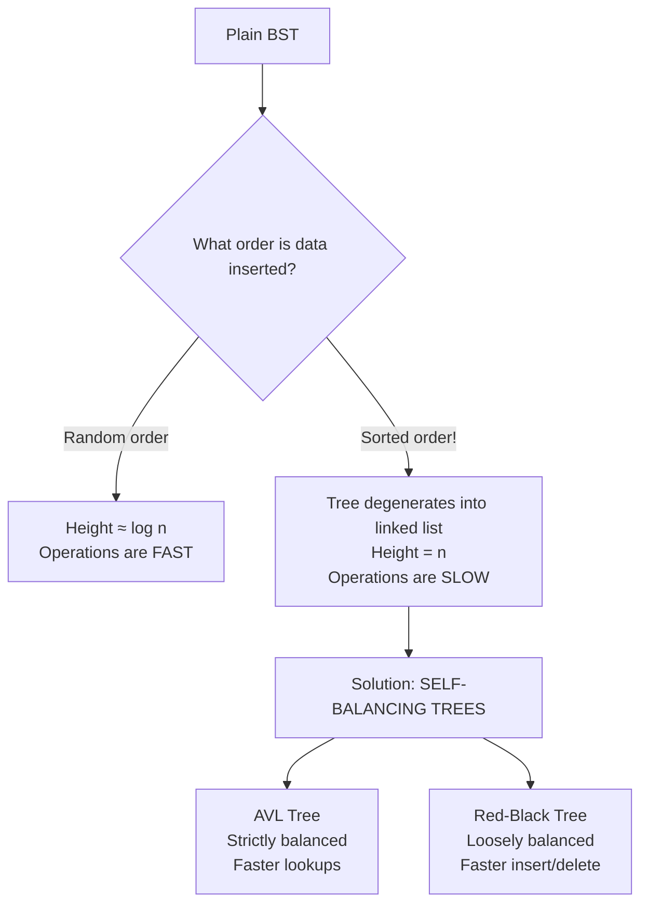

### Self-balancing idea

Self-balancing trees perform **restructuring operations** (rotations and color changes) during insert/delete so the height never exceeds **O(log n)** — no matter what order data arrives in.

The Red-Black Tree achieves this guarantee with very little bookkeeping, which is why it is one of the most used data structures in real software.

---

## 3. What is a Red-Black Tree?

A Red-Black Tree is a **self-balancing Binary Search Tree** where every node stores an extra bit: a **color**, which is either **RED** or **BLACK**.

### History

- Invented in **1972 by Rudolf Bayer** as "symmetric binary B-trees".
- Renamed "Red-Black tree" in **1978** by **Leonidas Guibas** and **Robert Sedgewick**.
- Fun fact: the colors have no technical meaning — legend says they came from the red and black pens available on a printer at Xerox PARC!

### The 5 Golden Properties

Every valid Red-Black Tree must satisfy ALL of these:

| # | Property | Meaning |
|---|---|---|
| 1 | Every node is either RED or BLACK | The extra bit of information |
| 2 | The root is always BLACK | Anchors the balance |
| 3 | Every leaf (`nullptr`) counts as BLACK | Simplifies math (called NIL leaves) |
| 4 | **No two consecutive RED nodes** | A RED node cannot have a RED parent or RED child |
| 5 | **Equal black height**: every path from any node down to its NIL leaves contains the same number of BLACK nodes | THE balancing property |

**📊 Diagram — RB properties recap — the five golden rules**

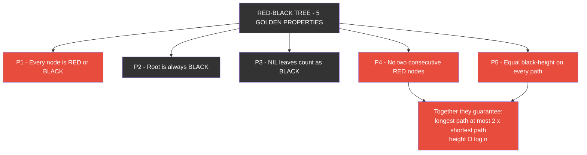

### Black Height (bh)

> **bh(node)** = number of BLACK nodes on any path from that node (excluding itself) down to a NIL leaf.

Property 5 guarantees every path has identical black height — the tree can never get lopsided beyond a factor of 2.

### Example of a valid Red-Black Tree

```
              20(B)
            /       \
        10(B)        40(R)
        /   \        /    \
     5(R)  15(R)  25(B)   30(B)
                          /
                       28(R)

Check property 4: no R-R pair anywhere ✓
Check property 5: every root→NIL path has exactly 3 blacks (incl. NIL):
  20B→10B→5R→NIL      = 3 blacks ✓
  20B→10B→15R→NIL     = 3 blacks ✓
  20B→40R→25B→NIL     = 3 blacks ✓
  20B→40R→30B→28R→NIL = 3 blacks ✓
```

**📊 Diagram — Example valid Red-Black Tree rendered as a graph**

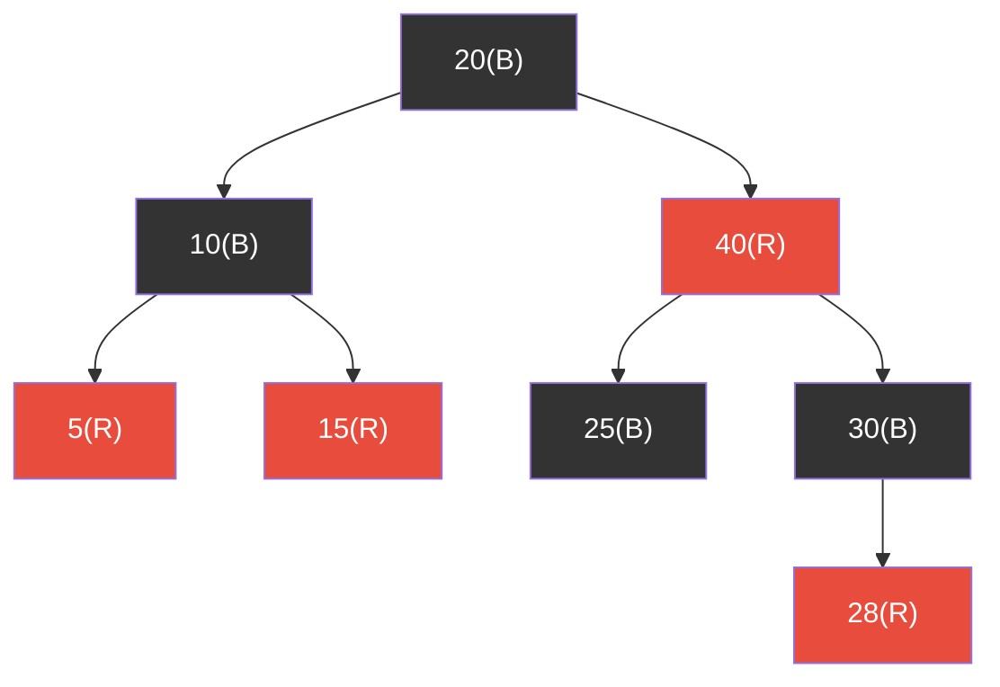

### Interesting consequence

Because of properties 4 + 5:

> **The longest root-to-leaf path is at most twice the shortest one.**
>
> Shortest path: all BLACK nodes.
> Longest path: alternate RED-BLACK (can't do better than doubling since no two REDs touch).

So the tree is guaranteed to be roughly balanced — never worse than ~2× the perfect tree.

---

## 4. Why Does It Work? — Height Bound Proof

**Claim:** A Red-Black Tree with n internal nodes always has height `h ≤ 2·log₂(n + 1)`.

### Proof sketch (important for interviews!)

**Step 1:** A subtree rooted at x with black-height `bh(x)` contains **at least** `2^bh(x) − 1` internal nodes.

*Proof by induction:*

- Base: NIL leaf → bh = 0 → contains 2⁰ − 1 = 0 nodes ✓
- Inductive step: Any internal node x has children whose black-heights are ≥ bh(x) − 1 (they lose at most one black when descending). By induction each subtree has ≥ 2^(bh−1) − 1 nodes:

```
nodes(x) ≥ (2^(bh(x)-1) − 1) + 1 + (2^(bh(x)-1) − 1) = 2^bh(x) − 1  ✓
```

**Step 2:** Therefore `n ≥ 2^bh − 1`, which means `bh ≤ log₂(n + 1)`.

**Step 3:** On any root-to-NIL path, BLACK count is fixed (= bh of root), and RED nodes can never outnumber BLACK ones (no two REDs adjacent). Hence total path length ≤ 2·bh.

**Conclusion:**

```
h ≤ 2·bh ≤ 2·log₂(n + 1)     ← logarithmic height GUARANTEED!
```

This is why every operation runs in **O(log n) worst case** — not just on average like a random BST.

---

## 5. Rotations — The Core Mechanism

Rotations are the **only structural changes** Red-Black Trees ever make (plus recoloring). A rotation is a local rearrangement of 3 pointers that preserves the BST ordering.

### Left Rotation (around x)

x's right child **y moves up**, x becomes y's left child.

```
LEFT ROTATION around x:

        px                     px
        |                      |
        x                      y
       / \                    / \
      a   y      ───►        x   c
         / \                / \
        b   c              a   b

BST order preserved:  a < x < b < y < c   (before AND after)
```

```cpp
void rotateLeft(Node* x) {
    Node* y = x->right;

    x->right = y->left;               // b becomes x's right subtree
    if (y->left != nullptr)
        y->left->parent = x;          // update b's parent

    y->parent = x->parent;            // y takes x's place
    if (x->parent == nullptr)
        root = y;                     // x was root
    else if (x == x->parent->left)
        x->parent->left = y;
    else
        x->parent->right = y;

    y->left   = x;                    // x hangs under y
    x->parent = y;
}
```

### Right Rotation (around y)

Mirror image — y's left child x moves up.

```
RIGHT ROTATION around y:

          py                    py
          |                     |
          y                     x
         / \                   / \
        x   c     ───►        a   y
       / \                       / \
      a   b                     b   c

BST order preserved:  a < x < b < y < c   (before AND after)
```

```cpp
void rotateRight(Node* y) {
    Node* x = y->left;

    y->left = x->right;               // b becomes y's left subtree
    if (x->right != nullptr)
        x->right->parent = y;

    x->parent = y->parent;
    if (y->parent == nullptr)
        root = x;
    else if (y == y->parent->right)
        y->parent->right = x;
    else
        y->parent->left = x;

    x->right  = y;
    y->parent = x;
}
```

> **Key insight:** Rotations take O(1) time (constant pointer updates) and preserve the in-order sequence. They change *shape* without changing *sortedness*.

**📊 Diagram — Rotation case selector — LL / LR / RL / RR**

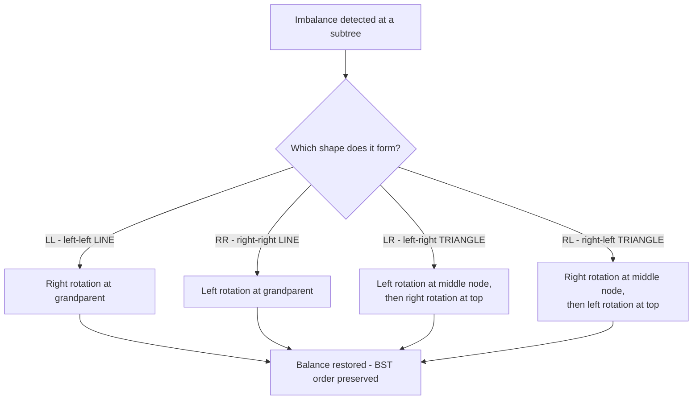

---

## 6. Insertion — Step by Step

### High-level algorithm

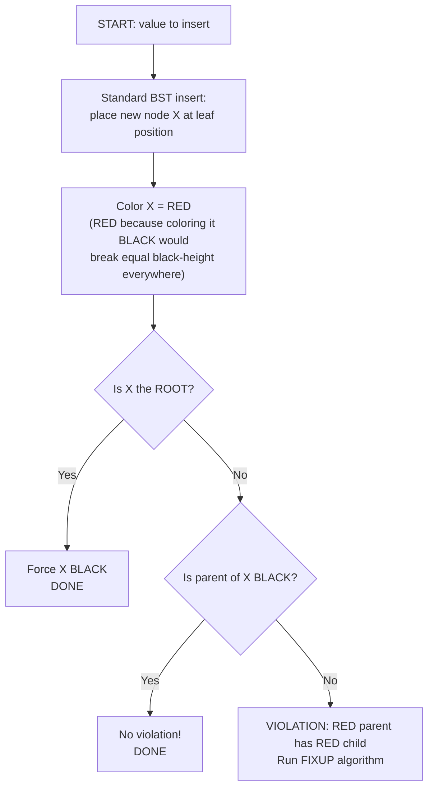

### Fixup — the interesting part

When we insert a RED node under a RED parent, we violate **property 4**. We resolve it based on one question: **what color is the UNCLE?**

(The uncle = the sibling of the parent, i.e., the other child of the grandparent.)

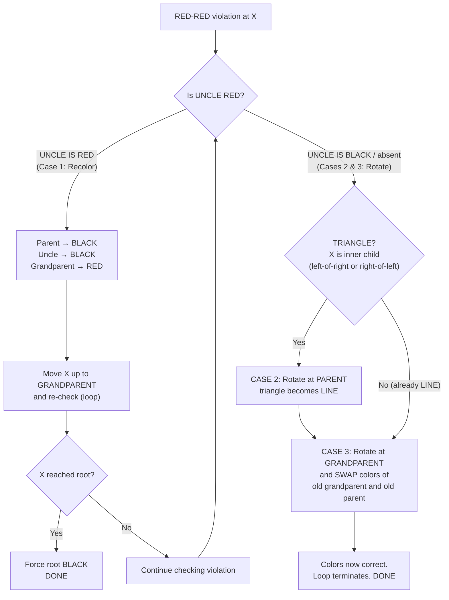

### Visualizing the 3 cases

#### Case 1 — Uncle is RED → just recolor

```
BEFORE                              AFTER (recolor only)

        G(B)                              G(R)  ← may cause NEW violation above!
       / \                               / \
     P(R) U(R)          ───►          P(B) U(B)
     |                                 |
     X(R)                              X(R)

The black-height of every path is unchanged (R↔B swaps happen in pairs).
If G's parent was also RED → violation moves UP to G → repeat the process.
```

**📊 Diagram — Recoloring decision — when Case 1 applies**

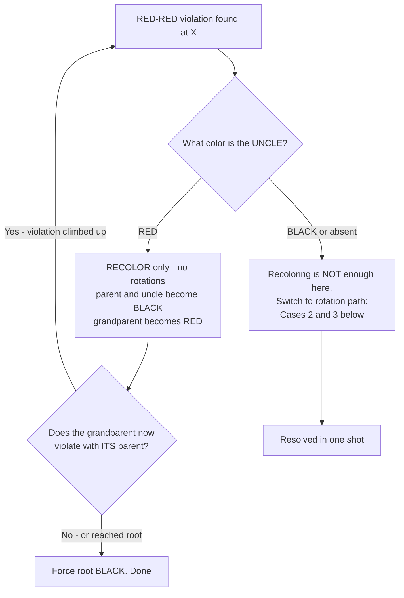

#### Case 2 — Uncle is BLACK, X is "inner" (TRIANGLE) → rotate at parent

```
BEFORE (triangle shape: left-child-of-right-child)      AFTER

        G                                     G
       / \                                   / \
     P(R) U(B)          ───►               X(R)  U(B)
       \                                   /
        X(R)                             P(R)

Rotate LEFT at P. Now the shape is a straight LINE → apply Case 3 next.
(Mirror version: right-child-of-left-child → rotate RIGHT at P.)
```

#### Case 3 — Uncle is BLACK, X is "outer" (LINE) → rotate at grandparent + swap colors

```
BEFORE (line: left-child-of-left-child)          AFTER

          G(B)                            P(?)  ← takes G's old color
         / \                             / \
       P(R) U(B)         ───►         X(R)  G(R)  ← becomes RED
       /
     X(R)

Rotate RIGHT at G. P rises, keeps G's old color, G turns RED.
Both subtrees below keep their black-height. VIOLATION FULLY RESOLVED.
```

> **Why does Case 3 terminate the loop?** After the rotation, the node that rose (P) is BLACK — so no red-red violation can exist above it. Cases 1 may propagate upward (O(log n) recolorings worst-case), but **rotations happen at most TWICE per insertion** (Case 2 immediately followed by Case 3).

### Full worked example

Insert the sequence: **10, 20, 30, 15, 25, 5, 40, 50**

**Step 1 — insert 10:** Root must be BLACK (property 2).

```
   10(B)
```

**Step 2 — insert 20:** Placed right of 10 as RED. Parent 10 is BLACK → no violation.

```
   10(B)
       \
       20(R)
```

**Step 3 — insert 30:** Right of 20. Parent 20 is RED → violation! Uncle = NIL = BLACK → line shape (RR). Rotate LEFT at grandparent 10, swap colors 20↔10.

```
     10(B)                    20(B)
        \          ──►        /  \
        20(R)              10(R) 30(R)
           \
           30(R)
```

**Step 4 — insert 15:** Goes 20 → left → 10, then right of 10. Parent 10 is RED, uncle 30 is RED → **Case 1**: recolor (10,30 → BLACK; 20 → RED). 20 is root → force BLACK again.

```
        20(R→B)
       /    \
    10(R→B) 30(R→B)
        \
        15(R)
```

**Step 5 — insert 25:** Left of 30. Parent 30 is BLACK → no violation.

```
        20(B)
       /    \
    10(B)   30(B)
        \    /
        15(R) 25(R)
```

**Step 6 — insert 5:** Left of 10. Parent 10 is BLACK → no violation.

```
        20(B)
       /    \
    10(B)   30(B)
    /  \     /
  5(R) 15(R) 25(R)
```

**Step 7 — insert 40:** 20 → right → 30 → left → 25 → right of 25. Parent 25 is RED, grandpa 30 is BLACK, uncle = NIL → TRIANGLE (right-of-left). **Case 2**: rotate LEFT at 25. Then **Case 3**: rotate RIGHT at 30, swap colors 40↔30.

```
   before fixup:                after Case 2:            after Case 3:
        20(B)                       20(B)                  20(B)
       /    \                      /    \                /      \
    10(B)   30(B)              10(B)   30(B)        10(B)     40(B)
    /  \     /                 /  \     /           /  \      /   \
  5(R) 15(R)25(R)           5(R) 15(R) 40(R)    5(R) 15(R) 25(R)  30(R)
              \                        /
              40(R)                  25(R)
```

**Step 8 — insert 50:** 20 → 40 → 30 → right of 30. Parent 30 RED, uncle 25 RED → **Case 1**: recolor 30,25 → BLACK; 40 → RED. 40's parent is 20 (BLACK) → stop.

### Final tree after inserting 10, 20, 30, 15, 25, 5, 40, 50

```
            20(B)
          /       \
      10(B)        40(R)
      /   \        /    \
   5(R)  15(R)  25(B)   30(B)
                           \
                           50(R)
```

Verify black-height: every root→NIL path has exactly **3 blacks** (including NIL) ✓

Notice how the tree stayed almost perfectly balanced through 8 insertions — with zero manual effort.

### Insertion summary table

| Situation detected | Action | Effect |
|---|---|---|
| Parent is BLACK (or X is root) | Nothing / force root BLACK | Done |
| Uncle is RED | Recolor P,U→BLACK, G→RED; move up to G | Violation may shift up |
| Uncle BLACK, TRIANGLE shape | Rotate at parent → converts to LINE | Then apply Line case |
| Uncle BLACK, LINE shape | Rotate at grandparent + swap G/P colors | Fully resolved |

**📊 Diagram — Insert fixup — complete decision path**

```mermaid
flowchart TD
    X["New RED node X sits under a RED parent"] --> C{"Uncle color?"}
    C -->|"RED"| R["Recolor P,U BLACK - G RED<br/>move X up to grandparent"]
    R --> RT{"Root reached or<br/>parent now BLACK?"}
    RT -->|"Yes"| D["Force root BLACK. DONE"]
    RT -->|"Still RED-RED"| X
    C -->|"BLACK or absent"| T{"TRIANGLE shape?<br/>X is an inner child"}
    T -->|"Yes"| T2["CASE 2 - rotate at parent<br/>triangle becomes LINE"]
    T -->|"No - already LINE"| T3["CASE 3 - rotate at grandparent,<br/>swap colors of P and G"]
    T2 --> T3
    T3 --> D2["Resolved. DONE"]

---

## 7. Deletion — The Double Black Concept

Deletion is harder than insertion. First recall the standard BST deletion difficulty levels:

```
Degree 1: LEAF          → simply unlink
Degree 2: ONE CHILD     → child replaces the node
Degree 3: TWO CHILDREN  → copy in-order SUCCESSOR's value here,
                          then DELETE the successor (which has ≤ 1 child)
                          → reduces to degree 1 or 2!
```

### The core difficulty

Removing a **BLACK** node breaks **property 5** (equal black-height): one side of the tree loses a black node. Think of it as leaving behind a "**double black**" — a phantom extra black that must be eliminated by pushing it up, moving black over from the sibling, or absorbing it into a red node.

*(Deleting a RED node is trivially safe — black-heights don't change at all.)*

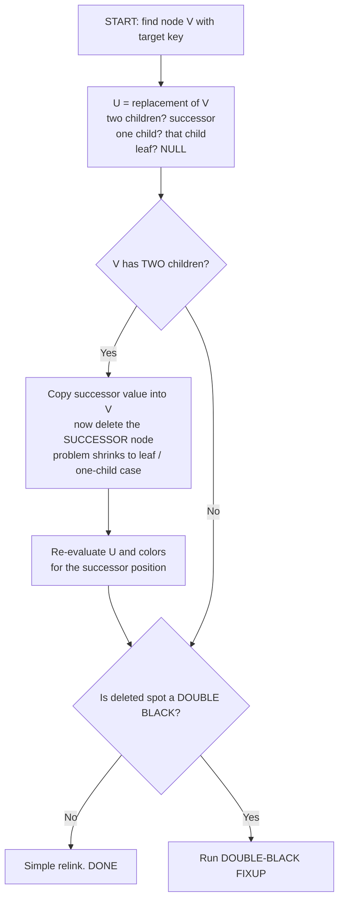

### Double-black fixup flowchart

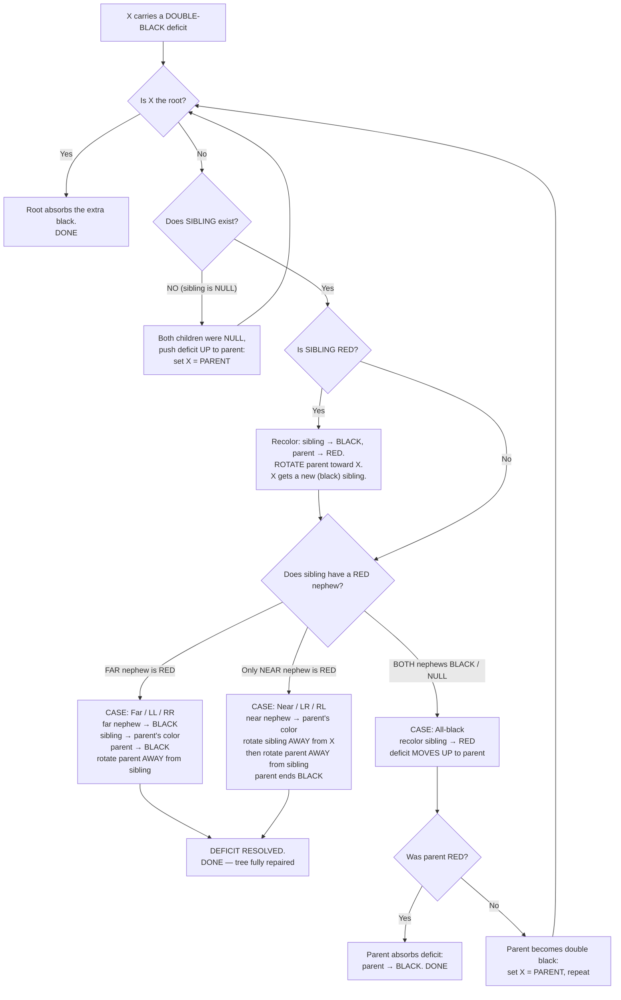

### Visualizing the deletion fix cases

Notation: `x†` marks the double-black spot, `P` parent, `S` sibling, `N` nephew.

#### Case: RED sibling → convert to a black-sibling case first

```
      P(?)                    S(B)  ← new black sibling now
     / \                     / \
  x†    S(R)     ───►      P(R)  SR
       / \                / \
     SL  SR             x†   SL
(recolor P,S; rotate LEFT at P)   → re-examine with black sibling
```

#### Case: BLACK sibling, FAR nephew RED (LL shown; RR is mirror)

```
        P(?)                    S(?←P's old color)
       / \                     / \
      S(B)  T        ───►    SL(B)  P(B)
     / \                            / \
   SL(R) N                        N    T
(far nephew SL → BLACK, S inherits P's color, P → BLACK, rotate RIGHT at P)
Every path regains exactly one black. DONE in one shot.
```

#### Case: BLACK sibling, only NEAR nephew RED (LR shown; RL is mirror)

```
      P(?)                    P(?)                     S(?)
     / \                     / \                      / \
    S(B) T       ───►      N(?) T       ───►        N(?) P(B)
      \                    /                        /     \
      N(R)               S(B)                    SL(B)    T
                          \        (rotate L     (then rotate R at P,
                          SL  at S)               P→BLACK) → DONE
```

#### Case: BLACK sibling, both nephews BLACK → push deficit up

```
      P(?)                    P(?)
     / \                     / \
    S(B) T       ───►     S(R) T
   / \                    / \
  BL BR                 BL BR
(S turns RED — its subtree now offers one less black on ALL paths,
 matching the deficient side. If P was RED it turns BLACK → done.
 If P was BLACK → P becomes the new double black → repeat upward.)
```

### Deletion summary table

| Condition | Action |
|---|---|
| Deleted node is RED | Just unlink — nothing breaks |
| Double black at ROOT | Absorb — done |
| No sibling | Move deficit up to parent |
| RED sibling | Recolor + rotate toward x, then re-check |
| BLACK sib, FAR nephew RED | 3 recolors + 1 rotation — done |
| BLACK sib, only NEAR nephew RED | Recolor + 2 rotations — done |
| BLACK sib, all nephews black | Recolor sibling RED; deficit moves to parent |

**📊 Diagram — Delete fixup overview — double-black resolution at a glance**

```mermaid
flowchart TD
    DB["DOUBLE-BLACK deficit at X"] --> Q0{"Is X the root?"}
    Q0 -->|"Yes"| ABS["Root absorbs the deficit. DONE"]
    Q0 -->|"No"| Q1{"Sibling RED?"}
    Q1 -->|"Yes"| CV["Recolor sibling BLACK, parent RED,<br/>rotate toward X,<br/>retry with new black sibling"]
    CV --> Q2
    Q1 -->|"No - sibling BLACK"| Q2{"Which nephew is RED?"}
    Q2 -->|"FAR nephew RED"| FAR["Steal its red: 3 recolors + 1 rotation. DONE"]
    Q2 -->|"only NEAR nephew RED"| NEAR["Recolor + double rotation. DONE"]
    Q2 -->|"ALL nephews BLACK"| PUSH["Paint sibling RED -<br/>deficit climbs to parent"]
    PUSH --> Q0

> Insertion needs **at most 2 rotations**; deletion needs **at most 3 rotations**. Both stay O(log n) overall due to the upward walk.

### Worked deletion example

Starting from our final tree:

```
            25(B)
          /       \
      10(B)        30(R)
      /   \        /    \
    5(R) 15(R)   40(B)  50(B)
```

**Delete 5:** RED leaf → simply unlink. Zero fixups needed. ✓

**Delete 25:** Root, two children. Successor = min of right subtree = 30. Copy 30 into root, then delete node-30. Node-30 is RED → unlink safely.

```
            30(B)                    ← holds successor's value
          /       \
      10(B)        40(B)
      /   \           \
    5(R) 15(R)         50(B)
```

Both deletions resolved instantly — no cascading. But try deleting from trickier shapes and you'll see all the double-black machinery fire (the C++ program lets you experiment freely).

---

## 8. Complete C++ Implementation

A single, self-contained, compilable program. Every piece explained above is here: rotations, insert-fixup, delete-fixup, search, traversals.

```cpp
/**********************************************************************
 *  RED-BLACK TREE — Complete Implementation in C++
 *
 *  Compile:  g++ -std=c++17 red_black_tree.cpp -o rbt
 *  Run    :  ./rbt
 **********************************************************************/
#include <iostream>
#include <algorithm>
using namespace std;

enum Color { RED, BLACK };

struct Node {
    int   data;
    Color color;
    Node *left, *right, *parent;

    Node(int val) : data(val), color(RED),          // new nodes start RED
                    left(nullptr), right(nullptr), parent(nullptr) {}
};

class RedBlackTree {
private:
    Node* root = nullptr;

    /* ==================== ROTATIONS (O(1)) ==================== */

    void rotateLeft(Node* x) {
        Node* y = x->right;

        x->right = y->left;                          // y's left subtree -> x's right
        if (y->left != nullptr) y->left->parent = x;

        y->parent = x->parent;                       // y replaces x at its parent
        if (x->parent == nullptr)      root = y;
        else if (x == x->parent->left) x->parent->left  = y;
        else                           x->parent->right = y;

        y->left   = x;                               // x drops under y
        x->parent = y;
    }

    void rotateRight(Node* y) {
        Node* x = y->left;

        y->left = x->right;
        if (x->right != nullptr) x->right->parent = y;

        x->parent = y->parent;
        if (y->parent == nullptr)      root = x;
        else if (y == y->parent->right) y->parent->right = x;
        else                            y->parent->left  = x;

        x->right  = y;
        y->parent = x;
    }

    /* ==================== HELPERS ==================== */

    Node* searchHelper(Node* node, int key) {
        if (node == nullptr || node->data == key) return node;
        return searchHelper(key < node->data ? node->left : node->right, key);
    }

    Node* minValue(Node* node) {
        while (node->left != nullptr) node = node->left;
        return node;
    }

    Node* getSibling(Node* x) {
        if (x->parent == nullptr) return nullptr;
        return (x == x->parent->left) ? x->parent->right : x->parent->left;
    }

    /* ==================== INSERT FIXUP (red-red violations) ====== */

    void fixRedRed(Node* x) {
        while (x != root && x->color == RED && x->parent->color == RED) {
            Node* parent = x->parent;
            Node* gpa    = parent->parent;           // grandparent (must exist)

            if (parent == gpa->left) {               // ---- parent is LEFT child
                Node* uncle = gpa->right;

                if (uncle != nullptr && uncle->color == RED) {
                    /* CASE 1: red uncle -> recolor, push violation up */
                    parent->color = BLACK;
                    uncle->color  = BLACK;
                    gpa->color    = RED;
                    x = gpa;                         // re-check at grandparent
                } else {
                    if (x == parent->right) {        /* CASE 2: triangle */
                        rotateLeft(parent);
                        parent = x;                  // upper node after rotation
                    }
                    /* CASE 3: line -> rotate grandparent + swap colors */
                    rotateRight(gpa);
                    swap(parent->color, gpa->color);
                    x = parent;                      // now BLACK -> loop exits
                }
            } else {                                 // ---- MIRROR: parent is RIGHT child
                Node* uncle = gpa->left;

                if (uncle != nullptr && uncle->color == RED) {
                    parent->color = BLACK;
                    uncle->color  = BLACK;
                    gpa->color    = RED;
                    x = gpa;
                } else {
                    if (x == parent->left) {         /* mirror triangle */
                        rotateRight(parent);
                        parent = x;
                    }
                    rotateLeft(gpa);
                    swap(parent->color, gpa->color);
                    x = parent;
                }
            }
        }
        root->color = BLACK;                         // property 2, always enforced
    }

    Node* bstInsert(Node* rootNode, Node* newNode) { // ordinary BST placement
        if (rootNode == nullptr) return newNode;

        if (newNode->data < rootNode->data) {
            rootNode->left = bstInsert(rootNode->left, newNode);
            rootNode->left->parent = rootNode;
        } else if (newNode->data > rootNode->data) {
            rootNode->right = bstInsert(rootNode->right, newNode);
            rootNode->right->parent = rootNode;
        }
        return rootNode;                             // duplicates silently ignored
    }

    /* ==================== DELETION ==================== */

    Node* bstReplace(Node* x) {
        if (x->left != nullptr && x->right != nullptr)
            return minValue(x->right);               // in-order successor
        if (x->left == nullptr && x->right == nullptr)
            return nullptr;                          // leaf -> no replacement
        return (x->left != nullptr) ? x->left : x->right;  // single child
    }

    void fixDoubleBlack(Node* x) {
        if (x == root) return;                       // root absorbs the deficit

        Node* parent  = x->parent;
        Node* sibling = getSibling(x);

        /* CASE A: no sibling -> deficit moves up */
        if (sibling == nullptr) {
            fixDoubleBlack(parent);
            return;
        }

        /* CASE B: RED sibling -> repaint & rotate toward x, then retry */
        if (sibling->color == RED) {
            parent->color  = RED;
            sibling->color = BLACK;
            if (sibling == parent->left) rotateRight(parent);
            else                         rotateLeft(parent);
            fixDoubleBlack(x);                       // sibling changed; re-run
            return;
        }

        /* From here: sibling is BLACK */
        bool nearRed = false, farRed = false;
        if (sibling == parent->left) {
            farRed  = sibling->left  != nullptr && sibling->left->color  == RED;
            nearRed = sibling->right != nullptr && sibling->right->color == RED;
        } else {
            nearRed = sibling->left  != nullptr && sibling->left->color  == RED;
            farRed  = sibling->right != nullptr && sibling->right->color == RED;
        }

        /* CASE C: both nephews BLACK -> repaint sibling, move deficit up */
        if (!nearRed && !farRed) {
            sibling->color = RED;
            if (parent->color == RED) parent->color = BLACK;   // absorbed
            else                      fixDoubleBlack(parent);  // propagated
            return;
        }

        Color pc = parent->color;                    // remember before repainting

        if (sibling == parent->left) {
            if (farRed) {
                /* CASE D: LEFT-LEFT (far nephew red) */
                sibling->left->color = BLACK;
                sibling->color       = pc;
                parent->color        = BLACK;
                rotateRight(parent);
            } else {
                /* CASE E: LEFT-RIGHT (only near nephew red) */
                sibling->right->color = pc;
                parent->color         = BLACK;
                rotateLeft(sibling);                 // convert to LEFT-LEFT...
                rotateRight(parent);                 // ...then finish
            }
        } else {
            if (farRed) {
                /* CASE F: RIGHT-RIGHT (mirror of D) */
                sibling->right->color = BLACK;
                sibling->color        = pc;
                parent->color         = BLACK;
                rotateLeft(parent);
            } else {
                /* CASE G: RIGHT-LEFT (mirror of E) */
                sibling->left->color = pc;
                parent->color        = BLACK;
                rotateRight(sibling);
                rotateLeft(parent);
            }
        }
    }

    void deleteNode(Node* v) {
        Node* u = bstReplace(v);

        bool  uvBlack = (u == nullptr || u->color == BLACK) && (v->color == BLACK);
        Node* parent  = v->parent;

        if (u == nullptr) {
            /* ---------------- v is a LEAF ---------------- */
            if (v == root) {
                root = nullptr;
            } else {
                if (uvBlack) fixDoubleBlack(v);      // true deficit: fix BEFORE unlink
                /* red leaf: removal is harmless, no fixup needed */
                if (parent->left == v) parent->left  = nullptr;
                else                   parent->right = nullptr;
            }
            delete v;
        }
        else if (v->left == nullptr || v->right == nullptr) {
            /* ---------------- v has ONE child ---------------- */
            if (v == root) {
                v->data = u->data;                   // copy child up
                v->left = v->right = nullptr;
                delete u;
            } else {
                if (parent->left == v) parent->left  = u;
                else                   parent->right = u;
                u->parent = parent;
                delete v;
                if (uvBlack) fixDoubleBlack(u);      // black removed: repair
                else         u->color = BLACK;       // u was RED: repaint
            }
        }
        else {
            /* ---------------- v has TWO children ---------------- */
            v->data = u->data;                       // copy successor's value...
            deleteNode(u);                           // ...delete successor instead
        }
    }

    void inorderHelper(Node* node) {
        if (node == nullptr) return;
        inorderHelper(node->left);
        cout << node->data << (node->color == RED ? "(R) " : "(B) ");
        inorderHelper(node->right);
    }

    int heightHelper(Node* node) {
        if (node == nullptr) return 0;
        return 1 + max(heightHelper(node->left), heightHelper(node->right));
    }

    void destroy(Node* node) {                       // post-order cleanup
        if (node == nullptr) return;
        destroy(node->left);
        destroy(node->right);
        delete node;
    }

public:
    RedBlackTree() = default;
    ~RedBlackTree() { destroy(root); }

    void insert(int data) {
        Node* newNode = new Node(data);
        root = bstInsert(root, newNode);
        fixRedRed(newNode);
    }

    bool remove(int key) {
        Node* v = searchHelper(root, key);
        if (v == nullptr) return false;
        deleteNode(v);
        return true;
    }

    bool search(int key) { return searchHelper(root, key) != nullptr; }

    int  height() { return heightHelper(root); }     // counted in NODES

    void inorder() {
        inorderHelper(root);
        cout << "\n";
    }
};

/* ==================== DEMO ==================== */

int main() {
    RedBlackTree rbt;

    cout << "--- Inserting: 10 20 30 15 25 5 40 50 ---\n";
    for (int v : {10, 20, 30, 15, 25, 5, 40, 50}) rbt.insert(v);

    cout << "Inorder : ";
    rbt.inorder();
    cout << "Height  : " << rbt.height() << "\n\n";   // 4 — tiny for 8 nodes!

    cout << "--- Deleting 5 and 20 ---\n";
    rbt.remove(5);
    rbt.remove(20);

    cout << "Inorder : ";
    rbt.inorder();

    cout << "Search 25 -> " << (rbt.search(25) ? "FOUND" : "NOT FOUND") << "\n";
    return 0;
}
```

### Expected output

```
--- Inserting: 10 20 30 15 25 5 40 50 ---
Inorder : 5(R) 10(B) 15(R) 20(B) 25(B) 30(B) 40(R) 50(R)
Height  : 4

--- Deleting 5 and 20 ---
Inorder : 10(B) 15(R) 25(B) 30(R) 40(B) 50(B)
Search 25 -> FOUND
```

### Sanity checker (optional — great for studying!)

Add this member function to verify all 5 properties automatically after any operation:

```cpp
private:
    // Returns the black-height of 'node', or -1 if ANY property is violated.
    int validate(Node* node) {
        if (node == nullptr) return 1;                       // NIL = black (property 3)

        if (node->color == RED &&                            // property 4: no red-red
            ((node->left  && node->left->color  == RED) ||
             (node->right && node->right->color == RED)))
            return -1;

        int lh = validate(node->left);
        int rh = validate(node->right);
        if (lh == -1 || rh == -1 || lh != rh) return -1;     // property 5: equal bh

        return lh + (node->color == BLACK ? 1 : 0);
    }

public:
    bool isValid() {
        if (root != nullptr && root->color != BLACK) return false;  // property 2
        return validate(root) != -1;
    }
```

Then call `cout << rbt.isValid();` after inserts/deletes — it must always print `1`.

---

## 9. Time & Space Complexity

| Operation | Average | Worst Case | Notes |
|---|---|---|---|
| Search | O(log n) | **O(log n)** | Guaranteed by height bound |
| Insert | O(log n) | **O(log n)** | ≤ 2 rotations, O(log n) recolorings |
| Delete | O(log n) | **O(log n)** | ≤ 3 rotations, O(log n) recolorings |
| Rotation | O(1) | O(1) | Constant pointer surgery |
| Space | O(n) | O(n) | One extra color bit per node |

Compare with plain BST, whose worst case is O(n) for everything.

---

## 10. Red-Black Tree vs AVL Tree

Both are balanced BSTs; they differ in *how strictly* they balance and what they optimize for.

| Aspect | Red-Black Tree | AVL Tree |
|---|---|---|
| Balance strictness | Loose: height ≤ 2·log(n+1) | Strict: heights of subtrees differ by ≤ 1 |
| Lookup speed | Slightly slower (taller tree) | Faster (shorter tree) |
| Insert / Delete speed | **Faster** (≤ 2 / ≤ 3 rotations) | Slower (may rotate at every level up to root) |
| Extra storage | 1 color bit per node | Height/balance factor per node (usually more bits) |
| Rebalancing cost | Fewer rotations, more recolorings (cheap) | More frequent rotations |
| Typical usage | General-purpose ordered containers | Read-heavy workloads |

**Rule of thumb:** many lookups AND many modifications → Red-Black. Mostly reads, rarely modified → AVL.

That's why C++ STL chose Red-Black trees, while AVL trees shine in specialized/database-adjacent scenarios.

---

## 11. Real-World Applications

You interact with Red-Black Trees daily without knowing it:

| Where | How it's used |
|---|---|
| **C++ STL** | `std::map`, `std::set`, `std::multimap`, `std::multiset` are backed by RB-trees |
| **Java** | `TreeMap`, `TreeSet`; `HashMap` buckets convert to RB-trees when a bucket overflows (Java 8+, "treeification") |
| **Linux kernel** | Completely Fair Scheduler (CFS) keeps runnable tasks in an RB-tree keyed by virtual runtime; also used in the epoll event system and ext4 extent management (`lib/rbtree.c`) |
| **Databases / filesystems** | Internal indexing structures (though most databases prefer B/B+ trees for disk pages) |

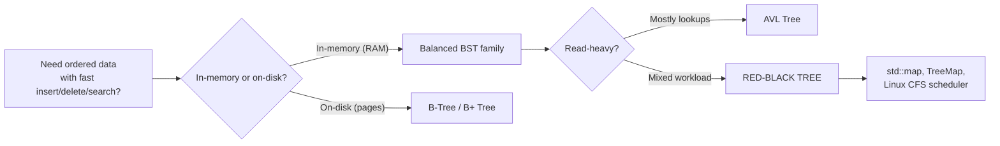

Why not hash tables everywhere? Hash tables give O(1) average lookup but **lose ordering**. When you need `min/max`, range queries (`map.lower_bound`, `upper_bound`), or sorted iteration — balanced BSTs win.

---

## 12. Interview Questions & Practice Problems

### Conceptual questions

1. **Why must the root be black?** It simplifies property 5 globally; allowing a red root wouldn't break correctness but adds case complexity. Convention chosen for uniformity.
2. **Why can't a red node have a red child?** This cap ("no two reds in a row") is exactly what bounds the longest path by 2× the shortest.
3. **Can a valid RB-tree have ALL nodes black?** Yes — but then every root-to-NIL path has equal length, forcing a **perfect binary tree** (n = 2^k − 1).
4. **Max rotations for insert vs delete?** Insert: at most 2. Delete: at most 3.
5. **Why insert new nodes as RED, not BLACK?** Coloring black would violate property 5 on every path (adding a black everywhere below); coloring red violates at most property 4 locally, which is cheap to fix.
6. **Worst-case height?** h ≤ 2·log₂(n+1) ≈ 1.44·log₂(n)... actually 2·log₂(n+1); e.g., n = 1000 → height ≤ ~20.
7. **RB vs AVL — when which?** See section 10.

### Practice problems

| Problem | Platform | Concept practiced |
|---|---|---|
| Implement RB-tree insert/delete from scratch | — | Everything |
| 108. Convert Sorted Array to BST | LeetCode | BST construction |
| 1382. Balance a Binary Search Tree | LeetCode | Rebalancing ideas |
| 235/236. LCA of BST / Binary Tree | LeetCode | BST navigation |
| Verify all 5 RB-properties programmatically | — | The `isValid()` above |
| Count black-height of every node | — | Property 5 fluency |

### Study strategy

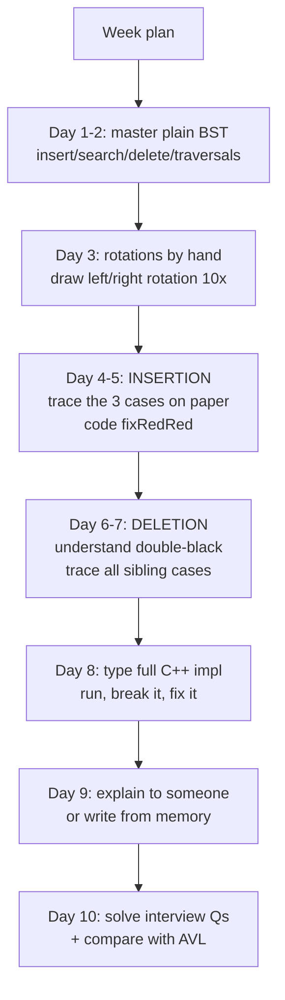

---

## 13. Quick Revision Cheat Sheet

### The 5 properties

```
1. Node color ∈ {RED, BLACK}
2. Root is BLACK
3. NIL leaves are BLACK
4. RED node ⇒ NO RED children (no red-red pairs)
5. Equal #BLACKs on every root→leaf path (equal black-height)
```

### Key facts to memorize

```
Height bound      : h ≤ 2 · log₂(n+1)
Longest path      : ≤ 2 × shortest path
New insert color  : RED (fix later)
Rotations/insert  : max 2
Rotations/delete  : max 3
Fix trigger       : insert → red-red pair
                    delete → double-black deficit
Case selector     : insert → uncle's color
                    delete → sibling's & nephews' colors
```

### Insert fixup (one-liner memory hooks)

```
Uncle RED    → recolor & climb        (grandparent becomes suspect)
Uncle BLACK  → rotate:
    Triangle → 1 rotation at parent  (straighten)
    Line     → 1 rotation at grandparent + color swap (finish)
```

### Delete fixup (one-liner memory hooks)

```
Sibling RED        → paint it black, rotate toward me, retry
Sibling BLACK      :
    Far nephew RED → steal its red: 3 recolors + 1 rotation, DONE
    Near RED only  → double rotation, DONE
    Both black     → sibling goes red, deficit climbs to parent
Root               → absorbs anything, DONE
```

### Mental model

> Think of black nodes as the **skeleton** (fixed length everywhere) and red nodes as flexible padding that fills gaps. Insertion/deletion merely rearrange padding, occasionally rotating the skeleton — and the skeleton guarantees O(log n) forever.

---

## References & Further Reading

- **CLRS** — *Introduction to Algorithms*, Chapter 13 (the canonical treatment)
- Sedgewick & Wayne — *Algorithms, 4th ed.* (left-leaning red-black trees variant)
- Wikipedia — [Red–black tree](https://en.wikipedia.org/wiki/Red%E2%80%93black_tree) (visualizations)
- VisuAlgo — interactive RB-tree animations: visualgo.net/en/bst
- Linux kernel source: `lib/rbtree.c` — production-grade, cache-friendly RB-tree
