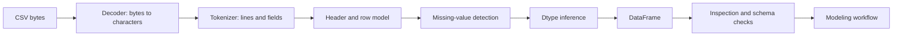
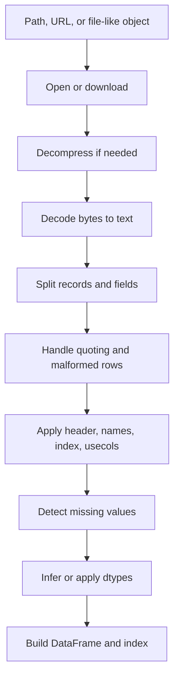
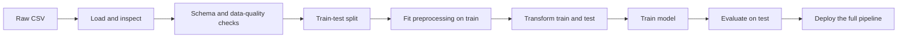

# Day 15 — Working with CSV Files

> **Course:** CampusX — 100 Days of Machine Learning, Day 15  
> **Official notebook:** `vendor/100-days-of-machine-learning/day15 - working with csv files/working-with-csv.ipynb` (36 cells)  
> **Personal notebook:** none during this preparation phase; the official notebook is mapped by path  
> **Primary dataset:** `datasets/aug_train.csv` (19,158 rows, 14 columns)  
> **Transcript:** not available; the transcript collection starts at Day 31  
> **Central question:** A CSV file looks like a spreadsheet, but it is only bytes on disk. What decisions must we make before those bytes become a trustworthy DataFrame for machine learning?

This chapter is the foundation for every later day. A model cannot learn from a file; it learns from a DataFrame with known columns, types, missing-value rules, and row meaning. Most “data problems” that appear later — a numeric column stored as text, an identifier treated as a number, a date stored as a string, silent row loss, or a test set that was accidentally used to choose preprocessing — begin at the loading step.

**Source labels used in this chapter**

- **Official**: the saved output in the CampusX notebook. It may have been produced with an older pandas version.
- **Rerun**: a result reproduced in this environment with **pandas 3.0.5**, Python 3.14.2, against the copied course datasets.
- **Supplementary**: an explanation or experiment added for learning; it is not presented as original course output.

The official notebook is the source for the sequence of arguments demonstrated. The rerun is used to check whether the saved output still matches the current API. Where they differ, both are reported.

---

# 1. Learning objectives

After studying this chapter I should be able to:

1. **Explain what a CSV file is** and why it is not already a typed table.
2. **Describe the internal stages** of `pandas.read_csv`: path resolution, decoding, tokenisation, field parsing, missing-value detection, dtype inference, and DataFrame construction.
3. **Read the important arguments** of `read_csv` and predict how each changes the resulting shape, columns, index, dtypes, or missing values.
4. **Load local files, TSV files, and remote files** without confusing downloaded text with parsed tabular data.
5. **Use `sep`, `names`, `header`, `index_col`, `usecols`, `nrows`, `skiprows`, and `chunksize` deliberately.**
6. **Explain how `encoding` differs from `dtype`**, why `latin-1` never raises a decoding error, and why a successful read can still produce wrong text.
7. **Control missing-value interpretation** with `na_values`, `keep_default_na`, and `dtype`, and explain the damage caused by treating a legitimate category as missing.
8. **Parse dates correctly**, compare object/string storage with `datetime64`, and explain the ambiguity in day/month formats.
9. **Process a file in chunks**, calculate the expected chunk sizes, and aggregate results without loading the whole file.
10. **Diagnose malformed rows, stale saved outputs, version-dependent arguments, and memory surprises.**
11. **Design a reproducible loading contract** for an ML project, including schema checks, checksums, and train/test contamination rules.
12. **Answer interview and examination questions** with reasons, not only definitions.

---

# 2. The central problem: bytes are not a table

A file named `aug_train.csv` does not contain a DataFrame. It contains bytes arranged into lines. If we open it in a text editor, we see characters such as:

```text
enrollee_id,city,city_development_index,gender,...,target
8949,city_103,0.92,Male,...,1.0
29725,city_40,0.776,Male,...,0.0
```

Those characters are not yet a table. To build a table we must decide:

- Which character separates fields? Comma, semicolon, tab, or something else?
- Which line is the header? Is there a header at all?
- Is the file encoded as UTF-8, Latin-1, or a Windows code page?
- Should an empty field mean missing, or an empty string?
- Should the text `"NA"` mean missing, or is it a legitimate category?
- Should `"00123"` become the integer `123`, or stay an identifier?
- Is `1.0` an integer-like label or a floating-point measurement?
- Is `date` a string, a date, or a timestamp?
- Should the row number be a feature, an index, or neither?
- Is it safe to drop malformed rows? How many were dropped?
- Can the file fit in memory? If not, how should it be read in pieces?

Every one of those questions changes the object that the model eventually receives. This is why `read_csv` is not a trivial “open file” operation. It is a parser combined with a schema-inference system.

The official notebook demonstrates the arguments one at a time. The important skill is not memorising the argument names. It is learning to ask: **what does this argument make the parser believe about the file?**



A file can load “successfully” and still be wrong. For example, `latin-1` can decode every possible byte, so it never raises `UnicodeDecodeError`; nevertheless, the resulting city names may be mojibake. A saved notebook output can show a plausible table even when the code would now raise a `TypeError`.

---

# 3. Foundations

## 3.1 The table model

A tabular dataset has:

- **Rows**: observations, records, or examples.
- **Columns**: variables, features, or attributes.
- **Values**: the entries at a row-column intersection.
- **Index**: labels attached to rows, used for alignment and selection.
- **Schema**: the column names and types.
- **Shape**: `(number_of_rows, number_of_columns)`.

For a dataset with $n$ rows and $p$ columns, the DataFrame has shape

$$
(n,p).
$$

The index is not counted as a feature column. If a CSV has 15 columns and we set one column as the index, the resulting DataFrame has 14 feature columns plus the index.

A row in `aug_train.csv` describes one course enrollee. A column such as `target` describes whether that enrollee looked for a new job. The meaning of a row is not encoded in the file; it comes from the dataset documentation and the problem definition.

## 3.2 What CSV actually is

CSV is a family of text formats, not one fully enforced standard. The commonly cited reference is RFC 4180. The core rules are:

- Records are separated by line breaks.
- Fields are separated by a delimiter, usually a comma.
- A field may be quoted.
- A quoted field may contain the delimiter or a line break.
- A quote inside a quoted field is represented by doubling it, for example `""`.
- The first record may be a header.

A simple example:

```csv
id,name,note
1,Alice,"hello, world"
2,Bob,"line one
line two"
```

The second row contains a comma inside the quoted field. The third row contains a newline inside the quoted field. A correct parser must not treat those characters as structural delimiters. A naive `line.split(",")` implementation would fail.

The parser therefore behaves like a small state machine: it tracks whether it is inside a quoted field, whether the next quote is an escape, and when a record actually ends. This is why hand-written CSV splitting is a common source of bugs.

## 3.3 Delimiters, headers, and names

A **delimiter** is the character between fields. A **header** is the record whose values become column labels. **Column names** are the labels attached to the columns.

There are three related but distinct ideas:

- `sep=...` tells the parser which character separates fields.
- `header=...` tells the parser which physical row contains the labels.
- `names=...` supplies labels directly instead of taking them from a row.

If a tab-separated file has no header, `sep="\t"` alone will treat the first data row as the header. Supplying `names=[...]` tells pandas to use those labels and, when no explicit `header` is given, to treat the first row as data. This is exactly what the course does with `movie_titles_metadata.tsv`.

## 3.4 Data types

A **dtype** is the internal representation of a column: integer, floating point, string, boolean, datetime, categorical, or a nullable extension type. CSV contains no dtype information. The parser must infer types from text.

Examples of inference:

- `"8949"` normally becomes an integer.
- `"0.776"` normally becomes a float.
- `"Male"` becomes a string/object.
- `"1.0"` and `"0.0"` may become floating point, even if the intended values are binary labels.
- `"00123"` may lose its leading zeros if parsed as an integer.
- `"2024-01-03"` may remain a string unless date parsing is requested.

Inference is convenient, but it is not a guarantee about meaning. A column of ZIP codes should be a string, not an integer, because arithmetic on ZIP codes is meaningless and leading zeros matter. A column of IDs should usually be an identifier, not a continuous feature.

The parser’s type decision changes:

- memory usage,
- sorting and comparison behaviour,
- which operations are valid,
- missing-value handling,
- what a model receives.

## 3.5 Missing values

A missing value is not the same as an empty string, zero, the word `"None"`, or the category `"Unknown"`. CSV has no universal null marker. Pandas recognises a default set of strings as missing, including values such as `NA`, `N/A`, `NaN`, `null`, and an empty field. The exact list is version-dependent, so production code should be explicit.

Three questions must be separated:

1. **What did the source mean by this token?** Is `"NA"` missing, or the abbreviation for a place?
2. **What should the parser treat as missing?** `na_values` and `keep_default_na` control this.
3. **What should the model do with the missing value?** Imputation, an indicator, or a model that handles missingness is a later decision.

The course demonstrates the dangerous direction: `na_values=["Male"]` makes the legitimate category `Male` missing. The parser is obedient, but the data has not become more correct.

## 3.6 Encoding

An **encoding** maps bytes to characters. The same character can have different byte representations:

- ASCII letters have the same bytes in ASCII-compatible encodings.
- UTF-8 uses one to four bytes per code point.
- Latin-1 uses one byte per code point for the first 256 code points.
- Windows code pages map some bytes differently.

If a file is decoded with the wrong encoding, two bad outcomes are possible:

- The decoder raises `UnicodeDecodeError` because a byte sequence is invalid.
- The decoder succeeds but produces the wrong characters. This is **mojibake**.

`latin-1` is special because every byte from `0x00` to `0xFF` maps to a code point. It therefore does not raise on arbitrary single-byte input when strict error handling is used. That property makes it a common “make the error go away” choice, but it can silently corrupt text. In the course’s `zomato.csv`, the Turkish city text is visibly mangled in the saved output. The parse succeeds; the semantics do not.

A byte-order mark (BOM) is another encoding trap. Some Windows tools write UTF-8 with a leading byte sequence `EF BB BF`. Reading with plain `utf-8` may leave an invisible character attached to the first column name. `utf-8-sig` removes the BOM.

## 3.7 Rows, columns, and the index

The **index** is the row label. It is useful for alignment and lookup. It is not a model feature unless it is explicitly converted into a column and used as one.

`index_col="enrollee_id"` moves the `enrollee_id` column out of the data columns and into the index. That is useful when the ID is a stable identifier and should not be treated as a numerical measurement. It is dangerous if downstream code assumes the ID is still a column.

`usecols` selects a subset of columns. It can reduce memory and parse time, but selecting too early can hide the columns needed to diagnose a data-quality problem. A sensible workflow is:

1. load a small preview with the full header,
2. inspect the schema,
3. then load only the required columns for the full run.

## 3.8 Files versus URLs

A local path is resolved by the operating system. A URL introduces network failure, authentication, redirects, compression, and server-side content negotiation. `pandas.read_csv` can read some URLs directly, but the course uses `requests` because it wants explicit control over the HTTP headers:

```python
import requests
from io import StringIO
import pandas as pd

url = "https://raw.githubusercontent.com/cs109/2014_data/master/countries.csv"
headers = {"User-Agent": "Mozilla/5.0 ..."}
response = requests.get(url, headers=headers)
data = StringIO(response.text)
df = pd.read_csv(data)
```

`requests.get` returns a response. `response.text` is already decoded text. `StringIO` makes that text look like a file-like object to pandas. This distinction matters:

- `StringIO` is a text stream; encoding has already happened.
- `BytesIO` is a binary stream; pandas would need an encoding.
- A network response can change or disappear; a saved local copy is more reproducible.

The official saved output for this example is 194 rows and 2 columns (`Country`, `Region`). The rerun in this environment produced the same shape.

---

# 4. Why the loading stage matters

Consider a model trained on `aug_train.csv`. The file’s raw `target` values are the strings `"1.0"` and `"0.0"`. With default parsing, pandas creates a `float64` target in this environment. Is that wrong? Not necessarily; a binary label can be stored as a float. But it affects:

- `value_counts` output,
- comparison with integer labels,
- downstream code that expects `0` and `1`,
- memory and display.

If the target had a missing value, `dtype={"target": int}` would fail because NumPy’s `int64` cannot store `NaN`. The nullable `Int64` type would be needed. This is a schema decision disguised as a loading detail.

Now consider a ZIP-code column. Default inference turns `"00123"` into `123`. The model receives a number whose magnitude is meaningless, and the original identifier is lost. The correct choice is a string dtype.

Consider a date column. As a string, it sorts lexicographically only if the format is consistently ISO-like. As a datetime, it supports year extraction, weekday extraction, and elapsed-time calculations. The representation enables or blocks later feature engineering.

Consider `nrows=100`. It is excellent for a quick test, but the first 100 rows are not a random sample. In the course data, the first 100 rows contain 28 positive targets (28%), while the full file contains 4,777 positives out of 19,158 (24.93%). That does not prove a permanent bias, but it demonstrates why a preview must not be used to estimate population rates.

The loading stage is therefore part of the modelling pipeline, even though no estimator has been fitted yet.

---

# 5. Internal working of `read_csv`

A useful mental model has seven stages.



## 5.1 Path and buffer resolution

Pandas accepts a path string, a path-like object, a URL, an open file, or a buffer. If the input is binary, it must decode. If it is text, decoding has already happened. If the file is compressed (`.gz`, `.bz2`, `.zip`), pandas can infer the compression from the extension or accept an explicit `compression` argument.

A subtle consequence: passing `StringIO(response.text)` means pandas never sees the original bytes. If `requests` guessed the wrong response encoding, the damage is already done before `read_csv`.

## 5.2 Decoding

The decoder turns bytes into Unicode characters. The `encoding` argument controls this. If no encoding is supplied, pandas uses a default that depends on the environment; do not rely on it for portable code.

A failed decode is often better than a silent wrong decode: it tells us that the file and the declared encoding disagree. In production, record the encoding in the data contract.

## 5.3 Record and field tokenisation

The parser splits the text into records and fields. It must handle:

- delimiters inside quoted fields,
- escaped quotes,
- line breaks inside quoted fields,
- comment lines,
- blank lines,
- trailing delimiters,
- inconsistent field counts.

The C parser is the default for ordinary comma/tab files. The Python engine is slower but supports more flexible regular-expression separators and some footer options. The engine choice changes performance and edge-case behaviour, not the meaning of a correctly formed CSV.

## 5.4 Header, names, and row filtering

The parser decides which record is the header and which records are data. `skiprows` removes physical records before parsing. `nrows` limits the number of data rows returned. `skipfooter` removes records at the end. These operations happen in a specific order, so combining them without checking is a common bug.

## 5.5 Missing-value detection

After field splitting, the parser compares field values with the missing-value set. This is where `na_values`, `keep_default_na`, and `na_filter` act. A token can be a real category in one column and a missing marker in another; pandas supports per-column dictionaries for exactly this reason.

## 5.6 Dtype inference

Pandas examines the parsed fields and infers a dtype. For large files, the parser may process data in internal chunks. In older pandas versions, the `low_memory` option influenced this chunked inference and could produce `DtypeWarning` when a column had mixed types. The warning is a prompt to specify dtypes, not a problem to ignore.

Inference is not a semantic oracle. It sees text, not meaning. This is why explicit dtypes are part of a reliable data contract.

## 5.7 DataFrame construction

Finally, pandas builds column arrays and an index. The displayed table is a rendering; the actual object may contain many more rows and columns than the display shows. The `...` in a notebook output is a display truncation controlled by pandas display options, not data loss.

---

# 6. The datasets used in Day 15

| Dataset | Shape | Role in the lesson |
|---|---:|---|
| `aug_train.csv` | 19,158 × 14 | Main CSV for local loading, indexing, columns, nrows, dtypes, missing values, chunks |
| `test.csv` | 4 data rows after `header=1` | Demonstrates a nonstandard header/blank line |
| `movie_titles_metadata.tsv` | 617 × 6 | Tab-separated file with no header and supplied names |
| `zomato.csv` | 9,551 × 21 | Encoding demonstration |
| `IPL Matches 2008-2020.csv` | 816 × 17 | Date parsing and converters |
| `BX-Books.csv` | not included | Malformed-line demonstration; saved output only |

`BX-Books.csv` is referenced by the notebook but is not present in the repository. The course README links the Book-Crossing dataset at `http://www2.informatik.uni-freiburg.de/~cziegler/BX/`. The saved output must not be presented as a reproducible result in this workspace.

The main dataset has 10 string/object columns and 4 numeric columns in this environment:

| Column | Missing | Missing % | Typical dtype |
|---|---:|---:|---|
| `enrollee_id` | 0 | 0.00% | `int64` |
| `city` | 0 | 0.00% | string/object |
| `city_development_index` | 0 | 0.00% | `float64` |
| `gender` | 4,508 | 23.53% | string/object |
| `relevent_experience` | 0 | 0.00% | string/object |
| `enrolled_university` | 386 | 2.01% | string/object |
| `education_level` | 460 | 2.40% | string/object |
| `major_discipline` | 2,813 | 14.68% | string/object |
| `experience` | 65 | 0.34% | string/object |
| `company_size` | 5,938 | 30.99% | string/object |
| `company_type` | 6,140 | 32.05% | string/object |
| `last_new_job` | 423 | 2.21% | string/object |
| `training_hours` | 0 | 0.00% | `int64` |
| `target` | 0 | 0.00% | `float64` by default |

The `gender` counts are:

- `Male`: 13,221
- missing: 4,508
- `Female`: 1,238
- `Other`: 191

These numbers matter later when we test `na_values=["Male"]`.

---

# 7. Reading the arguments one at a time

## 7.1 Loading a local file

The basic call is:

```python
import pandas as pd

df = pd.read_csv("datasets/aug_train.csv")
```

What happens:

1. The path is resolved relative to the current working directory.
2. The file is opened.
3. The first line is used as the header.
4. Commas separate fields.
5. Missing tokens and dtypes are inferred.
6. A DataFrame is returned.

The first thing to do is not `df`; it is an inspection:

```python
print(df.shape)
print(df.columns.tolist())
print(df.dtypes)
print(df.isna().sum())
df.head()
```

`df` in a notebook shows only a window into the data. The shape tells the real dimensions.

**Worked observation.** The rerun returns shape `(19158, 14)`. The display shows rows `0` to `19157` but truncates the middle with `...`; that is display behaviour. The file is 1,980,304 bytes on disk.

## 7.2 Loading a CSV from a URL

The course code:

```python
import requests
from io import StringIO
import pandas as pd

url = "https://raw.githubusercontent.com/cs109/2014_data/master/countries.csv"
headers = {"User-Agent": "Mozilla/5.0 ..."}
req = requests.get(url, headers=headers)
data = StringIO(req.text)
pd.read_csv(data)
```

Why not simply `pd.read_csv(url)`? Direct URL loading is convenient, but HTTP headers, authentication, retries, and explicit text decoding are easier to control with `requests`. The `StringIO` object adapts the decoded string to pandas’ file-like interface.

Execution order:

```text
URL -> HTTP response bytes -> response.text (decoded string)
    -> StringIO -> read_csv parser -> DataFrame
```

Rerun result: `(194, 2)` with columns `Country` and `Region`. The first row is `Algeria / AFRICA`; the last is `Venezuela / SOUTH AMERICA`.

**Reproducibility warning.** A remote URL can change. Save the downloaded data locally and record its checksum if it is part of a model’s training data.

## 7.3 `sep`: choosing the field separator

The TSV example:

```python
pd.read_csv(
    "datasets/movie_titles_metadata.tsv",
    sep="\t",
    names=["sno", "name", "release_year", "rating", "votes", "genres"],
)
```

The file uses tabs, not commas. Without `sep="\t"`, the entire line becomes one field.

The file has no header. The `names` list supplies six labels. Because `names` is present and no explicit `header` is given, the first physical row is treated as data; the output begins with `m0` and contains 617 rows.

The `genres` column is not a Python list. Its value is a string that looks like a NumPy array representation:

```text
['comedy' 'romance']
```

There are spaces but no commas between genre names, so this is not valid Python list syntax. It must be parsed with a deliberate method if genre structure is needed; it should not be assumed to be a list automatically.

**`sep` versus `delimiter`.** They are aliases in `read_csv`. Use one consistently. `delim_whitespace` is a separate convenience that treats runs of whitespace as separators; it has been deprecated in recent pandas versions, so an explicit separator or a preprocessing step is safer.

**Quoting.** For a comma-separated file whose text fields contain commas, the writer must quote those fields. If the file uses a different quote character, set `quotechar`. If it uses backslash escaping rather than doubled quotes, set `escapechar`. The parser cannot reliably guess all of these conventions.

## 7.4 `index_col`: selecting a row label

```python
df_indexed = pd.read_csv("datasets/aug_train.csv", index_col="enrollee_id")
```

Input: 19,158 rows and 14 columns.  
Output: 19,158 rows and 13 data columns, with `enrollee_id` as the index.

The index values are unique in this dataset (0 duplicate IDs). The shape change is not data loss; the identifier moved from a column to the row label.

Why use it?

- It prevents an identifier from being treated as a numerical feature.
- It makes lookups and joins by enrollee ID natural.
- It can preserve a stable row identity.

Why avoid it?

- Some downstream code expects all fields as columns.
- A non-unique index causes ambiguous alignment.
- The index is not automatically included in many model matrices.

`index_col` can also be an integer position or a list of columns. A list creates a MultiIndex, which is a different data model and should be chosen deliberately.

## 7.5 `usecols`: selecting columns while reading

```python
small = pd.read_csv(
    "datasets/aug_train.csv",
    usecols=["enrollee_id", "gender", "education_level"],
)
```

Result: 19,158 rows and 3 columns.

`usecols` reduces the amount of data parsed and held in memory. It is not only a display convenience. The rerun’s deep memory usage was approximately:

- full 14 columns: 11,024,933 bytes;
- selected 3 columns: 2,158,743 bytes;
- selected 3 columns with `category` dtype for the two string columns: 192,162 bytes.

The last result is not a universal recommendation. Categorical dtype is useful when the number of distinct values is small relative to the number of rows, but it introduces category ordering, unseen-category handling, and a different representation for downstream code.

`usecols` can accept a callable that receives a column name and returns a Boolean. That is useful when the selection rule is structural, such as “all columns whose names start with `city_`”. For reproducibility, record the resolved column list, not only the callable.

## 7.6 `header`: which physical row contains the labels

The `test.csv` file has an unusual physical layout:

```text
line 0: ,,,,,,,,,,,,,,
line 1: 0,enrollee_id,city,...,target
line 2: 1,29725,city_40,...,0
line 3: 2,11561,city_21,...,0
line 4: 3,33241,city_115,...,1
line 5: 4,666,city_162,...,0
```

The first line is not blank; it contains commas. `skip_blank_lines` therefore does not remove it. With the default `header=0`, pandas treats that comma line as the header and produces a 5-row DataFrame with 15 unnamed columns. With `header=1`, pandas skips line 0, uses line 1 as the header, and returns 4 data rows and 15 columns. The first header value is the string `"0"`.

This is a malformed source file, not a normal header convention. The lesson is diagnostic:

1. Print the first few raw lines before parsing.
2. Use `header=None` or an explicit header index when the source is irregular.
3. Check `df.columns.tolist()` and `df.shape`; a plausible table can still have the wrong header.

`header=1` is not the same concept as `skiprows=1`, although both can produce the same result for this particular file. `header` says which record supplies labels; `skiprows` says which physical records to discard before parsing. In general, keep the two ideas separate.

## 7.7 `names`: supplying labels directly

`names` is useful when the file has no header. It is also useful for replacing poor source labels with meaningful ones. When `names` is supplied without `header`, the first row is data, not a header. If `header=0` is also supplied, the first row is consumed as a header and replaced by the supplied names; this can silently drop the first data record if the file has no header.

The safe rule is:

- no header in file: `header=None, names=[...]`;
- header in file but labels need replacing: `header=0, names=[...]` only when the first row is genuinely a header;
- ambiguous source: inspect raw lines first.

## 7.8 `skiprows` and `nrows`

`nrows=100` returns the first 100 data rows:

```python
preview = pd.read_csv("datasets/aug_train.csv", nrows=100)
```

Result: `(100, 14)`.

`skiprows` removes physical rows before the header is interpreted. It accepts:

- an integer: skip the first $k$ rows;
- a list of row indices;
- a callable that receives a row index and returns a Boolean.

Neither argument is a random sampler. `nrows` is a prefix; `skiprows` is a filter. For a random subset, load with a random seed or use a sampling mechanism; for a huge file, use chunking with a deterministic selection rule.

**Sample-bias example.** The first 100 rows contain 28 positive targets, so the preview positive rate is 0.28. The full dataset positive rate is

$$
\hat{p} = \frac{4777}{19158} = 0.2493475\ldots
$$

The difference is 0.03065, or 3.065 percentage points. This is not a formal proof that the first rows are biased; it is a warning that a prefix is not a random sample. A preview is for schema and syntax, not for estimating population statistics.

## 7.9 `squeeze`: one column as a Series

The official code:

```python
pd.read_csv("datasets/aug_train.csv", usecols=["gender"], squeeze=True)
```

In older pandas this returned a `Series` named `gender` with 19,158 values. In pandas 3.0.5 the `squeeze` keyword is no longer accepted:

```text
TypeError: read_csv() got an unexpected keyword argument 'squeeze'
```

The modern equivalent is:

```python
gender = pd.read_csv(
    "datasets/aug_train.csv",
    usecols=["gender"],
).squeeze()
```

`DataFrame.squeeze()` removes axes of length one. A one-column DataFrame becomes a Series; a one-row DataFrame can also become a Series depending on the axis. For clarity, selecting `df["gender"]` is often better than relying on automatic squeezing.

## 7.10 `encoding`: decoding bytes into characters

The course reads:

```python
pd.read_csv("datasets/zomato.csv", encoding="latin-1")
```

Result shape: `(9551, 21)`. The rerun’s city column includes values such as `ÛÁstanbul` (the last five rows), not `İstanbul`. The read succeeds because Latin-1 accepts every byte, but the text is not semantically correct.

The rerun confirms:

- `encoding="latin-1"` returns 9,551 rows and 21 columns;
- `encoding="utf-8"` raises `UnicodeDecodeError` on a byte in this file;
- the first two bytes of `ÛÁstanbul` are `DB C1`, which Latin-1 renders as `ÛÁ`; the UTF-8 sequence for `İ` would start `C4 B0`, so this is not correctly decoded UTF-8.

This is the crucial distinction between **decoding without error** and **decoding correctly**. The parser cannot repair a lossy or wrong byte-to-character mapping after the fact.

Practical rules:

- Prefer the encoding declared by the data provider.
- Try UTF-8 first when the source is modern and unspecified.
- Use `utf-8-sig` for UTF-8 files with a BOM.
- Use `errors="strict"` (the default) to fail loudly; use `errors="replace"` only when you accept data loss and will report it.
- Do not choose Latin-1 merely to silence an exception.

## 7.11 Malformed rows and `on_bad_lines`

The old course call is:

```python
pd.read_csv(
    "BX-Books.csv",
    sep=";",
    encoding="latin-1",
    error_bad_lines=False,
)
```

`error_bad_lines` is removed in modern pandas. The current API is:

```python
pd.read_csv(
    "BX-Books.csv",
    sep=";",
    encoding="latin-1",
    on_bad_lines="skip",
)
```

`on_bad_lines` accepts:

- `"error"`: raise;
- `"warn"`: warn and skip;
- `"skip"`: skip silently (or with the parser’s message, depending on configuration);
- a callable that receives the fields and returns a corrected list or `None`; in current pandas this callable form requires `engine="python"` or `"pyarrow"`.

The saved output shows rows like:

```text
Skipping line 6452: expected 8 fields, saw 9
Skipping line 43667: expected 8 fields, saw 10
```

A row with more fields than the header usually means an unquoted delimiter inside a text field. Skipping the row prevents a shape error, but it removes an observation. In a production dataset, log the count and reason; silent skipping can bias the data.

Because `BX-Books.csv` is absent, we cannot reproduce the saved 271,360-row result here. The correct response is to report the missing source, not to generate a substitute file.

## 7.12 `dtype`: controlling type interpretation

The course forces:

```python
pd.read_csv("datasets/aug_train.csv", dtype={"target": int}).info()
```

The raw `target` values are `"1.0"` and `"0.0"`, so default inference produces `float64`. With `dtype={"target": int}`, the rerun produces `int64` and the value counts:

- `0`: 14,381
- `1`: 4,777

The official saved output showed `int32`; the exact integer width depends on the pandas/NumPy version and data. The semantic point is stable: the dtype was chosen explicitly rather than inferred.

`dtype` is not a post-hoc cast in all cases; it tells the parser how to construct the column. It can also apply a type to all columns (`dtype=str`) or a mapping to specific columns. It fails if a value cannot be represented. For integer columns with missing values, use a nullable type such as `Int64`, not plain `int`.

## 7.13 `parse_dates`: from text to datetime

```python
ipl = pd.read_csv(
    "datasets/IPL Matches 2008-2020.csv",
    parse_dates=["date"],
)
```

Input: 816 rows, 17 columns.  
Output: `date` becomes a datetime dtype; the value range is 2008-04-18 to 2020-11-10.

The rerun’s date column is `datetime64[us]`; the official saved output was `datetime64[ns]`. Pandas 3 can choose a finer or coarser resolution depending on the values. The semantic result is the same: the column is no longer a generic string.

Memory comparison for this column:

- object/string representation: 48,276 bytes;
- datetime representation: 6,660 bytes.

Datetime storage enables:

- sorting by time,
- extracting year/month/day/weekday,
- computing elapsed durations,
- plotting time series correctly.

`parse_dates` does not solve ambiguity. A value such as `03/04/2024` could be 3 April or 4 March. Use `dayfirst=True` when the source convention requires it, or supply an explicit `date_format` to `read_csv` (or `format` to `pd.to_datetime`). `read_csv` has no date-parsing `errors="coerce"` argument; if invalid values must be tolerated, read first and call `pd.to_datetime(..., errors="coerce")`, then count the resulting `NaT` values rather than silently discarding them.

## 7.14 `converters`: applying a function to each value

The course defines:

```python
def rename(name):
    if name == "Royal Challengers Bangalore":
        return "RCB"
    return name
```

and applies it:

```python
pd.read_csv(
    "datasets/IPL Matches 2008-2020.csv",
    converters={"team1": rename},
)
```

A converter is called for each value in the specified column. In the rerun, `team1` contains 108 `RCB` values; the other team names are unchanged. `team2` is not converted because it is not in the dictionary.

Converters are flexible but not vectorised. They can:

- return an arbitrary Python object,
- perform side effects,
- make dtype inference harder,
- be slower than a vectorised pandas operation.

For simple replacements, `Series.replace` or `Series.map` is usually clearer. For a value-dependent parser, a converter can be appropriate.

## 7.15 `na_values`: deciding what counts as missing

```python
pd.read_csv("datasets/aug_train.csv", na_values=["Male"])
```

What the parser does: every field equal to `Male` is converted to missing. The missing count for `gender` changes from 4,508 to 17,729 out of 19,158, or **92.54%**. The remaining observed categories are 1,238 `Female` and 191 `Other`.

This is technically correct parsing and bad data semantics. The string `Male` was a legitimate category. Unless the source documentation says that `Male` is a missing-code, the call has destroyed information.

The official saved output still shows `Male` in the first rows, including rows where the rerun converts the value to `NaN`. The saved output is therefore stale or otherwise inconsistent with the call; do not use it as proof that `na_values` had no effect.

Safer patterns:

```python
# Per-column missing codes
df = pd.read_csv(
    path,
    na_values={"gender": ["Unknown"], "company_size": ["N/A"]},
)
```

```python
# Keep literal "NA" as a category if the source uses it that way
df = pd.read_csv(path, keep_default_na=False, na_values=[""])
```

The choice must come from the data dictionary, not from a desire for a cleaner display.

## 7.16 `chunksize`: reading a large file in pieces

```python
reader = pd.read_csv("datasets/aug_train.csv", chunksize=5000)
```

`reader` is a `TextFileReader`, not a DataFrame. Iterating yields DataFrames:

```text
(5000, 14)
(5000, 14)
(5000, 14)
(4158, 14)
```

The chunk count is

$$
\left\lceil \frac{19158}{5000} \right\rceil = 4.
$$

The first three chunks contain 5,000 rows; the last contains 4,158. The total is $3 \times 5000 + 4158 = 19158$.

The official notebook’s loop contains a source bug:

```python
for chunks in dfs:
    print(chunk.shape)
```

The loop variable is `chunks`, but the body prints `chunk`. Rerunning this raises `NameError: name 'chunk' is not defined`. The saved output shows four chunks of `(4158, 14)`, which is also inconsistent with `chunksize=5000`; it cannot be the output of this exact source and chunk size. Treat the intended result as 5,000/5,000/5,000/4,158 and the saved output as unreliable.

Chunking is useful for:

- files larger than memory,
- aggregating counts or sums,
- streaming feature extraction,
- validating a schema before a full load.

Chunking is not automatically parallel, and many operations that need the whole table (global sorting, full shuffling, exact quantiles) require special algorithms or external storage.

## 7.17 Other arguments worth knowing

These are not all demonstrated in the official notebook, but they are directly relevant to real CSV work.

| Argument | Purpose | Caution |
|---|---|---|
| `quotechar` | Character surrounding quoted fields | Must match the writer |
| `escapechar` | Escape character inside fields | Not the same as doubled quotes |
| `doublequote` | Whether `""` represents a quote | Depends on the source |
| `skipinitialspace` | Remove spaces after delimiters | Can change legitimate leading spaces |
| `comment` | Ignore text after a marker | A marker inside a field can be mishandled |
| `skip_blank_lines` | Skip physically blank lines | A line of commas is not blank |
| `decimal` | Decimal separator | Relevant for comma-decimal locales |
| `thousands` | Thousands separator | `"1,234"` may otherwise become text |
| `compression` | Infer or specify compression | Extension is not proof of format |
| `low_memory` | Influence chunked dtype inference | Do not use it to hide mixed types |
| `memory_map` | Map a local file into memory | Not a universal speedup |
| `engine` | C or Python parser | Python supports more edge cases but is slower |
| `dtype_backend` | Use an alternative array backend | Changes downstream dtype behaviour |

---

# 8. Worked examples

The examples below use the copied course files and the rerun environment. Each example states the input, operation, output, and interpretation.

## Example 1 — A basic load and schema inspection

**Input:** `aug_train.csv`, 1,980,304 bytes.

**Operation:**

```python
df = pd.read_csv("datasets/aug_train.csv")
print(df.shape)
print(df.dtypes)
print(df.isna().sum())
```

**Output:** `(19158, 14)`; 10 string columns, 1 float measurement, 1 float target, 2 integer columns; missing counts as in the table above.

**Interpretation:** The file loads, but the target is a float because the raw values are written as `1.0`/`0.0`. A modeller should decide whether that is acceptable or whether an explicit integer label is required.

## Example 2 — A preview is not a population estimate

**Input:** the same file.

**Operation:**

```python
preview = pd.read_csv("datasets/aug_train.csv", nrows=100)
print(preview.target.value_counts(dropna=False))
```

**Output:** 72 zeros and 28 ones, a positive rate of 0.28.

**Full-data comparison:** 14,381 zeros and 4,777 ones, a positive rate of 0.2493475.

**Interpretation:** `nrows` returns the first 100 data rows. It is a prefix, not a random sample. Use it to test syntax and schema, not to estimate the target distribution.

## Example 3 — A malformed first line changes the header

**Input:** `test.csv` with a comma-only line before the real header.

**Operation A:**

```python
default = pd.read_csv("datasets/test.csv")
print(default.shape)
print(default.columns.tolist()[:3])
```

**Output A:** `(5, 15)` and columns beginning `Unnamed: 0`, `Unnamed: 1`, `Unnamed: 2`.

**Operation B:**

```python
corrected = pd.read_csv("datasets/test.csv", header=1)
print(corrected.shape)
print(corrected.columns.tolist()[:3])
```

**Output B:** `(4, 15)` and columns beginning `0`, `enrollee_id`, `city`.

**Interpretation:** The comma-only line was treated as a header in A. `header=1` used the real header. The first column in B is named `"0"` because the source’s first field is a row-number field. Neither result is automatically a clean modelling table; the source itself is irregular.

## Example 4 — A TSV with no header

**Input:** `movie_titles_metadata.tsv`.

**Operation:**

```python
movies = pd.read_csv(
    "datasets/movie_titles_metadata.tsv",
    sep="\t",
    names=["sno", "name", "release_year", "rating", "votes", "genres"],
)
```

**Output:** `(617, 6)`, first row `m0 / 10 things i hate about you / 1999 / 6.9 / 62847 / ['comedy' 'romance']`.

**Interpretation:** `names` supplied the labels and the first row was treated as data. The genre field is a string representation, not a list.

## Example 5 — Index versus feature

**Input:** `aug_train.csv`.

**Operation:**

```python
indexed = pd.read_csv("datasets/aug_train.csv", index_col="enrollee_id")
print(indexed.shape)
print(indexed.index[:3].tolist())
```

**Output:** `(19158, 13)` and index values `[8949, 29725, 11561]`.

**Interpretation:** The ID moved from a data column to the row index. The row count did not change. Whether that is desirable depends on whether the ID should be available as a feature; usually it should not.

## Example 6 — Removing a legitimate category

**Input:** `aug_train.csv`.

**Operation:**

```python
bad = pd.read_csv("datasets/aug_train.csv", na_values=["Male"])
print(bad.gender.isna().sum())
print(bad.gender.isna().mean())
```

**Output:** 17,729 missing; 92.54% missing.

**Comparison:** Before the call, 4,508 values (23.53%) were missing. The call also removed 13,221 legitimate `Male` values.

**Interpretation:** `na_values` is a semantic decision. Treating a category as unknown can destroy most of the column.

## Example 7 — Explicit integer dtype

**Input:** `aug_train.csv`, whose target is written as `1.0`/`0.0`.

**Operation:**

```python
integer_target = pd.read_csv(
    "datasets/aug_train.csv",
    dtype={"target": int},
)
print(integer_target.target.dtype)
print(integer_target.target.value_counts().to_dict())
```

**Output:** `int64`; `{0: 14381, 1: 4777}`.

**Interpretation:** The decimal strings were parsed directly as integers. This is safe only because there are no missing target values. If missing values existed, plain `int` would fail; use `Int64` or keep float.

## Example 8 — Date parsing changes storage and capability

**Input:** IPL matches.

**Operation:**

```python
ipl = pd.read_csv(
    "datasets/IPL Matches 2008-2020.csv",
    parse_dates=["date"],
)
print(ipl.shape, ipl.date.dtype)
print(ipl.date.min(), ipl.date.max())
```

**Output:** `(816, 17)`, `datetime64[us]`, range 2008-04-18 to 2020-11-10.

**Interpretation:** The date is now a first-class temporal value. String-stored dates can be displayed and compared in limited ways, but datetime supports calendar extraction and duration arithmetic.

## Example 9 — A converter is called per value

**Input:** IPL `team1`.

**Operation:**

```python
converted = pd.read_csv(
    "datasets/IPL Matches 2008-2020.csv",
    converters={"team1": rename},
)
print(converted.team1.value_counts().head(4))
```

**Output:** `RCB` 108, `Mumbai Indians` 97, `Kolkata Knight Riders` 95, `Chennai Super Kings` 94.

**Interpretation:** The conversion was applied only to `team1`. It did not alter `team2`, `winner`, or `toss_winner`. A converter is a per-field function, not a column-wise vector operation.

## Example 10 — Counting chunks

**Input:** 19,158 rows, chunk size 5,000.

**Operation:**

```python
reader = pd.read_csv("datasets/aug_train.csv", chunksize=5000)
for chunk in reader:
    print(chunk.shape)
```

**Output:** `(5000, 14)`, `(5000, 14)`, `(5000, 14)`, `(4158, 14)`.

**Interpretation:** The chunk count is 4. The final chunk is smaller. The reader is an iterator, so a second loop over the same reader would be empty unless the file is read again.

## Example 11 — A malformed row count

**Input:** the saved `BX-Books` output; file absent here.

**Saved warning examples:**

```text
Skipping line 6452: expected 8 fields, saw 9
Skipping line 43667: expected 8 fields, saw 10
Skipping line 51751: expected 8 fields, saw 9
```

**Interpretation:** The header defines 8 fields, but the malformed records contain 9, 10, or 11. An unquoted semicolon inside a text field is a likely cause. `on_bad_lines="skip"` would drop the records; a better production response is to log, inspect, and fix the source or use a correct quote/escape convention.

## Example 12 — When decoding succeeds but text is wrong

**Input:** `zomato.csv`.

**Operation:**

```python
latin = pd.read_csv("datasets/zomato.csv", encoding="latin-1")
print(latin.shape)
print(latin["City"].iloc[-5:].tolist())
```

**Output shape:** `(9551, 21)`; the city values include `ÛÁstanbul`.

**UTF-8 attempt:** raises `UnicodeDecodeError` because some byte sequence is invalid.

**Interpretation:** Latin-1 accepted all bytes but did not recover the intended Turkish characters. The output is not trustworthy text just because the call returned a DataFrame.

## Example 13 — A remote file

**Input:** the countries CSV URL.

**Operation:**

```python
response = requests.get(url, headers=headers, timeout=20)
countries = pd.read_csv(StringIO(response.text))
print(countries.shape)
```

**Output:** `(194, 2)`.

**Interpretation:** The network is part of the data dependency. A production pipeline should cache the downloaded bytes and record their checksum.

## Example 14 — Memory is not file size

**Input:** `aug_train.csv`, 1,980,304 bytes.

**Operation:**

```python
df = pd.read_csv("datasets/aug_train.csv")
print(df.memory_usage(deep=True).sum())
```

**Output:** 11,024,933 bytes, about 10.51 MiB.

**Interpretation:** The in-memory object is about 5.57 times the text file size. Numeric columns need less space than string columns because Python string objects carry overhead. The exact ratio depends on dtypes, pandas version, and the string storage backend.

---

# 9. The mathematics behind the loading choices

## 9.1 Field count and malformed rows

For a record with delimiter $d$ appearing $k$ times outside quotes, the number of fields is

$$
n_{\text{fields}} = k + 1.
$$

If the header has $m$ fields and a row has $n_{\text{fields}} \ne m$, the parser cannot assign all values to named columns. A quoted delimiter does not count as a structural delimiter; a parser that ignores quotes will overcount fields.

The saved warnings say “expected 8 fields, saw 9/10/11”. The observed excess is

$$
n_{\text{fields}} - m \in \{1,2,3\}.
$$

This is consistent with one or more unquoted separators inside a text field. The parser’s skip policy prevents a crash but does not repair the data.

## 9.2 Chunk count

For $N$ data rows and chunk size $C$, the number of chunks is

$$
\left\lceil \frac{N}{C} \right\rceil
= \left\lfloor \frac{N-1}{C} \right\rfloor + 1,
$$

where $\lceil \cdot \rceil$ is the ceiling function. For $N=19158$ and $C=5000$:

$$
\left\lceil \frac{19158}{5000} \right\rceil
= \lceil 3.8316 \rceil
= 4.
$$

The final chunk size is

$$
N - (4-1)C = 19158 - 15000 = 4158.
$$

If the file has a header, the header is consumed before data chunks; it does not count as a data row.

## 9.3 Missing fraction

For column $j$, the missing fraction is

$$
\hat{m}_j = \frac{1}{n}\sum_{i=1}^{n}\mathbf{1}\{x_{ij}\text{ is missing}\}.
$$

For `gender` before the bad call:

$$
\hat{m}_{\text{gender}} = \frac{4508}{19158} = 0.2353064\ldots \approx 23.53\%.
$$

After `na_values=["Male"]`:

$$
\hat{m}_{\text{gender}} = \frac{19158 - 1429}{19158}
= \frac{17729}{19158}
= 0.9254098\ldots \approx 92.54\%.
$$

The 1,429 observed values are 1,238 `Female` plus 191 `Other`. The operation removed 13,221 `Male` values and retained the other categories.

## 9.4 Memory estimation

A rough lower bound for numeric data is

$$
M_{\text{numeric}} \approx n \times \sum_{j \in \text{numeric}} b_j,
$$

where $b_j$ is the number of bytes per value. For four 8-byte numeric columns and 19,158 rows:

$$
M \approx 19158 \times 4 \times 8
= 613{,}056\text{ bytes}.
$$

The measured deep memory is 11,024,933 bytes because ten columns use string/object storage, and Python string objects carry per-object overhead. A useful ratio is

$$
\frac{M_{\text{memory}}}{M_{\text{file}}}
= \frac{11{,}024{,}933}{1{,}980{,}304}
= 5.5673\ldots
$$

This is not a universal multiplier; it is specific to this schema and environment. Use `memory_usage(deep=True)` rather than guessing.

## 9.5 Encoding and byte length

For ASCII characters, UTF-8 and Latin-1 usually share one-byte representations. For non-ASCII characters:

- UTF-8 uses a variable number of bytes;
- Latin-1 maps exactly one byte to each of the first 256 Unicode code points;
- a code page can map the same byte to a different character.

If bytes are decoded with the wrong mapping, the resulting code point sequence is generally not recoverable without knowing the original encoding. Re-encoding with Latin-1 and decoding with UTF-8 only works for the specific double-encoding pattern; it is not a general repair.

A BOM is a byte sequence at the start of a file that marks byte order or encoding. For UTF-8 it is `EF BB BF`. It is not part of the first column name, but a parser may include it if the BOM is not removed.

## 9.6 Datetime storage

A date-only string such as `2008-04-18` is stored as characters. A `datetime64` value is stored as an integer count of a chosen time unit since an epoch. Conceptually:

$$
t_{\text{stored}} = \frac{\text{timestamp} - \text{epoch}}{\text{unit}}.
$$

This is why datetime columns can be much smaller than object strings and why date arithmetic is possible. The exact unit and range depend on the dtype. The saved notebook reported nanoseconds; the rerun reported microseconds for date-only values.

## 9.7 Preview bias

If a preview contains $n_p$ rows and $n_p^+$ positives, its positive rate is

$$
\hat{p}_p = \frac{n_p^+}{n_p}.
$$

For the first 100 rows:

$$
\hat{p}_{100} = \frac{28}{100} = 0.28.
$$

For the full data:

$$
\hat{p} = \frac{4777}{19158} = 0.2493475\ldots
$$

The difference is

$$
0.28 - 0.2493475 \approx 0.03065.
$$

The calculation does not establish that the first rows are systematically biased; it establishes that a prefix estimate is not the full-data estimate. A random sample would require a sampling mechanism, not `nrows`.

---

# 10. Walking through the official notebook

The official notebook has 36 cells. Its sequence is:

| Cells | Topic | What the code demonstrates |
|---|---|---|
| 0–3 | Import and local file | `import pandas as pd`; `read_csv("aug_train.csv")`; displays a DataFrame |
| 4–5 | URL | `requests.get`, `StringIO`, `read_csv` on a remote CSV |
| 6–7 | Separator | Tab-separated `movie_titles_metadata.tsv` with `sep="\t"` and `names` |
| 8–9 | Index | `index_col="enrollee_id"`; ID becomes the index |
| 10–11 | Header | `test.csv` with `header=1`; leading comma line avoided |
| 12–13 | Column selection | `usecols=["enrollee_id", "gender", "education_level"]` |
| 14–15 | Squeeze | One selected column returned as a Series in old pandas |
| 16–17 | Preview | `nrows=100` |
| 18–19 | Encoding | `zomato.csv` read with Latin-1; rerun shows mojibake |
| 20–21 | Bad lines | `BX-Books.csv` with `error_bad_lines=False`; skipped-row warnings |
| 22–23 | Dtypes | `dtype={"target": int}`; `info()` shows target as integer |
| 24–25 | Dates | `parse_dates=["date"]`; IPL date becomes datetime |
| 26–29 | Converters | `rename` function; `converters={"team1": rename}` |
| 30–31 | Missing markers | `na_values=["Male"]` |
| 32–35 | Chunks | `chunksize=5000`; iteration over chunks; cell 35 is empty |

## 10.1 Source fidelity notes

These are important because a saved notebook is often treated as ground truth when it is only a historical artifact.

1. **The chunk loop has a variable-name bug.** The loop binds `chunks`, but the body prints `chunk.shape`. Rerunning raises `NameError`. The saved output also shows four chunks of 4,158 rows, which does not match `chunksize=5000`. The intended chunks are 5,000/5,000/5,000/4,158.
2. **The `na_values` saved output is inconsistent with the call.** The rerun converts `Male` values to `NaN`; the saved output still displays `Male`.
3. **`squeeze` is removed in pandas 3.0.5.** The old keyword raises `TypeError`; use `.squeeze()` on the DataFrame.
4. **`error_bad_lines` is removed.** The current keyword is `on_bad_lines`.
5. **The date dtype differs by pandas version.** The saved output reports `datetime64[ns]`; the rerun reports `datetime64[us]`.
6. **The integer width differs.** The saved output reports `int32`; the rerun reports `int64`.
7. **`BX-Books.csv` is absent.** The malformed-line experiment cannot be rerun from this workspace; the saved warning and row count are historical evidence only.
8. **The `test.csv` source is irregular.** The blank-looking first line contains commas; it is not skipped by `skip_blank_lines`.
9. **The `zomato.csv` rerun is visibly mojibake.** The saved output’s first rows do not display the affected city; the evidence comes from rerunning and inspecting the city values. A successful parse is not proof of correct encoding.
10. **The notebook heading says “Skiprows/nrows” but only demonstrates `nrows`.** The notes explain `skiprows` separately; that explanation is supplementary, not a claim about the notebook’s code.
11. **Display truncation is not data loss.** The `...` and row/column counts in the notebook are pandas display behaviour.
12. **The saved URL output is network-dependent.** The rerun produced the same 194 × 2 shape, but the URL remains an external dependency.

## 10.2 What the official outputs establish

The official outputs establish the intended demonstrations:

- local and remote CSV loading,
- delimiter and header control,
- column and index selection,
- encoding sensitivity,
- dtype and date conversion,
- converter behaviour,
- missing-marker control,
- chunk iteration.

They do not establish that every saved output is reproducible with a modern pandas version. The notes separate the intended lesson from the historical output.

---

# 11. Interpreting the results

## 11.1 Shape and schema

The main dataset has 19,158 rows and 14 columns. The shape tells us the row and column count, but not whether the rows are independent, whether the sample is representative, or whether the columns mean what their names suggest. Those are data-documentation questions.

The default dtypes show a common pattern: numeric-looking columns become numbers, text columns become strings, and a binary target written with decimal points becomes float. The dtype table is a set of hypotheses to verify, not a certificate of correctness.

## 11.2 Missingness

The missingness percentages are not uniform. `company_type` is missing for 32.05% of rows, `company_size` for 30.99%, and `gender` for 23.53%. A later imputation strategy must be chosen per column, not applied blindly to the whole dataset. A missing-value indicator may be valuable for a column whose missingness itself is informative. That is a later-day topic, but the loading stage determines whether the missingness is even represented correctly.

## 11.3 Target representation

The target has 14,381 zeros and 4,777 ones. Its default float representation is numerically equivalent to the integers for these values, but downstream code may care about dtype. The safest approach is to choose a label dtype consciously and to document it. For a binary target without missing values, `int8` or `Int8` can be compact; for a target with missing labels, a nullable type is necessary.

## 11.4 Dates

The IPL date column covers 2008-04-18 through 2020-11-10. Parsing changes the representation and enables calendar features. It does not automatically create a time-series index, handle time zones, or guarantee that every source date is valid. Those are separate decisions.

## 11.5 Encoding

The `zomato` city values show that decoding can be wrong without raising. The visible mojibake is a warning sign. If the city names are used as categories, the model will treat `ÛÁstanbul` as a distinct category from a correctly encoded `İstanbul`. The right response is to repair the source encoding, not to add a downstream string-cleaning hack without understanding the bytes.

## 11.6 What cannot be concluded

- A preview cannot estimate the full target rate reliably.
- A successful parse does not prove the encoding is correct.
- A saved output does not prove the code is reproducible.
- A lower memory usage does not prove the dtype is semantically right.
- A dropped malformed row does not prove the remaining rows are unbiased.
- A remote URL working today does not guarantee it will work tomorrow.

---

# 12. Comparisons

## 12.1 `read_csv` versus reading the file manually

A manual approach such as `open(...).read().splitlines()` gives strings. It does not handle quoting, escaping, dtype inference, missing values, or column alignment. `read_csv` is a parser with a schema model. Manual parsing is appropriate only for a well-controlled, simple format or for diagnosing a malformed file.

## 12.2 `read_csv` versus `read_table`

`read_table` is a convenience for tab-separated data. `read_csv(..., sep="\t")` is equivalent and clearer. In modern pandas, prefer the explicit `read_csv` call.

## 12.3 `read_csv` versus `read_excel`

Excel files contain typed cells, multiple sheets, formulas, and formatting. CSV is plain text. `read_excel` must decide which sheet to use and how to handle formulas. CSV is simpler but loses types and formatting. Neither is universally better; the source format determines the tool.

## 12.4 CSV versus Parquet

| Property | CSV | Parquet |
|---|---|---|
| Representation | Text | Binary columnar |
| Schema | Implicit or none | Explicit types |
| Human-readable | Yes | No |
| Compression | Optional, external | Built in |
| Read speed | Lower for large data | Usually higher |
| Column pruning | Limited | Efficient |
| Portability | Very high | Requires Parquet support |
| Type fidelity | Requires parsing | Preserved |

For a small course dataset, CSV is ideal for inspection. For a production data lake, Parquet is often better because schema and columnar access are preserved.

## 12.5 `dtype` versus `astype`

`dtype` tells the parser how to construct the column. `astype` converts an existing Series or DataFrame after parsing. `astype` can fail on missing values or ambiguous strings, and it may create an intermediate object column. When the source format is known, specifying `dtype` during parsing is usually more direct. When a transformation depends on post-parse logic, `astype` or a nullable dtype may be appropriate.

## 12.6 `parse_dates` versus `pd.to_datetime`

`parse_dates` integrates date parsing into the read. `pd.to_datetime` is explicit and easier to debug after loading. Both are valid. For a small file, explicit conversion is often clearer; for a large file, parse during reading to avoid an extra pass.

## 12.7 `na_values` versus later imputation

`na_values` decides which source tokens represent missingness. Imputation decides what value to substitute. These are different stages. Treating a legitimate category as missing is not imputation; it is data destruction. Conversely, leaving a missing-code such as `"Unknown"` as a category may force a model to learn from a sentinel that should have been handled explicitly.

## 12.8 `nrows` versus `chunksize`

`nrows` returns a prefix of the data. `chunksize` returns an iterator over the whole file, one piece at a time. Use `nrows` for a quick preview; use `chunksize` for a full pass over a large file. Do not use `nrows` to make a final model unless the modelling question is explicitly about that prefix.

## 12.9 Full load versus streaming

A full load is simpler and allows arbitrary operations. Streaming reduces peak memory but restricts operations to those that can be computed incrementally. If the file fits comfortably in memory, a full load is usually easier to reason about. If it does not, design the aggregation before writing the loop.

---

# 13. Connection to the ML workflow

A typical workflow is:



The loading stage belongs before the split, but not every loading decision is leakage-free.

- **Safe before the split:** reading the file, recording its encoding, checking that the schema matches the data dictionary, and validating that required columns exist.
- **Requires care:** looking at the test set’s target distribution and choosing features or missing-value rules based on it.
- **Leakage:** fitting an imputer, scaler, encoder, or date-derived statistic on the full data and then evaluating on a test set that contributed to those statistics.
- **Reproducibility:** record the file path or URL, checksum, encoding, parser version, column list, dtypes, and missing-value rules.

`read_csv` itself does not leak the target. Leakage enters when information from the evaluation data influences a modelling decision. A loading pipeline that uses the test set to choose an encoding or a missing-code policy can still contaminate the evaluation, even though no model has been fitted yet.

A practical loading contract for this dataset might be:

```python
schema = {
    "enrollee_id": "int64",
    "city": "string",
    "city_development_index": "float64",
    "gender": "string",
    "relevent_experience": "string",
    "enrolled_university": "string",
    "education_level": "string",
    "major_discipline": "string",
    "experience": "string",
    "company_size": "string",
    "company_type": "string",
    "last_new_job": "string",
    "training_hours": "int64",
    "target": "Int64",
}
```

The exact dtypes are a project decision. The important part is that they are explicit and checked, rather than left to inference.

For saving a cleaned table, `to_csv` has its own decisions:

```python
df.to_csv("clean.csv", index=False)
```

`index=False` prevents the row index from becoming an extra unnamed column. Quoting, encoding, and missing-value representation should be chosen deliberately, especially if the output will be read by another system.

---

# 14. Common mistakes and debugging

## 14.1 Mistake catalogue

1. **Loading without inspecting `shape`, `columns`, `dtypes`, and missingness.** A successful call is not a schema check.
2. **Using the default header on a file with a preamble or blank/comma-only line.** The first data row becomes labels.
3. **Forgetting `sep="\t"` for a TSV.** The whole line becomes one field.
4. **Supplying `names` while also consuming the first row as a header.** The first data record can disappear.
5. **Using `index_col` and then forgetting that the ID is no longer a column.** Downstream feature lists silently omit it.
6. **Selecting `usecols` before understanding the schema.** A required diagnostic column may be missing.
7. **Using `nrows` for the final model.** The model sees only a prefix.
8. **Treating a legitimate category as missing.** `na_values=["Male"]` is the course example.
9. **Forcing `int` when missing values exist.** Use a nullable integer type or keep float.
10. **Assuming a string date is sortable and complete.** Parse it and validate invalid values.
11. **Choosing Latin-1 to suppress a decode error.** The text may be silently wrong.
12. **Using removed arguments such as `error_bad_lines` or `squeeze`.** Check the installed pandas version.
13. **Ignoring skipped malformed rows.** Row loss can bias the dataset.
14. **Using the wrong chunk variable or reusing an exhausted iterator.** The loop may error or silently do nothing.
15. **Confusing display truncation with data loss.** Check `shape`.
16. **Trusting a saved notebook output.** Rerun the cell and compare.
17. **Not pinning the parser version.** Dtype and API behaviour can change.
18. **Using an absolute Windows path in a portable notebook.** Prefer relative paths or a documented project root.
19. **Leaving `index=True` in `to_csv`.** The output gains an unnamed index column.
20. **Failing to record dataset provenance.** A URL or file can change without notice.

## 14.2 Debugging procedure

When a load looks wrong, work from raw bytes upward:

1. Print the first 10 raw lines with `repr()` so invisible characters are visible.
2. Count the fields in the header and in a sample of rows.
3. Check the file size and row count.
4. Try `header=None` and inspect the first rows.
5. Try `on_bad_lines="warn"` to see malformed records.
6. Check `df.columns.tolist()` for BOMs, unnamed columns, and shifted labels.
7. Check `df.dtypes` and `df.isna().sum()`.
8. Compare a small `nrows` load with the full load.
9. If text looks wrong, inspect the raw bytes and the declared encoding.
10. If memory is high, use `usecols`, explicit dtypes, or chunking.
11. If a saved output disagrees, rerun the exact cell and record the installed versions.

A useful diagnostic snippet:

```python
from pathlib import Path

path = Path("datasets/aug_train.csv")
with path.open("r", encoding="utf-8", errors="replace") as f:
    for _ in range(5):
        print(repr(f.readline()))
```

This does not prove the encoding, but it reveals line structure and obvious delimiter problems. For encoding, inspect bytes directly:

```python
raw = path.read_bytes()
print(raw[:80])
```

---

# 15. Interview preparation

The answers below are explanatory rather than one-line definitions. They are grouped by difficulty.

## Level 1 — Foundations

### Q1. What is a CSV file, and what does `pd.read_csv` return?

A CSV file is a text representation of a table: records separated by line breaks, fields separated by a delimiter, with optional quoting and a header. It contains characters, not typed columns. `pd.read_csv` parses those characters, applies header and dtype rules, detects missing values, and returns a `pandas.DataFrame`. The important point is that the function is an interpreter of a format, not merely a file opener.

### Q2. What is the difference between a row, a column, and the index?

A row is one observation. A column is one variable. The index is the label attached to rows for alignment and selection. The index is not automatically a model feature. `index_col` moves a source column into the index, so the DataFrame loses one data column and gains a row-label structure.

### Q3. What is dtype inference?

Dtype inference is the parser’s guess about the internal type of each column based on its text values. `"8949"` is inferred as an integer; `"0.776"` as a float; `"Male"` as a string. The guess can be semantically wrong, as with ZIP codes, IDs, or decimal-written binary labels. Explicit dtypes are part of a reliable data contract.

### Q4. What is a missing value in pandas?

A missing value is a marker that a value is unknown or absent. Pandas uses `NaN`, `NaT`, or a nullable-type missing marker depending on dtype. CSV has no universal missing token, so the parser must be told which strings count as missing. A missing value is not the same as zero or an empty category.

## Level 2 — API understanding

### Q5. What is the difference between `sep`, `header`, and `names`?

`sep` chooses the field delimiter. `header` chooses which physical row supplies the column labels, or disables header use with `None`. `names` supplies labels directly. If a file has no header, `header=None, names=[...]` is explicit. If `names` is supplied without `header`, pandas treats the first row as data. These three arguments solve different problems and should not be conflated.

### Q6. What is the difference between `index_col` and `usecols`?

`index_col` selects one or more columns to become the row index; those columns are removed from the data columns. `usecols` selects which source columns to read at all. `index_col="id", usecols=["id", "age"]` can produce an index from `id` and a single data column `age`. The order and interaction matter.

### Q7. What is the difference between `na_values` and `keep_default_na`?

`na_values` adds tokens that should be treated as missing. `keep_default_na` controls whether pandas’ built-in missing-token list remains active. If a source uses the literal string `"NA"` as a real category, `keep_default_na=False` may be necessary, followed by an explicit missing policy. The correct choice depends on the data dictionary, not on making the column look cleaner.

### Q8. What is the difference between `nrows` and `chunksize`?

`nrows` returns only the first $n$ data rows. `chunksize` returns an iterator that yields successive DataFrames covering the whole file. `nrows` is for previews; `chunksize` is for full passes that do not fit in memory. A chunked reader is consumed once; iterating it a second time without reopening the file yields nothing.

## Level 3 — Applied reasoning

### Q9. Why did `target` become a float even though it looks like 0 and 1?

The source values are written as `1.0` and `0.0`, so the parser sees decimal strings and infers a floating-point type. The labels are numerically binary, but the textual representation is not integer syntax. `dtype={"target": int}` parses them as integers; if missing labels existed, `int` would fail and a nullable integer type would be needed.

### Q10. Why is `na_values=["Male"]` dangerous?

It converts every `Male` value to missing, even though `Male` is a legitimate category. In the course data, the missing fraction rises from 23.53% to 92.54%, leaving only 1,429 observed values across `Female` and `Other`. The parser is doing exactly what it was told, but the instruction is semantically wrong. Missing-value rules must come from the source documentation.

### Q11. Why is `parse_dates` better than leaving a date as a string?

A datetime column supports calendar extraction, chronological sorting, duration arithmetic, and correct plotting. A string column supports lexical operations and display, but not temporal semantics. Datetime storage can also be much smaller than storing Python string objects. The conversion does not resolve ambiguous day/month formats; that requires source knowledge or an explicit format.

## Level 4 — Debugging and source fidelity

### Q12. A CSV has a blank-looking first line before the header. Why does the default read produce unnamed columns?

The line may contain delimiters (for example, only commas), so it is not a blank line. Pandas treats it as the header record, producing unnamed columns. Inspect the raw lines with `repr()`, then use the correct `header` index, `skiprows`, or a source repair. Do not guess from the displayed table alone.

### Q13. Why does `read_csv(..., squeeze=True)` fail in this environment?

The `squeeze` keyword was removed from `read_csv` in the installed pandas 3.0.5. The modern approach is to select the column and call `.squeeze()` on the resulting DataFrame, or to select the Series directly with `df["gender"]`. Code copied from older notebooks must be checked against the installed version.

### Q14. Why does `error_bad_lines=False` fail?

`error_bad_lines` was removed in modern pandas. The replacement is `on_bad_lines`, with options such as `"skip"`, `"warn"`, `"error"`, or a callable. The old code also hid malformed rows without reporting enough context; a production pipeline should log how many rows were skipped and why.

### Q15. The notebook’s chunk loop prints `chunk.shape` but binds `chunks`. What happens?

The loop variable is `chunks`, so `chunk` is undefined. Rerunning raises `NameError`. The saved output is also inconsistent with `chunksize=5000`: it shows four chunks of 4,158 rows instead of 5,000/5,000/5,000/4,158. Both facts show why saved notebook outputs must be verified rather than trusted.

## Level 5 — Internals and performance

### Q16. What happens internally between a file path and a DataFrame?

Pandas resolves and opens the path, optionally decompresses, decodes bytes, tokenises records and fields, handles quoting and malformed rows, applies header/names/index/usecols rules, detects missing values, infers or applies dtypes, and constructs column arrays plus an index. The C engine handles common cases efficiently; the Python engine handles more flexible separators and some edge cases at a performance cost.

### Q17. Why can a DataFrame use more memory than the CSV file?

The CSV stores text bytes compactly. A DataFrame stores typed arrays, and string columns may store Python objects with per-object overhead. Numeric arrays use fixed-width representations, but metadata, indexes, and string payloads add memory. `memory_usage(deep=True)` measures the deeper cost. `usecols`, explicit compact dtypes, categorical encoding for low-cardinality strings, and chunking can reduce peak usage.

### Q18. When is chunking the right choice?

Chunking is right when the full file would exceed memory or when the computation can be expressed as an incremental aggregation, such as counts, sums, means, or streaming feature extraction. It is awkward for global sorting, full shuffling, or exact quantiles without an external algorithm. The chunk size should be large enough for efficient I/O but small enough to fit comfortably in memory.

### Q19. How does `usecols` affect dtype inference?

`usecols` limits which columns are parsed, so dtype inference applies only to the selected columns. This can reduce memory and parse time, but it also means a malformed or informative column outside the selection cannot affect the load. Select columns only after confirming the schema you need.

## Level 6 — Design

### Q20. How would you define a loading contract for a production pipeline?

Record the source location and checksum, the file format, delimiter, encoding, header rule, required columns, expected dtypes, missing-value policy, date formats, and row-count expectations. Validate these after reading and fail loudly on mismatch. Save the raw file or an immutable snapshot, and record the pandas version and parser settings. The contract makes a successful load reproducible and auditable.

### Q21. How should a pipeline handle malformed rows?

First detect and quantify them with `on_bad_lines="warn"` or a callable. Determine the cause: unquoted delimiters, wrong encoding, inconsistent field count, or a truncated file. If the rows are genuinely invalid, decide whether to skip, repair, or reject the dataset. Log the count and the reason. Silent skipping is not an acceptable default because it can bias the sample.

### Q22. When would you choose Parquet over CSV?

Choose Parquet when schema preservation, compression, columnar access, and read performance matter, especially for large or repeatedly accessed datasets. Keep CSV when interoperability, human inspection, or a simple text handoff matters. The choice is about the data contract and access pattern, not only file size.

## Level 7 — Advanced and edge cases

### Q23. How would you diagnose mojibake?

Inspect the raw bytes and the declared encoding. Reproduce the decode with candidate encodings and compare known strings. Check whether the file contains a BOM or was produced by a double-encoding process. Do not assume that re-encoding with Latin-1 and decoding with UTF-8 is a general fix. If the source bytes are corrupted, recover from the original source or a documented mapping; otherwise report the limitation.

### Q24. How would you process a CSV that is larger than memory and requires a random sample?

Use chunked reading with reservoir sampling, a hash-based selection rule, or an external-memory tool. `nrows` gives a prefix, not a random sample. If exact global statistics are required, use an out-of-core library or a database. Record the sampling rule and seed so the sample can be reproduced.

### Q25. How can the loading stage cause evaluation leakage?

Leakage occurs when information from the evaluation data influences a modelling decision. Choosing an encoding, missing-value policy, feature construction rule, or dtype based on the test set can leak information even before a model is fitted. Load and validate the schema on training data; keep the test set untouched until the final evaluation. Any statistic learned from data — including an imputation value — must be fitted on training data only.

---

# 16. Examination-style practice

## 16.1 Theory questions

**T1.** Explain why `pd.read_csv` is not simply a file-opening function.

**Answer.** It must decode bytes, parse records and fields, handle quoting, decide the header, apply names and column selection, detect missing values, infer dtypes, and construct an indexed DataFrame. Those are schema and semantics decisions, not just I/O.

**T2.** Why can a CSV load succeed while producing incorrect text?

**Answer.** A decoder can accept bytes without mapping them to the intended characters. Latin-1 accepts all byte values but may produce mojibake. Successful parsing means the syntax was accepted; it does not mean the encoding or semantics were correct.

**T3.** Distinguish `header`, `names`, and `skiprows`.

**Answer.** `header` selects the record whose values become column labels. `names` supplies labels directly. `skiprows` removes physical records before parsing. They interact, but they answer different questions.

**T4.** Why is a preview created with `nrows` not a random sample?

**Answer.** It is a prefix determined by file order. File order may correlate with time, source, or sorting. A random sample requires a sampling mechanism and a recorded seed.

**T5.** What is the difference between a missing value and a legitimate category?

**Answer.** A missing value is an unknown or absent observation. A category is an observed label with meaning. Treating a category as missing with `na_values` destroys information; the parser cannot know the difference without a data dictionary.

## 16.2 Numerical questions

**N1.** A file has 19,158 data rows and is read with `chunksize=5000`. How many chunks are produced, and what are their sizes?

**Answer.**

$$
\left\lceil \frac{19158}{5000} \right\rceil = 4,
$$

with sizes 5,000, 5,000, 5,000, and 4,158.

**N2.** A column has 4,508 missing values before a `na_values` call. After treating `Male` as missing, 17,729 values are missing. What fraction of the 19,158 rows was missing after the call?

**Answer.**

$$
\frac{17729}{19158} = 0.9254098\ldots \approx 92.54\%.
$$

**N3.** A DataFrame uses 11,024,933 bytes and its CSV file is 1,980,304 bytes. What is the memory-to-file ratio?

**Answer.**

$$
\frac{11024933}{1980304} = 5.5673\ldots
$$

The in-memory object is about 5.57 times the text file size in this environment.

**N4.** A file has 14 columns and an ID column is moved to the index. What is the new data-column count?

**Answer.** 13. The ID is still present as the row label, but it is no longer a data column.

**N5.** A 100-row prefix has 28 positives; the full 19,158-row dataset has 4,777 positives. Compare the positive rates.

**Answer.**

$$
\hat{p}_{100} = 0.28,\qquad
\hat{p}_{\text{full}} = \frac{4777}{19158} = 0.2493475\ldots
$$

The difference is about 3.065 percentage points.

## 16.3 Analytical questions

**A1.** A CSV has a first physical line of commas and a second line that looks like the header. The default read gives 15 unnamed columns. Diagnose and repair.

**Answer.** The comma-only line is being used as the header; it is not blank because it contains delimiters. Inspect the raw lines. Use `header=1` to select the second physical line as the header, or preprocess the source to remove the bad line. Then verify shape, column names, and the first data row.

**A2.** A numeric ID column contains values such as `00123`. What loading choice preserves its meaning?

**Answer.** Read it as a string or identifier dtype, not as an integer. An integer representation loses the leading zeros and invites meaningless arithmetic. If the column is only an ID, consider `index_col` or keep it as a string feature excluded from modelling.

**A3.** A dataset has a date column in `DD/MM/YYYY` format, a target written as `0.0`/`1.0`, and 30% missing values in a categorical column. Design a loading plan.

**Answer.** Inspect raw lines; specify `parse_dates` with an explicit `date_format` or `dayfirst=True`; if invalid dates must be tolerated, convert with `pd.to_datetime(..., errors="coerce")` and count `NaT`; choose an explicit target dtype (`Int8` if labels are binary and may be missing, otherwise `int8`); do not silently convert the categorical missing values to a new category without a data-dictionary decision; record the schema and the missingness policy; split before fitting any imputation.

---

# 17. Connections to later topics

- **Days 16–18 (JSON, APIs, web scraping):** the same distinction between an external representation and a DataFrame. JSON has nested structure; HTML has markup; SQL has typed tables. Loading is always an interpretation step.
- **Day 19 (descriptive statistics):** missing counts and dtypes determine which statistics are valid. A mean of a string-coded ID is meaningless.
- **Days 20–22 (univariate, bivariate, profiling):** correct column types and missing markers are prerequisites for plots and correlation matrices.
- **Days 24–28 (scaling, encoding, column transformer):** a numeric column stored as a string cannot be scaled; a category stored as an integer may be incorrectly treated as continuous. Encoding choices depend on how the column was loaded.
- **Days 29–31 (pipelines, function transformers, power transformers):** preprocessing must be fitted on training data only. The loading stage must preserve enough information to make that split and to distinguish train from test.
- **Days 32–45 (binning, mixed variables, dates, missing data):** every one of these topics assumes that the raw column was loaded with the correct dtype and missing-value representation.
- **Regression and classification metrics:** target dtype and label encoding affect which metrics are valid. A float target may be regression; an integer or categorical target may be classification.

---

# 18. Summary and checklist

## 18.1 What I should now be able to explain

1. A CSV file is bytes and text, not a typed DataFrame.
2. `read_csv` performs decoding, parsing, missing-value detection, and dtype inference.
3. `sep` and `names` control structure; `header` controls labels; `index_col` controls row identity.
4. `usecols` and `nrows` change what data is read, not only what is displayed.
5. `encoding` controls bytes-to-characters; success does not prove correctness.
6. `na_values` is a semantic decision, not a cleaning convenience.
7. `dtype` should be explicit for identifiers, labels, dates, and nullable integers.
8. `parse_dates` changes representation and enables temporal features.
9. `chunksize` returns an iterator; the final chunk may be smaller.
10. Saved notebook outputs can be stale or version-dependent.
11. Memory can be much larger than file size.
12. A loading contract is part of reproducible machine learning.

## 18.2 Pre-model checklist

- [ ] Raw file saved or immutable snapshot recorded.
- [ ] File checksum and source recorded.
- [ ] Delimiter and encoding verified from the source or raw bytes.
- [ ] Header rule checked against raw lines.
- [ ] Required columns present; unexpected columns documented.
- [ ] Dtypes explicitly chosen for identifiers, dates, and targets.
- [ ] Missing-value tokens and missingness rates checked.
- [ ] Malformed rows counted and explained.
- [ ] Date formats and invalid-date handling checked.
- [ ] Memory and chunking strategy chosen.
- [ ] Train/test split made before fitting learned preprocessing.
- [ ] Parser version and arguments recorded.

---

# 19. Coverage matrix

| Official cells | Concept | Covered in this chapter |
|---|---|---|
| 0–3 | Import and local CSV load | Sections 3, 5, 7.1; Section 8, Example 1 |
| 4–5 | URL loading with `requests` and `StringIO` | Sections 3.8, 7.2; Section 8, Example 13 |
| 6–7 | `sep="\t"` and `names` | Sections 3.3, 7.3, 7.7; Section 8, Example 4 |
| 8–9 | `index_col` | Sections 3.7, 7.4; Section 8, Example 5 |
| 10–11 | `header=1` | Sections 7.6, 10.1; Section 8, Example 3 |
| 12–13 | `usecols` | Sections 7.5, 9.4; Section 8, Example 1 |
| 14–15 | `squeeze` | Sections 7.9, 10.1 |
| 16–17 | `nrows` | Sections 7.8, 9.7; Section 8, Example 2 |
| 18–19 | `encoding="latin-1"` | Sections 3.6, 7.10, 9.5; Section 8, Example 12 |
| 20–21 | `error_bad_lines` / malformed rows | Sections 7.11, 10.1; Section 8, Example 11 |
| 22–23 | `dtype` and `info()` | Section 7.12; Section 8, Example 7 |
| 24–25 | `parse_dates` | Sections 7.13, 9.6; Section 8, Example 8 |
| 26–29 | `converters` and `rename` | Section 7.14; Section 8, Example 9 |
| 30–31 | `na_values` | Sections 7.15, 9.3; Section 8, Example 6 |
| 32–35 | `chunksize` and iteration | Sections 7.16, 9.2; Section 8, Example 10 |

Every official cell is represented. The notes add material that the notebook does not demonstrate directly, especially parser internals, encoding diagnostics, memory estimation, source-fidelity differences, and production safeguards. Those additions are labelled as supplementary explanations rather than course outputs.

---

# 20. References and glossary

## 20.1 Course references

- Official notebook: `vendor/100-days-of-machine-learning/day15 - working with csv files/working-with-csv.ipynb`.
- Course video link from the official folder README: `https://www.youtube.com/watch?v=a_XrmKlaGTs`.
- Book-Crossing dataset link from the official README: `http://www2.informatik.uni-freiburg.de/~cziegler/BX/`.
- Copied datasets: `Day_15/datasets/`; the source file names are preserved.

## 20.2 Technical references

- pandas `read_csv` API: `https://pandas.pydata.org/docs/reference/api/pandas.read_csv.html`.
- pandas I/O user guide: `https://pandas.pydata.org/docs/user_guide/io.html`.
- RFC 4180, Common Format and MIME Type for CSV Files: `https://www.rfc-editor.org/rfc/rfc4180`.
- Python codecs and Unicode: `https://docs.python.org/3/library/codecs.html`.
- Python `io` module, including `StringIO` and `BytesIO`: `https://docs.python.org/3/library/io.html`.

## 20.3 Glossary

- **CSV:** comma-separated values; a family of text table formats.
- **Delimiter:** the character that separates fields.
- **Header:** the record whose values become column labels.
- **Index:** row labels used for alignment and selection.
- **Dtype:** internal column type.
- **Inference:** automatic type guessing by the parser.
- **NA / NaN:** missing-value marker.
- **Sentinel:** a special value that stands for missingness, such as `-1` or `"Unknown"`.
- **Encoding:** mapping from bytes to characters.
- **Mojibake:** garbled text caused by decoding with the wrong encoding.
- **BOM:** byte-order mark; for UTF-8, the bytes `EF BB BF`.
- **Chunk:** one piece produced by a chunked reader.
- **Parser engine:** the implementation that tokenises and parses the text.
- **Schema:** column names, types, and constraints.
- **Data contract:** the documented rules a dataset must satisfy.
- **Leakage:** use of evaluation information in a decision that should be based only on training data.
