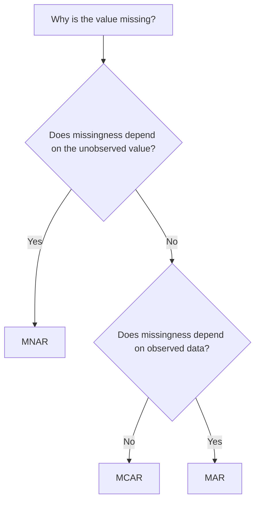
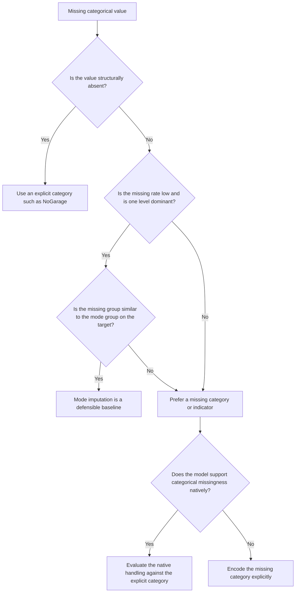
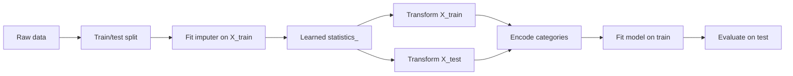

# Day 37 — Handling Missing Categorical Data

> **Course:** CampusX 100 Days of Machine Learning
> **Day:** 37
> **Official notebooks:** `frequent-value-imputation.ipynb`, `missing-category-imputation.ipynb`
> **Dataset:** `datasets/train.csv` — 1,460 rows; columns `FireplaceQu`, `GarageQual`, `SalePrice`
> **Local rerun environment:** Python 3.14.2, pandas 3.0.5, NumPy 2.5.3, scikit-learn 1.9.1
> **Status:** NOTES COMPLETE

This chapter teaches the two approaches demonstrated on Day 37:

1. **Frequent-value imputation** — replace a missing categorical value with the most frequent observed category (the mode).
2. **Missing-category imputation** — keep missingness as its own category, usually by filling with a sentinel such as `"Missing"`.

The chapter does more than describe the two notebooks. It explains why categorical missingness is different from numeric missingness, why a mean is not a valid categorical summary, what the two methods do to distributions and model bias, how to fit an imputer without leakage, and how to choose between the methods. It also documents the defects in the two reference notebooks and shows the corrected workflow without modifying the notebooks themselves.

> **Source labels used throughout**
>
> - **[Official]** — output saved inside the CampusX reference notebook.
> - **[Rerun]** — output reproduced locally from the same data and code, with the stated random state.
> - **[Supplementary]** — an explanation, experiment, or domain fact added by these notes, not present in the official notebook.

---

## How to use this chapter

Read Sections 1–5 for the conceptual foundation. Then read Sections 6–7 alongside the two notebooks. Sections 8–11 explain how to make a decision and how to avoid leakage. Sections 12–15 are implementation and debugging references. Sections 16–17 are interview and examination practice. Section 18 is the revision sheet. Section 19 maps every notebook cell to the chapter so that nothing is skipped.

Do not use the KDE plots as proof that an imputation method is correct. They are diagnostic pictures, not validation. The final test of an imputation method is whether it improves generalisation on unseen data without leaking information.

---

## Table of contents

1. The problem: missing categorical values
2. Foundations: categorical scales, codes, and cardinality
3. Missingness mechanisms and structural missingness
4. Why mean and median imputation are invalid for categories
5. Frequent-value (mode) imputation
6. Notebook 1: `frequent-value-imputation.ipynb`
7. Notebook 2: `missing-category-imputation.ipynb`
8. Choosing between mode imputation and a missing category
9. Bias, variance, and information effects
10. Categorical encoding interactions
11. Leakage, train/test discipline, and pipelines
12. Implementation reference: pandas and scikit-learn
13. Graph interpretation
14. Worked numerical examples
15. Common mistakes and debugging
16. Interview preparation: Levels 1–7
17. University-style examination questions
18. Revision sheet and mastery checklist
19. Coverage matrix for both notebooks
20. References and further reading

---

# 1. The problem: missing categorical values

## 1.1 The actual dataset

The course uses a three-column subset of the Ames Housing training data. The target is `SalePrice`; the two input columns are categorical quality ratings.

**[Official] `df.head()`**

| Row | FireplaceQu | GarageQual | SalePrice |
|---:|---|---|---:|
| 0 | NaN | TA | 208,500 |
| 1 | TA | TA | 181,500 |
| 2 | TA | TA | 223,500 |
| 3 | Gd | TA | 140,000 |
| 4 | TA | TA | 250,000 |
| 5 | NaN | TA | 143,000 |
| 6 | Gd | TA | 307,000 |
| 7 | TA | TA | 200,000 |

The data has 1,460 rows and three columns:

- `FireplaceQu`: fireplace quality.
- `GarageQual`: garage quality.
- `SalePrice`: sale price in dollars.

The observed quality labels are `Ex`, `Gd`, `TA`, `Fa`, and `Po`. In the Ames data dictionary these mean Excellent, Good, Typical/Average, Fair, and Poor.

**[Official] `df.isnull().mean() * 100`**

| Column | Missing percentage |
|---|---:|
| FireplaceQu | 47.260274 |
| GarageQual | 5.547945 |
| SalePrice | 0.000000 |

**[Rerun] missing counts and total shape**

| Column | Missing count | Missing percentage | Non-missing count |
|---|---:|---:|---:|
| FireplaceQu | 690 | 47.260274% | 770 |
| GarageQual | 81 | 5.547945% | 1,379 |
| SalePrice | 0 | 0.000000% | 1,460 |

So the two categorical columns have very different missingness profiles:

- `GarageQual` is missing for 81 of 1,460 rows: a small minority.
- `FireplaceQu` is missing for 690 of 1,460 rows: almost half the data.

That difference is the central practical fact of Day 37. A method that looks harmless when 5.5% is missing can be destructive when 47.3% is missing.

## 1.2 Why this is not a numeric imputation problem

For a numeric feature such as `Age`, the mean is a number on the same scale as the data. It may be a poor summary, but it is at least a possible value of the variable. For a categorical feature such as `GarageQual`, the values are labels:

```text
TA, Fa, Gd, Ex, Po
```

There is no arithmetic on these labels. It is not meaningful to say that the average of `TA` and `Gd` is a quality. The mean of a string column is not defined; pandas raises an error rather than inventing a number.

**[Rerun] pandas refuses to average strings**

```python
import pandas as pd

s = pd.Series(["TA", "Fa", None, "TA"])
print(s.mean())
```

Output:

```text
TypeError: Cannot perform reduction 'mean' with string dtype
```

A mode, by contrast, is an observed category: it is one of the labels that actually occurs. That is why `most_frequent` is the natural scikit-learn strategy for categorical columns. But “the mode is a valid label” does not mean “the mode is the right imputation.” Validity of the output type is not validity of the statistical decision.

## 1.3 The four questions to ask before imputing

Before choosing a method, answer these questions.

1. **Why is the value missing?** Is it unknown, or does the missingness mean “not applicable”? A missing fireplace quality may mean the house has no fireplace. A missing survey answer may mean the respondent skipped the question. These are different problems.
2. **How much is missing?** 5% and 50% are not the same problem. A small amount can sometimes be filled with limited damage; a large amount can dominate the feature.
3. **Is the missing group different?** Compare the target distribution of missing and observed rows. If the missing group has a very different `SalePrice` distribution, the missingness carries information. Filling it with the mode erases that information.
4. **What will the model do with the result?** A tree can split on a sentinel category. A linear model needs an explicit encoding. A neural network needs a numeric representation. The imputation and the encoding must be designed together.

These questions matter more than the syntax of `fillna`.

## 1.4 Structural missingness in the Ames data

**[Supplementary] Domain fact.** The Ames Housing data dictionary describes `GarageQual = NA` as “No Garage” and `FireplaceQu = NA` as “No Fireplace.” The course notebook does not state this, but it is part of the dataset documentation. In this dataset, therefore, a missing quality is often not an unknown quality; it is a structurally absent feature.

This changes the interpretation:

| Raw view | Domain view |
|---|---|
| `GarageQual` is missing | The house has no garage |
| `FireplaceQu` is missing | The house has no fireplace |
| Fill with `TA` | Pretend a no-garage house has a typical garage |
| Fill with `Gd` | Pretend a no-fireplace house has a good fireplace |
| Fill with `"Missing"` | Preserve the absence, but use a vague label |

The missing group is also much cheaper on average:

| Group | Rows | Mean SalePrice | Median SalePrice |
|---|---:|---:|---:|
| GarageQual missing | 81 | 103,317.28 | 100,000 |
| GarageQual = TA | 1,311 | 187,489.84 | 170,000 |
| FireplaceQu missing | 690 | 141,331.48 | 135,000 |
| FireplaceQu = Gd | 380 | 226,351.42 | 206,950 |

A no-garage house selling for about 103k versus a typical-garage house selling for about 187k is not a random fluctuation. It is a meaningful difference in the housing stock. Mode-imputing those 81 houses to `TA` tells the model that they have a typical garage, which is factually false. Mode-imputing the 690 no-fireplace houses to `Gd` is even more damaging because it changes almost half the rows.

The correct category label may be `"NoGarage"` or `"NoFireplace"`, not the generic `"Missing"`. The generic label is acceptable when the meaning of missingness is genuinely unknown. It is weaker when domain knowledge gives a precise meaning.

---

# 2. Foundations: categorical scales, codes, and cardinality

## 2.1 Nominal versus ordinal categories

A **nominal** categorical variable has labels with no order. A **ordinal** categorical variable has labels with a meaningful order.

`GarageQual` and `FireplaceQu` are ordinal in their observed quality levels:

```text
Po < Fa < TA < Gd < Ex
```

But the missing state is not another point on that ordinal scale. “No garage” is not a quality worse than `Po`; it is a different kind of state. This is a subtle but important distinction:

- The observed levels can be ordinally encoded if the model and the problem justify it.
- The missing state should usually be a separate nominal category or a separate indicator, not an ordinal code placed arbitrarily below `Po` or above `Ex`.

If you encode `Po=1, Fa=2, TA=3, Gd=4, Ex=5` and then encode missing as `0`, you have asserted that “no garage” is worse than “poor garage” and that the distance from missing to poor is the same as the distance from poor to fair. Neither assertion is justified by the data. A tree may happen to split near that code, but a linear model will treat the code as a real number.

## 2.2 Codes are a representation, not the data

Let the category of row $i$ be $X_i$. An encoding is a function

$$
f: \mathcal{C} \rightarrow \mathbb{R}^k
$$

where $\mathcal{C}$ is the set of categories and $k$ is the number of encoded columns.

- **Ordinal encoding** uses $k=1$: one number per category.
- **One-hot encoding** uses $k=|\mathcal{C}|$: one binary column per category.
- **Target encoding** uses $k=1$: a learned summary, usually a target mean.

The choice of $f$ changes the geometry that the model sees. A mean of encoded values depends on $f$, so “the mean category” is not a property of the data; it is a property of an arbitrary coding choice. This is the deepest reason mean imputation fails for categories.

## 2.3 Cardinality

The **cardinality** of a categorical variable is the number of distinct levels.

| Column | Observed levels | Count | Missing |
|---|---:|---:|---:|
| GarageQual | Ex, Gd, TA, Fa, Po | 5 | 81 |
| FireplaceQu | Ex, Gd, TA, Fa, Po | 5 | 690 |

Both columns have low cardinality. A missing category adds one level, so the encoded dimension becomes six rather than five. That is cheap here.

High cardinality is a different problem. If a column has thousands of levels, the mode may be a level that occurs in only a small fraction of rows, and adding a missing category may create a rare level with very few examples. Section 10 discusses high-cardinality strategies.

## 2.4 What “missing” looks like to pandas and scikit-learn

There are several distinct missing representations:

| Representation | Meaning | Typical detection |
|---|---|---|
| `np.nan` | Missing numeric or object value | `isna()` |
| `None` | Python missing object | `isna()` |
| `pd.NA` | pandas nullable missing value | `isna()` |
| `"Missing"` | A real string category, not missing | `isna()` is `False` |
| `"Unknown"` | A real string category, not missing | `isna()` is `False` |

The last two are not detected as missing by pandas or scikit-learn. Once you fill with `"Missing"`, the column has no technical missing values. That is the point of the missing-category method, but it also means that later code cannot distinguish “originally missing” from “a real category named Missing” unless you keep an indicator or a record of the transformation.

---

# 3. Missingness mechanisms and structural missingness

## 3.1 The three classical mechanisms

Let $M_i$ be the missingness indicator for row $i$:

$$
M_i =
\begin{cases}
1 & \text{if the value is missing} \\
0 & \text{if the value is observed}
\end{cases}
$$

Let $X_i$ be the full data (including the value that would have been observed) and $Y_i$ the target. The classical taxonomy is:

### MCAR — Missing Completely At Random

$$
P(M_i = 1 \mid X_i, Y_i) = P(M_i = 1)
$$

Missingness is independent of both the observed and unobserved values. A random sample of survey forms is lost. Under MCAR, complete-case analysis is unbiased for the complete-data distribution, though it wastes data.

### MAR — Missing At Random

$$
P(M_i = 1 \mid X_i, Y_i) = P(M_i = 1 \mid X_{\text{obs},i})
$$

Missingness may depend on observed variables, but not on the unobserved value after conditioning on what is observed. For example, older houses may be more likely to have a missing fireplace code, and age is observed. MAR is a conditional statement; it does not mean “random” in everyday language.

### MNAR — Missing Not At Random

$$
P(M_i = 1 \mid X_i, Y_i) \text{ depends on the unobserved value itself}
$$

For example, people with the lowest incomes may be least likely to report income. The probability of missingness depends on the very value that is missing. MNAR cannot be fully corrected without assumptions or external information.



## 3.2 Structural missingness is a fourth category

In real tabular data, many “missing” values are not missing at all in the statistical sense. They are **not applicable**:

- A house with no garage has no garage quality.
- A person with no spouse has no spouse income.
- A product with no discount has no discount percentage.

This is sometimes called **structural missingness**, **not-applicable missingness**, or **missing by design**. The value is not unknown; the question does not apply. The correct representation is usually an explicit category such as `"NoGarage"`, `"NoFireplace"`, or `"NotApplicable"`, plus domain documentation. It is not a value to be predicted from the other categories.

This matters for Day 37 because the missing rate is not necessarily a data-quality defect. A 47% missing rate in `FireplaceQu` may simply reflect that many houses have no fireplace. Imputing those houses to `Gd` is not filling a gap; it is changing the meaning of the row.

## 3.3 What can and cannot be tested

The missingness mechanism is generally **not identifiable** from the observed data alone. You can test whether missingness is associated with observed variables:

- Compare the distribution of observed features for missing versus non-missing rows.
- Compare the target distribution for missing versus non-missing rows.
- Look at missingness patterns across columns.

These checks are useful, but they cannot prove MCAR or MAR. A variable that looks unrelated to missingness may still drive it through an unobserved confounder. MNAR is especially untestable without assumptions. The practical response is:

1. Use domain knowledge to choose a plausible mechanism.
2. Prefer methods that preserve information when the mechanism is uncertain.
3. Run sensitivity analyses if the conclusion depends on the mechanism.
4. Evaluate the final model on held-out data; do not assume the imputation is correct because it looks reasonable.

## 3.4 The actual Day 37 patterns

**[Rerun] Cross-tabulation of the two missingness indicators**

| Pattern | Rows |
|---|---:|
| Both observed | 761 |
| FireplaceQu missing only | 618 |
| GarageQual missing only | 9 |
| Both missing | 72 |
| At least one missing | 699 |
| Total | 1,460 |

The two columns are strongly associated: 72 of the 81 garage-missing rows also have a missing fireplace. This is consistent with the domain interpretation that older or simpler houses may lack both features. It is not proof of MNAR, but it is a warning that the missingness is not a simple random sprinkle.

The target distributions reinforce the warning:

| Column | Missing group mean | Mode group mean | Difference |
|---|---:|---:|---:|
| GarageQual | 103,317.28 | 187,489.84 (TA) | -84,172.55 |
| FireplaceQu | 141,331.48 | 226,351.42 (Gd) | -85,019.93 |

If missingness were unrelated to price, these differences would be surprising. They suggest that “missing” is a meaningful state, not noise. Section 5 quantifies what mode imputation does to these groups.

---

# 4. Why mean and median imputation are invalid for categories

## 4.1 The direct answer

A mean is an arithmetic summary. It requires addition and division. Category labels do not support addition or division in a way that preserves meaning. If you encode labels as numbers, the mean depends on the encoding, may not correspond to an observed category, and may imply distances that do not exist. A median has the same problem for nominal categories: there is no natural order, and for an even number of observations the median may fall between two categories.

The mode is the only common single-value summary that is guaranteed to be an observed category. That is why `most_frequent` is the default categorical strategy in scikit-learn. But “the output is a valid category” is a weak guarantee; the mode can still be the wrong category for the missing rows.

## 4.2 Mean of raw strings is undefined

**[Rerun]**

```python
import pandas as pd

s = pd.Series(["TA", "Fa", None, "TA"])
print(s.mean())
```

Output:

```text
TypeError: Cannot perform reduction 'mean' with string dtype
```

pandas is not being unhelpful. There is no meaningful sum of `"TA"` and `"Fa"`. Any numeric answer would require an arbitrary encoding.

## 4.3 Mean of ordinal codes is encoding-dependent

Suppose we encode the five quality levels in two different ways:

| Category | Coding A | Coding B |
|---|---:|---:|
| Po | 1 | 0 |
| Fa | 2 | 10 |
| TA | 3 | 100 |
| Gd | 4 | 1,000 |
| Ex | 5 | 10,000 |

Take two observations, `Fa` and `Gd`.

- Under Coding A, the mean code is $(2+4)/2 = 3$, which is `TA`.
- Under Coding B, the mean code is $(10+1{,}000)/2 = 505$, which is not a category at all.

The data did not change. The “mean category” changed from `TA` to an invalid number because the coding changed. A statistic that depends on an arbitrary label assignment is not a property of the data.

Even with equal spacing, the mean of two adjacent ordinal levels can be a level that no row actually has. A fractional code such as 3.5 is not a category. Rounding it to 3 or 4 is an extra arbitrary decision.

## 4.4 Mean of one-hot columns is a proportion, not a category

One-hot encoding represents a category as a vector with a single 1:

$$
\mathbf{x}_i = (x_{i,1}, x_{i,2}, \ldots, x_{i,K}), \qquad
x_{i,k} = \mathbf{1}[X_i = c_k]
$$

where $K$ is the number of categories, $c_k$ is the $k$-th category, and $\mathbf{1}[\cdot]$ is 1 when the condition is true and 0 otherwise.

The mean of these vectors is

$$
\bar{\mathbf{x}} = \frac{1}{n}\sum_{i=1}^{n}\mathbf{x}_i
= (\hat{p}_1, \hat{p}_2, \ldots, \hat{p}_K)
$$

where $\hat{p}_k$ is the observed proportion of category $c_k$. This vector is not a one-hot vector. It says “the average row is 60% TA and 40% Gd,” not “the average row is a category.” Filling a missing row with this fractional vector would create a row that belongs to multiple categories at once. That is not a valid categorical observation.

If you take the largest proportion and assign that category, you have effectively performed mode imputation:

$$
\text{mode} = \arg\max_k \hat{p}_k
$$

So “mean imputation in one-hot space followed by argmax” collapses back to the mode. The detour through the mean does not add information.

## 4.5 Median is not a general fix

For ordinal data with an odd number of observations, the median can be an observed category. For nominal data, it is undefined because there is no order. For an even number of observations, the median is conventionally the average of the two middle values; for categories, that average is undefined or arbitrary. A median is therefore not a general categorical imputation method. It is a numeric or ordinal summary that requires a defensible ordering.

## 4.6 A numerical demonstration of the coding problem

Suppose a column has four observed values: `Fa`, `TA`, `TA`, `Gd`.

| Coding | Values | Arithmetic mean | Nearest category? |
|---|---|---:|---|
| Po=1, Fa=2, TA=3, Gd=4, Ex=5 | 2, 3, 3, 4 | 3.00 | TA |
| Po=0, Fa=10, TA=100, Gd=1000, Ex=10000 | 10, 100, 100, 1000 | 302.50 | None |
| TA=0, Fa=1, Gd=2, Ex=3, Po=4 | 1, 0, 0, 2 | 0.75 | Between TA and Fa |

The first coding happens to produce a valid category, the second does not, and the third produces a fractional value whose rounding is arbitrary. The lesson is not “choose a better coding.” The lesson is that arithmetic means are the wrong operation for unordered labels.

## 4.7 The correct conclusion

Do not say “mean imputation is always wrong.” Say:

- For genuinely numeric features, mean or median imputation is a legitimate baseline.
- For categorical features, mean imputation is undefined on the raw labels and arbitrary on encoded labels.
- The categorical analogue of a central tendency is the mode, but the mode has its own assumptions and failure modes.
- For informative or structural missingness, neither the mean nor the mode may be appropriate; an explicit missing category is often better.

---

# 5. Frequent-value (mode) imputation

## 5.1 Definition

Let $X$ be a categorical column with observed values $x_1, \ldots, x_{n_{\text{obs}}}$. The sample mode is

$$
\hat{m} = \arg\max_{c \in \mathcal{C}} \sum_{i=1}^{n_{\text{obs}}} \mathbf{1}[x_i = c]
$$

where:

- $\mathcal{C}$ is the set of observed categories.
- $\mathbf{1}[x_i=c]$ is 1 when observation $i$ equals category $c$, otherwise 0.
- The sum counts how many times each category occurs.
- The argmax selects the category with the largest count.

Frequent-value imputation replaces every missing value with $\hat{m}$:

$$
\tilde{x}_i =
\begin{cases}
x_i & \text{if } x_i \text{ is observed} \\
\hat{m} & \text{if } x_i \text{ is missing}
\end{cases}
$$

The method is also called **mode imputation** or **most-frequent-category imputation**.

## 5.2 The actual modes

**[Official] `df['GarageQual'].mode()`**

```text
0    TA
dtype: object
```

**[Official] `df['FireplaceQu'].mode()`**

```text
0    Gd
dtype: object
```

**[Rerun] Exact counts**

| GarageQual | Count | Share of all rows | Share of observed rows |
|---|---:|---:|---:|
| TA | 1,311 | 89.7945% | 95.0689% |
| Fa | 48 | 3.2877% | 3.4808% |
| Gd | 14 | 0.9589% | 1.0152% |
| Ex | 3 | 0.2055% | 0.2175% |
| Po | 3 | 0.2055% | 0.2175% |
| Missing | 81 | 5.5479% | — |
| Total | 1,460 | 100% | 100% |

The observed total is $1{,}311+48+14+3+3=1{,}379$. The mode share among observed rows is

$$
\frac{1{,}311}{1{,}379} = 0.950689 \approx 95.07\%.
$$

The mode share among all rows, counting missing as a separate state, is

$$
\frac{1{,}311}{1{,}460} = 0.897945 \approx 89.79\%.
$$

| FireplaceQu | Count | Share of all rows | Share of observed rows |
|---|---:|---:|---:|
| Gd | 380 | 26.0274% | 49.3506% |
| TA | 313 | 21.4384% | 40.6494% |
| Fa | 33 | 2.2603% | 4.2857% |
| Ex | 24 | 1.6438% | 3.1169% |
| Po | 20 | 1.3699% | 2.5974% |
| Missing | 690 | 47.2603% | — |
| Total | 1,460 | 100% | 100% |

The observed total is $380+313+33+24+20=770$. The mode share among observed rows is

$$
\frac{380}{770} = 0.493506 \approx 49.35\%.
$$

The mode share among all rows is

$$
\frac{380}{1{,}460} = 0.260274 \approx 26.03\%.
$$

These numbers tell different stories:

- **GarageQual:** the mode `TA` is overwhelming. Among observed values it is 95%, and even including missing as a state it is almost 90%. If the missing values were a random subset of the same population, filling them with `TA` would change relatively little.
- **FireplaceQu:** the mode `Gd` is only 49% of observed values and 26% of all rows. The second category `TA` is close (313 versus 380). Nearly half the column is missing. Calling `Gd` “the typical value” is much weaker here.

A useful diagnostic is the **relative mode share**:

$$
r = \frac{n_{\text{mode}}}{n_{\text{obs}}}
$$

and the **coverage of the mode after imputation**:

$$
r_{\text{after}} = \frac{n_{\text{mode}} + n_{\text{missing}}}{N}.
$$

For GarageQual:

$$
r = \frac{1{,}311}{1{,}379} = 0.9507, \qquad
r_{\text{after}} = \frac{1{,}311+81}{1{,}460} = 0.9534.
$$

For FireplaceQu:

$$
r = \frac{380}{770} = 0.4935, \qquad
r_{\text{after}} = \frac{380+690}{1{,}460} = 0.7329.
$$

Mode imputation raises the FireplaceQu mode from 49% to 73% of the column. That is a large artificial concentration. It is not “preserving the distribution”; it is reshaping it.

## 5.3 What mode imputation does to the distribution

Let $n_m$ be the count of the mode among observed rows, $n_{\text{miss}}$ the number of missing rows, and $N=n_{\text{obs}}+n_{\text{miss}}$ the total. After mode imputation, the mode count becomes $n_m+n_{\text{miss}}$, and every other category keeps its count. The new mode proportion is

$$
p_m^{\text{new}} = \frac{n_m+n_{\text{miss}}}{N}.
$$

The increase in the mode proportion is

$$
\Delta p_m = \frac{n_{\text{miss}}}{N}.
$$

For GarageQual, $\Delta p_m = 81/1{,}460 = 0.0555$, so the mode share rises by 5.55 percentage points. For FireplaceQu, $\Delta p_m = 690/1{,}460 = 0.4726$, so the mode share rises by 47.26 percentage points. The same operation has a small effect in one column and a huge effect in the other.

A second way to see the change is through **entropy**. For a categorical distribution with proportions $p_c$,

$$
H = -\sum_{c \in \mathcal{C}} p_c \log_2 p_c.
$$

Entropy is 0 when one category has probability 1, and increases as the distribution spreads over more categories. For the observed categories:

| Column | Entropy of observed distribution | Entropy after mode imputation | Entropy if missing is kept as a category |
|---|---:|---:|---:|
| GarageQual | 0.3437 bits | 0.3286 bits | 0.6339 bits |
| FireplaceQu | 1.5182 bits | 1.1107 bits | 1.7985 bits |

The comparison is descriptive, not a formal test. The important pattern is that mode imputation reduces the entropy of the observed categories, while keeping missing as a category preserves more information. For FireplaceQu, the loss is large because 690 rows are collapsed into `Gd`.

The **Gini impurity** tells a similar story:

$$
G = 1 - \sum_{c \in \mathcal{C}} p_c^2.
$$

| Column | Gini of observed distribution | Gini after mode imputation | Gini if missing is kept as a category |
|---|---:|---:|---:|
| GarageQual | 0.0949 | 0.0898 | 0.1894 |
| FireplaceQu | 0.5877 | 0.4160 | 0.6620 |

Again, the numbers are descriptive measures of concentration, not proof that one method predicts better. They show that mode imputation makes the feature more concentrated, and the effect is severe when the missing fraction is large.

## 5.4 What mode imputation does to the target relationship

Mode imputation changes the feature, not the target. The sale prices of the originally missing rows are still in the data. If the model uses only the category, those rows are now grouped with the mode category, so the observed mean sale price of the mode group becomes a mixture.

Let:

- $n_m$ = number of original mode rows,
- $n_{\text{miss}}$ = number of missing rows,
- $\mu_m$ = mean sale price of original mode rows,
- $\mu_{\text{miss}}$ = mean sale price of originally missing rows.

After mode imputation, the mode group contains both sets, so its observed mean is

$$
\tilde{\mu}_m =
\frac{n_m \mu_m + n_{\text{miss}} \mu_{\text{miss}}}{n_m+n_{\text{miss}}}.
$$

The change relative to the original mode group is

$$
\tilde{\mu}_m - \mu_m =
\frac{n_{\text{miss}}}{n_m+n_{\text{miss}}}
\left(\mu_{\text{miss}}-\mu_m\right).
$$

This formula is just a weighted-average calculation. It assumes the target values of the missing rows are retained, which they are: imputing the feature does not change `SalePrice`.

**GarageQual:**

$$
\tilde{\mu}_{TA} =
\frac{1{,}311(187{,}489.836) + 81(103{,}317.284)}
{1{,}311+81}
= 182{,}591.864.
$$

The shift is

$$
182{,}591.864 - 187{,}489.836 = -4{,}897.972,
$$

or about **-2.61%** relative to the original TA mean.

**FireplaceQu:**

$$
\tilde{\mu}_{Gd} =
\frac{380(226{,}351.416) + 690(141{,}331.483)}
{380+690}
= 171{,}525.478.
$$

The shift is

$$
171{,}525.478 - 226{,}351.416 = -54{,}825.938,
$$

or about **-24.22%** relative to the original Gd mean.

These are descriptive conditional means after imputation. They are not necessarily the model's estimated coefficients, and they do not prove causation. But they show the mechanism: mode imputation drags the mode group's target mean toward the missing group's mean. When the missing fraction is small, the drag is small. When the missing fraction is large and the missing group is different, the drag is large.

A model that sees the imputed category cannot distinguish an original `Gd` house from a no-fireplace house that was filled with `Gd`. The information that could have separated them has been destroyed.

## 5.5 Mode ties and empty columns

The mode is not always unique. If two categories have the same highest count, `Series.mode()` returns multiple values:

```python
import pandas as pd

s = pd.Series(["A", "A", "B", "B", None])
print(s.mode())
```

Output:

```text
0    A
1    B
dtype: object
```

Using `s.mode()[0]` picks one of the tied values. The choice may depend on sort order or implementation details, and it should be documented. A deterministic tie-breaking rule is better than an accidental one.

If every value is missing, there is no observed mode. `Series.mode()` returns an empty Series, and indexing `[0]` raises an error. scikit-learn's behaviour for all-missing columns depends on the strategy and version; do not assume the mode will be filled with something sensible. Detect and handle all-missing columns explicitly.

## 5.6 When mode imputation is defensible

Mode imputation is most defensible when all of the following hold:

1. **The missing rate is low.** A small missing fraction limits the damage even if the assumption is imperfect.
2. **One category dominates.** The mode is a meaningful “typical” value, not a near-tie.
3. **Missingness is plausibly unrelated to the target**, or at least the missing group is similar to the mode group. This is an assumption, not something the data can prove.
4. **The mode is semantically plausible for the missing rows.** Filling a missing garage quality with `TA` is only sensible if a missing garage quality really means an unknown quality of a typical garage. If missing means “no garage,” it is not sensible.
5. **The model and evaluation tolerate the distortion.** A simple baseline may be fine; a model that relies on the category distribution may not be.

In the Day 37 data, GarageQual satisfies (1) and (2) statistically, but may fail (4) because missing often means no garage. FireplaceQu fails (1) and (2) badly, and also fails (4) if missing means no fireplace.

## 5.7 When mode imputation is a bad idea

- The missing fraction is large, especially above roughly 10–20% in a small dataset.
- The mode is not dominant, or the top categories are close.
- Missingness is structural (“not applicable”).
- The missing group has a very different target distribution.
- The column has high cardinality, so the mode may be a rare level.
- You need to preserve the possibility that missingness itself predicts the target.
- You need uncertainty estimates; single imputation pretends the filled value is known.

The thresholds are heuristics, not laws. A 20% missing rate with a 99% dominant mode and a clearly random mechanism can be less harmful than a 5% missing rate that is entirely MNAR. The mechanism and the semantics matter more than a single percentage cutoff.

---

# 6. Notebook 1: `frequent-value-imputation.ipynb`

## 6.1 What the notebook sets out to do

The notebook demonstrates:

1. Finding the missing percentages.
2. Looking at the category distribution.
3. Finding the mode.
4. Comparing the target distribution for the mode group and the missing group with KDE plots.
5. Filling missing values with the mode using pandas.
6. Comparing the original and imputed target distributions.
7. Repeating the process for the second categorical column.
8. Splitting the data and demonstrating `SimpleImputer(strategy='most_frequent')`.
9. Inspecting `imputer.statistics_`.

The notebook is useful as a demonstration of syntax and diagnostic plotting. It is not a correct end-to-end imputation experiment, because the pandas filling happens before the train/test split and because the test set is transformed incorrectly.

## 6.2 Cell-by-cell map

| Cell | Type | What it does | Main output |
|---:|---|---|---|
| 0 | code | Imports pandas, NumPy, matplotlib | — |
| 1 | code | Loads three columns from `train.csv` | — |
| 2 | code | `df.head()` | First rows |
| 3 | code | Missing percentage per column | FireplaceQu 47.26%, GarageQual 5.55% |
| 4 | code | Bar chart of GarageQual counts | Plot |
| 5 | code | GarageQual mode | `TA` |
| 6 | code | KDE of SalePrice for TA versus missing GarageQual | Plot |
| 7 | code | Stores original TA SalePrice in `temp` | — |
| 8 | code | `df['GarageQual'].fillna('TA', inplace=True)` | — |
| 9 | code | Bar chart after filling | Plot |
| 10 | code | KDE of original TA versus imputed TA | Plot |
| 11 | code | Bar chart of FireplaceQu counts | Plot |
| 12 | code | FireplaceQu mode | `Gd` |
| 13 | code | KDE of SalePrice for Gd versus missing FireplaceQu | Plot |
| 14 | code | Stores original Gd SalePrice in `temp` | — |
| 15 | code | `df['FireplaceQu'].fillna('Gd', inplace=True)` | — |
| 16 | code | Bar chart after filling | Plot |
| 17 | code | KDE of original Gd versus imputed Gd | Plot |
| 18 | code | `train_test_split` with `test_size=0.2`, no `random_state` | — |
| 19 | code | Imports `SimpleImputer` | — |
| 20 | code | Creates `SimpleImputer(strategy='most_frequent')` | — |
| 21 | code | `fit_transform` on X_train; **`transform(X_train)` on X_test** | — |
| 22 | code | Prints `imputer.statistics_` | `['Gd', 'TA']` |
| 23 | code | Empty cell | — |

## 6.3 The exploratory part, cells 0–17

### Loading and missingness

The notebook loads only three columns:

```python
df = pd.read_csv(
    "train.csv",
    usecols=["GarageQual", "FireplaceQu", "SalePrice"]
)
```

`usecols` keeps the file's column order, not the order of the list. **[Rerun]** the resulting columns are:

```text
['FireplaceQu', 'GarageQual', 'SalePrice']
```

This is a small detail with a real consequence later: when the imputer is fitted on the two-feature DataFrame, `statistics_` follows `['FireplaceQu', 'GarageQual']`, so the output is `['Gd', 'TA']`, not `['TA', 'Gd']`.

The missing-percentage line is:

```python
df.isnull().mean() * 100
```

`isnull()` produces a Boolean DataFrame; `.mean()` averages the Booleans, giving the missing proportion; multiplying by 100 gives a percentage. This is a compact and correct diagnostic.

### GarageQual mode and target comparison

The mode is computed with:

```python
df["GarageQual"].mode()
```

The output is `TA`. The notebook then plots the KDE of `SalePrice` for `GarageQual == "TA"` and for `GarageQual.isnull()`. This is a good diagnostic idea: it compares the target distribution of the group that will receive the imputed value with the group that is missing.

The missing group's density is concentrated at lower sale prices, around 100k, while the TA group is broader and shifted to the right. The curves are not the same. This is evidence that the missing group is different, although a KDE is descriptive and not a formal test.

After `fillna("TA")`, the missing group disappears, and the TA bar grows. The KDE after imputation compares the original TA group (`temp`) with the new TA group (original TA plus the filled rows). Because only 81 rows were added to 1,311, the two curves nearly overlap. This is sometimes presented as “the imputation preserved the distribution.” That interpretation is too strong:

- The overlap is partly a consequence of the small missing fraction.
- The new curve contains the missing rows, so it must move toward them.
- Overlap does not prove that the filled values are correct; it only shows that the added group is small relative to the mode group.

### FireplaceQu mode and target comparison

The same sequence is repeated for `FireplaceQu`:

```python
df["FireplaceQu"].mode()
```

The output is `Gd`. The KDE compares `Gd` versus missing. The missing group is concentrated at lower prices, around 140k, while the Gd group is shifted right, around 226k on average.

After `fillna("Gd")`, 690 rows are added to a Gd group of 380. The new Gd distribution is a mixture of 380 original Gd rows and 690 missing rows. It is not surprising that the after-imputation curve looks very different from the original Gd curve. The notebook's plot makes this visible: the imputed curve is much more concentrated around the missing group's price range. This is the clearest demonstration in the notebook that mode imputation can fail badly when the missing fraction is large.

## 6.4 The split and the imputer, cells 18–22

### The split

```python
from sklearn.model_selection import train_test_split

X_train, X_test, y_train, y_test = train_test_split(
    df.drop(columns=["SalePrice"]),
    df["SalePrice"],
    test_size=0.2
)
```

There is no `random_state`, so the split is different on every run. For a learning notebook that is acceptable for demonstration, but it makes results irreproducible and makes small differences hard to interpret. A fixed random state is better for teaching and essential for fair comparison.

**[Rerun] With `random_state=42` and the same `test_size=0.2`:**

| Set | Rows | FireplaceQu missing | GarageQual missing |
|---|---:|---:|---:|
| Train | 1,168 | 547 | 64 |
| Test | 292 | 143 | 17 |

The imputer should learn from the 1,168 training rows and apply the learned statistics to the 292 test rows. The notebook does not do that correctly.

### The critical defect: filling before splitting

Cells 8 and 15 execute:

```python
df["GarageQual"].fillna("TA", inplace=True)
df["FireplaceQu"].fillna("Gd", inplace=True)
```

These lines run **before** cell 18 creates the train/test split. Therefore:

- The modes `TA` and `Gd` are computed from the full dataset, including the rows that later become the test set.
- The test rows are already imputed before the split, so the test set no longer contains missing values.
- The later `SimpleImputer` is fitted on data that has no missing values. It computes modes but does not fill anything.
- The notebook cannot measure how imputation would behave on genuinely unseen missing values.

This is a form of **data leakage**: information from the test set influences the preprocessing. The leakage is not as dramatic as fitting a supervised model on the test labels, but it is still a violation of the evaluation contract. The test set should be a stand-in for future data; its distribution must not influence any learned preprocessing parameter.

Even if the mode happens to be the same in the full data and the training data, the procedure is wrong. Correctness is about the procedure, not about whether this particular random split produced the same answer.

### The second defect: transforming X_train as X_test

Cell 21 contains:

```python
X_train = imputer.fit_transform(X_train)
X_test = imputer.transform(X_train)
```

The second line should be:

```python
X_test = imputer.transform(X_test)
```

The current line replaces the test set with a transformed copy of the training set. The consequences are:

1. `X_test` now has 1,168 rows, not 292.
2. `X_test` no longer corresponds to `y_test`.
3. Any downstream evaluation would either fail with a length mismatch or, worse, evaluate on training rows.
4. The actual test rows are never transformed.

The notebook stops before fitting a model, so the bug is latent rather than producing a visibly wrong score. But the code is still incorrect and should not be copied into a real pipeline.

### The `statistics_` output

**[Official] `imputer.statistics_`**

```text
array(['Gd', 'TA'], dtype=object)
```

This means:

- For the first feature in `X_train` (`FireplaceQu`), the most frequent value is `Gd`.
- For the second feature (`GarageQual`), the most frequent value is `TA`.

The order follows the columns of `X_train`, which follow the file order, not the order in the original `usecols` list. If you reorder the DataFrame columns, the statistics array reorders with them. Always align `statistics_` with `imputer.feature_names_in_` or the DataFrame columns before interpreting it.

## 6.5 What the notebook teaches and what it accidentally teaches

**Intended lessons:**

- Categorical missingness can be summarised with the mode.
- The mode is an observed category.
- `SimpleImputer(strategy="most_frequent")` stores the learned modes in `statistics_`.
- KDE plots can compare the target distribution of missing and observed groups.
- pandas `fillna` is a direct way to replace missing values.

**Accidental lessons:**

- Filling before splitting leaks test information.
- A `SimpleImputer` fitted after pandas filling is redundant.
- `transform(X_train)` is not a substitute for `transform(X_test)`.
- A KDE overlap after imputation is not proof of correctness.
- A large missing fraction can make mode imputation visibly distort the target distribution.

The corrected workflow is shown in Section 11. The next notebook introduces the alternative: keep missingness as a category.

# 7. Notebook 2: `missing-category-imputation.ipynb`

## 7.1 What the notebook sets out to do

The second notebook shows a different idea: instead of replacing missing values with an observed category, treat “missing” as a category of its own. The notebook:

1. Loads the same three columns.
2. Shows the missing percentages.
3. Plots the `GarageQual` counts.
4. Fills missing `GarageQual` values with the string `"Missing"`.
5. Plots the counts again, now with a `Missing` bar.
6. Splits the data.
7. Creates `SimpleImputer(strategy="constant", fill_value="Missing")`.
8. Fits and transforms the training data.
9. Prints `statistics_`.

The conceptual advance is real: missingness can be informative, so preserving it as a level may be better than erasing it. The implementation still contains the same pre-split filling and the same `transform(X_train)` bug as Notebook 1.

## 7.2 Cell-by-cell map

| Cell | Type | What it does | Main output |
|---:|---|---|---|
| 0 | code | Imports pandas, NumPy, matplotlib | — |
| 1 | code | Loads three columns from `train.csv` | — |
| 2 | code | `df.head()` | First rows |
| 3 | code | Missing percentage per column | FireplaceQu 47.26%, GarageQual 5.55% |
| 4 | code | Bar chart of GarageQual counts before filling | Plot |
| 5 | code | `fillna("Missing")` on GarageQual | — |
| 6 | code | Bar chart after filling, with Missing category | Plot |
| 7 | code | `train_test_split`, no `random_state` | — |
| 8 | code | Imports `SimpleImputer` | — |
| 9 | code | `SimpleImputer(strategy="constant", fill_value="Missing")` | — |
| 10 | code | `fit_transform` on X_train; **`transform(X_train)` on X_test** | — |
| 11 | code | Prints `statistics_` | `['Missing', 'Missing']` |
| 12 | code | Empty cell | — |

## 7.3 The actual counts before and after

Before filling, `GarageQual` has the following counts:

| GarageQual | Count |
|---|---:|
| TA | 1,311 |
| Missing | 81 |
| Fa | 48 |
| Gd | 14 |
| Ex | 3 |
| Po | 3 |

After `fillna("Missing")`, the counts are unchanged except that the 81 missing values now have the explicit label `Missing`:

| GarageQual | Count |
|---|---:|
| TA | 1,311 |
| Missing | 81 |
| Fa | 48 |
| Gd | 14 |
| Ex | 3 |
| Po | 3 |

The bar chart after filling looks almost identical to the bar chart before filling, except that there is now a visible `Missing` bar instead of an invisible absence. This is exactly the point: the missing-category method preserves the count and makes the absence visible to the model.

For `FireplaceQu`, the analogous counts are:

| FireplaceQu | Count |
|---|---:|
| Gd | 380 |
| TA | 313 |
| Fa | 33 |
| Ex | 24 |
| Po | 20 |
| Missing | 690 |

If the notebook had filled `FireplaceQu` with `"Missing"` before splitting, the `Missing` category would be the largest category with 690 rows. In the actual notebook, `FireplaceQu` is not filled in pandas before the split; the `SimpleImputer` with `fill_value="Missing"` is supposed to do that after the split. That is the only part of the second notebook where the imputer actually performs a fill.

## 7.4 The split and the constant imputer

The split is the same as in Notebook 1:

```python
X_train, X_test, y_train, y_test = train_test_split(
    df.drop(columns=["SalePrice"]),
    df["SalePrice"],
    test_size=0.2
)
```

Again, there is no `random_state`. With `random_state=42`, the training set has 1,168 rows and the test set 292 rows.

The imputer is:

```python
imputer = SimpleImputer(strategy="constant", fill_value="Missing")
```

`strategy="constant"` means “replace every missing value with the constant `fill_value`.” Unlike `most_frequent`, this strategy does not learn a mode from the data. The constant is supplied by the analyst. The fitted attribute `statistics_` is therefore an array of the fill value for every feature:

**[Official] `imputer.statistics_`**

```text
array(['Missing', 'Missing'], dtype=object)
```

This output is often misread. It does **not** mean:

- “There are two missing values.”
- “Both columns had missing values in the training set.”
- “The imputer found two modes.”

It means:

- “The imputer will fill missing values in each of the two features with the string `Missing`.”

At the time of fitting, `GarageQual` has no missing values because cell 5 filled them before the split. `FireplaceQu` still has missing values. The imputer's `statistics_` is the same for both columns because `constant` does not depend on the data. This is an important distinction between `statistics_` for `most_frequent` and `statistics_` for `constant`.

## 7.5 The same test-transform bug

Cell 10 contains:

```python
X_train = imputer.fit_transform(X_train)
X_test = imputer.transform(X_train)
```

The second line should be `imputer.transform(X_test)`. As in Notebook 1, the current code:

- Replaces the real test set with a transformed copy of the training set.
- Produces `X_test` with 1,168 rows instead of 292.
- Breaks the correspondence with `y_test`.
- Never applies the imputer to the actual test rows.

Because the notebook stops before model fitting, no visible score exposes the bug. But the code is not a valid evaluation pipeline.

## 7.6 What the missing-category method actually preserves

The key property is simple:

- **No observed category count changes.** A missing value is assigned to a new level; it is not moved into `TA`, `Gd`, or any other observed level.
- **The missing group remains distinguishable.** A model can learn a separate effect for `Missing` if the training data supports it.
- **The missing rate remains visible in the encoded data.** A one-hot `Missing` column has 1 for originally missing rows and 0 otherwise.
- **The target distribution of the missing group is not mixed into the mode group.**

For the Day 37 data, the missing group's mean sale price is far from the mode group's mean:

| Column | Missing group mean | Mode group mean |
|---|---:|---:|
| GarageQual | 103,317.28 | 187,489.84 (TA) |
| FireplaceQu | 141,331.48 | 226,351.42 (Gd) |

Keeping a separate `Missing` category allows a model to estimate a separate relationship for these rows. Whether that relationship generalises is a separate question, answered by validation, not by the construction alone.

## 7.7 The semantic weakness of the label “Missing”

The notebook uses the generic string `"Missing"` for both columns. A better label depends on the domain:

| Generic label | Better label when known |
|---|---|
| `"Missing"` | `"NoGarage"` for `GarageQual` |
| `"Missing"` | `"NoFireplace"` for `FireplaceQu` |
| `"Missing"` | `"Unknown"` if the value is genuinely unknown |
| `"Missing"` | `"NotApplicable"` if the question does not apply |

The label is part of the model's input. `"NoGarage"` and `"Unknown"` may have different relationships with the target. Collapsing both into `"Missing"` throws away a distinction that may matter. Conversely, if the data dictionary does not support a precise interpretation, `"Missing"` is an honest generic label.

The course notebook uses `"Missing"` because it is teaching the general pattern. In a real project, consult the data dictionary before naming the category.

## 7.8 What the notebook gets right and what it gets wrong

**Right:**

- It introduces the idea of preserving missingness as a level.
- It shows `SimpleImputer(strategy="constant", fill_value="Missing")`.
- It demonstrates that `statistics_` for a constant strategy contains the constant.
- It makes the missing count visible in the bar chart.

**Wrong or incomplete:**

- It fills `GarageQual` before the split, so the category is created using all rows.
- It does not fill `FireplaceQu` in pandas before the split, so the two columns are treated inconsistently.
- It fits the constant imputer on data where `GarageQual` has no missing values; the imputer's `statistics_` still contains the constant, which can mislead a reader into thinking both columns were missing.
- It transforms `X_train` as `X_test`.
- It does not compare the missing-category approach with the mode approach on held-out data.
- It does not use a pipeline, so the preprocessing is not reproducible as a single object.

The notebook is a demonstration of a concept, not a template for production.

---

# 8. Choosing between mode imputation and a missing category

## 8.1 The decision is not “which method is more accurate?”

There is no universally more accurate method. The right choice depends on:

- the missingness mechanism,
- the missing fraction,
- the dominance of the mode,
- the meaning of missingness,
- the model and encoding,
- the amount of data,
- and what you are trying to estimate.

A method can be better for prediction and worse for interpretation, or vice versa. A method can be unbiased under MCAR and badly biased under MNAR. The practical question is: **what assumption is defensible for this column, and what happens if the assumption is wrong?**

## 8.2 A decision table

| Situation | Reasonable first choice | Why |
|---|---|---|
| Missing means “not applicable” (no garage, no fireplace) | Explicit category (`NoGarage`, `NoFireplace`) | The absence is the information; imputing a quality would be false |
| Low missing rate, dominant mode, missingness plausibly uninformative | Mode imputation as a baseline | Small distortion; simple; preserves the observed category scale |
| High missing rate, no dominant mode | Missing category or a model that handles missingness | Mode would collapse too many rows into one level |
| Missing group has a very different target distribution | Missing category or missing indicator | The missingness itself is predictive; do not erase it |
| High-cardinality column | Careful: mode may be rare; rare missing category; consider grouping, hashing, target encoding with CV | A new level may have too few examples or too many levels |
| Model handles missing values natively | Consider leaving them, but check the model's semantics and the rest of the pipeline | Not all models handle categorical missingness natively; encoding may force a choice |
| Need uncertainty intervals for inference | Multiple imputation | Single imputation underestimates uncertainty |
| Very small dataset | Prefer simple, low-variance methods; avoid adding many levels | A missing category may have too few rows to estimate |
| Missingness is suspected MNAR and the conclusion is sensitive to it | Sensitivity analysis; domain assumptions; perhaps explicit missing category | The data alone cannot identify the MNAR correction |

These are starting points, not rules. Validate the choice on held-out data and inspect the effect on the target relationship.

## 8.3 A decision diagram



## 8.4 The two methods side by side

| Dimension | Mode imputation | Missing category |
|---|---|---|
| What is inserted | An observed category | A new category or sentinel |
| Data-derived parameter | The mode | The fill label (constant) |
| Effect on observed categories | Mode count grows; others unchanged | Observed counts unchanged |
| Effect on feature entropy | Decreases | Preserves or increases |
| Information about missingness | Erased | Preserved |
| Bias if missing group differs | Pulls mode group toward missing group | Can estimate a separate effect |
| Variance if category is small | Low apparent variance, but biased | Higher variance from a small group |
| Risk under MCAR with no missing effect | Small distribution distortion | Adds a possibly unnecessary level |
| Encoding cost | No new level | One new dummy / category |
| Semantic honesty | Often poor for structural missingness | Better if the label is meaningful |
| Leakage risk | Mode must be learned on training data | A constant label can be domain-fixed, but provenance still matters |
| Interpretability | “We assumed missing rows are typical” | “Missing is its own group” |
| Best use | Low missingness, dominant mode, uninformative missingness | Informative, structural, or high missingness |

## 8.5 Why “missing category” is not always the answer

Adding a category is not free. It can:

- Increase dimensionality, especially with one-hot encoding.
- Create a rare level with high estimation variance when the missing count is small.
- Encourage the model to fit a spurious missingness effect under MCAR.
- Make the model rely on missingness as a proxy for an unobserved variable, which may not generalise.
- Complicate deployment: new data may contain a missing pattern that was not present in training.
- Encode a group difference that is predictive but not causal; using it for decisions may be unjustified.

The method is attractive because it preserves information, but preservation is only valuable if the information is real and stable. A missing category with 12 rows in a high-cardinality column is not a reliable estimate of a group effect. A missing category that represents “no fireplace” with 690 rows is a meaningful state.

## 8.6 A practical protocol

1. **Document the missingness semantics.** Is it unknown, not applicable, or a real category?
2. **Measure the missing rate and the mode share.** Do not skip the descriptive step.
3. **Compare missing and observed groups on the target and on key features.** This is diagnostic, not proof.
4. **Choose a primary method based on the mechanism and semantics.**
5. **Choose a fallback method for sensitivity analysis.** For example, compare mode and missing category.
6. **Put the imputation inside a pipeline.** Fit only on training folds.
7. **Evaluate with a held-out metric that matches the decision.** Accuracy, RMSE, log loss, calibration, or whatever the task requires.
8. **Inspect subgroup performance.** A method that improves average RMSE but harms the missing group may be unacceptable.
9. **Document the assumption and the label.** Future maintainers need to know what `Missing` means.

---

# 9. Bias, variance, and information effects

## 9.1 Bias

In everyday ML language, **bias** is systematic error that does not disappear by adding more data of the same kind. Mode imputation can introduce bias because it assigns the same category to every missing row, regardless of what the missing value would have been.

If the missing rows are systematically different from the mode group, the imputed category is wrong for them. A model trained on the imputed data learns a relationship that mixes two populations:

- original mode rows, whose true category is the mode;
- missing rows, whose true category is something else (or “not applicable”).

The model cannot separate them because the feature now says they are the same. This is **label contamination** in the feature: the feature label no longer means what it says.

The conditional-mean calculation in Section 5.4 is a concrete example. The mode group's target mean is dragged toward the missing group. For FireplaceQu, the drag is about -54,826 dollars, which is enormous relative to the overall mean of about 180,921. For GarageQual, the drag is about -4,898 dollars, smaller but still systematic.

## 9.2 Variance

Mode imputation also changes variance:

- The feature's marginal variance decreases because a large block of values is replaced by a constant.
- Within the imputed group, the feature has zero variance by construction.
- Single imputation pretends the imputed value is known, so it ignores imputation uncertainty.
- A model may become overconfident because the feature looks cleaner than it is.

This does not mean “lower variance is always bad.” Lower variance can reduce overfitting. The problem is that the reduction is artificial: it comes from inventing certainty, not from learning a simpler truth.

The missing-category approach has the opposite profile:

- It preserves the variation between observed and missing rows.
- It adds a parameter for the new category, which increases estimation variance.
- If the category is small, its effect estimate is noisy.
- If the category is large and meaningful, the variance cost may be well worth the bias reduction.

## 9.3 The bias–variance trade-off in one table

| Method | Bias when missing group differs | Variance | Data used | Main risk |
|---|---|---|---|---|
| Complete-case deletion | High under MAR/MNAR | High due to lost rows | Only complete rows | Discards information; biased if missingness related to target |
| Mean/median (numeric) | Depends on mechanism; distorts variance | Lower apparent variance | All rows | Invalid for categories; underestimates uncertainty |
| Mode imputation | High if missing group differs; lower if similar | Lower apparent feature variance | All rows | Erases missingness; collapses group differences |
| Missing category | Lower if the category captures the difference | Higher if category is small | All rows | Sparse level; spurious effect under MCAR |
| Missing indicator + mode | Separates the missing effect from the mode value | Higher than mode alone | All rows | Indicator can be a proxy; encoding complexity |
| Multiple imputation | Lower under a correct model | Properly accounts for uncertainty | All rows | Model-dependent; more complex; not a single dataset |

## 9.4 Information

Missingness can be informative in three distinct ways:

1. **About the feature itself.** A missing `FireplaceQu` may mean “no fireplace,” which is a real state.
2. **About the target.** The missing group has a lower mean sale price. Even if the feature value is unknown, the fact of missingness predicts the target.
3. **About the data collection process.** Missingness may reveal how the data was recorded, which can matter for deployment.

Mode imputation destroys (1) and (2) at the feature level. The target values remain, but the model can no longer use missingness as a signal. The missing-category method preserves both, at the cost of an extra level.

Information is not automatically useful. A missing indicator can be a proxy for a sensitive attribute or an unobserved confounder. Predictive usefulness does not imply causal relevance or fairness. Section 16 discusses this at interview level.

## 9.5 MCAR, MAR, and MNAR effects

| Mechanism | Complete case | Mode imputation | Missing category |
|---|---|---|---|
| MCAR | Unbiased for the complete-data distribution, but wastes rows | Can distort feature distribution and conditional relationships even though missingness is random | Adds an unnecessary level; may add variance without bias |
| MAR | Biased if missingness depends on variables related to the target and those variables are not used correctly | Biased if the missing group differs conditional on observed data | Can reduce bias if the category captures the relevant pattern, but may still be biased if the mechanism is more complex |
| MNAR | Biased | Biased; often severely | May preserve a useful signal, but the category is still a proxy; causal claims are unsafe |
| Structural | Not applicable; complete cases are a selected subpopulation | Wrong by construction; it imputes a state that does not exist | Usually the correct representation |

The table is a simplification. Real data can have a mixture of mechanisms, and the same column can be MCAR for some rows and structural for others. The practical lesson is to avoid treating a single imputation method as universally valid.

## 9.6 Distribution shift

Mode imputation shifts the feature distribution toward the mode. Missing-category preserves the observed distribution and adds a new level. These are different kinds of shift:

- **Marginal shift:** the proportion of each category changes. Mode imputation increases the mode's share; missing-category changes the support by adding a level.
- **Conditional shift:** the target distribution within a category changes. Mode imputation mixes the missing group into the mode group; missing-category keeps the groups separate.
- **Joint shift:** the relationship between the feature and other features changes. Imputing a missing garage quality may create combinations that never occurred, such as a no-garage house with a typical garage quality.

A model trained on the imputed data may learn a relationship that is internally consistent with the imputed values but wrong for the real world. The KDE plots show marginal/conditional symptoms; they do not prove the joint distribution is preserved.

---

# 10. Categorical encoding interactions

## 10.1 One-hot encoding

For a categorical variable with levels $c_1,\ldots,c_K$, one-hot encoding creates

$$
x_{i,k} = \mathbf{1}[X_i = c_k].
$$

If missing is kept as a category, $K$ includes `Missing`. The encoded row for a missing observation is a 1 in the `Missing` column and 0 elsewhere. This is clean and interpretable.

If mode imputation is used, there is no `Missing` column. Every row is assigned to an observed category. The encoded matrix cannot tell which rows were originally missing.

With one-hot encoding, adding a missing category increases the number of columns by one. For these data, five observed levels become six. That is cheap. For a high-cardinality column with 5,000 levels, adding one more is also cheap in raw dimension, but the missing category may be the only level with enough rows; the other levels may be sparse. The problem is not the extra column; it is the distribution of counts.

## 10.2 The dummy-variable trap

If you one-hot encode all $K$ levels and include an intercept in a linear model, the columns are linearly dependent:

$$
\sum_{k=1}^{K} x_{i,k} = 1 \quad \text{for every row } i.
$$

The sum of the one-hot columns equals the intercept column. The design matrix is singular, so the model cannot identify all coefficients separately. The usual fix is to drop one level (`drop_first=True` in pandas) and interpret the remaining coefficients relative to the dropped reference.

This is an encoding issue, not an imputation issue, but it interacts with the missing category. If `Missing` is the dropped reference, all coefficients are relative to missing. If `TA` is the dropped reference, the `Missing` coefficient is relative to TA. The choice changes interpretation, not the fitted predictions.

For tree-based models, the dummy trap is usually not a problem because trees do not require full-rank design matrices. For linear models, it matters.

## 10.3 Ordinal encoding

An ordinal encoder assigns one number per category. If the observed levels are ordered, this can be reasonable:

```text
Po=1, Fa=2, TA=3, Gd=4, Ex=5
```

But where does `Missing` go? Options:

- `Missing=0`: asserts it is below `Po`.
- `Missing=6`: asserts it is above `Ex`.
- A separate missing indicator with the ordinal code set to something like the median: this is a hybrid, and the choice of code still matters.

If the missing state is “no garage,” it is not a quality level. Putting it on the ordinal scale is a modeling assumption that may be false. A tree can split on the code without assuming equal spacing, but the split still depends on the arbitrary ordering. A linear model assumes equal spacing and will interpret the code as a quantity.

A safer approach for ordinal categories with structural missingness is:

1. One-hot encode the ordinal levels, or
2. Use the ordinal code for observed levels plus a separate binary `Missing`/`NoGarage` indicator, with the ordinal code for missing rows set to a documented reference value, or
3. Use a model that handles categorical splits natively.

Option 2 still has the problem that the reference code for missing rows is arbitrary; the indicator carries the missingness information, but the ordinal main effect for missing rows is confounded with the reference. This is a design decision that should be tested.

## 10.4 Target encoding

Target encoding replaces a category with a summary of the target for that category, often the mean:

$$
t_c = \frac{1}{n_c}\sum_{i: X_i=c} y_i.
$$

For a missing category, $t_{\text{Missing}}$ is the mean target of the missing group. This can be useful, but it is also a leakage-prone encoding:

- If computed on the full training data and used to fit the same model, each row's target contributes to its own encoding. This can overfit, especially for rare categories.
- The correct approach uses out-of-fold estimates, smoothing, or a nested cross-validation scheme.
- The missing category's target mean may be based on a small group, so it needs smoothing.

For the Day 37 data, the missing group means are 103,317 for GarageQual and 141,331 for FireplaceQu. These are very different from the mode group means. A target encoder would capture that difference, but it would also make the missingness signal explicit and potentially unstable. Use cross-fitting and validate.

## 10.5 Frequency encoding

Frequency encoding replaces a category with its count or proportion. If mode imputation is applied first, the mode's frequency is inflated by the number of missing rows. The frequency encoding then tells the model that the mode is even more common than it really is among observed rows. This is another way the imputation decision propagates into downstream features.

Missing-category preserves the observed frequencies and gives the missing category its own frequency. That is usually more faithful to the data.

## 10.6 High-cardinality categories

High cardinality changes the imputation problem:

- The mode may be a level that occurs in only a small fraction of rows; “most frequent” does not mean “typical.”
- Adding a missing category may create a level with very few examples, or it may be the largest level if missingness is high.
- One-hot encoding can create thousands of sparse columns.
- Target encoding needs cross-fitting and smoothing.
- Hashing or embeddings may be needed for very large cardinality.
- Rare levels should often be grouped into an `Other` category before imputation, but the grouping rule must be learned on training data only.

For the Day 37 columns, cardinality is five, so none of these complications dominate. But an interview answer should mention them, because real categorical columns often have hundreds or thousands of levels.

---

# 11. Leakage, train/test discipline, and pipelines

## 11.1 The golden rule

Any preprocessing parameter that is learned from data must be learned from the training data only. Formally, if $\hat{s}$ is a learned statistic and $D_{\text{train}}$, $D_{\text{test}}$ are the splits, then

$$
\hat{s} = f(D_{\text{train}})
$$

and the same $\hat{s}$ is applied to both splits:

$$
\tilde{D}_{\text{train}} = g(D_{\text{train}}, \hat{s}), \qquad
\tilde{D}_{\text{test}} = g(D_{\text{test}}, \hat{s}).
$$

If instead $\hat{s} = f(D_{\text{train}} \cup D_{\text{test}})$, the test data has influenced the preprocessing. That is leakage.

The mode is a learned statistic. Therefore the mode must be computed on the training data only. The constant `"Missing"` is not learned from the data; it is a design choice. It can be applied before the split in principle, but keeping the whole preprocessing step inside the pipeline is simpler and less error-prone.

## 11.2 Why unsupervised leakage still matters

A common misconception is: “The mode does not use the target, so it cannot leak.” Leakage is not only about the target. The test set is supposed to simulate future data. If the preprocessing uses the test set's distribution, the evaluation no longer measures how the pipeline would behave on truly unseen data.

Examples:

- The full-data mode may differ from the training-only mode, especially with small samples or near-ties.
- The full-data missing rate may influence a decision about whether to use a missing category.
- The full-data category frequencies may influence rare-level grouping or target encoding.
- The test set's missing values may be filled before the split, so the model is evaluated on data that has already been processed with knowledge of the test distribution.

Even if the numerical difference is small for this dataset, the procedure is not valid. A correct procedure is reproducible and defensible; a leaked procedure may happen to work and still be wrong.

## 11.3 The correct sequence



The critical points:

1. Split first.
2. Fit the imputer on `X_train` only.
3. Transform `X_train` with `fit_transform` or `fit` then `transform`.
4. Transform `X_test` with `transform` only.
5. Encode after imputation, using an encoder fitted on the training data.
6. Fit the model on the transformed training data.
7. Evaluate on the transformed test data.

## 11.4 Correct code for the Day 37 columns

**[Supplementary] Corrected pattern, not the notebook code:**

```python
import pandas as pd
from sklearn.model_selection import train_test_split
from sklearn.impute import SimpleImputer
from sklearn.pipeline import Pipeline
from sklearn.preprocessing import OneHotEncoder
from sklearn.compose import ColumnTransformer

df = pd.read_csv("datasets/train.csv", usecols=[
    "GarageQual", "FireplaceQu", "SalePrice"
])

X = df.drop(columns=["SalePrice"])
y = df["SalePrice"]

X_train, X_test, y_train, y_test = train_test_split(
    X, y, test_size=0.2, random_state=42
)

categorical_columns = ["FireplaceQu", "GarageQual"]

imputer = SimpleImputer(strategy="most_frequent")

preprocess = ColumnTransformer(
    transformers=[
        ("cat_impute", imputer, categorical_columns),
    ],
    remainder="drop",
    verbose_feature_names_out=False,
)

pipeline = Pipeline(steps=[
    ("preprocess", preprocess),
    ("encode", OneHotEncoder(handle_unknown="ignore")),
])

X_train_ready = pipeline.fit_transform(X_train)
X_test_ready = pipeline.transform(X_test)

print(X_train_ready.shape)
print(X_test_ready.shape)
```

This is a sketch: `OneHotEncoder` is applied after the `ColumnTransformer`, and the column names from the imputer need to be preserved for a fully clean pipeline. A more explicit version uses a nested `Pipeline` inside the `ColumnTransformer`:

```python
from sklearn.pipeline import Pipeline
from sklearn.impute import SimpleImputer
from sklearn.preprocessing import OneHotEncoder
from sklearn.compose import ColumnTransformer

cat_pipeline = Pipeline(steps=[
    ("imputer", SimpleImputer(strategy="most_frequent")),
    ("onehot", OneHotEncoder(handle_unknown="ignore")),
])

preprocess = ColumnTransformer(
    transformers=[("cat", cat_pipeline, categorical_columns)],
    remainder="drop",
)
```

Then `preprocess.fit_transform(X_train)` and `preprocess.transform(X_test)` are the only two calls needed. The imputer and encoder are fitted on the training data inside the pipeline, and the test data is transformed with the learned objects.

## 11.5 Pandas versus scikit-learn

| Aspect | pandas `fillna` | scikit-learn `SimpleImputer` |
|---|---|---|
| State | Immediate; no fitted object | Stateful; stores `statistics_` |
| Train/test discipline | Manual; easy to leak | Built into `fit`/`transform` |
| Works in a pipeline | No, unless wrapped | Yes |
| Handles multiple columns | Yes, per column | Yes, per selected column |
| Returns | DataFrame/Series | NumPy array by default |
| Column names | Preserved | Lost unless wrapped |
| Missing indicators | Manual | `add_indicator=True` |
| Constant fill | `fillna("Missing")` | `strategy="constant", fill_value="Missing"` |
| Mode fill | `fillna(df[col].mode()[0])` | `strategy="most_frequent"` |
| Risk | Leakage, inconsistent application | Column order, dtype, array output |

Use pandas for exploration and for deterministic domain rules. Use scikit-learn for learned preprocessing that must be fitted on training data and applied consistently to test data.

## 11.6 Cross-validation

If you tune a model with cross-validation, the imputer must be inside the cross-validation pipeline. Otherwise, the imputer is fitted on the full training set before the folds are created, and each validation fold influences the imputation parameters. This is a subtle form of leakage that can make cross-validation optimistic.

Correct pattern:

```python
from sklearn.model_selection import cross_val_score
from sklearn.pipeline import Pipeline
from sklearn.impute import SimpleImputer
from sklearn.preprocessing import OneHotEncoder
from sklearn.compose import ColumnTransformer
from sklearn.linear_model import Ridge

preprocess = ColumnTransformer(
    transformers=[
        ("cat", Pipeline([
            ("imputer", SimpleImputer(strategy="most_frequent")),
            ("onehot", OneHotEncoder(handle_unknown="ignore")),
        ]), categorical_columns),
    ]
)

model = Pipeline(steps=[
    ("preprocess", preprocess),
    ("regressor", Ridge()),
])

scores = cross_val_score(model, X_train, y_train, cv=5, scoring="neg_root_mean_squared_error")
print(scores)
```

`cross_val_score` clones the pipeline for each fold and fits the imputer on the fold's training portion only. That is the correct behavior.

## 11.7 A subtle point about constant filling

A constant fill such as `"NoGarage"` is a domain rule, not a learned statistic. It is not leakage to apply it before the split if the rule is fixed independently of the data. However:

- The decision to use the rule may have been informed by looking at the full data, which is a milder form of analyst leakage.
- If the rule is applied before the split, the test set no longer contains missing values, so you cannot evaluate a pipeline that includes the imputer.
- Keeping the rule inside the pipeline makes the workflow uniform and testable.

The safest habit is to treat all preprocessing as part of the pipeline, even when a step is deterministic.

---

# 12. Implementation reference: pandas and scikit-learn

## 12.1 Pandas essentials

### Missing counts and percentages

```python
df.isnull().sum()
df.isnull().mean() * 100
```

`isnull()` returns a Boolean DataFrame. `sum()` counts `True` values per column; `mean()` gives the proportion missing.

### Value counts including missing

```python
df["GarageQual"].value_counts(dropna=False)
```

`dropna=False` keeps `NaN` in the count. Without it, pandas omits missing values, which can hide the size of the missing group.

### Mode

```python
mode_values = df["GarageQual"].mode()
mode = mode_values.iloc[0]
```

`mode()` returns a Series because there can be ties. `iloc[0]` chooses the first. If the column is all missing, the result is empty; handle that case.

### Fill

```python
df["GarageQual"] = df["GarageQual"].fillna(mode)
df["GarageQual"] = df["GarageQual"].fillna("Missing")
```

Prefer assignment over `inplace=True`. Assignment is easier to reason about, works with chained operations, and avoids surprising behavior with views.

### Group comparison

```python
df.groupby("GarageQual", dropna=False)["SalePrice"].agg(
    ["count", "mean", "median", "std"]
)
```

`dropna=False` includes the missing group, which is essential for diagnosing informative missingness.

## 12.2 scikit-learn `SimpleImputer`

### Most frequent

```python
from sklearn.impute import SimpleImputer

imputer = SimpleImputer(strategy="most_frequent")
X_train_imputed = imputer.fit_transform(X_train)
X_test_imputed = imputer.transform(X_test)
print(imputer.statistics_)
```

For the Day 37 training columns `["FireplaceQu", "GarageQual"]`, the statistics are `["Gd", "TA"]`.

### Constant

```python
imputer = SimpleImputer(strategy="constant", fill_value="Missing")
X_train_imputed = imputer.fit_transform(X_train)
X_test_imputed = imputer.transform(X_test)
print(imputer.statistics_)
```

The statistics are `["Missing", "Missing"]` for the two features, regardless of whether each feature had missing values at fit time. The constant is stored per feature.

### Important parameters

| Parameter | Meaning | Day 37 relevance |
|---|---|---|
| `strategy` | `mean`, `median`, `most_frequent`, `constant` | Use `most_frequent` or `constant` for categories |
| `fill_value` | Value for `constant` | Set explicitly, e.g. `"Missing"` or `"NoGarage"` |
| `missing_values` | What counts as missing | Default `np.nan`; can be `None` or `pd.NA` |
| `add_indicator` | Add binary missingness indicators | Useful when missingness itself may predict |
| `keep_empty_features` | Keep features that are all missing | Behaviour depends on strategy; handle explicitly |
| `copy` | Copy input or modify in place | Default `True`; keep it for safety |

### Important attributes

| Attribute | Meaning |
|---|---|
| `statistics_` | Learned fill value per feature |
| `indicator_` | Fitted `MissingIndicator` when `add_indicator=True` |
| `feature_names_in_` | Input feature names when fitted on a DataFrame |
| `n_features_in_` | Number of input features |

`statistics_` is not a missing count, a missing percentage, or a measure of imputation quality. It is the value that will replace missing entries.

### Output type and column names

`SimpleImputer.transform` returns a NumPy array by default. The DataFrame column names are lost. If you need a DataFrame, wrap the output:

```python
import pandas as pd

X_train_imputed = pd.DataFrame(
    imputer.fit_transform(X_train),
    columns=imputer.feature_names_in_,
    index=X_train.index,
)
```

This preserves row indices and column names. The order of `feature_names_in_` matches the order of `statistics_`.

### Missing indicators

```python
imputer = SimpleImputer(
    strategy="most_frequent",
    add_indicator=True,
)
X_train_imputed = imputer.fit_transform(X_train)
```

This appends binary columns indicating which features were missing. It is a bridge to Day 38's missing-indicator topic. The indicator can preserve the missingness signal even if the value is imputed. It also increases dimensionality and can encode a proxy for an unobserved variable.

### All-missing columns

If a column is entirely missing, there is no mode to learn. Do not assume `most_frequent` will produce a meaningful category. Detect the column, decide whether to drop it, and document the choice. In scikit-learn 1.9.1, an all-missing object column can remain unfilled when `most_frequent` is used; behaviour has changed across versions. Explicit handling is safer than relying on a version-specific default.

## 12.3 `ColumnTransformer` and `Pipeline`

A full categorical preprocessing pipeline:

```python
from sklearn.compose import ColumnTransformer
from sklearn.pipeline import Pipeline
from sklearn.impute import SimpleImputer
from sklearn.preprocessing import OneHotEncoder

categorical_columns = ["FireplaceQu", "GarageQual"]

cat_pipeline = Pipeline(steps=[
    ("imputer", SimpleImputer(strategy="constant", fill_value="Missing")),
    ("onehot", OneHotEncoder(handle_unknown="ignore")),
])

preprocess = ColumnTransformer(
    transformers=[("cat", cat_pipeline, categorical_columns)],
    remainder="drop",
)

X_train_ready = preprocess.fit_transform(X_train)
X_test_ready = preprocess.transform(X_test)
```

Why the components are nested this way:

- `SimpleImputer` fills missing categories.
- `OneHotEncoder` converts categories to numeric columns.
- `Pipeline` ensures the imputer and encoder are fitted in the right order on the training data.
- `ColumnTransformer` selects the categorical columns and leaves the rest alone or drops them.
- `handle_unknown="ignore"` prevents an error if the test set contains a category not seen in training.
- `fit_transform` on train, `transform` on test is the correct split discipline.

For a mixed dataset, add a numeric pipeline with `SimpleImputer(strategy="median")` and a scaler, then combine both in the `ColumnTransformer`.

## 12.4 Common exceptions and what they mean

| Exception or symptom | Likely cause | Fix |
|---|---|---|
| `TypeError: Cannot perform reduction 'mean' with string dtype` | Calling numeric mean on strings | Use mode or encode first |
| `ValueError: could not convert string to float` | Passing strings to a numeric model or scaler | Encode categoricals |
| `ValueError: Found array with 0 feature(s)` | All columns dropped or wrong selection | Check `ColumnTransformer` column names |
| `ValueError: Input contains NaN` | Model does not accept missing values | Impute before the model |
| `ValueError: shapes ... not aligned` | `X_test` has wrong rows (e.g. transform of X_train) | Transform `X_test` |
| `KeyError` on a column | Column name mismatch or case difference | Check exact names |
| `AttributeError: 'SimpleImputer' object has no attribute 'statistics_'` | Accessed before `fit` | Fit first |
| Unexpected array shape | Imputer/encoder returns NumPy, not DataFrame | Wrap or check `.shape` |

---

# 13. Graph interpretation

## 13.1 What the plots are

The frequent-value notebook contains four KDE plots and four bar charts. The missing-category notebook contains two bar charts.

| Figure | Notebook | What it shows | What it can tell you |
|---|---|---|---|
| GarageQual count bar | Notebook 1, cell 4 | Counts of observed GarageQual levels | TA dominates; missing is not shown unless `dropna=False` |
| GarageQual TA vs missing KDE | Notebook 1, cell 6 | SalePrice density for TA and missing rows | The missing group is concentrated at lower prices |
| GarageQual after fill bar | Notebook 1, cell 9 | Counts after `fillna("TA")` | TA bar grows; missing disappears |
| GarageQual original vs imputed KDE | Notebook 1, cell 10 | SalePrice density for original TA and new TA group | Curves nearly overlap because only 81 rows were added |
| FireplaceQu count bar | Notebook 1, cell 11 | Counts of observed FireplaceQu levels | Gd and TA are the largest; missing is hidden |
| FireplaceQu Gd vs missing KDE | Notebook 1, cell 13 | SalePrice density for Gd and missing rows | Missing group is much lower |
| FireplaceQu after fill bar | Notebook 1, cell 16 | Counts after `fillna("Gd")` | Gd bar grows dramatically |
| FireplaceQu original vs imputed KDE | Notebook 1, cell 17 | SalePrice density for original Gd and new Gd group | Imputed curve shifts toward the missing group |
| GarageQual bar before Missing | Notebook 2, cell 4 | Counts with missing omitted | TA dominates |
| GarageQual bar after Missing | Notebook 2, cell 6 | Counts with `Missing` level | The missing count becomes visible as its own bar |

## 13.2 How to read a KDE plot

A kernel density estimate approximates the probability density of a continuous variable. For a KDE of `SalePrice`:

- The **x-axis** is sale price.
- The **y-axis** is estimated density, not probability. The area under the curve over an interval approximates the probability of that interval.
- The **height** at a point is not the probability of that exact value; for a continuous variable, the probability of an exact value is zero.
- The **smoothing bandwidth** affects the shape. A narrow bandwidth shows noise; a wide bandwidth hides structure.
- **Overlap** means the two distributions have similar values in that region. It does not mean the groups are statistically identical.
- **Sample size** matters. A KDE based on 3 observations (such as `GarageQual = Ex`) is unstable. A KDE based on 690 observations is smoother.
- **Axis scaling** matters. The notebook plots use scientific notation on the y-axis in some figures; compare shapes, not raw heights, unless the scales are identical.

## 13.3 The GarageQual plots

The TA group is large (1,311 rows) and spans a wide range of sale prices. The missing group is small (81 rows) and concentrated around lower prices, with a mean of about 103k versus 187k for TA. The KDE shows the difference in location and spread.

After `fillna("TA")`, the new TA group has 1,392 rows. Because the 81 added rows are only about 5.8% of the new group, the new density is close to the original TA density. The overlap is expected. It does **not** prove that the missing rows are truly TA; it only shows that the numerical effect on the marginal density is small.

The bar chart after filling hides the missingness entirely. A reader who sees only the after chart cannot tell that 81 values were imputed. This is a visualization risk: always keep the before chart or a missingness indicator.

## 13.4 The FireplaceQu plots

The Gd group has 380 rows; the missing group has 690. The missing group is concentrated at lower prices, with a mean of about 141k versus 226k for Gd. The KDE shows a clear separation.

After `fillna("Gd")`, the new Gd group has 1,070 rows, of which 690 are originally missing. The new density is a weighted mixture:

$$
f_{\text{new}}(s) = \frac{380}{1{,}070} f_{\text{Gd}}(s)
+ \frac{690}{1{,}070} f_{\text{missing}}(s).
$$

The missing component dominates the mixture (64.5% of the new group), so the new curve shifts strongly toward the missing group's distribution. The plot is a direct visual demonstration that mode imputation can change the meaning of a category when the missing fraction is large.

## 13.5 The missing-category bar charts

Before filling, `value_counts()` omits `NaN`. The bar chart shows only the observed levels, so the missing 81 rows are invisible. After `fillna("Missing")`, the bar chart shows a `Missing` bar with 81 rows. The observed bars are unchanged.

This is a simple but important visual: the missing-category method does not move rows between observed categories. It gives the missing rows their own visible place.

The notebook does not plot the target distribution by the new `Missing` category. **[Supplementary]** If it did, the missing group's lower mean sale price would be visible, which would help justify why keeping the category may be useful.

## 13.6 What the plots cannot tell you

- They cannot prove MCAR, MAR, or MNAR.
- They cannot prove that mode imputation is correct because two curves overlap.
- They cannot prove that a missing category will improve predictive performance.
- They cannot tell you whether the missing group's difference is causal.
- They cannot replace a held-out evaluation.
- They cannot reveal the joint distribution of the two categorical columns and the target unless you plot or model that joint structure.

Use the plots to form hypotheses. Use validation to test them.

---

# 14. Worked numerical examples

## 14.1 Example A — Missing percentages

The dataset has $N=1{,}460$ rows.

For `FireplaceQu`, 690 values are missing:

$$
\hat{p}_{\text{Fireplace}} = \frac{690}{1{,}460} = 0.47260274 \approx 47.26\%.
$$

For `GarageQual`, 81 values are missing:

$$
\hat{p}_{\text{Garage}} = \frac{81}{1{,}460} = 0.05547945 \approx 5.55\%.
$$

The ratio of the missing counts is

$$
\frac{690}{81} \approx 8.52.
$$

FireplaceQu has about 8.5 times as many missing values as GarageQual, on the same 1,460 rows. Any method decision should treat these columns differently.

## 14.2 Example B — Mode shares

For GarageQual, the observed count is

$$
n_{\text{obs}} = 1{,}460 - 81 = 1{,}379.
$$

The mode is `TA` with $n_m=1{,}311$. The mode share among observed rows is

$$
\frac{1{,}311}{1{,}379} = 0.950689 \approx 95.07\%.
$$

The mode share among all rows is

$$
\frac{1{,}311}{1{,}460} = 0.897945 \approx 89.79\%.
$$

For FireplaceQu, the observed count is

$$
n_{\text{obs}} = 1{,}460 - 690 = 770.
$$

The mode is `Gd` with $n_m=380$. The mode share among observed rows is

$$
\frac{380}{770} = 0.493506 \approx 49.35\%.
$$

The mode share among all rows is

$$
\frac{380}{1{,}460} = 0.260274 \approx 26.03\%.
$$

Interpretation: GarageQual has a clear dominant category. FireplaceQu does not. The top two FireplaceQu categories are close: 380 Gd versus 313 TA. A tie or near-tie makes the mode a fragile summary.

## 14.3 Example C — The distribution after mode imputation

For GarageQual, after filling 81 missing rows with `TA`:

$$
n_{\text{TA}}^{\text{new}} = 1{,}311 + 81 = 1{,}392,
$$

$$
p_{\text{TA}}^{\text{new}} = \frac{1{,}392}{1{,}460} = 0.953425 \approx 95.34\%.
$$

The mode share increased by 5.55 percentage points, exactly the missing fraction.

For FireplaceQu, after filling 690 missing rows with `Gd`:

$$
n_{\text{Gd}}^{\text{new}} = 380 + 690 = 1{,}070,
$$

$$
p_{\text{Gd}}^{\text{new}} = \frac{1{,}070}{1{,}460} = 0.732877 \approx 73.29\%.
$$

The mode share increased by 47.26 percentage points, from 26.03% of all rows to 73.29%. This is not a small correction. It changes which category dominates the column.

## 14.4 Example D — The conditional target mean after mode imputation

For GarageQual:

$$
\tilde{\mu}_{TA} =
\frac{1{,}311(187{,}489.836) + 81(103{,}317.284)}
{1{,}311+81}
= 182{,}591.864.
$$

The original TA mean was 187,489.836. The shift is

$$
182{,}591.864 - 187{,}489.836 = -4{,}897.972.
$$

The percentage shift is

$$
\frac{-4{,}897.972}{187{,}489.836} \times 100 \approx -2.61\%.
$$

For FireplaceQu:

$$
\tilde{\mu}_{Gd} =
\frac{380(226{,}351.416) + 690(141{,}331.483)}
{380+690}
= 171{,}525.478.
$$

The shift is

$$
171{,}525.478 - 226{,}351.416 = -54{,}825.938,
$$

which is

$$
\frac{-54{,}825.938}{226{,}351.416} \times 100 \approx -24.22\%.
$$

Interpretation: the GarageQual distortion is modest in relative terms because the missing fraction is small. The FireplaceQu distortion is large because the missing group is large and its mean price is far from the mode group's mean.

## 14.5 Example E — Entropy and Gini impurity

For a categorical distribution with proportions $p_c$:

$$
H = -\sum_c p_c \log_2 p_c,
\qquad
G = 1 - \sum_c p_c^2.
$$

For GarageQual, using the observed proportions (excluding missing):

- TA: $1311/1379=0.9507$
- Fa: $48/1379=0.0348$
- Gd: $14/1379=0.0102$
- Ex: $3/1379=0.0022$
- Po: $3/1379=0.0022$

The entropy is about 0.3437 bits; the Gini impurity is about 0.0949. After assigning 81 missing rows to TA, the entropy is about 0.3286 bits and the Gini is about 0.0898. The distribution becomes slightly more concentrated.

For FireplaceQu, using the observed proportions:

- Gd: $380/770=0.4935$
- TA: $313/770=0.4065$
- Fa: $33/770=0.0429$
- Ex: $24/770=0.0312$
- Po: $20/770=0.0260$

The entropy is about 1.5182 bits; the Gini is about 0.5877. After assigning 690 missing rows to Gd, the entropy is about 1.1107 bits and the Gini is about 0.4160. The distribution becomes much more concentrated.

If missing is kept as a category, the distribution has one more level and the entropy is higher: about 0.6339 bits for GarageQual and 1.7985 bits for FireplaceQu. This is a descriptive measure of preserved information, not a guarantee of better prediction.

## 14.6 Example F — Split sizes and missing counts

With `test_size=0.2` and `random_state=42`:

$$
n_{\text{train}} = 0.8 \times 1{,}460 = 1{,}168,
\qquad
n_{\text{test}} = 0.2 \times 1{,}460 = 292.
$$

The missing counts in the split are:

| Set | FireplaceQu missing | GarageQual missing |
|---|---:|---:|
| Train | 547 | 64 |
| Test | 143 | 17 |
| Total | 690 | 81 |

The training missing rate for FireplaceQu is

$$
\frac{547}{1{,}168} \approx 46.83\%,
$$

and for GarageQual is

$$
\frac{64}{1{,}168} \approx 5.48\%.
$$

These are close to the full-data rates, which is expected for a random split. The point of splitting first is not that the rates differ; it is that the imputation parameters must be estimated from the training rows only.

## 14.7 Example G — Why a mean category code is arbitrary

Suppose `Fa=2`, `TA=3`, `Gd=4`. Two rows have `Fa` and `Gd`:

$$
\frac{2+4}{2} = 3,
$$

which happens to be `TA`. Now recode `Fa=0`, `TA=100`, `Gd=1000`:

$$
\frac{0+1000}{2} = 500,
$$

which is not a category. The arithmetic mean changed from a valid category to an invalid number without any change in the data. Therefore the “mean category” is not a data property.

If you round 500 to the nearest code, you get `Gd` under this coding; under the first coding you got `TA`. The imputed category depends on the coding scheme, not on the observations. This is the formal reason mean imputation is not identified for categorical data.

## 14.8 Example H — One-hot dimension with a missing category

For a column with 5 observed levels and a missing category:

$$
K_{\text{encoded}} = 5 + 1 = 6.
$$

A one-hot encoder with `drop=None` produces 6 columns; with `drop="first"` it produces 5 columns plus the intercept. The missing category can be the dropped reference or an explicit column. Either way, the model can distinguish missing rows from observed rows, unlike mode imputation.

If the column had 1,000 observed levels, the encoded dimension would be 1,001 without dropping. The missing category itself is only one column; the real cost is the 1,000 sparse observed levels.

## 14.9 Example I — A high-cardinality hypothetical

Suppose a `Neighborhood` column has 500 levels and 2% missing. The most frequent neighborhood appears in 8% of observed rows. Mode imputation would assign all missing rows to a level that is not typical; it is merely the largest of 500. The mode share is low, so the “most frequent” label is misleading. A missing category may be better, but it adds a 501st level with 2% of the rows. If the dataset is small, that level may have too few examples for a stable estimate. Grouping rare neighborhoods, using target encoding with cross-fitting, or using a model with categorical embeddings may be more appropriate. The Day 37 columns do not have this problem, but the reasoning generalizes.

---

# 15. Common mistakes and debugging

## 15.1 The mistakes

| # | Mistake | Symptom | Why it is wrong | Fix |
|---:|---|---|---|---|
| 1 | Filling before the train/test split | The imputer has nothing to fill; test rows already clean | Test distribution influences preprocessing | Split first; fit on train |
| 2 | Computing the mode on the full data | Mode may differ from training-only mode; evaluation optimistic | Leakage of test information | Compute mode on training data only |
| 3 | `X_test = imputer.transform(X_train)` | `X_test` has the wrong number of rows | The test set is replaced by training data | `transform(X_test)` |
| 4 | Fitting the imputer on the test set | Test statistics influence the model | Leakage | Fit on train, transform test |
| 5 | Reading `statistics_` as a missing count | Confusion about what was filled | `statistics_` stores fill values, not counts | Inspect `isnull()` before/after |
| 6 | Using `strategy="most_frequent"` with `fill_value` | Parameter ignored or error | `fill_value` is for `constant` | Use `constant` for a sentinel |
| 7 | Using `strategy="mean"` on strings | `ValueError` or wrong encoding | Mean is undefined for categories | Use `most_frequent` or encode |
| 8 | Ignoring mode ties | Arbitrary category chosen | `mode()` can return multiple values | Define a deterministic tie rule |
| 9 | Assuming all-missing columns get a mode | Empty mode or unchanged NaN | There is no observed mode | Detect and drop/handle explicitly |
| 10 | Treating `"Missing"` as NaN | `isnull()` is False after filling | It is a real string category | Keep a separate indicator if needed |
| 11 | Mismatching `statistics_` order | Wrong category assigned to wrong column | Order follows input columns | Align with `feature_names_in_` |
| 12 | Losing column names after `transform` | Later code cannot select columns | `SimpleImputer` returns an array | Wrap in a DataFrame |
| 13 | Using `inplace=True` inside a pipeline | Unexpected mutation or no effect | Pipelines expect returned objects | Prefer assignment / pipeline steps |
| 14 | Judging imputation by KDE overlap | False confidence | Overlap is descriptive, not validation | Evaluate on held-out data |
| 15 | Calling the missing category `"Missing"` when it means `"NoGarage"` | Loss of semantic information | Different absences may have different effects | Use domain-specific labels |
| 16 | Encoding missing as an ordinal code | Imposes a false order | Missing is not a quality level | Use one-hot or a separate indicator |
| 17 | Adding a missing category with very few rows | Unstable coefficient; overfitting | Sparse level | Group, smooth, or use a simpler method |
| 18 | Target-encoding the missing category without cross-fitting | Leakage and overfitting | Row's target influences its encoding | Use out-of-fold encoding |
| 19 | No `random_state` in the split | Results change every run | Irreproducible | Set a random state for teaching/comparison |
| 20 | Imputing outside cross-validation | Fold leakage | Validation folds influence preprocessing | Put imputer inside the CV pipeline |

## 15.2 A debugging checklist

When a categorical imputation pipeline gives a suspicious result:

1. Print the shape of `X_train` and `X_test` before and after every transformation.
2. Print `isnull().sum()` before and after the imputer.
3. Print `imputer.statistics_` and `imputer.feature_names_in_` together.
4. Confirm that the test set was transformed with `transform`, not `fit_transform`.
5. Confirm that the imputer was fitted after the split, not before.
6. Check whether the missing rate changed between train and test.
7. Check whether the mode is stable across folds; if not, the imputation is sensitive.
8. Check whether the missing category has enough rows in every training fold.
9. Check the model's input dtype: strings, objects, or encoded numbers.
10. Check for `"Missing"` strings being treated as real categories by later steps.
11. Check for new categories in the test set; use `handle_unknown="ignore"` or a fallback.
12. Compare the imputed distribution with the original using counts, not only KDE.
13. Evaluate the full pipeline on held-out data; do not evaluate the imputer in isolation.
14. Inspect subgroup errors for the originally missing rows.
15. Document the imputation assumption and the label semantics.

---

# 16. Interview preparation: Levels 1–7

The answers below are intentionally explanatory. In an interview, give the direct answer first, then the reasoning, then a caveat or example.

## Level 1 — Fundamentals

### Q1. What is missing categorical data?

Missing categorical data is a categorical feature whose value is absent for some rows. The absent value may be unknown, not applicable, or a real state that was not recorded. The key point is that the categories are labels, not numbers, so the imputation method must respect the label structure. A missing garage quality, for example, may mean “no garage” rather than “unknown quality.”

**Follow-up:** Why is that distinction important? Because imputing “no garage” to a typical garage changes the meaning of the row, while treating it as a separate category preserves the absence.

### Q2. Why can we not use the mean for a categorical column?

A mean requires addition and division, which are not defined for labels. If you encode labels as numbers, the mean depends on the encoding, may not correspond to any category, and may imply distances that do not exist. For strings, pandas raises a `TypeError`. For one-hot columns, the mean is a vector of proportions, not a category.

**Follow-up:** What about the median? A median is also undefined for nominal categories and requires an arbitrary ordering for ordinal categories. It is not a general solution.

### Q3. What is mode imputation?

Mode imputation replaces missing values with the most frequent observed category. It is also called frequent-value imputation. The mode is guaranteed to be an observed category, which is why it is the natural categorical analogue of a central value. It is computed from the training data and stored in `SimpleImputer.statistics_` when `strategy="most_frequent"`.

**Follow-up:** When does it fail? It fails when the missing fraction is large, the mode is not dominant, missingness is structural, or the missing group differs from the mode group.

### Q4. What is the missing-category approach?

The missing-category approach treats missingness as its own level. Missing values are replaced with a sentinel such as `"Missing"`, `"NoGarage"`, or `"Unknown"`, and the model learns a separate effect for that level. It preserves the observed category counts and the information that a value was missing.

**Follow-up:** What is the cost? It adds a level, which increases dimensionality and may create a sparse category with high estimation variance.

### Q5. When is mode imputation appropriate?

It is most defensible when the missing rate is low, one category clearly dominates, the missing group is plausibly similar to the mode group on the target, and the mode is semantically plausible for the missing rows. Even then it is a baseline, not a guarantee. In the Day 37 data, GarageQual is a better candidate than FireplaceQu statistically, but the “no garage” semantics may still make a missing category more honest.

**Follow-up:** Would you use a fixed threshold? No. A 20% missing rate with a 99% dominant mode may be safer than a 5% missing rate that is entirely informative. The mechanism and semantics matter more than the percentage alone.

## Level 2 — Mechanics

### Q6. How does `SimpleImputer(strategy="most_frequent")` work?

During `fit`, it validates the input, computes the most frequent observed value for each feature, and stores it in `statistics_`. During `transform`, it replaces missing entries with the corresponding statistic. It ignores missing values when computing the mode. If a feature is entirely missing, there is no mode; handle that case explicitly.

**Follow-up:** Does it use the target? No. It is unsupervised preprocessing.

### Q7. What exactly is `statistics_`?

`statistics_` is the fitted array of fill values, one per input feature. For `most_frequent`, it contains the modes. For `constant`, it contains the `fill_value`. For `mean` or `median`, it contains the numeric summary. It is not a count of missing values, and it does not tell you how many values were filled.

**Follow-up:** Why does a constant imputer report `["Missing", "Missing"]` even when one column has no missing values? Because the statistic is the constant to use if a value is missing, not a data-dependent estimate.

### Q8. What is the difference between `fit_transform` and `transform`?

`fit_transform` learns the parameters and applies the transformation in one call. `transform` applies already-learned parameters without changing them. On training data, use `fit_transform` (or `fit` then `transform`). On test data, use `transform` only. Fitting on test data leaks information.

**Follow-up:** Can `fit_transform` and `fit` followed by `transform` give different results? They should be equivalent for a deterministic transformer; use the form that makes the data flow clearest.

### Q9. Why does `SimpleImputer` return a NumPy array?

The transformer is designed to work with array-like data and to be composable in pipelines. Returning an array avoids ambiguity about pandas indexing and dtype. The cost is that column names are lost, so wrap the output in a DataFrame if later code needs names.

**Follow-up:** How do you recover the names? Use `imputer.feature_names_in_` when the imputer was fitted on a DataFrame, or use a `ColumnTransformer` with named columns.

### Q10. How do you impute several categorical columns with different strategies?

Use a `ColumnTransformer` with separate pipelines for each group. For example, one categorical pipeline with `most_frequent` and one with `constant="Missing"`, or separate numeric and categorical pipelines. The transformer selects columns by name and applies the right imputer to each subset. This avoids passing numeric columns to a categorical strategy and makes the preprocessing explicit.

**Follow-up:** What if a column is both numeric and categorical in meaning? Decide on a representation first; do not let the imputer guess.

## Level 3 — scikit-learn practice

### Q11. Pandas `fillna` versus `SimpleImputer`: when do you use each?

Use pandas for exploration, quick checks, and deterministic domain rules. Use `SimpleImputer` when the fill value is learned and must be fitted on training data, especially inside a pipeline. `SimpleImputer` stores the learned state and enforces the fit/transform discipline; pandas does not.

**Follow-up:** Is `fillna` always leakage? No. A fixed constant such as `"NoGarage"` is a domain rule, not a learned statistic. But learned values such as the mode must come from training data only.

### Q12. Why does the order of `statistics_` matter?

`statistics_` follows the order of the input features. If the DataFrame columns are `["FireplaceQu", "GarageQual"]`, the statistics are `["Gd", "TA"]`. If you reorder the columns, the array reorders too. Interpreting it against the wrong column order assigns the wrong fill value to the wrong feature.

**Follow-up:** How do you prevent this? Keep the column order fixed, use `feature_names_in_`, and prefer named `ColumnTransformer` steps.

### Q13. What happens to column names after imputation?

`SimpleImputer.transform` returns an array, so the DataFrame column names are lost. If you need a DataFrame, reconstruct it with `feature_names_in_` and the original index. Alternatively, use a pipeline that preserves names (for example, a custom transformer or a library that supports DataFrame output).

**Follow-up:** Does `set_output(transform="pandas")` help? In recent scikit-learn versions, yes for supported estimators; check the version and the estimator's support.

### Q14. What does `add_indicator=True` do?

It appends binary columns indicating which features were missing at fit time. This preserves the missingness signal even when the value is imputed. It is useful when missingness itself may predict the target. It also increases dimensionality and can encode a proxy for an unobserved variable.

**Follow-up:** Is it the same as a missing category? No. The indicator is a separate binary feature; a missing category replaces the value with a level. They can be combined.

### Q15. What happens with an all-missing column?

There is no observed mode, so `most_frequent` cannot learn a meaningful category. Depending on the version and parameters, the column may remain unfilled or be handled differently. Detect all-missing columns, decide whether to drop them, and document the decision. Do not rely on an accidental default.

**Follow-up:** Would `keep_empty_features=True` solve it? Not necessarily; it controls whether the feature is kept, not whether a meaningful mode exists. Handle the semantics explicitly.

## Level 4 — Statistics

### Q16. Explain MCAR, MAR, and MNAR.

MCAR means missingness is independent of both observed and unobserved values. MAR means missingness can depend on observed values but not on the unobserved value after conditioning. MNAR means missingness depends on the unobserved value itself. The mechanisms matter because they determine whether complete-case analysis or a particular imputation is biased.

**Follow-up:** Can you test the mechanism? You can test associations with observed data, but you cannot prove MAR or MNAR from the observed data alone. Domain knowledge and sensitivity analysis are needed.

### Q17. What is structural missingness?

Structural missingness, or not-applicable missingness, occurs when a value is absent because the question does not apply. A house with no garage has no garage quality. The correct representation is usually an explicit category such as `NoGarage`, not an imputed quality. It is not a random missing value.

**Follow-up:** Is it always MNAR? It is a separate mechanism; calling it MNAR can be misleading because the value is not “missing” in the usual sense. The key is the semantics, not the label.

### Q18. What is the bias of mode imputation?

Mode imputation assigns every missing row to the mode. If the missing group differs from the mode group, the imputed category is wrong for those rows, and the model's estimate of the mode group's relationship is a mixture of the two groups. The conditional mean of the mode group moves toward the missing group's mean. The bias is small when the missing fraction is small and the group means are close; it is large when either condition fails.

**Follow-up:** Does mode imputation preserve the overall mean of the feature? It preserves the count structure only in the sense that all rows now have a category; it does not preserve the original category distribution. It increases the mode share by the missing fraction.

### Q19. How do entropy and Gini impurity measure the effect?

Entropy $H=-\sum p_c\log_2 p_c$ and Gini impurity $G=1-\sum p_c^2$ measure how spread out a categorical distribution is. Mode imputation increases the mode proportion, so it tends to decrease entropy and Gini. A missing category adds a level and preserves more of the distribution's information. These are descriptive measures; they do not prove predictive superiority.

**Follow-up:** Why not just maximize entropy? Because preserved information can be noise. A missing category that is unrelated to the target may add variance without improving predictions.

### Q20. Compare mode imputation and a missing category in bias–variance terms.

Mode imputation has lower apparent variance because it replaces missing values with a constant, but it can have high bias when the missing group differs. A missing category preserves the group difference and can reduce bias, but it adds a parameter and has higher variance, especially if the category is small. The better choice depends on the mechanism, the missing fraction, and validation.

**Follow-up:** What if the missing category is unrelated to the target under MCAR? Then it adds variance without reducing bias; a simpler method may be better.

## Level 5 — Scenarios

### Q21. A column has 5% missing, and 95% of observed rows are one category. Missingness looks random. What do you do?

Mode imputation is a reasonable baseline, but first check whether the missing group differs on the target. If it does not, and the mode is semantically plausible, mode imputation is defensible. Still evaluate on held-out data and consider a missing indicator if the mechanism is uncertain.

**Follow-up:** What if the missing group is much cheaper? Then missingness is informative; prefer a missing category or indicator even at 5%.

### Q22. A column has 47% missing and no dominant mode. What do you do?

Do not use mode imputation. The mode is not typical, and nearly half the rows would be forced into one category. Use a missing category, a missing indicator, or a model that handles missingness, and investigate the mechanism. In the Ames data, the missing group is much cheaper, so preserving it is important.

**Follow-up:** Would you drop the column? Only if validation shows it adds no value or the missingness is too pervasive to model reliably. Do not drop it just because the missing rate is high.

### Q23. Missing means “no garage.” How do you encode it?

Use an explicit category such as `NoGarage`, not `TA`. If the model is linear, one-hot encode it; if the model is a tree, a categorical split or a separate binary indicator may work. Document the semantic meaning. Do not place `NoGarage` on the ordinal quality scale unless you have a defensible reason.

**Follow-up:** What if the data dictionary is unavailable? Use `Missing` as an honest generic label and state the uncertainty.

### Q24. The mode is tied between two categories. What do you do?

A tie means there is no unique most frequent category. Do not let an arbitrary `[0]` choice silently decide. Options: choose a deterministic tie-break, combine the tied categories if semantically sensible, use a missing category instead, or report that the mode is unstable. The right choice depends on the meaning of the categories.

**Follow-up:** Could you impute randomly among the tied modes? That adds randomness and complicates reproducibility; it is rarely the best default.

### Q25. A high-cardinality column has 80% missing. What now?

Mode imputation is almost certainly wrong: the mode may be a rare level, and 80% of rows would be assigned to it. Adding a missing category may be better, but the category would dominate and the observed levels may be sparse. Consider whether the column is usable at all, group rare levels, use target encoding with cross-fitting, or use a model with categorical embeddings. Validate carefully.

**Follow-up:** Would you drop the column? Possibly, if it adds no predictive value after honest validation. But a high missing rate alone is not a reason to drop; the missingness may be the signal.

## Level 6 — Advanced

### Q26. What is multiple imputation, and when would you use it?

Multiple imputation creates several plausible completed datasets, fits the analysis on each, and pools the results to account for imputation uncertainty. It is standard for statistical inference with missing data. For predictive ML, single imputation is often used for simplicity, but multiple imputation can improve calibration and uncertainty estimates. It is more complex and model-dependent.

**Follow-up:** Is multiple imputation compatible with a scikit-learn pipeline? It requires custom wrappers or external tools; it is not a single-step transformer.

### Q27. What is the leakage risk in target encoding a missing category?

If the target mean for the missing category is computed using the same rows that are used to fit the model, each row's target contributes to its own feature. This can overfit, especially when the category is small. Use out-of-fold encoding, smoothing, or a nested cross-validation scheme. The missing category is not exempt from this risk.

**Follow-up:** Does a larger missing category reduce the risk? It reduces variance but does not eliminate the self-influence; cross-fitting is still needed.

### Q28. How do you evaluate an imputation method?

Evaluate the full pipeline on held-out data with a metric tied to the task. Compare methods under the same split and model. Inspect subgroup performance for originally missing rows. Do not judge by KDE overlap or by how plausible the filled values look. If the goal is inference, consider bias and confidence-interval coverage, not just predictive error.

**Follow-up:** Should you tune the imputation method on the test set? No. Use training/validation data; keep the test set for final evaluation.

### Q29. Predictive vs causal use of missingness: what is the difference?

A missing indicator or category can be predictive because it correlates with the target, even if missingness has no causal effect. Using it to predict may be fine; using it to justify an intervention may be unjustified. For causal questions, you need a causal model and assumptions about the missingness mechanism, not just a feature that improves RMSE.

**Follow-up:** Give an example. A “no fireplace” category predicts lower price, but adding a fireplace to a house would not necessarily change its price by the estimated coefficient. The coefficient is associational.

### Q30. What if the missing category has only 10 rows?

The estimate of its effect will be noisy, and the model may overfit. Options: group it with a semantically similar category, use a hierarchical/smoothed model, use a missing indicator with a simpler main effect, or avoid the category if validation shows no benefit. A rare category is not automatically informative just because it is distinct.

**Follow-up:** Could you use cross-validation to decide? Yes, but the decision must be made inside the training folds, not by peeking at the test set.

## Level 7 — Research and edge cases

### Q31. Why is the missingness mechanism fundamentally untestable?

The observed data cannot reveal the distribution of the unobserved values. Any test of MCAR or MAR is a test of associations with observed variables, not proof about the unobserved mechanism. MNAR is especially unidentified. Sensitivity analysis and domain assumptions are necessary. This is why imputation is a modeling decision, not a purely data-driven one.

**Follow-up:** What is a practical sensitivity check? Compare conclusions under several plausible imputations; if they agree, the conclusion is robust; if they disagree, report the dependence.

### Q32. How can missingness create fairness risks?

Missingness can be correlated with protected attributes or unobserved disadvantage. A missing category may act as a proxy for a group, and a model may learn to rely on it. This can improve average accuracy while harming a subgroup. Inspect missingness rates and model performance across groups, and consider whether using the missingness signal is ethically justified.

**Follow-up:** Does removing the missing category fix the fairness issue? Not necessarily; it may hide the disparity and degrade performance for the missing group. The right response depends on the use case and the data-generating process.

### Q33. What happens when the deployment data has a different missingness rate?

The imputer's statistics are learned from training data. If deployment data has a different missing rate or a different mechanism, the imputed feature distribution shifts. A missing category may be more robust than mode imputation because it does not force new missing rows into an observed category, but it still assumes the category's effect is stable. Monitor missingness rates and model performance after deployment.

**Follow-up:** How would you detect the shift? Track missing rates, category proportions, and prediction distributions; compare them with training baselines.

### Q34. How would you handle a missing category that appears only in test data?

If the encoder was fitted without that category, it will either error or ignore it. Use `handle_unknown="ignore"` for one-hot encoding, or reserve an `Other`/`Unknown` category during training. For a tree with categorical support, check the model's handling of unseen levels. Do not fit the encoder on the test set to solve the problem; that is leakage.

**Follow-up:** Does `handle_unknown="ignore"` produce an all-zero row? For one-hot encoding, yes, the unseen category is encoded as zeros across the known columns. That may be acceptable, but it loses the information that the category was unseen.

### Q35. What research directions extend Day 37?

Modern approaches include model-native missingness handling (e.g., gradient boosting libraries with missing-value splits), learned embeddings for categorical missingness, multiple imputation with uncertainty propagation, and causal sensitivity analysis for MNAR. The core idea remains: decide what missingness means, preserve it when it is informative, and validate the downstream consequences.

**Follow-up:** Does a more complex method always beat mode imputation? No. With a small dataset and a low missing rate, a simple method can be more robust. Complexity must be justified by validation.

---

# 17. University-style examination questions

## 17.1 Short-answer questions

### Q1. Define mode imputation.

Mode imputation replaces missing categorical values with the most frequent observed category. The mode is computed from the training data. It is a single imputation method and can be implemented with `SimpleImputer(strategy="most_frequent")`.

### Q2. Why is mean imputation invalid for categorical variables?

Because categorical labels do not support arithmetic. Encoding labels as numbers makes the mean depend on the coding, may produce a non-category, and imposes unjustified distances. For raw strings, the mean is undefined.

### Q3. What is stored in `SimpleImputer.statistics_`?

It stores one fill value per input feature. For `most_frequent`, these are modes; for `constant`, the fill value; for `mean` or `median`, the numeric summary. It is not a missing count.

### Q4. Distinguish `most_frequent` and `constant` strategies.

`most_frequent` learns the mode from the training data. `constant` uses a user-specified `fill_value` and does not learn from the data. Both can be used for categorical columns, but they encode different assumptions.

### Q5. Define MCAR.

MCAR means the probability of missingness is independent of both observed and unobserved values. Formally, $P(M=1\mid X,Y)=P(M=1)$.

### Q6. What is structural missingness?

Structural missingness occurs when a value is absent because the question does not apply, such as no garage implying no garage quality. It is usually represented by an explicit category, not imputed as an observed level.

### Q7. What is data leakage in imputation?

Data leakage occurs when imputation parameters are learned using information from the test set. Filling before the split or fitting the imputer on all data are examples. The result is an evaluation that does not reflect unseen-data performance.

### Q8. What is the difference between `fit_transform` and `transform`?

`fit_transform` learns parameters and applies the transformation. `transform` applies previously learned parameters. Training data can use `fit_transform`; test data must use `transform`.

### Q9. Why can a missing category improve a model?

It preserves the information that a value was missing and allows the model to estimate a separate effect. This can reduce bias when missingness is informative or structural. It can also add variance if the category is sparse or irrelevant.

### Q10. What does entropy measure in this context?

Entropy measures how spread out a categorical distribution is. Mode imputation increases the mode proportion and tends to decrease entropy; a missing category preserves an additional distinction and tends to increase entropy.

## 17.2 Long-answer questions

### Q11. Compare mode imputation and missing-category imputation. Discuss assumptions, bias, variance, and practical use.

Mode imputation replaces missing values with the most frequent observed category. It assumes that the mode is a reasonable substitute for the missing rows; this is most plausible when the missing rate is low, the mode is dominant, and missingness is uninformative. It reduces apparent feature variance and can bias the mode group's estimated relationship when the missing group differs. The effect is small for GarageQual (5.55% missing, 95% mode share) but large for FireplaceQu (47.26% missing, 49% mode share among observed values).

Missing-category imputation assigns missing rows to their own level. It assumes that missingness is a meaningful state and that the training data contains enough missing rows to estimate its effect. It preserves observed category counts and the missingness signal, reducing bias when missingness is informative, but it adds a parameter and increases variance, especially for small categories. It also increases encoded dimensionality and requires a semantic label.

The choice should be based on the mechanism, the missing fraction, the mode dominance, the meaning of missingness, and held-out validation. Neither method is universally superior.

### Q12. Explain the bias–variance implications of single imputation.

Single imputation replaces each missing value with one guessed value and then treats it as known. This can reduce variance artificially because the imputed feature has less variation, but it can increase bias if the guess is systematically wrong. It also ignores imputation uncertainty, so standard errors and prediction intervals can be too narrow. Multiple imputation addresses the uncertainty by creating several plausible datasets, but it is more complex. In predictive ML, the practical consequence is that a single-imputation model may look more confident than it should, and its performance may degrade when the missingness pattern changes.

### Q13. Design a leakage-free preprocessing pipeline for a mixed numeric/categorical dataset.

Split the data first. Build a `ColumnTransformer` with one pipeline for numeric columns (median imputation, scaling) and one for categorical columns (mode or constant imputation, one-hot encoding). Fit the entire preprocessing pipeline on the training data only; transform the test data with the fitted pipeline. Put the preprocessing and model in a single `Pipeline`, and use cross-validation on the training data for tuning. Never fit the imputer or encoder on the test set, and never fill missing values before the split if the fill value is learned from the data.

### Q14. A colleague says: “The KDE curves overlap after mode imputation, so the imputation preserved the distribution.” Critique this claim.

Overlap of two density curves is a descriptive observation, not a proof of distributional preservation. The curves can overlap because the imputed group is small relative to the mode group, even if the missing rows are systematically different. The correct check is to compare the joint distribution and the target relationship, and to evaluate on held-out data. In the FireplaceQu case, the imputed curve shifts strongly toward the missing group, showing that the operation can change the distribution when the missing fraction is large. Overlap alone cannot establish correctness.

### Q15. How would you handle missing categorical data in a production system?

Document the semantics of missingness, choose a method based on the mechanism and validation, and implement it inside a reproducible pipeline. Fit imputers on training data, persist the fitted objects, and apply the same transformations at inference. Monitor missing rates and category distributions for drift. Provide a fallback for unseen categories. Evaluate subgroup performance and fairness. Retrain and revalidate when the missingness pattern changes.

## 17.3 Numerical questions

### Q16. A dataset has 2,000 rows. A categorical column has 300 missing values. What is the missing percentage?

$$
\frac{300}{2{,}000}\times 100 = 15\%.
$$

The observed count is 1,700.

### Q17. In the same dataset, the mode has 1,020 observed rows. What is the mode share among observed rows, and what is the mode share after imputing all missing rows with the mode?

Observed mode share:

$$
\frac{1{,}020}{1{,}700} = 0.60 = 60\%.
$$

After imputation:

$$
\frac{1{,}020+300}{2{,}000} = \frac{1{,}320}{2{,}000} = 0.66 = 66\%.
$$

The mode share increases by the missing fraction, 15 percentage points.

### Q18. In the Day 37 data, the missing GarageQual group has mean SalePrice 103,317.28 and 81 rows; the TA group has mean 187,489.84 and 1,311 rows. What is the mean of the combined group after mode imputation?

$$
\frac{81(103{,}317.28)+1{,}311(187{,}489.84)}{81+1{,}311}
= \frac{8{,}368{,}699.68+245{,}799{,}180.24}{1{,}392}
= \frac{254{,}167{,}879.92}{1{,}392}
\approx 182{,}591.87.
$$

The combined mean is about 182,591.87, a decrease of about 4,897.97 from the original TA mean.

### Q19. For a categorical column with proportions 0.7, 0.2, and 0.1, compute the entropy.

$$
H = -0.7\log_2 0.7 - 0.2\log_2 0.2 - 0.1\log_2 0.1.
$$

Using $\log_2 0.7\approx -0.5146$, $\log_2 0.2\approx -2.3219$, $\log_2 0.1\approx -3.3219$:

$$
H \approx 0.3602 + 0.4644 + 0.3322 = 1.1568 \text{ bits}.
$$

### Q20. A column has 5 observed levels and 12% missing. How many one-hot columns are produced if missing is kept as a category and no level is dropped?

$$
5+1=6.
$$

If one level is dropped as the reference, the count is 5 (including the missing level or excluding it, depending on which level is dropped). The encoded dimension must be documented because it affects interpretation.

## 17.4 Analytical questions

### Q21. A bar chart after imputation shows that the mode bar has grown and the missing bar has disappeared. What can you conclude?

You can conclude that the missing values were assigned to the mode in the plotted data. You cannot conclude that the imputation is correct, that the distribution is preserved, or that the model will perform better. The missing bar's disappearance is expected by construction; it is not evidence of quality.

### Q22. Critique the statement: “Since the mode is the most common category, it is the best guess for every missing value.”

The mode minimizes the expected 0–1 loss if the missing values are drawn from the same distribution as the observed values and the goal is to guess the most likely category. It does not minimize bias in the feature distribution, preserve the target relationship, or handle structural missingness. “Best guess” depends on the loss function and the assumption that missing rows resemble observed rows. When they do not, the mode can be systematically wrong.

### Q23. You have two columns: one with 5% missing and a 95% dominant mode, and one with 47% missing and a 49% mode share. Would you use the same method for both? Justify.

No. The first column is a candidate for mode imputation if the missing group is similar and the semantics allow it. The second column has a large missing fraction and no dominant mode; mode imputation would assign almost half the rows to `Gd` and distort the category distribution. A missing category or a more careful model is preferable. The decision depends on the mechanism and validation, but the descriptive statistics already show that one method cannot be applied blindly to both.

### Q24. How would you explain the difference between “missing” and “no fireplace” to a non-technical stakeholder?

“Missing” suggests we do not know the fireplace quality. “No fireplace” means the house does not have a fireplace, so there is no quality to know. If we fill “no fireplace” with “good fireplace,” we are describing the house incorrectly. Keeping a separate “no fireplace” category preserves the fact that the feature does not apply.

---

# 18. Revision sheet and mastery checklist

## 18.1 Core formulas

| Quantity | Formula | Meaning |
|---|---|---|
| Missing rate | $\hat{p}=\frac{n_{\text{miss}}}{N}$ | Fraction missing |
| Observed count | $n_{\text{obs}}=N-n_{\text{miss}}$ | Rows with a value |
| Mode | $\hat{m}=\arg\max_c n_c$ | Most frequent observed category |
| Mode share (observed) | $n_m/n_{\text{obs}}$ | Dominance among observed rows |
| Mode share after imputation | $(n_m+n_{\text{miss}})/N$ | Dominance after filling |
| Entropy | $H=-\sum_c p_c\log_2 p_c$ | Spread of the distribution |
| Gini impurity | $G=1-\sum_c p_c^2$ | Concentration of the distribution |
| Conditional mean after mode imputation | $\tilde{\mu}_m=\frac{n_m\mu_m+n_{\text{miss}}\mu_{\text{miss}}}{n_m+n_{\text{miss}}}$ | Mixture of mode and missing groups |
| Bias in the mode group's mean | $\frac{n_{\text{miss}}}{n_m+n_{\text{miss}}}(\mu_{\text{miss}}-\mu_m)$ | Drag toward the missing group |
| One-hot encoding | $x_{i,k}=\mathbf{1}[X_i=c_k]$ | Binary indicator per category |

## 18.2 Decision rules

1. Structural missingness → explicit category (`NoGarage`, `NoFireplace`).
2. Low missing rate + dominant mode + uninformative missingness → mode imputation may be acceptable.
3. High missing rate or no dominant mode → missing category, indicator, or native handling.
4. Missing group differs on the target → preserve missingness; do not erase it with the mode.
5. High cardinality → group rare levels, use cross-fitted target encoding, or embeddings; do not blindly mode-impute.
6. Always split before learning the mode; always transform test with `transform`.
7. Put imputation and encoding inside a pipeline for cross-validation.
8. Validate on held-out data; do not judge by KDE overlap.

## 18.3 Code skeleton

```python
import pandas as pd
from sklearn.model_selection import train_test_split
from sklearn.impute import SimpleImputer
from sklearn.preprocessing import OneHotEncoder
from sklearn.compose import ColumnTransformer
from sklearn.pipeline import Pipeline
from sklearn.linear_model import Ridge
from sklearn.model_selection import cross_val_score

df = pd.read_csv("datasets/train.csv", usecols=[
    "GarageQual", "FireplaceQu", "SalePrice"
])

X = df.drop(columns=["SalePrice"])
y = df["SalePrice"]

X_train, X_test, y_train, y_test = train_test_split(
    X, y, test_size=0.2, random_state=42
)

cat_cols = ["FireplaceQu", "GarageQual"]

cat_pipe = Pipeline(steps=[
    ("imputer", SimpleImputer(strategy="most_frequent")),
    ("onehot", OneHotEncoder(handle_unknown="ignore")),
])

preprocess = ColumnTransformer(
    transformers=[("cat", cat_pipe, cat_cols)],
)

model = Pipeline(steps=[
    ("preprocess", preprocess),
    ("regressor", Ridge()),
])

scores = cross_val_score(
    model, X_train, y_train, cv=5,
    scoring="neg_root_mean_squared_error"
)
print(scores)
```

## 18.4 Mastery checklist

- [ ] I can explain why the mean is invalid for categorical labels.
- [ ] I can compute a mode and a mode share from a frequency table.
- [ ] I can explain what `statistics_` stores for `most_frequent` and `constant`.
- [ ] I can explain the difference between `fit_transform` and `transform`.
- [ ] I can identify leakage when filling happens before the split.
- [ ] I can explain why `X_test = imputer.transform(X_train)` is wrong.
- [ ] I can describe MCAR, MAR, MNAR, and structural missingness.
- [ ] I can explain why the Ames missing values may mean “no garage” or “no fireplace.”
- [ ] I can compare mode imputation and missing-category imputation on bias and variance.
- [ ] I can compute the conditional mean after mode imputation.
- [ ] I can compute entropy and Gini impurity for a categorical distribution.
- [ ] I can design a leakage-free `ColumnTransformer` pipeline.
- [ ] I can explain the effect of one-hot encoding on a missing category.
- [ ] I can explain the ordinal-encoding problem for a missing state.
- [ ] I can explain target-encoding leakage and the need for cross-fitting.
- [ ] I can interpret KDE and bar charts without overclaiming.
- [ ] I can list the defects in both Day 37 notebooks.
- [ ] I can choose a method for low-missing, high-missing, and structural cases.
- [ ] I can describe how to evaluate an imputation method honestly.
- [ ] I can answer the Level 1–7 interview questions without notes.

## 18.5 One-sentence summary

For categorical missingness, the mode is a valid label but not automatically a valid assumption; when missingness is large, structural, or informative, preserve it as a category and validate the whole pipeline on held-out data.

---

# 19. Coverage matrix for both notebooks

## 19.1 `frequent-value-imputation.ipynb` — 24 cells

| Cell | Content | Covered in |
|---:|---|---|
| 0 | Imports | §12.1 |
| 1 | Load three columns | §6.3 |
| 2 | `df.head()` | §1.1 |
| 3 | Missing percentages | §1.1, §14.1 |
| 4 | GarageQual bar chart | §6.3, §13.1 |
| 5 | GarageQual mode (`TA`) | §5.2, §14.2 |
| 6 | TA vs missing SalePrice KDE | §6.3, §13.3 |
| 7 | Store original TA prices | §6.3 |
| 8 | `fillna("TA")` before split | §6.4, §11.2 |
| 9 | GarageQual bar after filling | §13.1, §13.3 |
| 10 | Original vs imputed TA KDE | §6.3, §13.3, §14.3 |
| 11 | FireplaceQu bar chart | §13.1 |
| 12 | FireplaceQu mode (`Gd`) | §5.2, §14.2 |
| 13 | Gd vs missing SalePrice KDE | §6.3, §13.4 |
| 14 | Store original Gd prices | §6.3 |
| 15 | `fillna("Gd")` before split | §6.4, §11.2 |
| 16 | FireplaceQu bar after filling | §13.1, §13.4 |
| 17 | Original vs imputed Gd KDE | §6.3, §13.4, §14.4 |
| 18 | `train_test_split`, no random state | §6.4, §14.6 |
| 19 | Import `SimpleImputer` | §12.2 |
| 20 | `SimpleImputer(strategy="most_frequent")` | §12.2 |
| 21 | `fit_transform` train; wrong test transform | §6.4, §15.1 |
| 22 | `imputer.statistics_` (`['Gd','TA']`) | §6.4, §12.2 |
| 23 | Empty cell | — |

## 19.2 `missing-category-imputation.ipynb` — 13 cells

| Cell | Content | Covered in |
|---:|---|---|
| 0 | Imports | §12.1 |
| 1 | Load three columns | §7.2 |
| 2 | `df.head()` | §1.1 |
| 3 | Missing percentages | §1.1, §14.1 |
| 4 | GarageQual bar before Missing | §7.3, §13.5 |
| 5 | `fillna("Missing")` on GarageQual | §7.3, §11.7 |
| 6 | GarageQual bar after Missing | §7.3, §13.5 |
| 7 | `train_test_split`, no random state | §7.4, §14.6 |
| 8 | Import `SimpleImputer` | §12.2 |
| 9 | Constant imputer with `"Missing"` | §7.4, §12.2 |
| 10 | `fit_transform` train; wrong test transform | §7.5, §15.1 |
| 11 | `statistics_` (`['Missing','Missing']`) | §7.4, §12.2 |
| 12 | Empty cell | — |

## 19.3 Coverage check

Every non-empty cell in both reference notebooks is mapped to at least one section. The two notebooks are treated as separate sources; their defects are documented rather than silently corrected. No cell is merged into a single “hero” implementation, and no personal notebook is created for Day 37.

---

# 20. References and further reading

## 20.1 Course material

- CampusX, *100 Days of Machine Learning*, Day 37: Handling Missing Categorical Data.
- Official reference repository: `vendor/100-days-of-machine-learning/`.
- `vendor/100-days-of-machine-learning/day37-handling-missing-categorical-data/frequent-value-imputation.ipynb`.
- `vendor/100-days-of-machine-learning/day37-handling-missing-categorical-data/missing-category-imputation.ipynb`.
- Local dataset: `Day_37/datasets/train.csv`, a three-column subset of the Ames Housing training data. The file is byte-identical to the vendor copy (SHA256 verified).

## 20.2 Documentation

- scikit-learn, `SimpleImputer`: https://scikit-learn.org/stable/modules/generated/sklearn.impute.SimpleImputer.html
- scikit-learn, imputation guide: https://scikit-learn.org/stable/modules/impute.html
- scikit-learn, `ColumnTransformer`: https://scikit-learn.org/stable/modules/generated/sklearn.compose.ColumnTransformer.html
- scikit-learn, `Pipeline`: https://scikit-learn.org/stable/modules/generated/sklearn.pipeline.Pipeline.html
- pandas, `DataFrame.fillna`: https://pandas.pydata.org/docs/reference/api/pandas.DataFrame.fillna.html
- pandas, `Series.mode`: https://pandas.pydata.org/docs/reference/api/pandas.Series.mode.html
- pandas, `DataFrame.isnull`: https://pandas.pydata.org/docs/reference/api/pandas.DataFrame.isnull.html

## 20.3 Missing-data theory

- D. B. Rubin, *Multiple Imputation for Nonresponse in Surveys*, Wiley, 1987.
- R. J. A. Little and D. B. Rubin, *Statistical Analysis with Missing Data*, 3rd edition, Wiley, 2019.
- S. van Buuren, *Flexible Imputation of Missing Data*, 2nd edition, Chapman & Hall/CRC, 2018.
- J. L. Schafer and J. W. Graham, “Missing Data: Our View of the State of the Art,” *Psychological Methods*, 2002.
- G. James, D. Witten, T. Hastie, and R. Tibshirani, *An Introduction to Statistical Learning*, chapters on missing data and resampling.

## 20.4 Dataset documentation

- Ames Housing data dictionary, as distributed with the Kaggle House Prices competition: https://www.kaggle.com/c/house-prices-advanced-regression-techniques/data
- The data dictionary defines `GarageQual` and `FireplaceQu` missing values as “No Garage” and “No Fireplace,” respectively. This domain fact is not stated in the Day 37 notebook; it is used in these notes to interpret the missingness.

---

# Appendix A — Glossary

| Term | Meaning |
|---|---|
| Categorical variable | A variable whose values are labels or levels |
| Nominal | Categories with no order |
| Ordinal | Categories with a meaningful order |
| Cardinality | Number of distinct levels |
| Missing rate | Fraction of rows with a missing value |
| Mode | Most frequent observed category |
| Mode share | Proportion of rows in the mode category |
| MCAR | Missing completely at random |
| MAR | Missing at random, conditional on observed data |
| MNAR | Missing not at random |
| Structural missingness | Missing because the value is not applicable |
| Mode imputation | Filling missing values with the mode |
| Missing-category imputation | Treating missingness as its own category |
| Complete-case analysis | Dropping rows with any missing value |
| Single imputation | One filled value per missing entry |
| Multiple imputation | Several plausible filled datasets, with pooled results |
| Data leakage | Test information influencing training/preprocessing |
| Pipeline | A sequence of fitted transformers and a model |
| `statistics_` | Learned fill values stored by `SimpleImputer` |
| One-hot encoding | Binary indicator per category |
| Dummy-variable trap | Perfect collinearity from including all one-hot levels with an intercept |
| Target encoding | Replacing a category with a target summary |
| Entropy | Measure of categorical spread |
| Gini impurity | Measure of categorical concentration |

---

# Appendix B — Final checklist before moving on

- Can you explain, without notes, why `mean` fails on `GarageQual`?
- Can you compute the mode share for both columns from their counts?
- Can you explain why `statistics_` is `['Gd','TA']` and not `['TA','Gd']`?
- Can you spot the two bugs in each reference notebook?
- Can you write a leakage-free pipeline from memory?
- Can you explain when a missing category is better than mode imputation?
- Can you interpret the FireplaceQu KDE after imputation without overclaiming?
- Can you answer the Level 1–7 questions with reasoning and caveats?

If any answer is uncertain, return to the relevant section and rework the numerical example. Understanding is measured by your ability to explain and apply the idea, not by the number of pages read.


