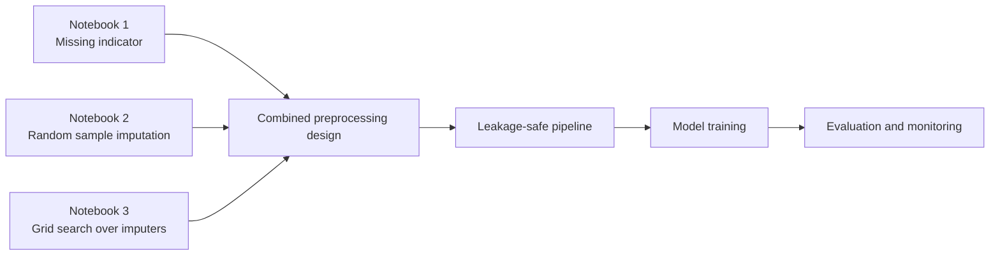
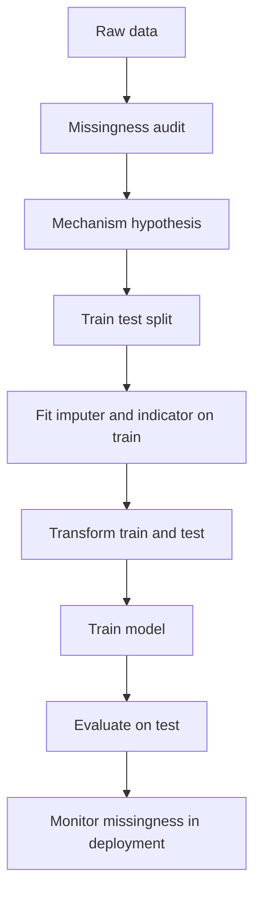
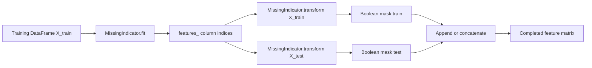
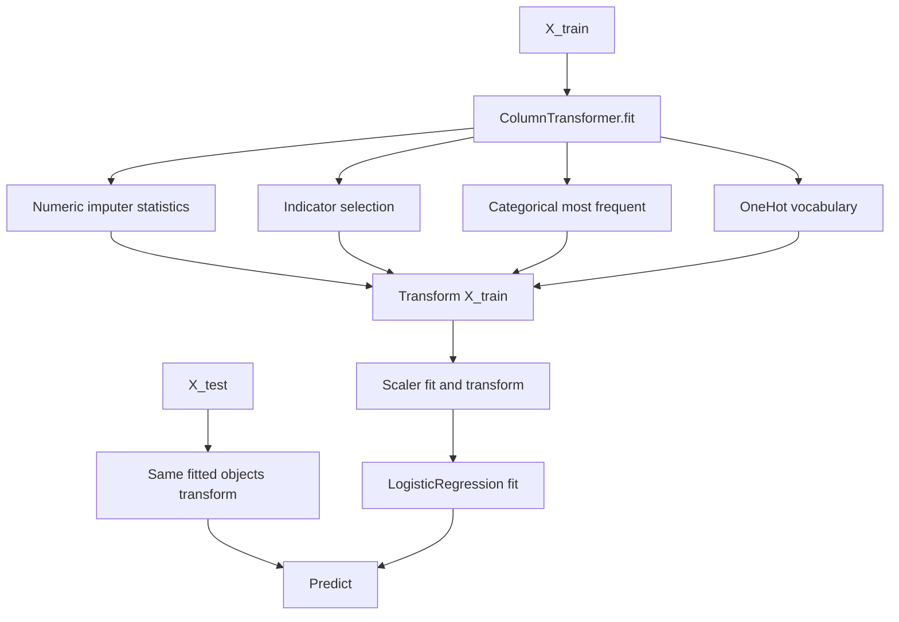
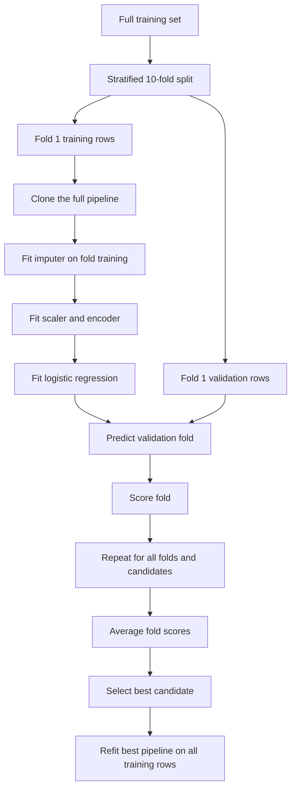

# Day 38 — Missing Indicators, Random-Sample Imputation, and Automatic Imputer Selection

> **Course:** CampusX — 100 Days of Machine Learning, Day 38
> **Official notebooks (three distinct notebooks, kept separate):**
> - `reference_notebooks/missing-indicator.ipynb` — 26 cells
> - `reference_notebooks/random-sample-imputation.ipynb` — 32 cells
> - `reference_notebooks/automatically-select-imputer-parameters.ipynb` — 17 cells
> **Datasets:** `datasets/train.csv` (Titanic, 891 rows, 61,194 bytes) and `datasets/house-train.csv` (House Prices, 1,460 rows, 462,137 bytes)
> **Personal notebook:** none in this folder. This chapter is the complete learning document for the three reference notebooks.
> **Central question:** When a value is missing, should the model receive an imputed value, a flag that the value was missing, or both — and how do we choose the imputation rule without fooling ourselves?

Day 36 asked how to replace a missing number with a sensible number. Day 37 asked how to replace a missing category with a sensible category. Day 38 asks a different and deeper question: **is the replacement itself the right thing to do?** The fact that a value was missing can be informative. A passenger whose age was not recorded may be a different kind of passenger from one whose age was recorded. A house with no fireplace is not a house with an unknown fireplace quality. If we replace the missing value and throw away the fact of missingness, we may delete a real signal. If we keep the fact of missingness but replace the value badly, we may invent a signal that does not exist.

The three official notebooks approach this question from three angles:

1. **`missing-indicator.ipynb`** adds a binary flag for "Age was missing" to the Titanic features and compares a logistic-regression model with and without the flag.
2. **`random-sample-imputation.ipynb`** replaces a missing value by a random draw from the observed values of the same column, for both a numeric feature (`Age`) and two categorical features (`FireplaceQu`, `GarageQual`), and studies the resulting distributions.
3. **`automatically-select-imputer-parameters.ipynb`** builds a leakage-safe preprocessing pipeline and uses `GridSearchCV` to choose an imputation strategy for numeric and categorical columns together with the regularisation strength of a logistic regression.

The notebooks are not three versions of one experiment. They use different feature sets, different data, and different questions. Their numbers must not be compared as if they came from one model. This chapter treats each notebook separately, then connects the ideas.

**Source labels used throughout this chapter**

- **Official** — the output saved inside the CampusX reference notebook. It was produced in a Python 3.8.3-era environment (the notebook metadata records Python 3.8.3), with the pandas, NumPy, and scikit-learn versions of that period.
- **Rerun** — a result reproduced for this chapter in the current environment: Python 3.14.2, pandas 3.0.5, NumPy 2.5.3, scikit-learn 1.9.1. A rerun is not the official output; where it differs, both are reported.
- **Supplementary** — an explanation, calculation, diagnostic, or experiment added for teaching. It is not presented as course output.

The three reference notebooks are byte-identical to their vendor sources (SHA-256 verified). The two local datasets are byte-identical to the vendor copies (SHA-256 verified). No notebook, dataset, or vendor file was modified while preparing this chapter.

---

# 1. Learning objectives

After studying this chapter I should be able to:

1. **Explain the two questions of missing-data modelling.** Distinguish recovering a missing value from predicting the target in the presence of missingness, and explain why a missing indicator answers the second question directly.
2. **Define the missingness mechanisms.** Write the formal definitions of MCAR, MAR, and MNAR, explain the conditioning sets, and state what each mechanism implies for an indicator feature.
3. **Build and interpret a missing indicator.** Use `MissingIndicator` and `SimpleImputer(add_indicator=True)`, explain `features_`, `indicator_`, column order, dtype, and the difference between the two APIs.
4. **Explain why missingness can carry information.** Give structural, MAR, and MNAR examples; distinguish a genuine signal from a proxy for an observed confounder; explain why an indicator is not a causal claim.
5. **Implement random-sample imputation correctly.** Sample donors from the training set only, handle numeric and categorical columns, control randomness, and avoid pandas chained-assignment failures.
6. **Derive what random-sample imputation preserves.** Show that the marginal distribution is approximately preserved, derive the expected variance of the completed sample, and derive the attenuation of covariance with other variables.
7. **Quantify uncertainty.** Explain why a single random draw understates imputation uncertainty, why the naive standard error is too small, and how multiple imputation addresses the problem.
8. **Select imputer parameters without leakage.** Build a `Pipeline` and `ColumnTransformer`, use nested parameter names, run `GridSearchCV`, and read `best_params_`, `best_score_`, `best_estimator_`, and `cv_results_`.
9. **Read the actual results.** Reproduce the Titanic accuracy figures, the variance and covariance figures, the categorical proportion tables, and the grid-search table; separate official from rerun values.
10. **Interpret the plots.** Explain what the Age density overlay, the Age box plot, and the two SalePrice density plots show, and what they cannot show.
11. **Compare the methods.** Compare mean, median, mode, random-sample, indicator, KNN, iterative, complete-case, model-native, and multiple imputation; choose a method for a stated mechanism and task.
12. **Protect the workflow.** Identify leakage through imputation, indicator fitting, donor sampling, and hyperparameter tuning; enforce train/test consistency; monitor missingness drift in deployment.
13. **Debug the common failures.** Recognise shape errors, dtype errors, feature-name errors, duplicate indicators, all-missing columns, unseen categories, and version-dependent pandas behaviour.
14. **Answer interview and examination questions.** Explain the reasoning, perform the arithmetic, discuss assumptions and edge cases, and avoid overclaiming from a small holdout.

---

# 2. The three notebooks at a glance

## 2.1 Why three notebooks, not one

The CampusX repository keeps three separate notebooks for Day 38. They are separate because they teach three separable ideas:

| Notebook | Question it answers | Data | Main API | Model? |
|---|---|---|---|---|
| `missing-indicator.ipynb` | Does the fact that `Age` is missing add predictive information? | Titanic, `Age`, `Fare`, `Survived` | `MissingIndicator`, `SimpleImputer(add_indicator=True)` | Logistic regression |
| `random-sample-imputation.ipynb` | Can we preserve a column's distribution by sampling observed values? | Titanic `Age`; House Prices `FireplaceQu`, `GarageQual`, `SalePrice` | pandas `sample`, `dropna`, `value_counts`, `cov`, seaborn | No model |
| `automatically-select-imputer-parameters.ipynb` | Which imputation strategy and regularisation strength work best? | Titanic, seven features after dropping identifiers | `Pipeline`, `ColumnTransformer`, `GridSearchCV` | Logistic regression |

The separation matters. The first notebook uses only two features, so its accuracy is low and its comparison is narrow. The third notebook uses seven features, so its accuracy is much higher. Comparing the first notebook's 0.6313 with the third notebook's 0.7879 would be a mistake: they are different feature sets, different preprocessing, and different evaluation protocols. The random-sample notebook does not train a model at all, so it produces no accuracy to compare.

## 2.2 What each notebook contributes

**Notebook 1 — the indicator.** It establishes the mechanical recipe:

```text
X_train, X_test
   |
   +--> MissingIndicator.fit(X_train) --> features_ = [0]
   |
   +--> mi.transform(X_train) --> boolean mask (712, 1)
   +--> mi.transform(X_test)  --> boolean mask (179, 1)
   |
   +--> append the mask as Age_NA
   |
   +--> SimpleImputer.fit_transform(...) --> completed numeric matrix
   |
   +--> LogisticRegression --> accuracy
```

It also shows the shortcut `SimpleImputer(add_indicator=True)`, although its final evaluation cell accidentally reuses the earlier arrays, so the shortcut is demonstrated but not actually scored. This source-fidelity issue is treated in detail in Section 6.10.

**Notebook 2 — the distribution.** It establishes a different recipe:

```text
observed values of a column
   |
   +--> donor pool = column.dropna()
   |
   +--> for every missing entry, draw one donor at random
   |
   +--> completed column
   |
   +--> compare density, variance, covariance, box plot
   |
   +--> repeat for categorical columns and compare proportions
```

The notebook's central claim is visual and numerical: the completed column looks like the original column. The chapter explains precisely what "looks like" means, what is preserved, and what is silently destroyed.

**Notebook 3 — the search.** It establishes the workflow recipe:

```text
raw Titanic table
   |
   +--> drop identifiers
   |
   +--> train/test split (random_state=2)
   |
   +--> ColumnTransformer
   |       |
   |       +--> numeric pipeline: SimpleImputer + StandardScaler
   |       +--> categorical pipeline: SimpleImputer + OneHotEncoder
   |
   +--> Pipeline with LogisticRegression
   |
   +--> GridSearchCV over imputer strategies and C
   |
   +--> best_params_, best_score_, cv_results_
```

The important property is that every preprocessing step is inside the pipeline, so `GridSearchCV` refits it inside each cross-validation fold. This is the correct way to tune an imputer.

## 2.3 How the notebooks connect

The three notebooks form a progression:

1. **Represent the missingness.** Notebook 1 turns missingness into a feature.
2. **Replace the value.** Notebook 2 replaces the value while trying to preserve its distribution.
3. **Choose the replacement.** Notebook 3 searches over replacement rules inside a leakage-safe pipeline.

A complete solution often combines all three: an indicator column, a carefully chosen imputation rule, and a pipeline that tunes and evaluates the combination without leakage. The notebooks demonstrate the pieces separately; the chapter shows how to assemble them.



## 2.4 Source labels and reproducibility

The official notebooks were saved with outputs. Those outputs are the historical record, not a live guarantee. Three kinds of differences appear in this chapter:

- **Numerical differences** caused by library versions. For example, the official `SimpleImputer` and `MissingIndicator` reprs and the exact random draw differ from the current versions.
- **Behavioural differences** caused by pandas. The most important is chained assignment: the official random-sample notebook uses `df[col][mask] = values`, which worked with a `SettingWithCopyWarning` in pandas 1.x but raises `ChainedAssignmentError` and does not update the frame in pandas 3.0.5.
- **Source-fidelity issues** inside the official notebook itself. The final `add_indicator` evaluation reuses old arrays; the `FireplaceQu` proportion table divides by the wrong denominator; one cell references an undefined variable. These are documented, not silently repaired in the notebook.

Every number in this chapter is labelled **Official**, **Rerun**, or **Supplementary**. Where a rerun is used, the environment and the random seed are stated.

---

# 3. The problem: an imputed value is not the original value

## 3.1 Two rows, one missing value

Consider two passengers, both with the same fare and the same passenger class, but one has a recorded age and the other does not. Suppose the recorded-age passenger survived and the missing-age passenger died. A mean imputer gives both passengers the same age. After imputation, the two rows differ only in fare and class. The fact that one age was missing has disappeared.

If age missingness is associated with survival — perhaps because third-class passengers were less likely to have their age recorded, and third-class passengers survived less often — then the indicator `Age_NA` carries information that the imputed age does not. The model can use that information.

But the indicator does not recover the true age. It says "this age was not observed", not "this passenger was 25". The two pieces of information are different:

- The **value** answers: what number should replace the missing entry?
- The **indicator** answers: was the entry missing?

A model can use both: the imputed value gives a plausible number, and the indicator tells the model that the number is a guess.

## 3.2 A tiny numerical example

Take four passengers with ages 20, 30, 40, and missing. The observed mean is 30. Mean imputation produces (20, 30, 40, 30). The completed sample has mean 30 and variance:

$$
s^2 = \frac{(20-30)^2 + (30-30)^2 + (40-30)^2 + (30-30)^2}{4-1}
= \frac{100 + 0 + 100 + 0}{3}
= 66.67.
$$

The observed sample (20, 30, 40) has variance:

$$
s^2_{\text{obs}} = \frac{(20-30)^2 + (30-30)^2 + (40-30)^2}{3-1}
= \frac{100 + 0 + 100}{2}
= 100.
$$

Mean imputation reduced the variance from 100 to 66.67, a 33.3% reduction. The imputed value is exactly at the mean, so it contributes no spread. This is the classic variance-shrinking property of mean imputation. A missing indicator does not fix the variance problem; it only records which entries were imputed. Random-sample imputation addresses the variance problem by drawing a value from the observed distribution instead of using the mean.

## 3.3 What an indicator can and cannot do

An indicator can:

- tell the model which entries are imputed;
- capture a structural distinction ("no garage" versus "garage quality unknown");
- capture an association between missingness and the target;
- let the model learn a different relationship for missing and observed rows.

An indicator cannot:

- recover the missing value;
- make the imputed value true;
- prove that missingness is causal;
- guarantee that the association will hold at deployment;
- replace a good feature-engineering analysis.

The indicator is a feature, not a fix. It is useful when the missingness mechanism is stable and informative. It is harmful when the missingness is a proxy for the target that will not be present at prediction time, or when it encourages the model to learn a shortcut.

## 3.4 The information-theoretic view

Let $Y$ be the target, $X$ the features, and $M$ the missingness indicator. The indicator adds information beyond the observed features if and only if:

$$
I(Y; M \mid X_{\text{obs}}) > 0,
$$

where $I(\cdot;\cdot\mid\cdot)$ is conditional mutual information. Equivalently:

$$
H(Y \mid X_{\text{obs}}) - H(Y \mid X_{\text{obs}}, M) > 0.
$$

If the conditional entropy of $Y$ does not decrease when $M$ is added, the indicator is useless in the population. In a finite sample, an indicator can still correlate with $Y$ by chance, and a misspecified model can still benefit from it. This is why the course result must be read with a confidence interval, not as proof.

## 3.5 Where this topic sits in the workflow



The ordering is not cosmetic. The imputer's statistics, the indicator's selected columns, and the donor pool are all learned from data. If they are learned before the split, the test set influences the preprocessing, and the evaluation is optimistic. The pipeline in Notebook 3 enforces the correct order automatically.

---

# 4. Foundations: missingness mechanisms and notation

## 4.1 The full-data notation

Let the complete data be:

$$
(X_1, X_2, \dots, X_p, Y),
$$

where $X_j$ is the $j$-th feature and $Y$ is the target. For each feature, define the response indicator:

$$
R_j = \begin{cases}
1 & \text{if } X_j \text{ is observed},\\
0 & \text{if } X_j \text{ is missing}.
\end{cases}
$$

The missingness indicator is $M_j = 1 - R_j$. The observed data are:

$$
X_{\text{obs}} = \{X_j : R_j = 1\},
$$

and the missing data are:

$$
X_{\text{mis}} = \{X_j : R_j = 0\}.
$$

The full data are $(X_{\text{obs}}, X_{\text{mis}})$. The analyst sees $(X_{\text{obs}}, R)$, where $R = (R_1,\dots,R_p)$. The target $Y$ may also be missing; in this chapter, the Titanic and House Prices targets are complete, so the focus is on missing features.

## 4.2 The three mechanisms

The mechanisms are defined by the conditional distribution of $R$ given the data.

**MCAR — missing completely at random.** Missingness is independent of both the observed and the missing values:

$$
P(R \mid X_{\text{obs}}, X_{\text{mis}}, Y) = P(R).
$$

Example: a laboratory instrument fails independently of the sample. Under MCAR, complete-case analysis is unbiased for many estimands, and a missing indicator is independent of $Y$ in the population. MCAR is a strong assumption and is rarely exactly true in observational data.

**MAR — missing at random.** Missingness may depend on the observed values but not on the missing values, given the observed values:

$$
P(R \mid X_{\text{obs}}, X_{\text{mis}}, Y) = P(R \mid X_{\text{obs}}).
$$

Example: younger passengers are more likely to have their age recorded, and age is observed for the passengers whose age is recorded. If the missingness depends only on observed variables such as passenger class and sex, MAR can hold. MAR is not "missingness is random"; it is "missingness is explainable by what we observed".

**MNAR — missing not at random.** The probability of missingness depends on the missing value itself, or on an unobserved variable:

$$
P(R \mid X_{\text{obs}}, X_{\text{mis}}, Y) \neq P(R \mid X_{\text{obs}}).
$$

Example: high-income respondents refuse to report income. The missingness depends on the very value that is missing. MNAR cannot be tested from the observed data alone without an assumption or an instrument; sensitivity analysis is the honest response.

## 4.3 The mechanism hierarchy

The three mechanisms are nested:

$$
\text{MCAR} \subset \text{MAR} \subset \text{MNAR}.
$$

Every MCAR mechanism is also MAR (the conditional distribution does not depend on anything). Every MAR mechanism is a special case of MNAR in the sense that MNAR is the complement of MAR. The hierarchy matters because the validity of an imputation method depends on which mechanism holds:

| Mechanism | Complete-case analysis | Mean imputation | Random-sample imputation | Missing indicator |
|---|---|---|---|---|
| MCAR | Unbiased for many estimands, inefficient | Unbiased for the mean, shrinks variance | Approximately preserves the marginal distribution | No population information; may add noise |
| MAR | Biased unless missingness depends only on covariates in the model | Biased if the missingness is related to $Y$ | Preserves the marginal distribution, not the conditional one | Can carry information through observed confounders |
| MNAR | Biased | Biased | Biased | Can carry direct information, but the mechanism is untestable |

The table is a guide, not a theorem. A method can be valid for one estimand and invalid for another under the same mechanism.

## 4.4 Why MAR is not "random"

A common misconception is that MAR means the missing values are a random sample of the data. That is MCAR, not MAR. Under MAR, the missing values are a biased sample, but the bias can be corrected using the observed variables. For example, if age is missing more often for third-class passengers, the missing ages are not a random sample of all ages, but they may be a random sample within each passenger class. A model that conditions on passenger class can use the observed ages to impute the missing ones.

This is why the choice of features matters. MAR is a statement about the conditioning set. A mechanism that is MNAR with respect to one set of variables may be MAR with respect to a richer set. If we observe the variable that drives the missingness, the mechanism becomes MAR conditional on it.

## 4.5 Structural missingness

Structural missingness occurs when a value is missing because the question does not apply:

- `GarageQual` is missing because the house has no garage.
- `FireplaceQu` is missing because the house has no fireplace.
- `Cabin` is missing because the passenger had no cabin assignment, or the cabin was not recorded.
- A numeric component is missing because the original value was alphabetic (Day 33).

Structural missingness is not a lost measurement. It is a category. Imputing the mode ("TA" for a typical garage) is wrong: it turns "no garage" into "typical garage". The correct encoding is a category such as "None" or a separate indicator. This is the strongest case for a missing indicator: the indicator is the feature.

## 4.6 The indicator variable

For a single feature $X_j$, the indicator is:

$$
M_j = \begin{cases}
1 & \text{if } X_j \text{ is missing},\\
0 & \text{if } X_j \text{ is observed}.
\end{cases}
$$

For a data matrix with $p$ features, the indicator matrix is $M = (M_1,\dots,M_p)$. `MissingIndicator` computes this matrix. With the default `features='missing-only'`, it keeps only the columns that had at least one missing value in the training data. With `features='all'`, it keeps every column.

The indicator is a deterministic function of the missingness pattern. It does not depend on the values of $X_{\text{obs}}$, except through the pattern. This is why it can be computed before imputation and why it is cheap.

## 4.7 Indicator as a proxy: confounding and reverse causation

An indicator can be associated with $Y$ for three very different reasons:

1. **The missingness is caused by a variable that also affects $Y$.** Example: third-class passengers are less likely to have their age recorded and less likely to survive. The indicator is a proxy for passenger class. If passenger class is already in the model, the indicator may add little.
2. **The missingness is caused by $Y$ or by a consequence of $Y$.** Example: patients who die have missing follow-up measurements. The indicator is a consequence of the outcome, not a cause. Using it for prediction may work in the historical data but may not transfer to a deployment setting where the outcome is not yet known.
3. **The missingness is caused by the missing value itself.** Example: high-income respondents refuse to report income. The indicator is directly informative about the missing value, but the mechanism is MNAR and cannot be validated from the observed data alone.

The first case is confounding, the second is reverse causation, and the third is MNAR. Only the first can be handled by adding the confounder to the model. The second requires careful causal reasoning. The third requires a sensitivity analysis or an instrument.

## 4.8 Why an indicator cannot recover the missing value

Suppose the missing values are drawn from a distribution $P(X_j \mid X_{\text{obs}}, M_j=1)$. The indicator tells us that we are in the $M_j=1$ stratum. It does not tell us where in that stratum the value lies. To recover the value, we need a model for the conditional distribution. To predict the target, we need a model for $P(Y \mid X_{\text{obs}}, M_j)$. These are different tasks.

This distinction is the reason the chapter keeps returning to two questions:

- **Imputation:** estimate $E[X_{\text{mis}} \mid X_{\text{obs}}, M]$.
- **Prediction:** estimate $E[Y \mid X_{\text{obs}}, M]$.

A missing indicator is a feature for the second question. It is not an imputation method for the first.

---

# 5. The Titanic data and the exact split

## 5.1 Shape and columns

The local `datasets/train.csv` is the standard Kaggle Titanic training file. A rerun gives:

```text
(891, 12)
```

The columns are:

| Column | Type | Missing | Role in this day |
|---|---|---:|---|
| `PassengerId` | integer | 0 | identifier; dropped in Notebook 3 |
| `Survived` | integer | 0 | target |
| `Pclass` | integer | 0 | passenger class; used in Notebook 3 |
| `Name` | string | 0 | identifier; dropped in Notebook 3 |
| `Sex` | string | 0 | categorical; used in Notebook 3 |
| `Age` | float | 177 | numeric feature with missingness |
| `SibSp` | integer | 0 | numeric feature in Notebook 3 |
| `Parch` | integer | 0 | numeric feature in Notebook 3 |
| `Ticket` | string | 0 | identifier; dropped in Notebook 3 |
| `Fare` | float | 0 | numeric feature |
| `Cabin` | string | 687 | high-missingness identifier |
| `Embarked` | string | 2 | categorical feature with missingness |

## 5.2 Missingness counts

The exact missing counts and percentages are:

| Column | Missing count | Missing percentage |
|---|---:|---:|
| `Age` | 177 | 19.86532% |
| `Cabin` | 687 | 77.10438% |
| `Embarked` | 2 | 0.22447% |
| all other columns | 0 | 0% |

The percentages are computed as:

$$
\text{missing percentage}_j = \frac{1}{n}\sum_{i=1}^{n} M_{ij} \times 100,
$$

where $M_{ij}=1$ if row $i$ is missing column $j$. In pandas, `df.isnull().mean() * 100` computes exactly this.

`Cabin` is missing for 77.1% of passengers. It is not used in any of the three notebooks. If it were used, the first decision would be whether the missingness is structural (no cabin) or a recording failure; imputing a cabin number would be meaningless.

`Embarked` is missing for only 2 passengers. Notebook 3 imputes it with the most frequent value or a constant. The choice has almost no effect on the model, as the grid search shows.

## 5.3 The three-column modelling frame

Notebooks 1 and 2 use:

```python
df = pd.read_csv("train.csv", usecols=["Age", "Fare", "Survived"])
```

This produces a DataFrame with 891 rows and 3 columns. The order of the columns in the file is `Survived`, `Age`, `Fare`; `usecols` preserves the file order, so the resulting columns are `Survived`, `Age`, `Fare`. The code then does:

```python
X = df.drop(columns=["Survived"])
y = df["Survived"]
```

so `X` has columns `Age`, `Fare` and `y` is the target. The column order matters for the later array indexing: `MissingIndicator.features_ = [0]` refers to `Age`, because `Age` is column 0 in `X`.

The target distribution is:

| Class | Count | Proportion |
|---|---:|---:|
| 0 (died) | 549 | 61.62% |
| 1 (survived) | 342 | 38.38% |

The classes are imbalanced. Accuracy alone is therefore a misleading metric, as Section 10 shows.

## 5.4 The split

Both notebooks use:

```python
X_train, X_test, y_train, y_test = train_test_split(
    X, y, test_size=0.2, random_state=2
)
```

A rerun gives:

```text
X_train: (712, 2)   X_test: (179, 2)
y_train: 449 zeros, 263 ones
y_test:  100 zeros, 79 ones
```

The split is 80/20: $891 \times 0.2 = 178.2$, which rounds to 179 test rows and 712 training rows. The exact numbers are:

$$
n_{\text{train}} = 712, \qquad n_{\text{test}} = 179.
$$

The training set has 148 missing ages; the test set has 29:

$$
148 + 29 = 177,
$$

which matches the total missing count. The missing rate is 20.79% in train and 16.20% in test:

$$
\frac{148}{712} = 0.207865, \qquad \frac{29}{179} = 0.162011.
$$

The rates differ because the split is random. This is a small but important reminder that the missingness pattern is a sample, not a fixed property of the data.

## 5.5 Why `random_state=2` matters

`random_state=2` makes the split reproducible. Without it, every run produces a different training set, a different imputer mean, a different indicator count, and a different accuracy. The course uses the same seed in Notebooks 1–3, so the 712/179 split is the same across them. This is why the Age mean in Notebook 1 (29.78590426) matches the observed mean in Notebook 2 (29.78590425531915). It is not a coincidence; it is the same 564 observed ages.

The seed does not make the random-sample imputation reproducible, because Notebook 2 calls `sample()` without a `random_state`. The official variance 208.3284 is one draw from a random process. A rerun with a different seed produces a different variance. Section 13 quantifies this.

## 5.6 The data facts to remember

| Fact | Value |
|---|---:|
| Titanic rows | 891 |
| Titanic columns | 12 |
| Age missing | 177 (19.86532%) |
| Cabin missing | 687 (77.10438%) |
| Embarked missing | 2 (0.22447%) |
| Train rows | 712 |
| Test rows | 179 |
| Train Age missing | 148 (20.7865%) |
| Test Age missing | 29 (16.2011%) |
| Train observed Age | 564 |
| Train Age mean | 29.78590426 |
| Train Age variance | 204.3495134 |
| Train Age median | 28.75 |
| Test Age mean | 29.3728 |
| Test Age median | 28.0 |
| Train Fare mean | 32.28905604 |
| Train Fare median | 14.4583 |
| Target prevalence (train) | 263/712 = 36.94% |
| Target prevalence (test) | 79/179 = 44.13% |

The train and test target prevalences differ (36.94% versus 44.13%). This is another reason the holdout accuracy is noisy.

---

# 6. Notebook 1 — Missing indicators, cell by cell

The notebook has 26 cells, all code. This section walks through them in order, quotes the significant outputs, and explains the execution.

## 6.1 Cells 0–2: imports and data

```python
import numpy as np
import pandas as pd

from sklearn.model_selection import train_test_split

from sklearn.impute import MissingIndicator, SimpleImputer
```

The imports bring in NumPy, pandas, the split function, and the two imputation classes. `MissingIndicator` produces the mask; `SimpleImputer` fills the values.

```python
df = pd.read_csv("train.csv", usecols=["Age", "Fare", "Survived"])
```

`usecols` reads only the three columns. The local copy is at `datasets/train.csv`; the notebook expects `train.csv` in its working directory, which is the vendor folder. When reproducing, point the path at the local copy.

```python
df.head()
```

**Official output:**

```text
   Survived   Age     Fare
0         0  22.0   7.2500
1         1  38.0  71.2833
2         1  26.0   7.9250
3         1  35.0  53.1000
4         0  35.0   8.0500
```

The first five rows have no missing ages. The missing values appear later. This is why `head()` is not a missingness diagnostic; it can easily miss the problem.

## 6.2 Cells 3–5: X, y, and the split

```python
X = df.drop(columns=["Survived"])
y = df["Survived"]
```

`X` is a DataFrame with columns `Age`, `Fare`. `y` is a Series with the target. `drop(columns=...)` returns a new DataFrame; it does not modify `df` because `inplace` is not used.

```python
X_train, X_test, y_train, y_test = train_test_split(
    X, y, test_size=0.2, random_state=2
)
```

The split is stratified by default for classification targets? No: `train_test_split` uses a random split, not a stratified split, unless `stratify=y` is passed. The class proportions can differ between train and test. In this split, the training prevalence is 36.94% and the test prevalence is 44.13%. This is a notable difference, and it contributes to the gap between cross-validation and holdout results.

```python
X_train.head()
```

**Official output:**

```text
      Age     Fare
30   40.0  27.7208
10    4.0  16.7000
873  47.0   9.0000
182   9.0  31.3875
876  20.0   9.8458
```

The index values (30, 10, 873, 182, 876) are the original row indices. They are not reset, so the training set preserves the original index. This matters for pandas alignment: when you assign a NumPy array to a column, pandas aligns by position, not by index, but when you concatenate DataFrames, pandas aligns by index. The notebooks mix both styles, which is a source of subtle bugs.

## 6.3 Cells 6–8: mean imputation baseline

```python
si = SimpleImputer()
X_train_trf = si.fit_transform(X_train)
X_test_trf = si.transform(X_test)
```

`SimpleImputer()` uses the default strategy `'mean'`. `fit_transform` on the training set does two things:

1. `fit` computes the mean of each column over the observed values and stores it in `si.statistics_`.
2. `transform` replaces each missing value with the corresponding mean and returns a NumPy array.

`transform` on the test set uses the training means. It does not recompute them. This is the correct train/test contract.

A rerun gives:

```text
si.statistics_ = [29.78590426, 32.28905604]
si.n_features_in_ = 2
si.feature_names_in_ = ['Age', 'Fare']
```

The first statistic is the mean of the 564 observed ages. The second is the mean of `Fare`, which has no missing values; it is computed and stored even though it is never used for imputation. This is a detail worth remembering: `statistics_` has one entry per input feature, not one entry per feature with missing values.

```python
X_train_trf
```

**Official output (abridged):**

```text
array([[ 40.        ,  27.7208    ],
       [  4.        ,  16.7       ],
       [ 47.        ,   9.        ],
       ...,
       [ 71.        ,  49.5042    ],
       [ 29.78590426, 221.7792    ],
       [ 29.78590426,  25.925     ]])
```

The last two rows show the imputation: the ages are replaced by 29.78590426, the training mean. The fares are untouched. The output is a float64 NumPy array, not a DataFrame. The column names are lost.

```python
from sklearn.linear_model import LogisticRegression

clf = LogisticRegression()
clf.fit(X_train_trf, y_train)

y_pred = clf.predict(X_test_trf)

from sklearn.metrics import accuracy_score
accuracy_score(y_test, y_pred)
```

**Official output:**

```text
0.6145251396648045
```

This is $110/179$. The model predicts 24 positives out of 179, while the test set contains 79 positives. The confusion matrix is:

```text
[[93  7]
 [62 17]]
```

The model is conservative: it catches only 17 of 79 survivors (recall 21.52%). Accuracy is 61.45%, but the model is not useful for finding survivors. This is the class-imbalance problem in action.

## 6.4 Cells 9–10: fitting `MissingIndicator`

```python
mi = MissingIndicator()

mi.fit(X_train)
```

**Official output:**

```text
MissingIndicator()
```

`fit` does not return a new object; it modifies `mi` in place and returns `mi` (the repr is shown because the cell's last expression is the return value). The fitted object stores which columns had missing values in the training data.

```python
mi.features_
```

**Official output:**

```text
array([0], dtype=int64)
```

`features_` is an array of column indices, not names. Index 0 corresponds to `Age`. `Fare` is index 1 and has no missing values, so it is excluded by the default `features='missing-only'`.

This is a common interview question: "What does `features_` contain?" The answer is: the integer positions of the features selected by the `features` parameter, based on the missingness observed during `fit`. It is not a list of feature names.

## 6.5 Cells 11–14: transforming train and test

```python
X_train_missing = mi.transform(X_train)
```

```python
X_train_missing
```

**Official output (abridged):**

```text
array([[False],
       [False],
       [False],
       ...
       [ True],
       [False],
       [False]])
```

The output is a 2D boolean array with shape `(712, 1)`. There are 148 `True` values, one for each missing age. The dtype is `bool`, not integer. If you need 0/1 integers, cast with `.astype(int)`.

```python
X_test_missing = mi.transform(X_test)
```

```python
X_test_missing
```

**Official output (abridged):**

```text
array([[False],
       [False],
       ...
       [ True],
       [False]])
```

The test mask has shape `(179, 1)` and 29 `True` values. The same fitted `mi` is used; it does not refit on the test set. This is the correct contract.

If the test set had a missing value in a column that was complete in training, `mi.transform` would raise a `ValueError` with the default `error_on_new=True`. This is a train/test consistency check. We will see how to relax it in Section 7.

## 6.6 Cells 15–18: appending the indicator

```python
X_train["Age_NA"] = X_train_missing
```

**Official output (stderr):**

```text
SettingWithCopyWarning:
A value is trying to be set on a copy of a slice from a DataFrame.
Try using .loc[row_indexer,col_indexer] = value instead
```

The assignment works in the official run, but pandas warns that `X_train` may be a slice of another DataFrame. The warning is a code-quality warning, not an error. The safe pattern is:

```python
X_train = X_train.copy()
X_train["Age_NA"] = X_train_missing
```

or, using `.loc`:

```python
X_train.loc[:, "Age_NA"] = X_train_missing.ravel()
```

A rerun in pandas 3.0.5 produces no warning, because copy-on-write is the default and the assignment is handled differently. The absence of a warning does not mean the code is safe in every pandas version; it means the version's behaviour changed.

```python
X_test
```

**Official output (abridged):**

```text
      Age     Fare
707  42.0  26.2875
37   21.0   8.0500
...
846   NaN  69.5500
870  26.0   7.8958
251  29.0  10.4625

[179 rows x 2 columns]
```

The test set still has 29 missing ages at this point. The indicator has not been appended yet.

```python
X_test["Age_NA"] = X_test_missing
```

The same warning appears. After this cell, both frames have three columns: `Age`, `Fare`, `Age_NA`.

```python
X_train
```

**Official output (abridged):**

```text
      Age      Fare  Age_NA
30   40.0   27.7208   False
10    4.0   16.7000   False
873  47.0    9.0000   False
182   9.0   31.3875   False
876  20.0    9.8458   False
..    ...       ...     ...
534  30.0    8.6625   False
584   NaN    8.7125    True
493  71.0   49.5042   False
527   NaN  221.7792    True
168   NaN   25.9250    True

[712 rows x 3 columns]
```

The `Age_NA` column is boolean. When `SimpleImputer` sees it, it treats it as a numeric column (0/1) because the default `strategy='mean'` requires numeric data. The mean of `Age_NA` is:

$$
\frac{148}{712} = 0.2078651685.
$$

This is the value stored in `statistics_` for the third column in the next step.

## 6.7 Cells 19–20: imputing the augmented frame

```python
si = SimpleImputer()

X_train_trf2 = si.fit_transform(X_train)
X_test_trf2 = si.transform(X_test)
```

A rerun gives:

```text
si.statistics_ = [29.78590426, 32.28905604, 0.20786517]
si.n_features_in_ = 3
si.feature_names_in_ = ['Age', 'Fare', 'Age_NA']
```

The imputer now has three statistics: the Age mean, the Fare mean, and the mean of the indicator. The indicator has no missing values, so its statistic is not used for imputation; it is simply recorded.

```python
from sklearn.linear_model import LogisticRegression

clf = LogisticRegression()

clf.fit(X_train_trf2, y_train)

y_pred = clf.predict(X_test_trf2)

from sklearn.metrics import accuracy_score
accuracy_score(y_test, y_pred)
```

**Official output:**

```text
0.6312849162011173
```

This is $113/179$. The indicator model improves the accuracy by 3 correct predictions:

$$
113 - 110 = 3.
$$

The confusion matrix is:

```text
[[94  6]
 [60 19]]
```

Compared with the baseline `[[93, 7], [62, 17]]`, the indicator model gains one true negative, loses one false positive, gains two true positives, and loses two false negatives. The recall rises from 21.52% to 24.05%. The improvement is small and is not statistically significant (Section 10).

## 6.8 Cells 21–24: the `add_indicator` shortcut

```python
si = SimpleImputer(add_indicator=True)
```

This creates a new imputer that will append one indicator column for each feature that had missing values during `fit`. The internal indicator is a `MissingIndicator` with `features='missing-only'` and `error_on_new=False`.

```python
X_train = si.fit_transform(X_train)
```

This is a crucial line: `X_train` is reassigned from a DataFrame to a NumPy array. The input has three columns (`Age`, `Fare`, `Age_NA`); the output has four columns:

1. `Age` imputed,
2. `Fare`,
3. `Age_NA` (the manual indicator),
4. `missingindicator_Age` (the new indicator).

A rerun gives:

```text
X_train.shape = (712, 4)
si.statistics_ = [29.78590426, 32.28905604, 0.20786517]
si.indicator_.features_ = [0]
```

The new indicator duplicates the manual `Age_NA` column. The notebook does not inspect this duplication.

```python
X_test = si.transform(X_test)
```

The test set becomes a `(179, 4)` array. The same fitted imputer is used.

```python
from sklearn.linear_model import LogisticRegression

clf = LogisticRegression()

clf.fit(X_train_trf2, y_train)

y_pred = clf.predict(X_test_trf2)

from sklearn.metrics import accuracy_score
accuracy_score(y_test, y_pred)
```

**Official output:**

```text
0.6312849162011173
```

This is the source-fidelity bug. The cell fits the classifier on `X_train_trf2` and predicts `X_test_trf2`, which are the **old three-column arrays** from cell 19. The new four-column `add_indicator` arrays `X_train` and `X_test` are never used. The reported accuracy is therefore the manual-indicator result from cell 20, not an evaluation of `add_indicator`.

A rerun confirms that the four-column `add_indicator` arrays produce the same accuracy 0.6312849162011173, because the duplicate indicator splits the coefficient between the two identical columns and the predictions do not change. The result is numerically identical, but the code does not demonstrate what it claims to demonstrate. The lesson is general: **always check which variable a cell actually uses**. A cell can produce the right number for the wrong reason.

## 6.9 Cell 25: empty

The last cell is empty. It contributes nothing.

## 6.10 The source-fidelity audit of Notebook 1

| Cell | What it does | Source-fidelity issue |
|---:|---|---|
| 0–5 | imports, data, split | none |
| 6–8 | mean imputation baseline | correct; accuracy 0.6145251 |
| 9–14 | fit and transform `MissingIndicator` | correct; `features_ = [0]`, masks (712, 1) and (179, 1) |
| 15–18 | append `Age_NA` | `SettingWithCopyWarning` in the official run; works anyway |
| 19–20 | impute the augmented frame | correct; accuracy 0.6312849 |
| 21–23 | `SimpleImputer(add_indicator=True)` | creates a four-column array with a duplicate indicator |
| 24 | evaluate `add_indicator` | **bug**: uses the old `X_train_trf2` / `X_test_trf2`, not the new arrays |
| 25 | empty | nothing |

The numerical conclusions of the notebook survive the audit: the manual indicator improves the holdout accuracy by 3 rows, and the `add_indicator` path produces an equivalent matrix. The pedagogical conclusion does not survive: the notebook never actually scores the `add_indicator` output.

## 6.11 What Notebook 1 establishes and what it does not

**Establishes:**

- `MissingIndicator` selects the `Age` column because it is the only column with missing values in training.
- The mask has 148 `True` values in train and 29 in test.
- Appending the mask and imputing the augmented frame raises the holdout accuracy from 0.6145251 to 0.6312849.
- `SimpleImputer(add_indicator=True)` is a shortcut for the same idea, but the notebook's evaluation cell does not use it.

**Does not establish:**

- That missingness is informative in general. The gain is 3 test rows, the McNemar p-value is 0.25, and the 95% confidence intervals overlap heavily.
- That the indicator is the cause of the improvement. The indicator is correlated with passenger class, which is not in the two-feature model. The improvement may be a proxy effect.
- That the result will generalize. The test set is 179 rows, the target prevalence differs between train and test, and the model's recall is low.
- That `add_indicator` was evaluated. It was not.

# 7. `MissingIndicator` internals

## 7.1 The constructor

`MissingIndicator` has four parameters:

| Parameter | Default | Meaning |
|---|---|---|
| `missing_values` | `np.nan` | The value that marks a missing entry |
| `features` | `'missing-only'` | Which columns to include: `'missing-only'` or `'all'` |
| `sparse` | `'auto'` | Return a sparse matrix when the mask is large and sparse |
| `error_on_new` | `True` | Raise if a column had no missing values in `fit` but has missing values in `transform` |

The object is stateless until `fit`. `fit` learns which columns to keep and stores their indices in `features_`. `transform` applies the same selection to new data.

## 7.2 A complete small example

```python
import numpy as np
import pandas as pd
from sklearn.impute import MissingIndicator

X = pd.DataFrame({
    "a": [1.0, np.nan, 3.0],
    "b": [1.0, 2.0, 3.0],
})

mi = MissingIndicator()
mi.fit(X)

print(mi.features_)
print(mi.transform(X))
print(mi.get_feature_names_out())
```

Output:

```text
[0]
[[False]
 [ True]
 [False]]
['missingindicator_a']
```

Column `a` is selected because it has a missing value. Column `b` is excluded because it is complete. The output is a 2D boolean array with one column. The feature name is `missingindicator_a`.

## 7.3 `features='all'`

```python
mi_all = MissingIndicator(features="all")
mi_all.fit(X)

print(mi_all.features_)
print(mi_all.transform(X))
print(mi_all.get_feature_names_out())
```

Output:

```text
[0 1]
[[False False]
 [ True False]
 [False False]]
['missingindicator_a' 'missingindicator_b']
```

Now both columns are included. Column `b` has no missing values, so its mask is all `False`. This is useful when you want a fixed output shape regardless of which columns happen to be missing in a particular training sample.

## 7.4 `error_on_new`

```python
mi_strict = MissingIndicator().fit(pd.DataFrame({"a": [1.0, 2.0]}))
mi_strict.transform(pd.DataFrame({"a": [np.nan]}))
```

Output:

```text
ValueError: The features [0] have missing values in transform but have no missing values in fit.
```

The training column had no missing values, so `features_` is empty. At transform time, column `a` has a missing value. The strict indicator refuses to silently ignore the new pattern. This is a useful consistency check: if the deployment data has a missingness pattern that the training data did not have, the model was never trained to handle it.

```python
mi_lenient = MissingIndicator(error_on_new=False).fit(
    pd.DataFrame({"a": [1.0, 2.0]})
)
print(mi_lenient.features_)
print(mi_lenient.transform(pd.DataFrame({"a": [np.nan]})).shape)
```

Output:

```text
[]
(1, 0)
```

With `error_on_new=False`, the transform does not raise, but it also does not add a new indicator. The output has zero columns. This is a subtle trap: `error_on_new=False` means "do not complain", not "add the new indicator". If you want a fixed set of indicators for every column, use `features='all'`.

## 7.5 Sparse output

For a large data matrix with many columns and few missing values, the boolean mask is mostly `False`. `MissingIndicator(sparse='auto')` returns a sparse matrix when the mask is large and sparse. A sparse matrix saves memory but may not be accepted by every downstream estimator. If a downstream step expects a dense array, pass `sparse=False` or convert with `.toarray()`.

## 7.6 No `inverse_transform`

`MissingIndicator` has no `inverse_transform`. It is a one-way transformation from data to a mask. You cannot recover the original values from the mask, because the mask does not contain the values. This is a simple but important point: the indicator is not an imputer.

## 7.7 `set_output`

`MissingIndicator` supports `set_output(transform='pandas')`:

```python
mi_pd = MissingIndicator(features="all").set_output(transform="pandas")
print(mi_pd.fit_transform(X))
```

Output:

```text
   missingindicator_a  missingindicator_b
0               False               False
1                True               False
2               False               False
```

The output is a DataFrame with boolean columns and informative names. This is convenient for inspection and for concatenating with the original DataFrame.

## 7.8 Data flow



The fitted object is the bridge between train and test. The selection is learned once, on the training data, and applied to both. If the test set is transformed with a different fitted object, the columns may not align.

## 7.9 What `MissingIndicator` does not do

- It does not fill missing values.
- It does not remove missing values.
- It does not validate that the indicator is useful.
- It does not handle unseen missingness in complete training columns unless `features='all'` is used.
- It does not preserve feature names in the output array unless `set_output` is used.
- It does not provide a built-in random seed or imputation model.

It is a small, single-purpose transformer. That is its strength: it is easy to reason about and easy to place inside a pipeline.

---

# 8. `SimpleImputer(add_indicator=True)` internals

## 8.1 The parameter

`SimpleImputer` has an `add_indicator` parameter, default `False`. When `True`, the imputer fits an internal `MissingIndicator` on the training data and appends the resulting mask columns to the imputed output. The internal indicator uses `features='missing-only'` and `error_on_new=False`.

The parameter is a convenience. It does not change the imputation statistics; it only appends columns.

## 8.2 A numeric example with an all-missing column

```python
import numpy as np
import pandas as pd
from sklearn.impute import SimpleImputer

Xn = pd.DataFrame({
    "a": [1.0, np.nan, 3.0, 4.0],
    "b": [np.nan, np.nan, np.nan, np.nan],
})

si = SimpleImputer(add_indicator=True)
out = si.fit_transform(Xn)

print(si.statistics_)
print(si.indicator_.features_)
print(out.shape)
print(out)
print(si.get_feature_names_out())
```

Output:

```text
[2.66666667        nan]
[0 1]
(4, 3)
[[1.         0.         1.        ]
 [2.66666667 1.         1.        ]
 [3.         0.         1.        ]
 [4.         0.         1.        ]]
['a' 'missingindicator_a' 'missingindicator_b']
```

Three details deserve attention.

**First, the output has three columns, not four.** Column `b` is entirely missing, so `SimpleImputer` drops its imputed column by default (`keep_empty_features=False`). But the indicator for `b` is kept, because the indicator is computed before the empty column is dropped. The output is `a`, `missingindicator_a`, `missingindicator_b`. The `statistics_` array still has a `nan` for `b`, because the imputer recorded that it could not compute a mean.

**Second, the indicator for `a` is 0/1 in a float array.** The output is float64 because the imputed `a` column is float. The indicator values are 0.0 and 1.0, not booleans. If you need booleans, cast the indicator columns.

**Third, the column order is imputed features first, then indicators.** This is the order returned by `get_feature_names_out`: `a`, `missingindicator_a`, `missingindicator_b`. If you build a DataFrame from the output, use this order.

## 8.3 `keep_empty_features=True`

```python
si = SimpleImputer(add_indicator=True, keep_empty_features=True)
out = si.fit_transform(Xn)

print(si.statistics_)
print(out.shape)
print(out)
print(si.get_feature_names_out())
```

Output:

```text
[2.66666667 0.        ]
(4, 4)
[[1.         0.         0.         1.        ]
 [2.66666667 0.         1.         1.        ]
 [3.         0.         0.         1.        ]
 [4.         0.         0.         1.        ]]
['a' 'b' 'missingindicator_a' 'missingindicator_b']
```

Now the all-missing column `b` is kept and filled with 0. The output has four columns: `a`, `b`, `indicator_a`, `indicator_b`. The statistic for `b` is 0, not `nan`, because the empty feature is filled with a constant. This is useful when the column's presence in the output must be stable across train and test.

## 8.4 A categorical example

```python
Xc = pd.DataFrame({
    "e": pd.Series(["S", np.nan, "C", "S"], dtype=object)
})

si = SimpleImputer(strategy="most_frequent", add_indicator=True)
out = si.fit_transform(Xc)

print(si.statistics_)
print(si.indicator_.features_)
print(out)
print(out.dtype)
```

Output:

```text
['S']
[0]
[['S' False]
 ['S' True]
 ['C' False]
 ['S' False]]
object
```

The output is an object array because it mixes strings (`'S'`, `'C'`) and booleans. This is a common surprise. If the downstream estimator requires a numeric matrix, encode the categorical column first (for example, with `OneHotEncoder`) and add the indicator separately, or cast the indicator to a numeric type.

Also note the default `missing_values=np.nan`. In pandas 3.0, an object column can contain a literal `None` that is not equal to `np.nan`. In that case, `SimpleImputer` may not recognise `None` as missing. The safe practice is to let pandas convert missing strings to `NaN`, or to set `missing_values` explicitly. This is a version-dependent edge case, not a property of the course data.

## 8.5 The internal indicator is lenient

```python
si = SimpleImputer(add_indicator=True).fit(
    pd.DataFrame({"a": [1.0, 2.0, 3.0]})
)
out = si.transform(pd.DataFrame({"a": [1.0, np.nan, 3.0]}))
print(out.shape)
print(out)
```

Output:

```text
(3, 1)
[[1.]
 [2.]
 [3.]]
```

The training column had no missing values, so the internal indicator selected no columns. At transform time, the missing value is imputed with the training mean 2.0, but no indicator is added. The output has one column, not two. This is the `error_on_new=False` behaviour in action. It is convenient, but it means that a new missingness pattern in deployment can be silently absorbed without a flag. If that pattern is meaningful, the model will not see it.

## 8.6 `statistics_` and `indicator_`

After fitting:

- `statistics_` is an array with one entry per input feature. For `strategy='mean'`, it contains the observed mean or `nan` for an all-missing feature. For `'median'`, it contains the median. For `'most_frequent'`, it contains the mode. For `'constant'`, it contains the fill value.
- `indicator_` is a fitted `MissingIndicator` when `add_indicator=True`; otherwise it is `None`.
- `indicator_.features_` contains the indices of the columns that received an indicator.
- `n_features_in_` and `feature_names_in_` describe the input features, not the output columns.

A common mistake is to read `statistics_` and assume it has one entry per output column. It does not: the indicator columns are added after the statistics are computed. The output has more columns than `statistics_` has entries.

## 8.7 A `ColumnTransformer` example

```python
from sklearn.compose import ColumnTransformer
from sklearn.pipeline import Pipeline
from sklearn.preprocessing import StandardScaler, OneHotEncoder

num = Pipeline([
    ("imputer", SimpleImputer(strategy="mean", add_indicator=True)),
    ("scaler", StandardScaler()),
])
cat = Pipeline([
    ("imputer", SimpleImputer(strategy="most_frequent")),
    ("ohe", OneHotEncoder(handle_unknown="ignore")),
])

pre = ColumnTransformer([
    ("num", num, ["Age", "Fare"]),
    ("cat", cat, ["Embarked", "Sex"]),
])
```

Fitting on the full Titanic features gives:

```text
pre.get_feature_names_out() =
['num__Age' 'num__Fare' 'num__missingindicator_Age'
 'cat__Embarked_C' 'cat__Embarked_Q' 'cat__Embarked_S'
 'cat__Sex_female' 'cat__Sex_male']
```

The numeric block contributes three columns: `Age`, `Fare`, and the Age indicator. The categorical block contributes five one-hot columns. The prefix `num__` and `cat__` comes from the `ColumnTransformer` step names. This is how the pipeline keeps track of which column came from which block.

The indicator is inside the numeric pipeline, so it is fit on the numeric block only. If you want an indicator for a categorical column, put `SimpleImputer(strategy='most_frequent', add_indicator=True)` inside the categorical pipeline. The output will be an object array unless you handle the dtype.

## 8.8 What `add_indicator` does not do

- It does not add an indicator for columns that were complete in training.
- It does not remove the original missing values before computing the indicator; the indicator is computed from the input.
- It does not guarantee that the indicator is useful.
- It does not prevent duplicate indicators if the input already contains one.
- It does not handle unseen categories; that is the encoder's job.
- It does not make the imputation statistically valid.

---

# 9. Indicator and imputation combinations

## 9.1 The four combinations

For a feature with missing values, there are four broad designs:

| Design | Representation | Example | Strengths | Weaknesses |
|---|---|---|---|---|
| Impute only | One completed column | `SimpleImputer(strategy='mean')` | Simple, compact | Loses the missingness signal; may distort variance |
| Indicator only | Original column with missing values plus a mask | `MissingIndicator` + model that accepts `NaN` | Preserves the raw values; explicit missingness | Not supported by most linear models; the missing values still need handling |
| Impute + indicator | Completed column plus a mask | `SimpleImputer(add_indicator=True)` | Keeps both the value and the fact of missingness | More columns; the indicator can add noise or leak |
| Neither | Drop rows or columns; use a model-native method | `dropna`, `HistGradientBoostingClassifier` | No fabricated values; model handles `NaN` | Loses data or requires a specific model |

The course demonstrates the first, the third, and a manual version of the second (the mask is appended but the values are imputed). It does not demonstrate a model that accepts `NaN` natively, but the concept is important.

## 9.2 Indicator only

`MissingIndicator` returns a mask, not a completed matrix. If you keep the original column with `NaN` and append the mask, a linear model will fail because it cannot multiply `NaN`. A tree model with native missing-value support can use the `NaN` directly:

```python
from sklearn.ensemble import HistGradientBoostingClassifier

model = HistGradientBoostingClassifier()
model.fit(X_train_with_nan, y_train)
```

The model learns a default direction for missing values at each split. Adding an explicit indicator may be redundant, because the tree can already isolate the missing rows. For a linear model, you must impute or use a sentinel.

## 9.3 Sentinel values versus indicators

A sentinel is a placeholder value outside the observed range, such as $-999$. It encodes missingness in the same column as the value. A tree can split on the sentinel, so it can recover the missingness. A linear model sees $-999$ as an extreme number, which distorts the coefficient and the scale. A distance-based model sees it as a far-away point, which distorts nearest neighbours.

An explicit indicator separates the two pieces of information:

- the imputed value is a plausible number in the observed range;
- the indicator tells the model that the number is a guess.

This separation is usually cleaner, especially for linear models and distance-based models. The cost is one extra column per feature with missing values.

## 9.4 When the indicator is redundant

The indicator is redundant when:

- the missingness is MCAR and the model is correctly specified;
- the imputation value is a sentinel and the model is a tree that can split on it;
- the indicator is perfectly collinear with an existing feature (for example, a category that already encodes "no garage");
- the indicator has almost no variation (for example, 1 missing value in 10,000 rows), so it cannot be estimated reliably.

Redundancy is not the same as harm. A redundant indicator may add a small amount of variance without changing the predictions. The grid search in Notebook 3 shows a case where the imputation strategy has no measurable effect; the same can happen with an indicator.

## 9.5 When the indicator is harmful

The indicator can be harmful when:

- it is a proxy for the target that will not be available at prediction time (reverse causation);
- it is a proxy for a subgroup and encourages the model to learn a spurious shortcut;
- it has very few positives, so the model overfits the indicator;
- the missingness mechanism changes between training and deployment, so the indicator's meaning changes;
- it is used causally ("missingness causes the outcome") without a causal design.

The Titanic Age indicator is a plausible proxy for passenger class. In the two-feature model, it improves the holdout accuracy by 3 rows. In the full-feature model that already includes `Pclass` and `Sex`, the gain shrinks to 0.0014 in cross-validation. This is consistent with the confounding explanation: once the confounder is in the model, the indicator has little left to add.

## 9.6 A decision table

| Situation | Recommended design | Reason |
|---|---|---|
| MCAR, low missingness, linear model | Impute only | The indicator has no population signal; imputation is enough |
| MAR, missingness associated with the target through observed variables | Impute + indicator, or add the confounder | The indicator may be a proxy; the confounder is the better feature |
| MNAR, missingness directly informative | Impute + indicator, plus sensitivity analysis | The indicator can carry signal, but the mechanism is untestable |
| Structural missingness | Indicator or explicit category, no value imputation | The missingness is the feature |
| Tree model with native `NaN` support | Native handling, optional indicator | The tree can isolate missing rows without a separate column |
| High missingness, distribution preservation | Random-sample or MICE, plus indicator | Marginal preservation matters; the indicator records the imputation |
| Deployment missingness may drift | Monitor indicator prevalence; use robust imputation | The indicator's meaning may change |

## 9.7 A leakage-safe indicator and imputation pipeline

```python
from sklearn.compose import ColumnTransformer
from sklearn.pipeline import Pipeline
from sklearn.impute import SimpleImputer
from sklearn.preprocessing import StandardScaler, OneHotEncoder
from sklearn.linear_model import LogisticRegression

numeric = Pipeline([
    ("imputer", SimpleImputer(strategy="mean", add_indicator=True)),
    ("scaler", StandardScaler()),
])
categorical = Pipeline([
    ("imputer", SimpleImputer(strategy="most_frequent")),
    ("ohe", OneHotEncoder(handle_unknown="ignore")),
])

pre = ColumnTransformer([
    ("num", numeric, ["Age", "Fare"]),
    ("cat", categorical, ["Embarked", "Sex"]),
])

model = Pipeline([
    ("preprocessor", pre),
    ("classifier", LogisticRegression(max_iter=1000)),
])

model.fit(X_train, y_train)
```

The pipeline is the contract. `fit` learns the means, the indicator selection, the scaler statistics, the most frequent categories, and the one-hot vocabulary from `X_train` only. `predict` applies the same objects to `X_test`. There is no separate imputation step that could accidentally see the test set.



The diagram shows the key property: the test set enters only at transform time. It never influences the fitted statistics, the indicator selection, or the encoder vocabulary.

---

# 10. Does the indicator actually help? Reading the Titanic result

## 10.1 The two holdout results

| Model | Features | Correct test rows | Accuracy | Recall (survived) |
|---|---|---:|---:|---:|
| Mean imputation only | `Age` imputed, `Fare` | 110/179 | 0.6145251 | 17/79 = 21.52% |
| Mean imputation + Age indicator | `Age` imputed, `Fare`, `Age_NA` | 113/179 | 0.6312849 | 19/79 = 24.05% |

The indicator adds 3 correct predictions. The accuracy rises by 1.68 percentage points. The recall rises by 2.53 percentage points. The model is still missing 60 of 79 survivors.

## 10.2 The paired comparison

The two models are evaluated on the same 179 test rows, so the correct comparison is paired, not independent. The 2×2 table of correct/incorrect outcomes is:

| | Indicator wrong | Indicator correct |
|---|---:|---:|
| Baseline wrong | 66 | 3 |
| Baseline correct | 0 | 110 |

The baseline is correct on 110 rows and wrong on 69. The indicator model is correct on the same 110 rows plus 3 additional rows. No row flips from correct to incorrect. The discordant pairs are 3 and 0. An exact McNemar test (two-sided binomial test on the 3 discordant pairs) gives:

$$
p = 2 \times \left(\frac{1}{2}\right)^3 \times \left[\binom{3}{0} + \binom{3}{1}\right] = 2 \times \frac{1}{8} \times 4 = 0.25.
$$

The p-value is 0.25. The improvement is not statistically significant at the conventional 0.05 level. With only 3 discordant pairs, the test has very little power.

## 10.3 The confidence intervals

The exact 95% confidence intervals for the two accuracies are:

| Model | Accuracy | 95% exact CI |
|---|---:|---|
| Baseline | 110/179 = 0.6145 | [0.5390, 0.6862] |
| Indicator | 113/179 = 0.6313 | [0.5561, 0.7020] |

The intervals overlap almost completely. The point estimate moved by 1.68 percentage points, but the uncertainty is about $\pm 7$ percentage points. A 3-row change on a 179-row test set is well within sampling noise.

## 10.4 The confusion matrices

Baseline:

```text
[[93  7]
 [62 17]]
```

Indicator:

```text
[[94  6]
 [60 19]]
```

The indicator model gains one true negative, one fewer false positive, two more true positives, and two fewer false negatives. The net is +3 correct. The model is still heavily biased toward the majority class: it predicts only 25 positives, while the test set has 79.

This is why accuracy is a poor headline metric here. A model that predicts "died" for everyone would achieve 100/179 = 55.87% accuracy. The baseline's 61.45% is only 5.6 percentage points above that trivial baseline. The indicator's 63.13% is 7.3 points above it. Neither is impressive for a survival model.

## 10.5 The confounding explanation

Age missingness is not random with respect to passenger class:

| `Pclass` | Passengers | Age missing | Missing rate | Survival if Age observed | Survival if Age missing |
|---:|---:|---:|---:|---:|---:|
| 1 | 216 | 30 | 13.89% | 65.59% | 46.67% |
| 2 | 184 | 11 | 5.98% | 47.98% | 36.36% |
| 3 | 491 | 136 | 27.70% | 23.94% | 25.00% |

The marginal association is strong: 29.38% survival when Age is missing versus 40.62% when it is observed. The chi-square test on the 2×2 table, using Yates continuity correction, gives:

$$
\chi^2 = 7.106, \qquad p = 0.00768.
$$

But the association is largely explained by passenger class. Third-class passengers are much more likely to have a missing age (27.70% versus 13.89% in first class), and they also survived less often. Within first class, missing age is still associated with lower survival (46.67% versus 65.59%), but the sample of 30 missing first-class passengers is small. Within third class, the association nearly disappears (25.00% versus 23.94%).

A logistic regression of survival on `Age_missing`, `Pclass`, and `Sex` gives a coefficient of $-0.1494$ for `Age_missing`, corresponding to an odds ratio of $e^{-0.1494} = 0.861$. The marginal odds ratio is:

$$
\widehat{OR}_{\text{marginal}} = \frac{52/125}{290/424} = 0.608.
$$

The adjusted odds ratio is much closer to 1. Most of the marginal signal was passenger class and sex, not missingness itself.

## 10.6 The full-feature supplementary comparison

To see whether the indicator adds anything once the confounders are present, a supplementary 10-fold cross-validation on the seven-feature Titanic frame gives:

| Model | CV accuracy | Test accuracy | Output features |
|---|---:|---:|---:|
| No indicator | 0.7879 | 0.7598 | 7 |
| Age indicator | 0.7893 | 0.7598 | 8 |

The CV gain is 0.0014, about one tenth of a percentage point. The test accuracy is identical. A supplementary grid search that includes `add_indicator` as a hyperparameter selects `add_indicator=True` with a CV score of 0.7907 and a test score of 0.7598. The selection is consistent with a tiny gain, but the gain is not practically meaningful.

These numbers are **Supplementary**, not official. They are produced with the current environment and a 10-fold `StratifiedKFold`. They support the confounding explanation: the indicator is more useful when the model lacks the variables that explain the missingness.

## 10.7 What the course result does and does not prove

**Proves:**

- The mechanical recipe works: the mask can be computed, appended, and used by a logistic regression.
- On this particular 179-row holdout, the indicator model is correct on 3 more rows than the baseline.

**Does not prove:**

- That the indicator is generally useful.
- That the improvement is statistically significant (p = 0.25).
- That the indicator is the cause of the improvement (passenger class is a confounder).
- That the result will replicate on another split or another dataset.
- That the final `add_indicator` cell was evaluated (it was not).

The honest summary is: **the notebook demonstrates the API and a small, fragile improvement.** It does not establish that missing indicators are a general-purpose win.

# 11. Notebook 2 — Random-sample imputation, cell by cell

The notebook has 32 cells, all code. It is longer than the first because it covers two datasets and two data types. This section walks through it in order.

## 11.1 Cells 0–3: imports, data, and missingness

```python
import numpy as np
import pandas as pd

from sklearn.model_selection import train_test_split

import matplotlib.pyplot as plt
import seaborn as sns
```

The imports add matplotlib and seaborn for the distribution plots. The modelling libraries are not imported because this notebook does not train a model.

```python
df = pd.read_csv("train.csv", usecols=["Age", "Fare", "Survived"])
```

The same three-column Titanic frame as Notebook 1.

```python
df.head()
```

**Official output:**

```text
   Survived   Age     Fare
0         0  22.0   7.2500
1         1  38.0  71.2833
2         1  26.0   7.9250
3         1  35.0  53.1000
4         0  35.0   8.0500
```

```python
df.isnull().mean() * 100
```

**Official output:**

```text
Survived     0.00000
Age         19.86532
Fare         0.00000
dtype: float64
```

The calculation is:

$$
\frac{177}{891} \times 100 = 19.86532\%.
$$

`df.isnull()` returns a boolean DataFrame; `.mean()` averages the booleans column-wise, giving the missing fraction; `* 100` converts to a percentage. This is the standard pandas missingness audit.

## 11.2 Cells 4–6: X, y, and the split

```python
X = df.drop(columns=["Survived"])
y = df["Survived"]
```

```python
X_train, X_test, y_train, y_test = train_test_split(
    X, y, test_size=0.2, random_state=2
)
```

The split is the same as Notebook 1: 712 training rows, 179 test rows, 148 missing ages in train, 29 in test.

```python
X_train
```

**Official output (abridged):**

```text
      Age      Fare
30   40.0   27.7208
10    4.0   16.7000
873  47.0    9.0000
182   9.0   31.3875
876  20.0    9.8458
..    ...       ...
534  30.0    8.6625
584   NaN    8.7125
493  71.0   49.5042
527   NaN  221.7792
168   NaN   25.9250

[712 rows x 2 columns]
```

The tail shows the three missing ages that will be imputed. The rows are not sorted; the missing values are scattered throughout the frame.

## 11.3 Cells 7–8: creating the imputed columns

```python
X_train["Age_imputed"] = X_train["Age"]
X_test["Age_imputed"] = X_test["Age"]
```

This creates a copy of the `Age` column in each frame. The original `Age` column is preserved so that the notebook can compare the original and imputed distributions. This is good practice for a demonstration: keep the raw column and the imputed column side by side.

**Official output (stderr):**

```text
SettingWithCopyWarning:
A value is trying to be set on a copy of a slice from a DataFrame.
Try using .loc[row_indexer,col_indexer] = value instead
```

The warning appears twice, once for each assignment. The assignment still works in the official pandas version. In pandas 3.0.5, the assignment also works and no warning is raised, because copy-on-write handles the new column differently.

```python
X_test.tail()
```

**Official output:**

```text
      Age     Fare  Age_imputed
89   24.0   8.0500         24.0
80   22.0   9.0000         22.0
846   NaN  69.5500          NaN
870  26.0   7.8958         26.0
251  29.0  10.4625         29.0
```

The `Age_imputed` column is an exact copy of `Age` at this stage. The missing value in row 846 is still missing.

## 11.4 Cell 9: the random draw

```python
X_train["Age_imputed"][X_train["Age_imputed"].isnull()] = \
    X_train["Age"].dropna().sample(X_train["Age"].isnull().sum()).values

X_test["Age_imputed"][X_test["Age_imputed"].isnull()] = \
    X_train["Age"].dropna().sample(X_test["Age"].isnull().sum()).values
```

This is the heart of the notebook. Read it from the inside out:

1. `X_train["Age"].dropna()` — the donor pool: the 564 observed ages in the training set.
2. `.sample(148)` — draw 148 values from the donor pool. The default is sampling **without replacement**, so each donor is used at most once within this draw.
3. `.values` — convert the pandas Series to a NumPy array.
4. `X_train["Age_imputed"].isnull()` — the mask of the 148 missing entries.
5. `X_train["Age_imputed"][mask] = values` — assign the 148 draws to the 148 missing positions.

The test set uses the same donor pool (`X_train["Age"].dropna()`), not the test set's own observed ages. This is the correct direction: the training data provides the donors, and the test data receives imputed values. Using the test donors would leak test information into the training-time imputation model.

**Official output (stderr):**

```text
C:\Users\91842\anaconda3\lib\site-packages\pandas\core\generic.py:8765:
SettingWithCopyWarning:
A value is trying to be set on a copy of a slice from a DataFrame
...
```

The official run works, with a warning. **Rerun in pandas 3.0.5:** the same chained assignment raises:

```text
ChainedAssignmentError: A value is being set on a copy of a DataFrame
or Series through chained assignment.
```

and the frame is **not** updated. The missing count remains 148. This is a critical version-dependent failure. The corrected code uses a single-step `.loc` assignment:

```python
donors = X_train["Age"].dropna()

train_mask = X_train["Age_imputed"].isnull()
X_train.loc[train_mask, "Age_imputed"] = donors.sample(
    int(train_mask.sum()), random_state=0
).values

test_mask = X_test["Age_imputed"].isnull()
X_test.loc[test_mask, "Age_imputed"] = donors.sample(
    int(test_mask.sum()), random_state=0
).values
```

The `.loc[row_mask, column]` form performs the assignment in one step, so copy-on-write cannot detach the intermediate object. The `random_state=0` makes the draw reproducible. This corrected code is a **Rerun**, not the official code.

## 11.5 Cells 10–11: the donor sample and the missing count

```python
X_train["Age"].dropna().sample(X_train["Age"].isnull().sum()).values
```

**Official output (abridged):**

```text
array([32.  , 14.  , 52.  ,  4.  , 32.  , 26.  , 45.  , 65.  , 35.  ,
       28.  , 38.  , 29.  , 17.  , 16.  , 36.  , 17.  , 58.  ,  4.  ,
       ...
       48.  , 25.  , 23.  , 25.  ])
```

The array has 148 values. It contains duplicates such as 32, 4, 17, and 25 because the donor pool itself contains multiple passengers with those ages. Duplicates in the output do **not** imply sampling with replacement; they reflect duplicates in the donor population.

This cell performs a **new** random draw. It is not the same draw that was assigned in cell 9. The output is a demonstration of the sampling operation, not a record of the values used in the imputation. This is a subtle source-fidelity point: the displayed array and the imputed column come from different random draws.

```python
X_train["Age"].isnull().sum()
```

**Official output:**

```text
148
```

This confirms the number of missing ages in the training set. The test set has 29.

## 11.6 Cell 12: the completed frame

```python
X_train
```

**Official output (abridged):**

```text
      Age      Fare  Age_imputed
30   40.0   27.7208         40.0
10    4.0   16.7000          4.0
873  47.0    9.0000         47.0
182   9.0   31.3875          9.0
876  20.0    9.8458         20.0
..    ...       ...          ...
534  30.0    8.6625         30.0
584   NaN    8.7125          3.0
493  71.0   49.5042         71.0
527   NaN  221.7792         16.0
168   NaN   25.9250         26.0

[712 rows x 3 columns]
```

The three missing ages in the tail have been replaced by 3.0, 16.0, and 26.0. These are observed ages drawn from the donor pool. The original `Age` column still shows `NaN`, so the comparison is possible.

## 11.7 Cell 13: the Age density overlay

```python
sns.distplot(X_train["Age"], label="Original", hist=False)
sns.distplot(X_train["Age_imputed"], label="Imputed", hist=False)

plt.legend()
plt.show()
```

**Official output:** a figure with two kernel density curves. The blue curve is the original `Age` (with `NaN` silently dropped by seaborn), and the orange curve is the completed `Age_imputed`. The two curves are almost indistinguishable. The x-axis is labelled `Age_imputed` because seaborn names the axis after the last plotted series, not because the original curve is missing.

The plot is the visual version of the claim "the distribution is preserved". Section 14 interprets it in detail.

## 11.8 Cell 14: the variance comparison

```python
print("Original variable variance: ", X_train["Age"].var())
print("Variance after random imputation: ", X_train["Age_imputed"].var())
```

**Official output:**

```text
Original variable variance:  204.3495133904614
Variance after random imputation:  208.32836615859927
```

The original variance is computed on the 564 observed ages. The imputed variance is computed on all 712 values. The imputed variance is 3.9789 higher, a 1.95% increase:

$$
\frac{208.328366 - 204.349513}{204.349513} \times 100 = 1.947\%.
$$

This is not a systematic variance increase; it is one random draw. A different draw can produce a variance below the original. Section 13 shows the distribution over 500 draws.

## 11.9 Cell 15: the covariance table

```python
X_train[["Fare", "Age", "Age_imputed"]].cov()
```

**Official output:**

```text
                    Fare         Age  Age_imputed
Fare         2368.246832   71.512440    43.000388
Age            71.512440  204.349513   204.349513
Age_imputed    43.000388  204.349513   208.328366
```

This table is the most important numerical result in the notebook, and it is easy to misread.

- `Cov(Fare, Age) = 71.512440` is computed on the 564 rows where both `Fare` and `Age` are observed. `Fare` has no missing values, so this is the complete-case covariance.
- `Cov(Fare, Age_imputed) = 43.000388` is computed on all 712 rows, because `Age_imputed` has no missing values. The imputed ages are random draws independent of `Fare`, so the covariance is attenuated toward zero.
- `Cov(Age, Age_imputed) = 204.349513` is computed on the 564 rows where both columns are non-missing (pandas uses pairwise complete observations). On those rows, `Age_imputed` equals `Age` exactly, so the covariance equals the variance of `Age`. This is **not** evidence that random imputation preserves the relationship; it is an artifact of pairwise deletion.

The meaningful comparison is the first two entries: 71.5124 versus 43.0004. The covariance dropped by 39.87%:

$$
\frac{71.512440 - 43.000388}{71.512440} \times 100 = 39.87\%.
$$

This is the price of random-sample imputation: the marginal distribution is preserved, but the relationship with other variables is weakened. Section 12 derives the attenuation factor.

## 11.10 Cell 16: the box plot

```python
X_train[["Age", "Age_imputed"]].boxplot()
```

**Official output:** a figure with two box plots. The boxes are nearly identical: the medians are around 29, the interquartile ranges are roughly 21 to 38, the whiskers extend from about 0 to 65, and there are a few high outliers around 65–70. The imputed box looks like the original box because the imputed values are draws from the original distribution.

The box plot hides an important fact: 148 of the 712 values in `Age_imputed` are copies of observed values, not independent observations. The visual similarity is real, but it does not mean the completed sample contains 712 independent pieces of information.

## 11.11 Cell 17: the undefined `observation`

```python
sampled_value = X_train["Age"].dropna().sample(
    1, random_state=int(observation["Fare"])
)
```

This cell has no output. Running it raises:

```text
NameError: name 'observation' is not defined
```

`observation` is never defined anywhere in the notebook. The cell is dead code, probably a leftover from an experiment that used a row's `Fare` as a random seed. It should be removed or rewritten. It is not part of the imputation pipeline.

The idea of seeding a random draw with a data value is also statistically questionable: the seed would change with the data, the draw would not be reproducible across datasets, and `int(observation["Fare"])` requires a specific row. A fixed integer seed or a `numpy.random.Generator` is the correct tool.

## 11.12 Cells 18–20: the House Prices data

```python
data = pd.read_csv(
    "house-train.csv",
    usecols=["GarageQual", "FireplaceQu", "SalePrice"],
)
```

**Official output of `data.head()`:**

```text
   FireplaceQu GarageQual  SalePrice
0         NaN         TA     208500
1          TA         TA     181500
2          TA         TA     223500
3          Gd         TA     140000
4          TA         TA     250000
```

```python
data.isnull().mean() * 100
```

**Official output:**

```text
FireplaceQu    47.260274
GarageQual      5.547945
SalePrice       0.000000
dtype: float64
```

The House Prices training file has 1,460 rows and 81 columns. The notebook selects three:

- `FireplaceQu` — fireplace quality, missing for 690 rows (47.26%).
- `GarageQual` — garage quality, missing for 81 rows (5.55%).
- `SalePrice` — the target, complete.

The missingness in these columns is largely **structural**: a missing `FireplaceQu` often means the house has no fireplace, and a missing `GarageQual` often means the house has no garage. This is exactly the setting where imputing the mode is conceptually wrong: "no fireplace" is not "typical fireplace quality".

## 11.13 Cells 21–24: the split and the imputed columns

```python
X = data
y = data["SalePrice"]
```

This is a **target-leakage bug** in the notebook's design. `X` is the entire `data` frame, including `SalePrice`. The target is also assigned to `y`. If a model were trained on `X`, it would see the target as a feature and achieve perfect performance. The notebook never trains a model, so the bug does not affect its distribution comparison, but the design is unsafe and should not be copied. The correct line is:

```python
X = data.drop(columns=["SalePrice"])
```

```python
X_train, X_test, y_train, y_test = train_test_split(
    X, y, test_size=0.2, random_state=2
)
```

A rerun gives:

```text
X_train: (1168, 3)   X_test: (292, 3)
```

The training set has 65 missing `GarageQual` values and 557 missing `FireplaceQu` values. The test set has 16 and 133, respectively.

```python
X_train["GarageQual_imputed"] = X_train["GarageQual"]
X_test["GarageQual_imputed"] = X_test["GarageQual"]

X_train["FireplaceQu_imputed"] = X_train["FireplaceQu"]
X_test["FireplaceQu_imputed"] = X_test["FireplaceQu"]
```

Four `SettingWithCopyWarning`s appear in the official run. The assignments create copies of the two categorical columns.

```python
X_train.sample(5)
```

**Official output:**

```text
    FireplaceQu GarageQual  SalePrice GarageQual_imputed FireplaceQu_imputed
989         NaN         TA     197000                 TA                 NaN
517          TA         TA     265000                 TA                  TA
910         NaN         TA     154300                 TA                 NaN
208          Gd         TA     277000                 TA                  Gd
340         NaN         TA     202900                 TA                 NaN
```

The `GarageQual_imputed` column is `TA` for all five sampled rows because `GarageQual` is `TA` for all five. The `FireplaceQu_imputed` column still has `NaN` because the imputation has not happened yet. The sample is a random five rows, not the first five.

## 11.14 Cell 25: the categorical random draw

```python
X_train["GarageQual_imputed"][X_train["GarageQual_imputed"].isnull()] = \
    X_train["GarageQual"].dropna().sample(
        X_train["GarageQual"].isnull().sum()
    ).values

X_test["GarageQual_imputed"][X_test["GarageQual_imputed"].isnull()] = \
    X_train["GarageQual"].dropna().sample(
        X_test["GarageQual"].isnull().sum()
    ).values

X_train["FireplaceQu_imputed"][X_train["FireplaceQu_imputed"].isnull()] = \
    X_train["FireplaceQu"].dropna().sample(
        X_train["FireplaceQu"].isnull().sum()
    ).values

X_test["FireplaceQu_imputed"][X_test["FireplaceQu_imputed"].isnull()] = \
    X_train["FireplaceQu"].dropna().sample(
        X_test["FireplaceQu"].isnull().sum()
    ).values
```

The logic is the same as the numeric case: draw from the training donor pool, assign to the missing positions, use the training donors for the test set.

The official run produces four `SettingWithCopyWarning`s and works. **Rerun in pandas 3.0.5:** the chained assignments raise `ChainedAssignmentError` and do not update the frames. The corrected code uses `.loc`:

```python
for col in ["GarageQual", "FireplaceQu"]:
    donors = X_train[col].dropna()

    train_mask = X_train[col + "_imputed"].isnull()
    X_train.loc[train_mask, col + "_imputed"] = donors.sample(
        int(train_mask.sum()), random_state=0
    ).values

    test_mask = X_test[col + "_imputed"].isnull()
    X_test.loc[test_mask, col + "_imputed"] = donors.sample(
        int(test_mask.sum()), random_state=0
    ).values
```

A rerun with `random_state=0` gives:

```text
GarageQual_imputed missing: 0
FireplaceQu_imputed missing: 0
```

## 11.15 Cells 26–27: the `GarageQual` proportions

```python
temp = pd.concat(
    [
        X_train["GarageQual"].value_counts()
        / len(X_train["GarageQual"].dropna()),
        X_train["GarageQual_imputed"].value_counts()
        / len(X_train),
    ],
    axis=1,
)
temp.columns = ["original", "imputed"]
```

**Official output:**

```text
    original   imputed
TA  0.951043  0.949486
Fa  0.037171  0.037671
Gd  0.009973  0.011130
Po  0.000907  0.000856
Ex  0.000907  0.000856
```

The table is correct. The original proportions divide by the number of observed `GarageQual` values (1,103), and the imputed proportions divide by the full training size (1,168). Both denominators are appropriate for their respective columns:

- The original proportions answer: "among houses with an observed garage quality, what fraction is TA?"
- The imputed proportions answer: "among all training houses, what fraction is TA after imputation?"

The two questions are slightly different, but both are legitimate. The imputed proportions are close to the original, which is the expected result of random sampling from the observed distribution. The sums are 1.0 for both columns.

## 11.16 Cell 28: the `FireplaceQu` proportions and the denominator bug

```python
temp = pd.concat(
    [
        X_train["FireplaceQu"].value_counts()
        / len(X_train["FireplaceQu"].dropna()),
        X_train["FireplaceQu_imputed"].value_counts()
        / len(df),
    ],
    axis=1,
)
temp.columns = ["original", "imputed"]
```

**Official output:**

```text
    original   imputed
Gd  0.494272  0.648709
TA  0.412439  0.538721
Fa  0.040917  0.052750
Po  0.027823  0.038159
Ex  0.024550  0.032548
```

The imputed column does **not** sum to 1:

$$
0.648709 + 0.538721 + 0.052750 + 0.038159 + 0.032548 = 1.310887.
$$

The reason is the denominator. `len(df)` is the length of the Titanic frame, which is 891, not the length of `X_train`, which is 1,168. The ratio is:

$$
\frac{1168}{891} = 1.310887.
$$

The imputed proportions are the imputed counts divided by 891 instead of 1,168. The counts themselves are correct; the denominator is wrong. If you divide the displayed proportions by 1.310887, you recover proportions that sum to 1 and are close to the original:

| Category | Original | Official "imputed" | Corrected imputed |
|---|---:|---:|---:|
| Gd | 0.494272 | 0.648709 | 0.494863 |
| TA | 0.412439 | 0.538721 | 0.410959 |
| Fa | 0.040917 | 0.052750 | 0.040240 |
| Po | 0.027823 | 0.038159 | 0.029110 |
| Ex | 0.024550 | 0.032548 | 0.024829 |
| **Sum** | **1.000000** | **1.310887** | **1.000001** |

The corrected counts are 578, 480, 47, 34, and 29; they sum to 1,168. The corrected proportions are close to the original, with differences of less than 0.0015. The denominator bug is a presentation error, not an imputation error. It is still important: a table that does not sum to 1 is a red flag, and the wrong denominator can make the imputation look far more distorting than it is.

## 11.17 Cells 29–30: the SalePrice density plots

```python
for category in X_train["FireplaceQu"].dropna().unique():
    sns.distplot(
        X_train[X_train["FireplaceQu"] == category]["SalePrice"],
        hist=False,
        label=category,
    )
plt.show()
```

```python
for category in X_train["FireplaceQu_imputed"].dropna().unique():
    sns.distplot(
        X_train[X_train["FireplaceQu_imputed"] == category]["SalePrice"],
        hist=False,
        label=category,
    )
plt.show()
```

The first plot uses only rows with an observed `FireplaceQu`; the missing rows are excluded. The second plot uses the imputed column, so every row is assigned to a category. Section 14 interprets both plots.

## 11.18 Cell 31: empty

The last cell is empty.

## 11.19 The source-fidelity audit of Notebook 2

| Cell | What it does | Source-fidelity issue |
|---:|---|---|
| 0–8 | imports, data, split, copy columns | `SettingWithCopyWarning` in the official run; works |
| 9 | numeric random imputation | chained assignment; works in pandas 1.x, fails in pandas 3.0.5 |
| 10–12 | donor sample, missing count, completed frame | the sample is a new draw, not the values used in cell 9 |
| 13–16 | density, variance, covariance, box plot | correct in the official run; variance is one random draw |
| 17 | undefined `observation` | dead code; `NameError` if run |
| 18–20 | House Prices data and missingness | correct |
| 21 | `X = data` | **target leakage**: `X` contains `SalePrice` |
| 22–24 | split, imputed columns, sample | warnings; sample shows unimputed `FireplaceQu` |
| 25 | categorical random imputation | chained assignment; fails in pandas 3.0.5 |
| 26–27 | `GarageQual` proportions | correct; denominator 1,168 |
| 28 | `FireplaceQu` proportions | **denominator bug**: uses `len(df) = 891` instead of `len(X_train) = 1,168` |
| 29–30 | SalePrice density plots | correct; the interpretation needs care |
| 31 | empty | nothing |

## 11.20 What Notebook 2 establishes and what it does not

**Establishes:**

- Random-sample imputation approximately preserves the marginal distribution of `Age`, `GarageQual`, and `FireplaceQu`.
- The variance of the completed `Age` column is close to the original (208.33 versus 204.35 in the official draw).
- The categorical proportions after imputation are close to the original when the denominator is correct.
- The covariance between `Age` and `Fare` is attenuated (71.51 to 43.00 in the official draw).

**Does not establish:**

- That the completed sample has the same joint distribution as the original. The covariance is attenuated.
- That the imputed values are correct for individual rows. They are random draws, not predictions.
- That the imputation uncertainty is captured. A single draw does not capture it.
- That the method is reproducible. The notebook does not set a seed.
- That the SalePrice relationship is preserved. The conditional distribution changes.
- That the notebook runs unchanged in pandas 3.0.5. The chained assignments fail.

---

# 12. Random-sample imputation: theory and mathematics

## 12.1 Definition

Let $x_{1j},\dots,x_{n_j j}$ be the observed values of column $j$, where $n_j$ is the number of observed values. Let $m_j$ be the number of missing values. Random-sample imputation replaces each missing entry with a draw from the empirical distribution of the observed values:

$$
z_{ij} \sim \hat F_j, \qquad \text{for each } (i,j) \text{ with } M_{ij}=1,
$$

where the empirical distribution is:

$$
\hat F_j(t) = \frac{1}{n_j}\sum_{i:\,R_{ij}=1} \mathbf{1}[x_{ij} \le t].
$$

Each observed value has probability $1/n_j$. The draws are usually made independently across missing entries, and often without replacement within a column.

## 12.2 Hot-deck imputation

Random-sample imputation is a form of **hot-deck imputation**: a missing value receives a value from a donor in the same dataset. The "deck" is the set of observed values; the "hot" refers to using the current data rather than a historical deck. The method is also called **random hot-deck** or **stochastic hot-deck**.

Variants:

- **Simple random hot-deck:** draw uniformly from all observed values.
- **Stratified hot-deck:** draw from observed values within strata (for example, within passenger class). This preserves the conditional distribution better than the global draw.
- **Nearest-neighbour hot-deck:** draw from the observed values of the most similar rows. This is closer to KNN imputation.

The course uses the simple random hot-deck. It is the easiest to implement and the easiest to analyse, but it ignores the other variables.

## 12.3 Expectation of an imputed value

Because each observed value is equally likely,

$$
E[Z_{ij}] = \frac{1}{n_j}\sum_{i:\,R_{ij}=1} x_{ij} = \bar x_j^{\text{obs}}.
$$

The imputed values are unbiased for the **observed** mean. They are not necessarily unbiased for the **population** mean: if the missingness is not MCAR, the observed mean differs from the population mean, and the imputed values inherit that difference.

This is a subtle but important distinction. Random-sample imputation does not correct selection bias. It reproduces the observed distribution, including its biases.

## 12.4 Variance of the completed sample

Let $n$ be the number of observed values, $m$ the number of imputed values, and $N=n+m$. Let $s^2$ be the sample variance of the observed values. If the imputed values are drawn from the empirical distribution with replacement, the completed sample is a mixture of the original $n$ values and $m$ draws from the same distribution. The expected completed variance is approximately:

$$
E[s_c^2] \approx s^2 \cdot \frac{n-1}{n} \cdot \frac{N}{N-1}.
$$

Derivation sketch. Write the completed sample as $x_1,\dots,x_n,z_1,\dots,z_m$. If the imputed mean $\bar z$ is close to the observed mean $\bar x$, the completed mean is close to $\bar x$. The sum of squared deviations is approximately:

$$
\sum_{i=1}^n (x_i-\bar x)^2 + \sum_{k=1}^m (z_k-\bar x)^2.
$$

The first term is $(n-1)s^2$. The expected second term is $m \cdot \frac{n-1}{n}s^2$, because the draws have the same population variance as the observed sample. Therefore:

$$
E\left[\sum (x_i-\bar x_c)^2 + \sum (z_k-\bar x_c)^2\right]
\approx (n-1)s^2\left(1+\frac{m}{n}\right)
= (n-1)s^2\frac{N}{n}.
$$

Dividing by $N-1$ gives the expression above.

For the Titanic training set:

$$
n = 564, \quad m = 148, \quad N = 712,
$$

$$
\frac{n-1}{n}\cdot\frac{N}{N-1}
= \frac{563}{564}\cdot\frac{712}{711}
= 0.99963.
$$

The expected completed variance is:

$$
0.99963 \times 204.349513 = 204.274.
$$

The rerun mean over 500 draws is 204.3407, which is within Monte Carlo error of 204.274. The official single draw is 208.3284, which is 0.90 standard deviations above the mean. The variance is approximately preserved **in expectation**, but a single draw can be noticeably above or below.

## 12.5 Why the variance is not exactly preserved

Three effects explain the discrepancy:

1. **Random draws vary.** The $m$ draws have a random mean and a random spread. The completed variance is a random variable.
2. **The completed mean shifts.** The imputed values change the sample mean slightly, which changes the sum of squared deviations.
3. **Sampling without replacement.** The draws are not independent of the observed values; each draw removes a donor from the pool. The finite-population correction changes the variance slightly.

The net effect is that the variance fluctuates around the observed variance. It is not systematically inflated or deflated by a large amount, but it is not a fixed constant.

## 12.6 Covariance with another variable

Let $w$ be another variable with no missing values, and let $s_{wx}$ be the covariance between $w$ and the observed $x$. The completed covariance is:

$$
s_{wc} = \frac{1}{N-1}\left[
\sum_{i=1}^n (w_i-\bar w_c)(x_i-\bar x_c)
+
\sum_{k=1}^m (w_k-\bar w_c)(z_k-\bar x_c)
\right].
$$

The draws $z_k$ are independent of $w_k$, and $E[z_k]=\bar x$. If the completed means are close to the observed means, the expected second sum is zero. Therefore:

$$
E[s_{wc}] \approx \frac{n-1}{N-1}s_{wx}.
$$

For the Titanic data:

$$
\frac{n-1}{N-1} = \frac{563}{711} = 0.79184,
$$

$$
71.512440 \times 0.79184 = 56.63.
$$

The rerun mean over 500 draws is 56.95, with a standard deviation of 7.44. The official single draw is 43.00, which is 1.87 standard deviations below the mean. The covariance is attenuated by roughly the observed fraction $n/N$, with substantial random variation around that factor.

## 12.7 Why the covariance is attenuated

The imputed values are drawn from the marginal distribution of $x$, independent of $w$. They add variance to $x$ without adding any covariance with $w$. The completed covariance is therefore a weighted average of the original covariance and zero, with weights proportional to the observed and imputed fractions. This is the same phenomenon as **regression dilution** or **attenuation**: random noise in a predictor reduces its estimated association with the outcome.

The attenuation is not a small technicality. In the Titanic example, the covariance drops by about 40%. A model that uses the imputed `Age` to predict a variable correlated with `Fare` will see a weaker relationship than the original data contains. The model may underuse `Age` or misestimate its effect.

## 12.8 What random-sample imputation preserves

| Property | Preserved? | Explanation |
|---|---|---|
| Marginal distribution of the imputed column | Approximately | The draws come from the observed empirical distribution |
| Mean | Approximately | $E[Z]=\bar x^{\text{obs}}$ |
| Variance | Approximately, with random fluctuation | Expected factor $((n-1)/n)(N/(N-1))$ |
| Support and dtype | Yes | The draws are observed values |
| Covariance with other variables | No | Attenuated by roughly $n/N$ |
| Conditional distribution given other variables | No | The draw is independent of the other variables |
| Correlation with the target | No | Attenuated unless the target is independent of the missingness |
| Imputation uncertainty | No (single draw) | One draw does not represent the distribution of plausible values |
| Reproducibility | Only with a seed | `sample()` without `random_state` is not reproducible |

## 12.9 Repeated imputation and uncertainty

If we repeat the random imputation $B$ times, we get $B$ completed datasets. Each dataset produces a different estimate $\hat\theta_b$. The variability of these estimates is the **imputation uncertainty**. A single draw ignores it.

For the Titanic `Age` variance, 500 draws give:

$$
\text{mean} = 204.3407, \quad \text{SD} = 4.4209, \quad \text{range} = [189.7778, 219.1685].
$$

For the covariance with `Fare`, 500 draws give:

$$
\text{mean} = 56.9502, \quad \text{SD} = 7.4379, \quad \text{range} = [36.3067, 89.0646].
$$

The official single draw (208.3284 for the variance, 43.0004 for the covariance) is a plausible draw, but it is not the whole story. Reporting only the single draw understates the uncertainty.

## 12.10 Single imputation versus multiple imputation

**Single random imputation** fills the missing values once and treats the completed data as if it were observed. This is what Notebook 2 does. It is simple, but it underestimates the standard errors because it ignores the uncertainty in the imputed values.

**Multiple imputation** creates $M$ completed datasets, fits the model $M$ times, and pools the results using Rubin's rules:

$$
\bar\theta = \frac{1}{M}\sum_{m=1}^M \hat\theta_m,
$$

$$
\bar U = \frac{1}{M}\sum_{m=1}^M U_m,
$$

$$
B = \frac{1}{M-1}\sum_{m=1}^M (\hat\theta_m-\bar\theta)^2,
$$

$$
T = \bar U + \left(1+\frac{1}{M}\right)B.
$$

Here $\hat\theta_m$ is the estimate from the $m$-th completed dataset, $U_m$ is its estimated variance, $\bar U$ is the within-imputation variance, $B$ is the between-imputation variance, and $T$ is the total variance. The term $(1+1/M)B$ inflates the variance to account for the fact that the imputed values are estimated, not observed.

The formula is the reason multiple imputation is preferred for inference. It separates the uncertainty that comes from the observed data ($\bar U$) from the uncertainty that comes from the imputation model ($B$). A single random draw has $\bar U$ but no $B$.

## 12.11 With and without replacement

`.sample(n)` defaults to sampling **without replacement**. If $m \le n$, every missing value receives a distinct donor (though the donor values themselves can repeat if the donor pool contains duplicates). If $m > n$, without replacement fails; the code must use `replace=True` or a model-based method.

Sampling with replacement allows the same donor to be used multiple times. It increases the variance of the imputed values slightly and can produce more duplication. The course uses without replacement, which is appropriate because $148 < 564$ and $557 < 611$.

## 12.12 Effective sample size

The completed sample has $N$ rows, but the imputed rows are not independent observations. The effective sample size for estimating the mean is closer to $n$ than to $N$. A naive standard error that uses $N$ is too small.

For the Titanic `Age`:

$$
SE_{\text{obs}} = \frac{s_{\text{obs}}}{\sqrt{n}}
= \frac{14.2958}{\sqrt{564}}
= 0.6020,
$$

$$
SE_{\text{comp}} = \frac{s_{\text{comp}}}{\sqrt{N}}
= \frac{14.4336}{\sqrt{712}}
= 0.5410.
$$

The completed standard error is 10.1% smaller, but the extra 148 values are copies of observed values, not new information. The correct standard error for inference should account for the imputation uncertainty, which the naive calculation does not.

## 12.13 The categorical version

For a categorical column with $K$ categories, the donor pool is the observed categories. The imputed category counts are random variables. If the observed proportion of category $k$ is $\hat p_k$, the expected imputed proportion is $\hat p_k$, and the variance is approximately:

$$
\operatorname{Var}(\hat p_k^{\text{comp}}) \approx \frac{\hat p_k(1-\hat p_k)}{n_{\text{eff}}},
$$

where $n_{\text{eff}}$ is the effective sample size, closer to the observed count than to the completed count.

Mode imputation is the degenerate case: every missing value receives the same category, so the imputed proportion of the mode becomes:

$$
\hat p_{\text{mode}}^{\text{comp}} = \frac{n_{\text{mode}} + m}{N},
$$

which can be much larger than $\hat p_{\text{mode}}$. For `FireplaceQu`, the mode `Gd` has 302 observed values out of 611, a proportion of 49.43%. After mode imputation of the 557 missing values, the proportion becomes:

$$
\frac{302 + 557}{1168} = \frac{859}{1168} = 73.54\%.
$$

That is a 24.1 percentage point distortion. Random-sample imputation avoids this by drawing from the full observed distribution, so the expected proportion stays at 49.43%.

## 12.14 What is destroyed

Random-sample imputation destroys:

- the joint distribution of the imputed column with the other columns;
- the conditional distribution of the target given the imputed column;
- the correlation structure;
- the distinction between observed and imputed values (unless an indicator is added);
- the uncertainty about the imputed values (unless multiple imputation is used).

It preserves:

- the marginal distribution, approximately;
- the support and dtype;
- the mean, approximately;
- the variance, approximately and with random fluctuation.

The method is a compromise. It is better than mean imputation for preserving the marginal shape, but it is not a model-based imputation and it does not preserve relationships. It is most useful when the marginal distribution is the object of interest, or as a simple baseline for more sophisticated methods.

---

# 13. Worked numerical examples with the actual data

## 13.1 Example 1 — missingness counts and the split

**Input:** Titanic `Age`, `Fare`, `Survived`; 891 rows.

**Operation:** count missing values and split 80/20 with `random_state=2`.

**Output:**

| Quantity | Value |
|---|---:|
| Total rows | 891 |
| Age missing | 177 (19.86532%) |
| Train rows | 712 |
| Test rows | 179 |
| Train Age missing | 148 (20.7865%) |
| Test Age missing | 29 (16.2011%) |
| Train observed Age | 564 |
| Test observed Age | 150 |

**Interpretation:** the missingness is not evenly distributed between train and test. The training set has a higher missing rate (20.79% versus 16.20%). A model trained on the training missingness pattern will see a slightly different pattern at test time. This is a small example of missingness drift.

## 13.2 Example 2 — observed mean and variance

**Input:** the 564 observed training ages.

**Operation:** compute the mean, variance, and standard deviation.

**Output:**

$$
\bar x = 29.78590426,
$$

$$
s^2 = 204.3495134,
$$

$$
s = \sqrt{204.3495134} = 14.2958.
$$

The median is 28.75. The mean is slightly above the median, indicating a mild right skew.

**Interpretation:** the mean imputer uses 29.7859 for all 148 missing ages. The random-sample imputer draws from the 564 observed values, whose empirical distribution has mean 29.7859 and variance 204.3495.

## 13.3 Example 3 — one random draw (official)

**Input:** 564 donors, 148 missing entries.

**Operation:** draw 148 values without replacement, assign them to the missing positions.

**Official output:**

$$
s^2_{\text{imputed}} = 208.3283662,
$$

$$
\operatorname{Cov}(\text{Fare},\text{Age}_{\text{imputed}}) = 43.000388.
$$

**Comparison:**

$$
\frac{208.3283662 - 204.3495134}{204.3495134} \times 100 = +1.947\%,
$$

$$
\frac{43.000388 - 71.512440}{71.512440} \times 100 = -39.87\%.
$$

**Interpretation:** the variance is close to the original (+1.95%), but the covariance is much lower (-39.87%). The marginal distribution is approximately preserved; the relationship with `Fare` is not. The official draw is one realization of a random process.

## 13.4 Example 4 — repeated draws

**Input:** the same 564 donors and 148 missing entries.

**Operation:** repeat the draw 500 times with different seeds; compute the variance and covariance each time.

**Output:**

| Statistic | Mean | SD | Minimum | Maximum |
|---|---:|---:|---:|---:|
| Completed variance | 204.3407 | 4.4209 | 189.7778 | 219.1685 |
| Completed covariance with Fare | 56.9502 | 7.4379 | 36.3067 | 89.0646 |
| Completed mean | 29.7799 | 0.2130 | — | — |

**Interpretation:** the variance fluctuates around the observed 204.3495 with a standard deviation of 4.42. The official 208.3284 is 0.90 SD above the mean. The covariance fluctuates around 56.95 with a standard deviation of 7.44. The official 43.0004 is 1.87 SD below the mean. Both official values are plausible draws, but neither is the expected value. A single random imputation is a random experiment, not a deterministic estimate.

## 13.5 Example 5 — the attenuation factor

**Input:** the observed covariance 71.512440, $n=564$, $N=712$.

**Operation:** apply the attenuation formula.

**Output:**

$$
\frac{n-1}{N-1} = \frac{563}{711} = 0.791842,
$$

$$
71.512440 \times 0.791842 = 56.6266.
$$

The rerun mean is 56.9502, close to 56.6266. The difference is Monte Carlo error.

**Interpretation:** the covariance is attenuated by about 20.8%, not by the 39.9% seen in the official draw. The official draw is unusually low. The formula gives the expected attenuation, not the value of any single draw.

## 13.6 Example 6 — `GarageQual` proportions

**Input:** 1,168 training rows; 65 missing `GarageQual`.

**Operation:** compare the observed proportions and the random-sample imputed proportions.

**Output:**

| Category | Observed count | Observed proportion | Imputed count | Imputed proportion |
|---|---:|---:|---:|---:|
| TA | 1,049 | 0.951043 | 1,109 | 0.949486 |
| Fa | 41 | 0.037171 | 44 | 0.037671 |
| Gd | 11 | 0.009973 | 13 | 0.011130 |
| Po | 1 | 0.000907 | 1 | 0.000856 |
| Ex | 1 | 0.000907 | 1 | 0.000856 |
| **Total** | **1,103** | **1.000000** | **1,168** | **1.000000** |

The additions are 60 TA, 3 Fa, and 2 Gd. The expected additions, proportional to the observed distribution, are:

$$
65 \times 0.951043 = 61.82, \quad
65 \times 0.037171 = 2.42, \quad
65 \times 0.009973 = 0.65.
$$

The observed additions (60, 3, 2) are close to these expectations. The random draw is doing what it should: reproducing the observed proportions approximately.

## 13.7 Example 7 — the `FireplaceQu` denominator bug

**Input:** the official table from cell 28.

**Operation:** sum the imputed proportions and compare the denominator with the training size.

**Output:**

$$
0.648709 + 0.538721 + 0.052750 + 0.038159 + 0.032548 = 1.310887.
$$

$$
\frac{1168}{891} = 1.310887.
$$

The imputed counts are:

| Category | Imputed proportion | Count = proportion × 891 | Count = proportion × 1168 |
|---|---:|---:|---:|
| Gd | 0.648709 | 578 | 578 |
| TA | 0.538721 | 480 | 480 |
| Fa | 0.052750 | 47 | 47 |
| Po | 0.038159 | 34 | 34 |
| Ex | 0.032548 | 29 | 29 |
| **Total** | **1.310887** | **1,168** | **1,168** |

The counts are the same either way; only the denominator differs. Dividing by 1,168 gives the corrected proportions in Section 11.16.

**Interpretation:** the table is not evidence that random imputation inflates the Gd proportion from 49.4% to 64.9%. It is evidence that the analyst divided by the wrong number. The imputation itself preserved the distribution.

## 13.8 Example 8 — mode imputation distortion

**Input:** 1,168 training rows; 557 missing `FireplaceQu`; observed mode `Gd` with 302 of 611 observed values.

**Operation:** compare the observed mode proportion with the mode proportion after mode imputation.

**Output:**

$$
\hat p_{\text{Gd}}^{\text{obs}} = \frac{302}{611} = 0.494272,
$$

$$
\hat p_{\text{Gd}}^{\text{mode}} = \frac{302 + 557}{1168} = \frac{859}{1168} = 0.735445.
$$

The distortion is:

$$
0.735445 - 0.494272 = 0.241173,
$$

or 24.1 percentage points.

For `GarageQual`:

$$
\hat p_{\text{TA}}^{\text{obs}} = \frac{1049}{1103} = 0.951043,
$$

$$
\hat p_{\text{TA}}^{\text{mode}} = \frac{1049 + 65}{1168} = \frac{1114}{1168} = 0.953767.
$$

The distortion is only 0.27 percentage points, because `TA` is already dominant.

**Interpretation:** mode imputation is not distribution-preserving. Its distortion depends on the mode's observed proportion and the missing rate. It is severe when the mode is not dominant and the missing rate is high, exactly the `FireplaceQu` case.

## 13.9 Example 9 — conditional distortion of SalePrice

**Input:** 1,168 training rows; `FireplaceQu` imputed by random sampling with `random_state=0`.

**Operation:** compare the median `SalePrice` by `FireplaceQu` before and after imputation.

**Output:**

| Category | Original count | Original median SalePrice | Imputed count | Imputed median SalePrice |
|---|---:|---:|---:|---:|
| Ex | 15 | 313,000 | 29 | 185,900 |
| Gd | 302 | 205,950 | 577 | 161,000 |
| TA | 252 | 187,500 | 483 | 167,500 |
| Fa | 25 | 159,500 | 46 | 149,900 |
| Po | 17 | 139,000 | 33 | 137,500 |

The missing rows have a median `SalePrice` of 135,000, compared with 190,000 for the observed rows. When those low-price rows are assigned to high-price categories such as `Gd` and `Ex`, the category medians fall.

**Interpretation:** the marginal distribution of `FireplaceQu` is preserved, but the conditional distribution of `SalePrice` given `FireplaceQu` is distorted. A model that uses the imputed `FireplaceQu` to predict `SalePrice` will see a weaker relationship than the original data contains. This is the same attenuation phenomenon as the covariance, applied to a categorical predictor.

## 13.10 Example 10 — standard error and effective sample size

**Input:** observed Age variance 204.3495, $n=564$; completed variance 208.3284, $N=712$.

**Operation:** compute the naive standard errors.

**Output:**

$$
SE_{\text{obs}} = \frac{\sqrt{204.3495}}{\sqrt{564}} = \frac{14.2958}{23.7487} = 0.6020,
$$

$$
SE_{\text{comp}} = \frac{\sqrt{208.3284}}{\sqrt{712}} = \frac{14.4336}{26.6833} = 0.5410.
$$

**Interpretation:** the completed standard error is 10.1% smaller, but the extra 148 values are not independent observations. The naive calculation treats them as if they were, so it understates the uncertainty. A correct analysis would use multiple imputation or a model that accounts for the imputation.

## 13.11 Example 11 — a two-value toy example

**Input:** observed values $x=(1,2,3,4)$; two missing entries; donor pool $(1,2,3,4)$.

**Operation:** draw two values without replacement and compute the completed variance.

**Output:**

| Draw | Completed sample | Mean | Variance |
|---|---|---:|---:|
| (2, 4) | (1, 2, 3, 4, 2, 4) | 2.667 | 1.467 |
| (1, 3) | (1, 2, 3, 4, 1, 3) | 2.333 | 1.467 |
| (2, 2) | not possible without replacement | — | — |
| (1, 4) | (1, 2, 3, 4, 1, 4) | 2.500 | 1.900 |

The observed variance is 1.667. The completed variance varies from 1.467 to 1.900 depending on the draw. The expected value is approximately 1.667.

For covariance, take $w=(10,20,30,40)$ and two new rows with $w=(50,60)$. The observed covariance is 16.667. The draws give:

| Draw | Completed $x$ | Completed covariance |
|---|---|---:|
| (2, 4) | (1, 2, 3, 4, 2, 4) | 16.0 |
| (1, 3) | (1, 2, 3, 4, 1, 3) | 8.0 |
| (1, 4) | (1, 2, 3, 4, 1, 4) | 13.0 |

The expected attenuation factor is $(n-1)/(N-1) = 3/5 = 0.6$, so the expected covariance is $16.667 \times 0.6 = 10.0$. The draws are scattered around 10.0.

**Interpretation:** even a tiny example shows both the approximate preservation of variance and the attenuation of covariance. The effect is not an artifact of the Titanic data; it is a property of drawing imputed values independently of the other variables.

## 13.12 Example 12 — donor-pool edge cases

**Input:** a column with $n$ observed values and $m$ missing values.

**Operation:** check whether the donor pool is large enough for sampling without replacement.

**Output:**

| Case | $n$ | $m$ | Without replacement | Recommended |
|---|---:|---:|---|---|
| Titanic Age | 564 | 148 | Works | Without replacement |
| FireplaceQu | 611 | 557 | Works | Without replacement |
| A column with 60% missing | 40 | 60 | Fails | With replacement or model-based |
| An all-missing column | 0 | 100 | Fails (no donors) | Drop the column or use a constant |

**Interpretation:** `.sample(m)` without replacement requires $m \le n$. If the missing rate is above 50%, the donor pool may be too small. In that case, use `replace=True`, a model-based imputer, or a structural category. An all-missing column has no donor pool; random-sample imputation is undefined.

---

# 14. Interpreting the plots

The notebook produces four figures. Each is a diagnostic, not a proof. This section describes what is visible, what it means, and what it cannot establish.

## 14.1 The Age density overlay (cell 13)

**Axes:** the x-axis is age in years (labelled `Age_imputed` because seaborn names the axis after the last plotted series); the y-axis is probability density.

**What is plotted:** two kernel density estimates. The blue curve is the original `Age` column, with the 148 missing values dropped by seaborn. The orange curve is the completed `Age_imputed` column, with all 712 values.

**Visible pattern:** the two curves almost coincide. The main peak is around 25–30 years, with a density of about 0.031. There is a small bump near 0–5 years, with a density of about 0.007. The right tail extends to about 80 years. The orange curve is slightly smoother in places because the completed column has more values.

**Interpretation:** the imputed values are draws from the observed distribution, so the completed distribution looks like the original. This is the expected result, and it is the main visual evidence for the notebook's claim.

**What cannot be concluded:**

- The joint distribution of `Age` and `Fare` is preserved. The covariance table shows it is not.
- The variance is exactly preserved. It is approximately preserved, with random fluctuation.
- The missingness is MCAR. The density overlay says nothing about the mechanism.
- The imputed values are correct for individual rows. They are random draws, not predictions.
- The completed sample has 712 independent observations. It does not.

## 14.2 The Age box plot (cell 16)

**Axes:** the x-axis has two boxes, `Age` and `Age_imputed`; the y-axis is age in years.

**Visible pattern:** the two boxes are nearly identical. The medians are around 29, the interquartile ranges are roughly 21–38, the whiskers extend from about 0 to 65, and there are a few high outliers around 65–70.

**Interpretation:** the quartiles and the extremes are approximately preserved. The box plot is a compact summary of the marginal distribution, and the two summaries agree.

**What cannot be concluded:**

- The shapes are identical. A box plot hides bimodality and other shape features.
- The completed values are independent. 148 of them are copies.
- The relationship with the target is preserved. The box plot ignores the target.

## 14.3 The `FireplaceQu` SalePrice density, original (cell 29)

**Axes:** the x-axis is `SalePrice` in dollars; the y-axis is probability density, scaled by $10^{-5}$.

**What is plotted:** one kernel density curve for each observed `FireplaceQu` category: `TA` (blue), `Fa` (orange), `Gd` (green), `Ex` (red), and `Po` (purple). The 557 rows with missing `FireplaceQu` are excluded by `.dropna()`.

**Visible pattern:**

- `Ex` (excellent fireplace) has a wide, high-price distribution, with a peak around 300,000 and a tail beyond 800,000.
- `Gd` (good) has a broad distribution around 200,000–250,000.
- `TA` (typical/average) has a broad distribution around 150,000–200,000.
- `Fa` (fair) is concentrated around 160,000.
- `Po` (poor) has a sharp low-price peak around 130,000.

**Interpretation:** fireplace quality is associated with sale price. Better quality tends to mean a higher price. The plot uses only the observed categories, so it describes the relationship among houses with a recorded fireplace.

**What cannot be concluded:**

- The relationship is causal. Better fireplaces may proxy for larger or newer houses.
- The missing rows follow the same relationship. They are excluded from this plot.
- The curves are precise. Kernel density estimates depend on the bandwidth and the sample size; the `Po` curve is based on only 17 observations.

## 14.4 The `FireplaceQu` SalePrice density, imputed (cell 30)

**Axes:** the same as the original plot.

**What is plotted:** one kernel density curve for each category of `FireplaceQu_imputed`. Every row is assigned to a category, including the 557 rows that were originally missing.

**Visible pattern:** the curves are smoother and the high-price categories shift down. The `Ex` curve becomes broader and lower, with more mass around 150,000–250,000. The `Gd` curve becomes broader, with a lower peak. The `Po` curve's peak drops. The low-price mass that belonged to the missing rows is now spread across all categories.

**Interpretation:** the imputed categories preserve the marginal frequency of `FireplaceQu`, but they do not preserve the conditional distribution of `SalePrice`. The missing rows have lower sale prices (median 135,000 versus 190,000 for observed rows), so assigning them to high-price categories pulls those categories' price distributions down. The plot is a visual demonstration of the attenuation described in Section 12.

**What cannot be concluded:**

- The imputation made the relationship more accurate. It made the relationship weaker.
- The imputed categories are correct for individual rows. They are random draws.
- The plot proves that random imputation is bad. It shows a trade-off: the marginal distribution is preserved, the conditional one is not.

## 14.5 A figure-by-figure summary

| Figure | What it shows | What it supports | What it cannot support |
|---|---|---|---|
| Age density | Original and imputed Age distributions overlap | Marginal preservation | Joint preservation, MCAR, correctness |
| Age box plot | Quartiles and extremes overlap | Marginal preservation | Shape, independence, target relationship |
| FireplaceQu original | SalePrice varies by observed quality | Association among observed rows | Causality, missing-row behaviour |
| FireplaceQu imputed | Association weakens after imputation | Conditional distortion | Correctness of individual imputations |

## 14.6 Why the visual check is not enough

A density overlay is a **marginal** diagnostic. It compares one column at a time. It cannot see:

- the covariance between the imputed column and the other features;
- the conditional distribution of the target;
- the difference between observed and imputed rows;
- the uncertainty of the imputation;
- the effect on a downstream model.

The notebook provides the covariance table, which is a joint diagnostic, and the two SalePrice plots, which are conditional diagnostics. Together they tell a more complete story: the marginal distribution is preserved, but the joint and conditional distributions are not. The visual overlap is necessary but not sufficient.

## 14.7 Bandwidth and sample-size caveats

Kernel density estimates depend on:

- the bandwidth: a larger bandwidth produces a smoother curve; a smaller bandwidth produces a more wiggly curve;
- the sample size: small categories produce noisy curves;
- the kernel: seaborn's default is Gaussian;
- the range: the curve extends beyond the observed data if the kernel has unbounded support.

The `Po` category has only 17 observed rows in the original plot and 33 after imputation. Its curve is the least reliable. The `Ex` category has 15 observed rows and 29 after imputation. The visual differences between the original and imputed `Po` and `Ex` curves are partly due to the small samples, not only to the imputation.

A density plot is a descriptive tool, not a hypothesis test. It should be read alongside counts, medians, and the covariance table.

# 15. Notebook 3 — Automatic imputer-parameter selection, cell by cell

The third notebook changes the question again. Notebooks 1 and 2 ask whether a particular missing-data treatment changes a result. Notebook 3 asks a workflow question: **can cross-validation choose the imputation strategy and the model's regularisation strength at the same time, without leaking information?** It builds a preprocessing pipeline, wraps it in a classifier, defines a grid of imputer and regularisation settings, and lets `GridSearchCV` evaluate every combination on the training set.

The notebook has 17 cells. It is the shortest of the three, but it contains the most important engineering pattern: all learned preprocessing lives inside the object that cross-validation clones and fits.

## 15.1 Cells 0–2: imports, data, and the first look

Cell 0 imports the pieces:

```python
import numpy as np
import pandas as pd

from sklearn.model_selection import train_test_split, GridSearchCV

from sklearn.compose import ColumnTransformer
from sklearn.pipeline import Pipeline
from sklearn.impute import SimpleImputer
from sklearn.preprocessing import StandardScaler, OneHotEncoder
from sklearn.linear_model import LogisticRegression
```

Each import has a job:

| Import | Job in this notebook |
|---|---|
| `train_test_split` | Creates one holdout set that is not touched during the search |
| `GridSearchCV` | Runs cross-validation for every parameter combination |
| `ColumnTransformer` | Sends different columns to different preprocessing pipelines |
| `Pipeline` | Chains steps so that fitting and transforming happen in the correct order |
| `SimpleImputer` | Fills missing numeric and categorical values |
| `StandardScaler` | Puts numeric features on a comparable scale |
| `OneHotEncoder` | Converts categorical values into indicator columns |
| `LogisticRegression` | The classifier being tuned |

Cell 1 reads the Titanic file:

```python
df = pd.read_csv('train.csv')
```

Cell 2 displays `df.head()`. The file has 891 rows and 12 columns. The target is `Survived`; the other columns mix identifiers, demographics, ticket information, and the target.

The notebook uses the local `datasets/train.csv` copy. The file is byte-identical to the vendor copy. The notebook itself expects `train.csv` in its working directory; when reproducing it, point pandas at `datasets/train.csv` or run from a directory where the file is available.

## 15.2 Cells 3–4: dropping identifiers

Cell 3 removes four columns:

```python
df.drop(columns=['PassengerId', 'Name', 'Ticket', 'Cabin'], inplace=True)
```

The reasoning is not "these columns are missing"; it is "these columns are identifiers or high-cardinality text that this small logistic-regression example cannot use well."

| Dropped column | Why it is dropped here | What is lost |
|---|---|---|
| `PassengerId` | A row identifier with no stable predictive meaning | Nothing for this model; it can encode row order or dataset artefacts |
| `Name` | Free text with titles and family information | Potential title and family features, which would need engineering |
| `Ticket` | High-cardinality alphanumeric identifier | Potential ticket-prefix or group information |
| `Cabin` | Very high cardinality and 77.10% missing | Potential deck information, which would need careful extraction |

`Cabin` is especially important. It is the column with the most missing values: 687 of 891 rows, or 77.10%. Dropping it avoids a separate missing-data problem, but it also discards a potentially useful structural signal. A more advanced analysis might extract the deck letter and treat "no cabin recorded" as its own category.

After cell 3, the frame has 8 columns:

```text
Survived, Pclass, Sex, Age, SibSp, Parch, Fare, Embarked
```

Cell 4 displays the reduced frame. The shape is $891 \times 8$.

## 15.3 Cells 5–7: X, y, and the split

Cell 5 separates the target:

```python
X = df.drop(columns=['Survived'])
y = df['Survived']
```

`X` has 7 columns and 891 rows. `y` has 891 binary values.

Cell 6 makes the same 80/20 split used in Notebooks 1 and 2:

```python
X_train, X_test, y_train, y_test = train_test_split(
    X, y, test_size=0.2, random_state=2
)
```

The split is:

| Set | Rows | Features | Survived = 0 | Survived = 1 |
|---|---:|---:|---:|---:|
| Training | 712 | 7 | 449 | 263 |
| Test | 179 | 7 | 100 | 79 |

The training set has 148 missing ages and 2 missing embarkation ports. The test set has 29 missing ages and no missing embarkation ports. The training missingness rate for `Age` is $148/712 = 20.79\%$; the test rate is $29/179 = 16.20\%$.

Cell 7 displays `X_train.head()`. The index values are not consecutive because the split preserves the original row indices. This matters for pandas assignment later: assignment aligns on the index, not on position.

## 15.4 Cell 8: the two preprocessing pipelines

Cell 8 defines the numeric and categorical transformers:

```python
numerical_features = ['Age', 'Fare']
numerical_transformer = Pipeline(steps=[
    ('imputer', SimpleImputer(strategy='median')),
    ('scaler', StandardScaler())
])

categorical_features = ['Embarked', 'Sex']
categorical_transformer = Pipeline(steps=[
    ('imputer', SimpleImputer(strategy='most_frequent')),
    ('ohe', OneHotEncoder(handle_unknown='ignore'))
])
```

This cell is the heart of the notebook. It says that the treatment of a column depends on its type.

**Numeric branch.** `Age` has 148 missing values in the training set; `Fare` has none. `SimpleImputer(strategy='median')` learns the median of the observed training ages and uses it for the missing entries. The median of the 564 observed training ages is 28.75. `StandardScaler` then learns the mean and standard deviation of the completed training age column and standardises it. `Fare` is also scaled. Scaling is not required for logistic regression to fit, but it makes the coefficients comparable and helps the optimiser when features have very different ranges.

**Categorical branch.** `Embarked` has 2 missing values in the training set; `Sex` has none. `SimpleImputer(strategy='most_frequent')` learns the training mode. The mode of `Embarked` in the training set is `S` (498 of 712 rows); the mode of `Sex` is `male` (459 of 712 rows). The two missing embarkation values are replaced by `S`. `OneHotEncoder(handle_unknown='ignore')` then creates one binary column per observed category.

The encoder is fitted on the training data. With the default `drop=None`, it keeps all categories:

```text
Embarked: C, Q, S  -> 3 columns
Sex:      female, male -> 2 columns
```

The numeric branch produces 2 columns, so the complete preprocessor produces $2 + 3 + 2 = 7$ output features. The feature names are:

```text
num__Age
num__Fare
cat__Embarked_C
cat__Embarked_Q
cat__Embarked_S
cat__Sex_female
cat__Sex_male
```

`handle_unknown='ignore'` means that if the test set contains an embarkation port or sex value that was not seen in training, the encoder produces all zeros for that group instead of raising an error. It does **not** mean the unseen category is learned or given its own column. The all-zero row is the encoding for "unknown to the training vocabulary."

In scikit-learn 1.9.1, `OneHotEncoder` returns a sparse matrix by default (`sparse_output=True`). The numeric branch is dense. `ColumnTransformer` combines them into a sparse output, which `LogisticRegression` accepts. The important point is not the sparsity itself; it is that the encoder vocabulary is learned from the training folds only.

## 15.5 Cell 9: the `ColumnTransformer`

Cell 9 assembles the branches:

```python
preprocessor = ColumnTransformer(
    transformers=[
        ('num', numerical_transformer, numerical_features),
        ('cat', categorical_transformer, categorical_features)
    ]
)
```

Each tuple has three parts:

1. `'num'` or `'cat'` — the transformer's name inside the `ColumnTransformer`;
2. the transformer object — a `Pipeline` in both cases;
3. the list of columns that the transformer receives.

The names are not cosmetic. They become part of the nested parameter names used by `GridSearchCV`:

```text
preprocessor__num__imputer__strategy
preprocessor__cat__imputer__strategy
```

The double underscore `__` separates levels:

```text
preprocessor        the ColumnTransformer step in the outer Pipeline
__num               the numeric branch inside the ColumnTransformer
__imputer           the imputer step inside the numeric Pipeline
__strategy          the parameter being set
```

This is the same object graph that was drawn in Section 9.7. The parameter name is a path through the graph, not an arbitrary string.

`ColumnTransformer` fits each branch on the columns it receives and then concatenates the transformed outputs horizontally. By default, columns not listed in `transformers` are dropped. Here all 7 features are listed, so nothing is dropped.

## 15.6 Cell 10: the full pipeline

Cell 10 wraps the preprocessor and the classifier:

```python
clf = Pipeline(steps=[
    ('preprocessor', preprocessor),
    ('classifier', LogisticRegression())
])
```

The name `clf` is slightly misleading: the object is a full pipeline, not only a classifier. When `clf.fit(X_train, y_train)` is called, the pipeline:

1. fits the numeric imputer on the training `Age` column;
2. transforms the training `Age` and `Fare` columns;
3. fits the scaler on the completed numeric training columns;
4. fits the categorical imputer on the training `Embarked` and `Sex` columns;
5. fits the one-hot encoder on the completed categorical training columns;
6. transforms the categorical columns;
7. concatenates the numeric and categorical outputs;
8. fits the logistic regression on the resulting matrix.

When `clf.predict(X_test)` is called, steps 1, 3, 4, and 5 do **not** learn anything new. They apply the parameters stored during `fit`. This is the train/test contract.

`LogisticRegression()` uses its defaults: L2 penalty, `C=1.0`, `solver='lbfgs'`, `max_iter=100`, no class weighting. The notebook does not set a random seed because the default lbfgs solver is deterministic for this problem.

## 15.7 Cell 11: the display configuration

Cell 11 is:

```python
from sklearn import set_config

set_config(display='diagram')
clf
```

`set_config(display='diagram')` changes how scikit-learn estimators are rendered in a Jupyter notebook. It does not change the model, the fitting, or the score. The final expression `clf` displays the pipeline as an interactive diagram. This cell is presentation only.

The diagram is still useful pedagogically: it shows the nested structure visually. The outer pipeline contains a preprocessor and a classifier; the preprocessor contains a numeric pipeline and a categorical pipeline; each inner pipeline contains an imputer and a transformer.

## 15.8 Cell 12: the parameter grid

Cell 12 defines the search space:

```python
param_grid = {
    'preprocessor__num__imputer__strategy': ['mean', 'median'],
    'preprocessor__cat__imputer__strategy': ['most_frequent', 'constant'],
    'classifier__C': [0.1, 1.0, 10, 100]
}

grid_search = GridSearchCV(clf, param_grid, cv=10)
```

The grid has:

$$
2 \times 2 \times 4 = 16
$$

candidate configurations. For each candidate, 10-fold cross-validation fits the entire pipeline 10 times. The search therefore performs

$$
16 \times 10 = 160
$$

fitting operations, plus one final refit of the best configuration on the full training set. If the pipeline is expensive, this cost is real. `n_jobs=-1` can parallelise the candidates and folds, at the cost of memory and process overhead.

The grid varies three things:

| Parameter | Values | What it controls |
|---|---|---|
| `preprocessor__num__imputer__strategy` | `mean`, `median` | How missing `Age` is filled |
| `preprocessor__cat__imputer__strategy` | `most_frequent`, `constant` | How missing `Embarked` is filled |
| `classifier__C` | 0.1, 1.0, 10, 100 | Inverse regularisation strength |

`C` is the inverse of the L2 regularisation strength. A smaller `C` means stronger regularisation: the coefficients are shrunk more aggressively toward zero. A larger `C` means weaker regularisation. The values 0.1, 1, 10, and 100 span a wide range on a logarithmic-ish scale.

The categorical `constant` strategy uses `SimpleImputer`'s default fill value. For an object column, the default is the string `'missing_value'`; for a numeric column, it would be `0`. The encoder then learns a `missing_value` category from the two imputed training rows. Because the test set has no missing `Embarked` values, this category never appears in the test transform in this split. That is one reason the categorical strategy has no effect on the test predictions.

The notebook does not search over:

- `add_indicator=True`;
- `fill_value` for the constant strategy;
- the numeric imputer's `add_indicator`;
- the scaler;
- the encoder's `drop` or `handle_unknown`;
- the classifier's penalty, solver, or class weight.

The search is therefore a small, illustrative grid, not a complete model-selection study.

## 15.9 Cells 13–14: fitting and reading the best result

Cell 13 fits the search and prints the best parameters:

```python
grid_search.fit(X_train, y_train)

print(f"Best params:")
print(grid_search.best_params_)
```

**Official output:**

```text
Best params:
{'classifier__C': 1.0, 'preprocessor__cat__imputer__strategy': 'most_frequent', 'preprocessor__num__imputer__strategy': 'mean'}
```

Cell 14 prints the best cross-validation score:

```python
print(f"Internal CV score: {grid_search.best_score_:.3f}")
```

**Official output:**

```text
Internal CV score: 0.788
```

The rerun in the current environment gives the same selected parameters and the unrounded score:

$$
\text{best score} = 0.7878521126760563.
$$

The score is the mean accuracy over the 10 validation folds. It is **not** the test accuracy. The notebook never calls `grid_search.predict(X_test)` or `grid_search.score(X_test, y_test)`.

`best_score_` is the mean of the 10 fold scores. The fold scores from the rerun are:

| Fold | Validation rows | Positive rows | Accuracy |
|---:|---:|---:|---:|
| 1 | 72 | 27 | 0.7638889 |
| 2 | 72 | 27 | 0.8611111 |
| 3 | 71 | 26 | 0.7746479 |
| 4 | 71 | 26 | 0.8028169 |
| 5 | 71 | 26 | 0.7887324 |
| 6 | 71 | 26 | 0.7605634 |
| 7 | 71 | 26 | 0.8450704 |
| 8 | 71 | 26 | 0.7323944 |
| 9 | 71 | 26 | 0.7605634 |
| 10 | 71 | 27 | 0.7887324 |

The mean is 0.7878521; the standard deviation is 0.0376561. The folds range from 0.7324 to 0.8611, a spread of 12.87 percentage points. That spread is a warning: the model's performance is sensitive to which rows happen to be in the validation fold. The mean is more stable than any single fold, but it is not a guarantee about the test set.

`best_index_` is 4 in the rerun. The `cv_results_` table is ordered by the parameter grid, not by score. Index 4 is the first configuration with `C=1.0`, categorical `most_frequent`, and numeric `mean`. Because several configurations tie exactly, the first one encountered becomes `best_params_`.

## 15.10 Cells 15–16: the results table and the empty cell

Cell 15 converts `cv_results_` to a DataFrame and sorts it:

```python
import pandas as pd

cv_results = pd.DataFrame(grid_search.cv_results_)
cv_results = cv_results.sort_values("mean_test_score", ascending=False)
cv_results[['param_classifier__C',
            'param_preprocessor__cat__imputer__strategy',
            'param_preprocessor__num__imputer__strategy',
            'mean_test_score']]
```

**Official output:** the sorted table has 12 rows with `mean_test_score = 0.787852` and 4 rows with `mean_test_score = 0.786444`. The 12 high rows are all combinations with `C` equal to 1, 10, or 100. The 4 low rows are the four combinations with `C=0.1`.

The rerun gives the same ordering and the same rounded values:

| `C` | Numeric strategy | Categorical strategy | Mean CV | Std CV | Rank |
|---:|---|---|---:|---:|---:|
| 1.0 | mean | most_frequent | 0.787852 | 0.037656 | 1 |
| 1.0 | median | most_frequent | 0.787852 | 0.037656 | 1 |
| 1.0 | mean | constant | 0.787852 | 0.037656 | 1 |
| 1.0 | median | constant | 0.787852 | 0.037656 | 1 |
| 10.0 | mean | most_frequent | 0.787852 | 0.037656 | 1 |
| 10.0 | median | most_frequent | 0.787852 | 0.037656 | 1 |
| 10.0 | mean | constant | 0.787852 | 0.037656 | 1 |
| 10.0 | median | constant | 0.787852 | 0.037656 | 1 |
| 100.0 | mean | most_frequent | 0.787852 | 0.037656 | 1 |
| 100.0 | median | most_frequent | 0.787852 | 0.037656 | 1 |
| 100.0 | mean | constant | 0.787852 | 0.037656 | 1 |
| 100.0 | median | constant | 0.787852 | 0.037656 | 1 |
| 0.1 | mean | most_frequent | 0.786444 | 0.038893 | 13 |
| 0.1 | median | most_frequent | 0.786444 | 0.038893 | 13 |
| 0.1 | mean | constant | 0.786444 | 0.038893 | 13 |
| 0.1 | median | constant | 0.786444 | 0.038893 | 13 |

The difference between the high and low groups is:

$$
0.787852 - 0.786444 = 0.001408.
$$

That is about one training row out of 712:

$$
\frac{1}{712} = 0.001404.
$$

So the entire regularisation effect is one correctly classified cross-validation row. The imputation strategy has no measurable effect at all in this grid. The search is effectively choosing between "slightly weaker regularisation" and "slightly stronger regularisation," and the winner is the weaker one.

Cell 16 is empty. It contains no code and no output. It is a placeholder.

## 15.11 The source-fidelity audit of Notebook 3

The notebook is mechanically correct, but its evaluation is incomplete. The audit:

1. **The test set is never scored.** `X_test` and `y_test` are created and then unused. The reported 0.788 is cross-validation accuracy, not holdout accuracy. A reader who treats 0.788 as the test result is overstating the evidence.
2. **The search is not nested.** The same 10-fold CV that selects the parameters also reports their score. That score is optimistically biased because the winner was chosen using those same folds.
3. **The imputation strategies are not really compared.** In this split, `mean` and `median` produce the same CV accuracy, and `most_frequent` and `constant` produce the same CV accuracy. The grid cannot distinguish them because the downstream model's predictions are unchanged on the folds.
4. **The categorical constant is never inspected.** The two missing `Embarked` rows become `'missing_value'`, but the notebook does not check the encoder vocabulary or the resulting column. The test set has no missing embarkation values, so the category is never exercised at test time.
5. **`add_indicator` is not in the grid.** The notebook does not test the central idea of Notebook 1. It only tunes the fill strategy and `C`.
6. **No random state is set on the search.** The split has `random_state=2`, but `GridSearchCV` itself has no `random_state`. The default 10-fold splitter is deterministic here because it does not shuffle, so this is not a reproducibility bug in this run, but it is a fragile habit.
7. **The classifier's convergence is not checked.** The default `max_iter=100` is enough in the rerun (`n_iter_ = 10`), but a different scale or solver could fail to converge. A robust notebook would inspect `n_iter_` or set `max_iter` explicitly.
8. **No feature-name or coefficient interpretation is provided.** The notebook prints the best parameters but not what the fitted model learned. The feature names and coefficients are available from the fitted pipeline.

The correct supplementary evaluation is:

```python
print(grid_search.score(X_train, y_train))
print(grid_search.score(X_test, y_test))
```

**Rerun output:**

```text
0.7879213483146067
0.7597765363128491
```

The test accuracy is 136/179. The 95% exact binomial interval is approximately $[0.6904, 0.8204]$. The point estimate is 2.81 percentage points below the cross-validation mean, which is well within the uncertainty of a 179-row test set.

The fitted best pipeline has 7 output features and the following coefficients:

| Feature | Coefficient |
|---|---:|
| `num__Age` | -0.1839 |
| `num__Fare` | 0.5035 |
| `cat__Embarked_C` | 0.3456 |
| `cat__Embarked_Q` | -0.2523 |
| `cat__Embarked_S` | -0.2159 |
| `cat__Sex_female` | 1.1450 |
| `cat__Sex_male` | -1.2677 |
| intercept | -0.1466 |

The coefficients are on the scaled numeric features and the full one-hot columns. Because both `Sex` dummies and all three `Embarked` dummies are present, the columns are linearly dependent; the L2 penalty makes the solution unique, but the individual coefficients are not clean effect estimates. The large positive female coefficient and the negative male coefficient are two sides of the same contrast, not two independent findings.

## 15.12 What Notebook 3 establishes and what it does not

**Establishes:**

- A `Pipeline` plus `ColumnTransformer` can carry imputation, scaling, encoding, and classification as one object.
- `GridSearchCV` can tune parameters at any depth of that object using nested names.
- Cross-validation can compare 16 configurations without touching the holdout set.
- The best configuration in this grid uses `C=1.0`, `most_frequent` for `Embarked`, and `mean` for `Age`.
- The search is cheap enough for a small dataset and a small grid.

**Does not establish:**

- That `mean` is better than `median`; they tie.
- That `most_frequent` is better than `constant`; they tie.
- That the selected model will achieve 0.788 on new data; the test score is 0.7598.
- That the pipeline is optimally designed; the grid is narrow.
- That imputation has no effect in general; it has no measurable effect in this particular grid and split.
- That the model is well calibrated or clinically useful; accuracy alone is not enough.

The honest summary is: **Notebook 3 demonstrates leakage-safe hyperparameter search, not a decisive imputation comparison.** Its main lesson is the pipeline architecture, not the winning parameter values.

---

# 16. `GridSearchCV` internals

Section 15 used `GridSearchCV` as a black box. This section opens the box. The goal is to understand what is fitted, what is cloned, what is scored, and why the reported number is not a test score.

## 16.1 The search problem

A model has hyperparameters: settings chosen before fitting, such as the imputation strategy or the regularisation strength. A grid search evaluates a finite set of candidate settings and selects the one with the best cross-validation score.

Formally, let

$$
\Theta = \Theta_1 \times \Theta_2 \times \cdots \times \Theta_m
$$

be the Cartesian product of the parameter value lists. For the Day 38 grid,

$$
|\Theta| = 2 \times 2 \times 4 = 16.
$$

For each candidate $\theta \in \Theta$, the search estimates a score by $K$-fold cross-validation:

$$
\widehat{S}(\theta) = \frac{1}{K}\sum_{k=1}^{K} s\left(\hat f_{\theta}^{(-k)}, D_k\right),
$$

where $\hat f_{\theta}^{(-k)}$ is the model fitted on all folds except fold $k$, and $D_k$ is the held-out fold. The selected configuration is

$$
\hat\theta = \arg\max_{\theta \in \Theta} \widehat{S}(\theta).
$$

The reported `best_score_` is $\widehat{S}(\hat\theta)$, the maximum of the estimated scores. It is not an unbiased estimate of the performance of $\hat\theta$ on new data.

## 16.2 The object graph and nested names

`GridSearchCV` does not know that `preprocessor__num__imputer__strategy` means "the strategy of the imputer inside the numeric branch." It parses the double underscores and walks the object graph:

```text
grid_search.estimator
└── Pipeline
    ├── preprocessor: ColumnTransformer
    │   ├── num: Pipeline
    │   │   ├── imputer: SimpleImputer
    │   │   └── scaler: StandardScaler
    │   └── cat: Pipeline
    │       ├── imputer: SimpleImputer
    │       └── ohe: OneHotEncoder
    └── classifier: LogisticRegression
```

The path `preprocessor__num__imputer__strategy` resolves to:

1. `preprocessor` — the first step of the outer pipeline;
2. `num` — the first transformer of the `ColumnTransformer`;
3. `imputer` — the first step of that transformer's pipeline;
4. `strategy` — the parameter on the `SimpleImputer`.

If any name in the path is wrong, `GridSearchCV` raises an error before fitting. This is better than silently ignoring a typo. A misspelled parameter does not quietly produce a default model; it fails loudly.

## 16.3 Cloning

For every candidate and every fold, `GridSearchCV` creates a fresh clone of the estimator. Cloning copies the configuration but not the fitted state. The clone starts with no learned means, no indicator selection, no encoder vocabulary, and no coefficients.

This is essential. If the same fitted object were reused across folds, information from one fold could leak into another. Cloning makes each fold's fit independent.

The sequence for one candidate is:

```text
unfitted template
    |
    +--> clone for fold 1 --> fit on folds 2..K --> score on fold 1
    |
    +--> clone for fold 2 --> fit on folds 1,3..K --> score on fold 2
    |
    ...
    |
    +--> clone for fold K --> fit on folds 1..K-1 --> score on fold K
    |
    +--> average the K scores
```

After the search, if `refit=True` (the default), a final clone is fitted on the entire training set using the best parameters. That final object is stored in `best_estimator_`.

## 16.4 The cross-validation splitter

For a classifier, `GridSearchCV(cv=10)` uses `StratifiedKFold` by default. Stratification preserves the target proportion in each fold. The Day 38 training set has 449 negatives and 263 positives, so each fold gets roughly the same positive rate.

The rerun fold sizes are:

| Fold | Train rows | Validation rows | Validation positives |
|---:|---:|---:|---:|
| 1 | 640 | 72 | 27 |
| 2 | 640 | 72 | 27 |
| 3 | 641 | 71 | 26 |
| 4 | 641 | 71 | 26 |
| 5 | 641 | 71 | 26 |
| 6 | 641 | 71 | 26 |
| 7 | 641 | 71 | 26 |
| 8 | 641 | 71 | 26 |
| 9 | 641 | 71 | 26 |
| 10 | 641 | 71 | 27 |

The splitter does not shuffle by default in this configuration. The order of the rows therefore affects the fold composition. With `random_state=2` on the train/test split, the row order is fixed; the CV folds are deterministic. If the splitter shuffled, a `random_state` would be needed for reproducibility.

## 16.5 The scoring loop

For each fold, the pipeline is fitted on the training part and scored on the validation part. The default scoring for a classifier is accuracy:

$$
\text{accuracy} = \frac{\text{number of correct predictions}}{\text{number of predictions}}.
$$

Accuracy is a thresholded, discrete metric. A small change in a predicted probability may not change the predicted class, so two different models can have exactly the same accuracy. This is why the grid shows ties: the imputation strategies change the probabilities slightly, but not enough to flip any validation prediction.

The fold scores are averaged. The standard deviation across folds is also stored:

$$
\text{std} = \sqrt{\frac{1}{K}\sum_{k=1}^{K}\left(s_k - \bar s\right)^2}.
$$

The standard deviation describes the spread of the fold scores, not the uncertainty of the mean. A rough standard error is $\text{std}/\sqrt{K}$, but the folds are not independent because their training sets overlap. The standard error is therefore optimistic.



The diagram makes the key point: the validation fold is used only for scoring. It never contributes to the imputer statistics, the scaler statistics, the encoder vocabulary, or the classifier coefficients.

## 16.6 What is stored in `cv_results_`

`grid_search.cv_results_` is a dictionary of arrays, one entry per candidate. Important keys:

| Key | Meaning |
|---|---|
| `params` | The parameter dictionary for each candidate |
| `param_<name>` | One array per parameter, convenient for tables |
| `mean_test_score` | Mean validation score across folds |
| `std_test_score` | Standard deviation of validation scores |
| `rank_test_score` | Rank of each candidate, with ties sharing a rank |
| `split0_test_score` ... `splitK_test_score` | Individual fold scores |
| `mean_fit_time`, `std_fit_time` | Fitting time statistics |
| `mean_score_time`, `std_score_time` | Scoring time statistics |
| `mean_train_score` | Present only if `return_train_score=True` |

The table in Notebook 3 uses only four of these columns. A more informative table would include `std_test_score` and `rank_test_score`, because a difference without a spread is hard to interpret.

## 16.7 The cost of the search

The number of fits is

$$
|\Theta| \times K + 1
$$

for a refitted best model. For Day 38,

$$
16 \times 10 + 1 = 161
$$

fits. Each fit includes imputation, scaling, encoding, and logistic regression. On a small dataset this is fast. On a large dataset, the cost can dominate the project.

Ways to reduce cost:

- reduce the grid;
- use `RandomizedSearchCV` with a fixed budget;
- use `HalvingGridSearchCV` for successive halving;
- use fewer folds;
- parallelise with `n_jobs`;
- cache transformers with `memory` if the same preprocessing is repeated across candidates.

The grid should be designed around questions, not around "try every value." A grid with 10,000 candidates and a weak validation design is not more scientific than a grid with 16 well-chosen candidates.

## 16.8 Why the best score is optimistic

The search selects the maximum of 16 noisy estimates. Even if all 16 configurations had the same true performance, the maximum would tend to be above the average because of random variation. This is the **winner's curse**.

The effect is small here because the top 12 candidates are tied and the bottom 4 differ by about one row. But the principle matters. The more candidates you try, the more the best observed score overstates the true performance of the selected model.

The clean solution is **nested cross-validation**:

```python
from sklearn.model_selection import cross_val_score

inner = GridSearchCV(clf, param_grid, cv=5)
outer_scores = cross_val_score(inner, X, y, cv=5)
```

The inner search selects parameters on the inner training folds. The outer loop evaluates the entire selection procedure on data that the inner search never sees. The outer scores are a better estimate of the performance of "run this search and use the winner" than `best_score_` is.

Nested CV is more expensive: it multiplies the number of fits. It is appropriate when the performance estimate itself is the deliverable, not only when a model is being chosen for deployment.

## 16.9 Common `GridSearchCV` mistakes

| Mistake | Symptom | Fix |
|---|---|---|
| Wrong nested name | `ValueError: Invalid parameter ...` | Print `clf.get_params().keys()` and copy the exact path |
| Preprocessing fitted before the search | Leakage; optimistic CV | Put all preprocessing inside the pipeline |
| Using `best_score_` as a test score | Overstated performance | Score a held-out set or use nested CV |
| Not refitting | `best_estimator_` unavailable or stale | Keep `refit=True` or call `fit` again |
| Too many candidates | Slow search, winner's curse | Design a smaller, hypothesis-driven grid |
| No `random_state` with a shuffled splitter | Different folds each run | Set the splitter's random state |
| Ignoring fold spread | A one-row difference looks meaningful | Report mean and standard deviation, and use a paired test |
| Tuning on the test set | Test set no longer held out | Lock the test set until the final evaluation |

## 16.10 What to remember

- `GridSearchCV` is a wrapper around a cross-validation loop, not a magic model selector.
- The parameter grid is a set of candidate configurations, not a set of independent tests.
- Nested names are paths through the estimator's object graph.
- Every candidate is cloned and fitted from scratch on each fold.
- The best score is the maximum of noisy estimates; it is optimistic.
- The test set must remain outside the search.

---

# 17. Reading the grid-search result

The grid-search table contains more information than the single best row. This section reads the table like a diagnostic, not like a leaderboard.

## 17.1 The selected configuration

The official and rerun results agree:

```text
classifier__C = 1.0
preprocessor__cat__imputer__strategy = most_frequent
preprocessor__num__imputer__strategy = mean
```

The selected configuration is not a strong claim that mean imputation is better than median imputation. The two produce the same cross-validation accuracy. The selection is a tie-break: the first configuration in the grid order that achieves the maximum.

The `best_index_` of 4 reflects that ordering. The grid iterates over the parameter values in a fixed order; the first maximum wins. If the grid were reordered, a different but equally scoring configuration could be selected.

## 17.2 The regularisation effect

The only parameter with a measurable effect is `C`:

| `C` | Mean CV | Std CV | Interpretation |
|---:|---:|---:|---|
| 0.1 | 0.786444 | 0.038893 | Stronger regularisation; one fewer correct CV row |
| 1.0 | 0.787852 | 0.037656 | Best/tied |
| 10.0 | 0.787852 | 0.037656 | Best/tied |
| 100.0 | 0.787852 | 0.037656 | Best/tied |

The difference between `C=0.1` and the rest is about 0.0014, or one row out of 712. This is not evidence of a meaningful regularisation effect. It is evidence that the model is not very sensitive to `C` in this range.

Why would `C` stop mattering above 1? The logistic regression coefficients are already small and the features are few. Increasing `C` beyond 1 reduces the penalty further, but the unpenalised solution is close to the penalised one. The predictions do not change. The model has hit a plateau.

## 17.3 Why the imputation strategies tie

The numeric imputer changes 148 training ages. Mean imputation uses 29.7859; median imputation uses 28.75. The difference is about one year. After scaling, the difference in the `Age` column is small, and the logistic regression coefficient adjusts. The predicted probabilities change slightly, but not enough to flip a validation prediction. Hence the accuracy is identical.

The categorical imputer changes 2 training embarkation values. `most_frequent` fills them with `S`; `constant` fills them with `'missing_value'`. The encoder learns an extra category for the constant strategy. But the two rows are a tiny fraction of 712, and the test set has no missing embarkation values. The test predictions are identical for `most_frequent` and `constant` when the numeric strategy is `mean`. With `median` and `constant`, one test prediction flips, which is why the test accuracy drops from 0.7598 to 0.7542 in the supplementary comparison.

The tie in cross-validation is therefore real but fragile. A different split, a different metric, or a different model could break it. The correct conclusion is not "imputation does not matter"; it is "this grid, this split, and this accuracy metric cannot distinguish these strategies."

## 17.4 The fold-level view

The fold scores are more informative than the mean:

```text
0.7639, 0.8611, 0.7746, 0.8028, 0.7887,
0.7606, 0.8451, 0.7324, 0.7606, 0.7887
```

The best fold is 0.8611; the worst is 0.7324. The difference is 0.1287. The mean of 0.7879 hides this. A model that is unstable across folds is risky even if its mean is acceptable.

The standard deviation is 0.0377. The rough standard error of the mean is

$$
\frac{0.0377}{\sqrt{10}} = 0.0119,
$$

but this understates the uncertainty because the training sets overlap. A paired comparison across folds would be more appropriate than treating the 10 scores as independent observations.

## 17.5 The test result

The notebook does not compute a test score. The supplementary rerun gives:

$$
\text{train accuracy} = \frac{561}{712} = 0.7879213,
$$

$$
\text{test accuracy} = \frac{136}{179} = 0.7597765.
$$

The test accuracy is 2.81 percentage points below the cross-validation mean. The exact 95% binomial interval for 136/179 is approximately $[0.6904, 0.8204]$. The interval is wide because the test set is small. The point estimate is consistent with a true accuracy anywhere from about 69% to 82%.

The train accuracy is almost identical to the CV mean, which is expected because the CV mean is an average of models trained on 90% of the training data. The test accuracy is lower because the test set is a different sample and because the model was selected using the training data.

## 17.6 What the table does not show

The `cv_results_` table does not show:

- the test score;
- the confusion matrix;
- the precision, recall, or F1 score;
- the calibration of the predicted probabilities;
- the coefficient stability across folds;
- the effect of the imputation on individual rows;
- the uncertainty of the ranking.

A complete model-selection report would include these. The notebook's table is a first look, not a final evaluation.

## 17.7 A better reporting template

A more honest report would say:

```text
Search: 16 candidates, 10-fold stratified CV on 712 training rows.
Best CV accuracy: 0.7879 (SD 0.0377).
Selected: C=1.0, numeric mean, categorical most_frequent.
Tied candidates: 12 of 16; the imputation choice is not identified.
Holdout accuracy: 0.7598 (136/179; 95% CI 0.6904–0.8204).
The holdout was not used for selection.
The CV spread is large; a different split could change the ranking.
```

This is less exciting than "best score 0.788," but it is more useful.

---

# 18. Pandas equivalents and manual implementations

The notebooks mix scikit-learn objects with pandas operations. This section shows the pandas equivalents, then builds a small custom transformer so that the same logic can live inside a pipeline. The goal is to understand what the library is doing, not to replace it.

## 18.1 Missingness summaries

The pandas equivalent of counting missing values is:

```python
df.isnull().sum()
df.isnull().mean()
df.isnull().mean() * 100
```

`df.isnull()` returns a boolean frame. `.sum()` counts `True` values per column. `.mean()` divides by the number of rows. The result is a Series indexed by column name.

For the Titanic data:

```python
df = pd.read_csv("datasets/train.csv")
df.isnull().mean().mul(100).sort_values(ascending=False)
```

**Output:**

```text
Cabin       77.104377
Age         19.865320
Embarked     0.224467
PassengerId  0.000000
...
```

The exact percentages are:

$$
\frac{687}{891} \times 100 = 77.1044\%,
$$

$$
\frac{177}{891} \times 100 = 19.8653\%,
$$

$$
\frac{2}{891} \times 100 = 0.2245\%.
$$

The summary is a starting point. It does not tell you the mechanism, the relationship with the target, or whether the missingness is structural.

## 18.2 A manual indicator

A manual indicator is a boolean or integer column:

```python
X_train = X_train.copy()
X_test = X_test.copy()

X_train["Age_NA"] = X_train["Age"].isna().astype(int)
X_test["Age_NA"] = X_test["Age"].isna().astype(int)
```

The `.copy()` calls avoid modifying the original frames. The `.astype(int)` converts `True`/`False` to `1`/`0`. A boolean column also works for many models, but an integer column is easier to inspect and is accepted by more estimators.

The indicator is fitted without learning anything. It is a deterministic function of the row. There is no state to store. This is why `MissingIndicator` has a `fit` method that only records which columns had missing values; the transform itself is a mask.

For a DataFrame with several columns:

```python
indicator = X_train.isna().astype(int)
indicator.columns = [f"{c}_NA" for c in indicator.columns]
```

This creates one indicator per feature. It is equivalent to `MissingIndicator(features="all")` with a different naming convention. The default `MissingIndicator` keeps only columns that had at least one missing value in the training data, which is usually what you want.

## 18.3 Manual mean, median, mode, and constant imputation

The pandas equivalents are:

```python
mean_value = X_train["Age"].mean()
median_value = X_train["Age"].median()
mode_value = X_train["Embarked"].mode()[0]

X_train["Age_mean"] = X_train["Age"].fillna(mean_value)
X_train["Age_median"] = X_train["Age"].fillna(median_value)
X_train["Embarked_mode"] = X_train["Embarked"].fillna(mode_value)
X_train["Embarked_constant"] = X_train["Embarked"].fillna("missing_value")
```

For the test set, use the training statistics:

```python
X_test["Age_mean"] = X_test["Age"].fillna(mean_value)
X_test["Age_median"] = X_test["Age"].fillna(median_value)
X_test["Embarked_mode"] = X_test["Embarked"].fillna(mode_value)
```

This is the manual version of `fit` on train and `transform` on test. If you compute `X_test["Age"].mean()` and use it to fill the test set, you have leaked test information into the imputation.

`Series.mode()` returns a Series because there can be ties. `.mode()[0]` takes the first mode in sorted order. `SimpleImputer(strategy="most_frequent")` has its own tie-breaking rule; for numeric data it chooses the smallest most frequent value. Do not assume the two are identical in every edge case.

## 18.4 Manual random-sample imputation

The notebook's random draw is:

```python
X_train["Age_imputed"] = X_train["Age"]
X_test["Age_imputed"] = X_test["Age"]

X_train.loc[X_train["Age_imputed"].isna(), "Age_imputed"] = (
    X_train["Age"].dropna()
    .sample(X_train["Age"].isna().sum(), random_state=0)
    .to_numpy()
)

X_test.loc[X_test["Age_imputed"].isna(), "Age_imputed"] = (
    X_train["Age"].dropna()
    .sample(X_test["Age"].isna().sum(), random_state=0)
    .to_numpy()
)
```

The important details:

- `.loc[mask, column]` is the safe assignment form. Chained assignment such as `X_train["Age_imputed"][mask] = ...` can fail or silently do nothing, especially under pandas copy-on-write. Pandas 3.0.5 raises `ChainedAssignmentError` for the notebook's pattern.
- The donor pool is `X_train["Age"].dropna()`, never the test set.
- `.sample(n)` defaults to sampling without replacement. It requires `n <= len(donor_pool)`. If the number of missing values exceeds the donor pool, use `replace=True`.
- `.to_numpy()` avoids index alignment surprises. The right-hand side is a plain array assigned to selected positions in order.
- `random_state=0` makes the draw reproducible. The notebook uses no seed, so its official draw is not reproducible.

For categorical columns, the same pattern works:

```python
X_train.loc[X_train["FireplaceQu_imputed"].isna(), "FireplaceQu_imputed"] = (
    X_train["FireplaceQu"].dropna()
    .sample(X_train["FireplaceQu"].isna().sum(), random_state=0)
    .to_numpy()
)
```

The donor pool must be from the training set. If the test set contributes donors, the imputation distribution depends on the test data, which is leakage.

## 18.5 A custom `RandomSampleImputer`

A reusable transformer can package the logic. The following version works with a pandas DataFrame and preserves the column names:

```python
import numpy as np
import pandas as pd
from sklearn.base import BaseEstimator, TransformerMixin


class RandomSampleImputer(BaseEstimator, TransformerMixin):
    def __init__(self, random_state=None):
        self.random_state = random_state

    def fit(self, X, y=None):
        self.feature_names_in_ = np.asarray(X.columns, dtype=object)
        self.n_features_in_ = X.shape[1]
        self.donors_ = {
            col: X[col].dropna().to_numpy()
            for col in X.columns
        }
        return self

    def transform(self, X):
        X_out = X.copy()
        rng = np.random.default_rng(self.random_state)

        for col in self.feature_names_in_:
            mask = X_out[col].isna()
            n_missing = int(mask.sum())
            if n_missing == 0:
                continue

            donors = self.donors_[col]
            if len(donors) == 0:
                raise ValueError(f"Column {col!r} has no observed donors")

            replace = n_missing > len(donors)
            draws = rng.choice(donors, size=n_missing, replace=replace)
            X_out.loc[mask, col] = draws

        return X_out
```

How it works:

- `fit` stores the observed values of each column. It does not store the missing positions, because the transform must handle any new missingness pattern.
- `transform` copies the input, finds the missing positions in each column, draws from the stored donor pool, and assigns with `.loc`.
- `replace=True` is used only when the number of missing values exceeds the number of donors. Without replacement is preferable when possible because it avoids reusing the same donor in the same column.
- The RNG is created inside `transform`. Repeated calls with the same `random_state` produce the same draws, which is reproducible but not stochastic across calls. For multiple imputation, create a new transformer with a different seed for each imputation.

The class is deliberately small. A production version would also:

- validate the input type;
- preserve categorical dtypes;
- implement `get_feature_names_out`;
- handle column subsets;
- store `n_features_in_` and check it in `transform`;
- support `add_indicator`;
- document whether sampling is with or without replacement.

The class can be placed inside a pipeline if the pipeline passes a DataFrame. `ColumnTransformer` can pass DataFrames to its transformers when the input is a DataFrame and the transformer supports it. If the transformer receives a NumPy array, the column-name logic must be replaced by positional indexing.

## 18.6 Group-wise imputation

A conditional imputer uses other columns to choose the donor pool. A simple example is group-wise median imputation by passenger class:

```python
group_medians = X_train.groupby("Pclass")["Age"].median()

X_train["Age_group"] = X_train["Age"].fillna(
    X_train["Pclass"].map(group_medians)
)
X_test["Age_group"] = X_test["Age"].fillna(
    X_test["Pclass"].map(group_medians)
)
```

This is closer to a MAR assumption: the imputation depends on an observed variable. It can preserve the relationship between `Age` and `Pclass` better than a global mean. It is still a single imputation, so it understates uncertainty. If `Pclass` itself is missing or unreliable at prediction time, the method inherits that problem.

A more flexible version uses a model:

```python
from sklearn.ensemble import RandomForestRegressor

model = RandomForestRegressor(random_state=0)
observed = X_train["Age"].notna()
model.fit(X_train.loc[observed, ["Pclass", "SibSp", "Parch", "Fare"]],
          X_train.loc[observed, "Age"])

X_train["Age_model"] = X_train["Age"]
X_train.loc[~observed, "Age_model"] = model.predict(
    X_train.loc[~observed, ["Pclass", "SibSp", "Parch", "Fare"]]
)
```

This is a regression imputation. It can capture nonlinear relationships, but it also tends to produce imputed values that are too close to the regression surface, understating variability. It must be fitted inside cross-validation to avoid leakage.

## 18.7 scikit-learn equivalents

The main scikit-learn objects are:

| Task | Object | Key parameters |
|---|---|---|
| Mean, median, mode, constant | `SimpleImputer` | `strategy`, `fill_value`, `add_indicator`, `keep_empty_features` |
| Missingness mask | `MissingIndicator` | `missing_values`, `features`, `sparse`, `error_on_new` |
| K-nearest-neighbour imputation | `KNNImputer` | `n_neighbors`, `weights`, `metric`, `add_indicator` |
| Iterative imputation | `IterativeImputer` | `estimator`, `max_iter`, `random_state`, `add_indicator` |
| Pipeline composition | `Pipeline` | list of `(name, estimator)` tuples |
| Column-specific composition | `ColumnTransformer` | list of `(name, transformer, columns)` tuples |
| Hyperparameter search | `GridSearchCV` | `estimator`, `param_grid`, `cv`, `scoring`, `refit` |

`KNNImputer` and `IterativeImputer` are not used in the official Day 38 notebooks. They are relevant alternatives because they use relationships between columns, unlike the univariate methods in Notebooks 1 and 2.

## 18.8 When manual code is acceptable

Manual pandas code is acceptable when:

- you are exploring, not building a reusable pipeline;
- the imputation is a one-off diagnostic;
- you need to inspect intermediate values;
- the dataset is small and the logic is simple.

Manual code is risky when:

- it is copied into a cross-validation loop without refitting;
- the donor pool includes test rows;
- the assignment uses chained indexing;
- the random seed is not controlled;
- the same logic must be applied consistently in training and deployment.

For anything that will be evaluated or deployed, put the learned state inside a transformer and let the pipeline manage fit and transform.

## 18.9 What to remember

- pandas is excellent for inspection and one-off experiments.
- scikit-learn transformers are better for reproducible, leakage-safe workflows.
- The critical distinction is learned state versus deterministic transformation.
- `.loc` is the safe assignment tool; chained assignment is not.
- Random sampling needs a seed, a donor pool, and a replacement rule.
- A custom transformer is useful when the built-in objects do not express the method you need.

# 19. Comparing missing-data methods

There is no universally best missing-data method. A method is a package of assumptions about the mechanism, the data type, the downstream model, and the cost of being wrong. This section compares the main options along the axes that matter in practice.

## 19.1 The comparison axes

Before choosing a method, answer six questions:

1. **What is the mechanism?** MCAR, MAR, MNAR, or structural missingness. The mechanism is rarely known, but the plausible mechanism narrows the options.
2. **How much is missing?** A few percent is a nuisance; 40–80% may be a structural category or a reason to drop the column.
3. **What type is the column?** Numeric, categorical, ordinal, text, or a composite identifier.
4. **What does the downstream model need?** A linear model needs a complete numeric matrix; a tree can often handle `NaN`; a distance-based model needs scaling and careful imputation.
5. **What must be preserved?** The marginal distribution, the covariance with other features, the conditional relationship with the target, or the uncertainty of the imputation.
6. **What is the cost of leakage or overfitting?** A method that is fitted outside cross-validation can produce an optimistic score even if its imputations look reasonable.

## 19.2 The main methods

| Method | What it does | What it preserves | What it distorts | Typical use |
|---|---|---|---|---|
| Complete-case deletion | Drops rows with any missing value | No fabricated values; the observed rows are real | Sample size and composition; can bias under MAR/MNAR | MCAR with a small missing fraction; quick baseline |
| Mean imputation | Replaces missing numeric values with the observed mean | The observed mean approximately | Variance, covariance, shape, relationships | Fast baseline for roughly symmetric numeric data |
| Median imputation | Replaces missing numeric values with the observed median | The median; robust to outliers | Mean, variance, covariance, relationships | Skewed numeric data; robust baseline |
| Mode imputation | Replaces missing categorical values with the most frequent category | The mode | The category distribution; relationships | Simple categorical baseline |
| Constant or sentinel | Replaces missing values with a fixed value or category | The fact of missingness, if the constant is distinct | Scale and relationships; can create false extremes | Structural missingness; explicit “unknown” category |
| Random-sample or hot-deck | Draws a donor from the observed values | The marginal distribution approximately | Covariance and conditional distributions; single-draw uncertainty | Distribution-preserving single imputation; teaching |
| Missing indicator | Adds a binary flag for missingness | The missingness pattern | Nothing by itself; it is not a fill method | Combined with imputation; structural missingness; tree models |
| KNN imputation | Averages the values of similar rows | Local relationships, to some extent | Global distribution; sensitive to scaling and $k$ | Small, well-scaled numeric data with MAR |
| Iterative or MICE | Models each feature from the others, possibly with multiple draws | Conditional relationships and uncertainty, if the model is adequate | Depends on the imputation model; can overfit or leak | MAR with complex relationships; multiple imputation |
| Native `NaN` handling | The model learns a default direction at splits | The missingness pattern and the observed values | Model-specific; not portable | Tree ensembles such as HistGradientBoosting |
| Matrix completion or deep imputation | Learns a low-rank or neural representation | Complex structure, if enough data | Interpretability, cost, and assumptions | Research or large-scale settings |

The table is a map, not a ranking. A simple method can beat a complex one when the simple method's assumptions are closer to the truth or when the complex method is fitted with leakage.

## 19.3 What each method does to variance and covariance

For a numeric column with $n$ observed values, $m$ missing values, and $N=n+m$:

**Mean imputation.** Every missing value is set to $\bar x$. The completed sum of squared deviations is the observed sum of squares; the denominator grows from $n-1$ to $N-1$. The expected completed variance is approximately

$$
E[s_c^2] \approx \frac{n-1}{N-1}s^2.
$$

The variance is underestimated. The covariance with another variable is attenuated by the same factor:

$$
E[s_{wc}] \approx \frac{n-1}{N-1}s_{wx}.
$$

**Random-sample imputation.** The missing values are draws from the observed empirical distribution. The expected completed variance is approximately

$$
E[s_c^2] \approx \frac{n-1}{n}\cdot\frac{N}{N-1}s^2,
$$

which is close to $s^2$ when $n$ is large. The covariance is still attenuated by approximately $(n-1)/(N-1)$, because the draws are independent of the other variable. Random sampling preserves the marginal variance better than mean imputation, but it does not preserve the joint structure.

**Conditional imputation.** If the missing values are drawn from $P(X_j \mid X_{\text{obs}})$, the imputed values can preserve the conditional mean and, with a good model, more of the joint structure. The cost is a stronger assumption: the imputation model must be approximately correct. If the model is wrong, conditional imputation can be confidently wrong.

**Multiple imputation.** Each missing value gets several draws from a posterior predictive distribution. The completed datasets are analysed separately and pooled. The between-imputation variance captures the uncertainty that a single draw ignores. This is the main advantage over single random-sample imputation.

## 19.4 The mechanism matrix

| Mechanism | Complete case | Mean/median/mode | Random sample | Conditional/MICE | Indicator |
|---|---|---|---|---|---|
| MCAR | Consistent for many estimands, but inefficient | Unbiased for the observed marginal; variance distorted | Preserves the observed marginal; covariance attenuated | Can improve efficiency; more complex than needed | No population signal; may add noise |
| MAR | Can be biased; selection depends on observed variables | Biased if the missingness is related to the value | Preserves the observed marginal, not the conditional | Appropriate if the model is adequate | May proxy the variables that drive missingness |
| MNAR | Biased | Biased | Biased | Biased unless the MNAR model is correct | Can carry signal, but the mechanism is untestable |
| Structural | Drops meaningful rows | Invents a value that does not exist | Invents a donor that does not exist | Models a category that is not a value | The indicator or explicit category is the feature |

The matrix is a set of default expectations, not a proof. A method can fail even under its preferred mechanism if the sample is small, the model is misspecified, or the evaluation leaks.

## 19.5 What is preserved, in one table

| Method | Marginal mean | Marginal variance | Covariance | Conditional mean | Imputation uncertainty |
|---|---|---|---|---|---|
| Complete case | Observed rows only | Observed rows only | Observed rows only | Observed rows only | Sampling uncertainty of the reduced sample |
| Mean | Yes, approximately | No, underestimated | No, attenuated | No | No |
| Median | Median, not mean | No | No | No | No |
| Mode | Mode, not full distribution | Not applicable | No | No | No |
| Random sample | Yes, approximately | Approximately | No, attenuated | No | No, unless repeated |
| KNN | Approximately | Approximately | Some local structure | Locally, approximately | No |
| MICE | Approximately | Approximately | Yes, if the model is adequate | Yes, if the model is adequate | Yes, with multiple draws |
| Indicator | Not a fill method | Not a fill method | Not a fill method | Adds missingness information | No |

A method that preserves the marginal mean can still destroy the relationship with the target. That is the central lesson of Notebook 2: the Age density looks similar, but the covariance with `Fare` falls from 71.51 to 43.00.

## 19.6 Worked selection scenarios

**Scenario 1: Titanic `Age`, about 20% missing, plausibly MAR through `Pclass` and `Sex`.**

A reasonable baseline is median imputation plus an indicator, evaluated inside cross-validation. If the goal is prediction and the relationships are important, compare with a conditional imputer such as `IterativeImputer` or a group-wise median by `Pclass`. The indicator is worth testing because missingness may carry information, but the full-feature comparison in Section 10.6 suggests the gain is small once `Pclass` and `Sex` are present.

**Scenario 2: House Prices `FireplaceQu`, 47.26% missing.**

The missingness is structural: no fireplace means no fireplace quality. Mode imputation would assign the most common quality to 557 houses that may have no fireplace at all. Random-sample imputation would invent a quality for those houses. The better representation is an explicit category such as `NoFireplace`, or an indicator plus a separate quality column where the value is undefined for no-fireplace houses. The same logic applies to `GarageQual`: no garage is not an unknown garage quality.

**Scenario 3: A column with 80% missing values.**

If the missingness is structural, keep it as an explicit category. If it is not structural, the column may contain too little information to justify a complex imputation. A regularised model with an indicator may be safer than KNN or MICE, which can overfit the 20% observed values. Always compare against dropping the column.

**Scenario 4: Deployment missingness changes.**

A model trained with 20% missing `Age` may see 35% missing `Age` in production. The indicator's meaning changes, the imputation distribution changes, and the model's calibration may drift. Monitor the missingness rate, the indicator prevalence, and the input distribution. Retrain or add a fallback when the drift is material.

## 19.7 Why there is no universal winner

The choice depends on what the model needs:

- A linear model needs a complete numeric matrix. Mean, median, conditional, or random imputation are all candidates.
- A tree with native `NaN` support may need no imputation at all. Adding an indicator can be redundant because the tree can isolate missing rows.
- A distance-based model is sensitive to scale and to the geometry of imputed points. KNN imputation may be more natural than a global mean, but it is also more expensive.
- A statistical inference problem may require multiple imputation to propagate uncertainty. A prediction competition may care only about holdout accuracy.

The evaluation should match the goal. If the goal is prediction, compare cross-validated predictive performance. If the goal is inference, compare estimates, standard errors, and sensitivity to the missing-data assumption. A single accuracy number cannot answer both questions.

## 19.8 Connection to Days 36 and 37

Day 36 introduced univariate numeric imputation: mean, median, mode, arbitrary values, and the beginning of multivariate methods. Day 37 extended the discussion to categorical data and to the difference between "unknown" and "not applicable." Day 38 adds three ideas:

1. **Missingness itself can be a feature.** The indicator is not a replacement for the value; it is a separate signal.
2. **Random sampling preserves the marginal distribution but not the joint distribution.** A visually similar histogram is not evidence that the relationships are preserved.
3. **The imputation choice can be treated as a hyperparameter.** A pipeline and a grid search can compare strategies without leaking the test set.

The progression is from "fill the hole" to "model the missingness and evaluate the whole workflow."

---

# 20. Leakage, pipelines, and train/test consistency

Leakage is the most common way a missing-data experiment becomes falsely optimistic. This section defines leakage precisely, lists the places it enters a Day 38 workflow, and shows the pipeline pattern that prevents it.

## 20.1 What leakage is

Leakage occurs when information that would not be available at prediction time influences training or evaluation. In missing-data work, there are four common forms:

1. **Train/test contamination.** The imputer, scaler, encoder, or indicator is fitted on the combined data before the split.
2. **Cross-validation leakage.** Preprocessing is fitted on the full training set before cross-validation, so each validation fold influences the learned parameters.
3. **Target leakage.** A feature contains information about the target that will not be available when the model is used.
4. **Temporal leakage.** Future rows or future missingness patterns influence the imputation of past rows.

The first two produce optimistic performance estimates. The third produces a model that cannot be deployed. The fourth produces a model that looks good in backtesting but fails in production.

## 20.2 Where leakage enters a missing-data workflow

| Leakage point | How it happens | Consequence | Prevention |
|---|---|---|---|
| Imputer statistics | `SimpleImputer.fit(X)` before `train_test_split` | Test values influence the mean/median/mode | Fit on training data only |
| Indicator selection | `MissingIndicator.fit(X)` on all data | Test missingness influences `features_` | Fit inside the training pipeline |
| Donor pool | Random sampling from the full dataset | Test values become donors | Sample from training donors only |
| Scaler statistics | `StandardScaler.fit(X)` before the split | Test distribution influences the scale | Fit inside the pipeline |
| Encoder vocabulary | `OneHotEncoder.fit(X)` before the split | Test categories influence the columns | Fit inside the pipeline |
| Grid search | Tuning on the test set | Test set is no longer held out | Tune on training CV; test once |
| Target leakage | `X` includes the target or a proxy | Model learns the answer | Drop the target and post-outcome columns |
| Temporal leakage | Random split of time-ordered data | Future information leaks into the past | Use time-based splits |

The pattern is always the same: **learn parameters on data that is allowed to influence the model, then apply them unchanged to data that is not.**

## 20.3 The pipeline contract

The safe pattern is:

```python
from sklearn.compose import ColumnTransformer
from sklearn.impute import SimpleImputer
from sklearn.linear_model import LogisticRegression
from sklearn.model_selection import train_test_split
from sklearn.pipeline import Pipeline
from sklearn.preprocessing import OneHotEncoder, StandardScaler

X_train, X_test, y_train, y_test = train_test_split(
    X, y, test_size=0.2, random_state=2
)

numeric = Pipeline([
    ("imputer", SimpleImputer(strategy="median", add_indicator=True)),
    ("scaler", StandardScaler()),
])
categorical = Pipeline([
    ("imputer", SimpleImputer(strategy="most_frequent")),
    ("encoder", OneHotEncoder(handle_unknown="ignore")),
])
preprocessor = ColumnTransformer([
    ("num", numeric, ["Age", "Fare"]),
    ("cat", categorical, ["Embarked", "Sex"]),
])
model = Pipeline([
    ("preprocessor", preprocessor),
    ("classifier", LogisticRegression(max_iter=1000)),
])

model.fit(X_train, y_train)
test_score = model.score(X_test, y_test)
```

The split happens first. The pipeline is fitted on `X_train` only. The test set is touched exactly once, at the final score.

The same contract applies inside cross-validation. If you pass the pipeline to `cross_val_score` or `GridSearchCV`, each fold clones the pipeline and fits it on the fold's training rows. The validation rows never contribute to the imputer statistics, the indicator selection, the scaler, or the encoder.

```python
from sklearn.model_selection import cross_val_score

scores = cross_val_score(model, X_train, y_train, cv=10, scoring="accuracy")
```

This is leakage-safe because the preprocessing is inside `model`. If you impute `X_train` before passing it to `cross_val_score`, the imputation statistics are learned from all training rows, including the rows that later become validation folds. The leak is usually small for mean imputation, but it is real, and it is larger for KNN, iterative imputation, target encoding, and indicator selection.

## 20.4 `fit_transform` versus `transform`

The distinction is simple but essential:

- `fit_transform(X_train)` learns the parameters from `X_train` and returns the transformed training data.
- `transform(X_test)` applies the already-learned parameters to `X_test` and learns nothing.
- `fit_transform(X_test)` would learn new parameters from the test set. Never do this in a supervised workflow.

For `SimpleImputer`, `fit` stores `statistics_`. For `MissingIndicator`, `fit` stores `features_`. For `StandardScaler`, `fit` stores `mean_` and `scale_`. For `OneHotEncoder`, `fit` stores `categories_`. `transform` uses those stored attributes.

A common mistake is to call `fit_transform` on the test set because the method exists and returns the right shape. The shape is right; the semantics are wrong.

## 20.5 Nested cross-validation

`GridSearchCV` selects the best configuration using cross-validation. The `best_score_` is the maximum of the cross-validation estimates, so it is optimistic. If the performance estimate itself matters, use nested cross-validation:

```python
from sklearn.model_selection import GridSearchCV, cross_val_score

inner = GridSearchCV(model, param_grid, cv=5)
outer_scores = cross_val_score(inner, X_train, y_train, cv=5)
```

The outer loop evaluates the entire selection procedure. The inner loop selects parameters on the outer training folds. The outer validation folds are never used to choose the parameters. Nested CV is more expensive, but it gives a less biased estimate of the workflow's performance.

For Day 38, the notebook reports `best_score_ = 0.788` without a holdout score. A nested CV or a single held-out test score would be a stronger evaluation.

## 20.6 Target leakage in Notebook 2

The House Prices section contains a serious latent bug:

```python
X = data
y = data['SalePrice']
```

`X` includes `SalePrice`. The target is also in the feature matrix. The notebook does not train a model on this frame, so the bug does not affect its plots. But if a reader reused the code for modelling, the model would see the answer.

The correct line is:

```python
X = data.drop(columns=['SalePrice'])
y = data['SalePrice']
```

This is a reminder that missing-data notebooks can contain modelling bugs even when the missing-data logic is the focus. Always inspect the feature matrix, not only the imputation code.

## 20.7 Train/test missingness drift

The Titanic training set has 148 missing ages out of 712 (20.79%); the test set has 29 out of 179 (16.20%). The difference is sampling variation, not leakage, but it shows that the missingness rate is not fixed.

If the test set has a different missingness pattern, three things can happen:

1. **The imputer still works.** `SimpleImputer` applies the training statistic to any missing value.
2. **The indicator may change meaning.** A missingness indicator trained on one pattern may not represent the same population in another.
3. **The model may be miscalibrated.** The relationship between missingness and the target may differ.

Monitor the missingness rate by column, the indicator prevalence, and the distribution of imputed values. A sudden change is a signal to investigate, not necessarily to retrain immediately.

## 20.8 New missingness and unseen categories

`MissingIndicator(error_on_new=True)` raises an error when a column that had no missing values in training has missing values in transform. This is a useful consistency check. `error_on_new=False` silently ignores the new pattern. The default for `MissingIndicator` is `True`; the internal indicator used by `SimpleImputer(add_indicator=True)` is lenient (`error_on_new=False`).

This difference matters:

- If a column had no missing values in training, the internal indicator has no column for it.
- If the column has missing values in test, `SimpleImputer` fills them with the training statistic, but no indicator is added.
- The model never learned that this column can be missing.

The same issue arises with `OneHotEncoder(handle_unknown='ignore')`: an unseen category becomes an all-zero row. The model does not crash, but it also does not know what the category means. Silent handling is convenient for deployment, but it can hide a schema change.

A robust pipeline should validate the schema and the missingness pattern before transforming. If new missingness is expected, include it in training or add an explicit fallback.

## 20.9 All-missing columns

If a column is entirely missing in the training data, `SimpleImputer` drops it by default. The imputed output does not contain the column. If `add_indicator=True`, the indicator is still appended, because the missingness itself is informative.

```python
import numpy as np
import pandas as pd
from sklearn.impute import SimpleImputer

X = pd.DataFrame({"a": [1.0, np.nan, 3.0], "b": [np.nan, np.nan, np.nan]})
si = SimpleImputer(strategy="mean", add_indicator=True)
Xt = si.fit_transform(X)

print(si.statistics_)
print(Xt.shape)
```

Output:

```text
[ 2. nan]
(3, 3)
```

The output has three columns: imputed `a`, the indicator for `a`, and the indicator for `b`. Column `b` itself is dropped because it has no observed values. With `keep_empty_features=True`, the column is kept and filled with 0:

```python
si = SimpleImputer(
    strategy="mean",
    add_indicator=True,
    keep_empty_features=True,
)
Xt = si.fit_transform(X)
print(si.statistics_)
print(Xt.shape)
```

Output:

```text
[2. 0.]
(3, 4)
```

The choice depends on whether an all-missing column is meaningful. If it is a data pipeline error, dropping it and alerting is better. If it is a structural "not collected" column, keeping it with an explicit indicator may be better.

## 20.10 Deployment checklist

Before deploying a missing-data pipeline:

- confirm that the training and serving schemas match;
- log the missingness rate per column in both training and serving;
- store the fitted imputer statistics and indicator selection with the model;
- use the same library versions or test the serialised pipeline;
- handle unseen categories and new missingness explicitly;
- monitor the distribution of imputed values;
- monitor calibration, not only accuracy;
- define a retraining trigger for material missingness drift;
- keep a fallback model or rule for schema failures.

Leakage prevention is not only a modelling concern. It is an engineering contract between training and serving.

---

# 21. Common mistakes and debugging

The Day 38 notebooks contain several real bugs and several patterns that are easy to copy incorrectly. This section lists the failures, explains why they happen, and gives the fix. The goal is to make the error recognisable before it appears in a new notebook.

## 21.1 The mistake table

| # | Mistake | Symptom | Cause | Fix |
|---:|---|---|---|---|
| 1 | Chained assignment | `ChainedAssignmentError` or no change to the frame | `df["col"][mask] = ...` is not a safe assignment under copy-on-write | Use `df.loc[mask, "col"] = ...` |
| 2 | Undefined variable | `NameError: name 'observation' is not defined` | The notebook references a variable that was never created | Define the variable or remove the cell |
| 3 | Wrong denominator | Proportions sum to 1.31 instead of 1 | Dividing by `len(df)` instead of `len(X_train)` | Divide by the length of the frame that produced the counts |
| 4 | Target leakage | Suspiciously high model performance | `X` includes `SalePrice` or another target-derived column | Drop the target and all post-outcome columns |
| 5 | Stale arrays | A cell reports the previous model's score | The model is fitted on `X_train_trf2` after new arrays were created | Fit on the new arrays and inspect their shapes |
| 6 | Duplicate indicator | More indicator columns than expected | `add_indicator=True` is applied to a frame that already has a manual indicator | Start from the raw features, or drop the manual indicator |
| 7 | Shape mismatch | `ValueError` about inconsistent samples or broadcast | A 2D mask is assigned to a 1D column, or row counts differ | Inspect `.shape`; use `.ravel()` only when appropriate |
| 8 | Boolean indicator surprise | Imputer statistics include an unexpected third value | A boolean indicator is passed to a numeric imputer | Convert to int or handle the indicator separately |
| 9 | All-missing column dropped | Output has fewer columns than expected | `SimpleImputer` drops all-missing columns by default | Use `keep_empty_features=True` or drop deliberately |
| 10 | New missingness ignored | No indicator for a test column that is missing | Internal indicator is lenient and only covers training-missing columns | Validate the pattern; use a strict `MissingIndicator` if needed |
| 11 | Unseen category | All-zero one-hot row at test time | `handle_unknown='ignore'` | Confirm the category is truly unknown; add a fallback or retrain |
| 12 | Mode tie | Different mode than expected | Ties are broken by an implementation-specific rule | Inspect `statistics_`; do not rely on an unspecified tie-break |
| 13 | Constant fill surprise | Numeric zeros or the string `missing_value` | `SimpleImputer(strategy='constant')` defaults differ by dtype | Set `fill_value` explicitly |
| 14 | Sampling without replacement | `ValueError: Cannot take a larger sample than population` | More missing values than donors | Use `replace=True` or a different method |
| 15 | Unseeded random draw | Different imputed values on every run | No `random_state` | Set a seed and record it |
| 16 | Test donors | Imputation depends on the test set | Donor pool built from the full data | Sample from training donors only |
| 17 | Pre-CV imputation | Optimistic cross-validation score | Imputer fitted before the CV split | Put the imputer inside the pipeline |
| 18 | Parameter typo | `ValueError: Invalid parameter` | Nested name does not match the object graph | Print `get_params().keys()` and copy the exact name |
| 19 | `best_score_` as test score | Overstated performance | The search score is a CV maximum | Score a held-out set or use nested CV |
| 20 | Comparing notebooks | Confusing 0.631 with 0.788 | Different feature sets, splits, and protocols | Compare within the same experiment |
| 21 | Accuracy only | Missing the class-imbalance problem | Accuracy hides false negatives | Report recall, F1, ROC AUC, calibration |
| 22 | Non-convergence | `ConvergenceWarning` or unstable coefficients | `max_iter` too small or features unscaled | Scale features and set `max_iter` |
| 23 | Categorical dtype assignment | New category cannot be assigned | The column is a pandas `category` dtype | Cast to object or add the category first |
| 24 | Feature-name mismatch | `get_feature_names_out` fails or names are wrong | Transformers received arrays instead of DataFrames | Fit on a DataFrame or set feature names explicitly |
| 25 | Sparse/dense confusion | Unexpected matrix type or memory use | `OneHotEncoder` returns sparse output | Use `sparse_output=False` or handle sparse matrices |

## 21.2 Debugging the pandas assignment

The Notebook 2 pattern is:

```python
X_train['Age_imputed'][X_train['Age_imputed'].isnull()] = (
    X_train['Age'].dropna().sample(...).values
)
```

In pandas 1.x this often worked with a `SettingWithCopyWarning`. In pandas 3.0.5 it raises `ChainedAssignmentError` and the frame is not updated. The reason is that `X_train['Age_imputed']` returns a Series that may be a copy; assigning into it does not necessarily write back to the parent frame.

The safe pattern is:

```python
mask = X_train['Age_imputed'].isna()
X_train.loc[mask, 'Age_imputed'] = (
    X_train['Age'].dropna()
    .sample(mask.sum(), random_state=0)
    .to_numpy()
)
```

Use `.loc` for row-and-column assignment. Avoid chained indexing for writes. If you need to modify a slice, make an explicit `.copy()` first and accept that the copy is separate from the original.

## 21.3 Debugging the denominator bug

Notebook 2 cell 28 computes:

```python
X_train['FireplaceQu_imputed'].value_counts() / len(df)
```

`df` in that notebook is the Titanic frame from earlier, with 891 rows; it is not the House Prices frame. `X_train` has 1,168 rows. The denominator is therefore wrong by a factor of $1168/891 = 1.310887$. The proportions sum to 1.310887 instead of 1.

The fix is:

```python
X_train['FireplaceQu_imputed'].value_counts() / len(X_train)
```

The general rule: compute the numerator and denominator from the same frame. If the numerator is a count in `X_train`, the denominator is `len(X_train)`, not `len(df)`.

## 21.4 Debugging the stale-array bug

Notebook 1 cell 24 fits:

```python
clf.fit(X_train_trf2, y_train)
y_pred = clf.predict(X_test_trf2)
```

But `X_train_trf2` and `X_test_trf2` were created in cell 19, before the `add_indicator` arrays. The new arrays are named `X_train` and `X_test`, and they are never used. The reported score is the manual-indicator score, not the `add_indicator` score.

The fix is:

```python
clf.fit(X_train, y_train)
y_pred = clf.predict(X_test)
```

Before fitting, print the shapes and the first few rows. A shape check would have shown that the new arrays have four columns, while the old arrays have three.

## 21.5 Debugging the duplicate indicator

If a frame already contains a manual `Age_NA` column and you call `SimpleImputer(add_indicator=True)`, the imputer appends another indicator for `Age`. The output has two indicator columns with the same information. The model's coefficients may split between them, and the duplicate can make interpretation harder.

The fix is to choose one representation:

```python
# Option A: manual indicator, then a plain imputer
X_train["Age_NA"] = X_train["Age"].isna().astype(int)
si = SimpleImputer(strategy="mean")
X_train_trf = si.fit_transform(X_train)

# Option B: raw features, then add_indicator
si = SimpleImputer(strategy="mean", add_indicator=True)
X_train_trf = si.fit_transform(X_train[["Age", "Fare"]])
```

Do not apply both to the same frame unless you have a specific reason and you inspect the resulting columns.

## 21.6 Debugging shapes and dtypes

A missing-indicator mask is 2D:

```python
mask = mi.transform(X_train)
print(mask.shape)  # (712, 1)
```

Assigning it to a DataFrame column with `X_train["Age_NA"] = mask` works because pandas broadcasts a single-column 2D array. Assigning a multi-column mask to one column fails. If you have several indicators, assign them as a DataFrame with matching column names, or use `np.hstack` and keep track of the order.

`MissingIndicator` returns a boolean array. `SimpleImputer(strategy="mean")` expects numeric data; if you pass a boolean indicator, it converts to a numeric type for the statistic. That is usually harmless, but it can surprise you when you inspect `statistics_`.

## 21.7 Debugging the pipeline

When a pipeline fails, inspect it from the outside in:

```python
print(model)
print(model.named_steps)
print(model.get_params().keys())
print(model.named_steps["preprocessor"].transformers_)
print(model.named_steps["preprocessor"].get_feature_names_out())
```

`transformers_` is available only after fitting. It shows which columns each transformer actually received. `get_feature_names_out()` shows the final column names, including the prefixes added by `ColumnTransformer`.

If a parameter name is wrong, print the available keys:

```python
for key in sorted(model.get_params()):
    print(key)
```

Copy the exact key. Do not guess the number of underscores.

## 21.8 Debugging a suspicious score

When a score looks too good, check:

1. Is the target in `X`?
2. Was the imputer fitted before the split?
3. Was the test set used for tuning?
4. Is the metric appropriate for the class balance?
5. Are the rows independent, or are there duplicate/near-duplicate rows?
6. Is there a time-ordering problem?
7. Does the score change wildly across folds?
8. Is the model predicting a constant class?

A high score is not proof of a good model. It is a reason to look for leakage.

## 21.9 Version-specific notes

The official notebooks were produced in a Python 3.8.3-era environment. The rerun uses Python 3.14.2, pandas 3.0.5, NumPy 2.5.3, and scikit-learn 1.9.1. Differences that matter:

- pandas 3.0.5 raises `ChainedAssignmentError` for the notebook's assignment pattern; pandas 1.x often warned and continued.
- `sns.distplot` is deprecated in recent seaborn versions; use `sns.histplot(..., kde=True)` or `sns.kdeplot`.
- `OneHotEncoder` defaults to sparse output; older versions also defaulted to sparse, but the surrounding code may differ.
- `SimpleImputer` and `MissingIndicator` have additional parameters and stricter validation in newer versions.
- `LogisticRegression` defaults are stable for this problem, but convergence warnings may differ.

When reproducing an old notebook, record the environment. A difference in output is not necessarily a bug in your code; it may be a library change.

## 21.10 A debugging checklist

Before concluding that an imputation experiment is valid:

- print the shape before and after each transform;
- print the missing count before and after imputation;
- inspect the fitted statistics and indicator features;
- verify that the test set was not used in `fit`;
- verify that the donor pool is training-only;
- verify that the denominator matches the frame;
- verify that the model uses the intended arrays;
- check the class balance and the confusion matrix;
- check the fold-level score spread;
- check the convergence status;
- compare against a simple baseline;
- write down which outputs are official and which are reruns.

Most missing-data bugs are not subtle statistical errors. They are shape errors, stale variables, wrong denominators, and leakage. A disciplined inspection catches them.

---

# 22. Interview preparation

The following questions are organised from foundations to design. The answers are written to be spoken in an interview: direct first, then the reasoning, then the caveat. They are not one-line definitions.

## 22.1 Level 1 — Foundations

**Q1. What is a missing indicator, and why can missingness be informative?**

A missing indicator is a binary feature that is 1 when a value is missing and 0 when it is observed. It does not replace the missing value; it records the fact that the value was not recorded. Missingness can be informative because the reason a value is absent may be related to the target. In a hospital dataset, a test may be ordered only for patients who are sick enough to need it, so "test not ordered" can be associated with the outcome. In the Titanic data, age is missing more often for third-class passengers, and passenger class is related to survival. The indicator can therefore act as a proxy for the missingness mechanism, even though it says nothing about the true missing value.

The caveat is that an indicator is not a causal explanation. It may be a proxy for an observed confounder, such as passenger class, or for an unobserved variable. Once the confounder is in the model, the indicator may add little. It can also be a leak if the missingness is caused by the target or by a post-outcome process.

**Q2. Define MCAR, MAR, and MNAR with examples.**

MCAR means missing completely at random: the probability of missingness is independent of both the observed and the missing values. A sensor that fails independently of the measurement is an example. MAR means missing at random: the probability of missingness depends on the observed values but not on the missing values, given the observed values. A survey where younger respondents are less likely to report income, and age is observed, is an example. MNAR means missing not at random: the probability of missingness depends on the missing value itself or on an unobserved variable. High-income respondents refusing to report income is an example.

The names are misleading. MAR does not mean the data are random; it means the missingness is explainable by the observed data. MNAR is untestable from the observed data alone, because the missing values are exactly what we cannot see. The mechanism determines which methods are justified, but in practice we often have to compare methods and perform sensitivity analysis.

**Q3. What is random-sample imputation?**

Random-sample imputation, also called random hot-deck imputation, replaces each missing value with a random draw from the observed values of the same column. The donor pool is the set of observed values. The draw is usually without replacement when there are enough donors. It preserves the marginal distribution approximately: the mean is unbiased for the observed mean, and the variance is close to the observed variance when the donor pool is large. It does not preserve the relationship with other variables, because the draws are independent of the other columns.

It is a single imputation. A single draw does not represent the uncertainty of the imputation, so standard errors computed from the completed data are too small. Multiple imputation addresses that by drawing several completed datasets and pooling the results.

**Q4. What is `GridSearchCV`?**

`GridSearchCV` is a scikit-learn wrapper that evaluates every combination of a parameter grid using cross-validation. For each candidate, it clones the estimator, fits it on each training fold, scores it on the validation fold, and averages the scores. It then selects the candidate with the best mean validation score and, by default, refits it on the full training set.

It is not a test-set evaluator. `best_score_` is the maximum of the cross-validation estimates, so it is optimistically biased. A separate holdout set or nested cross-validation is needed for an unbiased performance estimate.

**Q5. Why use a `Pipeline`?**

A `Pipeline` chains preprocessing and modelling so that `fit` and `transform` happen in the correct order and with the correct data. It ensures that imputation statistics, scaler parameters, encoder vocabularies, and model coefficients are learned only from the training data. It also makes cross-validation safe: each fold clones the whole pipeline and fits it from scratch.

Without a pipeline, it is easy to fit an imputer on the full dataset before splitting, which leaks test information. The pipeline is not just a convenience; it is a correctness mechanism.

## 22.2 Level 2 — Mechanics and API

**Q6. What does `MissingIndicator.features_` contain, and what does `transform` return?**

`features_` contains the integer indices of the columns that are included in the mask. With the default `features='missing-only'`, it contains only the columns that had at least one missing value in the training data. With `features='all'`, it contains all columns. The indices refer to the columns of the input, not to the output.

`transform` returns a 2D boolean array with one column per selected feature. The rows correspond to the input rows. `True` means the value is missing. If `sparse='auto'` and the mask is large and sparse, the output may be a sparse matrix. `get_feature_names_out()` gives names such as `missingindicator_Age`.

**Q7. What does `SimpleImputer(add_indicator=True)` do, and in what order are the columns output?**

It imputes the missing values using the chosen strategy and appends one indicator column for each feature that had missing values during `fit`. The output order is: all imputed features first, in their original order, then the indicator columns, in the order of the selected features. The imputer stores the indicator object in `indicator_`, and the indicator's selected column indices in `indicator_.features_`.

The internal indicator is a `MissingIndicator` with `features='missing-only'` and `error_on_new=False`. It is lenient: if a column had no missing values in training but has missing values in test, the imputer fills them but does not add an indicator for the new pattern.

**Q8. Why `fit_transform` on training data but only `transform` on test data?**

`fit_transform` learns the parameters from the training data and applies them. `transform` applies the already-learned parameters without changing them. The test set must not influence the imputation statistics, the indicator selection, the scaler, or the encoder vocabulary. If you call `fit_transform` on the test set, you learn a new set of parameters from the test data, which is leakage and makes the evaluation optimistic.

The same rule applies inside cross-validation: the pipeline's `fit` is called on the training fold, and `transform` is called on the validation fold.

**Q9. Explain nested parameter names in `GridSearchCV`.**

A nested name is a path through the estimator's object graph, with double underscores separating the levels. In `preprocessor__num__imputer__strategy`, `preprocessor` is a step in the outer pipeline, `num` is a transformer in the `ColumnTransformer`, `imputer` is a step in that transformer's pipeline, and `strategy` is the parameter. `GridSearchCV` resolves the path and sets the parameter on a clone of the estimator.

The names must match exactly. A typo raises an error before fitting, which is better than silently using a default. `get_params().keys()` lists the valid paths.

**Q10. What is the difference between `best_score_`, `best_params_`, `best_estimator_`, and `cv_results_`?**

`best_score_` is the mean cross-validation score of the selected candidate. `best_params_` is the parameter dictionary of that candidate. `best_estimator_` is the estimator refitted on the full training set with those parameters. `cv_results_` is a dictionary of arrays containing the scores, timings, ranks, and parameters for every candidate and every fold.

`best_score_` is not a test score. `best_estimator_` is the object you would use for prediction, but its performance should be evaluated on data that was not used for selection.

## 22.3 Level 3 — Mathematics

**Q11. Derive the expected variance of a randomly imputed sample.**

Let the observed values be $x_1,\dots,x_n$ with sample variance $s^2$, and let $m$ values be imputed by independent draws from the empirical distribution. Let $N=n+m$. If the imputed mean is close to the observed mean, the completed sum of squared deviations is approximately the observed sum plus the sum for the imputed values:

$$
\sum_{i=1}^n (x_i-\bar x)^2 + \sum_{k=1}^m (z_k-\bar x)^2.
$$

The first term is $(n-1)s^2$. Each draw has expectation $\bar x$ and variance approximately $s^2$, so the expected second term is $m s^2$ if we use the population variance, or $m(n-1)s^2/n$ if we use the unbiased sample variance. Combining and dividing by $N-1$ gives

$$
E[s_c^2] \approx s^2\cdot\frac{n-1}{n}\cdot\frac{N}{N-1}.
$$

For the Titanic training set, $n=564$, $m=148$, $N=712$, and the factor is

$$
\frac{563}{564}\cdot\frac{712}{711} = 0.99963.
$$

So the expected variance is almost the observed variance. The official single draw gave 208.33 versus 204.35, a 1.95% increase, which is within the random variation of one draw.

**Q12. Derive the attenuation of covariance.**

Let $w$ be another variable with no missing values, and let $s_{wx}$ be the covariance between $w$ and the observed $x$. The completed covariance is computed over $N$ rows. The observed rows contribute their original products; the imputed rows contribute products between $w_k$ and a draw $z_k$ that is independent of $w_k$. If the completed means are close to the observed means, the expected contribution of the imputed rows is zero. Therefore

$$
E[s_{wc}] \approx \frac{n-1}{N-1}s_{wx}.
$$

For the Titanic data, $(n-1)/(N-1) = 563/711 = 0.791842$, and $71.512440 \times 0.791842 = 56.6266$. The rerun mean over 500 draws was 56.9502, close to the theoretical value. The single official draw gave 43.0004, which is lower than expected but still in the tail of the sampling distribution.

The intuition is that the imputed values add variance to $x$ without adding covariance with $w$. The completed covariance is therefore a diluted version of the observed covariance.

**Q13. Why does mean imputation underestimate variance? Compare with random-sample imputation.**

Mean imputation assigns the same value to every missing entry. It adds no new variation; it only adds rows at the center of the distribution. The denominator of the variance grows from $n-1$ to $N-1$, while the numerator stays approximately the same, so the variance shrinks by roughly $(n-1)/(N-1)$.

Random-sample imputation adds draws from the observed distribution. Those draws vary, so they contribute to the numerator as well as the denominator. The expected variance is close to the observed variance, with a small correction factor. The trade-off is that the draws are independent of the other variables, so the covariance is still attenuated. Mean imputation distorts both variance and covariance; random sampling preserves variance better but not covariance.

**Q14. Compute the exact McNemar p-value for 3 discordant pairs and interpret it.**

If the two models disagree on 3 rows and the baseline is never correct when the indicator model is wrong, the discordant counts are $b=0$ and $c=3$. Under the null hypothesis that the two models have the same error rate, each discordant row is equally likely to favor either model. The two-sided exact p-value is

$$
p = 2\sum_{k=0}^{0}\binom{3}{k}\left(\frac{1}{2}\right)^3
= 2\cdot\frac{1}{8} = 0.25.
$$

The p-value is 0.25, so the 3-row improvement is not statistically significant at the 5% level. With only 3 discordant pairs, the test has very little power. A non-significant result does not prove that the indicator is useless; it means the data are compatible with no effect.

**Q15. Why does mode imputation inflate the mode proportion?**

If the mode has $n_{\text{mode}}$ observed values and all $m$ missing values are filled with the mode, the completed proportion of the mode is

$$
\hat p_{\text{mode}}^{\text{comp}} = \frac{n_{\text{mode}} + m}{N}.
$$

For `FireplaceQu`, the mode `Gd` has 302 observed values out of 611, and 557 values are missing. Mode imputation gives

$$
\frac{302+557}{1168} = \frac{859}{1168} = 73.54\%,
$$

compared with the observed 49.43%. The distortion is 24.1 percentage points. The mode proportion is inflated because every missing value is forced into the most common category, regardless of the row's other features. Random-sample imputation avoids this particular distortion because it draws categories in proportion to their observed frequencies, but it still ignores the conditional distribution.

## 22.4 Level 4 — Applied diagnosis

**Q16. `Age` is 20% missing and plausibly MAR through `Pclass`. How do you choose an imputation method?**

Start with a leakage-safe baseline: median imputation inside a pipeline, with and without an indicator, evaluated by cross-validation. Then test a conditional method, such as a group-wise median by `Pclass` or an iterative imputer that uses `Pclass`, `Sex`, `Fare`, and family variables. Compare on the same folds and the same metric. If the conditional method improves out-of-fold performance and the improvement is stable across folds, prefer it; if not, the simpler median is easier to defend.

The mechanism matters for interpretation. Under MAR, the conditional distribution given the observed variables is the right target. A global median ignores those variables; a group-wise or model-based method uses them. The indicator is a separate question: it asks whether the fact of missingness adds information beyond the observed variables. Test it rather than assuming it.

**Q17. A column is 80% missing. What do you do?**

First ask why it is missing. If the missingness is structural, such as "no fireplace" or "not applicable," encode it as an explicit category or indicator and do not impute a value. If it is not structural, the column has very little observed information. A complex imputer may overfit the 20% observed values and create false confidence. Compare three options: drop the column, keep it with an indicator and a simple fill, and keep it with a regularised model. Use cross-validation and a holdout set to decide.

If the column is important and the missingness is MAR, a model-based imputer may help, but it must be fitted inside cross-validation. If the column is important and the missingness is MNAR, no method can guarantee correctness; report a sensitivity analysis.

**Q18. An indicator helps in a two-feature model but not in a full-feature model. Why?**

In the two-feature model, the indicator may be a proxy for a confounder that is not in the model, such as passenger class. Adding the indicator gives the model a way to separate a subgroup, so accuracy improves slightly. In the full-feature model, `Pclass` and `Sex` are already present, so the indicator has little independent information. The gain shrinks from 3 test rows to about 0.0014 in cross-validation.

This is a confounding explanation, not a causal one. The indicator is not "causing" survival; it is standing in for a variable that does. Once the confounder is included, the proxy is redundant. The lesson is to include the variables that explain missingness before concluding that the indicator itself is useful.

**Q19. A colleague's pandas assignment raises `ChainedAssignmentError`. How do you debug it?**

The error means the code is assigning into a temporary Series rather than into the parent DataFrame. The pattern is usually `df["col"][mask] = values`. Replace it with `df.loc[mask, "col"] = values`. If the frame is a slice of another frame, make an explicit copy or use the parent frame. Check the index alignment: `.loc` with a boolean mask aligns by position for the mask but by index for a Series right-hand side. Use `.to_numpy()` if the right-hand side is a plain array.

After the fix, verify that the missing count decreased and that the values are in the expected range. Do not assume the assignment worked because no error was raised.

**Q20. The test set has a new category and a new missingness pattern. What happens in the pipeline?**

For a new category, `OneHotEncoder(handle_unknown='ignore')` produces an all-zero row for that category. The model does not crash, but it has no learned coefficient for the category. For new missingness in a column that had no missing values in training, `SimpleImputer` fills the value with the training statistic, but `add_indicator=True` does not add an indicator for the new pattern because the internal indicator only covers columns that were missing in training. `MissingIndicator(error_on_new=True)` would raise an error instead.

The right response depends on the risk. If the new pattern is expected, include it in training or add an explicit fallback. If it is a schema error, fail loudly. Silent handling is convenient but can hide a distribution shift.

## 22.5 Level 5 — Advanced and edge cases

**Q21. Compare single imputation and multiple imputation. When does single imputation fail?**

Single imputation produces one completed dataset. It treats the imputed values as if they were observed, so the standard errors and confidence intervals computed from that dataset are too small. The point estimate may be reasonable, but the uncertainty is understated. This matters for inference, where the goal is a confidence interval or a hypothesis test.

Multiple imputation produces $M$ completed datasets, analyses each one, and pools the estimates using Rubin's rules. The total variance is the within-imputation variance plus an inflated between-imputation variance:

$$
T = \bar U + \left(1+\frac{1}{M}\right)B.
$$

The between-imputation variance captures the uncertainty about the missing values. Single imputation is acceptable for prediction when the goal is a point prediction and the imputation model is good; it is not acceptable when the uncertainty of the imputation is part of the answer.

**Q22. How would you handle MNAR?**

MNAR cannot be solved from the observed data alone, because the missing values depend on the unobserved values. The honest approach is a sensitivity analysis: posit several plausible MNAR mechanisms, impute under each, and report how the conclusions change. Pattern-mixture models, selection models, and delta-adjusted imputation are common frameworks. In a prediction setting, an indicator can capture some of the missingness signal, but it does not recover the missing value.

The key is to avoid pretending that a standard MAR method is valid under MNAR. State the assumption, test how sensitive the result is to departures from it, and report the range of conclusions.

**Q23. How can a missing indicator become a leak or a proxy?**

A missing indicator is a leak if the missingness is caused by the target or by a post-outcome process. For example, if patients who die have missing follow-up measurements, the indicator "follow-up missing" is a consequence of the outcome and will not be available at prediction time. It is a proxy if it stands in for an observed confounder, such as passenger class. The proxy is not necessarily harmful, but it can mislead interpretation and may become useless once the confounder is included.

To detect it, ask when the missingness is determined, whether it is available at prediction time, and whether it is correlated with the target after conditioning on the observed features. To mitigate it, remove post-outcome columns, include the confounders, and evaluate on a temporally valid split.

**Q24. Random sample, KNN, or MICE for a MAR feature with nonlinear relationships?**

Random sample is the simplest and preserves the marginal distribution, but it ignores the other features. KNN uses local similarity and can capture nonlinear relationships, but it is sensitive to scaling, the choice of $k$, and the distance metric, and it is expensive on large data. MICE models each feature conditional on the others and can capture more complex relationships, especially with multiple imputation, but it requires a correct imputation model and more computation.

A practical approach is to start with a simple baseline, then test KNN and iterative imputation on the same cross-validation folds. If the data are small and the relationships are local, KNN may be enough. If the relationships are complex and uncertainty matters, MICE is more principled. If the marginal distribution is the main concern and the relationships are weak, random sampling may be sufficient.

**Q25. What happens with an all-missing column, and what should you do?**

`SimpleImputer` drops an all-missing column by default because it has no observed values from which to compute a statistic. If `add_indicator=True`, the indicator is still kept, because the fact that the column is entirely missing may be informative. With `keep_empty_features=True`, the column is kept and filled with 0.

The right choice depends on why the column is empty. If it is a data pipeline error, dropping it and alerting is better. If it is a structural "not collected" column, keeping it with an indicator or an explicit category may be better. Do not silently impute an all-missing column with a mean; there is no mean to learn.

## 22.6 Level 6 — Research and limitations

**Q26. What does the missing-data literature say about indicator methods?**

The modern missing-data literature, associated with Rubin, Little, and colleagues, treats missingness as a probabilistic process and emphasises the mechanism: MCAR, MAR, and MNAR. Indicator methods are a way to condition on the missingness pattern. Under MAR, the missingness pattern can be informative, but the right solution is often to model the joint distribution of the data and the missingness, or to use multiple imputation. A simple indicator is a pragmatic approximation, not a general solution.

The literature also warns that adding an indicator can increase variance and that its coefficient is not a causal effect. It can be useful when the missingness is structural or when the pattern is predictive, but it should be evaluated rather than assumed.

**Q27. Are missing indicators always beneficial?**

No. Under MCAR, the indicator has no population signal, so it can add noise. Under MAR, it may be a proxy for observed confounders; once those confounders are included, the gain may disappear. Under MNAR, it can carry signal, but the mechanism is untestable. In small samples, a rare indicator can overfit. In deployment, the meaning of missingness can drift.

The Day 38 result illustrates the fragility: the indicator adds 3 correct test rows in a two-feature model, but the McNemar p-value is 0.25, and the gain shrinks to about 0.0014 in a full-feature cross-validation. The honest conclusion is "test it in your workflow," not "always add it."

**Q28. How do you evaluate imputation quality when the true values are unknown?**

You cannot directly measure the imputation error without the true missing values. You can evaluate the downstream predictive performance with cross-validation, compare the imputed distribution with the observed distribution, inspect the covariance structure, and perform sensitivity analysis under different assumptions. If a held-out set with known values is available, you can measure RMSE or classification accuracy on the artificially masked values.

For inference, compare estimates and standard errors across methods and mechanisms. For prediction, compare out-of-fold performance. No single diagnostic is sufficient; the evaluation should match the goal.

**Q29. What are the limitations of the Day 38 experiments?**

The Titanic experiments use a small dataset, a single 80/20 split, and a two-feature model in Notebook 1. The improvement is 3 test rows and is not statistically significant. Notebook 2 uses a single random draw for most comparisons, so its variance and covariance figures are one realisation, not the distribution. It also contains a chained-assignment bug and a denominator bug. Notebook 3 tunes a narrow grid, never scores the test set, and finds that the imputation strategies tie.

The notebooks are excellent for learning the APIs and the workflow, but they are not a definitive empirical study. The chapter separates official outputs from reruns and supplements the missing diagnostics.

## 22.7 Level 7 — Design and teaching

**Q30. Design a production pipeline for a dataset with mixed missingness.**

Start with schema validation and a missingness audit by column and by segment. Classify each column as structural, MAR-like, MNAR-like, or low-information. Use a `ColumnTransformer` with separate numeric and categorical branches. For structural missingness, encode an explicit category or indicator. For MAR-like numeric features, compare median, conditional, and iterative imputation inside cross-validation. For categorical features, use mode or an explicit unknown category. Keep all learned preprocessing inside a `Pipeline`. Evaluate with nested cross-validation or a locked holdout set, and report calibration and subgroup performance, not only accuracy. Log missingness rates and imputed-value distributions in production, and define retraining triggers.

The design should be simple enough to audit. A complex imputer that cannot be explained or monitored is a liability.

**Q31. Explain to a stakeholder why 0.788 cross-validation accuracy is not 0.788 future accuracy.**

Cross-validation estimates performance by training on part of the data and testing on the rest, repeatedly. The 0.788 is the average over those folds. It is a useful estimate, but it is not a guarantee: the folds are small, the score varies from about 0.73 to 0.86 across folds, and the model was selected using the same data. The holdout accuracy is 0.760, and its 95% interval is roughly 0.69 to 0.82. Future accuracy will depend on whether the new data resemble the training data and whether the missingness pattern stays the same. We should present a range and a monitoring plan, not a single number.

**Q32. A colleague imputes the full dataset before cross-validation. What do you say?**

I would explain that the imputer's statistics are learned from all rows, including the rows that later become validation folds. That makes the validation score optimistic. The leak is small for mean imputation but larger for KNN, iterative imputation, and indicator selection. The fix is to put the imputer inside a pipeline and pass the pipeline to `cross_val_score` or `GridSearchCV`, so each fold fits its own imputer on its training rows. I would show a before-and-after comparison and check whether the conclusion changes.

I would also check for target leakage and donor-pool leakage, because preprocessing leakage is only one of several ways the experiment can be invalid.

**Q33. How would you teach the difference between imputation and a missing indicator?**

I would use a two-column table. Imputation answers "what value should I put in the empty cell?" An indicator answers "was the cell empty?" They are different questions, and they can be used together. I would show a small dataset where the missing rows have a different target rate, then compare three models: impute only, indicator only with a model that accepts `NaN`, and impute plus indicator. I would show that the indicator does not recover the missing value; it only records the pattern. Finally, I would show a case where the indicator is a proxy for a confounder, so the gain disappears once the confounder is included.

The goal is to prevent the misconception that the indicator is a clever way to fill the hole. It is a separate feature with a separate interpretation.

## 22.8 Two worked interview problems

**Problem 1.** A numeric feature has $n=400$ observed values and $m=100$ missing values. The observed variance is 25. Mean imputation is used. What is the approximate completed variance? What if random-sample imputation is used?

For mean imputation:

$$
E[s_c^2] \approx \frac{n-1}{N-1}s^2
= \frac{399}{499}\times 25
= 19.99.
$$

For random-sample imputation:

$$
E[s_c^2] \approx \frac{n-1}{n}\cdot\frac{N}{N-1}s^2
= \frac{399}{400}\cdot\frac{500}{499}\times 25
= 24.99.
$$

Mean imputation loses about 20% of the variance; random sampling preserves it almost exactly. The covariance with another variable, however, is attenuated by roughly $(n-1)/(N-1)=0.7996$ in both cases if the imputed values are independent of that variable.

**Problem 2.** A classifier is evaluated on 200 rows. Model A is correct on 150; Model B is correct on 154. They disagree on 10 rows: Model A is right and B is wrong on 3, B is right and A is wrong on 7. Is the difference significant?

The discordant counts are $b=3$ and $c=7$. The exact two-sided McNemar p-value is

$$
p = 2\sum_{k=0}^{3}\binom{10}{k}\left(\frac{1}{2}\right)^{10}
= 2\times\frac{1+10+45+120}{1024}
= 0.34375.
$$

The difference is not statistically significant at the 5% level. The accuracy difference is $4/200 = 2$ percentage points, but the discordant pairs are few and the uncertainty is large. A confidence interval for the difference would be more informative than the p-value alone.

---

# 23. University exam-style questions

This section is for written examinations and vivas. The questions are deliberately different from the interview questions: they ask for definitions, derivations, and numerical work under time pressure.

## 23.1 Part A — Short answers

**A1. Define a missing indicator and state one situation in which it is useful.**

A missing indicator is a binary variable that equals 1 when a feature is missing and 0 otherwise. It is useful when the missingness is structural or predictive, for example when a test is ordered only for high-risk patients, so "test missing" carries information about risk.

**A2. State the difference between MCAR and MAR.**

MCAR means missingness is independent of both observed and missing values. MAR means missingness may depend on observed values but not on the missing values, given the observed values.

**A3. Why does `SimpleImputer(strategy='most_frequent')` need a tie-breaking rule?**

Because a categorical column can have several categories with the same maximum frequency. The imputer must choose one value. For numeric data, scikit-learn chooses the smallest most frequent value; for object data, the behaviour depends on the implementation. The tie-break should not be interpreted as a substantive preference.

**A4. What is the output order of `SimpleImputer(add_indicator=True)`?**

The imputed features come first, in their original order, followed by the indicator columns for the features that had missing values during `fit`.

**A5. Why is `best_score_` not a test score?**

Because it is the maximum of the cross-validation scores used to select the model. The selection process makes it optimistically biased. A test score must come from data that was not used for selection.

**A6. State one advantage and one disadvantage of random-sample imputation.**

Advantage: it preserves the marginal distribution approximately. Disadvantage: it destroys the relationship with other variables and a single draw understates imputation uncertainty.

**A7. What is the difference between `features='missing-only'` and `features='all'` in `MissingIndicator`?**

`missing-only` includes only columns that had at least one missing value in `fit`. `all` includes every column, producing an all-false mask for columns with no missing values. The latter gives a fixed output shape.

**A8. What does `handle_unknown='ignore'` do in `OneHotEncoder`?**

It encodes an unseen category as all zeros instead of raising an error. It does not learn the category or create a new column for it.

**A9. Why can mode imputation inflate the mode proportion?**

Because every missing value is assigned to the mode, so the mode's count increases by the number of missing values. The completed proportion becomes $(n_{\text{mode}}+m)/N$, which can be much larger than the observed proportion.

**A10. What is the role of `random_state` in random-sample imputation?**

It makes the random draw reproducible. Without it, the imputed values and any downstream metric can change from run to run. It does not make the imputation statistically valid; it only makes the experiment repeatable.

## 23.2 Part B — Long answers

**B1. Explain the three missingness mechanisms and their implications for imputation.**

Answer should cover:

- definitions of MCAR, MAR, and MNAR with the conditioning sets;
- examples of each;
- the nesting MCAR $\subset$ MAR $\subset$ MNAR;
- the implication that complete-case analysis is consistent under MCAR but can be biased under MAR/MNAR;
- the role of conditional imputation under MAR;
- the need for sensitivity analysis under MNAR;
- the fact that the mechanism is not directly testable from the observed data.

A complete answer should also note that an indicator can be useful under MAR or MNAR but is not a substitute for a correct imputation model.

**B2. Derive the expected variance and covariance of random-sample imputation.**

Answer should cover:

- the donor pool and the empirical distribution;
- $E[Z]=\bar x^{\text{obs}}$;
- the completed sum of squares decomposition;
- the factor $((n-1)/n)(N/(N-1))$ for variance;
- the factor $(n-1)/(N-1)$ for covariance;
- the Titanic numbers as a numerical check;
- the interpretation: marginal preservation, joint attenuation.

A strong answer should distinguish the expected variance from a single realised draw and explain why the official 208.33 is not a systematic variance increase.

**B3. Compare mean, random-sample, KNN, and MICE imputation.**

Answer should cover:

- mean: fast, preserves mean, underestimates variance and covariance;
- random sample: preserves marginal distribution, destroys conditional structure, single-draw uncertainty;
- KNN: local conditional mean, sensitive to scaling and $k$, expensive, single imputation;
- MICE: conditional model, multiple imputation, uncertainty propagation, expensive, model-dependent;
- the role of the mechanism and the downstream task;
- leakage risks for all methods.

A strong answer should avoid declaring a universal winner and should propose an evaluation protocol.

**B4. Explain how `GridSearchCV` with a `Pipeline` prevents leakage.**

Answer should cover:

- the split before any fitting;
- the pipeline's `fit` on the training fold;
- cloning for each candidate and fold;
- nested parameter names;
- the fact that `best_score_` is still optimistic;
- nested cross-validation as a stronger evaluation;
- the difference between `fit_transform` and `transform`.

A strong answer should mention that putting the imputer inside the pipeline is necessary but not sufficient; the test set must also remain outside the search.

**B5. Discuss the limitations of the Day 38 experiments.**

Answer should cover:

- small Titanic test set and single split;
- two-feature model in Notebook 1;
- non-significant McNemar result;
- single random draw in Notebook 2;
- chained-assignment and denominator bugs;
- target leakage in the House Prices frame;
- narrow grid and no test evaluation in Notebook 3;
- the difference between official outputs and reruns.

A strong answer should distinguish "the notebook demonstrates the API" from "the notebook proves the method is better."

## 23.3 Part C — Numerical problems

**C1. Titanic missingness.** The full data have 891 rows; 177 ages are missing. The training set has 712 rows and 148 missing ages; the test set has 179 rows. Compute the overall missing rate, the training missing rate, and the test missing rate. Verify that the counts add up.

Solution:

$$
\frac{177}{891}\times 100 = 19.8653\%,
$$

$$
\frac{148}{712}\times 100 = 20.7865\%,
$$

$$
\frac{29}{179}\times 100 = 16.2011\%.
$$

The counts add up: $148+29=177$. The rates differ because the split is random.

**C2. Random-sample variance.** A column has 564 observed values with variance 204.3495 and 148 missing values. Compute the expected completed variance under random-sample imputation.

Solution:

$$
n=564,\quad m=148,\quad N=712,
$$

$$
\frac{n-1}{n}\cdot\frac{N}{N-1}
= \frac{563}{564}\cdot\frac{712}{711}
= 0.99963,
$$

$$
E[s_c^2] = 0.99963\times 204.3495 = 204.274.
$$

The expected variance is almost unchanged. The official single draw gave 208.3284, which is a random fluctuation, not a systematic increase.

**C3. Covariance attenuation.** The observed covariance between `Fare` and `Age` is 71.5124. There are 564 observed ages and 712 completed rows. Compute the expected covariance after random-sample imputation.

Solution:

$$
\frac{n-1}{N-1} = \frac{563}{711} = 0.791842,
$$

$$
E[s_{wc}] = 0.791842\times 71.5124 = 56.6266.
$$

The covariance is attenuated by about 20.8%. The rerun mean over 500 draws was 56.9502, close to the theoretical value.

**C4. Mode distortion.** In the House Prices training set, `FireplaceQu` has 302 `Gd` values among 611 observed values. There are 557 missing values in the training set. Compute the observed and mode-imputed proportions of `Gd`.

Solution:

$$
\hat p_{\text{obs}} = \frac{302}{611} = 0.494272,
$$

$$
\hat p_{\text{mode}} = \frac{302+557}{1168} = \frac{859}{1168} = 0.735445.
$$

The mode proportion rises by 24.1 percentage points. Mode imputation distorts the category distribution.

**C5. McNemar test.** Two models disagree on 10 rows. Model A is correct on 3 of the disagreements; Model B is correct on 7. Compute the exact two-sided McNemar p-value.

Solution:

$$
p = 2\sum_{k=0}^{3}\binom{10}{k}\left(\frac{1}{2}\right)^{10}
= 2\times\frac{1+10+45+120}{1024}
= 0.34375.
$$

The difference is not significant at the 5% level. The result does not prove the models are equivalent; it means the data are compatible with no difference.

**C6. Grid-search cost.** A grid has 2 numeric imputation strategies, 2 categorical strategies, and 4 values of `C`. The search uses 10-fold cross-validation and refits the best model. How many pipeline fits are performed?

Solution:

$$
|\Theta| = 2\times 2\times 4 = 16,
$$

$$
\text{fits} = 16\times 10 + 1 = 161.
$$

The 160 fits are the cross-validation fits; the extra fit is the final refit on the full training set.

**C7. Effective sample size.** The observed Age standard deviation is 14.2958 with $n=564$. The completed standard deviation is 14.4336 with $N=712$. Compute the naive standard errors and explain why the completed standard error is misleading.

Solution:

$$
SE_{\text{obs}} = \frac{14.2958}{\sqrt{564}} = 0.6020,
$$

$$
SE_{\text{comp}} = \frac{14.4336}{\sqrt{712}} = 0.5410.
$$

The completed standard error is 10.1% smaller, but the imputed rows are not independent observations. The effective sample size is closer to 564 than to 712, so the naive completed standard error is too small. Multiple imputation would account for the extra uncertainty.

**C8. Indicator prevalence.** In the training set, 148 of 712 rows have missing Age. In the test set, 29 of 179 rows have missing Age. Compute the indicator means and the difference.

Solution:

$$
\hat p_{\text{train}} = \frac{148}{712} = 0.207865,
$$

$$
\hat p_{\text{test}} = \frac{29}{179} = 0.162011,
$$

$$
0.207865 - 0.162011 = 0.045854.
$$

The training indicator mean is 20.79%; the test mean is 16.20%. The difference is 4.59 percentage points. The missingness prevalence differs between the two sets, so the indicator's distribution is not identical even though the split is random.

---

# 24. Connections, summary, and revision

## 24.1 The concept map

The Day 38 material connects as follows:

```text
missing values
   |
   +--> why are they missing?
   |       |
   |       +--> MCAR
   |       +--> MAR
   |       +--> MNAR
   |       +--> structural
   |
   +--> what do we do?
   |       |
   |       +--> drop rows or columns
   |       +--> impute a value
   |       |       |
   |       |       +--> mean / median / mode / constant
   |       |       +--> random sample
   |       |       +--> KNN / iterative / MICE
   |       |
   |       +--> record missingness
   |       |       |
   |       |       +--> MissingIndicator
   |       |       +--> SimpleImputer(add_indicator=True)
   |       |
   |       +--> let the model handle NaN
   |
   +--> how do we evaluate?
           |
           +--> leakage-safe pipeline
           +--> cross-validation
           +--> holdout test
           +--> calibration and subgroup checks
```

The map is not a decision tree. The same dataset can require different treatments for different columns, and the choice depends on the model and the goal.

## 24.2 Connection to the rest of the course

Day 36 introduced numeric imputation and the distinction between univariate and multivariate methods. Day 37 extended the discussion to categorical data and to structural missingness. Day 38 adds the missingness indicator, random-sample imputation, and automatic imputer selection. Later topics build on the same workflow:

- **Feature engineering** uses imputation and indicators as preprocessing steps.
- **Pipelines and column transformers** are the infrastructure for leakage-safe preprocessing.
- **Cross-validation and grid search** are the evaluation layer.
- **Model interpretation** must account for imputed values and indicator proxies.
- **Deployment** must monitor missingness drift and schema changes.

The technical thread is that missing data is not a cleaning step separate from modelling. It is part of the model's input distribution, and it must be learned and evaluated as part of the pipeline.

## 24.3 One-page summary

| Question | Short answer |
|---|---|
| What is a missing indicator? | A binary feature that records whether a value was missing |
| When is it useful? | When missingness is structural, predictive, or a proxy for a confounder |
| When is it harmful? | When it leaks the target, proxies a subgroup, or is too rare to estimate |
| What does `MissingIndicator` return? | A 2D boolean mask of selected columns |
| What does `add_indicator=True` do? | Imputes first, then appends indicators for training-missing columns |
| What does random-sample imputation preserve? | The marginal distribution approximately |
| What does it destroy? | Covariance and conditional relationships; single-draw uncertainty |
| What does mean imputation do to variance? | Underestimates it by roughly $(n-1)/(N-1)$ |
| What does random sampling do to covariance? | Attenuates it by roughly $(n-1)/(N-1)$ |
| What is the safest workflow? | Fit all preprocessing inside a pipeline on training data only |
| Why is `best_score_` optimistic? | It is the maximum of noisy CV estimates |
| How do you get a better estimate? | Holdout test or nested cross-validation |
| What is the main lesson of Notebook 2? | A similar histogram does not mean the relationships are preserved |
| What is the main lesson of Notebook 3? | Pipeline architecture matters more than the winning parameter values |

## 24.4 Revision questions

1. Why can missingness be informative even when the missing value is unknown?
2. What is the difference between MAR and MNAR? Give an example of each.
3. Why does `MissingIndicator` have a `fit` method if the mask is deterministic?
4. What is stored in `features_` and `indicator_.features_`?
5. Why does `SimpleImputer` drop an all-missing column by default?
6. What happens to an unseen category with `handle_unknown='ignore'`?
7. Why is the internal indicator of `SimpleImputer` lenient?
8. Derive the expected variance of random-sample imputation.
9. Derive the covariance attenuation factor.
10. Why is the completed standard error too small?
11. What is the difference between single and multiple imputation?
12. Why is the House Prices `X = data` line a bug?
13. Why does pandas 3.0.5 reject chained assignment?
14. What is the correct denominator for the `FireplaceQu` proportions?
15. Why does the indicator help in the two-feature model but not the full model?
16. What does `best_score_` measure?
17. Why is `GridSearchCV` not a test-set evaluator?
18. What is nested cross-validation?
19. What are the leakage points in a missing-data pipeline?
20. How would you monitor missingness drift in production?

## 24.5 Mastery checklist

I can consider Day 38 complete when I can:

- explain MCAR, MAR, MNAR, and structural missingness without looking them up;
- build a `MissingIndicator` and interpret its output shape and dtype;
- use `SimpleImputer(add_indicator=True)` and explain the column order;
- explain why an indicator is not a replacement for a value;
- implement random-sample imputation with a training-only donor pool and a seed;
- derive the variance and covariance formulas and apply them to the Titanic numbers;
- explain why a single random draw understates uncertainty;
- build a `ColumnTransformer` and a `Pipeline` for mixed data;
- use nested parameter names in `GridSearchCV`;
- read `cv_results_` and distinguish CV from test performance;
- detect leakage in a preprocessing workflow;
- debug chained assignment, shape errors, and denominator errors;
- compare mean, median, mode, random sample, KNN, and MICE;
- answer the interview questions at Levels 1–7 with reasoning;
- state the limitations of the Day 38 experiments honestly.

## 24.6 Final takeaway

The deepest lesson of Day 38 is not "use a missing indicator" or "use random-sample imputation." It is that **missingness is part of the data-generating process, and every treatment of it is a modelling assumption.** An indicator assumes the fact of missingness is meaningful. Mean imputation assumes the missing values are near the center. Random sampling assumes the observed marginal distribution is the right donor distribution. A pipeline assumes the same preprocessing must be learned on training data and applied unchanged to new data.

The job is to make those assumptions explicit, test them against a leakage-safe baseline, and report what the evidence supports. The Day 38 notebooks are a starting point for that discipline, not a substitute for it.

---

# 25. Complete cell coverage matrix

The three reference notebooks contain 75 code cells in total: 26 + 32 + 17. This matrix maps every cell to the section where it is discussed. Empty cells are listed explicitly.

## 25.1 `missing-indicator.ipynb` — 26 cells

| Cell | Code or action | Discussed in |
|---:|---|---|
| 0 | Imports NumPy, pandas, `train_test_split`, `MissingIndicator`, `SimpleImputer` | §6.1 |
| 1 | Reads `train.csv` with `Age`, `Fare`, `Survived` | §6.1 |
| 2 | Displays `df.head()` | §6.1 |
| 3 | Creates `X` by dropping `Survived` and `y = df['Survived']` | §6.2 |
| 4 | Splits into 712 training and 179 test rows | §6.2 |
| 5 | Displays `X_train.head()` | §6.2 |
| 6 | Creates `SimpleImputer()` and fits/transforms train and test | §6.3 |
| 7 | Displays the imputed training array | §6.3 |
| 8 | Fits logistic regression, predicts, and prints accuracy | §6.3 |
| 9 | Fits `MissingIndicator()` on `X_train` | §6.4 |
| 10 | Prints `mi.features_` | §6.4 |
| 11 | Transforms `X_train` into the mask | §6.5 |
| 12 | Displays the training mask | §6.5 |
| 13 | Transforms `X_test` into the mask | §6.5 |
| 14 | Displays the test mask | §6.5 |
| 15 | Adds `Age_NA` to `X_train` | §6.6 |
| 16 | Displays `X_test` before the indicator is added | §6.6 |
| 17 | Adds `Age_NA` to `X_test` | §6.6 |
| 18 | Displays the augmented `X_train` | §6.6 |
| 19 | Creates a new `SimpleImputer()` and imputes the 3-column frame | §6.7 |
| 20 | Fits logistic regression and scores the manual-indicator model | §6.7 |
| 21 | Creates `SimpleImputer(add_indicator=True)` | §6.8 |
| 22 | Fits and transforms the augmented frame, producing a 4-column array | §6.8 |
| 23 | Transforms the test frame with the same imputer | §6.8 |
| 24 | Fits the model on the stale `X_train_trf2` / `X_test_trf2` arrays | §6.8, §6.10 |
| 25 | Empty cell | §6.9 |

## 25.2 `random-sample-imputation.ipynb` — 32 cells

| Cell | Code or action | Discussed in |
|---:|---|---|
| 0 | Imports NumPy, pandas, `train_test_split`, matplotlib, seaborn | §11.1 |
| 1 | Reads Titanic `Age`, `Fare`, `Survived` | §11.1 |
| 2 | Displays `df.head()` | §11.1 |
| 3 | Prints missing percentages | §11.1 |
| 4 | Creates `X` and `y` | §11.2 |
| 5 | Splits into 712 training and 179 test rows | §11.2 |
| 6 | Displays `X_train` | §11.2 |
| 7 | Copies `Age` into `Age_imputed` in both frames | §11.3 |
| 8 | Displays `X_test.tail()` | §11.3 |
| 9 | Randomly fills missing `Age_imputed` values | §11.4 |
| 10 | Shows the donor sample | §11.5 |
| 11 | Counts missing training ages | §11.5 |
| 12 | Displays the completed training frame | §11.6 |
| 13 | Plots the original and imputed Age densities | §11.7 |
| 14 | Compares the two variances | §11.8 |
| 15 | Prints the covariance table | §11.9 |
| 16 | Draws the Age box plot | §11.10 |
| 17 | References the undefined `observation` variable | §11.11 |
| 18 | Reads the House Prices columns | §11.12 |
| 19 | Displays `data.head()` | §11.12 |
| 20 | Prints House Prices missing percentages | §11.12 |
| 21 | Sets `X = data` and `y = data['SalePrice']`, leaking the target into `X` | §11.13, §20.6 |
| 22 | Splits the House Prices data | §11.13 |
| 23 | Copies the categorical columns into imputed columns | §11.13 |
| 24 | Displays five training rows | §11.13 |
| 25 | Randomly fills `GarageQual_imputed` and `FireplaceQu_imputed` | §11.14 |
| 26 | Builds the `GarageQual` proportion table | §11.15 |
| 27 | Displays the `GarageQual` table | §11.15 |
| 28 | Builds the `FireplaceQu` table with the wrong denominator | §11.16 |
| 29 | Plots SalePrice by observed `FireplaceQu` | §11.17 |
| 30 | Plots SalePrice by imputed `FireplaceQu` | §11.17 |
| 31 | Empty cell | §11.18 |

## 25.3 `automatically-select-imputer-parameters.ipynb` — 17 cells

| Cell | Code or action | Discussed in |
|---:|---|---|
| 0 | Imports the pipeline, preprocessing, model, and search objects | §15.1 |
| 1 | Reads `train.csv` | §15.1 |
| 2 | Displays `df.head()` | §15.1 |
| 3 | Drops `PassengerId`, `Name`, `Ticket`, `Cabin` | §15.2 |
| 4 | Displays the reduced frame | §15.2 |
| 5 | Creates `X` and `y` | §15.3 |
| 6 | Splits into 712 training and 179 test rows | §15.3 |
| 7 | Displays `X_train.head()` | §15.3 |
| 8 | Defines the numeric and categorical pipelines | §15.4 |
| 9 | Defines the `ColumnTransformer` | §15.5 |
| 10 | Defines the full pipeline with logistic regression | §15.6 |
| 11 | Sets `display='diagram'` and displays the pipeline | §15.7 |
| 12 | Defines the 16-candidate parameter grid and `GridSearchCV` | §15.8 |
| 13 | Fits the search and prints `best_params_` | §15.9 |
| 14 | Prints `best_score_` | §15.9 |
| 15 | Sorts and displays `cv_results_` | §15.10 |
| 16 | Empty cell | §15.10 |

---

# 26. References, glossary, and final checklist

## 26.1 References

**Course and data**

- CampusX, *100 Days of Machine Learning*, Day 38. Local vendor path: `vendor/100-days-of-machine-learning/day38-missing-indicator/`.
- CampusX, `missing-indicator.ipynb`, `random-sample-imputation.ipynb`, `automatically-select-imputer-parameters.ipynb`.
- Kaggle, *Titanic: Machine Learning from Disaster*, `train.csv`.
- Kaggle, *House Prices: Advanced Regression Techniques*, `house-train.csv`.

**Missing-data theory**

- Rubin, D. B. (1987). *Multiple Imputation for Nonresponse in Surveys*. Wiley.
- Little, R. J. A., and Rubin, D. B. (2019). *Statistical Analysis with Missing Data*, 3rd edition. Wiley.
- van Buuren, S. (2018). *Flexible Imputation of Missing Data*, 2nd edition. Chapman & Hall/CRC.
- Enders, C. K. (2010). *Applied Missing Data Analysis*. Guilford Press.
- Allison, P. D. (2001). *Missing Data*. Sage.
- McKnight, P. E., McKnight, K. M., Sidani, S., and Figueredo, A. J. (2007). *Missing Data: A Gentle Introduction*. Guilford Press.
- White, I. R., and Carlin, J. B. (2010). Bias and efficiency of multiple imputation compared with complete-case analysis for missing covariate values. *Statistics in Medicine*.
- Sterne, J. A. C., et al. (2009). Multiple imputation for missing data in epidemiological and clinical research. *BMJ*.

**Methods and evaluation**

- McNemar, Q. (1947). Note on the sampling error of the difference between correlated proportions or percentages. *Psychometrika*.
- scikit-learn documentation: `SimpleImputer`, `MissingIndicator`, `Pipeline`, `ColumnTransformer`, `GridSearchCV`, `OneHotEncoder`, `StandardScaler`.
- pandas documentation: indexing, `.loc`, copy-on-write, `fillna`, `sample`, `value_counts`.
- seaborn documentation: kernel density estimation and `histplot`/`kdeplot`.
- Kaggle Titanic and House Prices competition documentation.

## 26.2 Glossary

| Term | Meaning |
|---|---|
| MCAR | Missing completely at random; missingness independent of observed and missing values |
| MAR | Missing at random; missingness may depend on observed values, not on missing values given the observed |
| MNAR | Missing not at random; missingness depends on the missing value or an unobserved variable |
| Structural missingness | Missingness that means "not applicable" or "none," not "unknown" |
| Missing indicator | Binary feature that records whether a value was missing |
| Hot-deck imputation | Imputation that uses donors from the current dataset |
| Donor pool | The observed values from which a random imputation draws |
| Single imputation | One completed dataset per missing value |
| Multiple imputation | Several completed datasets, analysed and pooled |
| Rubin's rules | Formulas for pooling estimates and variances across multiple imputations |
| MICE | Multiple imputation by chained equations |
| FMI | Fraction of missing information; a measure of how much the missing data affect an estimate |
| Complete-case analysis | Analysis restricted to rows with no missing values |
| Native `NaN` handling | A model that learns from missing values without imputation |
| Attenuation | Reduction of a covariance or coefficient due to imputation |
| Effective sample size | The equivalent number of independent observations after accounting for imputation |
| Leakage | Information from outside the training data influencing training or evaluation |
| Nested cross-validation | An outer evaluation loop around an inner parameter search |
| Winner's curse | The tendency of the best observed result to overstate the true performance |
| Calibration | Agreement between predicted probabilities and observed frequencies |
| Concept drift | Change in the data distribution or the feature-target relationship over time |

## 26.3 Final verification checklist

Before treating this chapter as complete:

- all three official notebooks are covered cell by cell;
- the 75-cell matrix accounts for every cell, including the empty ones;
- official, rerun, and supplementary numbers are labelled;
- the Titanic and House Prices facts match the local datasets;
- the source-fidelity bugs are documented, not hidden;
- the mathematics has been checked numerically;
- the Mermaid diagrams render;
- the code examples are syntactically valid;
- the interview levels and exam questions have explanatory answers;
- the limitations of the experiments are stated;
- no notebook, dataset, vendor file, or reference notebook was modified.

The chapter is a study document, not a replacement for running the notebooks. The reader should open the reference notebooks, execute the cells, compare the outputs, and use this chapter to explain what happened and why.

