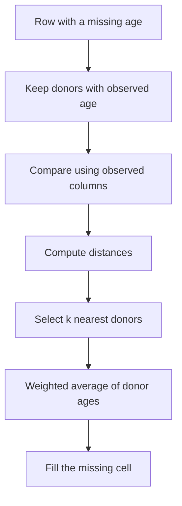
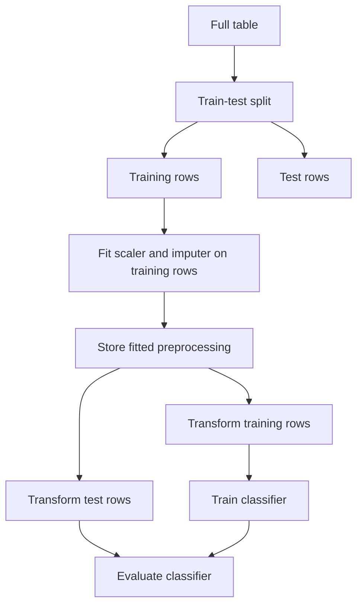
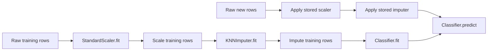
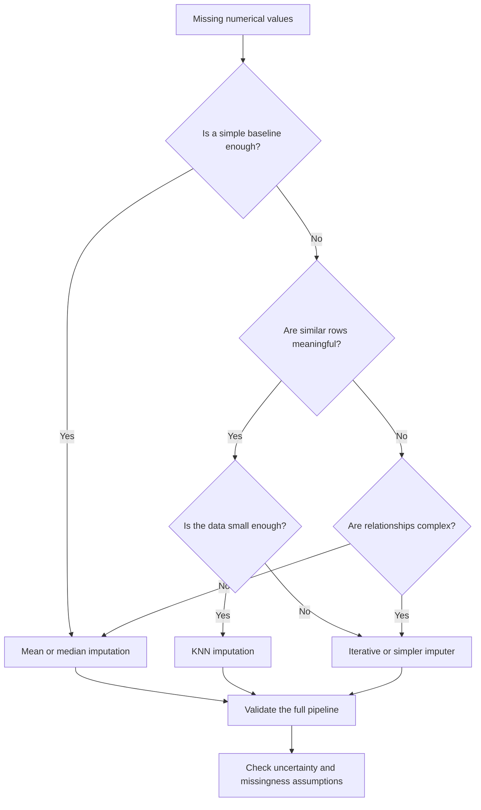

# Day 39 — KNN Imputer: Using Similar Rows to Fill Missing Values

> **Course:** CampusX 100 Days of Machine Learning, Day 39  
> **Official notebook:** `reference_notebooks/day39.ipynb` (12 cells, 11 with code and 1 empty)  
> **Dataset:** `datasets/train.csv` (Titanic table: 891 rows, 12 columns; the notebook uses `Age`, `Pclass`, `Fare`, `Survived`)  
> **Personal notebook:** none in this folder. This chapter is the learning material for the official notebook.

This chapter has two parts. **Part A** is the main learning chapter: read it first, and you should be able to explain and use KNN imputation without opening another source. **Part B** is the advanced reference: it keeps the longer derivations, alternative distance metrics, library internals, extra experiments, and the extended interview and examination bank. You do not need Part B to understand Part A.

The chapter is based on the actual notebook and dataset. Where a number comes from the notebook's saved output, it is called **official**. Where it was reproduced in this environment, it is called **rerun**. Explanations added for teaching are called **supplementary**. The distinction matters because the official KNN accuracy and the rerun accuracy are not identical.

---

# Part A — Main Learning Chapter

## 1. The problem: a passenger's age is missing

Imagine that you are preparing the Titanic data for a model that predicts survival. One of the input columns is `Age`. Most passengers have an age, but some do not. In this dataset there are 891 passengers, and 177 of them have a missing age:

$$
\frac{177}{891}\times 100 = 19.8653\%.
$$

So roughly one passenger in five has no recorded age. We cannot simply ignore the column, because age may contain useful information. We also cannot feed a missing value directly into most machine-learning models, because they expect a number.

The general name for filling a missing value is **imputation**. A very simple imputation is to replace every missing age with the average age of the passengers whose age is known. That is called **mean imputation**. It is easy to compute and it removes the missing values, but it has a hidden cost.

Before we look at the cost, we need one term. The **mean** is the arithmetic average: add the observed values and divide by how many there are. The **median** is the middle value after sorting. The **variance** measures how spread out the values are around their mean; the **standard deviation** is its square root and is in the same units as the original column.

For the observed ages in the full dataset, the mean is about 29.70 years, the median is 28 years, and the standard deviation is about 14.53 years. If we filled all 177 missing values with 29.70, every missing passenger would receive exactly the same age. The column would look complete, but it would contain less variation than the real ages.

### Why mean imputation is not enough

The problem is not only that the imputed values are all equal. The bigger problem is that the missing passengers are not a random mixture of all passengers. Their ages are related to other columns, especially passenger class.

Here are the observed ages by class:

| Passenger class | Observed passengers | Mean age | Median age | Standard deviation |
|---:|---:|---:|---:|---:|
| 1 | 186 | 38.23 | 37.0 | 14.80 |
| 2 | 173 | 29.88 | 29.0 | 14.00 |
| 3 | 355 | 25.14 | 24.0 | 12.50 |

A first-class passenger with a missing age is probably closer to 38 than to 30. A third-class passenger is probably closer to 25. Mean imputation gives both of them 29.70, because it ignores the class column. The overall average is preserved, but the average *within each class* is distorted.

The missingness itself is also uneven:

| Passenger class | Missing-age rate |
|---:|---:|
| 1 | 13.89% |
| 2 | 5.98% |
| 3 | 27.70% |

Third-class passengers are much more likely to have a missing age. This means the missing rows are not a random sample of the whole table. Filling them all with the global mean pulls the third-class ages upward and the first-class ages downward.

This is the key lesson: **a missing value is not just an empty cell; it is an empty cell inside a row that contains other information.** A method that uses only the column being filled is called **univariate** imputation. A method that uses several columns of the same row is called **multivariate** imputation. We want a multivariate method.

### Mean imputation also shrinks the variance

There is a mathematical consequence that is easy to see. Suppose the observed ages have variance $s^2_{\text{obs}}$ and there are $n_{\text{obs}}$ observed values. The full column has $n$ rows, so $n-n_{\text{obs}}$ values are replaced by the observed mean. Each imputed value has zero deviation from the new mean. The completed variance is therefore

$$
s^2_{\text{imputed}}
=
\frac{n_{\text{obs}}-1}{n-1}\,s^2_{\text{obs}}.
$$

For `Age`, $n_{\text{obs}}=714$ and $n=891$. Using $s_{\text{obs}}=14.5265$:

$$
s^2_{\text{imputed}}
=
\frac{713}{890}(14.5265)^2
\approx 168.86,
$$

so

$$
s_{\text{imputed}}\approx 13.00.
$$

The original standard deviation is 14.53; the mean-imputed version is 13.00. The completed column looks less spread out than the real data. A model trained on it sees an artificially narrow age distribution. This is one reason mean imputation can make a feature less useful, even though it removes the missing values.

The goal of KNN imputation is to keep the row's other information in the estimate. For a missing age, we will look at passengers who are similar in class and fare, and use their ages as a guide.

---

## 2. The nearest-neighbour idea

Suppose a passenger has a missing age, is in first class, and paid a fare of 133.65. We want an age estimate. Instead of using all 714 observed ages, we can look for passengers who are also in first class and paid a similar fare. Their ages are more relevant than the global average.

This is the basic idea of **K-nearest neighbours (KNN) imputation**:

> Find the rows that are most similar to the row with the missing value, and use their observed values of that feature to estimate the missing one.

The word **nearest** refers to similarity in the other features. The word **neighbours** refers to the rows that are closest. The number of rows we use is called $k$. If $k=3$, we use the three most similar rows that have an observed age.

The method is called **non-parametric** because it does not learn a fixed formula such as "age = a + b × fare". Instead, it keeps the training rows and makes a local estimate for each missing value. "Local" means it uses a small neighbourhood of similar rows, not the whole dataset. "Conditional" means the estimate is based on the values of the other features in that row.

In statistical language, the **expected value** is the long-run average we would see if we could repeat the observation many times. A **conditional expectation** is the average we expect *given* some known information, such as "given that the passenger is in first class and paid this fare". KNN is a simple local approximation to that conditional expectation: it averages the ages of rows that are close in the known features. The word "local" matters because the average is taken over a small neighbourhood, not over the whole dataset.

### The algorithm in plain language

For one missing cell in row $i$ and column $j$:

1. **Build a donor pool.** Keep only the rows that have an observed value in column $j$. A row with a missing value in that column cannot donate a value for that column.
2. **Compare the query row with each donor.** Use the columns that are observed in both rows. We cannot compare a value that one row does not have.
3. **Measure distance.** A smaller distance means the rows are more similar.
4. **Choose the $k$ closest donors.**
5. **Combine their values.** With uniform weights, take the simple average. With distance weights, give closer donors more influence.

The value being imputed is never used in its own distance calculation. That sounds obvious, but it is important: if the missing age were used to find neighbours, the method would be circular.

A diagram of the process:



The method is **not iterative**. It fills each missing cell from the observed donors in one pass. It is also **not the same as KNN classification**. In KNN classification, the neighbours vote on a class label. Here, the neighbours provide a numerical value that is averaged. The same distance idea is used, but the task is different.

### A small example with actual rows

In the training split, row 334 is a first-class passenger with a fare of 133.65 and a missing age. Using the raw class and fare values, the three nearest donors selected in the rerun were:

| Donor row | Donor age | Class | Fare | Distance |
|---:|---:|---:|---:|---:|
| 319 | 40 | 1 | 134.50 | 1.0410 |
| 337 | 41 | 1 | 134.50 | 1.0410 |
| 325 | 36 | 1 | 135.63 | 2.4290 |

With distance weights, the estimate is

$$
\hat{\text{age}}
=
\frac{
\frac{1}{1.0410}(40)
+
\frac{1}{1.0410}(41)
+
\frac{1}{2.4290}(36)
}{
\frac{1}{1.0410}
+
\frac{1}{1.0410}
+
\frac{1}{2.4290}
}
\approx 39.71.
$$

With uniform weights, the same three donors give

$$
\frac{40+41+36}{3}=39.0.
$$

The distance-weighted answer is closer to the two very similar donors (ages 40 and 41) and less influenced by the third donor. That is the purpose of distance weighting.

Notice that the estimate is not one of the observed ages. It is a weighted average. This is why KNN imputation can produce values that were never recorded, but it cannot go beyond the range of the donors it uses. With non-negative weights, the result is a convex combination of the donor values.

### Why the choice of $k$ matters

A small $k$ follows the nearest rows closely. It can capture local structure, but it is sensitive to noise and ties. A large $k$ averages many rows and becomes more stable, but it can include rows that are not really similar. In the extreme, if $k$ equals the number of donors and all weights are equal, KNN imputation becomes mean imputation:

$$
\frac{1}{n_j}\sum_{r\in D_j}x_{rj}
=
\bar{x}_j.
$$

So $k$ controls a bias–variance trade-off. Bias is error from using a simplified estimate; variance is sensitivity to the particular sample. Small $k$ tends to have low bias and high variance; large $k$ tends to have higher bias and lower variance. There is no universal best $k$. It should be chosen with validation data, not by repeatedly checking the test set.

---

## 3. How do we measure "near"?

To find neighbours, we need a distance. For two rows with $p$ features, the usual **Euclidean distance** is

$$
d(\mathbf{x},\mathbf{y})
=
\sqrt{\sum_{j=1}^{p}(x_j-y_j)^2}.
$$

Here:

- $\mathbf{x}$ and $\mathbf{y}$ are two rows;
- $x_j$ is the value of the first row in feature $j$;
- $y_j$ is the value of the second row in feature $j$;
- $p$ is the number of features.

The formula subtracts corresponding values, squares each difference, adds the squares, and takes the square root. Squaring prevents positive and negative differences from cancelling. The square root returns the result to the original units.

But our rows have missing values. We cannot subtract a missing age from another missing age. The practical solution is to use only the features that are observed in both rows. Let $O$ be the set of common observed features. A simple partial distance would be

$$
\sqrt{\sum_{j\in O}(x_j-y_j)^2}.
$$

This creates a new problem. If two rows are compared using only two features, their distance may look smaller than the distance between two rows compared using all four features, simply because fewer differences were included. To compensate, Scikit-learn's `nan_euclidean` distance multiplies the partial squared distance by the ratio of the total number of features to the number of common features:

$$
d_{\text{nan}}(\mathbf{x},\mathbf{y})
=
\sqrt{
\frac{p}{|O|}
\sum_{j\in O}(x_j-y_j)^2
}.
$$

Here $|O|$ is the number of commonly observed features. If all features are present, $|O|=p$ and the factor is 1, so the formula becomes ordinary Euclidean distance. If only half the features are common, the factor is 2, which makes the distance less artificially small.

For example, take $p=4$ and two rows:

$$
\mathbf{x}=(3,\ \text{NA},\ \text{NA},\ 6),
\qquad
\mathbf{y}=(1,\ \text{NA},\ 4,\ 5).
$$

Only features 1 and 4 are common, so $|O|=2$. The squared differences are

$$
(3-1)^2=4,
\qquad
(6-5)^2=1.
$$

The sum is 5. The adjustment factor is $4/2=2$. Therefore

$$
d_{\text{nan}}=\sqrt{2\cdot 5}=\sqrt{10}\approx 3.1623.
$$

Without the factor, the distance would be $\sqrt{5}\approx 2.2361$. The adjusted value is larger because only half of the coordinates contributed.

### Raw scale can dominate the distance

Distance depends on the units of the features. In the Titanic table, `Pclass` takes values 1, 2, and 3, while `Fare` ranges from about 0 to more than 500. A difference of 1 in class is tiny compared with a difference of 1 in fare. As a result, raw `Fare` can dominate the neighbour calculation, even though `Pclass` is more strongly related to age.

The correlation between `Age` and `Pclass` is about $-0.3692$, while the correlation between `Age` and `Fare` is only about $0.0961$. The feature that carries more age information is not the feature that dominates the raw distance. This is a mismatch.

The standard fix is **standardization**: for each feature, subtract its mean and divide by its standard deviation:

$$
z_j=\frac{x_j-\mu_j}{\sigma_j}.
$$

After this transformation, each feature has mean 0 and standard deviation 1, so no feature dominates merely because of its units. The scaler must be fitted on the training data only. If it is fitted on the full dataset, the test rows influence the training preprocessing, which is a form of **data leakage**.

A subtle point: scaling does not always improve the final accuracy on a small dataset. In this experiment, the cross-validation results with and without scaling were close, and sometimes the unscaled version was slightly better. That does not mean scaling is unnecessary. It means the dataset is small, the age–fare relationship is weak, and ties are common. Scaling is still the correct default for a distance-based method.

---

## 4. What the official notebook does

The official notebook is short: 12 cells, 11 with code and one empty. It compares two imputations using the same downstream classifier.

### Step 1: select the columns

```python
df = pd.read_csv('train.csv')[['Age','Pclass','Fare','Survived']]
```

The table keeps one incomplete feature (`Age`), two donor features (`Pclass`, `Fare`), and the target (`Survived`). The notebook does not use the other columns, so the only information available for finding neighbours is class and fare.

The target is not used to impute age. If it were, the outcome would leak into the input, and the model's evaluation would be too optimistic.

### Step 2: split before fitting

```python
X = df.drop(columns=['Survived'])
y = df['Survived']

X_train, X_test, y_train, y_test = train_test_split(
    X, y, test_size=0.2, random_state=2
)
```

The 891 rows become 712 training rows and 179 test rows. `Age` is missing in 148 training rows and 29 test rows. The training positive rate is 36.94%, and the test positive rate is 44.13%. The split is not stratified, so those rates differ by chance.

The split must happen before the imputer is fitted. The imputer is part of the preprocessing, and its donor matrix is learned from data. If it sees the test rows during `fit`, the test set has influenced the model pipeline.

The correct flow is:



The arrows show why the test rows never enter the `fit` step. They are transformed by objects that were learned only from the training rows.

### Step 3: fit the KNN imputer on training data

```python
knn = KNNImputer(n_neighbors=3, weights='distance')

X_train_trf = knn.fit_transform(X_train)
X_test_trf = knn.transform(X_test)
```

`KNNImputer` creates an imputer object. The parameters mean:

- `n_neighbors=3`: use three donors for each missing value;
- `weights='distance'`: closer donors receive larger weights;
- the default metric is `nan_euclidean`;
- the default `missing_values` is `np.nan`;
- the default `add_indicator=False`.

`fit_transform(X_train)` does two jobs. `fit` stores the training matrix and its missing-value mask. `transform` fills the training missing values using training donors. `transform(X_test)` uses the stored training state; the test rows are receivers, not donors.

This is the correct direction of information flow: training data help impute test data, but test data do not change the training imputer.

`KNNImputer` does not have a `statistics_` attribute like `SimpleImputer`. It is not storing one mean per column. It stores the training rows themselves (and a mask), because it needs them to find neighbours later. The important fitted attributes are the stored training matrix and the missing mask, not a small table of means.

### Step 4: fit a baseline mean imputer

```python
si = SimpleImputer()

X_train_trf2 = si.fit_transform(X_train)
X_test_trf2 = si.transform(X_test)
```

`SimpleImputer()` uses the mean by default for numerical columns. The training means are approximately:

| Feature | Training mean |
|---|---:|
| `Age` | 29.7859 |
| `Pclass` | 2.3006 |
| `Fare` | 32.2891 |

Only `Age` is actually filled, because the other two columns are complete. The baseline is useful because it isolates the effect of using similar rows instead of one global average.

### Step 5: train and evaluate the same classifier

```python
lr = LogisticRegression()
lr.fit(X_train_trf, y_train)
y_pred = lr.predict(X_test_trf)
accuracy_score(y_test, y_pred)
```

The same steps are repeated with the mean-imputed data. The official saved accuracies are:

| Imputation | Correct test predictions | Accuracy |
|---|---:|---:|
| KNN, 3 neighbours, distance weights | 128 / 179 | **0.7151** |
| Mean | 124 / 179 | **0.6927** |

The KNN version is better by four test rows. That is the result the course demonstrates. But four rows out of 179 is a small difference, and the rerun gives a slightly different KNN value: **0.7039** (126 correct). The mean result reproduces exactly at 0.6927. The difference in KNN is consistent with small changes in numerical libraries, tie-breaking, or the solver path.

The official notebook does not use a scaler, a pipeline, cross-validation, or a missing indicator. It is a compact demonstration, not a complete model-selection study. That is why the next sections separate what the experiment shows from what it does not show.

---

## 5. What the experiment can and cannot tell us

On the 179-row test set, the rerun confusion matrices are:

| KNN | Predicted 0 | Predicted 1 |
|---|---:|---:|
| Actual 0 | 91 | 9 |
| Actual 1 | 44 | 35 |

| Mean | Predicted 0 | Predicted 1 |
|---|---:|---:|
| Actual 0 | 91 | 9 |
| Actual 1 | 46 | 33 |

Both models make the same 100 negative predictions. The difference is entirely in the positive class: KNN finds 35 survivors, while mean imputation finds 33. Two rows move from false negatives to true positives. That is a real difference on this split, but it is not a large sample.

A 95% Wilson interval for the KNN accuracy is roughly [0.633, 0.766], and for the mean accuracy roughly [0.622, 0.756]. The intervals overlap heavily. A paired comparison is more informative because both models are evaluated on the same rows:

| Outcome | Count |
|---|---:|
| Both correct | 123 |
| KNN correct, mean wrong | 3 |
| KNN wrong, mean correct | 1 |
| Both wrong | 52 |

The discordant counts are 3 and 1. An exact McNemar test gives $p\approx 0.625$. There is no statistical evidence of a systematic difference on this test set.

Cross-validation on the full data tells a similar story. In a 5-fold experiment with preprocessing inside a pipeline:

| Configuration | Mean accuracy | Standard deviation |
|---|---:|---:|
| Mean imputation | 0.7048 | 0.0155 |
| KNN, $k=3$, unscaled, uniform | 0.7104 | 0.0175 |
| KNN, $k=3$, unscaled, distance | 0.7048 | 0.0170 |
| KNN, $k=5$, unscaled, uniform | 0.7037 | 0.0154 |
| KNN, $k=3$, scaled, uniform | 0.7082 | 0.0166 |
| Iterative imputation | 0.7037 | 0.0154 |

The differences are a few thousandths of accuracy, while the fold-to-fold standard deviation is about 0.02. The honest conclusion is that these methods are close on this dataset. KNN imputation is not automatically better; it is a different way to use information, and its value depends on the data and the downstream model.

The imputed age distribution also shows what happened. On the training rows, the observed mean age is 29.7859 with standard deviation 14.2951. The KNN-imputed column has mean 29.8845 and standard deviation 13.4734. The mean is close, but the spread is smaller. The maximum imputed age is 71, not 80, because KNN averages donor values and cannot extrapolate beyond the donors it uses.

The correlations help explain the geometry:

| Pair | Correlation |
|---|---:|
| `Age` and `Pclass` | -0.3692 |
| `Age` and `Fare` | 0.0961 |
| `Pclass` and `Fare` | -0.5495 |

`Pclass` is the more useful donor feature for age, but raw `Fare` has the larger range and therefore the larger influence on the distance. This is exactly why scaling matters conceptually, even when a small experiment does not show a clear accuracy gain.

### What you should not conclude

The experiment does **not** prove that:

- KNN imputation is always better than mean imputation;
- $k=3$ is the best number of neighbours;
- distance weights are always better than uniform weights;
- scaling is unnecessary because the cross-validation difference was small;
- the official accuracy of 0.7151 will reproduce exactly on another machine;
- the imputed ages are the true ages;
- the model is ready for deployment.

It **does** show that KNN imputation can be implemented in a few lines, that it produces plausible conditional estimates, and that the downstream result can change. It also shows that the change is small and uncertain on this dataset.

---

## 6. Doing it correctly in a real workflow

The official notebook fits the imputer on `X_train` and transforms `X_test`, which is leakage-free for this holdout. But it does not use a pipeline, so the discipline is not enforced for later experiments. A safer workflow is:

```python
from sklearn.pipeline import Pipeline
from sklearn.preprocessing import StandardScaler
from sklearn.impute import KNNImputer
from sklearn.linear_model import LogisticRegression

model = Pipeline([
    ("scale", StandardScaler()),
    ("impute", KNNImputer(n_neighbors=3, weights="distance")),
    ("classifier", LogisticRegression())
])

model.fit(X_train, y_train)
accuracy = model.score(X_test, y_test)
```

A **pipeline** is an object that chains steps. When `model.fit` is called, the scaler is fitted on the training rows, the imputer is fitted on the scaled training rows, and the classifier is fitted on the imputed training rows. When `model.predict` is called, the same stored transformations are applied to the new rows.



The same pipeline object therefore holds the scaler statistics, the donor matrix, and the classifier coefficients. Saving the pipeline saves the complete preprocessing state.

The order matters: scale first, then impute. If you impute first, the distance calculation uses raw units. If you scale after imputing, the scaler is still fitted on the imputed training data, which is acceptable, but the imputer's distances were already distorted. Scaling first is the cleaner order for a distance-based imputer.

Use cross-validation on the **raw** training data, not on a pre-imputed matrix:

```python
from sklearn.model_selection import cross_val_score

scores = cross_val_score(model, X_train, y_train, cv=5)
```

Inside each fold, the pipeline refits the scaler and imputer on that fold's training portion. The validation fold is transformed with those fitted objects, so it does not influence them. This is the practical meaning of leakage-free cross-validation.

If you tune `k`, the weights, or the metric, tune them inside the training data. Looking at the test accuracy for several values and then choosing the best one is **selection leakage**: the test set has influenced a modelling decision, so the final test score is optimistic. Use a validation split or nested cross-validation.

The same rule applies to the missing indicator. `KNNImputer(add_indicator=True)` adds a column that records which features had missing values during `fit`. It is a tool to test, not a guaranteed improvement. In this experiment, it changed the training shape from 712×3 to 712×4 and did not improve the holdout accuracy; the cross-validation mean was slightly lower. That is a result for this dataset, not a general verdict.

---

## 7. Assumptions, limitations, and alternatives

KNN imputation assumes that rows that are close in the observed features tend to have similar values in the missing feature. This is a **smoothness** assumption: the feature is expected to change gradually as the other features change. If the relationship is sharp or the neighbours are not meaningful, the estimate can be poor.

The method also inherits the missingness assumptions of the data. A useful classification is:

- **MCAR (missing completely at random):** the probability of missingness does not depend on any variable. Complete-case analysis is unbiased in large samples, and imputation is mainly about efficiency.
- **MAR (missing at random):** the probability of missingness depends on observed variables but not on the missing value itself, given those variables. Multivariate imputation can use the observed variables to improve estimates.
- **MNAR (missing not at random):** the probability depends on the unobserved value. No method can fully correct this without a model for the missingness mechanism.

In the Titanic data, missingness is associated with passenger class, so it is not MCAR. Whether it is MAR depends on whether class and fare capture the relevant information. KNN uses those observed columns, but it cannot know the true age of a passenger who did not report it.

KNN is also a **single imputation** method: it fills one value and treats it as if it were observed. This understates uncertainty. A confidence interval or standard error computed on the completed data will usually be too narrow. Multiple imputation addresses this by creating several completed datasets, fitting the model on each, and combining the results.

Other limitations:

- **Scaling sensitivity:** distances depend on units, so standardize unless the features are already comparable.
- **High-dimensional cost:** in many dimensions, distances become less informative and the transform becomes expensive.
- **Memory:** the imputer stores the training matrix, so the fitted object grows with the training set.
- **Ties:** many rows can have the same distance; the selected neighbour can depend on implementation details.
- **No extrapolation:** a weighted average of donors stays within the donor range.
- **Categorical features:** `KNNImputer` works on numerical arrays. Categorical columns must be encoded or handled separately.
- **Computational cost:** for $m$ rows to transform, $n$ training rows, and $p$ features, the distance work is roughly $O(mnp)$, plus neighbour selection and averaging. This can be expensive for large data.

Alternatives:

| Method | What it uses | Strength | Weakness |
|---|---|---|---|
| Mean/median | One column | Simple, fast, stable | Ignores other features; shrinks variance |
| KNN | Nearby rows | Local, multivariate | Sensitive to scale, $k$, distance, ties |
| Iterative imputer | Regression on other columns | Flexible conditional model | More complex; can overfit; slower |
| Multiple imputation | Several completed datasets | Reflects uncertainty | More work to combine results |
| Complete-case analysis | Only complete rows | Simple and unbiased under MCAR | Can lose many rows and bias under MAR/MNAR |

A practical decision guide:



In practice:

- Start with mean or median as a baseline.
- Use KNN when you believe similar rows should have similar values and the dataset is not too large or high-dimensional.
- Try iterative imputation when the relationships are complex and you need a regression-style conditional model.
- Use a missing indicator when missingness itself may carry information.
- Always evaluate on held-out data with the entire preprocessing pipeline inside the evaluation.

---

## 8. Common mistakes and debugging

| Symptom | Likely cause | Fix |
|---|---|---|
| Test accuracy looks too good | Imputer or scaler fitted before the split | Put preprocessing in a pipeline; fit only on training folds |
| `AttributeError: statistics_` | Expecting `KNNImputer` to store column means | Use the stored training matrix/mask; `statistics_` belongs to `SimpleImputer` |
| Distance dominated by one feature | Raw scales differ | Standardize before imputing |
| Different results across runs | Ties or library/version differences | Fix seeds where possible; inspect ties; report both official and rerun |
| Shape changed unexpectedly | `add_indicator=True` added columns | Check `indicator_` and the output shape |
| Transform is slow or memory-heavy | Large training matrix stored | Subsample, reduce features, or use a simpler imputer |
| Imputed values all identical | $k$ is the number of donors with uniform weights, or the data are degenerate | Reduce $k$ or use distance weights; check the donor pool |
| No improvement over mean | Weak relationship between donors and target feature | Use a different donor set, scaling, or another imputer |

A short debugging checklist:

1. Confirm the imputer was fitted on training data only.
2. Check the missing count before and after `transform`.
3. Check the output shape, especially with `add_indicator=True`.
4. Print a few donor rows and distances for one missing cell.
5. Verify that the scaler is fitted before the imputer in the pipeline.
6. Evaluate with a confusion matrix and a baseline, not accuracy alone.
7. Do not choose $k$ by looking at the test set.

---

## 9. Interview essentials

These are the questions to be able to answer after the main chapter. The extended bank is in Part B.

**Q1. What is KNN imputation?**  
It fills a missing value using the observed values of the $k$ most similar rows. Similarity is measured on the other features, and the donor values are combined by a uniform or distance-weighted average.

**Q2. Why not use the mean?**  
The mean ignores the rest of the row. If missingness or the feature itself is related to other columns, the mean gives the same answer to different kinds of rows and shrinks the variance. KNN uses local information.

**Q3. What does "multivariate" mean here?**  
It means the estimate uses several columns of the same row, not just the column being filled. The row is treated as a point in feature space.

**Q4. Why is the missing value excluded from its own distance?**  
Because it is unknown. Using it would be circular, and it would make the query artificially similar to donors that share the same placeholder.

**Q5. What is the NaN-Euclidean distance?**  
It computes the squared distance only on commonly observed features and multiplies by $p/|O|$, where $p$ is the total number of features and $|O|$ is the number of common observed features. The factor compensates for comparing rows with different amounts of overlap.

**Q6. Why scale before KNN?**  
Distance is unit-dependent. A feature with a large range can dominate the neighbour selection even if it is less informative. Standardization puts features on a comparable scale.

**Q7. What does `fit` store in `KNNImputer`?**  
It stores the training matrix and the missing-value mask needed to find donors. It does not store a single mean per column like `SimpleImputer`.

**Q8. What is the effect of $k$?**  
Small $k$ follows local structure but is noisy and sensitive to ties. Large $k$ is smoother but can include dissimilar rows. At $k$ equal to the number of donors with uniform weights, it becomes mean imputation.

**Q9. What is data leakage in this context?**  
It is using test data to fit the scaler, imputer, or model-selection decision. The evaluation then benefits from information it would not have in deployment. A pipeline fitted inside each cross-validation fold prevents this.

**Q10. Does KNN imputation preserve variance?**  
It usually shrinks variance because each imputed value is an average of donors. The effect is smaller than mean imputation but still present.

**Q11. When would you not use KNN imputation?**  
When the data are very large or high-dimensional, when features are categorical without a sensible distance, when the relationship is not smooth, or when a simpler baseline performs equally well.

**Q12. What is the difference between KNN imputation and KNN classification?**  
Classification predicts a class by neighbour voting. Imputation estimates a missing numerical value by averaging neighbour values. The distance machinery is similar, but the output and loss are different.

---

## 10. Exam practice

**Q1. Define univariate and multivariate imputation.**  
Univariate imputation fills a missing value using only the column that contains it. Multivariate imputation uses other columns of the same row to estimate it.

**Q2. Explain why mean imputation reduces variance.**  
Every imputed value equals the observed mean, so it contributes zero deviation from the new mean. The completed variance is $(n_{\text{obs}}-1)/(n-1)$ times the observed variance, which is smaller than the observed variance when some values are imputed.

**Q3. Compute the NaN-Euclidean distance for $\mathbf{x}=(3,\text{NA},\text{NA},6)$ and $\mathbf{y}=(1,\text{NA},4,5)$.**  
Common features are 1 and 4. Squared differences: $(3-1)^2=4$ and $(6-5)^2=1$. The sum is 5. With $p=4$ and $|O|=2$, the factor is 2. The distance is $\sqrt{2\cdot5}=\sqrt{10}\approx3.1623$.

**Q4. Why is a pipeline useful for imputation?**  
It ensures that the scaler and imputer are fitted only on the training portion of each split or cross-validation fold, then applied to validation/test data. This prevents leakage and makes the workflow reproducible.

**Q5. The official KNN accuracy is 0.7151 and the mean baseline is 0.6927. Can we conclude that KNN is better?**  
Not from this experiment alone. The difference is four rows out of 179, the confidence intervals overlap, and a paired test is not significant. Cross-validation shows differences of a few thousandths with fold-to-fold variation of about 0.02. The result is suggestive, not conclusive.

---

## 11. One-page revision

- Missing age: 177 of 891 rows (19.87%).
- Mean imputation gives every missing row the same value and ignores class/fare.
- Conditional means differ by class: about 38.2, 29.9, and 25.1 years.
- KNN uses the $k$ most similar rows with observed values.
- Distance: Euclidean on common features, adjusted by $p/|O|$ for missing coordinates.
- Scale features before using distances.
- `KNNImputer(n_neighbors=3, weights='distance')`; fit on train, transform test.
- `KNNImputer` stores the training matrix and mask, not `statistics_`.
- Official accuracy: KNN 0.7151, mean 0.6927; rerun KNN 0.7039.
- The difference is small and uncertain; cross-validation is close.
- Put scaling, imputation, and the model in a pipeline; never fit on test data.
- Choose $k$ with validation data, not the test set.
- KNN assumes similar rows have similar missing values; it is not a fix for MNAR or a substitute for uncertainty analysis.

---

# Part B — Advanced Reading and Reference

This part preserves the deeper material. It is not required for a first reading of Part A.

## B1. Formal setup and notation

Let $X$ be an $n\times p$ data matrix. Let $M$ be the missingness mask, with $M_{ij}=1$ when $X_{ij}$ is missing and $M_{ij}=0$ when it is observed. For a target cell $(i,j)$, the donor pool is

$$
D_j=\{r:M_{rj}=0\}.
$$

For a query row $i$ and donor $r$, the common observed coordinates are

$$
O_{ir}=\{\ell:M_{i\ell}=0\ \text{and}\ M_{r\ell}=0\}.
$$

The NaN-Euclidean distance is

$$
d_{\text{nan}}(i,r)
=
\sqrt{
\frac{p}{|O_{ir}|}
\sum_{\ell\in O_{ir}}(X_{i\ell}-X_{r\ell})^2
}.
$$

If $O_{ir}$ is empty, the distance is undefined; the implementation handles this with a fallback. The $k$ nearest donors are

$$
N_k(i)=\text{the }k\text{ donors in }D_j\text{ with smallest }d_{\text{nan}}(i,r).
$$

With uniform weights,

$$
\hat{X}_{ij}=\frac{1}{k}\sum_{r\in N_k(i)}X_{rj}.
$$

With inverse-distance weights,

$$
w_{ir}=\frac{1}{d_{\text{nan}}(i,r)},
\qquad
\hat{X}_{ij}
=
\frac{\sum_{r\in N_k(i)}w_{ir}X_{rj}}
{\sum_{r\in N_k(i)}w_{ir}}.
$$

The denominator is the sum of the weights, not $k$. Dividing by $k$ is a common arithmetic error. If a distance is zero, the implementation gives special treatment to the exact-match donors; otherwise the weight would be infinite.

The method is non-iterative: each target cell is filled once from observed donors. It is a single imputation, not a multiple imputation.

## B2. Distance metrics

| Metric | Formula or idea | Use | In `KNNImputer` |
|---|---|---|---|
| Euclidean | $\sqrt{\sum_j(x_j-y_j)^2}$ | Continuous, comparable scales | Yes, via `nan_euclidean` |
| Manhattan | $\sum_j|x_j-y_j|$ | Robust to some outliers; grid-like distances | Callable |
| Minkowski | $\left(\sum_j|x_j-y_j|^q\right)^{1/q}$ | General family; $q=1$ Manhattan, $q=2$ Euclidean | Callable |
| Chebyshev | $\max_j|x_j-y_j|$ | Largest coordinate difference | Callable |
| Cosine | $1-\frac{x\cdot y}{\|x\|\|y\|}$ | Direction similarity, text embeddings | Callable |
| Mahalanobis | $\sqrt{(x-y)^\top\Sigma^{-1}(x-y)}$ | Correlated features, covariance-aware | Callable |
| Hamming | Count of differing coordinates | Categorical/string-like data | Not directly for numeric imputer |
| Gower | Mixed-type distance | Mixed numerical/categorical tables | External implementation |

`KNNImputer` officially supports `nan_euclidean`; other metrics can be passed as callables, but they must handle missing values appropriately. A metric that cannot ignore missing coordinates is not a drop-in replacement.

Cosine distance ignores magnitude, so it is usually a poor choice for raw tabular measurements unless the direction is the meaningful quantity. Mahalanobis requires a reliable covariance estimate, which is difficult when many values are missing or $p$ is large. Hamming and Gower are relevant when categorical features are present, but the basic `KNNImputer` works on a numeric matrix; categorical encoding must be handled deliberately.

## B3. Weighting, ties, and a full numerical example

The actual training row 334 has `Age` missing, `Pclass=1`, and `Fare=133.65`. With three features and two common coordinates, the adjustment factor is $p/|O|=3/2=1.5$.

The rerun's nearest donors:

| Donor | Age | Class | Fare | Squared difference | Distance |
|---:|---:|---:|---:|---:|---:|
| 319 | 40 | 1 | 134.50 | $0.85^2=0.7225$ | $\sqrt{1.5\cdot0.7225}=1.0410$ |
| 337 | 41 | 1 | 134.50 | $0.85^2=0.7225$ | $1.0410$ |
| 325 | 36 | 1 | 135.63 | $1.9833^2=3.9335$ | $\sqrt{1.5\cdot3.9335}=2.4290$ |

There are three donors at distance 2.4290: rows 269 (age 35), 325 (age 36), and 373 (age 22). `np.argpartition` selects one of them; the rerun selected 325. This is a concrete example of tie-breaking affecting the imputed value.

The inverse-distance weights are

$$
w_{319}=0.9606,\qquad
w_{337}=0.9606,\qquad
w_{325}=0.4117.
$$

Their sum is $2.3329$. The weighted estimate is

$$
\hat{X}_{334,\text{Age}}
=
\frac{0.9606(40)+0.9606(41)+0.4117(36)}{2.3329}
\approx 39.7059.
$$

The uniform estimate is $(40+41+36)/3=39.0$. Inverse-squared weights would give a different answer:

$$
\frac{70/10^2+50/50^2}{1/10^2+1/50^2}
\approx 69.2308
$$

for the toy donors with distances 10 and 50 and values 70 and 50. Scikit-learn uses inverse distance, not inverse squared distance. The toy example also shows why the denominator must be the sum of weights: dividing the numerator by $k=2$ gives 4, which is outside the donor range and is not a weighted average.

When $k$ equals the number of donors and weights are uniform, the estimate is the column mean. This is a useful sanity check: KNN contains mean imputation as a special case.

## B4. Curse of dimensionality and cost

For two independent points uniformly distributed in $[0,1]^p$, the squared Euclidean distance is a sum of $p$ independent terms, each with mean $1/6$ and variance $7/180$. Therefore

$$
\mathbb{E}[d^2]=\frac{p}{6},
\qquad
\operatorname{Var}(d^2)=\frac{7p}{180}.
$$

The relative standard deviation of the squared distance is

$$
\frac{\sqrt{7p/180}}{p/6}
=
\sqrt{\frac{1.4}{p}}.
$$

As $p$ grows, absolute distances grow, but their relative spread shrinks. Distances become concentrated around a common value, so the difference between the nearest and farthest neighbour becomes small relative to the typical distance. This weakens the meaning of "nearest".

The nearest-neighbour distance in a unit cube scales roughly as $(1/n)^{1/p}$; as $p\to\infty$, this ratio approaches 1. High dimensionality therefore makes local methods less local, unless the data lie near a lower-dimensional manifold or the distance is learned.

Cost summary, with $n$ training rows, $m$ rows to transform, $p$ features, $k$ neighbours, and $q$ missing features per row:

| Operation | Time | Memory |
|---|---|---:|
| `fit` | $O(np)$ to validate and store | $O(np)$ |
| `transform` distances | $O(mnp)$ | chunked |
| neighbour selection | $O(mn)$ per feature | $O(n)$ |
| averaging | $O(mpk)$ | small |
| `SimpleImputer` fit | $O(np)$ | $O(p)$ |
| `SimpleImputer` transform | $O(mp)$ | $O(p)$ |

For $n=10^6$ rows and $p=100$ float64 features, the raw training matrix alone is about $10^6\cdot100\cdot8=800$ MB before masks and overhead. For $n=10^7$, it is 8 GB. This is the deployment problem: a fitted `KNNImputer` keeps the training data, unlike a mean imputer that keeps only one value per column.

## B5. Scikit-learn API details

The constructor parameters:

- `missing_values`: the placeholder to treat as missing; default `np.nan`.
- `n_neighbors`: number of donors; default 5.
- `weights`: `'uniform'`, `'distance'`, or a callable.
- `metric`: `'nan_euclidean'` by default; other metrics can be callable.
- `copy`: whether to copy the input; default `True`.
- `add_indicator`: append missingness indicators; default `False`.
- `keep_empty_features`: whether to keep features that are entirely missing; version-dependent.

Fitted state includes the stored training matrix (`_fit_X`), the missing mask (`_mask_fit_X`), feature metadata, and, when requested, an indicator object. It does **not** have `statistics_`. That attribute belongs to `SimpleImputer`, which stores one learned statistic per feature. `KNNImputer` is instance-based: the training rows are the model.

With `add_indicator=True`, the output has shape $(n,p+q)$, where $q$ is the number of features that had at least one missing value during `fit`. In this experiment, only `Age` qualified, so the training output became $(712,4)$ instead of $(712,3)$.

Version notes: the exact set of accepted metrics and the handling of empty features can change between scikit-learn releases. Always check the installed version's documentation rather than assuming the behavior of an older tutorial.

## B6. Missingness assumptions and uncertainty

MCAR, MAR, and MNAR are assumptions about the mechanism that produced the missing values, not properties of the imputer. KNN can use observed variables to approximate a conditional distribution under MAR, but it cannot recover information that is missing because of the unobserved value itself (MNAR) without an additional model.

Single imputation treats the filled value as known. This understates uncertainty. Multiple imputation creates $M$ completed datasets, fits the model on each, and combines the estimates using Rubin's rules. The between-imputation variance captures the uncertainty caused by not knowing the missing values.

A missing indicator can be useful when the fact of missingness is predictive. It should be evaluated, not assumed. In this dataset, adding the indicator did not improve the holdout and slightly reduced the 5-fold CV mean; that is a dataset-specific result.

## B7. Expanded experiment tables

Holdout accuracy for different $k$ (rerun):

| $k$ | Uniform | Distance |
|---:|---:|---:|
| 1 | 0.7207 | 0.7207 |
| 2 | 0.7095 | 0.7095 |
| 3 | 0.7039 | 0.7039 |
| 4 | 0.7039 | 0.7039 |
| 5 | 0.7039 | 0.7039 |
| 7 | 0.7039 | 0.7039 |
| 10 | 0.6983 | 0.7039 |
| 20 | 0.6927 | 0.7039 |

The best holdout value is $k=1$, not $k=3$. The course chose 3 as a practical compromise. The table is also a warning: choosing $k$ by looking at the test set is selection leakage. The reported best value is optimistic.

Repeated 5-fold by 5-repeat cross-validation (25 fits per configuration):

| Configuration | Mean accuracy | Standard deviation |
|---|---:|---:|
| Mean | 0.7017 | 0.0235 |
| KNN, $k=3$, unscaled, uniform | 0.7057 | 0.0240 |
| KNN, $k=3$, unscaled, distance | 0.7046 | 0.0228 |
| KNN, $k=3$, scaled, uniform | 0.7042 | 0.0228 |
| KNN, $k=3$, scaled, distance | 0.7048 | 0.0239 |
| Iterative | 0.7017 | 0.0221 |

The ranking is not stable across resampling. The differences are small relative to the uncertainty.

## B8. Extended interview bank

### Level 1 — definitions

**Q1. What is a donor in KNN imputation?**  
A donor is a training row that has an observed value in the column being imputed and is used to estimate the missing value.

**Q2. What is a query row?**  
The row that contains the missing cell being filled.

**Q3. What does `n_neighbors=3` mean?**  
Three donor rows are selected for each missing cell.

**Q4. What does `weights='distance'` mean?**  
Each donor's contribution is inversely proportional to its distance from the query, so closer donors have more influence.

### Level 2 — mechanics

**Q5. Why is the donor pool restricted to rows with an observed target value?**  
A row with a missing target cannot provide a value to average. It could still be a query, but not a donor for that column.

**Q6. What happens if no donor exists for a feature?**  
The feature cannot be imputed by donors. Implementations may drop it, keep it empty, or require a fallback. `keep_empty_features` controls whether an entirely empty feature is retained.

**Q7. What happens when distances tie?**  
The implementation selects among tied rows using its internal ordering or partitioning. The result can depend on row order and library version; this is why tie inspection matters.

**Q8. Why is `KNNImputer` called non-parametric?**  
It does not estimate a fixed set of regression coefficients. It keeps the training rows and makes a local estimate for each query.

### Level 3 — mathematics

**Q9. Derive the $k=n$ mean-imputation limit.**  
With uniform weights and all $n_j$ donors, the estimate is $(1/n_j)\sum_{r\in D_j}x_{rj}$, which is the column mean of the donor pool.

**Q10. Why does the NaN-Euclidean factor use $p/|O|$?**  
It rescales a partial squared distance to the scale of a full $p$-feature distance. Without it, pairs with fewer common features would look artificially close.

**Q11. What is the variance of a mini-batch mean?**  
For independent terms with variance $\sigma^2$, the mean of $B$ terms has variance $\sigma^2/B$. This is the same averaging principle behind KNN's reduced variance, although KNN neighbours are not a random sample.

**Q12. Why does KNN shrink variance?**  
Each imputed value is a weighted average of donors, so it tends to lie near the centre of the donor values and reduces the spread of the completed column.

### Level 4 — diagnosis

**Q13. Your KNN imputer gives the same value for every missing row. What do you check?**  
Check whether $k$ equals the donor count with uniform weights, whether the donor features are constant, and whether the distance matrix is degenerate. Also check that the imputer was fitted on the intended columns.

**Q14. Your transform is very slow. What are the likely causes?**  
Large $n$, large $p$, many rows to transform, or a callable metric that is not vectorized. Reduce features, subsample donors, or use a simpler imputer.

**Q15. Your cross-validation score is much higher than the holdout score. What could be wrong?**  
The preprocessing may be fitted outside the CV folds, or the holdout may come from a different distribution. Put the whole pipeline inside cross-validation and inspect the split.

**Q16. Why does scaling sometimes fail to improve accuracy?**  
If the informative feature has little variation, if ties dominate, or if the dataset is small, the effect may be lost in noise. Scaling is still the correct default; evaluate it with proper validation.

### Level 5 — design

**Q17. How would you handle categorical donor features?**  
Encode them with a distance-appropriate representation, use Gower distance, or impute categorical and numerical columns separately. One-hot encoding followed by Euclidean distance is possible but can distort distances; evaluate it.

**Q18. How would you choose $k$?**  
Use a validation split or nested cross-validation, evaluate the full pipeline, and report the uncertainty. Do not choose $k$ on the test set.

**Q19. When is iterative imputation preferable to KNN?**  
When the conditional relationship is better captured by a regression model, when the data are not locally smooth, or when you need a model that can use all features without storing the full training matrix.

**Q20. How would you explain the result to a non-technical stakeholder?**  
KNN fills a missing age by looking at passengers with similar class and fare. It produced a small improvement in this test, but the sample is small, so we should not promise a general improvement without further validation.

### Level 6 — advanced

**Q21. What is the difference between single and multiple imputation?**  
Single imputation fills one value and treats it as known. Multiple imputation creates several plausible completed datasets and combines the model estimates, capturing the uncertainty of the missing values.

**Q22. Why can high dimensionality break nearest-neighbour methods?**  
Distances concentrate: the nearest and farthest neighbours become similar in relative terms, so "nearest" carries less information. The effective sample size in a local neighbourhood also shrinks.

**Q23. What is the computational complexity of `transform`?**  
Roughly $O(mnp)$ for distances, plus neighbour selection and averaging. Memory is dominated by storing the training matrix.

**Q24. Does KNN imputation handle MNAR?**  
No. It can use observed variables to improve estimates under MAR, but MNAR requires a model of the missingness mechanism or external information.

### Level 7 — synthesis

**Q25. Design a complete imputation experiment.**  
Split the data; put scaling, imputation, and the model in a pipeline; compare mean, median, KNN, and iterative imputation with nested cross-validation; report accuracy and uncertainty; inspect the imputed distribution and donor behavior; test a missing indicator; and avoid tuning on the test set.

**Q26. A colleague says "KNN is better because it uses more information." How do you respond?**  
Using more information can help, but it also adds assumptions, cost, and sensitivity to scale and $k$. The benefit must be demonstrated on held-out data, not assumed from the algorithm's description.

## B9. Extended examination questions

**Q1. Derive the variance of mean-imputed data.**  
Let $n_{\text{obs}}$ observed values have variance $s^2_{\text{obs}}$, and let $n-n_{\text{obs}}$ values be replaced by the observed mean. The imputed values have zero deviation from the new mean, so the sum of squared deviations is unchanged. The variance with $n-1$ denominator is therefore $(n_{\text{obs}}-1)/(n-1)s^2_{\text{obs}}$.

**Q2. Explain why the NaN-Euclidean distance is not simply the Euclidean distance on the common coordinates.**  
A partial distance uses fewer terms, so it is systematically smaller when overlap is small. The factor $p/|O|$ puts it back on the scale of a full-feature distance. Without the factor, a pair with two common features could appear closer than a pair with four, even if their actual differences were larger.

**Q3. Show that distance-weighted KNN with all donors and equal distances reduces to the mean.**  
If all distances are equal, all weights are equal. The weighted average becomes the arithmetic mean of the donor values.

**Q4. Why does standardization not change the OLS fit but can change KNN imputation?**  
OLS is invariant to invertible linear rescaling in exact arithmetic: the fitted function is the same, although coefficients change. KNN uses distances directly, so rescaling changes which rows are neighbours and therefore changes the imputed values.

**Q5. A test set has 179 rows and KNN gets 128 correct while mean gets 124. Is the difference significant?**  
Not necessarily. The difference is four rows, the confidence intervals overlap, and a paired test on the discordant rows is not significant. Report the uncertainty and avoid claiming general superiority.

**Q6. Explain the bias–variance trade-off in choosing $k$.**  
Small $k$ gives a local estimate with low bias but high variance and sensitivity to noise. Large $k$ averages more donors, reducing variance but increasing bias because distant rows may not be similar. The best $k$ is chosen by validation.

**Q7. What does a missing indicator add, and when can it hurt?**  
It records whether a value was missing, allowing the model to learn a different relationship for missing rows. It can hurt when the indicator is sparse, when missingness is noise, or when the extra column encourages overfitting.

**Q8. Explain the leakage in fitting a scaler before the train–test split.**  
The scaler learns the mean and standard deviation from all rows, including test rows. The training transformation then contains information about the test distribution, so the evaluation is not a clean simulation of unseen data. Fit the scaler inside the training fold or pipeline.

## B10. Coverage and source fidelity

The official notebook has 12 cells: 11 code cells and one empty cell. The main operations are:

| Cell | Operation | Output |
|---:|---|---|
| 1 | imports | none |
| 2 | read and select four columns | none |
| 3 | `head()` | five rows |
| 4 | missing percentages | `Age 19.86532` |
| 5 | define `X`, `y` | none |
| 6 | train/test split | none |
| 7 | `X_train.head()` | five rows |
| 8 | KNN imputer | none saved |
| 9 | KNN model accuracy | 0.7150837988826816 |
| 10 | mean imputer | none |
| 11 | mean model accuracy | 0.6927374301675978 |
| 12 | empty | none |

The official notebook does not print the imputed table, use a pipeline, scale the features, cross-validate, or add an indicator. Those are supplementary analyses in this chapter, clearly labelled.

The mean accuracy reproduces exactly in the rerun. The KNN accuracy differs by two test rows. The difference is consistent with version-dependent tie-breaking and numerical paths. The chapter reports both rather than pretending the saved value is universal.

The source notebook has almost no Markdown, so the topic reconstruction comes from the code, saved outputs, the dataset, and the course sequence. No experimental result was invented. The transcript was used only for topic orientation, not for exact numbers.

## B11. References

- CampusX, 100 Days of Machine Learning, Day 39: KNN Imputer.
- Scikit-learn documentation: `KNNImputer`, `SimpleImputer`, `Pipeline`, `cross_val_score`.
- Little and Rubin, *Statistical Analysis with Missing Data*.
- Hastie, Tibshirani, and Friedman, *The Elements of Statistical Learning*.
- Cover and Hart (1967), nearest-neighbour pattern classification.
- Beyer, Goldstein, Ramakrishnan, and Shaft (1999), when is nearest neighbour meaningful?
