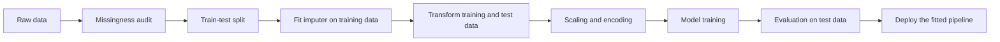
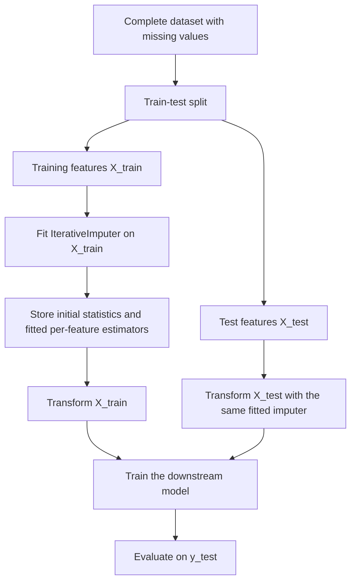
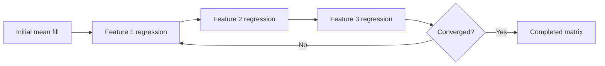
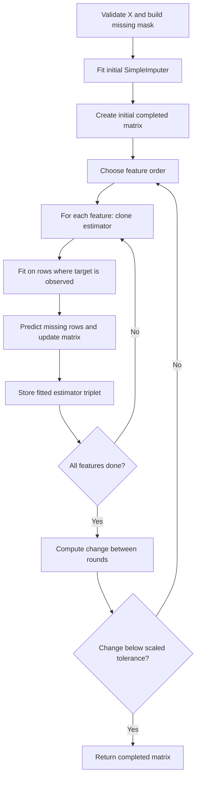
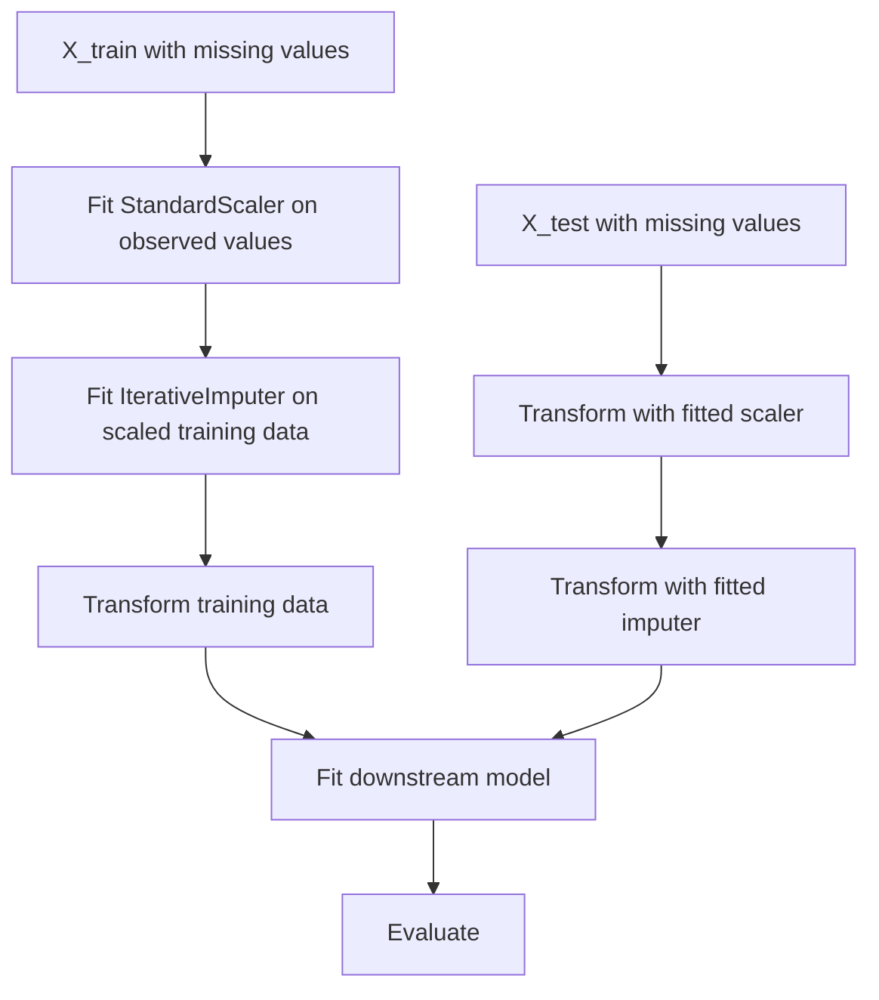

# Day 40 — Iterative Imputation: MICE and Chained Equations

> **Course:** CampusX — 100 Days of Machine Learning, Day 40
> **Official notebook:** `reference_notebooks/step-by-step.ipynb` (46 cells, no Markdown cells)
> **Official source:** `vendor/100-days-of-machine-learning/day40-iterative-imputer/step-by-step.ipynb`
> **Dataset:** `datasets/50_Startups.csv` (50 rows, 5 columns)
> **Transcript used:** `ML_Notes_Videos_31_40/transcripts/40_transcript.txt`
> **Central question:** If one feature is missing, can the other features tell us what it probably was — and if so, how do we turn that idea into a stable, leakage-safe algorithm?

### How this chapter is organised

This chapter is one unified study document for the single official Day 40 notebook. It starts with the limits of univariate and nearest-neighbour imputation, develops conditional imputation and the MICE/fully conditional specification idea, then walks through all 46 notebook cells, reproduces the arithmetic, explains the scikit-learn `IterativeImputer` API and internals, and finishes with convergence, uncertainty, leakage, comparisons, interview preparation, examination practice, a revision sheet, and a cell coverage matrix.

**Source labels used below.**

- **Official** means the CampusX notebook and its saved outputs.
- **Rerun** means a number reproduced in this environment with the same code.
- **Supplementary** means an explanation, experiment, or diagnostic added in this chapter and not present in the official notebook. Supplementary numbers are never presented as course output.

The official notebook is a hand-written demonstration on five rows. It does not import or call `IterativeImputer`. The scikit-learn API sections are therefore teaching material added beyond the notebook; they are labelled accordingly.

---

## Table of contents

1. Learning objectives
2. Where this topic sits in the machine-learning workflow
3. Why univariate imputation is limited
4. Why KNN imputation is limited
5. Conditional imputation: the central idea
6. Regression-based imputation
7. MICE and fully conditional specification
8. The dataset and the official experiment
9. The official notebook, cell by cell
10. The arithmetic of the first sweep
11. The second and third sweeps
12. `IterativeImputer`: API and internals
13. Worked scikit-learn examples
14. Convergence and diagnostics
15. Uncertainty and multiple imputation
16. Scaling, categorical variables, and model choice
17. Leakage-safe pipelines
18. Comparison with mean, median, and KNN
19. Common mistakes and debugging
20. Interview preparation, Levels 1–7
21. University examination practice
22. Revision sheet and mastery checklist
23. Coverage matrix for all 46 cells
24. References

---

# 1. Learning objectives

After studying this chapter, I should be able to:

1. **Explain the problem.** Describe why a missing value is not merely a blank cell, and why the filling method changes variances, covariances, distances, and model behaviour.
2. **Critique univariate imputation.** Derive the variance-shrinkage result for mean imputation, explain covariance attenuation, and state when a mean or median fill is still a reasonable baseline.
3. **Critique KNN imputation.** Explain `nan_euclidean` distance, the role of `n_neighbors`, the need for scaling, the curse of dimensionality, and the absence of uncertainty.
4. **Define conditional imputation.** Write the conditional distribution and conditional mean, and explain why other columns can carry information about a missing feature.
5. **Derive the regression step.** Write the ordinary least-squares normal equations, explain every symbol, and compute a prediction by hand on the actual notebook data.
6. **Explain MICE.** Describe multivariate imputation by chained equations, the round-robin update, the difference between a joint model and fully conditional specification, and the assumptions required.
7. **Trace the official notebook.** Explain every one of the 46 cells, including the saved outputs, the manual rounding, the non-update at cell 33, and the no-op at cell 43.
8. **Use `IterativeImputer` correctly.** Explain `estimator`, `max_iter`, `tol`, `initial_strategy`, `imputation_order`, `random_state`, `sample_posterior`, `skip_complete`, `add_indicator`, and the fitted attributes.
9. **Diagnose convergence.** Interpret `n_iter_`, the convergence warning, the relative tolerance, trace tables, and the difference between convergence and correctness.
10. **Separate single imputation from multiple imputation.** Explain Rubin's pooling rules and why `sample_posterior=True` is not, by itself, a complete multiple-imputation workflow.
11. **Build a leakage-safe pipeline.** Fit imputation on training data only, transform test data with the fitted object, and place the imputer inside cross-validation.
12. **Answer interview and examination questions.** Explain the reasoning, perform the calculations, compare alternatives, and discuss limitations.

---

# 2. Where this topic sits in the machine-learning workflow

Imputation is a **preprocessing** step. It belongs after the train–test split if any parameter is learned from the data:



The split comes before fitting the imputer because the imputer learns:

- the initial mean, median, or mode of each column;
- the regression coefficients used to predict one feature from the others;
- the feature order, correlation structure, and possibly random posterior draws.

All of those are **learned parameters**. If they are computed using the test rows, the test set has influenced preprocessing, and the evaluation is contaminated. This is **data leakage**.

There is an important ordering nuance. A domain decision such as “we will impute R&D Spend from Administration and Marketing Spend” can be made before seeing the split. The numerical values of the regression must be learned after the split. The same distinction appeared in earlier preprocessing topics:

- **Day 36 (`SimpleImputer`)** learned one statistic per column. It was univariate.
- **Day 38 (missing indicators)** learned which columns had missing values and appended binary flags.
- **Day 39 (`KNNImputer`)** used distances between rows. It was multivariate but local.
- **Day 40 (this day)** uses a regression model for each feature. It is multivariate, global, and iterative.

The detailed execution order for a supervised experiment is:



Two mistakes are common here:

1. Calling `fit_transform` on the full dataset and then splitting. The imputer has already seen the test rows.
2. Calling `fit_transform` on the test set. The test set must be transformed with the training-fitted object, not fitted again.

The correct contract is:

$$
\text{fit on } X_{\text{train}},
\qquad
\text{transform } X_{\text{train}} \text{ and } X_{\text{test}}.
$$

In scikit-learn, a `Pipeline` makes that contract executable because it calls `fit_transform` on the training portion and `transform` on the test portion. During cross-validation, the pipeline is refitted inside every fold.

---

# 3. Why univariate imputation is limited

## 3.1 What univariate imputation does

A **univariate imputer** fills a missing value in column $j$ using only the observed values of column $j$. The three basic recipes are:

$$
\hat{x}_{ij} =
\begin{cases}
\bar{x}_j, & \text{mean imputation},\\
\operatorname{median}(x_j), & \text{median imputation},\\
\operatorname{mode}(x_j), & \text{mode imputation}.
\end{cases}
$$

Here:

- $i$ indexes a row;
- $j$ indexes a feature;
- $x_{ij}$ is the value of feature $j$ for row $i$;
- $\bar{x}_j$ is the mean of the observed values in column $j$;
- $\operatorname{median}(x_j)$ is the middle observed value after sorting;
- $\operatorname{mode}(x_j)$ is the most frequent observed value.

The imputer ignores every other column. If R&D Spend is missing, the mean imputer does not ask whether Marketing Spend is large, whether Administration is small, or whether the row belongs to a particular State. It fills the same value for every missing row in that column.

## 3.2 A small actual example

The official notebook samples five rows from `50_Startups.csv`, divides the four numeric columns by 10,000, rounds them, and removes one value from each of the first three columns. The three inputs become:

```text
    R&D Spend  Administration  Marketing Spend
21        8.0            15.0             30.0
37        NaN             5.0             20.0
2        15.0            10.0             41.0
14       12.0             NaN             26.0
44        2.0            15.0              NaN
```

The observed R&D values are $8, 15, 12, 2$. Their mean is

$$
\bar{x}_{\text{R\&D}} = \frac{8+15+12+2}{4} = \frac{37}{4} = 9.25.
$$

The observed Administration values are $15, 5, 10, 15$, so

$$
\bar{x}_{\text{Admin}} = \frac{15+5+10+15}{4} = \frac{45}{4} = 11.25.
$$

The observed Marketing values are $30, 20, 41, 26$, so

$$
\bar{x}_{\text{Marketing}} = \frac{30+20+41+26}{4} = \frac{117}{4} = 29.25.
$$

Mean imputation therefore produces the matrix that the notebook calls `df0`:

```text
    R&D Spend  Administration  Marketing Spend
21       8.00           15.00            30.00
37       9.25            5.00            20.00
2       15.00           10.00            41.00
14      12.00           11.25            26.00
44       2.00           15.00            29.25
```

Notice what has happened: the missing R&D row is assigned $9.25$, even though its Marketing Spend is only $20$, its Administration is $5$, and the complete rows with low R&D have quite different profiles. The fill is a column average, not a conditional estimate.

## 3.3 Variance shrinkage: the exact result

Mean imputation systematically reduces the sample variance. This is not a small technicality; it changes the scale of the feature that the downstream model sees.

Suppose a column has $n$ rows, of which $n_o$ are observed and $r=n-n_o$ are missing. Let the observed values be $x_1,\dots,x_{n_o}$ with mean

$$
\bar{x}_o = \frac{1}{n_o}\sum_{i=1}^{n_o}x_i.
$$

Mean imputation replaces each missing value by $\bar{x}_o$. The filled column has mean $\bar{x}_o$ as well, because

$$
\frac{1}{n}\left(\sum_{i=1}^{n_o}x_i + r\bar{x}_o\right)
= \frac{n_o\bar{x}_o + r\bar{x}_o}{n}
= \bar{x}_o.
$$

The sum of squared deviations of the filled column is

$$
\sum_{i=1}^{n}(x_i^{\text{filled}}-\bar{x}_o)^2
=
\sum_{i=1}^{n_o}(x_i-\bar{x}_o)^2
+
\sum_{\text{missing}}(\bar{x}_o-\bar{x}_o)^2
=
\sum_{i=1}^{n_o}(x_i-\bar{x}_o)^2.
$$

The imputed rows contribute zero squared deviation. Therefore the sample variance of the filled column is

$$
s_{\text{filled}}^2
=
\frac{1}{n-1}\sum_{i=1}^{n_o}(x_i-\bar{x}_o)^2
=
\frac{n_o-1}{n-1}\,s_o^2,
$$

where

$$
s_o^2 = \frac{1}{n_o-1}\sum_{i=1}^{n_o}(x_i-\bar{x}_o)^2
$$

is the sample variance of the observed values. The factor

$$
\frac{n_o-1}{n-1}
$$

is less than one whenever at least one value is missing. The more missing values, the more severe the shrinkage.

For R&D Spend in the sample:

$$
n=5,\qquad n_o=4,\qquad s_o^2=31.5833,
$$

so

$$
s_{\text{filled}}^2
=
\frac{4-1}{5-1}\times 31.5833
=
0.75\times 31.5833
=
23.6875.
$$

The standard deviation falls from approximately $5.62$ to $4.87$. The same factor applies to the other two columns because each has exactly one missing value among five rows:

| Column | Observed variance $s_o^2$ | Filled variance $s_{\text{filled}}^2$ | Ratio |
|---|---:|---:|---:|
| R&D Spend | 31.5833 | 23.6875 | 0.75 |
| Administration | 22.9167 | 17.1875 | 0.75 |
| Marketing Spend | 78.2500 | 58.6875 | 0.75 |

This is a real distortion, not a cosmetic one. A model that standardizes features will divide by a standard deviation that is too small, and a distance-based model will treat the filled column as if it were more concentrated than it really is.

## 3.4 Covariance and correlation attenuation

Mean imputation also distorts relationships between columns. When a value is imputed at the column mean, its deviation from the mean is zero, so it contributes nothing to the covariance with another column. The covariance sum is effectively restricted to rows where both values are observed, while the denominator is still $n-1$.

For two columns $X$ and $Y$, the filled covariance is

$$
s_{XY}^{\text{filled}}
=
\frac{1}{n-1}
\sum_{i:\,X_i\text{ and }Y_i\text{ observed}}
(x_i-\bar{x}_o)(y_i-\bar{y}_o),
$$

where $\bar{x}_o$ and $\bar{y}_o$ are the observed means of the two columns. Rows with an imputed value in either column contribute zero to the sum. The denominator does not shrink. The covariance is therefore attenuated, and the correlation usually moves toward zero.

On the five-row sample, the pairwise-complete correlations and the correlations after mean filling are:

| Pair | Pairwise-complete correlation | Correlation after mean filling |
|---|---:|---:|
| R&D vs Administration | -0.8874 | -0.4840 |
| R&D vs Marketing | 0.6476 | 0.3868 |
| Administration vs Marketing | 0.4760 | 0.3616 |

These five-row correlations are statistically unstable and should not be used as substantive evidence. They are useful only as a demonstration of the mechanism: the filled values sit at the mean and therefore weaken the apparent linear relationship. On a larger dataset the exact numbers would differ, but the direction of the distortion is the same.

## 3.5 Distribution shape

Mean imputation creates a spike at the mean. The filled column is a mixture of:

- the observed distribution;
- a point mass at $\bar{x}_o$ with probability $r/n$.

A histogram therefore shows an artificial bar at the mean. Quantiles, skewness, and kurtosis change. The filled column is not a sample from the original distribution; it is a sample from a distorted distribution that has less spread and an artificial concentration point.

Median imputation has the same structural problem, although the spike is at the median and the median is more robust to extreme values. Mode imputation creates a spike at the most frequent value and is especially dangerous for continuous features because ties may be arbitrary.

## 3.6 Why univariate imputation is sometimes acceptable

Mean or median imputation is not always wrong. It can be a reasonable baseline when:

- the missing rate is very small, so the distortion is limited;
- the data are MCAR or nearly MCAR and the downstream model is robust;
- the feature is weak or will be dropped later;
- a missing indicator preserves the information that the value was absent;
- the goal is a quick baseline, not a final scientific estimate;
- the imputation is inside a properly fitted pipeline, so at least there is no leakage.

The mistake is not using a simple imputer. The mistake is using it while claiming that the filled values are accurate individual estimates, or using it when the missingness is strongly related to other features that could have supplied information.

## 3.7 Mean or median?

The mean minimizes the sum of squared errors. The median minimizes the sum of absolute errors. Therefore:

- if the downstream loss is squared error, the mean is the natural point summary;
- if the feature is skewed or has extreme values, the median is more robust;
- neither one uses the other columns;
- neither one restores the original variance;
- both create an artificial point mass.

The choice between mean and median is a choice about the summary, not a solution to the missing-data problem. The conditional approach in the rest of this chapter uses the other columns and is a different kind of answer.

---

# 4. Why KNN imputation is limited

## 4.1 The KNN idea

`KNNImputer` fills a missing value by looking at the rows that are most similar on the observed features. If row $i$ is missing feature $j$, the imputer finds its $k$ nearest neighbours among the rows where feature $j$ is observed, and combines their feature-$j$ values.

For uniform weights, the estimate is

$$
\hat{x}_{ij}
=
\frac{1}{\lvert N_k(i)\rvert}
\sum_{l\in N_k(i)} x_{lj},
$$

where:

- $N_k(i)$ is the set of the $k$ nearest neighbours of row $i$ that have an observed value of feature $j$;
- $\lvert N_k(i)\rvert$ is the number of such neighbours;
- $x_{lj}$ is the observed value of feature $j$ for neighbour $l$.

For distance weights, the estimate is

$$
\hat{x}_{ij}
=
\frac{\sum_{l\in N_k(i)} w_{il}x_{lj}}
{\sum_{l\in N_k(i)} w_{il}},
\qquad
w_{il}=\frac{1}{d(i,l)},
$$

where $d(i,l)$ is the distance between rows $i$ and $l$. Closer neighbours receive larger weights.

## 4.2 `nan_euclidean` distance

Ordinary Euclidean distance cannot be computed when one of the coordinates is missing. scikit-learn uses a variant that ignores coordinates missing in either row and rescales the remaining squared differences:

$$
d(i,l)
=
\sqrt{
\frac{p}{p_{il}}
\sum_{m\in O_{il}}(x_{im}-x_{lm})^2
},
$$

where:

- $p$ is the total number of features;
- $O_{il}$ is the set of features observed in both rows $i$ and $l$;
- $p_{il}=\lvert O_{il}\rvert$ is the number of coordinates present in both rows;
- the factor $p/p_{il}$ increases the weight of the coordinates that are present.

For example, compare row 44 `[2, 15, NaN]` with row 21 `[8, 15, 30]`. The common coordinates are R&D and Administration. The squared difference is

$$
(2-8)^2+(15-15)^2=36+0=36.
$$

There are $p=3$ features and $p_{il}=2$ common coordinates, so

$$
d=\sqrt{\frac{3}{2}\times 36}=\sqrt{54}\approx 7.35.
$$

This is the nearest neighbour of row 44. Its observed Marketing Spend is $30$, so `KNNImputer(n_neighbors=1)` fills the missing Marketing value with $30$. That matches the actual output:

```text
k = 1
[[ 8. 15. 30.]
 [12.  5. 20.]
 [15. 10. 41.]
 [12. 15. 26.]
 [ 2. 15. 30.]]
```

With $k=5$, all four other rows are used for each missing value, and the result becomes the observed column mean:

```text
k = 5
[[ 8.   15.   30.  ]
 [ 9.25  5.   20.  ]
 [15.   10.   41.  ]
 [12.   11.25 26.  ]
 [ 2.   15.   29.25]]
```

That is a useful warning: with a tiny dataset, a large neighbourhood degenerates into mean imputation.

## 4.3 Scaling

KNN is distance-based, so the units of the features matter. A feature measured in lakhs will dominate a feature measured in single digits unless the data are scaled. In the startup data, after dividing by 10,000, R&D Spend ranges from about $2$ to $16$, Administration from about $5$ to $18$, and Marketing Spend from about $3$ to $47$. Marketing already has the largest spread, so it would dominate an unscaled Euclidean distance.

The standard pattern is:

```python
from sklearn.pipeline import Pipeline
from sklearn.preprocessing import StandardScaler
from sklearn.impute import KNNImputer

knn_pipeline = Pipeline([
    ("scale", StandardScaler()),      # StandardScaler ignores NaN when learning
    ("impute", KNNImputer(n_neighbors=5)),
])
```

`StandardScaler` computes its mean and variance from the observed values and leaves `NaN` entries as `NaN`. The imputer then operates on standardized coordinates where each feature has comparable scale. If the final model expects original units, the imputed output can be inverse-transformed, but for distance-based imputation the standardized space is the meaningful space.

## 4.4 The choice of $k$

The number of neighbours controls a bias–variance trade-off:

- small $k$: low bias, high variance; the estimate follows local quirks and can copy an outlier;
- large $k$: lower variance, higher bias; the estimate smooths toward a global average;
- $k=n_o$: the estimate becomes the observed column mean, so KNN adds nothing over mean imputation.

There is no universal best $k$. It should be chosen by a mask-and-recover experiment or by downstream cross-validation, not by inspecting the final test score repeatedly.

## 4.5 Local versus global structure

KNN is a **local** method. It assumes that rows close in the observed feature space have similar values of the missing feature. That is useful when the relationship is nonlinear and locally smooth. It is weak when:

- the feature space is high-dimensional, so distances become less informative;
- many features are correlated, so the same information is counted several times;
- the missingness is related to the value itself, so the neighbours are a biased sample;
- the nearest neighbours are far away in absolute terms;
- the data contain categorical variables that have been encoded without a meaningful distance.

KNN is also not a generative model. It produces a point estimate, usually a weighted average. It does not produce a conditional variance, a posterior, or a set of plausible completed datasets. There is no `sample_posterior` option.

## 4.6 Computational and memory costs

`KNNImputer` must retain the training data and compute distances between rows. Fitting and transforming can be expensive when $n$ is large. For a full pairwise distance matrix the memory cost is $O(n^2)$; practical implementations may chunk the computation, but the number of distance evaluations remains large. Iterative imputation is also expensive, but for a different reason: it fits $p$ regressions per iteration. The right choice depends on whether $n$ or $p$ is the bottleneck.

## 4.7 When KNN is a good choice

KNN imputation can be reasonable when:

- $n$ is moderate and $p$ is small;
- features are scaled and meaningful;
- the relationship is local and nonlinear;
- the missing rate is low to moderate;
- a simple, non-parametric method is preferred;
- the downstream model does not need imputation uncertainty.

It is a strong baseline, but it is not a substitute for a conditional model when the global linear structure is the main source of information.

---

# 5. Conditional imputation: the central idea

## 5.1 The conditional distribution

Let $X_j$ be the feature with missing values and let

$$
X_{-j} = (X_1,\dots,X_{j-1},X_{j+1},\dots,X_p)
$$

be all the other features. Conditional imputation models

$$
p(x_j \mid x_{-j}),
$$

the distribution of the missing feature given the observed values of the other features.

The **conditional mean** is

$$
m_j(x_{-j}) = \mathbb{E}[X_j \mid X_{-j}=x_{-j}].
$$

If we want a single point estimate and we are penalised by squared error, the conditional mean is optimal. If we want to represent uncertainty, we need the whole conditional distribution, not just its mean.

## 5.2 Why conditioning helps

The univariate mean ignores the row. The conditional mean uses the row's other features. In the startup example, a row with low Marketing Spend and low Administration is not typical of a high R&D row; a conditional model can learn that and produce a different estimate for each row.

A simple linear conditional model is

$$
\hat{x}_{ij}
=
\beta_{j0}
+
\sum_{k\ne j}\beta_{jk}x_{ik},
$$

where:

- $\hat{x}_{ij}$ is the predicted value of feature $j$ for row $i$;
- $\beta_{j0}$ is the intercept for feature $j$;
- $\beta_{jk}$ is the coefficient that multiplies feature $k$ when feature $j$ is the target;
- $x_{ik}$ is the current value of feature $k$ for row $i$.

The coefficients are learned from rows where feature $j$ is observed. The missing rows are then predicted from their other features.

## 5.3 Conditional mean is not the same as a plausible value

Regression imputation fills the conditional mean. That value is the best point prediction under squared error, but it is not a draw from the conditional distribution. If the conditional distribution is wide, the mean can be far from the actual value.

For a normal linear model,

$$
X_j \mid X_{-j}=x_{-j}
\sim
\mathcal{N}\!\left(\beta_{j0}+\sum_{k\ne j}\beta_{jk}x_{ik},\ \sigma_j^2\right),
$$

where $\sigma_j^2$ is the conditional variance of feature $j$ given the other features. Regression imputation uses only the mean and sets the residual to zero. A stochastic imputation draws from the normal distribution, including the $\sigma_j^2$ term. That is the difference between “best guess” and “one plausible completed dataset”.

## 5.4 Missingness assumptions

The standard missingness mechanisms are defined with a missingness indicator $M_j$:

- **MCAR (missing completely at random):**

$$
P(M_j \mid X_{\text{obs}}, X_{\text{mis}}) = P(M_j).
$$

The probability of missingness does not depend on any data, observed or unobserved.

- **MAR (missing at random):**

$$
P(M_j \mid X_{\text{obs}}, X_{\text{mis}}) = P(M_j \mid X_{\text{obs}}).
$$

The probability may depend on observed values, but not on the unobserved value after conditioning on what is observed.

- **MNAR (missing not at random):**

$$
P(M_j \mid X_{\text{obs}}, X_{\text{mis}})
\neq
P(M_j \mid X_{\text{obs}}).
$$

The probability depends on the unobserved value itself.

Conditional imputation is most defensible under MAR: the observed columns contain the information needed to model the missing value. Under MNAR, the observed data alone are not enough; a model of the missingness mechanism or a sensitivity analysis is required. MICE does not solve MNAR by itself.

The lecture describes the mechanisms informally. The precise definitions above are the ones to use in an interview or examination.

## 5.5 What conditional imputation cannot do

Conditional imputation cannot:

- recover the exact value that was lost;
- prove that the missingness mechanism is MAR;
- guarantee that the conditional model is correctly specified;
- replace a sensitivity analysis when MNAR is plausible;
- make a biased sample representative;
- turn a small dataset into a large one.

It can produce a more plausible fill than a column mean when the other columns carry real information. That is the limited but useful promise.

---

# 6. Regression-based imputation

## 6.1 Ordinary least squares in one paragraph

For a target vector $y$ with $n$ observations and a design matrix $X$ with $n$ rows and $p+1$ columns (including an intercept), the linear model is

$$
y = X\beta + \varepsilon,
$$

where:

- $y$ is the $n\times 1$ vector of observed target values;
- $X$ is the $n\times(p+1)$ design matrix;
- $\beta$ is the $(p+1)\times 1$ vector of coefficients;
- $\varepsilon$ is the $n\times 1$ vector of errors.

The ordinary least-squares estimate minimises

$$
\operatorname{SSE}(\beta) = \lVert y-X\beta\rVert_2^2
= \sum_{i=1}^{n}(y_i-x_i^{\top}\beta)^2.
$$

The normal equations are

$$
X^{\top}X\hat{\beta}=X^{\top}y,
$$

so, when $X^{\top}X$ is invertible,

$$
\hat{\beta}=(X^{\top}X)^{-1}X^{\top}y.
$$

For a new row $x_*$, the prediction is

$$
\hat{y}_* = x_*^{\top}\hat{\beta}.
$$

In the imputation context, $y$ is the observed part of the feature being imputed, $X$ contains the other features for those rows, and $x_*$ is the row whose feature is missing.

## 6.2 Why one pass is not enough

The first regression for feature $j$ uses the current values of the other features. At the start, those values may themselves be mean imputations. The prediction for feature $j$ is therefore based on guesses. After feature $j$ is updated, the next feature's regression can use a better value for $j$. After all features have been updated once, the cycle can repeat.

The algorithm is solving a system of conditional models:

$$
\begin{aligned}
x_1 &= f_1(x_2,x_3,\dots,x_p)+\varepsilon_1,\\
x_2 &= f_2(x_1,x_3,\dots,x_p)+\varepsilon_2,\\
&\;\;\vdots\\
x_p &= f_p(x_1,x_2,\dots,x_{p-1})+\varepsilon_p.
\end{aligned}
$$

Each $f_j$ is a regression model. The equations are **chained**: the output of one equation becomes an input to the next. Repeating the chain is the “iterative” part of iterative imputation.

## 6.3 Why iteration can help

At iteration zero, every missing value is an initial guess. At iteration one, each feature is predicted from the other features using those guesses. At iteration two, the predictions from iteration one are used as inputs. If the conditional models are reasonable and the system is stable, the imputed values move toward a fixed point.

The fixed point satisfies, for every missing cell,

$$
x_{ij}^{(\infty)}
=
f_j\!\left(x_{i,-j}^{(\infty)}\right).
$$

This is a system of equations, not a guarantee of correctness. A fixed point can be:

- a good reconstruction;
- a poor local solution;
- an unstable oscillation;
- a solution determined mostly by the initial values;
- a solution that is mathematically consistent but substantively wrong.

That is why convergence diagnostics matter.

## 6.4 The small-sample danger

The official notebook uses four training rows to fit a regression with two predictors and an intercept. That is three parameters estimated from four observations. The residual degrees of freedom are

$$
n-p-1 = 4-2-1 = 1.
$$

A model with one residual degree of freedom can fit the training data closely. The first R&D regression has $R^2=0.8125$, the Administration regression has $R^2=0.9326$, and the Marketing regression has $R^2=0.1832$. Those numbers are not evidence that the imputations generalise. They are evidence that a tiny regression can contort itself to fit four points.

The danger is easy to state:

- with few rows, the coefficients are unstable;
- with correlated predictors, the coefficients can have large opposite signs;
- the prediction for a missing row can lie far outside the observed range;
- rounding intermediate predictions changes the next regression;
- the iterative process can move away from the truth rather than toward it.

The official notebook demonstrates the mechanics, not a reliable imputation model. That distinction is central to reading it correctly.

## 6.5 Regularisation and nonlinear estimators

OLS is not the only possible estimator. Common choices are:

- **Ridge regression:** adds an $L_2$ penalty, stabilises coefficients when predictors are correlated.
- **Bayesian ridge regression:** the default in `IterativeImputer`; estimates a noise precision and a weight precision, and can return a predictive standard deviation.
- **Lasso:** adds an $L_1$ penalty, can set coefficients to zero; useful when only a few features matter.
- **Elastic net:** combines $L_1$ and $L_2$.
- **Random forest / extra trees:** captures nonlinearity and interactions, but usually does not provide `return_std`.
- **K-nearest-neighbours regression:** local and nonlinear, but expensive and scale-sensitive.

The estimator is a modelling choice. The imputer does not become “assumption-free” because it is iterative. It inherits the assumptions of the estimator used for each feature.

---

# 7. MICE and fully conditional specification

## 7.1 The name

**MICE** stands for **Multivariate Imputation by Chained Equations**. The same family of methods is also called **FCS**, for **fully conditional specification**. The core idea is:

> Specify one conditional model for each variable with missing data, and update the variables one at a time, cycling through the models until the imputations stabilise.

This is different from specifying a single joint multivariate distribution for all variables. A joint model might be a multivariate normal distribution; MICE instead specifies the conditional distributions directly.

## 7.2 The algorithm

A generic MICE procedure is:

```text
Initialise every missing value with a simple guess.

For iteration t = 1, ..., T:
    For each feature j in the chosen order:
        Fit a model for feature j using rows where j is observed.
        Use the current values of the other features as predictors.
        Draw the model parameters from their posterior.        # proper MICE
        Draw a value for each missing x_j from its predictive
        distribution given the other features.                  # proper MICE
        Update the missing entries of feature j.

    Check convergence of the imputed values.
    If converged, stop.

Return the completed dataset, or repeat the whole process m times
to create m completed datasets for multiple imputation.
```

The scikit-learn `IterativeImputer` follows the same round-robin structure but, by default, uses a **point prediction** instead of drawing parameters and values. This is why it is best described as “MICE-like” or “iterative regression imputation”, not as a complete multiple-imputation engine.

## 7.3 A diagram of the chain



The loop is the “chained” part. The order matters because feature 2 sees the updated feature 1, feature 3 sees the updated features 1 and 2, and the next iteration sees the updated feature 3. Different orders can converge to different numerical answers.

## 7.4 Joint modelling versus FCS

A joint modelling approach specifies

$$
p(x_1,\dots,x_p;\theta)
$$

and imputes from the conditional distributions derived from that joint model. For multivariate normal data, the conditional distributions are linear regressions with specific variance constraints.

FCS specifies

$$
p(x_1\mid x_{-1};\theta_1),\ \dots,\ p(x_p\mid x_{-p};\theta_p)
$$

separately. The conditional models may not be compatible with any single joint distribution. This is the **compatibility** problem. In practice, FCS is widely used because it is flexible: it can use logistic regression for binary variables, multinomial regression for categorical variables, and linear regression for continuous variables in the same chain.

The price of that flexibility is that convergence and theoretical guarantees are weaker than in a carefully specified joint model.

## 7.5 What proper multiple imputation adds

A full multiple-imputation procedure has three stages:

1. **Imputation:** create $m$ completed datasets, not one. Each dataset should reflect uncertainty about the missing values and about the model parameters.
2. **Analysis:** fit the substantive model separately on each completed dataset.
3. **Pooling:** combine the $m$ estimates and their standard errors using Rubin's rules.

`IterativeImputer` can help with the first stage, but it does not implement stages 2 and 3. It returns one matrix. Its `sample_posterior=True` option adds predictive noise, but it still returns one matrix and does not pool.

## 7.6 Convergence in MICE

MICE is a Markov-chain-like procedure. The imputed values are updated conditional on the current values of the other features. Diagnostics usually include:

- trace plots of imputed values or model parameters across iterations;
- comparison of means, variances, and correlations across iterations;
- multiple chains started from different initial values;
- checks that the number of iterations is large enough;
- sensitivity to the ordering of the variables;
- sensitivity to the imputation model.

There is no universal number of iterations. The default of 10 in `IterativeImputer` is a convenience, not a theorem. A slow-converging problem may need more; a simple problem may converge in 3 or 4.

## 7.7 When MICE is appropriate

MICE is most defensible when:

- the missingness is MCAR or MAR;
- there is enough data to estimate the conditional models;
- the conditional models are reasonably specified;
- the missing rate is not so high that the models are extrapolating into regions with little support;
- the analysis can use multiple imputation if uncertainty matters.

It is not a universal fix for MNAR, and it is not automatically better than a simple imputer for prediction. On small datasets with many features, the regression models can be unstable, as the official notebook shows.

---

# 8. The dataset and the official experiment

## 8.1 The raw dataset

`50_Startups.csv` contains 50 rows and five columns:

| Column | Type | Meaning |
|---|---|---|
| `R&D Spend` | numeric | spending on research and development |
| `Administration` | numeric | spending on administration |
| `Marketing Spend` | numeric | spending on marketing |
| `State` | categorical | New York, California, or Florida |
| `Profit` | numeric | target variable |

The raw data have no missing values. The complete dataset has:

- R&D Spend range from $0$ to $165{,}349.20$;
- Administration range from $51{,}283.14$ to $182{,}645.56$;
- Marketing Spend range from $0$ to $471{,}784.10$;
- Profit range from $14{,}681.40$ to $192{,}261.83$;
- State counts: New York 17, California 17, Florida 16.

The correlations in the complete data are:

| Pair | Correlation |
|---|---:|
| R&D Spend vs Profit | 0.9729 |
| Marketing Spend vs Profit | 0.7478 |
| Administration vs Profit | 0.2007 |
| R&D Spend vs Marketing Spend | 0.7242 |
| R&D Spend vs Administration | 0.2420 |
| Administration vs Marketing Spend | -0.0322 |

These correlations are computed on the original scale; scaling by a positive constant does not change them. R&D Spend is strongly related to Profit, Marketing Spend is moderately related, and Administration is weakly related.

## 8.2 The notebook's preprocessing

The notebook uses only the four numeric columns and drops `State`:

```python
df = np.round(
    pd.read_csv("50_Startups.csv")[
        ["R&D Spend", "Administration", "Marketing Spend", "Profit"]
    ] / 10000
)
np.random.seed(9)
df = df.sample(5)
df
```

The steps are:

1. `pd.read_csv` loads the file.
2. The list of column names selects four columns.
3. Division by 10,000 changes the units from rupees to tens of thousands of rupees.
4. `np.round` rounds to the nearest integer.
5. `np.random.seed(9)` fixes NumPy's global random state.
6. `df.sample(5)` selects five rows without replacement.

The sampled row labels are 21, 37, 2, 14, and 44. The labels are preserved by pandas, so `df.iloc[1]` is the row labelled 37, not the row labelled 1. This is the first syntax trap in the notebook: `iloc` uses positions, while `loc` uses labels.

The scaled and rounded sample is:

```text
    R&D Spend  Administration  Marketing Spend  Profit
21        8.0            15.0             30.0    11.0
37        4.0             5.0             20.0     9.0
2        15.0            10.0             41.0    19.0
14       12.0            16.0             26.0    13.0
44        2.0            15.0              3.0     7.0
```

Rounding before sampling matters. The original values are not exact multiples of 10,000, and `np.round` uses round-half-to-even for exact halves. The rounded data are easier to display and calculate, but they are not the raw measurements.

## 8.3 Dropping the target

The next cell removes the last column:

```python
df = df.iloc[:, 0:-1]
df
```

`iloc[:, 0:-1]` means:

- `:` in the row position means all rows;
- `0:-1` in the column position means columns from position 0 up to, but not including, the last position.

The result is a five-row, three-column input matrix:

```text
    R&D Spend  Administration  Marketing Spend
21        8.0            15.0             30.0
37        4.0             5.0             20.0
2        15.0            10.0             41.0
14       12.0            16.0             26.0
44        2.0            15.0              3.0
```

Profit is the target, not an input. Imputing inputs using the target would be a form of target leakage if the target is unavailable at prediction time. The notebook correctly removes Profit before the imputation demonstration.

## 8.4 Creating the missing pattern

The notebook deliberately removes three values:

```python
df.iloc[1, 0] = np.NaN
df.iloc[3, 1] = np.NaN
df.iloc[-1, -1] = np.NaN
df.head()
```

The positions are:

- row position 1, column position 0: row label 37, R&D Spend;
- row position 3, column position 1: row label 14, Administration;
- row position -1, column position -1: last row (label 44), last column (Marketing Spend).

The resulting matrix is:

```text
    R&D Spend  Administration  Marketing Spend
21        8.0            15.0             30.0
37        NaN             5.0             20.0
2        15.0            10.0             41.0
14       12.0             NaN             26.0
44        2.0            15.0              NaN
```

Each column has exactly one missing value. The missing values were chosen by hand, and all three happen to remove low values: R&D $=4$, Administration $=16$, Marketing $=3$. The observed column means are therefore biased relative to the complete five-row means:

| Column | Complete five-row mean | Observed mean after deletion | Direction |
|---|---:|---:|---|
| R&D Spend | 8.20 | 9.25 | observed mean is higher because the low value 4 was removed |
| Administration | 12.20 | 11.25 | observed mean is lower because the high value 16 was removed |
| Marketing Spend | 24.00 | 29.25 | observed mean is higher because the low value 3 was removed |

This is not MCAR in the sense of a random deletion mechanism. It is a deliberately constructed pattern. The demonstration is designed to show the algorithm, not to estimate a real missingness mechanism.

## 8.5 The true values behind the missing cells

Because we have the original data, we can write down the values that the imputer is trying to reconstruct:

| Row | Feature | True scaled value | Mean fill | Final manual imputation |
|---|---|---:|---:|---:|
| 37 | R&D Spend | 4.0 | 9.25 | 24.57 |
| 14 | Administration | 16.0 | 11.25 | 11.37 |
| 44 | Marketing Spend | 3.0 | 29.25 | 45.53 |

The mean fills are poor for R&D and Marketing because the deleted values are far below the observed means. The manual iterative procedure moves R&D from 9.25 to 24.57 and Marketing from 29.25 to 45.53, both in the wrong direction relative to the true values. Administration stays near 11, also far from 16. This is the most important interpretive fact in the notebook: **iteration is not a guarantee of accuracy**. With four training rows and an unregularised linear model, the procedure can move confidently away from the truth.

---

# 9. The official notebook, cell by cell

The official notebook has 46 code cells and no Markdown cells. The following walkthrough covers every cell. The saved outputs are quoted as **Official**. Where I reran the arithmetic, the result is labelled **Rerun**.

## 9.1 Setup: cells 1–5

### Cell 1 — imports

```python
import pandas as pd
import numpy as np

from sklearn.linear_model import LinearRegression
```

`pandas` handles the table, `numpy` supplies `NaN`, and `LinearRegression` is the estimator used inside each manual regression. The notebook does **not** import `IterativeImputer`; the scikit-learn imputer is discussed only in the lecture and in this chapter.

### Cell 2 — load, scale, round, sample

```python
df = np.round(pd.read_csv("50_Startups.csv")[
    ["R&D Spend", "Administration", "Marketing Spend", "Profit"]
] / 10000)
np.random.seed(9)
df = df.sample(5)
df
```

The saved output is the five-row table shown in Section 8.2. The row labels 21, 37, 2, 14, and 44 are original dataset indices. The scaling by 10,000 is not a statistical transformation; it only changes the unit. The rounding does change the values slightly.

**What to observe.** The sample contains rows with very different profiles. Row 2 has large R&D, large Marketing, and large Profit. Row 44 has small R&D, large Administration, and small Marketing. Those differences are the raw material for a conditional model.

### Cell 3 — drop Profit

```python
df = df.iloc[:, 0:-1]
df
```

The saved output has three columns. The target has been removed. The input matrix is now ready for imputation.

### Cell 4 — inject missing values

```python
df.iloc[1, 0] = np.NaN
df.iloc[3, 1] = np.NaN
df.iloc[-1, -1] = np.NaN
```

No output is saved. The cell mutates `df` in place. `np.NaN` is a floating-point missing value. The positions are positional, not label-based.

### Cell 5 — inspect the missing pattern

```python
df.head()
```

The output shows the matrix with one `NaN` in each column. `head()` prints the first five rows; because the table has exactly five rows, it shows everything.

**What to observe.** Each missing value is in a different row and a different column. This pattern makes the round-robin demonstration easy to follow, but it also means that the regression for each feature has only four training rows.

## 9.2 Initialisation: cells 6–7

### Cell 6 — mean imputation

```python
df0 = pd.DataFrame()

df0["R&D Spend"] = df["R&D Spend"].fillna(df["R&D Spend"].mean())
df0["Administration"] = df["Administration"].fillna(df["Administration"].mean())
df0["Marketing Spend"] = df["Marketing Spend"].fillna(df["Marketing Spend"].mean())
```

This builds a new DataFrame with the same index as `df`. `Series.fillna(value)` replaces missing entries. `Series.mean()` skips `NaN` by default, so the mean is computed from the four observed values in each column.

The three means are:

$$
\bar{x}_{\text{R\&D}}=9.25,\qquad
\bar{x}_{\text{Admin}}=11.25,\qquad
\bar{x}_{\text{Marketing}}=29.25.
$$

The code is verbose because it writes each column separately. A shorter equivalent would be:

```python
df0 = df.fillna(df.mean())
```

The long form makes the per-column operation explicit, which is useful for a first demonstration.

**Important detail.** `df0 = pd.DataFrame()` creates an empty DataFrame. Assigning a Series to a column aligns the Series by index. The resulting index is the original row labels 21, 37, 2, 14, 44. This matters later when subtracting DataFrames: pandas aligns by index, not by position.

### Cell 7 — display iteration zero

```python
df0
```

The saved output is the mean-filled matrix:

```text
    R&D Spend  Administration  Marketing Spend
21       8.00           15.00            30.00
37       9.25            5.00            20.00
2       15.00           10.00            41.00
14      12.00           11.25            26.00
44       2.00           15.00            29.25
```

This is the initial state for the iterative procedure. The notebook calls it iteration zero. In scikit-learn terms, this is the `initial_strategy='mean'` step performed by `initial_imputer_`.

## 9.3 First sweep: cells 8–25

### Cell 8 — remove the R&D fill

```python
df1 = df0.copy()
df1.iloc[1, 0] = np.NaN
df1
```

`df1` is a copy of the mean-filled matrix. The R&D value in row position 1 (label 37) is set back to `NaN`. The other two missing values remain filled with their means.

The output:

```text
    R&D Spend  Administration  Marketing Spend
21        8.0           15.00            30.00
37        NaN            5.00            20.00
2        15.0           10.00            41.00
14       12.0           11.25            26.00
44        2.0           15.00            29.25
```

The missing R&D value is now the target for the first regression.

### Cell 9 — training inputs for R&D

```python
X = df1.iloc[[0, 2, 3, 4], 1:3]
X
```

The row positions `[0, 2, 3, 4]` are the rows where R&D is observed: labels 21, 2, 14, 44. The column positions `1:3` are Administration and Marketing Spend. The row at position 1 (label 37) is excluded because its R&D target is missing.

The output:

```text
    Administration  Marketing Spend
21           15.00            30.00
2            10.00            41.00
14           11.25            26.00
44           15.00            29.25
```

### Cell 10 — training target for R&D

```python
y = df1.iloc[[0, 2, 3, 4], 0]
y
```

The output is the R&D values for the same four rows:

```text
21     8.0
2     15.0
14    12.0
44     2.0
Name: R&D Spend, dtype: float64
```

`X` and `y` are aligned by position because both use the same row list. The estimator will fit a linear function of Administration and Marketing Spend that predicts R&D Spend on these four rows.

### Cell 11 — fit and predict R&D

```python
lr = LinearRegression()
lr.fit(X, y)
lr.predict(df1.iloc[1, 1:].values.reshape(1, 2))
```

`LinearRegression()` creates an unfitted estimator. `.fit(X, y)` estimates the intercept and two coefficients. `.predict(...)` receives the missing row's Administration and Marketing values.

The expression `df1.iloc[1, 1:].values` produces a one-dimensional NumPy array of length 2. `.reshape(1, 2)` turns it into a $1\times 2$ matrix because scikit-learn expects a two-dimensional input.

The saved prediction is:

```text
array([23.14158651])
```

The model predicts that row 37 has R&D Spend approximately 23.14 (in tens of thousands). Its true value is 4.0. The prediction is far too high. This is the small-sample instability in action.

### Cell 12 — store the rounded prediction

```python
df1.iloc[1, 0] = 23.14
```

No output. The prediction is rounded to two decimals and written back. This rounding is a pedagogical choice. It changes the next regression because the Administration regression will use 23.14 rather than 23.14158651.

### Cell 13 — display after R&D update

```python
df1
```

The output shows R&D row 37 = 23.14. The other imputed values remain 11.25 and 29.25.

### Cell 14 — remove the Administration fill

```python
df1.iloc[3, 1] = np.NaN
df1
```

Row position 3 is label 14. Its Administration value is set back to `NaN`. R&D now uses the newly imputed 23.14 for row 37. Marketing is still 29.25 for row 44.

The output:

```text
    R&D Spend  Administration  Marketing Spend
21       8.00           15.0            30.00
37      23.14            5.0            20.00
2       15.00           10.0            41.00
14      12.00            NaN            26.00
44       2.00           15.0            29.25
```

### Cell 15 — training inputs for Administration

```python
X = df1.iloc[[0, 1, 2, 4], [0, 2]]
X
```

The training rows are positions 0, 1, 2, 4: labels 21, 37, 2, 44. The predictors are columns 0 and 2: R&D Spend and Marketing Spend. Row 14 is excluded because Administration is the target.

The output includes the newly imputed R&D value 23.14 for row 37.

### Cell 16 — training target for Administration

```python
y = df1.iloc[[0, 1, 2, 4], 1]
y
```

The target values are $15, 5, 10, 15$. The mean is $11.25$, but the regression can use R&D and Marketing to differentiate the rows.

### Cell 17 — fit and predict Administration

```python
lr = LinearRegression()
lr.fit(X, y)
lr.predict(df1.iloc[3, [0, 2]].values.reshape(1, 2))
```

The saved prediction is:

```text
array([11.06331285])
```

The prediction is approximately 11.06. The true Administration value for row 14 is 16.0. The model again predicts near the observed mean.

### Cell 18 — store the rounded prediction

```python
df1.iloc[3, 1] = 11.06
```

The Administration fill is replaced by 11.06. This becomes an input to the Marketing regression.

### Cell 19 — display after Administration update

```python
df1
```

The output shows Administration row 14 = 11.06. R&D row 37 = 23.14. Marketing row 44 is still the mean 29.25.

### Cell 20 — remove the Marketing fill

```python
df1.iloc[4, -1] = np.NaN
df1
```

Row position 4 is label 44. Its Marketing value is set back to `NaN`. `-1` in the column position means the last column. The output has marketing missing for row 44.

### Cell 21 — training inputs for Marketing

```python
X = df1.iloc[0:4, 0:2]
X
```

Rows 0 through 3 are positions 0, 1, 2, 3: labels 21, 37, 2, 14. Columns 0 and 1 are R&D Spend and Administration. Row 44 is excluded because Marketing is the target.

### Cell 22 — training target for Marketing

```python
y = df1.iloc[0:4, -1]
y
```

The target values are $30, 20, 41, 26$. Their mean is $29.25$.

### Cell 23 — fit and predict Marketing

```python
lr = LinearRegression()
lr.fit(X, y)
lr.predict(df1.iloc[4, 0:2].values.reshape(1, 2))
```

The saved prediction is:

```text
array([31.56351448])
```

The prediction is approximately 31.56. The true Marketing value for row 44 is 3.0. The model predicts near the observed mean, not near the low true value.

### Cell 24 — store the rounded prediction

```python
df1.iloc[4, -1] = 31.56
```

The Marketing fill becomes 31.56. The first sweep is complete.

### Cell 25 — display the first iteration

```python
df1
```

The output:

```text
    R&D Spend  Administration  Marketing Spend
21       8.00           15.00            30.00
37      23.14            5.00            20.00
2       15.00           10.00            41.00
14      12.00           11.06            26.00
44       2.00           15.00            31.56
```

This is the notebook's “after 1st iteration” matrix. It is the result of one full pass through the three features, in left-to-right order.

## 9.4 Difference after the first sweep: cell 26

### Cell 26 — compare iteration one with iteration zero

```python
df1 - df0
```

Pandas aligns the two DataFrames by row label and subtracts elementwise. Rows that were observed in both matrices have difference zero. Rows that were imputed have the change:

```text
    R&D Spend  Administration  Marketing Spend
21       0.00            0.00             0.00
37      13.89            0.00             0.00
2        0.00            0.00             0.00
14       0.00           -0.19             0.00
44       0.00            0.00             2.31
```

The changes are:

$$
23.14-9.25=13.89,\qquad
11.06-11.25=-0.19,\qquad
31.56-29.25=2.31.
$$

The R&D change is large because the regression predicts 23.14 instead of the mean 9.25. The Administration change is small and negative. The Marketing change is moderate.

**Interpretation.** The first sweep has moved the imputations away from the mean. Whether it has moved them toward the truth is a separate question. For R&D the truth is 4.0, so 23.14 is worse than 9.25. For Marketing the truth is 3.0, so 31.56 is worse than 29.25. For Administration the truth is 16.0, so 11.06 is worse than 11.25 by a small amount. The first sweep is not an improvement in reconstruction error, even though it uses more information.

## 9.5 Second sweep: cells 27–35

### Cell 27 — copy and remove R&D again

```python
df2 = df1.copy()
df2.iloc[1, 0] = np.NaN
df2
```

`df2` starts from the first-sweep result. The R&D value for row 37 is set back to `NaN`. The Administration value 11.06 and Marketing value 31.56 are now the current estimates.

### Cell 28 — refit and predict R&D

```python
X = df2.iloc[[0, 2, 3, 4], 1:3]
y = df2.iloc[[0, 2, 3, 4], 0]

lr = LinearRegression()
lr.fit(X, y)
lr.predict(df2.iloc[1, 1:].values.reshape(1, 2))
```

The predictor matrix now uses Administration 11.06 for row 14 and Marketing 31.56 for row 44. The saved prediction is:

```text
array([23.78627207])
```

The prediction is approximately 23.79, but the notebook stores 23.78. This is a manual truncation/rounding choice, not the exact two-decimal rounding of 23.786. We reproduce the notebook's assignment to keep the arithmetic faithful.

### Cell 29 — store 23.78

```python
df2.iloc[1, 0] = 23.78
```

The stored value is 23.78. If you were writing your own loop, you would normally store the unrounded prediction and round only for display.

### Cell 30 — remove Administration and refit

```python
df2.iloc[3, 1] = np.NaN
X = df2.iloc[[0, 1, 2, 4], [0, 2]]
y = df2.iloc[[0, 1, 2, 4], 1]

lr = LinearRegression()
lr.fit(X, y)
lr.predict(df2.iloc[3, [0, 2]].values.reshape(1, 2))
```

The R&D predictor for row 37 is now 23.78. The saved prediction is:

```text
array([11.22020174])
```

### Cell 31 — store 11.22

```python
df2.iloc[3, 1] = 11.22
```

The Administration value becomes 11.22.

### Cell 32 — remove Marketing and refit

```python
df2.iloc[4, -1] = np.NaN

X = df2.iloc[0:4, 0:2]
y = df2.iloc[0:4, -1]

lr = LinearRegression()
lr.fit(X, y)
lr.predict(df2.iloc[4, 0:2].values.reshape(1, 2))
```

The R&D and Administration values used for the first four rows are now 8, 23.78, 15, 12 and 15, 5, 10, 11.22. The saved prediction is:

```text
array([38.87979054])
```

This is the value the regression would impute for Marketing in the second sweep.

### Cell 33 — store 31.56, not 38.88

```python
df2.iloc[4,-1] = 31.56
```

This is a crucial source-fidelity detail. The model predicted 38.87979054, but the notebook assigns 31.56, the value from the first sweep. Therefore the Marketing value does not update in the second sweep. The printed difference `df2 - df1` for Marketing is exactly zero, but that zero is not evidence of convergence; it is the result of carrying the old value forward.

A faithful automated implementation would assign the prediction:

```python
df2.iloc[4, -1] = 38.87979054
```

The notebook's choice may be pedagogical, a copy/paste decision, or a manual simplification. Whatever the reason, the output must be interpreted as the notebook wrote it, not as a generic MICE run.

### Cell 34 — display the second iteration

```python
df2
```

The output:

```text
    R&D Spend  Administration  Marketing Spend
21       8.00           15.00            30.00
37      23.78            5.00            20.00
2       15.00           10.00            41.00
14      12.00           11.22            26.00
44       2.00           15.00            31.56
```

### Cell 35 — difference after the second sweep

```python
df2 - df1
```

The output:

```text
    R&D Spend  Administration  Marketing Spend
21       0.00            0.00              0.0
37       0.64            0.00              0.0
2        0.00            0.00              0.0
14       0.00            0.16              0.0
44       0.00            0.00              0.0
```

The R&D change is $23.78-23.14=0.64$. The Administration change is $11.22-11.06=0.16$. The Marketing change is zero only because the value was not updated.

**Interpretation.** If we naively read the zero Marketing difference as convergence, we would be wrong. The next sweep will show a large Marketing jump. This is exactly the kind of diagnostic trap that a trace plot or a careful cell review catches.

## 9.6 Third sweep: cells 36–45

### Cell 36 — copy and remove R&D again

```python
df3 = df2.copy()
df3.iloc[1, 0] = np.NaN
df3
```

The third sweep starts from `df2`. R&D is removed for row 37.

### Cell 37 — refit and predict R&D

```python
X = df3.iloc[[0, 2, 3, 4], 1:3]
y = df3.iloc[[0, 2, 3, 4], 0]

lr = LinearRegression()
lr.fit(X, y)
lr.predict(df3.iloc[1, 1:].values.reshape(1, 2))
```

The saved prediction is:

```text
array([24.57698058])
```

### Cell 38 — store 24.57

```python
df3.iloc[1, 0] = 24.57
```

The R&D value becomes 24.57.

### Cell 39 — remove Administration and refit

```python
df3.iloc[3, 1] = np.NaN
X = df3.iloc[[0, 1, 2, 4], [0, 2]]
y = df3.iloc[[0, 1, 2, 4], 1]

lr = LinearRegression()
lr.fit(X, y)
lr.predict(df3.iloc[3, [0, 2]].values.reshape(1, 2))
```

The saved prediction is:

```text
array([11.37282844])
```

### Cell 40 — store 11.37

```python
df3.iloc[3, 1] = 11.37
```

The Administration value becomes 11.37.

### Cell 41 — remove Marketing and refit

```python
df3.iloc[4, -1] = np.NaN

X = df3.iloc[0:4, 0:2]
y = df3.iloc[0:4, -1]

lr = LinearRegression()
lr.fit(X, y)
lr.predict(df3.iloc[4, 0:2].values.reshape(1, 2))
```

The saved prediction is:

```text
array([45.53976417])
```

### Cell 42 — store 45.53

```python
df3.iloc[4, -1] = 45.53
```

The Marketing value becomes 45.53. The third sweep is complete.

### Cell 43 — a no-op on df2

```python
df2.iloc[3, 1] = 11.22
```

This cell sets the Administration value of `df2` to 11.22. But `df2` already contains 11.22 from cell 31. The assignment changes nothing. It does not touch `df3`, which is the DataFrame displayed next. As written, cell 43 has no effect on the subsequent output.

A reader might expect the cell to reset something in `df3`, or to correct a value before the final display. It does neither. This is a source-fidelity anomaly worth recording: the notebook's final `df3` is determined by cells 36–42, not by cell 43.

### Cell 44 — display the third iteration

```python
df3
```

The output:

```text
    R&D Spend  Administration  Marketing Spend
21       8.00           15.00            30.00
37      24.57            5.00            20.00
2       15.00           10.00            41.00
14      12.00           11.37            26.00
44       2.00           15.00            45.53
```

### Cell 45 — difference after the third sweep

```python
df3 - df2
```

The output:

```text
    R&D Spend  Administration  Marketing Spend
21       0.00            0.00             0.00
37       0.79            0.00             0.00
14       0.00            0.15             0.00
44       0.00            0.00            13.97
```

The R&D change is $24.57-23.78=0.79$. The Administration change is $11.37-11.22=0.15$. The Marketing change is $45.53-31.56=13.97$.

**Interpretation.** The Marketing difference jumped from zero to 13.97. The earlier zero was not convergence. The system is still moving, and with the small sample and unregularised OLS it may not settle at a sensible value. The notebook stops after three sweeps for demonstration; it does not establish convergence.

### Cell 46 — empty

The final cell is empty. It produces no output and has no effect. It is included in the 46-cell count.

---

# 10. The arithmetic of the first sweep

The saved predictions are not arbitrary. They can be reproduced from the four training rows with ordinary least squares. This section writes the equations out, because “the model predicted 23.14” is not an explanation.

## 10.1 The R&D regression

The training rows for R&D are the four rows where R&D is observed:

| Row | Administration | Marketing Spend | R&D target |
|---|---:|---:|---:|
| 21 | 15.00 | 30.00 | 8.00 |
| 2 | 10.00 | 41.00 | 15.00 |
| 14 | 11.25 | 26.00 | 12.00 |
| 44 | 15.00 | 29.25 | 2.00 |

The fitted model is

$$
\widehat{\text{R\&D}}
=
31.21068652
-
1.874618527\,\text{Administration}
+
0.065199631\,\text{Marketing}.
$$

The coefficients, intercept, $R^2$, and residual sum of squares are:

| Quantity | Value |
|---|---:|
| Intercept $\hat{\beta}_0$ | 31.21068652 |
| Coefficient on Administration $\hat{\beta}_1$ | -1.874618527 |
| Coefficient on Marketing $\hat{\beta}_2$ | 0.065199631 |
| $R^2$ on the four training rows | 0.812543429 |
| SSE | 17.76151008 |
| Residual degrees of freedom | 1 |

For the missing row 37, Administration $=5$ and Marketing $=20$. The prediction is

$$
\begin{aligned}
\widehat{\text{R\&D}}_{37}
&=
31.21068652
-
1.874618527(5)
+
0.065199631(20)\\
&=
31.21068652-9.373092635+1.30399262\\
&=
23.141586505.
\end{aligned}
$$

The notebook stores $23.14$. The exact value and the stored value differ by about $0.0016$, which is small here but not necessarily small after several rounds.

## 10.2 The Administration regression

The Administration target is missing for row 14. The training rows are 21, 37, 2, and 44. The predictors are R&D Spend and Marketing Spend. The R&D value for row 37 is now the rounded prediction $23.14$.

| Row | R&D Spend | Marketing Spend | Administration target |
|---|---:|---:|---:|
| 21 | 8.00 | 30.00 | 15.00 |
| 37 | 23.14 | 20.00 | 5.00 |
| 2 | 15.00 | 41.00 | 10.00 |
| 44 | 2.00 | 29.25 | 15.00 |

The fitted model is

$$
\widehat{\text{Administration}}
=
15.651050995
-
0.49104415\,\text{R\&D}
+
0.05018429\,\text{Marketing}.
$$

The fit statistics are:

| Quantity | Value |
|---|---:|
| Intercept | 15.651050995 |
| Coefficient on R&D | -0.49104415 |
| Coefficient on Marketing | 0.05018429 |
| $R^2$ | 0.932589425 |
| SSE | 4.634477019 |
| Residual degrees of freedom | 1 |

For row 14, R&D $=12$ and Marketing $=26$:

$$
\begin{aligned}
\widehat{\text{Administration}}_{14}
&=
15.651050995
-
0.49104415(12)
+
0.05018429(26)\\
&=
15.651050995-5.8925298+1.30479154\\
&\approx
11.063312735.
\end{aligned}
$$

The saved value is $11.06331285$. The tiny difference comes from using rounded coefficients in the hand calculation. The notebook stores $11.06$.

## 10.3 The Marketing regression

The Marketing target is missing for row 44. The training rows are 21, 37, 2, and 14. The predictors are R&D Spend and Administration. R&D row 37 is $23.14$; Administration row 14 is $11.06$.

| Row | R&D Spend | Administration | Marketing target |
|---|---:|---:|---:|
| 21 | 8.00 | 15.00 | 30.00 |
| 37 | 23.14 | 5.00 | 20.00 |
| 2 | 15.00 | 10.00 | 41.00 |
| 14 | 12.00 | 11.06 | 26.00 |

The fitted model is

$$
\widehat{\text{Marketing}}
=
8.122311897
+
0.38629523\,\text{R\&D}
+
1.51124081\,\text{Administration}.
$$

The fit statistics are:

| Quantity | Value |
|---|---:|
| Intercept | 8.122311897 |
| Coefficient on R&D | 0.38629523 |
| Coefficient on Administration | 1.51124081 |
| $R^2$ | 0.183207859 |
| SSE | 191.741955177 |
| Residual degrees of freedom | 1 |

For row 44, R&D $=2$ and Administration $=15$:

$$
\begin{aligned}
\widehat{\text{Marketing}}_{44}
&=
8.122311897
+
0.38629523(2)
+
1.51124081(15)\\
&=
8.122311897+0.77259046+22.66861215\\
&\approx
31.563514507.
\end{aligned}
$$

The saved value is $31.56351448$. The notebook stores $31.56$.

## 10.4 Why the exact values differ from a full-precision run

The notebook rounds after every prediction. If we keep full precision, the first sweep produces different numbers because each regression uses a slightly different input:

| Stage | Full precision | Rounded after each step (official) |
|---|---:|---:|
| R&D prediction for row 37 | 23.14158651 | 23.14 |
| Administration prediction for row 14 | 11.06361785 | 11.06331285 |
| Marketing prediction for row 44 | 31.60184683 | 31.56351448 |

The first Administration prediction in the full-precision run uses R&D $=23.14158651$. The official run uses R&D $=23.14$. The difference in the R&D input changes the Administration prediction by about $0.0003$. That changes the Marketing input, and the Marketing prediction changes by about $0.038$. Rounding is not cosmetic when the result becomes an input to the next model.

This is a general lesson: **do not round intermediate model outputs unless you have a reason**. Store full precision and round only for display, or document the rounding as part of the algorithm.

## 10.5 The first-sweep result in one table

| Row | Feature | Initial mean | First-sweep prediction | Stored | Change |
|---|---|---:|---:|---:|---:|
| 37 | R&D Spend | 9.25 | 23.14158651 | 23.14 | +13.89 |
| 14 | Administration | 11.25 | 11.06331285 | 11.06 | -0.19 |
| 44 | Marketing Spend | 29.25 | 31.56351448 | 31.56 | +2.31 |

The mean absolute change is

$$
\frac{13.89+0.19+2.31}{3}=5.4633.
$$

That is a large first step. It does not mean the algorithm is learning quickly in a useful direction; it means the initial mean fill was far from the regression's conditional prediction.

## 10.6 What the residual degrees of freedom tell us

For each regression, the model has four training rows and three estimated parameters: an intercept and two slopes. The residual degrees of freedom are

$$
4-3=1.
$$

With one residual degree of freedom, the model can fit almost any four-point pattern. The $R^2$ values are therefore not a fair estimate of predictive power. A high $R^2$ on four points is a warning, not a certificate.

A useful mental rule:

> When the number of training rows is close to the number of parameters, regression imputation is interpolation on a very small scaffold. It can produce extreme predictions, especially when a missing row lies outside the training cloud.

The official notebook's missing rows are not extreme in every coordinate, but row 37 has low Administration and Marketing, and row 44 has very low R&D and Marketing. The regressions extrapolate.

---

# 11. The second and third sweeps

## 11.1 The second sweep

The second-sweep predictions are:

| Feature | Prediction | Stored | Comment |
|---|---:|---:|---|
| R&D Spend | 23.78627207 | 23.78 | stored with a manual truncation-style choice |
| Administration | 11.22020174 | 11.22 | rounded to two decimals |
| Marketing Spend | 38.87979054 | 31.56 | prediction is not stored; old value is kept |

The second-sweep matrix is:

```text
    R&D Spend  Administration  Marketing Spend
21       8.00           15.00            30.00
37      23.78            5.00            20.00
2       15.00           10.00            41.00
14      12.00           11.22            26.00
44       2.00           15.00            31.56
```

The changes from the first sweep are:

| Feature | Change |
|---|---:|
| R&D Spend | +0.64 |
| Administration | +0.16 |
| Marketing Spend | 0.00 (not updated) |

## 11.2 The third sweep

The third-sweep predictions are:

| Feature | Prediction | Stored |
|---|---:|---:|
| R&D Spend | 24.57698058 | 24.57 |
| Administration | 11.37282844 | 11.37 |
| Marketing Spend | 45.53976417 | 45.53 |

The third-sweep matrix is:

```text
    R&D Spend  Administration  Marketing Spend
21       8.00           15.00            30.00
37      24.57            5.00            20.00
2       15.00           10.00            41.00
14      12.00           11.37            26.00
44       2.00           15.00            45.53
```

The changes from the second sweep are:

| Feature | Change |
|---|---:|
| R&D Spend | +0.79 |
| Administration | +0.15 |
| Marketing Spend | +13.97 |

## 11.3 Reading the difference table correctly

The sequence of maximum absolute changes is:

$$
13.89 \longrightarrow 0.64 \longrightarrow 13.97.
$$

It does not decrease monotonically. The middle value is artificially small because Marketing was not updated. If the algorithm had stored the Marketing prediction 38.87979054 in the second sweep, the second difference would have been

$$
38.87979054-31.56351448 \approx 7.3163,
$$

and the third-sweep input would have been different as well. The notebook's numbers are a consequence of its manual bookkeeping.

The lesson is not that iterative imputation always oscillates. The lesson is that **a difference table is only meaningful if every missing value is actually updated according to the algorithm**. A held-over value can make a system look converged when it is not.

## 11.4 Did the procedure converge?

No. The changes have not approached zero, and the last Marketing change is large. The notebook stops after three sweeps because it is a teaching demonstration, not because a convergence criterion was met.

If we ran the official manual procedure for many more sweeps, we would not be guaranteed a good answer. With four training rows and an unregularised linear model, the coefficients can change drastically as the imputed inputs change. The system may oscillate, diverge, or settle at a value that is mathematically stable but far from the true values.

This is why production code should use:

- a regularised estimator such as `BayesianRidge`;
- a convergence tolerance and a maximum iteration count;
- a warning when the tolerance is not reached;
- diagnostic plots of the imputed values across iterations;
- a mask-and-recover evaluation on data where the truth is known.

## 11.5 Comparison with scikit-learn's one-sweep result

`IterativeImputer(estimator=LinearRegression(), max_iter=1)` on the same five-row matrix produces:

```text
[[ 8.       15.       30.      ]
 [23.141587  5.       20.      ]
 [15.       10.       41.      ]
 [12.       11.063618 26.      ]
 [ 2.       15.       31.601847]]
```

This matches the full-precision first sweep, not the notebook's rounded first sweep. The differences are:

| Cell | scikit-learn | Notebook | Difference |
|---|---:|---:|---:|
| R&D row 37 | 23.141587 | 23.14 | 0.001587 |
| Administration row 14 | 11.063618 | 11.06 | 0.003618 |
| Marketing row 44 | 31.601847 | 31.56 | 0.041847 |

This is a clean demonstration that the notebook and the library are implementing the same first-sweep idea, with different rounding and bookkeeping. It also shows why exact reproduction requires matching every intermediate assignment.

## 11.6 Why the true values are not recovered

The true values are R&D $=4$, Administration $=16$, Marketing $=3$. The final manual values are 24.57, 11.37, and 45.53. A procedure that is supposed to reconstruct missing values has moved R&D and Marketing far from the truth.

There are three separate reasons:

1. **The training sample is tiny.** Four rows cannot identify a stable relationship among three features.
2. **The missing values were chosen at the low end.** The observed data do not contain enough low-value examples for the regression to learn how low values behave.
3. **The model is misspecified for this purpose.** A linear conditional mean with two predictors and an intercept is a very simple model for a five-row dataset with outliers.

The correct conclusion is not “iterative imputation is bad”. The correct conclusion is “iterative imputation inherits the limitations of its estimator and its data”. On a larger, well-behaved dataset with a sensible conditional model, it can work well. On this demonstration, it is a mechanics lesson.

---

# 12. `IterativeImputer`: API and internals

## 12.1 The experimental import

`IterativeImputer` is still an experimental scikit-learn estimator. It must be enabled explicitly:

```python
from sklearn.experimental import enable_iterative_imputer  # noqa: F401
from sklearn.impute import IterativeImputer
```

The first import has no visible effect other than enabling the second. If you omit it, Python raises an `ImportError` explaining that the estimator is experimental. The API can change without a deprecation cycle, so production code should pin the scikit-learn version and test the behaviour.

## 12.2 The constructor

In scikit-learn 1.9.1, the signature is:

```python
IterativeImputer(
    estimator=None,
    *,
    missing_values=np.nan,
    sample_posterior=False,
    max_iter=10,
    tol=1e-3,
    n_nearest_features=None,
    initial_strategy="mean",
    fill_value=None,
    imputation_order="ascending",
    skip_complete=False,
    min_value=-np.inf,
    max_value=np.inf,
    verbose=0,
    random_state=None,
    add_indicator=False,
    keep_empty_features=False,
)
```

The parameters named in the course request are covered below. The remaining parameters are also important in practice.

## 12.3 `estimator`

The estimator is the regression model used for each feature. If `estimator=None`, scikit-learn uses `BayesianRidge()`.

The estimator must implement:

- `fit(X, y)`;
- `predict(X)`.

If `sample_posterior=True`, it must also support:

- `predict(X, return_std=True)`.

Examples that work for point imputation:

```python
from sklearn.linear_model import LinearRegression, Ridge, BayesianRidge
from sklearn.ensemble import RandomForestRegressor, ExtraTreesRegressor
from sklearn.neighbors import KNeighborsRegressor
```

Examples that support `return_std`:

```python
from sklearn.linear_model import BayesianRidge, ARDRegression
from sklearn.gaussian_process import GaussianProcessRegressor
```

`LinearRegression` and `RandomForestRegressor` do **not** support `return_std`. With `sample_posterior=True`, they raise a `TypeError`.

For every feature and every iteration, the imputer clones the estimator, fits it on the rows where that feature is observed, and predicts the missing rows. The fitted estimators are stored in `imputation_sequence_` so that `transform` can reuse them without refitting.

**Scale matters.** A regularised estimator such as `BayesianRidge`, `Ridge`, or `Lasso` penalises coefficients. If the features have wildly different units, the penalty is not applied fairly. Standardise the features before the imputer, or use an estimator whose internal scaling is appropriate.

**The estimator's own randomness is separate.** `IterativeImputer(random_state=0)` controls the imputer's random choices, not a `RandomForestRegressor(random_state=None)` inside it. Set the estimator's seed separately if reproducibility matters.

## 12.4 `max_iter`

`max_iter` is the maximum number of full imputation rounds. A round updates every feature in the chosen order once.

- Default: 10.
- `max_iter=0`: return the initial imputation only; `n_iter_=0`.
- If early stopping is reached, `n_iter_` is smaller than `max_iter`.
- If `sample_posterior=True`, early stopping is disabled and the loop runs all `max_iter` rounds.

`max_iter` is a compute budget, not a promise of convergence. A value of 10 is a common default, not a universal answer. If the imputed values are still moving at round 10, increasing the number may help, but it may also simply produce a different unstable solution.

## 12.5 `tol`

`tol` is the convergence tolerance. The implementation computes the infinity norm of the change between two consecutive completed matrices:

$$
\Delta_t = \lVert X^{(t)}-X^{(t-1)}\rVert_\infty
=
\max_{i,j}\left\lvert x_{ij}^{(t)}-x_{ij}^{(t-1)}\right\rvert.
$$

It compares this with a scaled tolerance:

$$
\Delta_t < \texttt{tol}\times \max_{i,j}\left\lvert x_{ij}^{\text{observed}}\right\rvert.
$$

Equivalently,

$$
\frac{\Delta_t}{\max_{i,j}\left\lvert x_{ij}^{\text{observed}}\right\rvert}<\texttt{tol}.
$$

The scaling matters. A raw tolerance of $0.001$ means something different for a feature measured in rupees and a feature measured in thousands of rupees. The relative form makes the criterion less dependent on the unit.

If the maximum absolute observed value is zero, the scaled tolerance is zero and the strict inequality may never be satisfied. That is an edge case; check the data before relying on early stopping.

Early stopping is applied only when `sample_posterior=False`. With posterior sampling, every round is intentionally stochastic, so a small change between rounds would not have the same meaning.

## 12.6 `initial_strategy`

The initial strategy is passed to the internal `SimpleImputer` that creates the first complete matrix.

| Value | Initial fill |
|---|---|
| `"mean"` | column mean of observed values |
| `"median"` | column median of observed values |
| `"most_frequent"` | most frequent observed value |
| `"constant"` | `fill_value`, or 0 for numeric data |

The default is `"mean"`. The initialisation is not the final answer; it is the starting point for the chain. Different initialisations can lead to different fixed points when the problem has multiple solutions or is unstable.

The internal imputer is available after fitting as `initial_imputer_`. Its learned statistics are in `initial_imputer_.statistics_`.

## 12.7 `imputation_order`

The order controls which feature is updated first in each round.

| Value | Meaning |
|---|---|
| `"ascending"` | features with the fewest missing values first |
| `"descending"` | features with the most missing values first |
| `"roman"` | left to right |
| `"arabic"` | right to left |
| `"random"` | a fresh random order each round |

The default is `"ascending"`. The idea is to update the easiest, most complete features first so that later features have better inputs.

Order matters because the chain is sequential. If feature A is updated first, feature B sees the new A. If B is updated first, A sees the new B. Different orders can produce different numerical results, especially on small or ill-conditioned data.

A supplementary run on the five-row sample with `LinearRegression`, `max_iter=10`, and `random_state=0` gives:

| Order | R&D row 37 | Administration row 14 | Marketing row 44 | `n_iter_` |
|---|---:|---:|---:|---:|
| `ascending` | 26.7182 | 13.0225 | 70.6926 | 6 |
| `roman` | 26.7182 | 13.0225 | 70.6926 | 6 |
| `descending` | 9.2734 | 4.3516 | 14.9128 | 3 |
| `arabic` | 9.2734 | 4.3516 | 14.9128 | 3 |
| `random` | 14.3890 | 9.3527 | 4.7731 | 5 |

These differences are dramatic. On this tiny dataset, the order is not a minor implementation detail; it changes the answer. On a larger dataset with a stable model, the differences are usually smaller, but the principle remains: report the order and the seed if reproducibility matters.

## 12.8 `random_state`

`random_state` controls:

- the random order when `imputation_order="random"`;
- the selection of nearest features when `n_nearest_features` is not `None`;
- the posterior draws when `sample_posterior=True`.

It does not control the internal estimator's randomness unless that estimator receives its own seed. It also does not make a stochastic `transform` call repeatable on the same fitted object, because the random state advances between calls. For reproducible experiments, create a fresh imputer with the same integer seed and fit it again, or reset the random state deliberately.

## 12.9 `sample_posterior`

When `sample_posterior=False` (the default), the imputer uses the estimator's point prediction:

$$
\hat{x}_{ij}=\hat{f}_j(x_{i,-j}).
$$

When `sample_posterior=True`, the estimator must return a predictive mean and standard deviation. The imputer draws from a Gaussian or truncated Gaussian distribution:

$$
x_{ij}^{\text{imputed}}
\sim
\mathcal{N}\!\left(\mu_{ij},\sigma_{ij}^2\right),
$$

subject to the `min_value` and `max_value` bounds. Here:

- $\mu_{ij}$ is the estimator's predicted mean for cell $(i,j)$;
- $\sigma_{ij}$ is the estimator's predictive standard deviation;
- the draw is truncated to the allowed range when bounds are supplied.

This adds **predictive uncertainty** to the imputed value. It does not add **parameter uncertainty** from refitting the regression coefficients, and it does not create multiple completed datasets. It is one stochastic completed matrix.

A supplementary run with `BayesianRidge`, `sample_posterior=True`, `max_iter=3`, and `random_state=0` gives:

```text
[[ 8.       15.       30.      ]
 [12.3592   5.       20.      ]
 [15.       10.       41.      ]
 [12.        7.9444   26.      ]
 [ 2.       15.       10.1108]]
```

Different seeds produce different values. That is the point of posterior sampling, and it is also why the results must not be reported as a single deterministic truth.

## 12.10 `skip_complete`

If `skip_complete=True`, features that had no missing values during `fit` are not included in the iterative updates. They can still be used as predictors for other features.

The consequence at `transform` time is subtle:

- A feature that was complete at fit and has missing values in a new test row is filled by the **initial imputer only**, because no per-feature estimator was stored for it.
- If `skip_complete=False` (the default), the imputer fits an estimator for every feature, including complete ones, so a new missing value in a complete-at-fit feature can be predicted from the others.

`skip_complete=True` can save a lot of computation when many features are complete. It is safe only if you expect the missingness pattern at prediction time to match the pattern at fit time. For a production system where new missing values can appear anywhere, the default is safer.

## 12.11 `add_indicator`

`add_indicator=True` appends a `MissingIndicator` block to the imputed output. For each feature that had missing values at fit time, a binary column records whether the original value was missing.

For the five-row sample, the imputed matrix has shape $5\times 3$. With `add_indicator=True`, the output has shape $5\times 6$:

```text
[[ 8.   15.   30.    0.    0.    0.  ]
 [26.72  5.   20.    1.    0.    0.  ]
 [15.   10.   41.    0.    0.    0.  ]
 [12.   13.02 26.    0.    1.    0.  ]
 [ 2.   15.   70.69  0.    0.    1.  ]]
```

The last three columns are the indicators for R&D, Administration, and Marketing, in the same order as the features. The fitted indicator is stored in `indicator_`.

Important details:

- The indicator is created only for features that were missing **during fit**. A feature that was complete at fit will not get an indicator even if it has missing values at transform time.
- The indicator is appended after the imputed features.
- `get_feature_names_out()` returns the combined names.
- Indicators can help a downstream model recover information about the missingness mechanism, but they do not fix a bad imputation model.

## 12.12 Other useful parameters

| Parameter | Meaning | Practical note |
|---|---|---|
| `n_nearest_features` | use only the most correlated features for each target | speeds up high-dimensional data; selection is stochastic |
| `min_value` | lower bound for imputed values | useful for non-negative features; scalar or per-feature array |
| `max_value` | upper bound for imputed values | useful for proportions or known maxima |
| `keep_empty_features` | keep features that are entirely missing at fit | otherwise they are dropped |
| `fill_value` | constant used when `initial_strategy="constant"` | numeric 0 by default |
| `verbose` | 0, 1, or 2 | prints rounds and convergence changes |
| `missing_values` | placeholder for missing entries | default `np.nan` |

`n_nearest_features` computes absolute correlations after the initial imputation and samples a subset of features with probability proportional to correlation. This is not the same as KNN over rows; it is feature selection for each regression. It reduces compute when $p$ is large, but it adds randomness and can miss weak but useful predictors.

`min_value` and `max_value` are applied after prediction. With `sample_posterior=True`, the draw is truncated to the bounds. If `min_value >= max_value` for any feature, the imputer raises a `ValueError`.

## 12.13 Fitted attributes

After `fit` or `fit_transform`, the important attributes are:

| Attribute | Meaning |
|---|---|
| `initial_imputer_` | the internal `SimpleImputer` used for initialisation |
| `n_iter_` | number of rounds actually run |
| `n_features_with_missing_` | number of features in the update order |
| `imputation_sequence_` | list of fitted `(feature_index, neighbour_indices, estimator)` triplets |
| `indicator_` | the fitted `MissingIndicator`, or `None` |
| `random_state_` | the random state used by the imputer |
| `n_features_in_` | number of input features |
| `feature_names_in_` | input feature names when available |

The name `n_features_with_missing_` is slightly misleading. With the default `skip_complete=False`, the update order includes all features, even ones with no missing values, because the imputer may need to predict a new missing value in those features at transform time. If you need the strict count of features that were missing at fit, compute it from the training mask yourself.

`imputation_sequence_` has length

$$
\texttt{n\_features\_with\_missing\_}\times\texttt{n\_iter\_}
$$

and each entry stores the estimator that was fitted for one feature in one round. `transform` walks through this sequence, applying the stored estimators without refitting.

## 12.14 Execution trace

The following diagram shows what happens during `fit_transform`:



During `transform`:

1. Validate the new matrix and build its missing mask.
2. Apply the stored `initial_imputer_`.
3. Walk through the stored `imputation_sequence_` in the same order.
4. For each triplet, use the already-fitted estimator to predict the missing rows.
5. Append indicators if `add_indicator=True`.
6. Return the completed matrix.

`transform` does **not** refit the regressions. That is what makes the imputer inductive: it can be applied to new rows after being fitted on training data.

## 12.15 Complexity

The documentation gives a rough cost of

$$
\mathcal{O}(k\,n\,p^3\min(n,p))
$$

for the default configuration, where:

- $k$ is `max_iter`;
- $n$ is the number of rows;
- $p$ is the number of features.

The intuition is that each feature requires fitting a regression with roughly $p$ predictors, and there are $p$ features and $k$ rounds. The exact cost depends on the estimator. A random forest is much more expensive than a linear model; a Gaussian process can be cubic in $n$.

Ways to reduce cost:

- set `n_nearest_features` to a small number;
- set `skip_complete=True` when appropriate;
- reduce `max_iter`;
- increase `tol`;
- use a cheaper estimator;
- reduce the number of features with domain knowledge.

Iterative imputation is usually more expensive than mean or median imputation. It may be cheaper or more expensive than KNN depending on $n$, $p$, and the estimator.

## 12.16 Edge cases

- **One feature only:** the imputer returns the initial imputation; `n_iter_=0`. There is no other feature to condition on.
- **All values missing in a feature at fit:** the feature is dropped unless `keep_empty_features=True`. If kept, it is filled with 0, or with `fill_value` under the constant strategy.
- **No missing values at fit:** the imputer can still be fitted; `n_iter_` is 1 in the current implementation because the convergence check sees no change. A new missing value at transform time can be predicted if `skip_complete=False`.
- **Constant feature:** a regression on a constant predictor is degenerate. The imputer may warn or produce the constant. Such a feature carries no information and should usually be dropped.
- **Infinite values:** `IterativeImputer` accepts `NaN` but not infinity by default. Clean infinities before imputation.
- **Strings:** the imputer requires numeric data. Encode categorical variables first.

---

# 13. Worked scikit-learn examples

## 13.1 Reproducing the first sweep

```python
import numpy as np
import pandas as pd
from sklearn.experimental import enable_iterative_imputer
from sklearn.impute import IterativeImputer
from sklearn.linear_model import LinearRegression

df = np.round(
    pd.read_csv("datasets/50_Startups.csv")[
        ["R&D Spend", "Administration", "Marketing Spend", "Profit"]
    ] / 10000
)
df = df.sample(5, random_state=9).iloc[:, :-1]
df.iloc[1, 0] = np.nan
df.iloc[3, 1] = np.nan
df.iloc[4, 2] = np.nan

imputer = IterativeImputer(
    estimator=LinearRegression(),
    max_iter=1,
    random_state=0,
)
completed = imputer.fit_transform(df)
print(np.round(completed, 6))
print(imputer.n_iter_)
```

The output is the full-precision first sweep:

```text
[[ 8.       15.       30.      ]
 [23.141587  5.       20.      ]
 [15.       10.       41.      ]
 [12.       11.063618 26.      ]
 [ 2.       15.       31.601847]]
1
```

This is the cleanest way to connect the manual notebook to the library. The idea is the same; the bookkeeping differs.

## 13.2 Default `BayesianRidge` versus `LinearRegression`

Using the same five-row matrix:

```python
default_imputer = IterativeImputer(random_state=0)
X_default = default_imputer.fit_transform(df)
print(np.round(X_default, 4))
print(default_imputer.n_iter_)
```

A supplementary run gives:

```text
[[ 8.     15.     30.    ]
 [10.7122  5.     20.    ]
 [15.     10.     41.    ]
 [12.      6.3281 26.    ]
 [ 2.     15.     12.9905]]
4
```

The default is much more conservative than unregularised OLS, which produced 26.72, 13.02, and 70.69 after convergence. `BayesianRidge` shrinks the coefficients and the predictions toward safer values. On a tiny dataset, that shrinkage is a feature, not a bug.

This comparison is also a warning: “iterative imputation” does not name a single numerical algorithm. The estimator changes the answer.

## 13.3 `initial_strategy`

With `LinearRegression` and `initial_strategy="median"`, the supplementary run gives:

```text
[[ 8.     15.     30.    ]
 [28.4186  5.     20.    ]
 [15.     10.     41.    ]
 [12.     13.2632 26.    ]
 [ 2.     15.     59.9135]]
```

The medians of the observed columns are 10, 12.5, and 28. The starting matrix is different, the chain follows a different path, and the final values differ. Initialisation is not guaranteed to wash out.

## 13.4 `imputation_order`

The order table in Section 12.7 shows the same point. `ascending` and `roman` agree here because all three features have the same missing fraction, so the stable sort preserves the left-to-right order. `descending` and `arabic` agree for the same reason. `random` produces a different fixed point.

A practical recommendation: keep the default order unless you have a reason to change it, and always report the order when the result matters.

## 13.5 `sample_posterior`

```python
from sklearn.linear_model import BayesianRidge

posterior_imputer = IterativeImputer(
    estimator=BayesianRidge(),
    sample_posterior=True,
    max_iter=3,
    random_state=0,
)
X_posterior = posterior_imputer.fit_transform(df)
```

The output is stochastic. Run it with several seeds and compare the spread of the imputed cells. That spread is a rough indication of predictive uncertainty, not a full posterior distribution of the missing value.

## 13.6 `add_indicator`

```python
indicator_imputer = IterativeImputer(
    estimator=LinearRegression(),
    add_indicator=True,
    random_state=0,
)
X_indicator = indicator_imputer.fit_transform(df)
print(X_indicator.shape)
print(indicator_imputer.indicator_)
```

The shape is $(5,6)$ and the indicator columns appear after the three imputed features. The downstream model can use the flags to learn a different relationship for rows whose values were missing.

## 13.7 One feature only

```python
single = df[["R&D Spend"]]
single_imputed = IterativeImputer(random_state=0).fit_transform(single)
print(single_imputed)
```

The missing R&D value is filled with the observed mean 9.25. With one feature, there is nothing else to condition on, so the iterative part has no work to do.

---

# 14. Convergence and diagnostics

## 14.1 What convergence means

Convergence means that the completed matrix stops changing between rounds, within the tolerance. It does **not** mean that the imputed values are correct. It means the algorithm has reached a numerical resting point.

A fixed point can be:

- substantively plausible;
- substantively wrong;
- an artefact of the initial values;
- a consequence of an ill-conditioned regression;
- a local solution chosen by the feature order.

Convergence is necessary for a stable output, not sufficient for a good output.

## 14.2 `n_iter_` and the warning

`n_iter_` is the number of rounds actually run.

- If `n_iter_ < max_iter`, early stopping was reached.
- If `n_iter_ == max_iter`, the loop used the full budget. It may or may not have converged.
- If the tolerance is not reached, scikit-learn raises a `ConvergenceWarning`.

The warning is not an error. It is a signal to inspect the data, the estimator, the scaling, and the number of iterations. Silencing it without investigation is a bad habit.

## 14.3 A trace table

For the manual notebook, the trace is:

| Round | R&D row 37 | Administration row 14 | Marketing row 44 | Max change |
|---|---:|---:|---:|---:|
| 0 | 9.25 | 11.25 | 29.25 | — |
| 1 | 23.14 | 11.06 | 31.56 | 13.89 |
| 2 | 23.78 | 11.22 | 31.56 | 0.64 |
| 3 | 24.57 | 11.37 | 45.53 | 13.97 |

The table makes the non-monotone behaviour visible. A line plot of each column against the round would show the same thing.

A small plotting script for a scikit-learn imputer is:

```python
import matplotlib.pyplot as plt

values = []
for k in range(1, 11):
    imp = IterativeImputer(max_iter=k, random_state=0)
    values.append(imp.fit_transform(df)[1, 0])  # R&D for row 37

plt.plot(range(1, 11), values, marker="o")
plt.xlabel("iteration")
plt.ylabel("imputed R&D for row 37")
plt.title("Trace of one imputed cell")
plt.show()
```

Refitting from scratch for each `max_iter` is inefficient, but it is a simple diagnostic. For a production trace, use `verbose=1` or write a custom loop that records the matrix after each round.

## 14.4 Diagnostics that matter

A good imputation diagnostic suite includes:

1. **Convergence trace.** Plot imputed values or summaries across rounds.
2. **Change table.** Record the maximum absolute change and the scaled tolerance.
3. **Range check.** Are imputed values inside the plausible range? Negative R&D is a red flag.
4. **Distribution check.** Compare means, standard deviations, quantiles, and correlations before and after imputation.
5. **Mask-and-recover experiment.** Hide known values, impute them, and compare predictions with the truth.
6. **Downstream validation.** Evaluate the final model with cross-validation, not just the imputation fit.
7. **Sensitivity analysis.** Change the estimator, order, seed, and initial strategy. If the conclusions change drastically, the imputation is fragile.
8. **Missingness pattern check.** Compare fit-time and transform-time missingness. A feature complete at fit but missing at transform is a special case.

## 14.5 Mask-and-recover experiment

The cleanest way to compare imputers is to create missing values in data where the truth is known. The protocol is:

1. Split rows into training and test sets.
2. Mask a random subset of cells in the training set.
3. Mask a random subset of cells in the test set.
4. Fit each imputer on the masked training set.
5. Transform the masked test set.
6. Compare the imputed test cells with their known true values.
7. Repeat with several random masks and report mean and standard deviation of MAE and RMSE.

A supplementary experiment on the full 50-row dataset used:

- features: R&D Spend, Administration, Marketing Spend, scaled by 10,000;
- 20 random 80/20 train–test splits;
- 15% missing cells in training and 20% in test, at least one per column;
- mean, median, `KNNImputer(n_neighbors=5)`, default `IterativeImputer`, and `IterativeImputer(LinearRegression())`;
- all imputers fitted only on the masked training set.

The results were:

| Method | Mean MAE | SD of MAE | Mean RMSE | SD of RMSE |
|---|---:|---:|---:|---:|
| Mean | 5.6559 | 1.9158 | 7.9759 | 2.9120 |
| Median | 5.7333 | 1.8750 | 8.0715 | 2.9329 |
| KNN, $k=5$ | 5.3386 | 1.9616 | 7.3671 | 3.0318 |
| Iterative, default `BayesianRidge` | 4.5759 | 1.4593 | 6.3044 | 2.6283 |
| Iterative, `LinearRegression` | 4.4615 | 1.5102 | 6.2218 | 2.7175 |

On this dataset and protocol, the iterative methods have the lowest average error. That does not prove they are always best. The dataset is small, the features are correlated, and the missingness was generated MCAR. A different dataset, a different missingness mechanism, or a nonlinear relationship could reverse the ranking.

The experiment is still useful because it follows the right logic: compare imputers on cells whose truth is known, not on the final test score alone.

## 14.6 Convergence is not correctness: the official example

The official notebook is the clearest counterexample. The changes do not converge, and even if they did, the final values would be far from the true values. A converged fixed point of a misspecified model is still a wrong answer.

The right question is not “did the algorithm converge?” but:

> Did the algorithm converge to a value that is useful for the downstream task, and is that value stable under reasonable changes to the model and the data?

That question requires validation, not just a tolerance check.

---

# 15. Uncertainty and multiple imputation

## 15.1 Why single imputation is overconfident

A single imputation treats the filled value as if it were observed. Downstream standard errors, confidence intervals, and p-values are computed as if the sample size were larger and the data were complete. In reality:

- the filled value is an estimate;
- the imputation model has uncertainty;
- the missingness mechanism may be uncertain;
- a different plausible fill could change the result.

Single imputation therefore tends to produce **too-small standard errors** and **too-narrow confidence intervals**. This is true for mean imputation, regression imputation, KNN, and a single stochastic draw.

## 15.2 What multiple imputation does

Multiple imputation creates $m$ completed datasets. Each dataset is analysed separately, and the results are pooled.

Let $\hat{Q}_l$ be the estimate of a scalar quantity $Q$ from completed dataset $l$, and let $U_l$ be its estimated variance. Rubin's rules are:

$$
\bar{Q} = \frac{1}{m}\sum_{l=1}^{m}\hat{Q}_l,
$$

$$
\bar{U} = \frac{1}{m}\sum_{l=1}^{m}U_l,
$$

$$
B = \frac{1}{m-1}\sum_{l=1}^{m}\left(\hat{Q}_l-\bar{Q}\right)^2,
$$

$$
T = \bar{U}+\left(1+\frac{1}{m}\right)B.
$$

Here:

- $\bar{Q}$ is the pooled point estimate;
- $\bar{U}$ is the average within-imputation variance;
- $B$ is the between-imputation variance;
- $T$ is the total variance;
- $m$ is the number of completed datasets.

The pooled standard error is $\sqrt{T}$. A confidence interval uses a $t$ distribution with an appropriate degrees of freedom. The classic Rubin degrees of freedom is

$$
\nu = (m-1)\left(1+\frac{\bar{U}}{(1+1/m)B}\right)^2.
$$

The fraction of missing information is often estimated as

$$
\widehat{\mathrm{FMI}} = \frac{(1+1/m)B}{T}.
$$

A large FMI means the missing data contribute substantially to the uncertainty.

## 15.3 A worked pooling example

Suppose $m=3$ completed datasets give estimates

$$
\hat{Q}_1=0.5,\qquad \hat{Q}_2=0.6,\qquad \hat{Q}_3=0.7,
$$

with within-imputation variances $U_1=U_2=U_3=0.04$.

The pooled estimate is

$$
\bar{Q}=\frac{0.5+0.6+0.7}{3}=0.6.
$$

The average within-imputation variance is

$$
\bar{U}=0.04.
$$

The between-imputation variance is

$$
B=\frac{(0.5-0.6)^2+(0.6-0.6)^2+(0.7-0.6)^2}{3-1}
=\frac{0.01+0+0.01}{2}=0.01.
$$

The total variance is

$$
T=0.04+\left(1+\frac{1}{3}\right)(0.01)
=0.04+0.013333=0.053333.
$$

The pooled standard error is

$$
\sqrt{T}=\sqrt{0.053333}\approx 0.2309.
$$

The estimated fraction of missing information is

$$
\widehat{\mathrm{FMI}}
=
\frac{(1+1/3)(0.01)}{0.053333}
=
\frac{0.013333}{0.053333}
\approx 0.25.
$$

The classical degrees of freedom is

$$
\nu
=
(3-1)\left(1+\frac{0.04}{0.013333}\right)^2
=
2(1+3)^2
=
32.
$$

This example shows the central idea: the total variance includes both the variance within each completed dataset and the variance caused by the fact that the completed datasets disagree.

## 15.4 `sample_posterior` is not full multiple imputation

`IterativeImputer(sample_posterior=True)` draws one value per missing cell from the estimator's predictive distribution. That is a stochastic single imputation. It captures some predictive uncertainty, but:

- it does not draw the regression parameters from their posterior;
- it returns one completed dataset;
- it does not pool estimates;
- it does not provide a built-in FMI or Rubin variance.

To approximate multiple imputation with scikit-learn, you would need to:

1. Create $m$ imputers with different seeds.
2. Fit each on the same training data.
3. Produce $m$ completed training sets.
4. Fit the downstream model $m$ times.
5. Pool the predictions or coefficients using Rubin's rules.

That is a manual workflow. If proper multiple imputation is the goal, a dedicated package such as R's `mice` or a Python multiple-imputation library is usually more appropriate. The scikit-learn imputer is designed primarily for preprocessing in a prediction pipeline, not for publishable variance estimation.

## 15.5 Does prediction need multiple imputation?

For pure prediction, a single deterministic imputation can be enough if the downstream model is stable and the imputation is fitted inside the pipeline. The uncertainty of the imputed value is not directly used by a point predictor. For inference, confidence intervals, or scientific claims, multiple imputation is the more defensible framework.

---

# 16. Scaling, categorical variables, and model choice

## 16.1 Scaling before or after imputation

There are two different questions:

1. Should the **internal regression estimator** see scaled features?
2. Should the **downstream model** see scaled features?

For a regularised internal estimator, scaling the features before the imputer is usually wise. `StandardScaler` ignores `NaN` when computing its statistics and leaves `NaN` entries unchanged, so this works:

```python
from sklearn.pipeline import Pipeline
from sklearn.preprocessing import StandardScaler
from sklearn.impute import IterativeImputer

numeric_pipeline = Pipeline([
    ("scale", StandardScaler()),
    ("impute", IterativeImputer(
        estimator=None,          # BayesianRidge
        max_iter=10,
        random_state=0,
    )),
])
```

The imputer now operates on standardized features, so the penalty in `BayesianRidge` is applied on a common scale. The output is also standardized. If the downstream model expects original units, add an inverse transform or scale after imputation instead.

Scaling after imputation is also valid:

```python
numeric_pipeline = Pipeline([
    ("impute", IterativeImputer(random_state=0)),
    ("scale", StandardScaler()),
])
```

This scales the completed output but does not change the internal regressions. It is appropriate when the internal estimator is unregularised `LinearRegression` and the main goal is to give the downstream model comparable features.

Whichever order you choose, document it. The same imputer can produce different values under different scaling choices because the internal estimator changes.

## 16.2 Categorical variables

`IterativeImputer` requires numeric input. A string column such as `State` cannot be passed directly. The options are:

1. **Drop the categorical column.** This is what the official notebook does. It is simple but loses information.
2. **Encode before imputation.** One-hot encoding creates binary columns; ordinal encoding creates integer codes.
3. **Impute categorical values separately.** Use `SimpleImputer(strategy="most_frequent")` or a dedicated categorical model, then encode.
4. **Include the encoded categorical columns in the iterative model.** This allows the numeric imputations to condition on category, but the imputer will also treat the encoded columns as regression targets unless you handle them separately.

A `ColumnTransformer` can route the two groups:

```python
from sklearn.compose import ColumnTransformer
from sklearn.impute import SimpleImputer
from sklearn.preprocessing import OneHotEncoder, StandardScaler
from sklearn.pipeline import Pipeline

numeric_cols = ["R&D Spend", "Administration", "Marketing Spend"]
categorical_cols = ["State"]

numeric_pipe = Pipeline([
    ("scale", StandardScaler()),
    ("impute", IterativeImputer(random_state=0)),
])

categorical_pipe = Pipeline([
    ("impute", SimpleImputer(strategy="most_frequent")),
    ("encode", OneHotEncoder(handle_unknown="ignore")),
])

preprocessor = ColumnTransformer([
    ("num", numeric_pipe, numeric_cols),
    ("cat", categorical_pipe, categorical_cols),
])
```

This design imputes the numeric block conditionally on the other numeric features and imputes the categorical block with the mode. The numeric imputation does not see `State`. If `State` is predictive, that is a loss. A more ambitious design encodes `State` first and includes the one-hot columns in the iterative block, but then the imputer may produce fractional values for binary columns. Bounds such as `min_value=0` and `max_value=1` can clip them, but clipping is not the same as a proper categorical model.

## 16.3 Binary and count features

For a binary feature:

- a linear regression can predict values outside $[0,1]$;
- clipping to $[0,1]$ keeps the output in range but may produce fractions;
- rounding to 0 or 1 after imputation changes the conditional model;
- a classifier would be more natural, but `IterativeImputer` is designed around `predict` and does not provide a full categorical treatment.

A practical compromise is to one-hot encode the binary feature, impute the indicator as a numeric column with bounds, and accept fractional values if the downstream model can tolerate them. For a strict binary requirement, impute separately with a classifier or a mode-based method.

For counts, a linear model can predict negative values. Use `min_value=0` or a transformed target (for example, a log transform) if the conditional mean should be positive.

## 16.4 Skewed features

A linear regression assumes additive Gaussian errors with constant variance. A heavily skewed feature may violate that assumption. Options:

- transform the feature before imputation, then inverse-transform;
- use a robust or nonlinear estimator;
- use a generalized linear model if the feature has a known distribution;
- accept that the imputation is approximate and validate downstream.

The official notebook does not transform the features. It works on rounded, scaled values, which are still skewed in the full dataset. The demonstration is about mechanics, not distributional correctness.

## 16.5 Model choice

The estimator should match the conditional relationship you expect:

| Situation | Reasonable estimator |
|---|---|
| approximately linear, low-dimensional | `BayesianRidge`, `Ridge`, `LinearRegression` |
| many correlated features | `Ridge`, `BayesianRidge`, `ElasticNet` |
| sparse conditional relationships | `Lasso`, `ElasticNet` |
| nonlinear, enough data | `RandomForestRegressor`, `ExtraTreesRegressor`, `HistGradientBoostingRegressor` |
| smooth nonlinear, small data | `GaussianProcessRegressor` |
| local nonlinear | `KNeighborsRegressor` |

The default `BayesianRidge` is a good general-purpose starting point because it is regularised and provides predictive standard deviations. It is not automatically the best model for every feature.

---

# 17. Leakage-safe pipelines

## 17.1 The rule

The imputer is part of the model. It must be fitted on the training data and applied to the test data.

```python
from sklearn.model_selection import train_test_split
from sklearn.pipeline import Pipeline
from sklearn.compose import ColumnTransformer
from sklearn.preprocessing import OneHotEncoder, StandardScaler
from sklearn.impute import SimpleImputer, IterativeImputer
from sklearn.ensemble import RandomForestRegressor

X = df[["R&D Spend", "Administration", "Marketing Spend", "State"]]
y = df["Profit"]

X_train, X_test, y_train, y_test = train_test_split(
    X, y, test_size=0.2, random_state=42
)

numeric_cols = ["R&D Spend", "Administration", "Marketing Spend"]
categorical_cols = ["State"]

numeric_pipe = Pipeline([
    ("scale", StandardScaler()),
    ("impute", IterativeImputer(
        estimator=None,
        max_iter=10,
        random_state=0,
    )),
])

categorical_pipe = Pipeline([
    ("impute", SimpleImputer(strategy="most_frequent")),
    ("encode", OneHotEncoder(handle_unknown="ignore")),
])

preprocessor = ColumnTransformer([
    ("num", numeric_pipe, numeric_cols),
    ("cat", categorical_pipe, categorical_cols),
])

model = Pipeline([
    ("preprocess", preprocessor),
    ("regressor", RandomForestRegressor(random_state=0)),
])

model.fit(X_train, y_train)
score = model.score(X_test, y_test)
```

The `Pipeline` calls `fit_transform` on `X_train` and `transform` on `X_test`. The imputer never sees the test rows during fitting.

## 17.2 Data flow



The test path uses the fitted scaler and the fitted imputer. It does not refit either one.

## 17.3 Cross-validation

Cross-validation must include the imputer inside the pipeline:

```python
from sklearn.model_selection import cross_val_score

scores = cross_val_score(model, X, y, cv=5, scoring="r2")
```

The pipeline is cloned and refitted in each fold. The imputer's initial statistics and regression coefficients are learned only from that fold's training portion.

The wrong pattern is:

```python
# Wrong: the imputer sees all rows before cross-validation.
X_imputed = IterativeImputer(random_state=0).fit_transform(X)
scores = cross_val_score(model, X_imputed, y, cv=5)
```

Here the imputer has already used the validation rows. The cross-validation score is optimistic.

Another wrong pattern is:

```python
# Wrong: the test fold is fitted again.
X_train_imputed = imputer.fit_transform(X_train)
X_test_imputed = imputer.fit_transform(X_test)
```

The second call learns a new imputer from the test fold. Use `transform` for the test data.

## 17.4 Target leakage

Do not use the target to impute predictors unless the target is legitimately available at prediction time. The official notebook removes Profit before imputation, which is correct for a model that predicts Profit from the other columns.

There is a subtlety in multiple imputation for inference: including the outcome in the imputation model can be statistically appropriate because it preserves the outcome–predictor relationship. But for a deployment pipeline, the imputer must be a function of the features that will actually be available when a prediction is made. If Profit is unknown at prediction time, it cannot be an input to the imputer.

## 17.5 Group leakage

If the dataset contains repeated rows, multiple records per customer, or near-duplicate observations, random cross-validation can put the same group in both training and validation. Use `GroupKFold` or `GroupShuffleSplit` with a group identifier. Imputation fitted on a group that also appears in validation can inflate performance.

## 17.6 Production

In production:

- save the entire fitted pipeline, not just the model;
- version the imputer configuration and the scikit-learn version;
- monitor the missingness rate and the distribution of imputed values;
- watch for new missingness patterns in features that were complete during training;
- retrain and refit the imputer when the data distribution changes;
- log whether a value was imputed, especially if `add_indicator=True`.

The imputer is a learned component. Treat it like the model, not like a formatting function.

---

# 18. Comparison with mean, median, and KNN

## 18.1 Summary table

| Method | Uses other columns? | Relationship modelled | Output | Uncertainty | Main cost |
|---|---|---|---|---|---|
| Mean | No | none | constant per column | none | very low |
| Median | No | none | constant per column | none | very low |
| Mode | No | none | most frequent value | none | very low |
| KNN | Yes | local similarity | weighted neighbour average | none | distance computations |
| Iterative | Yes | conditional regression | model prediction | optional posterior | repeated regressions |

## 18.2 What each method preserves

**Mean imputation** preserves the column mean exactly, but shrinks variance and attenuates covariance. It is a baseline, not a reconstruction.

**Median imputation** preserves the median and is robust to outliers, but it also shrinks variance and creates a spike. It is useful for skewed features when a simple fill is required.

**KNN imputation** can preserve local nonlinear structure and is easy to explain. It depends on scaling, the choice of $k$, and the distance metric. It does not model uncertainty.

**Iterative imputation** can preserve global conditional relationships and can use regularisation. It depends on the estimator, the order, the initialisation, and convergence. It is the most expensive of the four and the easiest to over-interpret.

## 18.3 When mean or median is enough

Use a simple imputer when:

- the missing rate is low and the mechanism is MCAR;
- the feature is not central to the analysis;
- a baseline is needed before a more complex method;
- the downstream model is tree-based and robust to monotone distortions;
- a missing indicator captures the important information;
- explainability and speed matter more than reconstruction accuracy.

A simple imputer inside a leakage-safe pipeline is often better than an elaborate imputer fitted on the full data.

## 18.4 When KNN is preferable

KNN can be preferable when:

- the relationship is local and nonlinear;
- $n$ is moderate and $p$ is small;
- the features are scaled and semantically comparable;
- a non-parametric method is desired;
- the missing rate is low enough that neighbours are reliable.

It is often a strong baseline and a useful sanity check for iterative imputation.

## 18.5 When iterative imputation is preferable

Iterative imputation can be preferable when:

- the features are correlated and the conditional relationships are approximately linear;
- there is enough data to estimate the regressions;
- the missing rate is moderate and the mechanism is MAR;
- regularisation is needed for stability;
- a probabilistic estimator such as `BayesianRidge` is appropriate;
- the cost is acceptable.

It is not automatically better. The official notebook is a reminder that a small, unstable regression can be worse than a mean fill.

## 18.6 A decision procedure

1. Audit the missingness: rate, pattern, mechanism hypotheses.
2. Establish a baseline with mean or median imputation inside a pipeline.
3. Try KNN if the data are low-dimensional and scaled.
4. Try iterative imputation with a regularised estimator.
5. Evaluate with a mask-and-recover experiment and downstream cross-validation.
6. Check convergence, range, and sensitivity to order and seed.
7. If inference and uncertainty matter, move to multiple imputation.
8. Document the choice and the assumptions.

---

# 19. Common mistakes and debugging

## 19.1 Mistake catalogue

### Mistake 1 — fitting the imputer on the full dataset

```python
# Wrong
X_imputed = IterativeImputer(random_state=0).fit_transform(X)
X_train, X_test, y_train, y_test = train_test_split(X_imputed, y)
```

The imputer has seen the test rows. Split first, then fit on the training portion.

### Mistake 2 — calling `fit_transform` on the test set

```python
# Wrong
X_train_imp = imputer.fit_transform(X_train)
X_test_imp = imputer.fit_transform(X_test)
```

The test set must be transformed with the training-fitted imputer:

```python
# Right
X_train_imp = imputer.fit_transform(X_train)
X_test_imp = imputer.transform(X_test)
```

### Mistake 3 — including the target as an input

If Profit is the target, it must not be in the matrix passed to the imputer. The official notebook drops it in cell 3. Including it would leak target information and would make the imputer unusable at prediction time.

### Mistake 4 — passing strings to `IterativeImputer`

The imputer requires numeric data. A column such as `State` must be dropped or encoded first. A raw string column raises a conversion error.

### Mistake 5 — forgetting to scale

KNN and regularised iterative estimators are scale-sensitive. A feature with a large range can dominate distances or penalties. Scale before the imputer, or use an estimator that is invariant to scale.

### Mistake 6 — using `sample_posterior=True` with `LinearRegression`

`LinearRegression` does not support `predict(return_std=True)`. The imputer raises a `TypeError`. Use `BayesianRidge`, `ARDRegression`, or another estimator with a predictive standard deviation.

### Mistake 7 — treating `n_iter_ == max_iter` as convergence

Equality means the full budget was used. It does not mean the tolerance was reached. Check for a `ConvergenceWarning` and inspect the trace.

### Mistake 8 — ignoring `ConvergenceWarning`

The warning exists because the output may be unstable. Investigate the data, estimator, scaling, and iteration count before suppressing it.

### Mistake 9 — using a raw absolute tolerance

`tol` is scaled by the maximum absolute observed value. A tolerance that is appropriate for one unit system may be inappropriate for another. Standardise the data or reason about the relative tolerance.

### Mistake 10 — assuming the imputed value is the true value

Every imputation is an estimate. The official notebook's final values are far from the true values. Report imputation error when you can measure it, and do not present filled values as observations.

### Mistake 11 — not clipping to a plausible range

A linear model can predict negative spending or a proportion above one. Use `min_value` and `max_value`, or choose an estimator that respects the range. Clipping is a guardrail, not a full solution.

### Mistake 12 — rounding intermediate predictions

The official notebook rounds after each prediction. That changes the next regression. In production, keep full precision and round only for display.

### Mistake 13 — not fixing `random_state`

`imputation_order="random"`, `n_nearest_features`, and `sample_posterior=True` are stochastic. Without a seed, repeated runs can differ. Even with a seed, repeated `transform` calls on the same object can differ because the random state advances.

### Mistake 14 — assuming `skip_complete=True` is always safe

If a feature is complete at fit but missing at transform, `skip_complete=True` fills it with the initial imputation only. That may be unacceptable in production. Use the default unless you have verified the missingness pattern.

### Mistake 15 — expecting indicators for new missingness

`add_indicator=True` creates indicators only for features missing at fit. A feature that was complete at fit will not get an indicator when it becomes missing later. Monitor this case separately.

### Mistake 16 — dropping all-missing features silently

By default, a feature that is entirely missing at fit is dropped. The output shape changes. If downstream code expects the original number of columns, set `keep_empty_features=True` or handle the drop explicitly.

### Mistake 17 — using a single feature and expecting iteration

With one feature, there is nothing to condition on. The imputer returns the initial imputation and `n_iter_=0`. Use a univariate method or add informative features.

### Mistake 18 — comparing manual and library outputs without matching rounding

The manual notebook rounds; the library does not. Exact comparisons require matching every intermediate assignment. The first sweep is the cleanest place to compare.

### Mistake 19 — misreading the zero in `df2 - df1`

The Marketing difference is zero because the notebook did not update Marketing in the second sweep. It is not evidence of convergence. Always check whether every missing value was actually updated.

### Mistake 20 — treating cell 43 as a correction

Cell 43 writes 11.22 into `df2`, which already contains 11.22. It does not touch `df3`. It is a no-op. Do not attribute the final result to it.

### Mistake 21 — evaluating only on complete cases after imputation

If you impute and then evaluate only on rows that were originally complete, you are not evaluating the imputation. Include rows with originally missing values, or use a mask-and-recover protocol.

### Mistake 22 — tuning on the test set

If you try many estimators, orders, and iteration counts and choose the one with the best test score, the test score is no longer an unbiased estimate. Use cross-validation or a separate validation set.

### Mistake 23 — assuming MAR without evidence

MICE and iterative imputation are most defensible under MAR. The data cannot prove MAR by themselves. Use domain knowledge, missingness diagnostics, and sensitivity analysis.

### Mistake 24 — using a classifier as if it were a regressor

`IterativeImputer` calls `predict` and expects numeric predictions. A classifier can return class labels, but the imputer is not designed for categorical targets. Encode and validate carefully, or impute categorical variables separately.

### Mistake 25 — imputing the target

If the target has missing values, imputing it is a separate modelling problem. Do not pass the target to the feature imputer and then pretend it was observed.

### Mistake 26 — using target encoding before imputation without a pipeline

Target encoding learns from the target. If it is fitted on the full data before the split, it leaks. Put it inside the pipeline and fit it per fold.

### Mistake 27 — ignoring group structure

Repeated customers or duplicated records can leak across folds. Use group-aware splitting and group-aware imputation evaluation.

### Mistake 28 — assuming iterative imputation scales linearly

The cost grows with the number of features and iterations. For wide data, use `n_nearest_features`, `skip_complete=True`, fewer iterations, or a simpler method.

### Mistake 29 — not checking dtypes and shapes

`IterativeImputer` returns a NumPy array by default, not a DataFrame. Column order is preserved, but names are lost unless you use `get_feature_names_out()` or `set_output`. Check the shape after adding indicators or dropping empty features.

### Mistake 30 — comparing methods on one random mask

A single mask can favour one method by chance. Repeat the mask generation, report mean and standard deviation, and use the same masks for all methods.

## 19.2 Debugging playbook

When an iterative imputation looks wrong:

1. Print `X.isna().sum()` and `X.dtypes`.
2. Check the shape before and after `fit_transform`.
3. Fit on a tiny hand-checkable dataset and compare with a manual calculation.
4. Use `verbose=1` to see the rounds and the change values.
5. Inspect `n_iter_`, `initial_imputer_.statistics_`, and `imputation_sequence_`.
6. Check the range of imputed values.
7. Compare `transform` with `fit_transform` on the training data; they should agree when the imputer is fitted on that data.
8. Try `BayesianRidge` instead of `LinearRegression` to see whether regularisation stabilises the result.
9. Try a different `imputation_order` and `random_state`.
10. Run a mask-and-recover experiment.

## 19.3 Error decoder

| Error or warning | Likely cause | Fix |
|---|---|---|
| `ImportError: IterativeImputer is experimental` | missing experimental import | import `enable_iterative_imputer` first |
| `TypeError: predict() got an unexpected keyword argument 'return_std'` | `sample_posterior=True` with an estimator that lacks predictive std | use `BayesianRidge` or disable posterior sampling |
| `ValueError: could not convert string to float` | categorical or object column | encode or drop it |
| `ValueError: Input contains infinity` | infinite values | replace with `NaN` or clean |
| `ConvergenceWarning` | tolerance not reached | increase `max_iter`, change estimator/order, inspect data |
| `ValueError: One (or more) features have min_value >= max_value` | invalid bounds | fix the bounds |
| output has fewer columns than expected | all-missing feature dropped | set `keep_empty_features=True` or handle it |
| indicators missing for a new column | feature was complete at fit | use default `skip_complete=False` or a separate indicator |

---

# 20. Interview preparation, Levels 1–7

## Level 1 — Foundations

### Q1. What is iterative imputation?

Iterative imputation fills missing values by modelling each feature as a function of the other features and cycling through the features until the completed matrix stabilises. It is multivariate because each prediction uses the other columns, and iterative because the first predictions are based on initial guesses and are refined in later rounds. The scikit-learn implementation stores one fitted estimator per feature per round.

### Q2. What does MICE stand for?

MICE stands for Multivariate Imputation by Chained Equations. It is also called fully conditional specification. The idea is to specify a conditional model for each variable with missing data and update the variables one at a time in a chain.

### Q3. How is iterative imputation different from mean imputation?

Mean imputation uses only the observed values of the same column and fills every missing row with the same number. Iterative imputation uses the other columns, so different rows can receive different predictions. Mean imputation shrinks variance and attenuates covariance; iterative imputation can preserve conditional relationships, but it inherits the assumptions and instability of its regression models.

### Q4. How is iterative imputation different from KNN imputation?

KNN is local and non-parametric: it averages the values of similar rows. Iterative imputation is global and parametric by default: it fits a regression across all rows and predicts from the conditional model. KNN depends on a distance metric and scaling; iterative imputation depends on the estimator, feature order, and convergence. Both are multivariate, and both can leak if fitted on the full data.

### Q5. What is conditional imputation?

Conditional imputation models the distribution of a missing feature given the other features, $p(x_j \mid x_{-j})$, and uses that model to fill the missing value. The conditional mean is the best point prediction under squared error, but a full conditional distribution is needed to represent uncertainty.

### Q6. What is the difference between single and multiple imputation?

Single imputation produces one completed dataset and treats the filled values as known. Multiple imputation produces several completed datasets, analyses each one, and pools the results using Rubin's rules. Multiple imputation accounts for the uncertainty of the missing values; single imputation usually understates standard errors.

### Q7. When is iterative imputation most appropriate?

It is most appropriate when the features are correlated, the missingness is MCAR or MAR, there is enough data to estimate the conditional models, and the cost is acceptable. It is less appropriate for tiny datasets, highly nonlinear relationships with a linear estimator, categorical data without careful encoding, or MNAR without a sensitivity analysis.

## Level 2 — API and mechanics

### Q8. What is the default estimator in `IterativeImputer`?

The default is `BayesianRidge()`. It is a regularised Bayesian linear regression that estimates a noise precision and a weight precision. It is more stable than unregularised OLS on small or correlated data, and it supports `predict(return_std=True)`, which is required for `sample_posterior=True`.

### Q9. What does `max_iter` control?

`max_iter` is the maximum number of full rounds. Each round updates every feature in the chosen order once. If early stopping is reached, `n_iter_` is smaller than `max_iter`. If `sample_posterior=True`, early stopping is disabled and all rounds run.

### Q10. What does `tol` control?

`tol` is the relative convergence tolerance. The imputer computes the maximum absolute change between consecutive completed matrices and compares it with `tol` times the maximum absolute observed value. If the change is below that scaled threshold, the loop stops. The scaling makes the criterion less dependent on the unit of the data.

### Q11. What are the possible values of `imputation_order`?

The values are `"ascending"`, `"descending"`, `"roman"`, `"arabic"`, and `"random"`. Ascending starts with the features that have the fewest missing values; descending starts with the most missing; roman is left to right; arabic is right to left; random shuffles the order each round. The order can change the numerical result because each feature sees the updates made before it.

### Q12. What does `skip_complete=True` do?

It excludes features that had no missing values at fit time from the iterative updates. Those features can still be predictors for other features. At transform time, a new missing value in such a feature is filled only by the initial imputer, because no per-feature estimator was stored. This can save computation but is risky if new missingness can appear anywhere.

### Q13. What does `add_indicator=True` do?

It appends binary missingness indicators for features that were missing at fit time. The indicators are appended after the imputed features. A downstream model can use them to learn from the fact that a value was missing. Features complete at fit do not get indicators, even if they become missing at transform time.

### Q14. What does `sample_posterior=True` do?

It draws each imputed value from the estimator's predictive distribution instead of using the point prediction. The estimator must support `predict(return_std=True)`. The draws are truncated to the `min_value` and `max_value` bounds. This adds predictive noise, but it is still one completed dataset, not a full multiple-imputation procedure.

### Q15. What is stored in `imputation_sequence_`?

It is a list of triplets `(feature_index, neighbour_feature_indices, fitted_estimator)`, one for each feature updated in each round. `transform` uses these stored estimators to impute new data without refitting. The length is `n_features_with_missing_ * n_iter_`.

## Level 3 — Mathematics and statistics

### Q16. Why does mean imputation shrink variance?

Imputed values equal the observed mean, so their deviations from the mean are zero. The sum of squared deviations is computed only over the observed rows, while the denominator uses the full sample size. The filled variance is $(n_o-1)/(n-1)$ times the observed variance, where $n_o$ is the number of observed values and $n$ is the total number of rows.

### Q17. Why does mean imputation attenuate covariance?

An imputed value contributes zero to the covariance sum because its deviation from the mean is zero. Rows with an imputed value in either column contribute nothing, while the denominator remains $n-1$. The covariance therefore shrinks toward zero, and the correlation usually does too.

### Q18. What is the conditional mean, and why is it optimal for squared error?

The conditional mean is $\mathbb{E}[X_j \mid X_{-j}=x_{-j}]$. Among all functions of $x_{-j}$, it minimises the expected squared prediction error. That is why regression imputation uses it as the point estimate. It is not necessarily the most likely value, and it does not represent the full conditional uncertainty.

### Q19. Write the OLS normal equations.

For $y=X\beta+\varepsilon$, the least-squares estimate is $\hat{\beta}=(X^{\top}X)^{-1}X^{\top}y$ when $X^{\top}X$ is invertible. The prediction for a new row $x_*$ is $\hat{y}_*=x_*^{\top}\hat{\beta}$. In imputation, $y$ is the observed target feature, $X$ contains the other features for those rows, and $x_*$ is the row with the missing target.

### Q20. Why can iterative imputation fail to converge?

The update is a composition of conditional models, not a contraction mapping in general. If the models are unstable, the features are collinear, the sample is tiny, or the order creates feedback, the imputed values can oscillate or drift. Different initial values or orders can lead to different fixed points.

### Q21. What is the difference between MCAR, MAR, and MNAR?

MCAR means the missingness probability does not depend on any data. MAR means it depends on observed data but not on the unobserved value after conditioning on what is observed. MNAR means it depends on the unobserved value itself. Conditional imputation is most defensible under MAR; MNAR requires a model of the missingness mechanism or a sensitivity analysis.

### Q22. Why is a high $R^2$ in the official notebook not evidence of good imputation?

Each regression is fitted on four rows with three parameters, leaving one residual degree of freedom. A high $R^2$ on four points can be achieved by a model that contorts itself to fit the sample. It does not estimate generalisation performance. The true values behind the missing cells are far from the imputed values.

### Q23. What is Rubin's total variance?

Rubin's total variance is $T=\bar{U}+(1+1/m)B$, where $\bar{U}$ is the average within-imputation variance, $B$ is the between-imputation variance, and $m$ is the number of completed datasets. The second term accounts for the fact that different completed datasets give different estimates.

## Level 4 — Applied reasoning

### Q24. You have a dataset with 40% missing values in a key feature. Would you use iterative imputation?

It depends on why the values are missing and how much information the other features carry. If the missingness is MAR and the conditional model is well supported, iterative imputation can help. If 40% is missing and the feature is the main predictor, the imputation will be uncertain and may drive the model. I would compare it with a simple baseline, use a missing indicator, run a mask-and-recover experiment, and consider multiple imputation if uncertainty matters.

### Q25. How would you choose between KNN and iterative imputation?

I would start with the data geometry. If the data are low-dimensional, scaled, and the relationship is local and nonlinear, KNN is a natural baseline. If the relationship is global and approximately linear, and there is enough data for regression, iterative imputation is likely stronger. I would compare both on masked cells and downstream cross-validation, not on a single test score.

### Q26. How would you handle a categorical feature with missing values?

I would impute it separately, usually with the mode or a categorical model, and add a missing indicator. If I need the numeric imputation to condition on the category, I would encode the category first, but I would be careful about treating the encoded columns as regression targets. A `ColumnTransformer` with separate numeric and categorical branches is the cleanest design.

### Q27. How would you scale features before iterative imputation?

For a regularised internal estimator, I would put `StandardScaler` before `IterativeImputer` in the pipeline. `StandardScaler` ignores `NaN` when learning its statistics and leaves missing entries as `NaN`, so the imputer receives standardized features with missing values. I would document whether the downstream model expects scaled or original units.

### Q28. Your iterative imputer predicts negative values for a non-negative feature. What do you do?

First, check whether the conditional model is appropriate. A linear model can extrapolate below zero. I would set `min_value=0` for that feature, consider a log transform, or use an estimator that respects the range. Clipping alone may hide a model problem, so I would also inspect the distribution and the downstream effect.

### Q29. How would you detect leakage in an imputation pipeline?

I would check where the imputer is fitted. If it is fitted before the train–test split, or if `fit_transform` is called on the test set, that is leakage. I would also check whether the target or a target-derived encoding is used in the imputation, and whether cross-validation refits the imputer inside each fold. A pipeline plus a fold-level audit is the safest pattern.

### Q30. How would you report imputation quality?

I would report the missingness pattern, the method and its assumptions, the estimator and hyperparameters, the convergence behaviour, a mask-and-recover MAE/RMSE where possible, and the downstream validation results. I would not report only a prettier histogram or a single test score.

## Level 5 — Debugging and source fidelity

### Q31. The official notebook's second sweep shows zero Marketing change. Is that convergence?

No. Cell 32 predicts 38.87979054, but cell 33 stores 31.56, the old value. The zero is a bookkeeping artefact. The third sweep then changes Marketing by 13.97, proving that the system had not converged.

### Q32. Why does cell 43 do nothing?

Cell 43 assigns `df2.iloc[3, 1] = 11.22`. `df2` already contains 11.22 in that position from cell 31. The cell does not modify `df3`, which is the matrix displayed in cell 44. It is a no-op and has no effect on the final output.

### Q33. Why does the official notebook's first Administration prediction differ from a full-precision calculation?

The notebook stores the R&D prediction as 23.14 before fitting the Administration regression. A full-precision run uses 23.14158651. The small difference in the input changes the Administration prediction from 11.06361785 to 11.06331285, and the subsequent Marketing prediction changes by about 0.038. Rounding intermediate values propagates.

### Q34. `IterativeImputer` raises `ConvergenceWarning`. What do you check?

I would check `n_iter_`, the scale of the data, the estimator, the missingness pattern, and the feature order. I would try more iterations, a regularised estimator, scaling, a different order, and a trace plot. I would not suppress the warning until I understood why it appeared.

### Q35. Why does `sample_posterior=True` fail with `LinearRegression`?

`LinearRegression.predict` does not accept `return_std=True`. The imputer needs a predictive standard deviation to draw from the posterior. `BayesianRidge`, `ARDRegression`, and `GaussianProcessRegressor` support the required interface; `LinearRegression` and random forests do not.

### Q36. You fit an imputer on data with no missing values and then transform a test row with a missing value. What happens?

With the default `skip_complete=False`, the imputer fits an estimator for each feature even if no values were missing, so it can predict the new missing value. With `skip_complete=True`, it does not fit those estimators, so the new missing value is filled only by the initial imputer. This is a key production difference.

### Q37. Why does `add_indicator=True` not add an indicator for a feature that becomes missing only at transform time?

The indicator is created from the missingness pattern observed during `fit`. A feature that was complete at fit is not in the indicator's feature set. The imputer warns that the feature was not seen with missing values and does not create a new indicator for it.

## Level 6 — Advanced and edge cases

### Q38. Is `IterativeImputer` the same as MICE?

It is MICE-like, but not a full MICE implementation. It follows the chained-equations structure and can use different estimators, but by default it performs point prediction rather than drawing model parameters and missing values. It returns one completed matrix and does not pool multiple imputations. It is best described as iterative regression imputation inspired by MICE.

### Q39. What is the compatibility problem in FCS?

Each conditional model may be specified separately, and there may be no joint distribution that implies all of them. This is the incompatibility problem. In practice, FCS often works well, but the theoretical guarantee of a single coherent joint model is weaker than in joint modelling.

### Q40. What does `n_nearest_features` actually do?

It selects a subset of other features for each target feature, using absolute correlations computed after the initial imputation. The selection is probabilistic and controlled by `random_state`. It reduces computation when there are many features, but it can miss weak predictors and adds randomness to the result.

### Q41. Why can iterative imputation be unstable when features are collinear?

Collinear predictors make the regression coefficients poorly identified. Small changes in the imputed inputs can produce large changes in the coefficients and predictions. Regularisation helps, but it does not eliminate the problem. The official five-row example is an extreme case: four rows, two predictors, and one residual degree of freedom.

### Q42. How would you use iterative imputation for multiple imputation in practice?

I would generate $m$ completed datasets with different seeds and `sample_posterior=True`, fit the analysis model on each, and pool the estimates using Rubin's rules. I would also check that the imputation model is appropriate for the analysis and that the number of imputations is sufficient. For serious inference, I would prefer a dedicated multiple-imputation package.

### Q43. What happens to an all-missing feature?

By default it is dropped from the output, and the output has fewer columns than the input. With `keep_empty_features=True`, it is retained and filled with 0, or with `fill_value` under the constant strategy. Dropping a column silently can break downstream code that assumes a fixed schema.

### Q44. Why is the default `BayesianRidge` often safer than `LinearRegression` in this setting?

`BayesianRidge` regularises the coefficients and estimates a noise precision. On small or collinear data, it shrinks unstable coefficients toward safer values and provides a predictive standard deviation. `LinearRegression` is unregularised and can produce extreme predictions when the design matrix is ill-conditioned.

## Level 7 — Design, research, and judgement

### Q45. Design an imputation strategy for a production credit-risk model with missing income, employment length, and loan amount.

I would start with a missingness audit and a domain discussion about why values are missing. I would keep a simple baseline, add missing indicators, and use a pipeline with separate numeric and categorical branches. For income and loan amount, I would consider iterative imputation with a regularised estimator after scaling, plus bounds to prevent impossible values. I would evaluate with mask-and-recover error and out-of-time validation, monitor missingness drift, and avoid using the default outcome in the imputer unless it is available at decision time. If the model is used for decisions with uncertainty requirements, I would consider multiple imputation or a sensitivity analysis.

### Q46. When would you deliberately choose mean imputation over iterative imputation?

When the missing rate is low, the mechanism is MCAR, the feature is not central, the downstream model is robust, and simplicity or speed matters. A simple imputer inside a leakage-safe pipeline is often a better engineering choice than an elaborate imputer that is unstable or hard to monitor.

### Q47. What are the main threats to validity in an imputation experiment?

Leakage, a single random mask, a small test set, a misspecified imputation model, ignoring the missingness mechanism, tuning on the test set, and reporting only aggregate error without distributional checks. A credible experiment repeats the masking, uses the same masks for all methods, separates training and test, and reports uncertainty.

### Q48. How would you monitor an iterative imputer in production?

I would monitor the missingness rate per feature, the distribution of imputed values, the fraction of rows with indicators, the number of iterations, convergence warnings, and the downstream model's calibration and error. I would alert on new missingness patterns, especially in features that were complete during training, and on imputed values outside the training range.

### Q49. What is the relationship between imputation and causal inference?

Imputation fills a value; it does not identify a causal effect. A regression coefficient estimated after imputation is still an association unless the design supports a causal interpretation. Missingness can be related to treatment, outcome, or both, and naive imputation can bias causal estimates. Multiple imputation and sensitivity analysis are important, but they do not replace a causal design.

### Q50. What would you study next to go deeper?

I would study Rubin's multiple-imputation theory, the `mice` package and its diagnostics, pattern-mixture models for MNAR, joint modelling versus FCS, and the literature on imputation in high-dimensional data. I would also practise mask-and-recover experiments and learn how to report imputation uncertainty honestly.

## Progressive follow-ups

1. **If iterative imputation is better than mean imputation, why not always use it?** Because it is slower, requires enough data to estimate conditional models, can be unstable, and can be worse when the model is misspecified. The official notebook is a counterexample.
2. **If `sample_posterior=True` adds uncertainty, is that the same as multiple imputation?** No. It draws one completed dataset. Multiple imputation creates several datasets and pools the analyses.
3. **If `n_iter_ < max_iter`, is the answer correct?** No. It means the numerical change is small; the model can still be wrong.
4. **If `n_iter_ == max_iter`, did it fail?** Not necessarily. It means the budget was exhausted. Check the warning and the trace.
5. **If `skip_complete=True` saves time, why not use it?** Because new missing values in complete-at-fit features will not be modelled iteratively. Use it only when the missingness pattern is stable.
6. **If KNN is non-parametric, is it assumption-free?** No. It assumes local similarity, a meaningful distance, and a good choice of $k$.
7. **If the imputed values look plausible, are they correct?** Not necessarily. Plausibility is not accuracy. Compare with known values when possible.
8. **Why does the order matter?** Because the chain is sequential; each feature sees the updates made before it, and different orders can reach different fixed points.
9. **Why does scaling matter for `BayesianRidge`?** The penalty is applied to coefficients; features with larger scales can be penalised differently unless standardized.
10. **Can iterative imputation handle MNAR?** Not by itself. It assumes the conditional model is adequate; MNAR requires a model of the missingness mechanism or a sensitivity analysis.

## Worked interview problems

### Problem 1 — compute a mean-imputation variance

A column has observed values $2, 4, 6, 8$ and one missing value. Mean-impute the missing value and compute the sample variance before and after.

The observed mean is

$$
\bar{x}_o=\frac{2+4+6+8}{4}=5.
$$

The observed sample variance is

$$
s_o^2=\frac{(2-5)^2+(4-5)^2+(6-5)^2+(8-5)^2}{3}
=\frac{9+1+1+9}{3}=\frac{20}{3}\approx 6.6667.
$$

The filled column is $2,4,6,8,5$. Its mean is 5. The sum of squared deviations is still 20, so

$$
s_{\text{filled}}^2=\frac{20}{5-1}=5.
$$

The ratio is $5/6.6667=0.75=(n_o-1)/(n-1)=(4-1)/(5-1)$. The example confirms the formula.

### Problem 2 — compute one regression-imputed value

Suppose a feature $y$ is missing for a row with predictors $x_1=2$ and $x_2=3$. On the observed rows, the fitted model is

$$
\hat{y}=1.5+0.8x_1-0.4x_2.
$$

Compute the imputed value.

$$
\hat{y}=1.5+0.8(2)-0.4(3)=1.5+1.6-1.2=1.9.
$$

The imputed value is 1.9. If the model has residual standard deviation $0.5$ and we sample from a normal predictive distribution, a draw could be $1.9+0.5z$, where $z$ is a standard normal draw. That is the difference between point imputation and posterior sampling.

### Problem 3 — pool two multiple-imputation estimates

Two completed datasets give $\hat{Q}_1=10$ with $U_1=4$ and $\hat{Q}_2=14$ with $U_2=4$. Compute the pooled estimate, total variance, and standard error.

$$
\bar{Q}=\frac{10+14}{2}=12.
$$

$$
\bar{U}=\frac{4+4}{2}=4.
$$

$$
B=\frac{(10-12)^2+(14-12)^2}{2-1}=8.
$$

$$
T=4+\left(1+\frac{1}{2}\right)(8)=4+12=16.
$$

The pooled standard error is $\sqrt{16}=4$. The between-imputation variance is large relative to the within-imputation variance, so the fraction of missing information is high:

$$
\widehat{\mathrm{FMI}}=\frac{(1+1/2)(8)}{16}=\frac{12}{16}=0.75.
$$

---

# 21. University examination practice

## 21.1 Short-answer questions

### Question 1. Define multivariate imputation.

Multivariate imputation fills a missing value using information from more than one feature, rather than using only the distribution of the feature that contains the missing value. KNN and iterative imputation are multivariate; mean and median imputation are univariate.

### Question 2. Expand MICE.

Multivariate Imputation by Chained Equations.

### Question 3. What is a chained equation?

A chained equation is one conditional model in a cycle of models, where each feature is regressed on the current values of the other features. The models are called chained because the output of one update becomes an input to the next.

### Question 4. What is the role of the initial imputation?

It provides a complete starting matrix so that the first regression for each feature has values for all predictors. Common initial strategies are mean, median, most frequent, and constant.

### Question 5. Why is `max_iter` not a convergence guarantee?

It is only an upper bound on the number of rounds. The algorithm may stop earlier if the tolerance is met, or it may exhaust the budget without meeting the tolerance. Exhausting the budget is not the same as converging.

### Question 6. What does `sample_posterior=True` require from the estimator?

The estimator must implement `predict(X, return_std=True)` and return a predictive mean and standard deviation.

### Question 7. What is the difference between `fit_transform` and `transform` in an imputation pipeline?

`fit_transform` learns the imputation parameters and applies them. `transform` applies already-learned parameters without refitting. Training data may use `fit_transform`; test data must use `transform`.

### Question 8. Why can mean imputation reduce correlation?

Imputed values have zero deviation from the mean, so they contribute nothing to the covariance. The covariance is computed over fewer effective observations while the denominator remains the full sample size, so the correlation is attenuated.

### Question 9. What is the difference between convergence and correctness?

Convergence means the completed matrix stops changing within a tolerance. Correctness means the imputed values are close to the true values or useful for the downstream task. A converged model can be wrong.

### Question 10. Why is the official notebook not a production MICE implementation?

It uses five rows, an unregularised linear regression, manual rounding, no convergence criterion, no multiple imputation, and a manual non-update of Marketing in the second sweep. It is a teaching demonstration of the mechanics.

## 21.2 Long-answer questions

### Question 1. Explain the MICE algorithm and its assumptions.

MICE, or fully conditional specification, specifies a conditional model for each feature with missing data. It starts with an initial completed matrix, then cycles through the features. For each feature, it fits a model using the rows where that feature is observed and the current values of the other features, then predicts or draws the missing values. The cycle repeats until the imputed values stabilise. The method is most defensible under MAR, with correctly specified conditional models, enough data, and a converged chain. It does not solve MNAR by itself, and the conditional models may be incompatible with a single joint distribution.

### Question 2. Compare univariate, KNN, and iterative imputation.

Univariate imputation uses one column and ignores relationships. It is fast but shrinks variance and attenuates covariance. KNN uses local similarity between rows; it can capture nonlinear structure but depends on scaling, the choice of $k$, and the distance metric, and it provides no uncertainty. Iterative imputation uses global conditional regressions; it can capture linear relationships and provide regularisation, but it is slower, depends on the estimator and order, and can be unstable on small data. The best choice depends on the missingness mechanism, the data geometry, the sample size, and the downstream task.

### Question 3. Why does the official notebook fail to recover the true values?

The notebook uses four training rows for each regression, with two predictors and an intercept, leaving one residual degree of freedom. The coefficients are unstable, the missing values were chosen at the low end of the distribution, and the linear model extrapolates poorly. The manual rounding and the non-update of Marketing in the second sweep further distort the chain. The demonstration teaches the mechanics, not a reliable imputation model.

### Question 4. Explain the leakage risks in imputation.

If the imputer is fitted on the full dataset before the train–test split, it learns means, coefficients, and possibly correlations from the test rows. If `fit_transform` is called on the test set, the test distribution influences the imputation. If the target is used to impute predictors, target leakage occurs unless the target is available at prediction time. The safe pattern is to put the imputer inside a pipeline, fit it on the training portion, transform the test portion, and refit it inside every cross-validation fold.

### Question 5. Explain the difference between single imputation, stochastic single imputation, and multiple imputation.

Single imputation fills one value and treats it as known. Stochastic single imputation draws one value from a predictive distribution, capturing some predictive uncertainty, but still returns one completed dataset. Multiple imputation creates several completed datasets, analyses each one, and pools the estimates and variances using Rubin's rules. Multiple imputation is the appropriate framework when uncertainty about the missing values must be propagated into standard errors and confidence intervals.

### Question 6. Discuss the limitations of `IterativeImputer` for categorical data.

`IterativeImputer` requires numeric input and treats each feature as a regression target. Categorical variables must be encoded, and one-hot encoded columns can receive fractional predictions from a linear model. A classifier is not a drop-in replacement because the imputer expects `predict` and, for posterior sampling, `return_std`. A practical solution is to impute categorical variables separately with a mode or a dedicated categorical model, or to encode them and accept the limitations of the numeric approximation. Bounds can clip values but do not make the model categorical.

## 21.3 Derivations

### Derivation 1. Mean-imputation variance shrinkage

Let $n_o$ observed values have mean $\bar{x}_o$ and sample variance $s_o^2$. Mean imputation adds $r=n-n_o$ copies of $\bar{x}_o$. The filled mean is $\bar{x}_o$. The filled sum of squared deviations is the observed sum, because each imputed deviation is zero. Therefore

$$
s_{\text{filled}}^2
=
\frac{1}{n-1}\sum_{i=1}^{n_o}(x_i-\bar{x}_o)^2
=
\frac{n_o-1}{n-1}s_o^2.
$$

The variance is reduced by the factor $(n_o-1)/(n-1)$.

### Derivation 2. OLS normal equations

Minimise

$$
S(\beta)=\lVert y-X\beta\rVert_2^2
=(y-X\beta)^{\top}(y-X\beta).
$$

Expanding,

$$
S(\beta)=y^{\top}y-2\beta^{\top}X^{\top}y+\beta^{\top}X^{\top}X\beta.
$$

Differentiating with respect to $\beta$ and setting the gradient to zero gives

$$
-2X^{\top}y+2X^{\top}X\beta=0,
$$

so

$$
X^{\top}X\beta=X^{\top}y.
$$

If $X^{\top}X$ is invertible,

$$
\hat{\beta}=(X^{\top}X)^{-1}X^{\top}y.
$$

### Derivation 3. Conditional mean minimises squared error

For random variables $X_j$ and $X_{-j}$, consider a predictor $g(X_{-j})$. The squared error is

$$
\mathbb{E}\left[(X_j-g(X_{-j}))^2\right].
$$

Condition on $X_{-j}=x_{-j}$. The inner problem is

$$
\min_{g}\mathbb{E}\left[(X_j-g(x_{-j}))^2\mid X_{-j}=x_{-j}\right].
$$

The minimiser of $\mathbb{E}[(Z-c)^2]$ over constants $c$ is $c=\mathbb{E}[Z]$. Therefore

$$
g^*(x_{-j})=\mathbb{E}[X_j\mid X_{-j}=x_{-j}].
$$

This is why regression imputation uses the conditional mean.

### Derivation 4. Rubin's total variance intuition

If we had the true missing values, the variance of an estimate would be the within-data variance. Because we do not, different completed datasets produce different estimates. The total variance adds the average within-imputation variance to the between-imputation variance, inflated by $(1+1/m)$ because each completed dataset is itself an estimate based on a finite number of imputations. The formula is

$$
T=\bar{U}+\left(1+\frac{1}{m}\right)B.
$$

The inflation factor accounts for the extra uncertainty of estimating the between-imputation mean from $m$ draws.

### Derivation 5. Relative convergence tolerance

The imputer computes

$$
\Delta_t=\max_{i,j}\left\lvert x_{ij}^{(t)}-x_{ij}^{(t-1)}\right\rvert.
$$

A raw threshold would depend on the unit of the data. Dividing by the maximum absolute observed value gives a scale-free measure:

$$
\frac{\Delta_t}{\max_{i,j}\left\lvert x_{ij}^{\text{observed}}\right\rvert}.
$$

The loop stops when this ratio is below `tol`. The comparison in the implementation is equivalent to

$$
\Delta_t<\texttt{tol}\times\max_{i,j}\left\lvert x_{ij}^{\text{observed}}\right\rvert.
$$

## 21.4 Numerical questions

### Numerical 1. Initial means and mean fills

For the five-row sample, compute the observed means and the mean-filled matrix.

Observed R&D values: $8,15,12,2$, mean $9.25$. Observed Administration values: $15,5,10,15$, mean $11.25$. Observed Marketing values: $30,20,41,26$, mean $29.25$. The mean-filled matrix is the one shown in Section 3.2.

### Numerical 2. First R&D prediction

Using the model

$$
\widehat{\text{R\&D}}
=
31.21068652
-
1.874618527\,\text{Administration}
+
0.065199631\,\text{Marketing},
$$

compute the prediction for Administration $=5$ and Marketing $=20$.

$$
31.21068652-1.874618527(5)+0.065199631(20)
=
31.21068652-9.373092635+1.30399262
=
23.141586505.
$$

The imputed value is approximately 23.14.

### Numerical 3. Variance after mean imputation

A column has observed values $2,4,6,8$ and one missing value. Compute the observed and filled sample variances.

Observed mean $=5$; observed sum of squares $=9+1+1+9=20$; observed variance $=20/3\approx6.6667$. Filled variance $=20/4=5$. Ratio $=0.75$.

### Numerical 4. KNN distance with a missing coordinate

Compute the `nan_euclidean` distance between row A $=[3,\text{NaN},\text{NaN},6]$ and row B $=[1,\text{NaN},4,5]$ with $p=4$.

Common coordinates are the first and fourth. The squared difference is $(3-1)^2+(6-5)^2=4+1=5$. There are 2 common coordinates, so

$$
d=\sqrt{\frac{4}{2}\times5}=\sqrt{10}\approx3.1623.
$$

### Numerical 5. Pooled multiple-imputation estimate

Use the two-dataset example: $\hat{Q}_1=10$, $U_1=4$, $\hat{Q}_2=14$, $U_2=4$. Compute $\bar{Q}$, $T$, and the standard error.

$$
\bar{Q}=12,\qquad \bar{U}=4,\qquad B=8,\qquad T=4+(1+1/2)(8)=16.
$$

The standard error is $\sqrt{16}=4$.

### Numerical 6. Convergence threshold

Suppose the maximum absolute observed value is 41 and `tol=1e-3`. What absolute change is required for early stopping?

$$
0.001\times41=0.041.
$$

The maximum absolute change between rounds must be less than 0.041. A change of 0.64 would not trigger early stopping.

### Numerical 7. KNN with a small neighbourhood

For the five-row sample, explain why `KNNImputer(n_neighbors=5)` produces the same values as mean imputation.

Each missing value has only four other rows with an observed value. A request for five neighbours can use at most four; the imputer averages all available neighbours. The average of the four observed values is the observed column mean, so the result is the mean fill.

---

# 22. Revision sheet and mastery checklist

## 22.1 Formula sheet

| Concept | Formula |
|---|---|
| Mean imputation | $\hat{x}_{ij}=\bar{x}_j$ |
| Mean-imputation variance | $s_{\text{filled}}^2=\frac{n_o-1}{n-1}s_o^2$ |
| Conditional mean | $m_j(x_{-j})=\mathbb{E}[X_j\mid X_{-j}=x_{-j}]$ |
| Linear conditional model | $\hat{x}_{ij}=\beta_{j0}+\sum_{k\ne j}\beta_{jk}x_{ik}$ |
| OLS estimate | $\hat{\beta}=(X^{\top}X)^{-1}X^{\top}y$ |
| OLS prediction | $\hat{y}_*=x_*^{\top}\hat{\beta}$ |
| KNN uniform estimate | $\hat{x}_{ij}=\frac{1}{\lvert N_k(i)\rvert}\sum_{l\in N_k(i)}x_{lj}$ |
| KNN distance-weighted estimate | $\hat{x}_{ij}=\frac{\sum_l w_{il}x_{lj}}{\sum_l w_{il}}$ |
| `nan_euclidean` distance | $d(i,l)=\sqrt{\frac{p}{p_{il}}\sum_{m\in O_{il}}(x_{im}-x_{lm})^2}$ |
| Convergence change | $\Delta_t=\max_{i,j}\lvert x_{ij}^{(t)}-x_{ij}^{(t-1)}\rvert$ |
| Scaled tolerance | $\Delta_t<\texttt{tol}\times\max_{i,j}\lvert x_{ij}^{\text{observed}}\rvert$ |
| Rubin pooled estimate | $\bar{Q}=\frac{1}{m}\sum_l\hat{Q}_l$ |
| Rubin total variance | $T=\bar{U}+(1+1/m)B$ |
| Between-imputation variance | $B=\frac{1}{m-1}\sum_l(\hat{Q}_l-\bar{Q})^2$ |
| Fraction of missing information | $\widehat{\mathrm{FMI}}=\frac{(1+1/m)B}{T}$ |

## 22.2 API defaults

| Parameter | Default | Effect |
|---|---|---|
| `estimator` | `None` → `BayesianRidge()` | regression model for each feature |
| `max_iter` | 10 | maximum rounds |
| `tol` | 0.001 | relative convergence tolerance |
| `initial_strategy` | `"mean"` | initial fill |
| `imputation_order` | `"ascending"` | feature update order |
| `sample_posterior` | `False` | point prediction |
| `skip_complete` | `False` | complete-at-fit features are still in the update order |
| `add_indicator` | `False` | append missingness indicators |
| `n_nearest_features` | `None` | use all other features |
| `random_state` | `None` | seed for stochastic choices |
| `min_value` | $-\infty$ | lower clip |
| `max_value` | $+\infty$ | upper clip |

## 22.3 Data facts to remember

- `50_Startups.csv`: 50 rows, 5 columns.
- Numeric columns used by the notebook: R&D Spend, Administration, Marketing Spend, Profit.
- `State`: New York 17, California 17, Florida 16.
- Full-data correlations with Profit: R&D 0.9729, Marketing 0.7478, Administration 0.2007.
- Sample rows: 21, 37, 2, 14, 44.
- Scaled rounded sample: R&D 8, 4, 15, 12, 2; Administration 15, 5, 10, 16, 15; Marketing 30, 20, 41, 26, 3.
- Observed means after deletion: R&D 9.25, Administration 11.25, Marketing 29.25.
- True missing values: R&D 4, Administration 16, Marketing 3.
- Final manual imputations: R&D 24.57, Administration 11.37, Marketing 45.53.
- First-sweep official predictions: 23.14158651, 11.06331285, 31.56351448.
- Second-sweep official predictions: 23.78627207, 11.22020174, 38.87979054, with Marketing stored as 31.56.
- Third-sweep official predictions: 24.57698058, 11.37282844, 45.53976417.
- Changes: 13.89, -0.19, 2.31; 0.64, 0.16, 0.0; 0.79, 0.15, 13.97.

## 22.4 Decision table

| Situation | Preferred starting point | Why |
|---|---|---|
| low missing rate, MCAR, baseline | mean or median inside a pipeline | simple, fast, low distortion |
| skewed feature, simple fill | median | robust to extremes |
| low-dimensional, local nonlinear | KNN after scaling | captures local structure |
| correlated features, enough rows | iterative with `BayesianRidge` | global conditional model, regularised |
| nonlinear, enough data | iterative with tree ensemble | captures interactions |
| uncertainty required | multiple imputation | propagates imputation variance |
| categorical missing | separate categorical imputation | avoids regression on categories |
| high-dimensional | `n_nearest_features`, `skip_complete`, fewer iterations | controls cost |
| tiny dataset | simple baseline or regularised iterative | avoids unstable regressions |

## 22.5 Mastery checklist

- [ ] I can explain why a missing value is a modelling problem, not just a blank cell.
- [ ] I can derive the mean-imputation variance factor.
- [ ] I can explain covariance attenuation without claiming a universal factor.
- [ ] I can compute a `nan_euclidean` distance by hand.
- [ ] I can explain the bias–variance trade-off in the choice of $k$.
- [ ] I can write the conditional mean and explain why it minimises squared error.
- [ ] I can derive the OLS normal equations.
- [ ] I can compute a regression-imputed value from coefficients.
- [ ] I can explain the MICE round-robin and the compatibility problem.
- [ ] I can state the MCAR, MAR, and MNAR definitions precisely.
- [ ] I can describe every one of the 46 official notebook cells.
- [ ] I can explain the cell 33 non-update and the cell 43 no-op.
- [ ] I can explain every named `IterativeImputer` parameter.
- [ ] I can interpret `n_iter_`, `ConvergenceWarning`, and the scaled tolerance.
- [ ] I can explain `sample_posterior` and why it is not full multiple imputation.
- [ ] I can write Rubin's pooling formulas and compute a small example.
- [ ] I can build a leakage-safe imputation pipeline.
- [ ] I can compare mean, median, KNN, and iterative imputation.
- [ ] I can design a mask-and-recover experiment.
- [ ] I can answer the Level 1–7 interview questions with reasoning.

## 22.6 One-minute summary

Iterative imputation replaces a missing feature with a prediction from the other features, then cycles through the features until the completed matrix stabilises. It is multivariate and can preserve conditional relationships better than mean or KNN imputation, but it inherits the assumptions of its regression estimator and can be unstable on small or collinear data. The official Day 40 notebook demonstrates the mechanics on five rows: mean-initialise, regress each feature on the others, update, subtract successive matrices, and repeat. Its Marketing value is not updated in the second sweep, so the zero difference is not convergence. `IterativeImputer` implements the same idea with configurable estimators, ordering, initialisation, tolerance, posterior sampling, and missing indicators. It is not a complete multiple-imputation engine; for uncertainty, use multiple imputation and Rubin's rules. Always fit the imputer on training data only, transform test data with the fitted object, and validate with mask-and-recover experiments rather than a prettier histogram.

---

# 23. Coverage matrix for all 46 cells

| Cell | Code or action | Concept | Saved output or role |
|---:|---|---|---|
| 1 | imports pandas, NumPy, `LinearRegression` | setup | no output |
| 2 | load CSV, select four columns, divide by 10,000, round, seed, sample five rows | data preparation | five-row table with labels 21, 37, 2, 14, 44 |
| 3 | `df.iloc[:, 0:-1]` | drop target Profit | three-column input matrix |
| 4 | assign `NaN` at positions (1,0), (3,1), (-1,-1) | create missingness | no output |
| 5 | `df.head()` | inspect missing pattern | one `NaN` per column |
| 6 | `df0` with `fillna(column mean)` | mean initialisation | no output |
| 7 | display `df0` | iteration zero | mean-filled matrix; means 9.25, 11.25, 29.25 |
| 8 | copy `df0`, set R&D row 1 to `NaN` | prepare R&D target | R&D missing for row 37 |
| 9 | select rows 0,2,3,4 and columns 1:3 | R&D training inputs | Administration and Marketing |
| 10 | select R&D for rows 0,2,3,4 | R&D training target | values 8, 15, 12, 2 |
| 11 | fit `LinearRegression`, predict row 1 | first regression | 23.14158651 |
| 12 | store 23.14 | rounded update | R&D row 37 becomes 23.14 |
| 13 | display `df1` | inspect update | R&D 23.14 |
| 14 | set Administration row 3 to `NaN` | prepare Administration target | Administration missing for row 14 |
| 15 | select rows 0,1,2,4 and columns 0,2 | Administration training inputs | R&D and Marketing |
| 16 | select Administration for rows 0,1,2,4 | Administration target | values 15, 5, 10, 15 |
| 17 | fit and predict row 3 | second regression | 11.06331285 |
| 18 | store 11.06 | rounded update | Administration row 14 becomes 11.06 |
| 19 | display `df1` | inspect update | Administration 11.06 |
| 20 | set Marketing row 4 to `NaN` | prepare Marketing target | Marketing missing for row 44 |
| 21 | select rows 0:4, columns 0:2 | Marketing training inputs | R&D and Administration |
| 22 | select Marketing for rows 0:4 | Marketing target | values 30, 20, 41, 26 |
| 23 | fit and predict row 4 | third regression | 31.56351448 |
| 24 | store 31.56 | rounded update | Marketing row 44 becomes 31.56 |
| 25 | display `df1` | end of first sweep | first-iteration matrix |
| 26 | `df1 - df0` | first difference | 13.89, -0.19, 2.31 |
| 27 | copy `df1`, set R&D row 1 to `NaN` | start second sweep | R&D missing again |
| 28 | fit and predict R&D | second R&D regression | 23.78627207 |
| 29 | store 23.78 | update R&D | R&D row 37 becomes 23.78 |
| 30 | remove Administration, fit and predict | second Administration regression | 11.22020174 |
| 31 | store 11.22 | update Administration | Administration row 14 becomes 11.22 |
| 32 | remove Marketing, fit and predict | second Marketing regression | 38.87979054 |
| 33 | store 31.56 | no update of Marketing | keeps first-sweep value |
| 34 | display `df2` | end of second sweep | second-iteration matrix |
| 35 | `df2 - df1` | second difference | 0.64, 0.16, 0.0 |
| 36 | copy `df2`, set R&D row 1 to `NaN` | start third sweep | R&D missing again |
| 37 | fit and predict R&D | third R&D regression | 24.57698058 |
| 38 | store 24.57 | update R&D | R&D row 37 becomes 24.57 |
| 39 | remove Administration, fit and predict | third Administration regression | 11.37282844 |
| 40 | store 11.37 | update Administration | Administration row 14 becomes 11.37 |
| 41 | remove Marketing, fit and predict | third Marketing regression | 45.53976417 |
| 42 | store 45.53 | update Marketing | Marketing row 44 becomes 45.53 |
| 43 | set `df2` Administration to 11.22 | no-op | value already 11.22; no effect |
| 44 | display `df3` | end of third sweep | third-iteration matrix |
| 45 | `df3 - df2` | third difference | 0.79, 0.15, 13.97 |
| 46 | empty cell | none | no output |

---

# 24. References

## Official course material

1. CampusX, 100 Days of Machine Learning, Day 40 — Iterative Imputer / MICE. Video: `https://youtu.be/a38ehxv3kyk`.
2. Official notebook: `vendor/100-days-of-machine-learning/day40-iterative-imputer/step-by-step.ipynb` (46 cells).
3. Official dataset: `vendor/100-days-of-machine-learning/day40-iterative-imputer/50_Startups.csv`; local copy at `datasets/50_Startups.csv`.
4. Lecture transcript: `ML_Notes_Videos_31_40/transcripts/40_transcript.txt`.

## scikit-learn documentation

5. scikit-learn, `IterativeImputer` API reference and user guide: `https://scikit-learn.org/stable/modules/generated/sklearn.impute.IterativeImputer.html`.
6. scikit-learn, `KNNImputer` API reference: `https://scikit-learn.org/stable/modules/generated/sklearn.impute.KNNImputer.html`.
7. scikit-learn, `SimpleImputer` API reference: `https://scikit-learn.org/stable/modules/generated/sklearn.impute.SimpleImputer.html`.
8. scikit-learn, `MissingIndicator` API reference: `https://scikit-learn.org/stable/modules/generated/sklearn.impute.MissingIndicator.html`.
9. scikit-learn, `BayesianRidge` API reference: `https://scikit-learn.org/stable/modules/generated/sklearn.linear_model.BayesianRidge.html`.
10. scikit-learn user guide, imputation of missing values: `https://scikit-learn.org/stable/modules/impute.html`.

## Statistical background

11. Rubin, D. B. (1987). *Multiple Imputation for Nonresponse in Surveys*. Wiley.
12. Little, R. J. A., and Rubin, D. B. (2019). *Statistical Analysis with Missing Data*, 3rd edition. Wiley.
13. van Buuren, S. (2018). *Flexible Imputation of Missing Data*, 2nd edition. Chapman and Hall/CRC.
14. van Buuren, S., and Groothuis-Oudshoorn, K. (2011). “mice: Multivariate Imputation by Chained Equations in R.” *Journal of Statistical Software*, 45(3), 1–67.
15. Raghunathan, T. E., Lepkowski, J. M., van Hoewyk, J., and Solenberger, P. (2001). “A multivariate technique for multiply imputing missing values using a sequence of regression models.” *Survey Methodology*, 27(1), 85–95.
16. White, I. R., Royston, P., and Wood, A. M. (2011). “Multiple imputation using chained equations: Issues and guidance for practice.” *Statistics in Medicine*, 30(4), 377–399.
17. Azur, M. J., Stuart, E. A., Frangakis, C., and Leaf, P. J. (2011). “Multiple imputation by chained equations: what is it and how does it work?” *International Journal of Methods in Psychiatric Research*, 20(1), 40–49.
18. Buck, S. F. (1960). “A method of estimation of missing values in multivariate data suitable for use with an electronic computer.” *Journal of the Royal Statistical Society: Series B*, 22(2), 302–306.
19. Troyanskaya, O., Cantor, M., Sherlock, G., Brown, P., Hastie, T., Tibshirani, R., Botstein, D., and Altman, R. B. (2001). “Missing value estimation methods for DNA microarrays.” *Bioinformatics*, 17(6), 520–525.
20. Stekhoven, D. J., and Bühlmann, P. (2012). “MissForest — non-parametric missing value imputation for mixed-type data.” *Bioinformatics*, 28(1), 112–118.

## Software and reproducibility notes

21. The official notebook’s saved outputs were produced with Python 3.8.3-era libraries. This chapter’s reruns used scikit-learn 1.9.1, pandas 3.0.5, and NumPy 2.5.3; version differences can affect exact floating-point output and warnings.
22. The reference notebook is read-only. It expects `50_Startups.csv` in its working directory; the local dataset is at `datasets/50_Startups.csv`, so a rerun should use an explicit path or a working directory that contains the CSV.
23. No personal notebook was created for this day. The official notebook is mapped by path, not copied.

---

# Final connection

The Day 40 notebook is deliberately small. It takes five rows, removes three values, and walks through three sweeps by hand. Its value is not the final numbers; those numbers are far from the truth. Its value is the visible mechanics:

- a missing value is replaced by a conditional prediction;
- the prediction depends on the current values of the other features;
- the other features are themselves imputed, so the process must cycle;
- the cycle can move, oscillate, or settle;
- convergence is not correctness;
- the estimator, the order, the initialisation, and the rounding all matter.

`IterativeImputer` packages that idea into a reusable estimator. It adds regularisation, ordering options, posterior sampling, missing indicators, and a convergence criterion. It is a powerful preprocessing tool when used inside a leakage-safe pipeline and validated honestly. It is not a magic recovery machine, and it is not a complete multiple-imputation system. The correct professional habit is to compare it with simpler baselines, measure imputation error where truth is available, check convergence and sensitivity, and state the assumptions under which the filled values are meaningful.

