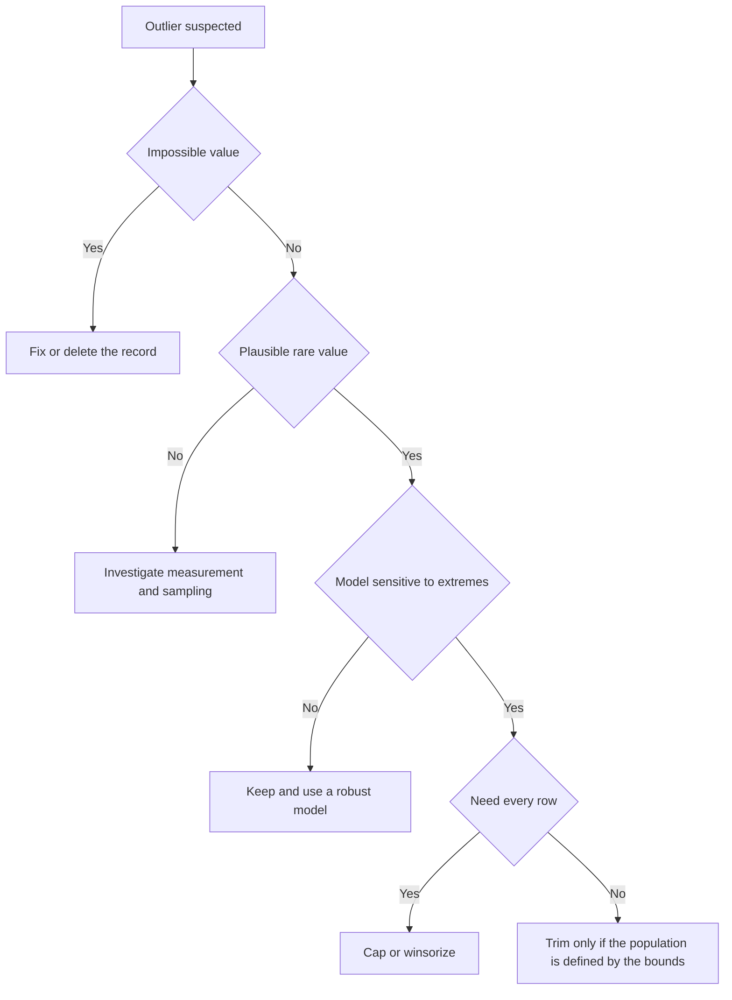
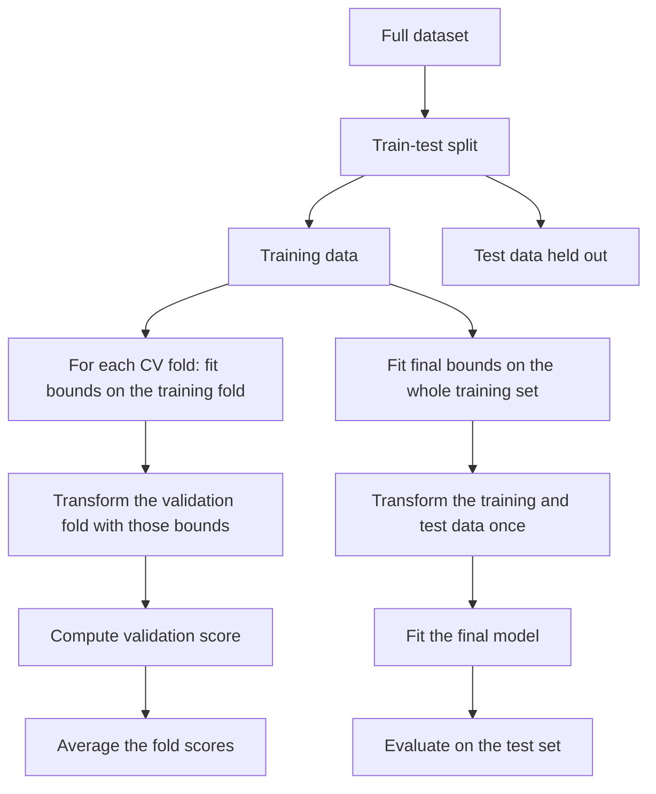
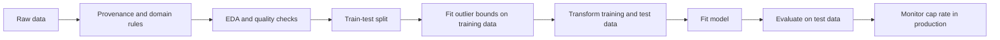

# Day 42 — Outlier Handling: Trimming and Capping

> **Course:** CampusX — 100 Days of Machine Learning, Day 42  
> **Official topic:** Outlier removal using the Z-score  
> **Reference notebook:** `reference_notebooks/day42.ipynb` — 25 cells, byte-identical to the vendor notebook  
> **Vendor source:** `vendor/100-days-of-machine-learning/day42-outlier-removal-using-zscore/day42.ipynb`  
> **Dataset:** `datasets/placement.csv` — 1,000 rows and 3 columns, byte-identical to the vendor copy  
> **Video:** https://youtu.be/OnPE-Z8jtqM  
> **Central question:** When a numerical feature contains a few values that sit far from the rest, should we delete those rows, replace the extreme values with a boundary, transform the feature, or change the model — and how do we make that decision without lying to ourselves about the data?

### How this chapter is organised

The chapter begins with the practical problem in the placement dataset, then builds the vocabulary
needed to distinguish an outlier from an error, a rare event, a skewed tail, and a high-leverage
point. It develops the mathematics of the three-sigma rule, trimming, capping, winsorization, and
their effects on the mean, variance, covariance, correlation, and regression. It then turns to
implementation, boundary edge cases, leakage-safe workflows, plots, worked examples, interview
preparation, and examination practice. The final section maps every one of the 25 notebook cells.

**Source labels used in this chapter**

- **Official** — the saved output in the CampusX notebook `reference_notebooks/day42.ipynb`.
- **Rerun** — a value reproduced in this environment (Python 3.14.2, pandas 3.0.5, NumPy 2.5.3,
  scikit-learn 1.9.1, SciPy 1.18.1, seaborn 0.13.2). The reference notebook was produced with
  Python 3.8.3, so last digits and plotting behaviour can differ.
- **Supplementary** — an explanation, calculation, or experiment added for learning. It is not
  presented as original course output.

The notebook is a preprocessing demonstration, not a model-evaluation experiment. It contains no
train/test split, no model, and no performance metric. That is not a defect in the notebook's own
purpose, but it means that any claim of the form “removing outliers improved the model” would be an
invention. This chapter is careful to separate what the notebook demonstrates from what would be
needed to justify a modelling decision.

---

# 1. Learning objectives

After studying this chapter, I should be able to:

1. **Define an outlier precisely enough to act on it.** Explain why an outlier is an observation
   that is surprising under a stated model, not simply a large or small number, and distinguish an
   outlier from a data error, a rare event, a skewed tail, a mixture component, and a
   high-leverage point.
2. **Explain the causes.** Recognise entry errors, unit errors, sensor faults, sampling bias,
   mixtures, heavy-tailed processes, genuine rare events, contextual anomalies, and adversarial
   manipulation, and explain why the cause determines the correct action.
3. **Detect univariate outliers.** Read histograms, KDEs, box plots, and Q–Q plots; compute
   z-scores, IQR fences, percentile bounds, and modified z-scores; explain what each method assumes
   and when it fails.
4. **Derive the three-sigma rule.** Write the z-score, state the normal tail probabilities, prove
   the Chebyshev bound, and explain why “three sigma” is a convention rather than a law of nature.
5. **Distinguish trimming from capping.** Explain row trimming, the trimmed mean, clipping,
   winsorization, and censoring; state which quantities are preserved and which are changed.
6. **Derive the effect on moments.** Obtain the mean and variance of a clipped variable, the
   symmetric three-sigma variance-retention formula, and the decomposition of variance and
   covariance after trimming.
7. **Explain the effect on regression.** Use the OLS slope formula, leverage, and Cook's distance
   to explain when deleting or capping a point changes a fitted model, and when it does not.
8. **Reason about bias and information loss.** Explain why deleting genuine tail observations can
   bias estimates, why capping attenuates variance and covariance, and why removing measurement
   errors is a different activity from statistical outlier handling.
9. **Choose an action.** Decide between dropping, capping, transforming, using a robust model, or
   treating the extreme values as the phenomenon of interest, with explicit trade-offs.
10. **Implement safely.** Write pandas and scikit-learn code that computes bounds, trims, caps,
    and fits bounds on training data only inside a pipeline; recognise leakage, stale columns,
    inclusive/exclusive boundary bugs, and sample-versus-population standard-deviation differences.
11. **Interpret the placement experiment.** Report the actual numbers, explain what they do and do
    not show, and avoid claiming a model improvement that the notebook never measured.
12. **Answer interview and examination questions.** Give reasoned answers, perform the arithmetic,
    and discuss assumptions, limitations, and alternatives.

---

# 2. The problem in one page

## 2.1 The placement data

The dataset has three columns:

| Column | Meaning | Type | Missing |
|---|---|---|---|
| `cgpa` | Undergraduate CGPA | continuous, roughly 4.9–9.1 | 0 |
| `placement_exam_marks` | Marks in a placement examination | continuous, 0–100 | 0 |
| `placed` | Placement outcome | binary, 0 or 1 | 0 |

There are 1,000 rows. The target is almost balanced: 489 students placed and 511 not placed.
The two numerical features have very different shapes:

| Statistic | `cgpa` | `placement_exam_marks` |
|---|---:|---:|
| Mean | 6.961240 | 32.225000 |
| Standard deviation | 0.615898 | 19.130822 |
| Minimum | 4.89 | 0 |
| 25th percentile | 6.55 | 17 |
| Median | 6.96 | 28 |
| 75th percentile | 7.37 | 44 |
| Maximum | 9.12 | 100 |
| Skewness | -0.014530 | 0.835642 |
| Excess kurtosis | 0.091123 | 0.270519 |

`cgpa` is almost symmetric. `placement_exam_marks` has a long right tail: many students score in
the teens and twenties, a smaller number score above 80, and one student scores 100. The
notebook's outlier demonstration uses `cgpa`, not the more obviously skewed marks column. That
choice matters for interpretation, because a nearly normal feature has very few three-sigma
values, so trimming and capping barely change its histogram.

## 2.2 What the notebook actually does

The 25-cell notebook:

1. Imports NumPy, pandas, Matplotlib, and seaborn.
2. Reads `placement.csv`.
3. Displays the shape, a random sample, and two distribution plots.
4. Mentions the skewness of `placement_exam_marks`.
5. Prints the mean, standard deviation, minimum, and maximum of `cgpa`.
6. Computes the three-sigma boundaries.
7. Displays rows outside rounded boundaries of 8.80 and 5.11.
8. Trims rows outside those boundaries.
9. Computes a `cgpa_zscore` column and displays rows with z-scores above 3 and below -3.
10. Trims using the z-score mask.
11. Recomputes the boundaries and caps `cgpa` in place with nested `np.where`.

The notebook does **not** fit a model, split the data, evaluate an outlier detector, compare
trimming with capping on a holdout set, or examine `placement_exam_marks` beyond its skewness.
It is a mechanics lesson: here is the arithmetic, here is the mask, here is the replacement.

## 2.3 What this chapter adds

This chapter keeps the notebook's arithmetic as the anchor, then adds the reasoning that makes the
arithmetic safe:

- A definition of outlier that is precise enough to choose an action.
- The difference between a data error and a genuine extreme value.
- The mathematics of what trimming and capping do to moments and models.
- The difference between deleting rows and replacing values.
- A comparison with IQR, percentile, modified z-score, Mahalanobis distance, isolation forests,
  and robust regression.
- A leakage-safe implementation in pandas and scikit-learn.
- A cell-by-cell source audit, including the places where the notebook's shortcuts matter.

---

# 3. What an outlier is — and what it is not

## 3.1 A working definition

An **outlier** is an observation that is surprisingly far from the pattern of the other
observations, relative to a stated model or reference distribution. The phrase “relative to a
stated model” is essential. A value is not an outlier in a vacuum. It is an outlier with respect
to:

- a feature's marginal distribution;
- a relationship between two or more features;
- a regression model's residual pattern;
- a time-series model's expected level;
- a group or context;
- a domain rule.

For a univariate sample $x_1,\dots,x_n$, a simple working definition is:

$$
x_i \text{ is an outlier if } |z_i| > k,
\qquad
z_i=\frac{x_i-\bar{x}}{s},
$$

where $\bar{x}$ is the sample mean, $s$ is the sample standard deviation, and $k$ is a threshold
such as 3. This definition is convenient, but it is only one possible definition. It assumes that
the mean and standard deviation are meaningful summaries, which is exactly what fails when the
tail is heavy.

## 3.2 The definition is model-relative

A CGPA of 9.12 is unusual in this sample: its z-score is 3.505. In a different university where
the median CGPA is 9.0, the same value would be ordinary. A salary of 50 lakh rupees is an outlier
in a sample of interns and unremarkable in a sample of senior surgeons. A temperature of 35°C is
normal in Chennai in May and unusual in Oslo in January.

This is not philosophical decoration. The model determines the reference set, and the reference set
determines the action. If the reference set is “students who took this placement exam”, a 9.12
CGPA is a genuine high performer. If the reference set is “rows that were typed correctly”, a
CGPA of 91.2 is probably a decimal-point error. Same number, different meaning.

## 3.3 Types of outliers

**Univariate outlier.** A value that is far from the rest of one feature. The placement `cgpa`
example is univariate.

**Multivariate outlier.** A row whose individual coordinates are not extreme, but whose
*combination* is unusual. For example, in a dataset of houses, a house with 2,000 square feet and
1 bedroom is unusual even though neither 2,000 nor 1 is extreme on its own. A row can be a
multivariate outlier while being unremarkable in every single column.

**Point outlier.** A single observation that is anomalous. Most of this chapter concerns point
outliers.

**Contextual outlier.** A value that is anomalous only in context. A sale of 500 units is normal
on a festival day and abnormal on an ordinary Tuesday. The context may be time, location, user,
device, or a group.

**Collective outlier.** A sequence of observations that is anomalous as a group, even though each
individual observation may look normal. A sudden sustained shift in a sensor is a collective
anomaly. Univariate z-scores applied one row at a time will miss it.

**Error outlier.** The value is wrong because of a data-generation problem: a misplaced decimal,
a unit conversion, a sensor spike, a duplicate, a parsing failure. This is a data-quality issue.

**Genuine extreme.** The value is correct and rare: a top-performing student, a very large
transaction, a severe storm. This is a property of the population, not a mistake.

The error-versus-genuine distinction is more important than the statistical label. Deleting an
error is cleaning. Deleting a genuine extreme changes the population you are studying.

## 3.4 What is not an outlier

The following are often incorrectly called outliers:

1. **A rare but valid value.** A 9.12 CGPA, a 100-mark exam score, or a large but legitimate
   purchase. Rarity is not the same as invalidity.
2. **A data error.** A negative age, a height of 300 cm, or a CGPA of 91.2 is an error. It should
   be corrected or removed as a data-quality action, not “handled” by capping to a statistical
   boundary as if it were a plausible extreme.
3. **The natural tail of a skewed distribution.** Income, city population, and hospital length of
   stay are right-skewed. The large values are part of the distribution. A logarithm or a
   robustness-aware model is often better than deletion.
4. **A separate subpopulation.** A dataset of employees may contain both interns and executives.
   The executives are not errors; they are a mixture component. Segmenting or modelling the
   mixture is more honest than deleting the senior group.
5. **A high-leverage point that lies on the trend.** A point with an extreme $x$ can have high
   leverage without being an outlier in the response. It may even be the most informative point
   for estimating a slope.
6. **A large residual at a central $x$.** This is an outlier in $y$ but not a high-leverage point.
   Its influence on the slope may be modest, while its effect on the intercept and residual
   variance can be larger.
7. **An extreme target value.** A high `placement_exam_marks` is not automatically an outlier in
   the feature space. If the target is extreme, the question is whether the model should predict
   it, not whether the row should be deleted.
8. **Missing, duplicate, or inconsistent data.** These are separate data-quality categories.
   A missing value is not an outlier; it is absent. A duplicate is a sampling or key error, not a
   statistical extreme.
9. **A value that is unusual in one feature but normal jointly.** Context matters. A high mark in
   an easy exam may be normal once the exam difficulty is included.
10. **A value that is unusual only because the sample is small.** With $n=10$, one large value can
    inflate the standard deviation enough to hide itself. That is a failure of the detector, not
    evidence that the value is ordinary.

## 3.5 Outlier, anomaly, novelty, and error

The words overlap but are not identical:

- **Outlier** is a statistical description: an observation far from the bulk under a model.
- **Anomaly** often refers to an observation generated by a different mechanism, especially in
  fraud, intrusion detection, or fault detection. An anomaly may be the signal we want to keep.
- **Novelty** refers to a new but valid pattern that was not present in the training data. Novelty
  detection is concerned with deciding whether a new observation belongs to the known
  distribution.
- **Error** is a data-quality judgement: the value is wrong.

A fraud detection system should not “remove outliers” before training. The fraudulent transactions
are the positive class. An anomaly detection system should not cap the anomalies it is trying to
find. The correct action depends on which of these categories the observation belongs to.

## 3.6 Why the distinction matters

Suppose a hospital dataset contains a length-of-stay of 365 days. If the value is a coding error
(discharge date minus admission date across a year boundary), removing it is correct. If the value
is a genuine long stay, removing it biases the average stay downward and may hide a quality
problem. If the goal is to predict long stays, removing the longest stay destroys the signal.

The statistical method cannot tell you which case you are in. Domain knowledge, data provenance,
and a check of the raw record must. This is the most important sentence in the chapter:

> Outlier detection is a statistical warning, not a diagnosis. The diagnosis determines the
> treatment.

---

# 4. Causes of outliers

## 4.1 Data-generation errors

**Entry errors.** A CGPA of 91.2 instead of 9.12; a salary with an extra zero; a date in 2099.
These are usually impossible or implausible under domain constraints. They should be corrected
against the source or removed.

**Unit errors.** A weight recorded in grams in a column that expects kilograms; a temperature in
Fahrenheit in a Celsius column; a salary in paise instead of rupees. Unit errors produce values
that are off by a known factor, not random noise.

**Parsing and encoding errors.** A decimal comma parsed as a thousands separator; a string
`"NULL"` converted to a number; a date parsed with the wrong format. The result may be a valid
number that is semantically wrong.

**Sensor and instrument faults.** A spike caused by electrical interference, a stuck sensor, a
reading outside the instrument's physical range. These can be detected with domain limits and
temporal context.

**Duplicate or linkage errors.** The same entity counted twice, or a row joined to the wrong
record. The resulting values may look extreme because they mix two entities.

## 4.2 Sampling and mixture

**Selection bias.** The sample is not representative. A survey of only the students who responded
may over-represent high achievers. The “outliers” may be the under-represented group finally
appearing.

**Mixture of populations.** A dataset of human heights that contains both adults and children will
look bimodal. A dataset of transaction amounts that contains both retail customers and businesses
will have a heavy tail. Neither tail is an error; the data contain more than one generating
process.

**Aggregation.** A mean of means, a sum over groups of different sizes, or a rate computed from
small denominators can create extreme values that are artefacts of the aggregation.

## 4.3 Genuine rare events

**Heavy-tailed processes.** Income, wealth, city size, file size, and social-network degree are
often heavy-tailed. Extremes are expected. A three-sigma rule based on a normal model will
under-estimate how often they occur.

**Rare but real events.** A once-in-a-decade storm, a market crash, a record-breaking performance,
a successful fraud. The event is rare, but it is part of the phenomenon.

**Fraud and adversarial behaviour.** The extreme value is deliberately generated to look unusual
or to exploit a model. Removing it from training may make the model less able to detect it.

## 4.4 Distributional shape

**Skewness.** In a right-skewed distribution, the mean is pulled to the right and the standard
deviation is inflated. A symmetric mean $\pm$ three-sigma interval may extend below the physical
minimum (for marks, the lower bound is $-25.17$) and may fail to cover the upper tail
symmetrically.

**Bounded support.** A proportion must lie in $[0,1]$; a mark in $[0,100]$; an age in
$[0,120]$. A normal model assigns positive probability outside the bounds, so three-sigma logic
can produce impossible boundaries.

**Zero inflation.** A large spike at zero (for example, 14 students with 0 marks) is not a tail;
it is a separate probability mass. A z-score may not flag zero because the standard deviation is
large.

**Discreteness.** A feature with only a few distinct values can have many ties at the boundary.
Percentile and IQR methods then depend on how ties are handled.

## 4.5 Context and time

**Seasonality.** Sales, temperatures, and travel volumes have seasonal patterns. A value that is
extreme relative to the annual average may be normal for the month.

**Regime changes.** A pandemic, a policy change, or a system upgrade changes the data-generating
process. Values after the change may look extreme relative to the pre-change history, but they are
the new normal.

**Level shifts and drift.** A sensor calibration drift produces a gradual change, not a single
spike. A step change in a metric may be a collective anomaly.

## 4.6 Adversarial manipulation

A user who reports a fake income, a seller who manipulates a rating, or an attacker who injects a
malformed record. The value may be statistically extreme but the correct response is validation,
not capping.

## 4.7 A diagnostic table

| Cause | Typical sign | Correct first action |
|---|---|---|
| Entry error | Impossible value, decimal shift | Check source; correct or delete |
| Unit error | Values off by a constant factor | Recover the unit; convert |
| Sensor fault | Spike, stuck value, out-of-range | Check device log; repair or remove |
| Duplicate | Repeated entity, inconsistent fields | De-duplicate |
| Selection bias | Tail appears only in one subgroup | Re-weight or re-sample; do not delete |
| Mixture | Bimodal or multi-modal distribution | Segment; model separately |
| Heavy tail | Many moderate extremes, no gap | Transform or use a robust model |
| Genuine rare event | Valid record, plausible context | Keep; consider robust loss |
| Contextual anomaly | Normal globally, extreme within group | Model context |
| Fraud | Extreme and adversarial | Keep as positive signal; validate |
| Small sample | One point hides itself | Do not trust z-score; use robust methods |

---

# 5. Foundations: mean, variance, z-score, and the normal rule

## 5.1 Mean and variance

For observations $x_1,\dots,x_n$, the sample mean is

$$
\bar{x}=\frac{1}{n}\sum_{i=1}^{n}x_i.
$$

The sample variance is

$$
s^2=\frac{1}{n-1}\sum_{i=1}^{n}(x_i-\bar{x})^2,
$$

and the sample standard deviation is $s=\sqrt{s^2}$. The denominator $n-1$ is used because the
deviations are measured from the estimated mean, which uses up one degree of freedom. If the
denominator were $n$, the estimate would be biased downward on average.

Numerically, for the placement `cgpa` column:

$$
\bar{x}=6.961240,
\qquad
s=0.615898,
\qquad
s^2=0.379330.
$$

Every observation contributes to the mean. A single value of 9.12 contributes
$9.12/1000=0.00912$ to the mean by itself. The mean is therefore sensitive to the tail. The median
is the middle order statistic; it changes only when an observation crosses the middle, so it is
much less sensitive.

## 5.2 Standardization

The z-score of observation $x_i$ is

$$
z_i=\frac{x_i-\bar{x}}{s}.
$$

The transformation subtracts the mean and divides by the standard deviation. It is affine, so it
preserves the shape of the distribution; it changes the location to 0 and the scale to 1. The
z-score is dimensionless: it counts how many standard deviations the observation lies from the
mean.

For the largest CGPA, $x=9.12$:

$$
z=\frac{9.12-6.961240}{0.615898}
=\frac{2.158760}{0.615898}
=3.505062.
$$

The value is 3.505 standard deviations above the mean. For the smallest, $x=4.89$:

$$
z=\frac{4.89-6.961240}{0.615898}
=\frac{-2.071240}{0.615898}
=-3.362960.
$$

A z-score is not a probability. A z-score of 3.5 does not mean “0.05% probability that this row is
valid”. It means “3.5 sample standard deviations from the sample mean”. Turning it into a
probability requires a distributional model.

## 5.3 The three-sigma rule

If $X\sim N(\mu,\sigma^2)$ and $Z=(X-\mu)/\sigma$, then

$$
\mathbb{P}(|Z|\le 1)=0.682689,
\qquad
\mathbb{P}(|Z|\le 2)=0.954500,
\qquad
\mathbb{P}(|Z|\le 3)=0.997300.
$$

Equivalently,

$$
\mathbb{P}(|Z|>3)=2(1-\Phi(3))=0.002700,
$$

where $\Phi$ is the standard normal CDF. About 27 observations in 10,000 lie beyond three sigma
under normality, or roughly 2.7 in 1,000. The placement `cgpa` sample has 5 such rows out of
1,000, which is not by itself evidence of non-normality; random variation around an expected 2.7
is normal.

The three-sigma rule is a **reference**, not a test. It says: under a normal model, values beyond
three sigma are rare. It does not say: every value beyond three sigma is an error, or every value
inside three sigma is valid.

## 5.4 Chebyshev: what is true without normality

For any distribution with finite mean $\mu$ and finite variance $\sigma^2$, and any $k>0$,

$$
\mathbb{P}(|X-\mu|\ge k\sigma)\le \frac{1}{k^2}.
$$

For $k=3$, at most $1/9\approx 11.11\%$ of the probability can lie beyond three sigma. Under
normality the bound is 0.27%, much tighter. The Chebyshev bound is distribution-free but usually
very loose. It is useful for one purpose: it shows that “three sigma” does not have a universal
0.27% interpretation. For a heavy-tailed distribution, the true tail can be much larger than the
normal value, and for a bounded or skewed distribution it can be much smaller on one side.

## 5.5 Sample versus population standard deviation

There are two common standard deviations:

$$
s_{\text{pop}}=\sqrt{\frac{1}{n}\sum_{i=1}^{n}(x_i-\bar{x})^2},
\qquad
s_{\text{sample}}=\sqrt{\frac{1}{n-1}\sum_{i=1}^{n}(x_i-\bar{x})^2}.
$$

pandas `Series.std()` uses $n-1$ by default. NumPy `np.std()` uses $n$ by default. scikit-learn's
`StandardScaler` uses the population version internally (`var_` is the population variance).
For the placement data, the ratio is

$$
\frac{s_{\text{pop}}}{s_{\text{sample}}}
=\sqrt{\frac{n-1}{n}}
=\sqrt{\frac{999}{1000}}
=0.999500.
$$

The difference is tiny for $n=1000$, but it is not zero. For the largest CGPA, the z-score changes
from 3.505061 (sample) to 3.506815 (population). For $n=10$, the factor is
$\sqrt{9/10}=0.948683$, a 5.1% difference; that can move a value across a threshold. Always state
which convention you use.

## 5.6 Why the mean and standard deviation are not robust

A robust statistic is one whose value is not dominated by a small fraction of the data. The
**breakdown point** is the smallest fraction of observations that must be contaminated to make the
statistic arbitrarily large.

- The sample mean has breakdown point 0: one sufficiently extreme observation can make it
  arbitrarily large.
- The sample standard deviation also has breakdown point 0: one extreme observation can make it
  arbitrarily large.
- The median has breakdown point 0.5: nearly half the data must be contaminated before the median
  can be driven arbitrarily far.
- The median absolute deviation (MAD) also has breakdown point 0.5.

This is why a z-score built from the mean and standard deviation is not robust. The very outlier
we are trying to detect inflates both the centre and the scale, making itself look less extreme.
This phenomenon is called **masking**.

## 5.7 Masking and swamping

**Masking** occurs when an outlier inflates the standard deviation so much that its own z-score
falls below the threshold. The outlier hides itself.

**Swamping** occurs when the inflated standard deviation causes ordinary observations to be
flagged. The detector mistakes the bulk for the tail.

Both are consequences of using non-robust estimates. Increasing the sample size reduces the
effect of a single outlier on the mean and standard deviation, which is why the placement data
with $n=1000$ can flag a 3.5-sigma value that a sample of $n=10$ would hide.

## 5.8 A worked masking example

Take ten values:

$$
1,\ 2,\ 3,\ 4,\ 5,\ 6,\ 7,\ 8,\ 9,\ 100.
$$

The mean is

$$
\bar{x}=\frac{1+2+\cdots+9+100}{10}
=\frac{45+100}{10}
=14.5.
$$

The sample standard deviation is

$$
s=\sqrt{\frac{1}{9}\sum_{i=1}^{10}(x_i-14.5)^2}.
$$

The nine small deviations are $-13.5,-12.5,\dots,-5.5$, whose squared sum is $872.25$. The large
deviation is $85.5$, whose square is $7{,}310.25$. Therefore

$$
s^2=\frac{872.25+7{,}310.25}{9}
=\frac{8{,}182.50}{9}
=909.1667,
\qquad
s=30.1524.
$$

The z-score of 100 is

$$
z=\frac{100-14.5}{30.1524}
=\frac{85.5}{30.1524}
=2.8356.
$$

It is **below 3**. A three-sigma rule would not flag the most obvious outlier in the sample. Yet
the IQR rule gives $Q_1=3.25$, $Q_3=7.75$, $\mathrm{IQR}=4.5$, upper fence
$7.75+1.5(4.5)=14.5$, and flags 100 immediately. The modified z-score is even more dramatic:
median $=5.5$, MAD $=2.5$, and

$$
z_{\text{mod}}=0.6745\frac{100-5.5}{2.5}=25.50,
$$

which is far beyond any reasonable threshold.

This example is the cleanest argument for why “outlier removal using z-score” must be taught with
its failure modes, not as a universal recipe.

---

# 6. Detection by distribution

## 6.1 Histograms and kernel density estimates

A histogram partitions the range into bins and counts observations. A kernel density estimate
(KDE) smooths the histogram into a continuous curve. Both are descriptive: they show where the
mass is, whether the distribution is symmetric, whether there are gaps, and whether there are
multiple modes.

For the placement data:

- `cgpa` is roughly bell-shaped, centred near 7, with a range of 4.89 to 9.12. A 22-bin histogram
  from 4.8 to 9.2 has a peak of 126 observations in the 6.6–6.8 bin and only 3 observations in the
  first bin and 1 in the last.
- `placement_exam_marks` is right-skewed. A 20-bin histogram from 0 to 100 has 14 observations at
  0, a peak of 140 in the 15–20 bin, and a long thinning tail: 7 observations in 85–90, 5 in
  90–95, and 3 in 95–100.

Histograms depend on bin width and origin. A feature can look smooth at one width and spiky at
another. KDEs depend on bandwidth. Neither is a formal outlier test. They are aids to judgement.

## 6.2 Box plots and the IQR

A box plot shows the median, the quartiles $Q_1$ and $Q_3$, and whiskers. The interquartile range
is

$$
\mathrm{IQR}=Q_3-Q_1.
$$

Tukey's usual whiskers extend to the most extreme observations inside

$$
L=Q_1-1.5\,\mathrm{IQR},
\qquad
U=Q_3+1.5\,\mathrm{IQR}.
$$

Observations outside the whiskers are drawn individually. A factor of 3.0 is sometimes used for
“extreme” outliers.

For `cgpa`:

$$
Q_1=6.55,\quad Q_3=7.37,\quad \mathrm{IQR}=0.82,
$$

so

$$
L=6.55-1.5(0.82)=5.32,
\qquad
U=7.37+1.5(0.82)=8.60.
$$

The IQR rule flags 8 rows: 4.89, 4.90, 4.92, 5.23, 5.27, 8.62, 8.87, and 9.12. The three-sigma
rule flags 5: 4.89, 4.90, 4.92, 8.87, and 9.12. The IQR rule is a superset here; it also flags
5.23, 5.27, and 8.62, which are outside the Tukey fences but inside the three-sigma interval.

For `placement_exam_marks`:

$$
Q_1=17,\quad Q_3=44,\quad \mathrm{IQR}=27,
$$

so

$$
L=17-1.5(27)=-23.5,
\qquad
U=44+1.5(27)=84.5.
$$

The lower fence is negative, so no low mark is flagged, even though 14 students scored 0. The
upper fence flags 15 rows: 86, 86, 86, 87, 87, 87, 87, 90, 90, 90, 93, 94, 96, 97, and 100. This
is a useful warning: a domain-implausible value (0 marks) can be inside a statistical fence when
the distribution is skewed. The detector is not a substitute for domain checks.

A box plot is not a hypothesis test. It does not report a p-value, it does not account for sample
size, and its whiskers are a convention. With skewed data, many points can lie beyond the
whiskers without being errors. With small samples, the quartiles are unstable.

## 6.3 Q–Q plots

A quantile–quantile plot compares the sorted sample quantiles with the quantiles of a theoretical
distribution, often the normal. If the points lie close to a straight line, the sample is
approximately normal. Departures at the ends indicate tail behaviour: points above the line in the
upper tail suggest a heavier right tail; points below suggest a lighter tail.

For `cgpa`, skewness is $-0.0145$ and excess kurtosis is $0.0911$, so the normal reference is
reasonable. For `placement_exam_marks`, skewness is $0.8356$, so the upper tail departs from
normality. A Q–Q plot is descriptive; it does not identify which points are errors.

## 6.4 Scatter plots and multivariate views

A scatter plot of two features can reveal:

- points far from the main cloud (multivariate outliers);
- points at the edge of the $x$-range but on the trend (high leverage);
- clusters or mixtures;
- non-linear relationships;
- heteroscedasticity.

In higher dimensions, pairwise scatter plots are incomplete. A row can be normal in every pair
but unusual in the joint distribution. Mahalanobis distance, isolation forests, and local outlier
factor are designed for this setting.

## 6.5 Time series and context

For time-ordered data, the relevant question is not “is this value far from the global mean?” but
“is this value far from what the model expected at this time?” Seasonal decomposition, moving
averages, and residual-based detection are more appropriate than a global z-score. A value can be
globally ordinary and locally extreme, or globally extreme and locally ordinary.

## 6.6 Domain rules

Domain rules are often the strongest detector:

- age must be between 0 and 120;
- a percentage must be between 0 and 100;
- a CGPA cannot exceed the institution's maximum;
- a transaction cannot be negative for a refund-only field;
- a date cannot be in the future for a completed event;
- a count cannot be negative.

A domain rule is not a statistical model, but it is a valid and interpretable detector. It should
be applied before statistical methods, because a value that violates a hard constraint is an error,
not a tail observation.

## 6.7 Detection is not removal

The output of detection is a **flag**, not an action. The flag says “investigate this row”. The
action depends on the cause:

- error → correct or delete;
- genuine extreme → keep, transform, cap, or use a robust model;
- mixture → segment;
- anomaly of interest → keep and model;
- contextual → model the context.

Conflating detection with removal is the most common conceptual mistake in applied outlier
handling.

---

# 7. Detection by three-sigma logic

## 7.1 The rule

The three-sigma procedure is:

1. Compute the sample mean $\bar{x}$ and sample standard deviation $s$.
2. Compute the lower and upper bounds
   $$
   L=\bar{x}-k s,
   \qquad
   U=\bar{x}+k s,
   $$
   with $k=3$ for the usual rule.
3. Flag observations with $x_i<L$ or $x_i>U$.
4. Optionally compute the z-score
   $$
   z_i=\frac{x_i-\bar{x}}{s}
   $$
   and flag $|z_i|>k$.

Steps 3 and 4 are equivalent when the same mean and standard deviation are used. The z-score form
is convenient because it is dimensionless and can be compared across features.

## 7.2 One-sided versus two-sided

The usual rule is two-sided: both very low and very high values are flagged. For a right-skewed
feature such as income, a low value is often not an error, while a very high value may be. A
one-sided rule flags only the upper tail:

$$
x_i>U=\bar{x}+k s.
$$

For a left-skewed feature, the reverse may be appropriate. The choice must be justified by the
domain, not chosen after looking at which choice removes more rows.

## 7.3 A complete numerical example on cgpa

The notebook computes:

$$
\bar{x}=6.961240,
\qquad
s=0.615898.
$$

Therefore

$$
L=6.961240-3(0.615898)=6.961240-1.847694=5.113546,
$$

$$
U=6.961240+3(0.615898)=6.961240+1.847694=8.808934.
$$

The official printed values are 5.113546374602842 and 8.808933625397177. The last digits differ
from a hand calculation because of floating-point arithmetic; the rounded values are identical.

The five rows outside these bounds are:

| Row index | `cgpa` | z-score | `placement_exam_marks` | `placed` |
|---:|---:|---:|---:|---:|
| 485 | 4.92 | -3.314251 | 44.0 | 1 |
| 995 | 8.87 | 3.099150 | 44.0 | 1 |
| 996 | 9.12 | 3.505062 | 65.0 | 1 |
| 997 | 4.89 | -3.362960 | 34.0 | 0 |
| 999 | 4.90 | -3.346724 | 10.0 | 1 |

The z-scores are computed with the original mean and standard deviation. For example, row 996:

$$
z=\frac{9.12-6.961240}{0.615898}=3.505062.
$$

Row 485:

$$
z=\frac{4.92-6.961240}{0.615898}=-3.314251.
$$

The table is not a list of errors. It is a list of statistically extreme observations. Four of the
five students were placed; the removed group has a placement rate of $4/5=0.80$, compared with
$489/1000=0.489$ overall. Deleting them therefore changes the target prevalence slightly, from
48.9% to 48.74%. That is a real selection effect, even though it is small.

## 7.4 What the rule found and what it missed

The rule found five rows in `cgpa`. It did not examine `placement_exam_marks` beyond printing its
skewness. If the same three-sigma rule is applied to marks:

$$
\bar{x}=32.225000,
\qquad
s=19.130822,
$$

so

$$
L=32.225000-3(19.130822)=-25.167467,
\qquad
U=32.225000+3(19.130822)=89.617467.
$$

The lower bound is negative, which is impossible for marks. The upper bound flags 8 rows: 90, 90,
90, 93, 94, 96, 97, and 100. The zero marks are not flagged because $-25.17<0$. The IQR rule flags
15 rows, all on the high side. The methods disagree because they make different assumptions and
use different summaries.

This is a concrete illustration of a general lesson: the three-sigma rule is not “the” outlier
rule. It is one detector among many, and its output depends on the distribution's shape.

## 7.5 Threshold sensitivity

The choice of $k$ changes the number of flags:

| Threshold | `cgpa` flags | `placement_exam_marks` flags |
|---:|---:|---:|
| $|z|>2.0$ | 43 | 42 |
| $|z|>2.5$ | 12 | 19 |
| $|z|>3.0$ | 5 | 8 |
| $|z|>3.5$ | 1 | 1 |

A lower threshold removes more rows and risks deleting genuine values. A higher threshold keeps
more rows and risks leaving errors. There is no universally correct threshold. The choice should
be pre-specified, justified by the cost of false positives and false negatives, and evaluated on
training data only.

## 7.6 Why 3 is a convention

The value 3 is convenient because of the normal 99.7% rule, because it is easy to remember, and
because it is a common default in engineering and quality control. It is not a law. In some
domains, 2.5 or 3.5 is more appropriate; in others, a robust method or a domain rule is better.
The number 3 should be accompanied by a reason, not treated as a universal constant.

---

# 8. Detection by percentiles

## 8.1 Empirical quantiles

The $p$-th quantile $Q(p)$ is the value below which a proportion $p$ of the data lies. For a
sorted sample

$$
x_{(1)}\le x_{(2)}\le\cdots\le x_{(n)},
$$

the empirical quantile is an interpolation between order statistics. pandas uses the default
`linear` method, which is Hyndman–Fan type 7. With $h=(n-1)p+1$, let $j=\lfloor h\rfloor$ and
$\gamma=h-j$. Then

$$
Q(p)=x_{(j)}+\gamma\left(x_{(j+1)}-x_{(j)}\right),
$$

with the convention that $x_{(n+1)}=x_{(n)}$ at the top.

## 8.2 Interpolation: a worked calculation

For the placement `cgpa`, $n=1000$. At $p=0.01$:

$$
h=(999)(0.01)+1=9.99+1=10.99.
$$

So $j=10$ and $\gamma=0.99$. The 10th and 11th sorted values are $x_{(10)}=5.52$ and
$x_{(11)}=5.56$. Therefore

$$
Q(0.01)=5.52+0.99(5.56-5.52)
=5.52+0.0396
=5.5596.
$$

At $p=0.99$:

$$
h=(999)(0.99)+1=989.01+1=990.01,
$$

so $j=990$ and $\gamma=0.01$. The result is $Q(0.99)=8.4201$. These are the bounds used for a
1% two-sided percentile rule.

The interpolation matters. A different method (`lower`, `higher`, `nearest`, `midpoint`) can
produce a slightly different bound and a different number of removed rows when there are ties at
the boundary.

## 8.3 Trimming and capping at percentiles

Given a lower proportion $\alpha$ and an upper proportion $\alpha$:

- **Percentile trimming:** remove rows with $x<Q(\alpha)$ or $x>Q(1-\alpha)$.
- **Percentile capping / winsorization:** replace values below $Q(\alpha)$ with $Q(\alpha)$ and
  values above $Q(1-\alpha)$ with $Q(1-\alpha)$.

The same idea can be applied with different proportions in each tail, for example 0.5% lower and
2% upper for a right-skewed feature.

## 8.4 Choosing the proportion

The proportion is a tuning choice. Common values are 0.5%, 1%, and 5% per tail. Larger proportions
remove more of the tail and reduce variance more, but they also increase bias and can delete
genuine information. With $n=1000$:

- 1% per tail removes about 10 rows per tail, 20 in total;
- 5% per tail removes about 50 rows per tail, 100 in total;
- 0.5% per tail removes about 5 rows per tail, 10 in total.

The exact count depends on ties and interpolation. For the placement data, the 1%/99% bounds
remove exactly 20 rows; the 5%/95% bounds are 5.97 and 7.9505, and capping at those bounds changes
99 rows (49 below, 50 above, with two values equal to the lower bound).

## 8.5 Ties, discreteness, and boundary ambiguity

For discrete features, many observations can equal the quantile. Then:

- strict `<` and `>` may remove fewer rows than expected;
- inclusive `<=` and `>=` may remove more;
- capping may create a large point mass at the boundary;
- the “proportion trimmed” is only approximate.

For example, if 20 observations equal $Q(0.01)$, a strict trim removes none of them, while an
inclusive trim removes all 20. The choice must be documented.

## 8.6 Percentiles on the placement data

| Rule | Lower bound | Upper bound | Rows removed or changed | Effect |
|---|---:|---:|---:|---|
| 3-sigma on `cgpa` | 5.113546 | 8.808934 | 5 removed (trim) | Keeps 995 rows |
| 1%/99% on `cgpa` | 5.5596 | 8.4201 | 20 removed (trim) | Keeps 980 rows |
| 5%/95% on `cgpa` | 5.97 | 7.9505 | 99 changed (cap) | Keeps 1,000 rows |
| IQR on `cgpa` | 5.32 | 8.60 | 8 flagged | Depends on action |
| 3-sigma on marks | -25.167467 | 89.617467 | 8 flagged | Lower bound impossible |
| IQR on marks | -23.5 | 84.5 | 15 flagged | All high |

The percentile method is attractive because it does not assume normality and directly controls
the proportion of data affected. Its weakness is that the proportion is arbitrary, and it can
remove genuine tail observations simply because they are in the tail.

---

# 9. Trimming: definition and arithmetic

## 9.1 Row trimming versus trimmed mean

“Trimming” is used in two related but distinct ways:

1. **Row trimming:** delete observations outside a boundary and continue the analysis with the
   remaining rows. The sample size decreases.
2. **Trimmed mean:** compute the mean after deleting a fixed proportion from each tail, but the
   deleted rows may still be used for other purposes (or the analysis is explicitly about the
   trimmed mean). The trimmed mean is a robust estimator of location.

The placement notebook performs row trimming: `new_df = df[(df['cgpa'] < 8.80) & (df['cgpa'] > 5.11)]`.
The new data frame has 995 rows. That is not the same as reporting a trimmed mean and keeping all
1,000 rows for other analyses.

## 9.2 The trimming mask

For bounds $L$ and $U$, define the retention indicator

$$
r_i=
\begin{cases}
1, & L\le x_i\le U,\\
0, & \text{otherwise}.
\end{cases}
$$

The trimmed sample is $\{x_i:r_i=1\}$, with size

$$
n_T=\sum_{i=1}^{n}r_i.
$$

The removed sample has size $n_R=n-n_T$. In the placement example, $n_T=995$ and $n_R=5$.

The mask can be written with strict or inclusive comparisons. The notebook uses strict
comparisons in the trimming cells (`< 8.80` and `> 5.11`), while the exact three-sigma bounds are
5.113546 and 8.808934. A value exactly equal to 8.80 or 5.11 would be removed even though it is
inside the exact three-sigma interval. In this dataset no observation lies exactly on those
rounded boundaries, so the count is the same, but the code is not generally correct.

## 9.3 Effect on the mean

Let $\bar{x}_T$ be the mean of the retained rows and $\bar{x}_R$ the mean of the removed rows.
The overall mean is a weighted average:

$$
\bar{x}=\frac{n_T}{n}\bar{x}_T+\frac{n_R}{n}\bar{x}_R.
$$

Rearranging,

$$
\bar{x}_T=\frac{n\bar{x}-n_R\bar{x}_R}{n_T}.
$$

This identity is useful for checking arithmetic. For the placement data:

$$
\bar{x}=6.961240,
\qquad
\bar{x}_R=\frac{4.92+8.87+9.12+4.89+4.90}{5}
=\frac{32.70}{5}
=6.54.
$$

Therefore

$$
\bar{x}_T=\frac{1000(6.961240)-5(6.54)}{995}
=\frac{6961.240-32.70}{995}
=\frac{6928.54}{995}
=6.963357.
$$

The trimmed mean is slightly higher than the original mean because the removed group's mean
(6.54) is below the overall mean (6.961). The change is $+0.002117$.

## 9.4 Effect on the variance: a decomposition

The total sum of squared deviations can be split into within-group and between-group parts. Let
$T$ be the retained group and $R$ the removed group. Then

$$
\sum_{i=1}^{n}(x_i-\bar{x})^2
=
\sum_{i\in T}(x_i-\bar{x}_T)^2
+
n_T(\bar{x}_T-\bar{x})^2
+
\sum_{i\in R}(x_i-\bar{x}_R)^2
+
n_R(\bar{x}_R-\bar{x})^2.
$$

This is the law of total variance in sum-of-squares form. The first two terms describe the retained
group: its internal spread plus its displacement from the overall mean. The last two terms describe
the removed group.

For the placement data:

| Component | Sum of squares |
|---|---:|
| Total | 378.950862 |
| Within retained | 357.937388 |
| Between retained and overall | 0.004458 |
| Within removed | 20.121800 |
| Between removed and overall | 0.887216 |

The trimmed sample variance is

$$
s_T^2=\frac{357.937388}{995-1}
=\frac{357.937388}{994}
=0.360098,
$$

so $s_T=0.600082$. The original variance was $0.379330$ and the original standard deviation was
$0.615898$. Trimming reduced the standard deviation by about 2.6%.

Notice that the trimmed variance is **not** simply the total sum of squares minus the removed
sum of squares divided by $n-1$. The denominator changes, and the retained group's mean changes.
The decomposition above is the correct accounting.

## 9.5 Effect on covariance

For two features $X$ and $Y$, the same decomposition applies to the sum of cross-products:

$$
\sum_{i=1}^{n}(x_i-\bar{x})(y_i-\bar{y})
=
\sum_{i\in T}(x_i-\bar{x}_T)(y_i-\bar{y}_T)
+
n_T(\bar{x}_T-\bar{x})(\bar{y}_T-\bar{y})
+
\sum_{i\in R}(x_i-\bar{x}_R)(y_i-\bar{y}_R)
+
n_R(\bar{x}_R-\bar{x})(\bar{y}_R-\bar{y}).
$$

The trimmed covariance is

$$
\operatorname{Cov}_T(X,Y)=\frac{1}{n_T-1}
\sum_{i\in T}(x_i-\bar{x}_T)(y_i-\bar{y}_T).
$$

For the placement data, with $X=$ `cgpa` and $Y=$ `placement_exam_marks`:

| Component | Sum of cross-products |
|---|---:|
| Total | -322.179000 |
| Within retained | -433.431075 |
| Between retained and overall | -0.075940 |
| Within removed | +126.440000 |
| Between removed and overall | -15.111985 |

The removed group's within-group cross-product is positive (+126.44), which makes the total
cross-product less negative. Removing those rows makes the covariance more negative:

$$
\operatorname{Cov}_{\text{original}}
=\frac{-322.179000}{999}
=-0.322501,
$$

$$
\operatorname{Cov}_{\text{trimmed}}
=\frac{-433.431075}{994}
=-0.436047.
$$

This is a crucial point: trimming can **increase** the magnitude of a covariance or correlation
even while reducing the variance of each feature. The direction of the change depends on where the
removed points lie relative to the trend, not simply on how extreme they are.

## 9.6 Effect on correlation

The correlation is

$$
r_T=\frac{\operatorname{Cov}_T(X,Y)}{s_{T,X}s_{T,Y}}.
$$

Both the numerator and the denominator change. There is no general rule that trimming reduces
correlation. If the removed points were off-trend, removing them can strengthen the correlation.
If they were aligned with the trend, removing them can weaken it.

For the placement data:

| Version | Covariance | Correlation |
|---|---:|---:|
| Original | -0.322501 | -0.027371 |
| Trimmed | -0.436047 | -0.037984 |
| Capped | -0.335499 | -0.028623 |

The correlation is tiny in all three versions. The change from -0.027 to -0.038 is not evidence of
a meaningful relationship; it is a small numerical shift in a near-zero association. A hypothesis
test or confidence interval would be needed before making any claim about the population
correlation.

## 9.7 Worked example on cgpa

The notebook's trimming step produces:

| Statistic | Original | Trimmed |
|---|---:|---:|
| $n$ | 1,000 | 995 |
| Mean | 6.961240 | 6.963357 |
| Standard deviation | 0.615898 | 0.600082 |
| Skewness | -0.014530 | 0.016217 |
| Variance | 0.379330 | 0.360098 |
| Placement rate | 0.489000 | 0.487437 |

The trimmed distribution is slightly more concentrated and slightly less negatively skewed. The
placement rate falls by 0.156 percentage points because four of the five removed students were
placed. These are small changes, but they are real selection effects.

## 9.8 What trimming does not do

Trimming does not:

- make the remaining distribution normal;
- remove the need to check for errors;
- preserve the original sample size;
- preserve the target prevalence;
- preserve the population definition;
- guarantee a better model;
- work as a row-wise transformation at prediction time.

The last point deserves emphasis. A trained model expects a feature vector. If trimming deletes a
row during training, that is a data-cleaning decision. At prediction time, a new customer cannot
be “deleted” because their CGPA is outside the training bounds. If the goal is deployment, capping
is usually the operation that can be applied consistently; trimming changes the population and may
not be deployable.

# 10. Capping and winsorization: definition and arithmetic

## 10.1 Clipping

**Capping** (also called **clipping**) replaces values outside a boundary with the boundary value:

$$
Y=
\begin{cases}
L, & X<L,\\
X, & L\le X\le U,\\
U, & X>U.
\end{cases}
$$

The sample size is unchanged. The extreme values are no longer present, but the rows are. The
resulting distribution has point masses at $L$ and $U$: every capped low value becomes exactly
$L$, and every capped high value becomes exactly $U$.

In the placement notebook, the capping cell is:

```python
df['cgpa'] = np.where(
    df['cgpa'] > upper_limit,
    upper_limit,
    np.where(
        df['cgpa'] < lower_limit,
        lower_limit,
        df['cgpa']
    )
)
```

The outer `np.where` checks the upper boundary. If the condition is false, it evaluates the inner
`np.where`, which checks the lower boundary. If both conditions are false, it returns the original
value. The result is an array, which is assigned back to the `cgpa` column.

## 10.2 Indicator representation

It is useful to write clipping with indicator functions. Let

$$
\mathbf{1}\{A\}=
\begin{cases}
1, & A\text{ is true},\\
0, & A\text{ is false}.
\end{cases}
$$

Then

$$
Y=L\,\mathbf{1}\{X<L\}+X\,\mathbf{1}\{L\le X\le U\}+U\,\mathbf{1}\{X>U\}.
$$

Equivalently,

$$
Y=X-(X-U)_++(L-X)_+,
$$

where $(a)_+=\max(a,0)$. This form is useful for deriving moments and for understanding what
capping removes: the amount by which a high value exceeds $U$, and the amount by which a low value
falls below $L$.

## 10.3 Mean and variance under capping

For a continuous random variable $X$ with density $f$ and CDF $F$,

$$
\mathbb{E}[Y]
=
L F(L)
+
\int_{L}^{U}x f(x)\,dx
+
U\bigl(1-F(U)\bigr).
$$

The first term is the contribution of the lower point mass: all values below $L$ become $L$, and
they have total probability $F(L)$. The middle term is the unchanged middle region. The last term
is the upper point mass.

The second moment is

$$
\mathbb{E}[Y^2]
=
L^2 F(L)
+
\int_{L}^{U}x^2 f(x)\,dx
+
U^2\bigl(1-F(U)\bigr),
$$

and the variance is

$$
\operatorname{Var}(Y)=\mathbb{E}[Y^2]-\bigl(\mathbb{E}[Y]\bigr)^2.
$$

These formulas are general. They do not assume normality. The normal case is important because it
produces closed forms.

## 10.4 The normal case

Let $X\sim N(\mu,\sigma^2)$, and standardize the bounds:

$$
a=\frac{L-\mu}{\sigma},
\qquad
b=\frac{U-\mu}{\sigma}.
$$

Let $\varphi(z)=\frac{1}{\sqrt{2\pi}}e^{-z^2/2}$ be the standard normal density and $\Phi$ the
standard normal CDF. Using $x=\mu+\sigma z$,

$$
\int_{L}^{U}x f(x)\,dx
=
\mu\bigl(\Phi(b)-\Phi(a)\bigr)
+
\sigma\bigl(\varphi(a)-\varphi(b)\bigr).
$$

Therefore

$$
\mathbb{E}[Y]
=
L\Phi(a)
+
\mu\bigl(\Phi(b)-\Phi(a)\bigr)
+
\sigma\bigl(\varphi(a)-\varphi(b)\bigr)
+
U\bigl(1-\Phi(b)\bigr).
$$

The second moment is

$$
\mathbb{E}[Y^2]
=
L^2\Phi(a)
+
\mu^2\bigl(\Phi(b)-\Phi(a)\bigr)
+
2\mu\sigma\bigl(\varphi(a)-\varphi(b)\bigr)
+
\sigma^2\left[\Phi(b)-\Phi(a)+a\varphi(a)-b\varphi(b)\right]
+
U^2\bigl(1-\Phi(b)\bigr).
$$

The term in square brackets comes from
$\int_a^b z^2\varphi(z)\,dz$. To see it, note that
$\frac{d}{dz}\bigl(z\varphi(z)\bigr)=\varphi(z)-z^2\varphi(z)$, so
$z^2\varphi(z)=\varphi(z)-\frac{d}{dz}\bigl(z\varphi(z)\bigr)$. Integrating gives
$\Phi(b)-\Phi(a)-b\varphi(b)+a\varphi(a)$.

## 10.5 Symmetric three-sigma clipping

The most important special case is symmetric clipping at $\mu\pm k\sigma$, so
$L=\mu-k\sigma$ and $U=\mu+k\sigma$, hence $a=-k$ and $b=k$. Because $\varphi(-k)=\varphi(k)$ and
$\Phi(-k)=1-\Phi(k)$, the mean simplifies:

$$
\mathbb{E}[Y]=\mu.
$$

The variance simplifies to

$$
\operatorname{Var}(Y)
=
\sigma^2\left[
\Phi(k)-\Phi(-k)-2k\varphi(k)+2k^2\Phi(-k)
\right].
$$

The bracket is the fraction of the original variance that survives clipping. For $k=3$:

$$
\Phi(3)-\Phi(-3)=0.997300,
$$

$$
2k\varphi(k)=6(0.00443185)=0.026591,
$$

$$
2k^2\Phi(-k)=18(0.00134990)=0.024298.
$$

Therefore

$$
\operatorname{Var}(Y)
=
\sigma^2(0.997300-0.026591+0.024298)
=
0.995007\,\sigma^2.
$$

The standard deviation is multiplied by $\sqrt{0.995007}=0.99750$. Symmetric three-sigma clipping
removes only about 0.5% of the variance under normality, even though it touches both tails. This is
why capping at three sigma usually looks like a small change.

| $k$ | Variance retained | Standard-deviation ratio |
|---:|---:|---:|
| 1.0 | 0.5161 | 0.7184 |
| 1.5 | 0.7785 | 0.8823 |
| 2.0 | 0.9205 | 0.9594 |
| 2.5 | 0.9776 | 0.9887 |
| 3.0 | 0.9950 | 0.9975 |

The table makes the trade-off visible. Capping at one sigma would remove almost half the variance,
which is far too aggressive for most applications. Capping at three sigma is mild. Capping at five
sigma would be almost a no-op.

## 10.6 Covariance and correlation under capping

Let $W$ be another variable. Since $Y=g(X)$ with $g$ the clipping function,

$$
\operatorname{Cov}(Y,W)
=
\operatorname{Cov}(X,W)
-
\operatorname{Cov}(X-Y,W).
$$

Using $X-Y=(X-U)_+-(L-X)_+$,

$$
\operatorname{Cov}(Y,W)
=
\operatorname{Cov}(X,W)
-
\operatorname{Cov}\bigl((X-U)_+,W\bigr)
+
\operatorname{Cov}\bigl((L-X)_+,W\bigr).
$$

The covariance is reduced by the upper-tail co-movement and increased by the lower-tail
co-movement. If the two features tend to be extreme together, capping attenuates their covariance.
If the extremes move in opposite directions, capping can change the covariance in a less obvious
way.

The correlation is

$$
r_Y=\frac{\operatorname{Cov}(Y,W)}{s_Y s_W}.
$$

Both the numerator and the denominator shrink. There is no universal guarantee that $|r|$
decreases. In the placement data, the correlation changes from $-0.027371$ to $-0.028623$ after
capping; the magnitude increases slightly. The change is tiny because the original association is
tiny.

## 10.7 Worked example on cgpa

The notebook computes the bounds from the original `cgpa`:

$$
L=5.113546,
\qquad
U=8.808934.
$$

Five values are outside:

- low: 4.89, 4.90, 4.92;
- high: 8.87, 9.12.

Capping replaces the low values with 5.113546 and the high values with 8.808934. The net change in
the sum is

$$
(5.113546-4.89)+(5.113546-4.90)+(5.113546-4.92)
+(8.808934-8.87)+(8.808934-9.12).
$$

The low changes are $+0.223546$, $+0.213546$, and $+0.193546$, totalling $+0.630639$. The high
changes are $-0.061066$ and $-0.311066$, totalling $-0.372132$. The net change is $+0.258506$, so
the mean changes by

$$
\frac{0.258506}{1000}=0.000259.
$$

The original mean is 6.961240, so the capped mean is 6.961499. This matches the notebook's
`describe()` output.

The capped column has:

| Statistic | Original | Capped |
|---|---:|---:|
| $n$ | 1,000 | 1,000 |
| Mean | 6.961240 | 6.961499 |
| Standard deviation | 0.615898 | 0.612688 |
| Variance | 0.379330 | 0.375387 |
| Skewness | -0.014530 | -0.003704 |
| Minimum | 4.89 | 5.113546 |
| Maximum | 9.12 | 8.808934 |
| Count at lower bound | 0 | 3 |
| Count at upper bound | 0 | 2 |

The observed variance ratio is

$$
\frac{0.375387}{0.379330}=0.98958,
$$

which is a 1.04% reduction. The normal-theory prediction for symmetric three-sigma clipping is a
0.50% reduction. The difference is not a contradiction: the data are not exactly normal, the
sample is finite, and the clipped values are not the theoretical normal tail. The calculation
shows the order of magnitude, not an exact prediction.

After capping, the z-score of the capped maximum, computed with the **original** mean and standard
deviation, is exactly 3:

$$
\frac{8.808934-6.961240}{0.615898}=3.000000.
$$

If the mean and standard deviation are recomputed after capping, the z-score of the capped value is
no longer 3. This is the source of a subtle bug discussed in Section 16.

## 10.8 Winsorization

**Winsorization** is capping at a specified quantile. For example, 5% Winsorization replaces the
bottom 5% of values with the 5th percentile and the top 5% with the 95th percentile. It is named
after the statistician Charles Winsor, not the British royal family.

There are two common implementations:

- **Pandas-style:** compute the empirical quantiles with interpolation, then `clip`.
- **SciPy-style:** `scipy.stats.mstats.winsorize` computes a proportion of observations at each
  end and replaces them with the nearest retained order statistic.

The two can differ slightly because of interpolation and tie handling. For the placement data,
5%/95% capping with pandas uses bounds 5.97 and 7.9505 and changes 99 rows. SciPy's `winsorize`
with `limits=(0.05, 0.05)` produces a maximum of 7.95, changes 99 rows, and gives a mean of
6.96171 and a standard deviation of 0.556596. The difference in the maximum (7.95 versus 7.9505)
is an implementation detail, not an error. Always report which function and which quantile
definition you used.

The effect of 5%/95% winsorization on `cgpa` is much larger than three-sigma capping:

| Version | Mean | Standard deviation | Skewness |
|---|---:|---:|---:|
| Original | 6.961240 | 0.615898 | -0.014530 |
| 3-sigma cap | 6.961499 | 0.612688 | -0.003704 |
| 5%/95% winsorized | 6.961735 | 0.556640 | 0.009287 |

The standard deviation falls by about 9.6%, because 99 rows are changed, including many values
that are not statistical outliers under the three-sigma rule. This is the cost of choosing a
proportion rather than a parametric threshold: the method is simple and distribution-free, but it
changes a fixed fraction of the data whether or not those rows are problematic.

## 10.9 Capping is not free

Capping preserves the row count but changes the values. Consequences include:

- **Point masses:** many rows can share the boundary value, which can distort histograms, scatter
  plots, and models that assume continuous features.
- **Attenuation:** variance, covariance, and regression slopes can shrink toward zero.
- **Artificial threshold effects:** a model may learn a discontinuity at the cap, especially trees
  and splines.
- **Lost tail information:** the model can no longer distinguish a value just above the cap from a
  value far above it.
- **Population mismatch:** if training data are capped but future data are not, the model sees a
  different distribution at prediction time.

Capping is a bias-variance trade. It reduces the influence of extreme values, but it introduces
bias and can hide genuine signal. It should be used when the extreme values are plausible but
unhelpful, or when the model is sensitive and the tail is not the target of inference.

---

# 11. Effect on regression

## 11.1 Simple linear regression

For a simple linear regression

$$
y_i=\beta_0+\beta_1x_i+\varepsilon_i,
$$

the ordinary least squares slope is

$$
\hat{\beta}_1
=
\frac{\sum_{i=1}^{n}(x_i-\bar{x})(y_i-\bar{y})}
{\sum_{i=1}^{n}(x_i-\bar{x})^2}
=
\frac{s_{xy}}{s_x^2}
=
r\frac{s_y}{s_x}.
$$

The intercept is $\hat{\beta}_0=\bar{y}-\hat{\beta}_1\bar{x}$. The slope is the covariance divided
by the variance of $x$. Anything that changes the covariance or the variance changes the slope.

Trimming or capping changes both:

- deleting tail rows changes the numerator and denominator;
- capping compresses the $x$-range, reducing the denominator, while also changing the covariance.

The direction of the change is not determined by the number of rows removed. It depends on where
the removed or capped points lie relative to the regression line.

## 11.2 Leverage

In a simple linear regression, the leverage of observation $i$ is

$$
h_{ii}=\frac{1}{n}+\frac{(x_i-\bar{x})^2}{S_{xx}},
\qquad
S_{xx}=\sum_{j=1}^{n}(x_j-\bar{x})^2.
$$

Leverage measures how far the observation's $x$-value is from the centre, relative to the spread of
$x$. It lies between $1/n$ and 1. A rule of thumb flags high leverage when
$h_{ii}>2p/n$ or $3p/n$, where $p$ is the number of parameters. For simple regression, $p=2$.

For the placement data, $S_{xx}=378.950862$. The largest CGPA, $x=9.12$, has

$$
h=\frac{1}{1000}+\frac{(9.12-6.961240)^2}{378.950862}
=0.001+\frac{4.660245}{378.950862}
=0.001+0.012298
=0.013298.
$$

The smallest CGPA, $x=4.89$, has $h=0.012321$. Both exceed the $3p/n=0.006$ rule of thumb, but
they are still only about 1.3% of the total leverage. With $n=1000$, a three-sigma point is not
automatically a dominating point. This is an important counterweight to the phrase “outliers
destroy regression”: the effect depends on the sample size, the design, and the response.

## 11.3 Influence and Cook's distance

Leverage is about $x$. Influence is about the effect on the fitted coefficients. Cook's distance
combines leverage and residual size:

$$
D_i=\frac{e_i^2}{p\,s^2}\cdot\frac{h_{ii}}{(1-h_{ii})^2},
$$

where $e_i=y_i-\hat{y}_i$ is the residual, $p$ is the number of parameters, and $s^2$ is the
estimated residual variance. A large $D_i$ means that deleting observation $i$ would change the
fitted coefficients substantially.

For row 996 ($x=9.12$, $y=65$), the fitted model is approximately
$\hat{y}=38.1434-0.8502x$. The prediction at $x=9.12$ is

$$
\hat{y}=38.1434-0.8502(9.12)=38.1434-7.7537=30.3897.
$$

The residual is $65-30.3897=34.6103$. With $s^2=366.0806$ and $h=0.013298$,

$$
D=\frac{34.6103^2}{2(366.0806)}\cdot\frac{0.013298}{(1-0.013298)^2}
\approx 1.635\cdot 0.01366
\approx 0.0223.
$$

Cook's distance of 0.022 is small. Deleting this row changes the slope from $-0.8502$ to $-1.0500$,
which sounds large in percentage terms but corresponds to a model with $R^2\approx 0.001$. The
absolute fit is almost no relationship either way.

## 11.4 Trimming on x versus trimming on y

These are fundamentally different operations:

- **Trimming on $x$:** select rows based on the feature. This changes the design distribution. If
  the true relationship is linear, deleting symmetric extreme $x$ values can reduce the precision
  of the slope but does not necessarily bias it. If the relationship is non-linear, deleting the
  ends can bias the slope by removing the curvature.
- **Trimming on $y$:** select rows based on the response. This is truncation on the dependent
  variable. It generally biases the intercept and slope, because the selection is correlated with
  the error term. It is especially dangerous if the goal is prediction: the model never sees the
  extreme responses it will face in deployment.

The placement notebook trims on `cgpa`, a feature. That is the safer of the two, but it is still a
selection on $x$ and should be justified.

## 11.5 Worked regression on placement data

Regress `placement_exam_marks` on `cgpa`:

| Version | Slope | Intercept | $R^2$ |
|---|---:|---:|---:|
| Original | -0.850187 | 38.143354 | 0.000749 |
| Trimmed (3-sigma) | -1.210913 | 40.620965 | 0.001443 |
| Capped (3-sigma) | -0.893742 | 38.446781 | 0.000819 |
| Original without row 996 | -1.050008 | 39.499280 | 0.001132 |

The slope changes by about 42% when five rows are removed. The $R^2$ remains below 0.0015 in every
version. The lesson is not “trimming improves the model”. The lesson is “a handful of
high-leverage rows can change a slope substantially even when the overall relationship is weak,
so the slope is not stable enough to interpret without uncertainty quantification”.

The logistic regression of `placed` on `cgpa` is even less informative:

| Version | Coefficient | Training accuracy |
|---|---:|---:|
| Original | 0.088122 | 0.502 |
| Trimmed | 0.081785 | 0.5065 |
| Capped | 0.088052 | 0.502 |

Accuracy near 0.50 means the model is essentially predicting the majority class or guessing. There
is no evidence in this dataset that CGPA alone predicts placement. The notebook never fits this
model; these numbers are supplementary and are included only to show how to interpret a null
result honestly.

## 11.6 Logistic regression and other models

Outlier handling is model-dependent:

- **Linear regression:** sensitive to high leverage and large residuals; influence measures are
  well developed.
- **Logistic regression:** extreme $x$ values can produce very small or very large predicted
  probabilities; separation and quasi-separation can occur. Regularisation helps.
- **Trees and forests:** splits depend on order, not on the numerical gap, so monotone
  transformations and capping have limited effect on the split structure. Leaf means can still be
  affected by extreme responses, and extreme feature values can create unnecessary splits.
- **k-nearest neighbours, k-means, SVM:** distance-based; extreme values can dominate distances,
  so scaling and outlier handling matter more.
- **PCA:** variance-maximising; extreme values can dominate the first components. Robust PCA or
  trimming may be appropriate.
- **Neural networks:** sensitive to feature scale and to large gradients; clipping features or
  gradients is common.

The right question is not “are there outliers?” but “does this model's loss or distance use the
extreme values in a way that harms the task?”.

## 11.7 What the numbers do and do not show

The numbers show:

- the arithmetic of trimming and capping;
- that five rows can change a slope noticeably;
- that the placement features are nearly unrelated in this sample;
- that capping has a smaller effect than trimming on this dataset.

The numbers do not show:

- that trimming improves predictive performance;
- that the removed students are errors;
- that the population placement rate is 48.9%;
- that CGPA has no effect in general;
- that the same conclusions hold on another sample.

No train/test split was performed, so there is no out-of-sample evidence. No confidence intervals
or hypothesis tests were reported, so there is no inferential evidence. The chapter is explicit
about this boundary.

---

# 12. Information loss and bias

## 12.1 The bias-variance trade-off

For an estimator $\hat{\theta}$ of a parameter $\theta$, the mean squared error decomposes as

$$
\operatorname{MSE}(\hat{\theta})
=
\operatorname{Var}(\hat{\theta})
+
\bigl(\operatorname{Bias}(\hat{\theta})\bigr)^2,
\qquad
\operatorname{Bias}(\hat{\theta})=\mathbb{E}[\hat{\theta}]-\theta.
$$

Trimming and capping usually reduce variance by removing or shrinking extreme values, but they can
introduce bias by changing the population. The preferred action is the one with the better
MSE for the task, not the one with the smaller variance alone.

A trimmed mean is a classic example. Under a normal distribution with no contamination, the sample
mean is efficient and the trimmed mean has slightly higher variance. Under a heavy-tailed or
contaminated distribution, the trimmed mean can have much lower variance and lower MSE. The best
choice depends on the contamination model.

## 12.2 Trimming: lost rows, lost information

Trimming deletes observations. Consequences:

- **Smaller sample size:** standard errors generally increase; confidence intervals widen.
- **Changed population:** the remaining rows are a truncated population, not the original one.
- **Changed target prevalence:** in the placement data, the removed group has a placement rate of
  0.80, so the trimmed rate is 0.4874 instead of 0.4890.
- **Loss of tail information:** the model cannot learn from the deleted region.
- **Possible selection bias:** if the deleted rows differ systematically from the retained rows,
  the remaining sample is not representative.
- **Non-deployable:** a prediction-time row cannot be deleted in the same way.

The placement change is small: 5 rows out of 1,000, and a 0.16 percentage-point change in the
placement rate. But the principle is not small. If the tail is 5% of the data and differs strongly
from the bulk, trimming can change conclusions substantially.

## 12.3 Capping: retained rows, distorted values

Capping keeps every row but changes the tail values. Consequences:

- **Attenuation of variance:** the capped feature has less spread.
- **Attenuation of covariance:** tail co-movement is removed.
- **Point masses:** many rows share the boundary value.
- **Lost magnitude:** the model cannot distinguish “just above the cap” from “far above the cap”.
- **Artificial threshold:** a model may learn a discontinuity at the cap.
- **Distribution shift:** if the cap is fitted on training data and future data have a different
  tail, the cap may be too tight or too loose.

Capping is often preferable to trimming when the row count matters, when the extreme values are
plausible but noisy, or when the model is sensitive to scale. It is usually preferable to deletion
when the goal is deployment, because a deterministic cap can be applied to new data.

## 12.4 Selection bias

Selection bias occurs when the rows that remain are not representative of the population about
which you want to make a claim. Examples:

- removing all students with CGPA below 5.0, then estimating the average CGPA of “students”;
- removing all transactions above a threshold, then estimating fraud prevalence;
- removing all patients with long stays, then estimating average hospital cost.

The estimate may be precise but wrong for the target population. The correct response is to define
the population explicitly. If the claim is about students above 5.0, say so. If the claim is about
all students, do not trim.

## 12.5 Target prevalence

For classification, removing rows changes the class balance. In the placement data:

$$
\text{original prevalence}=\frac{489}{1000}=0.489,
\qquad
\text{trimmed prevalence}=\frac{485}{995}=0.4874.
$$

The absolute change is 0.0016. A model trained on the trimmed data learns a slightly different
prior. If the removed rows were all positive (or all negative), the change could be much larger.
Always report the class balance before and after cleaning.

## 12.6 Measurement error and regression dilution

Suppose $x$ is measured with error:

$$
x_{\text{observed}}=x_{\text{true}}+u,
\qquad
u\sim(0,\sigma_u^2).
$$

In a linear regression of $y$ on $x_{\text{true}}$, using $x_{\text{observed}}$ attenuates the
slope toward zero. This is **regression dilution**. Capping is a different kind of distortion, but
it has a similar effect: it compresses the $x$-range and can attenuate the slope.

If the extreme values are caused by measurement error, trimming them may reduce noise, but it does
not recover the true values. If the extreme values are genuine, trimming them removes signal. The
distinction requires knowing the measurement process.

## 12.7 When removal is the right kind of cleaning

Removal is appropriate when:

- the value is impossible under domain constraints (negative age, CGPA above the maximum);
- the value is a confirmed entry or unit error;
- the row is a duplicate or a mislinked record;
- the row is outside the population of interest by design, and the population is stated;
- the measurement is known to be invalid (sensor fault, failed assay).

In these cases, removal is data cleaning, not statistical outlier handling. The justification
comes from provenance and domain knowledge, not from a z-score.

## 12.8 When removal is harmful

Removal is harmful when:

- the value is a genuine extreme and the target is about the full population;
- the extreme values are the phenomenon of interest (fraud, disease, failure);
- the sample is small and each row carries substantial information;
- the removal is based on the response variable;
- the removal is applied after looking at the test set;
- the removal changes the class balance in a way that distorts the task.

The most dangerous version is silent removal: a cleaning step that deletes rows without recording
which rows were deleted or why. Always log the mask, the bounds, the count, and the reason.

---

# 13. Choosing an action

## 13.1 The decision framework

Outlier handling is a decision problem. The useful questions, in order, are:

1. **Is the value possible?** If not, it is an error. Correct or delete it.
2. **Is the value plausible but rare?** If yes, it may be genuine. Do not delete it automatically.
3. **Is the model sensitive to it?** If the model is a tree, the effect may be small. If the model
   is linear, kNN, k-means, or PCA, the effect may be large.
4. **Is the tail the target?** If yes, keep it and model it. If no, consider cap or transform.
5. **Do I need every row?** If yes, cap or use a robust model. If no, trimming may be acceptable.
6. **Can the operation be applied at prediction time?** If not, trimming is not a deployable
   preprocessing step.
7. **Is the decision leakage-safe?** Bounds must be fitted on training data only.



## 13.2 Drop

Drop when:

- the value is a confirmed error;
- the row is a duplicate or mislinked record;
- the row is outside the defined population;
- the sample is large enough that losing a few rows does not matter;
- the analysis is explanatory and the population can be redefined honestly.

Do not drop when:

- the value is genuine and the target is the full population;
- the row is the only example of an important class;
- the sample is small;
- the drop is based on the response;
- the drop is applied to the test set after seeing the results.

## 13.3 Cap or winsorize

Cap when:

- the extreme values are plausible but noisy;
- the model is sensitive to scale or leverage;
- the row count must be preserved;
- the operation must be deployable;
- the tail magnitude is not the target of inference.

Choose the cap source deliberately:

- **Parametric:** mean $\pm k$ standard deviation. Simple, assumes approximate symmetry; not robust.
- **Quantile:** $Q(\alpha)$ and $Q(1-\alpha)$. Distribution-free; arbitrary proportion.
- **IQR:** $Q_1-1.5\,\mathrm{IQR}$ and $Q_3+1.5\,\mathrm{IQR}$. Robust; flags skew as outliers.
- **Domain:** physical or business limits. Interpretable; requires domain knowledge.

## 13.4 Transform

Transform when:

- the distribution is skewed and the tail is genuine;
- the relationship is multiplicative or multiplicative-like;
- the model assumes additive errors or constant variance;
- the goal is to reduce leverage without deleting rows.

Common transforms: $\log(x)$, $\log(1+x)$, $\sqrt{x}$, Box–Cox, Yeo–Johnson. A transform changes
the shape and spacing but preserves all rows and the ordering. It is often a better first response
to a right-skewed positive feature than trimming.

A transform does not “remove” outliers. The same row stays in the tail in rank order, but its
z-score, leverage, and the shape of the distribution can change substantially; a log transform can
make a multiplicative tail look much more regular.

## 13.5 Robust models

Use a robust model when:

- the data contain genuine extremes;
- the goal is prediction or inference in the presence of contamination;
- you do not want to delete or distort rows.

Examples: median-based statistics, trimmed means, Huber regression, quantile regression, RANSAC,
robust covariance, tree ensembles, and regularised models. Robust methods trade some efficiency
under ideal conditions for resistance to contamination.

## 13.6 Anomaly detection

Use anomaly detection when the extreme values are the target:

- fraud detection;
- intrusion detection;
- fault detection;
- disease outbreak detection;
- novelty detection.

In this setting, do not remove the anomalies from training without careful thought. The model may
need examples of anomalies, or it may be trained only on normal data and asked to score new
observations. The evaluation metric is different: recall at a fixed false-positive rate, precision
at $k$, area under the precision–recall curve, or cost-sensitive loss.

## 13.7 A comparison table

| Action | Rows | Information | Bias | Deployable | Best for |
|---|---:|---|---|---|---|
| Drop | Lost | Tail lost | Selection bias possible | No, unless filter is part of the product | Confirmed errors, out-of-population rows |
| Cap | Kept | Tail magnitude lost | Attenuation | Yes | Plausible extremes, sensitive models |
| Transform | Kept | Shape changed, order kept | Model-dependent | Yes | Skewed positive features |
| Robust model | Kept | Tail down-weighted | Model-dependent | Yes | Genuine extremes, contamination |
| Anomaly model | Kept | Tail is signal | None by design | Yes | Fraud, faults, novelty |

## 13.8 Scenarios

**Scenario 1: A CGPA of 91.2.** Impossible at a 10-point institution. This is an entry error.
Correct it against the source or delete the row. Do not cap it to 9.12.

**Scenario 2: A CGPA of 9.12.** Plausible. The student is a high performer. If the model is a
linear regression and the point has high leverage, consider a robust regression or a sensitivity
analysis. Do not delete the best student merely because the z-score is 3.5.

**Scenario 3: A CEO salary in an employee dataset.** Genuine extreme. If the goal is to describe
all employees, keep it and report the median as well as the mean. If the goal is to model typical
salaries, a log transform or a quantile regression is more informative than deletion.

**Scenario 4: A sensor spike.** Check the device log. If the spike is a fault, remove or correct
it. If the sensor is valid, keep it; the spike may be the event of interest.

**Scenario 5: A right-skewed income feature.** Do not use mean $\pm$ 3 standard deviation. The
upper bound may be too high and the lower bound may be negative. Use a log transform, quantile
regression, or a robust model.

**Scenario 6: A small clinical trial with 30 patients.** Do not trim aggressively. Each patient
carries substantial information. Use robust methods and report sensitivity analyses.

**Scenario 7: A test set.** Do not fit bounds on the test set. Apply the training bounds. Do not
delete test rows because they are extreme; the test set is supposed to represent the deployment
distribution.

**Scenario 8: A fraud dataset.** The fraudulent transactions are the positive class. Do not remove
them as “outliers”. Build an anomaly-detection or cost-sensitive classifier and evaluate with
precision–recall.

---

# 14. Comparison with IQR, Z-score, and robust methods

## 14.1 The IQR method

The IQR method uses the quartiles and the interquartile range. It makes no normal assumption and is
resistant to a small fraction of extreme values. It is the basis of Tukey's box plot.

**Advantages:**

- robust to heavy tails;
- simple and interpretable;
- distribution-free;
- works with skewed data better than the symmetric z-score.

**Disadvantages:**

- the 1.5 factor is a convention;
- with skew, many genuine tail values are flagged;
- the fences can lie outside the data range on one side (for marks, the lower fence is $-23.5$);
- quartiles are unstable in small samples;
- in high dimensions, univariate IQR ignores the joint distribution.

## 14.2 The z-score method

The z-score method standardizes by the mean and standard deviation.

**Advantages:**

- familiar and easy to compute;
- connects directly to the normal distribution;
- works well for approximately symmetric, light-tailed data;
- the threshold has a probability interpretation under normality.

**Disadvantages:**

- the mean and standard deviation are not robust;
- masking and swamping;
- assumes approximate symmetry;
- a single extreme value can inflate the scale;
- the 0.27% interpretation is invalid for non-normal data;
- in small samples, the standard deviation is unstable.

## 14.3 The modified z-score and MAD

The modified z-score replaces the mean and standard deviation with the median and the median
absolute deviation:

$$
M_i=\frac{x_i-\operatorname{median}(x)}{\operatorname{MAD}},
\qquad
\operatorname{MAD}=\operatorname{median}\bigl(|x_i-\operatorname{median}(x)|\bigr).
$$

A common scaled version is

$$
z_{\text{mod},i}=0.6745\frac{x_i-\operatorname{median}(x)}{\operatorname{MAD}}.
$$

The constant $0.6745$ is $\Phi^{-1}(0.75)$; it makes the MAD a consistent estimator of the
standard deviation under normality. A threshold of 3.5 is often used (Iglewicz and Hoaglin).

For the placement `cgpa`, the median is 6.96 and the MAD is 0.41. The largest value has

$$
z_{\text{mod}}=0.6745\frac{9.12-6.96}{0.41}=3.553,
$$

which is just above 3.5. The smallest value has

$$
z_{\text{mod}}=0.6745\frac{4.89-6.96}{0.41}=-3.405,
$$

which is just inside the threshold. At threshold 3.5, the modified z-score flags only 9.12, not
the four other three-sigma values. At threshold 3.0, it would flag more. This shows that robust
methods are not automatically “better”; they are different, and the threshold still matters.

**Advantages:** resistant to masking; works with skewed data; interpretable.

**Disadvantages:** the MAD can be zero for discrete data; the threshold is a convention; it is
still univariate.

## 14.4 Percentile methods

Percentile trimming and capping directly control the proportion of data affected.

**Advantages:** distribution-free; easy to explain; works with skew; no mean or standard deviation.

**Disadvantages:** the proportion is arbitrary; it removes genuine tail values; ties and
interpolation matter; with small samples, a single observation can be a large percentage of the
tail.

## 14.5 Mahalanobis distance

For a multivariate observation $\mathbf{x}_i$ with mean vector $\boldsymbol{\mu}$ and covariance
matrix $\boldsymbol{\Sigma}$, the squared Mahalanobis distance is

$$
D_i^2=(\mathbf{x}_i-\boldsymbol{\mu})^T\boldsymbol{\Sigma}^{-1}(\mathbf{x}_i-\boldsymbol{\mu}).
$$

Under a multivariate normal model, $D_i^2$ follows a chi-square distribution with $p$ degrees of
freedom, so a threshold such as $\chi^2_{p,0.975}$ can be used. The method accounts for correlation
between features. It is sensitive to the estimated mean and covariance, so robust covariance
(minimum covariance determinant) is often used.

**Advantages:** multivariate; accounts for correlation; interpretable under normality.

**Disadvantages:** assumes elliptical symmetry; the sample covariance is not robust; the
chi-square threshold is invalid for non-normal data; in high dimensions, estimation is unstable.

## 14.6 Isolation Forest, LOF, and DBSCAN

**Isolation Forest** isolates observations with random splits. Anomalies require fewer splits to
isolate, so they receive lower anomaly scores. It scales well and does not assume a parametric
distribution.

**Local Outlier Factor (LOF)** compares the local density of a point with the local densities of
its neighbours. It detects points in low-density regions relative to their neighbourhood. It is
useful when clusters have different densities.

**DBSCAN** is a density-based clustering algorithm that labels points in low-density regions as
noise. It is not primarily an outlier detector, but its noise label can be used as one.

**Advantages:** multivariate, non-parametric, scalable (especially Isolation Forest).

**Disadvantages:** hyperparameters; scores are not probabilities; difficult to interpret; can flag
genuine rare clusters; need careful validation.

## 14.7 Robust regression

Robust regression down-weights or ignores influential observations. Examples:

- **Huber regression:** quadratic loss for small residuals, linear loss for large residuals.
- **Quantile regression:** models a conditional quantile, such as the median, rather than the
  mean. It is resistant to extreme responses.
- **RANSAC:** repeatedly fits a model to a random subset and selects the fit with the most inliers.
- **Least trimmed squares:** minimises the sum of the smallest $h$ squared residuals.

**Advantages:** keeps all rows; resistant to contamination; provides a natural sensitivity
analysis.

**Disadvantages:** more complex; less efficient under ideal normality; inference is
model-dependent; not a substitute for checking data errors.

## 14.8 Comparison table

| Method | Assumption | Robustness | Multivariate | Output | Main risk |
|---|---|---|---|---|---|
| Z-score | approximate symmetry, finite variance | Low | No | flag | masking, swamping |
| IQR | none | High | No | flag | flags skew, arbitrary 1.5 |
| Modified z | none | High | No | flag | MAD zero, threshold |
| Percentile | none | High | No | flag or bound | arbitrary proportion |
| Mahalanobis | elliptical, normal | Low (unless robust) | Yes | distance | covariance estimation |
| Isolation Forest | none | High | Yes | score | hyperparameters |
| LOF | local density | High | Yes | score | varying density |
| Robust regression | model | High | Yes | coefficients | efficiency loss |

## 14.9 Which method when

- **Approximately normal, large $n$, need a simple rule:** z-score with $k=3$ is acceptable, but
  report the sensitivity to $k$.
- **Skewed data:** IQR, percentile, modified z-score, or a transform. Do not use a symmetric
  three-sigma rule blindly.
- **Small $n$:** modified z-score or IQR; avoid z-score.
- **Multiple features:** Mahalanobis, isolation forest, or a model-based influence measure.
- **Genuine extremes and prediction:** robust regression or tree ensembles; do not delete.
- **Errors:** domain rules and provenance, not statistics.
- **Anomalies are the target:** anomaly detection, not removal.

## 14.10 The placement data comparison

| Method | `cgpa` flags | `placement_exam_marks` flags |
|---|---:|---:|
| 3-sigma | 5 | 8 |
| IQR 1.5 | 8 | 15 |
| IQR 3.0 | 0 | 0 |
| Modified z, threshold 3.5 | 1 | 5 |
| Percentile 1%/99% | 20 removed | 14 removed (strict; ties at 4 and 87) |

For `cgpa`, the IQR method flags 8 rows and the three-sigma method flags 5. The IQR set includes
all five three-sigma rows plus 5.23, 5.27, and 8.62. For marks, the IQR method flags 15 rows and
the three-sigma method flags 8; all eight three-sigma rows are in the IQR set. The IQR method is
more aggressive here because the marks distribution is right-skewed and the lower fence is
negative.

The modified z-score at threshold 3.5 is much more conservative than three-sigma or IQR 1.5: it
flags only 9.12 in `cgpa` and five marks rows (93, 94, 96, 97, 100); the mark 90 has a modified
z-score of about 3.485 and sits just below the threshold. The IQR 3.0 rule flags no rows in either
feature. A different threshold would give a different answer. The choice of method and threshold is
a modelling decision, not a fact.

---

# 15. Implementation in pandas and scikit-learn

## 15.1 pandas: computing bounds and masks

```python
import pandas as pd
import numpy as np

df = pd.read_csv("datasets/placement.csv")

mean = df["cgpa"].mean()
std = df["cgpa"].std()          # sample standard deviation, ddof=1
lower = mean - 3 * std
upper = mean + 3 * std

mask = df["cgpa"].between(lower, upper)   # inclusive on both ends
trimmed = df.loc[mask].copy()
capped = df.assign(cgpa=df["cgpa"].clip(lower=lower, upper=upper))
```

Important details:

- `Series.mean()` and `Series.std()` skip missing values by default.
- `Series.std()` uses `ddof=1`; `np.std()` uses `ddof=0`.
- `Series.between(lower, upper)` is inclusive by default. Use `inclusive="neither"` for strict
  comparisons.
- `df.loc[mask]` returns a new object; `.copy()` avoids later `SettingWithCopyWarning`.
- `df.assign(...)` returns a new data frame; it does not mutate `df`.
- `Series.clip(lower=..., upper=...)` preserves the index and dtype where possible.

## 15.2 pandas: trimming

```python
mean = df["cgpa"].mean()
std = df["cgpa"].std()
lower, upper = mean - 3 * std, mean + 3 * std

trimmed = df[df["cgpa"].between(lower, upper)].copy()
print(df.shape, trimmed.shape)
# (1000, 3) (995, 3)
```

If a z-score column has already been added, the trimmed frame has four columns:

```python
df["cgpa_zscore"] = (df["cgpa"] - mean) / std
trimmed = df[df["cgpa_zscore"].abs() <= 3].copy()
print(trimmed.shape)
# (995, 4)
```

The z-score mask and the bound mask are equivalent when the same mean and standard deviation are
used. The z-score version is convenient for a threshold that is expressed in standard deviations.

## 15.3 pandas: capping

```python
capped = df.assign(
    cgpa=df["cgpa"].clip(lower=lower, upper=upper)
)
```

Or in place:

```python
df["cgpa"] = df["cgpa"].clip(lower=lower, upper=upper)
```

The in-place version mutates the original data frame. That is what the notebook does with
`np.where`. In production code, prefer a new column or a copy so that the original data remain
auditable.

The nested `np.where` form is equivalent:

```python
df["cgpa"] = np.where(
    df["cgpa"] > upper,
    upper,
    np.where(df["cgpa"] < lower, lower, df["cgpa"])
)
```

`np.where` returns a NumPy array. Assigning it to a pandas column aligns by position, not by
index. That is fine when the array has the same length and order as the data frame, but it is a
source of subtle bugs if the frame has been filtered or reordered.

## 15.4 pandas: z-scores

```python
z = (df["cgpa"] - df["cgpa"].mean()) / df["cgpa"].std()
outliers = df.loc[z.abs() > 3]
```

`z.abs() > 3` is strict. A value with $|z|=3$ exactly is not flagged. Use `>=` if the boundary
should be included. The choice must be documented.

SciPy provides a convenience function:

```python
from scipy.stats import zscore
z = zscore(df["cgpa"], ddof=1)
```

The default `ddof=0`; set `ddof=1` to match pandas. This is a common source of small discrepancies.

## 15.5 pandas: IQR and percentiles

```python
q1, q3 = df["cgpa"].quantile([0.25, 0.75])
iqr = q3 - q1
lower_iqr = q1 - 1.5 * iqr
upper_iqr = q3 + 1.5 * iqr

lower_p, upper_p = df["cgpa"].quantile([0.01, 0.99])
```

`Series.quantile` accepts `interpolation=` in older pandas and `method=` in newer pandas. The
default is linear interpolation (type 7). If the exact boundary matters, inspect the sorted values
around the quantile and document the method.

## 15.6 SciPy: trimmed mean and winsorization

```python
from scipy.stats import trim_mean
from scipy.stats.mstats import winsorize

trimmed_mean = trim_mean(df["cgpa"].to_numpy(), 0.01)
winsorized = winsorize(df["cgpa"].to_numpy(), limits=(0.01, 0.01))
```

`trim_mean(a, 0.01)` removes 1% from each end and averages the rest. `winsorize` returns a masked
array; convert with `np.asarray` if needed. The limits are proportions, not counts. The exact
number of changed observations depends on the implementation and ties.

## 15.7 scikit-learn: StandardScaler and RobustScaler

```python
from sklearn.preprocessing import StandardScaler, RobustScaler

standard = StandardScaler()
x_standard = standard.fit_transform(df[["cgpa"]])

robust = RobustScaler()
x_robust = robust.fit_transform(df[["cgpa"]])
```

`StandardScaler` subtracts the mean and divides by the population standard deviation. It does not
remove outliers; it only rescales. `RobustScaler` subtracts the median and divides by the
interquartile range (by default), so it is less affected by extremes. Neither clips.

To detect outliers with a scaler, compute the transformed values and apply a threshold:

```python
z = StandardScaler().fit_transform(df[["cgpa"]])
flag = np.abs(z[:, 0]) > 3
```

Because `StandardScaler` uses `ddof=0`, the threshold may differ slightly from a pandas z-score.

## 15.8 scikit-learn: QuantileTransformer and PowerTransformer

```python
from sklearn.preprocessing import QuantileTransformer, PowerTransformer

qt = QuantileTransformer(
    n_quantiles=1000,
    output_distribution="normal",
    random_state=42,
)
x_qt = qt.fit_transform(df[["cgpa"]])

pt = PowerTransformer(method="yeo-johnson", standardize=True)
x_pt = pt.fit_transform(df[["cgpa"]])
```

`QuantileTransformer` maps the empirical distribution to a uniform or normal distribution. It
compresses extreme values and can reduce leverage, but it also changes the spacing of all values.
`PowerTransformer` estimates a power parameter to stabilise variance and reduce skew. It keeps all
rows and preserves order. Both are fitted on training data only.

These transformers are alternatives to trimming and capping, not replacements for data cleaning.
They do not decide whether an extreme value is an error.

## 15.9 A custom leakage-safe clipper

A reusable scikit-learn transformer should learn the bounds in `fit` and apply them in
`transform`:

```python
import numpy as np
from sklearn.base import BaseEstimator, TransformerMixin
from sklearn.utils.validation import check_is_fitted

class ThreeSigmaClipper(BaseEstimator, TransformerMixin):
    def __init__(self, k=3.0):
        self.k = k

    def fit(self, X, y=None):
        X = np.asarray(X, dtype=float)
        self.mean_ = np.nanmean(X, axis=0)
        self.std_ = np.nanstd(X, axis=0, ddof=1)
        self.lower_ = self.mean_ - self.k * self.std_
        self.upper_ = self.mean_ + self.k * self.std_
        self.n_features_in_ = X.shape[1]
        return self

    def transform(self, X):
        check_is_fitted(self)
        X = np.asarray(X, dtype=float)
        return np.clip(X, self.lower_, self.upper_)
```

Why each piece exists:

- `BaseEstimator` and `TransformerMixin` provide the scikit-learn API, including `get_params`,
  `set_params`, and `fit_transform`.
- `fit` learns the bounds. The trailing underscores in `mean_`, `std_`, `lower_`, and `upper_`
  mark them as fitted attributes.
- `transform` calls `check_is_fitted` so that using an unfitted transformer raises an error.
- `np.nanmean` and `np.nanstd` ignore missing values during fitting. `np.clip` preserves NaN values
  in the data; if that is not desired, impute before clipping.
- `np.clip` broadcasts the per-column bounds across rows.
- `n_features_in_` is a scikit-learn convention that records the number of input features.

This transformer clips; it does not delete rows. That is deliberate: a scikit-learn transformer is
expected to preserve the number of samples. Trimming would break that contract. If trimming is
required, it must happen before the pipeline, on training data only, or be implemented as a
sample-weight/filter step outside the estimator.

## 15.10 Pipeline and ColumnTransformer

```python
from sklearn.pipeline import Pipeline
from sklearn.compose import ColumnTransformer
from sklearn.linear_model import LogisticRegression
from sklearn.model_selection import cross_val_score

preprocess = ColumnTransformer(
    [
        ("clip_cgpa", ThreeSigmaClipper(k=3.0), ["cgpa"]),
        ("clip_marks", ThreeSigmaClipper(k=3.0), ["placement_exam_marks"]),
    ],
    remainder="passthrough",
)

pipe = Pipeline(
    [
        ("preprocess", preprocess),
        ("model", LogisticRegression(max_iter=1000)),
    ]
)

scores = cross_val_score(pipe, X_train, y_train, cv=5, scoring="accuracy")
pipe.fit(X_train, y_train)
predictions = pipe.predict(X_test)
```

Execution order:

1. `cross_val_score` splits `X_train` into five training/validation folds.
2. For each fold, it clones the pipeline.
3. `fit` on the fold's training part computes the mean and standard deviation and stores the
   bounds.
4. `transform` applies those bounds to the fold's training and validation parts.
5. The model is fitted and scored.
6. For the final model, `pipe.fit(X_train, y_train)` computes bounds on the full training set.
7. `pipe.predict(X_test)` applies the training bounds to the test set.

The test set never influences the bounds. That is the leakage-safe pattern.

## 15.11 Execution order and fitted attributes

The distinction between creating, fitting, transforming, and predicting is essential:

- `ThreeSigmaClipper(k=3.0)` creates an object with `k` stored, but no learned bounds.
- `fit(X_train)` computes `mean_`, `std_`, `lower_`, and `upper_`.
- `transform(X_train)` uses the stored bounds to clip the training data.
- `transform(X_test)` uses the same stored bounds to clip the test data.
- `fit_transform(X_train)` is a convenience that calls `fit` and then `transform` on the same data.
- `predict(X_test)` uses the model fitted after the preprocessing.

After fitting, inspect the learned attributes:

```python
clipper = ThreeSigmaClipper(k=3.0).fit(X_train[["cgpa"]])
print(clipper.lower_, clipper.upper_)
```

This is how you audit what the pipeline learned. Do not guess the bounds from the original data;
read them from the fitted object.

## 15.12 Common API traps

1. **`std` default:** pandas uses `ddof=1`, NumPy and scikit-learn use `ddof=0`.
2. **`between` inclusivity:** the default is inclusive on both ends.
3. **`clip` versus `np.clip`:** `Series.clip` preserves the index; `np.clip` returns an array.
4. **`np.where` alignment:** the result is positional when assigned to a column.
5. **NaN comparisons:** `NaN < lower` and `NaN > upper` are both False, so a trimming mask silently
   drops NaN rows. Handle missingness explicitly.
6. **Constant columns:** `std=0` makes the z-score undefined; guard before dividing.
7. **In-place mutation:** capping `df["cgpa"]` changes the original data and any column computed
   from it earlier.
8. **Stale derived columns:** a `cgpa_zscore` computed before capping no longer describes the
   capped column.
9. **`df.shape` after adding a column:** the shape includes the new column, so a comparison with
   the original shape can be misleading.
10. **`distplot` deprecation:** seaborn's `distplot` is deprecated; use `histplot(kde=True)`.

---

# 16. Boundary computation and edge cases

## 16.1 The exact bounds

For a threshold $k$:

$$
L=\bar{x}-k s,
\qquad
U=\bar{x}+k s.
$$

For the placement `cgpa` with $k=3$:

$$
L=5.113546,
\qquad
U=8.808934.
$$

The notebook prints more digits, but the rounded values are what matter for the count. The exact
floating-point representation can differ in the last digits depending on the order of operations.

## 16.2 Inclusive versus exclusive

The notebook's trimming cell uses a strict retention interval:

```python
new_df = df[(df["cgpa"] < 8.80) & (df["cgpa"] > 5.11)]
```

This keeps only values strictly inside the rounded interval, so a value equal to 8.80 or 5.11 would
be removed, even though the exact three-sigma bounds are 8.808934 and 5.113546. In this dataset, no
observation lies exactly on 8.80 or 5.11, so the count is 995 either way. In general, the choice
matters:

- **Strict retention:** `(x > L) & (x < U)`; a row exactly at $L$ or $U$ is removed.
- **Inclusive retention:** `(x >= L) & (x <= U)`; a row exactly at $L$ or $U$ is kept.
- **Flagging:** the complementary masks are `(x < L) | (x > U)` for strict retention and
  `(x <= L) | (x >= U)` for inclusive retention.

Pick one convention, document it, and test it with a tiny example that contains a value exactly on
the boundary.

## 16.3 Sample versus population standard deviation

The z-score threshold depends on the standard deviation convention:

| Convention | `cgpa` $s$ | z-score of 9.12 |
|---|---:|---:|
| Sample, $n-1$ | 0.615898 | 3.505061 |
| Population, $n$ | 0.615590 | 3.506815 |

The difference is small here, but it can cross a threshold in small samples. Use the same
convention for detection and for reporting.

## 16.4 NaN and infinite values

- pandas `mean()` and `std()` skip NaN by default. If a column is all NaN, the result is NaN.
- A comparison with NaN is False. A mask `(x < L) | (x > U)` therefore returns False for NaN, so a
  trimming operation silently drops NaN rows. That may be acceptable if complete-case analysis is
  intended, but it should be explicit.
- Infinite values dominate the mean and standard deviation. Filter or replace them before
  computing bounds.
- `np.clip` with NaN bounds can propagate NaN. Check the bounds are finite before applying them.

A safe pattern:

```python
valid = np.isfinite(df["cgpa"])
mean = df.loc[valid, "cgpa"].mean()
std = df.loc[valid, "cgpa"].std()
```

## 16.5 Constant features

If a feature is constant, $s=0$. Then:

- the z-score is $0/0$, undefined;
- the bounds are $L=U=\bar{x}$;
- strict trimming keeps every row, while inclusive trimming can remove every row;
- capping is a no-op.

Guard against zero standard deviation:

```python
if std == 0:
    # no outlier handling; the feature carries no variation
    ...
```

A constant feature is usually dropped, not outlier-handled.

## 16.6 Tiny samples

With small $n$:

- the standard deviation is unstable;
- one observation can dominate the mean and standard deviation;
- a three-sigma rule may flag nothing (masking) or too much (swamping);
- quartiles and percentiles are coarse;
- trimming a fixed proportion can remove a large fraction of the data.

For $n<30$, prefer robust methods, domain rules, or no automatic removal. Report a sensitivity
analysis.

## 16.7 Skewed and bounded data

For a right-skewed feature:

- the mean is above the median;
- the lower three-sigma bound may be negative or below the physical minimum;
- the upper bound may be too high to catch the tail;
- a symmetric rule is a poor fit.

For a bounded feature (marks in $[0,100]$):

- a normal model assigns probability outside the bounds;
- the lower bound can be negative;
- capping at a negative bound is meaningless;
- use a one-sided rule or a transform.

## 16.8 Ties and quantile interpolation

With discrete data, the quantile may fall on a value shared by many observations. Then:

- the number of rows below the quantile is not exactly $n\alpha$;
- strict and inclusive comparisons differ;
- capping creates a large point mass at the boundary;
- different quantile methods (`linear`, `lower`, `higher`, `nearest`, `midpoint`) give different
  bounds.

For the placement `cgpa`, the 5th percentile is 5.97, and two observations equal 5.97. The 95th
percentile is 7.9505, with none equal. The count below the lower bound is 49, not exactly 50,
because of the tie. This is normal; report the actual counts.

## 16.9 Re-running and mutation

The notebook caps `df['cgpa']` in place. If the boundary cells are re-run after capping, the bounds
are recomputed from the capped data, which has a smaller standard deviation:

- after the first cap: mean 6.961499, standard deviation 0.612688;
- new bounds: $6.961499\pm3(0.612688)$, or 5.123433 and 8.799564;
- the three values at the old lower bound 5.113546 are below the new lower bound, and the two
  values at the old upper bound 8.808934 are above the new upper bound, so five values would be
  clipped again.

This is an **idempotency failure**: applying the operation twice is not the same as applying it
once. It happens because capping changes the mean and standard deviation used to compute the next
bounds. In a notebook, re-running cells in a different order can therefore produce different
results. In production, compute the bounds once, store them, and reuse them.

The same issue affects the z-score column. It was computed before capping and is not updated. After
capping, the column contains z-scores of the original values, not the capped values. If you filter
on it after capping, you are mixing two versions of the data.

## 16.10 Integer and dtype issues

- Capping a float column at a float bound produces floats.
- Capping an integer column at a float bound generally upcasts the column to float.
- If the feature is a count, a cap should usually be an integer. Round deliberately and document
  the rounding.
- `np.where` may change dtype because the two branches have different types. Check `dtype` after
  the operation.

## 16.11 A checklist

Before applying any boundary:

- [ ] Is the feature numeric and finite?
- [ ] Is the distribution approximately symmetric, or is a robust/percentile method needed?
- [ ] Is the standard deviation sample or population?
- [ ] Are missing values handled explicitly?
- [ ] Is the feature constant?
- [ ] Is the sample size adequate?
- [ ] Are the bounds inside the physical range?
- [ ] Are the comparisons strict or inclusive, and is that documented?
- [ ] Are ties at the boundary handled?
- [ ] Is the operation idempotent, or are the bounds stored?
- [ ] Are derived columns recomputed after the operation?
- [ ] Is the operation fitted on training data only?

---

# 17. Leakage-safe workflow

## 17.1 Why leakage matters

**Data leakage** occurs when information from the test set or the future influences preprocessing
or model fitting. If the outlier bounds are computed on the full dataset, the test set contributes
to the mean and standard deviation, and the evaluation is optimistic. The model has indirectly
seen the test distribution.

The effect can be small in a large dataset, but it is still a methodological error. In a small
dataset or a highly skewed feature, the effect can be substantial. The rule is simple:

> Fit every data-dependent preprocessing step on the training data only.

## 17.2 Split first

The safe order is:

1. Define the task and the population.
2. Perform data-quality checks and remove confirmed errors using provenance, not test performance.
3. Split into training and test sets.
4. Fit preprocessing (including outlier bounds) on the training set.
5. Transform the training and test sets with the same fitted objects.
6. Fit the model on the transformed training set.
7. Evaluate once on the test set.

Exploratory data analysis on the full dataset is acceptable for understanding the data, but it must
not be used to choose a threshold that is then evaluated on the same data. If you inspect the test
set's outliers and adjust the threshold until the test score improves, you have leaked.

## 17.3 Fit bounds on training only

```python
from sklearn.model_selection import train_test_split

X = df[["cgpa", "placement_exam_marks"]]
y = df["placed"]

X_train, X_test, y_train, y_test = train_test_split(
    X, y, test_size=0.2, random_state=42, stratify=y
)

clipper = ThreeSigmaClipper(k=3.0).fit(X_train)
X_train_capped = clipper.transform(X_train)
X_test_capped = clipper.transform(X_test)
```

The test set is transformed with the training bounds. It is not used to compute them.

## 17.4 Cross-validation

Cross-validation repeats the split. The bounds must be fitted inside each fold:

```python
from sklearn.model_selection import cross_val_score

scores = cross_val_score(pipe, X_train, y_train, cv=5, scoring="accuracy")
```

`cross_val_score` clones the pipeline for each fold. The clipper's `fit` sees only the fold's
training part. The validation part is transformed with those bounds. This is the correct pattern.

A common mistake is to cap the full training set before cross-validation:

```python
# Wrong: the bounds see all training rows, including the validation folds
X_train_capped = cap(X_train)
scores = cross_val_score(model, X_train_capped, y_train, cv=5)
```

This is not as severe as fitting on the test set, but it still leaks within the training set: the
validation fold influenced the bounds used to evaluate it. For a large dataset the effect is
small; for a small dataset it can matter.

## 17.5 Trimming is not a row-wise transform

A scikit-learn transformer must return the same number of samples it receives. Trimming deletes
rows, so it cannot be a standard `transform`. Options:

1. **Trim once on the training set before cross-validation.** The test set is not trimmed. This is
   acceptable only if trimming is a data-cleaning step justified by provenance, not a
   hyperparameter tuned on validation scores.
2. **Use capping in the pipeline.** Capping preserves the row count and is deployable.
3. **Use sample weights.** Instead of deleting rows, assign them weight zero or a small weight in
   the model. This keeps the row count and can be implemented in a pipeline, but not all models
   support sample weights.
4. **Use a robust model.** Do not delete; down-weight the influence through the loss.

For deployment, option 2 or 4 is usually preferable. A model that expects a feature vector cannot
delete a future customer because their CGPA is outside the training range.

## 17.6 Test-set philosophy

There are two legitimate views:

- **Clean the test set the same way as the training set.** If the cleaning is a deterministic
  data-quality rule (for example, remove impossible values), apply it to both. The test set should
  represent the deployment data after the same quality filter.
- **Do not remove test rows based on training statistics.** If the test set contains genuine
  extremes, removing them makes the evaluation easier and less realistic. Keep them and apply the
  training cap, or evaluate on the full test distribution.

The choice depends on what the deployment system will do. If the system will reject or cap extreme
inputs, apply that rule consistently. If it will score every input, evaluate on every input.

## 17.7 Production

In production:

- store the fitted bounds with the model;
- apply the same bounds to every new observation;
- monitor the distribution of the feature for drift;
- re-fit the bounds periodically on a training window, not on the live test data;
- log how many values are capped;
- alert if the cap rate changes sharply.

A cap rate that jumps from 0.5% to 10% is a signal that the input distribution has changed, not
proof that the model is wrong. Monitor it.

## 17.8 A complete pipeline



The diagram makes the key point: the test set is held out until the end, and the bounds are always
fitted on data that does not include the evaluation rows.

## 17.9 Leakage checklist

- [ ] Split before fitting any data-dependent preprocessing.
- [ ] Fit means, standard deviations, medians, quartiles, and caps on training data only.
- [ ] Use a pipeline so cross-validation refits the preprocessing per fold.
- [ ] Do not choose the threshold by looking at test performance.
- [ ] Do not delete test rows because they are extreme.
- [ ] Do not use the target to define the outlier mask.
- [ ] Log the bounds and the number of affected rows.
- [ ] Recompute derived columns after any in-place transformation.
- [ ] Keep a reproducible record of the split and the random seed.

---

# 18. Before-and-after plots

## 18.1 The official figure

Cell 4 of the notebook creates a figure with two subplots:

```python
plt.figure(figsize=(16, 5))
plt.subplot(1, 2, 1)
sns.distplot(df["cgpa"])

plt.subplot(1, 2, 2)
sns.distplot(df["placement_exam_marks"])
plt.show()
```

The saved output is a 1152×360 figure with two axes. The left panel shows `cgpa`: a roughly
symmetric, bell-shaped distribution centred near 7, with most mass between 6 and 8 and thin tails
toward 4.89 and 9.12. The right panel shows `placement_exam_marks`: a right-skewed distribution
with a large mass in the teens and twenties, a long thinning tail toward 100, and a small spike at
0.

The function `distplot` is deprecated in seaborn 0.13 and removed in later versions. The modern
equivalent is:

```python
sns.histplot(df["cgpa"], kde=True)
```

The saved figure is the only plot in the official notebook. The notebook does not plot the data
before and after trimming or capping. The before/after interpretation below is supplementary and
is based on the computed statistics, not on a saved official output.

## 18.2 Reproducing the plots

```python
import matplotlib.pyplot as plt
import seaborn as sns

mean = df["cgpa"].mean()
std = df["cgpa"].std()
lower, upper = mean - 3 * std, mean + 3 * std

trimmed = df[df["cgpa"].between(lower, upper)].copy()
capped = df.assign(cgpa=df["cgpa"].clip(lower=lower, upper=upper))

fig, axes = plt.subplots(1, 3, figsize=(15, 4), sharex=True, sharey=True)
sns.histplot(df["cgpa"], kde=True, ax=axes[0])
axes[0].set_title("Original")
sns.histplot(trimmed["cgpa"], kde=True, ax=axes[1])
axes[1].set_title("Trimmed")
sns.histplot(capped["cgpa"], kde=True, ax=axes[2])
axes[2].set_title("Capped")
for ax in axes:
    ax.axvline(lower, color="red", linestyle="--", linewidth=1)
    ax.axvline(upper, color="red", linestyle="--", linewidth=1)
plt.tight_layout()
plt.show()
```

## 18.3 cgpa before and after trimming

With 22 bins from 4.8 to 9.2:

| Bin | Original count | Trimmed count | Capped count |
|---|---:|---:|---:|
| 4.8–5.0 | 3 | 0 | 0 |
| 5.0–5.2 | 0 | 3 | 3 |
| 5.2–5.4 | 2 | 2 | 2 |
| 8.6–8.8 | 1 | 1 | 1 |
| 8.8–9.0 | 1 | 0 | 2 |
| 9.0–9.2 | 1 | 0 | 0 |

The trimmed histogram is almost identical to the original. The first and last bins become empty,
and the five removed rows are gone. Because only 0.5% of the data is removed, the shape, centre,
and spread barely change. The KDE tails are slightly shorter.

The capped histogram is also almost identical, but the first and last bins change:

- the three low values move into the 5.0–5.2 bin, creating a small spike at 5.113546;
- the two high values move into the 8.8–9.0 bin, creating a small spike at 8.808934;
- the 4.8–5.0 and 9.0–9.2 bins become empty.

The spikes are tiny because only 3 and 2 observations are capped. A viewer who does not know the
cap values might not notice them. That is the point: three-sigma capping of a nearly normal feature
is a very mild operation.

## 18.4 cgpa before and after capping

The capped distribution has the same 1,000 rows but a smaller range. The mean is essentially
unchanged (6.961240 to 6.961499), the standard deviation falls from 0.615898 to 0.612688, and the
skewness moves from -0.0145 to -0.0037. The distribution is slightly more concentrated and
slightly less left-skewed.

The visual change is small. A histogram that uses 20 or 30 bins may show no visible difference
except at the extreme bins. A box plot is more informative because it shows the whiskers and the
capped points.

## 18.5 placement_exam_marks

The notebook does not treat marks, but the feature is the more instructive example:

- 14 observations at 0;
- a peak of 140 observations in the 15–20 bin;
- a long right tail: 7 observations in 85–90, 5 in 90–95, 3 in 95–100;
- skewness 0.8356;
- three-sigma upper bound 89.617, which flags 8 rows;
- IQR upper fence 84.5, which flags 15 rows;
- the IQR lower fence is negative, so the zero marks are not flagged.

A before/after plot for marks would show a much larger change than for `cgpa`. Trimming the 15 IQR
outliers would remove 1.5% of the data and shorten the upper tail. Capping at 84.5 would create a
visible spike at 84.5. A log or square-root transform would compress the tail without deleting
rows. This is the kind of feature where the choice of method matters.

## 18.6 Box plots

```python
fig, axes = plt.subplots(1, 2, figsize=(12, 4))
sns.boxplot(x=df["cgpa"], ax=axes[0])
sns.boxplot(x=df["placement_exam_marks"], ax=axes[1])
plt.show()
```

The `cgpa` box plot shows a median near 6.96, a box from 6.55 to 7.37, whiskers extending to the
most extreme values inside the fences, and a few points beyond. The marks box plot shows a median
of 28, a box from 17 to 44, a long upper whisker, and 15 points above the upper fence. The lower
fence is below zero, so the zero marks are inside the whisker.

A box plot is useful for a quick summary, but it hides the sample size, the shape within the box,
and the density of the tails. Pair it with a histogram or a strip plot.

## 18.7 Q–Q plots

```python
from scipy import stats
import matplotlib.pyplot as plt

fig, axes = plt.subplots(1, 2, figsize=(12, 4))
stats.probplot(df["cgpa"], dist="norm", plot=axes[0])
stats.probplot(df["placement_exam_marks"], dist="norm", plot=axes[1])
plt.show()
```

For `cgpa`, the points should lie close to the straight line, consistent with skewness near zero
and excess kurtosis near zero. For marks, the upper tail should depart from the line, consistent
with the positive skew. A Q–Q plot is a diagnostic, not a removal rule.

## 18.8 What the plots do not prove

A prettier histogram after trimming does not prove that the model is better. The plots show:

- the shape of the marginal distribution;
- the effect of the operation on that shape;
- the presence of gaps, spikes, and tails.

They do not show:

- whether the removed values are errors;
- whether the model's predictions improve;
- whether the relationship between features changes;
- whether the test-set performance changes;
- whether the population definition has changed.

Those questions require a model, a split, and an evaluation metric. The notebook provides none of
them. The plots are a starting point, not a conclusion.

# 19. Worked examples with the placement data

The examples in this section use the actual `placement.csv` values. Each example states the input,
the operation, the output, and the interpretation. The arithmetic is shown step by step so that it
can be reproduced by hand or in a notebook.

## Example 1 — z-score by hand

**Input.** The `cgpa` column has mean $\bar{x}=6.961240$ and sample standard deviation
$s=0.615898$. The largest value is 9.12.

**Operation.** Standardize:

$$
z=\frac{x-\bar{x}}{s}.
$$

**Output.**

$$
z=\frac{9.12-6.961240}{0.615898}
=\frac{2.158760}{0.615898}
=3.505062.
$$

For the smallest value, 4.89:

$$
z=\frac{4.89-6.961240}{0.615898}
=\frac{-2.071240}{0.615898}
=-3.362960.
$$

**Interpretation.** The largest CGPA is 3.505 sample standard deviations above the mean; the
smallest is 3.363 below. Under a normal model, both are rare. The z-score says nothing about
whether the values are errors. It only locates them relative to the sample centre and scale.

**Check.** The mean of the z-scores is 0 (up to rounding), and the sample standard deviation of the
z-scores is 1. This is a useful sanity check when implementing the formula.

## Example 2 — bounds and outlier count

**Input.** $\bar{x}=6.961240$, $s=0.615898$, $k=3$.

**Operation.** Compute

$$
L=\bar{x}-ks,
\qquad
U=\bar{x}+ks.
$$

**Output.**

$$
L=6.961240-3(0.615898)=5.113546,
$$

$$
U=6.961240+3(0.615898)=8.808934.
$$

The rows outside are:

| Row | `cgpa` | Side |
|---:|---:|---|
| 485 | 4.92 | low |
| 995 | 8.87 | high |
| 996 | 9.12 | high |
| 997 | 4.89 | low |
| 999 | 4.90 | low |

There are 5 rows: 3 low and 2 high.

**Interpretation.** The count is 0.5% of the sample. Under normality, the expected count beyond
three sigma is about $1000(0.0027)=2.7$. The observed 5 is within ordinary sampling variation.
There is no evidence here of a heavy tail or a data error.

**Check.** If the notebook's rounded bounds 5.11 and 8.80 are used, the count is still 5, because
no observation lies between 8.80 and 8.808934 or between 5.113546 and 5.11. This is a lucky
coincidence, not a general property of rounding.

## Example 3 — trimming arithmetic

**Input.** The five removed rows have `cgpa` values 4.92, 8.87, 9.12, 4.89, 4.90.

**Operation.** Compute the removed mean, the retained mean, and the retention rate.

**Output.**

$$
\bar{x}_R=\frac{4.92+8.87+9.12+4.89+4.90}{5}
=\frac{32.70}{5}=6.54.
$$

The overall mean is 6.961240. The retained mean is

$$
\bar{x}_T=\frac{1000(6.961240)-5(6.54)}{995}
=\frac{6928.54}{995}
=6.963357.
$$

The retained sample size is $n_T=995$, so the retention rate is

$$
\frac{995}{1000}=0.995.
$$

The removed group's placement rate is $4/5=0.80$. The retained placement rate is

$$
\frac{489-4}{995}=\frac{485}{995}=0.487437.
$$

**Interpretation.** The trimmed mean is slightly higher than the original because the removed
group's mean (6.54) is below the overall mean. The placement rate falls slightly because the
removed group had a higher placement rate (0.80) than the overall rate (0.489). Trimming is not a
neutral operation: it changes both the feature distribution and the target distribution.

**Check.** The weighted average of the retained and removed means recovers the overall mean:

$$
0.995(6.963357)+0.005(6.54)=6.92854+0.03270=6.96124.
$$

## Example 4 — capping arithmetic

**Input.** The same five values, with bounds 5.113546 and 8.808934.

**Operation.** Replace the low values with the lower bound and the high values with the upper
bound. Compute the change in the sum and the mean.

**Output.** The low changes are:

$$
5.113546-4.89=0.223546,
$$

$$
5.113546-4.90=0.213546,
$$

$$
5.113546-4.92=0.193546.
$$

Their sum is $0.630639$. The high changes are:

$$
8.808934-8.87=-0.061066,
$$

$$
8.808934-9.12=-0.311066.
$$

Their sum is $-0.372132$. The net change in the sum is

$$
0.630639-0.372132=0.258506.
$$

The mean changes by

$$
\frac{0.258506}{1000}=0.000259.
$$

The capped mean is $6.961240+0.000259=6.961499$. The capped variance is 0.375387, so the capped
standard deviation is $\sqrt{0.375387}=0.612688$.

**Interpretation.** Capping changes the mean by only 0.000259 because the upward changes at the
low end nearly cancel the downward changes at the high end. It reduces the variance more
noticeably, by about 1.04%. The capped column has three observations exactly at 5.113546 and two
exactly at 8.808934.

**Check.** The notebook's `describe()` reports count 1000, mean 6.961499, std 0.612688, min
5.113546, max 8.808934. These match the hand calculation.

## Example 5 — IQR versus z-score on marks

**Input.** `placement_exam_marks` has $Q_1=17$, $Q_3=44$, mean 32.225, standard deviation 19.130822.

**Operation.** Compute the IQR fences and the three-sigma bounds, then count the flags.

**Output.** The IQR is

$$
\mathrm{IQR}=44-17=27.
$$

The fences are

$$
L_{\text{IQR}}=17-1.5(27)=-23.5,
\qquad
U_{\text{IQR}}=44+1.5(27)=84.5.
$$

The three-sigma bounds are

$$
L_{3\sigma}=32.225-3(19.130822)=-25.167467,
\qquad
U_{3\sigma}=32.225+3(19.130822)=89.617467.
$$

The IQR flags 15 rows: 86, 86, 86, 87, 87, 87, 87, 90, 90, 90, 93, 94, 96, 97, 100. The
three-sigma rule flags 8 rows: 90, 90, 90, 93, 94, 96, 97, 100. All 8 three-sigma rows are also IQR
flags. The seven IQR-only rows are 86, 86, 86, 87, 87, 87, 87.

**Interpretation.** Both methods focus on the upper tail, because the lower fences are negative.
The IQR method is more aggressive because the distribution is right-skewed: the quartiles are
pulled toward the bulk, while the long tail extends far beyond the upper fence. The three-sigma
method uses the standard deviation, which is inflated by the same tail, so its upper bound is
higher. Neither method flags the 14 zeros, which a domain expert might want to investigate.

**Check.** The IQR lower fence is negative, so no low mark is flagged. If a one-sided upper rule
were used, the counts would be the same because there are no low flags.

## Example 6 — covariance and correlation

**Input.** For `cgpa` and `placement_exam_marks`:

- original covariance: $-0.322501$;
- original standard deviations: $s_x=0.615898$, $s_y=19.130822$;
- original correlation: $-0.027371$.

**Operation.** Verify the correlation formula and compare the trimmed and capped versions.

**Output.**

$$
r=\frac{\operatorname{Cov}(X,Y)}{s_x s_y}
=\frac{-0.322501}{(0.615898)(19.130822)}
=\frac{-0.322501}{11.7839}
=-0.027371.
$$

The trimmed covariance is $-0.436047$ and the trimmed correlation is $-0.037984$. The capped
covariance is $-0.335499$ and the capped correlation is $-0.028623$.

**Interpretation.** The correlation is near zero in every version. Trimming makes it slightly more
negative; capping makes it slightly more negative as well. The change is not evidence of a
meaningful relationship. The covariance decomposition shows why trimming changes the sign
magnitude: the removed rows had a positive within-group cross-product (+126.44), which made the
full-sample covariance less negative. Removing them leaves a more negative covariance.

**Check.** The correlation is unit-free and must lie in $[-1,1]$. All three values do. The
covariance has units of CGPA times marks, so its magnitude is not directly interpretable.

## Example 7 — regression and leverage

**Input.** Regress `placement_exam_marks` on `cgpa`. The original slope is $-0.850187$, the
intercept is $38.143354$, and $R^2=0.000749$.

**Operation.** Compute the leverage and Cook's distance for row 996 ($x=9.12$, $y=65$).

**Output.** The sum of squared deviations of $x$ is $S_{xx}=378.950862$. The leverage is

$$
h=\frac{1}{1000}+\frac{(9.12-6.961240)^2}{378.950862}
=0.001+\frac{4.660245}{378.950862}
=0.013298.
$$

The fitted value at $x=9.12$ is

$$
\hat{y}=38.143354-0.850187(9.12)=30.3897.
$$

The residual is $65-30.3897=34.6103$. With $s^2=366.0806$ and $p=2$,

$$
D=\frac{34.6103^2}{2(366.0806)}\cdot\frac{0.013298}{(1-0.013298)^2}
=0.0223.
$$

**Interpretation.** The point has high leverage by the $3p/n=0.006$ rule of thumb, but its Cook's
distance is small (0.022). It does not dominate the fit. Deleting it changes the slope from
$-0.8502$ to $-1.0500$, but both models have $R^2$ near zero. The slope is unstable because the
relationship is weak, not because the point is catastrophic.

**Check.** The leverage formula must give a value between $1/n=0.001$ and 1. The computed 0.013298
is in range. Cook's distance is non-negative. A value above 1 is often considered large; 0.022 is
small.

## Example 8 — percentile trimming and winsorization

**Input.** The `cgpa` column, $n=1000$.

**Operation.** Compute the 1%/99% bounds and the 5%/95% bounds. Trim at 1%/99%; winsorize at
5%/95%.

**Output.** The 1%/99% bounds are 5.5596 and 8.4201. The trimmed sample has $n=980$, mean
6.961745, standard deviation 0.573327, and skewness 0.007523.

The 5%/95% bounds are 5.97 and 7.9505. Capping at those bounds changes 99 rows, with mean 6.961735,
standard deviation 0.556640, and skewness 0.009287.

| Version | $n$ | Mean | Std | Skew |
|---|---:|---:|---:|---:|
| Original | 1000 | 6.961240 | 0.615898 | -0.014530 |
| 1%/99% trim | 980 | 6.961745 | 0.573327 | 0.007523 |
| 5%/95% cap | 1000 | 6.961735 | 0.556640 | 0.009287 |

**Interpretation.** The 1% trim removes 20 rows and reduces the standard deviation by about 6.9%.
The 5%/95% cap changes 99 rows and reduces the standard deviation by about 9.6%. Both methods
change more rows than the three-sigma rule, and both reduce variance more. The percentile method is
controlling a proportion, not a probability under a normal model.

**Check.** The 1% trim removes 10 rows below the 1st percentile and 10 above the 99th. The 5%/95%
cap changes 49 rows below 5.97 and 50 above 7.9505; two observations equal 5.97 and are not changed
by `clip` because they are already at the boundary. The total is 99.

## Example 9 — masking on a small sample

**Input.** The ten values $1,2,\dots,9,100$.

**Operation.** Compute the mean, standard deviation, z-score of 100, three-sigma bounds, IQR
fences, and modified z-score.

**Output.** The mean is 14.5, the sample standard deviation is 30.1524, and

$$
z_{100}=\frac{100-14.5}{30.1524}=2.8356.
$$

The three-sigma bounds are

$$
14.5\pm3(30.1524)=14.5\pm90.4572,
$$

or $-75.9572$ and $104.9572$. The value 100 is inside the interval, so no row is trimmed.

The IQR is $7.75-3.25=4.5$, so the upper fence is $7.75+1.5(4.5)=14.5$. The value 100 is far
above it. The median is 5.5, the MAD is 2.5, and

$$
z_{\text{mod}}=0.6745\frac{100-5.5}{2.5}=25.50.
$$

**Interpretation.** The three-sigma rule fails completely: the outlier inflates the standard
deviation so much that it hides itself. The IQR and modified z-score detect it easily. This is the
masking phenomenon, and it is why the z-score method should not be used blindly on small samples or
heavy-tailed data.

**Check.** The three-sigma upper bound 104.96 is above the maximum 100, so the mask is empty. This
is a useful diagnostic: if the upper bound exceeds the maximum and the lower bound is below the
minimum, the rule flags nothing.

## Example 10 — repeated capping and stale columns

**Input.** The notebook caps `df['cgpa']` in place, then a user re-runs the boundary cells.

**Operation.** Compute the bounds before and after capping.

**Output.** Before capping:

$$
\bar{x}=6.961240,
\qquad
s=0.615898,
\qquad
L=5.113546,
\qquad
U=8.808934.
$$

After capping:

$$
\bar{x}=6.961499,
\qquad
s=0.612688,
\qquad
L'=6.961499-3(0.612688)=5.123433,
\qquad
U'=6.961499+3(0.612688)=8.799564.
$$

The current maximum is 8.808934, which is greater than $U'=8.799564$. Two values are above the new
upper bound, so a second capping would change them again.

**Interpretation.** Capping is not idempotent when the bounds are recomputed from the capped data.
The first cap reduces the standard deviation, which shrinks the interval, which caps more values.
The notebook's `cgpa_zscore` column is also stale: it was computed before capping and still
contains the z-score of the original 9.12 (3.505), even though the capped value is 8.808934. After
capping, filtering on `cgpa_zscore > 3` selects a row whose `cgpa` is no longer extreme.

**Check.** The capped maximum has original z-score exactly 3:

$$
\frac{8.808934-6.961240}{0.615898}=3.000000.
$$

Using the original statistics, the capped value sits on the boundary. Using the new statistics, it
is above the new boundary. Both statements are true because the reference statistics changed.

## Example 11 — an impossible value

**Input.** A dataset of student ages contains the values 18, 19, 20, 21, and 250.

**Operation.** Apply a z-score rule and a domain rule.

**Output.** The mean is

$$
\frac{18+19+20+21+250}{5}=\frac{328}{5}=65.6.
$$

The sample standard deviation is large, and the z-score of 250 may or may not exceed 3 depending on
the other values. But 250 is impossible for a student age. The domain rule `18 <= age <= 100`
flags it immediately.

**Interpretation.** The statistical rule is unnecessary and potentially misleading. The value is an
error. Correct it against the source or delete it. Capping it to 100 would create a fake age that
is still impossible for a student. Domain rules come before statistical rules.

**Check.** After removing 250, the mean is $(18+19+20+21)/4=19.5$, which is a plausible average
student age. The statistical mean of 65.6 is meaningless.

## Example 12 — a multivariate outlier

**Input.** Ten points with two features that are negatively correlated:

$$
(-1,1),\ (0,0),\ (1,-1),\ (-2,2),\ (2,-2),\ (-1.5,1.5),\ (1.5,-1.5),\ (-0.5,0.5),\ (0.5,-0.5),\ (2,2).
$$

**Operation.** Check each feature separately, then check the joint pattern.

**Output.** The last point $(2,2)$ is not extreme in either coordinate: the $x$-range is about
$[-2,2]$ and the $y$-range is about $[-2,2]$. But the other points lie approximately on the line
$y=-x$; the point $(2,2)$ lies far from that line. A Mahalanobis distance or a scatter plot reveals
it. A univariate z-score on $x$ or $y$ alone may not.

**Interpretation.** Outliers can be multivariate. Checking each feature separately is not
sufficient when features are correlated. Use a scatter plot, Mahalanobis distance, or a
multivariate anomaly detector.

**Check.** The point $(2,2)$ is at the edge of both marginal ranges, so a univariate rule with a
threshold of 2 might flag it, but a threshold of 3 would not. The joint pattern is the stronger
signal.

---

# 20. Common mistakes and debugging

## 20.1 Detection mistakes

**Mistake: treating every extreme value as an error.**  
Symptom: the best students, largest customers, or rarest events are deleted.  
Cause: confusing statistical rarity with invalidity.  
Fix: classify the cause first; use domain rules and provenance.

**Mistake: using a z-score on a skewed feature.**  
Symptom: the lower bound is negative or the upper tail is under-flagged.  
Cause: symmetric mean $\pm$ standard deviation assumes approximate symmetry.  
Fix: use IQR, percentile, modified z-score, or a transform.

**Mistake: using a z-score on a small sample.**  
Symptom: an obvious outlier is not flagged.  
Cause: masking; the outlier inflates the standard deviation.  
Fix: use the modified z-score or IQR; inspect the data.

**Mistake: using the test set to choose the threshold.**  
Symptom: the reported test score is optimistic.  
Cause: leakage.  
Fix: choose the threshold on training data only.

**Mistake: checking only one feature.**  
Symptom: multivariate outliers remain.  
Cause: univariate analysis ignores correlation.  
Fix: scatter plots, Mahalanobis, isolation forest.

## 20.2 Arithmetic mistakes

**Mistake: using the population standard deviation when the sample standard deviation was
intended.**  
Symptom: the bounds differ slightly; a value near the threshold changes status.  
Cause: pandas uses `ddof=1`, NumPy and scikit-learn use `ddof=0`.  
Fix: state and check the convention.

**Mistake: hard-coding rounded bounds.**  
Symptom: a value between the exact and rounded bounds is treated incorrectly.  
Cause: copying 8.80 and 5.11 instead of using the computed values.  
Fix: compute the bounds once and store them.

**Mistake: using strict versus inclusive comparisons inconsistently.**  
Symptom: a row exactly on the boundary is removed in one cell and kept in another.  
Cause: `<` versus `<=`.  
Fix: pick a convention and test it with a boundary value.

**Mistake: recomputing bounds after capping.**  
Symptom: repeated capping changes more values each time.  
Cause: capping changes the mean and standard deviation.  
Fix: compute the bounds once, store them, and reuse them.

## 20.3 pandas mistakes

**Mistake: modifying a slice.**  
Symptom: `SettingWithCopyWarning` or a change that does not propagate.  
Cause: `df[mask]["col"] = ...` operates on a temporary object.  
Fix: use `.loc[mask, "col"] = ...` or `.copy()`.

**Mistake: assuming `between` is exclusive.**  
Symptom: boundary values are kept when they should be removed.  
Cause: `between` is inclusive by default.  
Fix: use `inclusive="neither"` or explicit comparisons.

**Mistake: forgetting that NaN comparisons are False.**  
Symptom: NaN rows disappear during trimming.  
Cause: `NaN < L` is False and `NaN > U` is False.  
Fix: handle missing values explicitly before the mask.

**Mistake: assigning `np.where` to a filtered frame.**  
Symptom: values are assigned to the wrong rows.  
Cause: the array is aligned by position, not by index.  
Fix: use `Series.clip` or align on the index.

**Mistake: reading `df.shape` after adding a column.**  
Symptom: the shape is (1000, 4) instead of (1000, 3).  
Cause: the z-score column was added.  
Fix: compare the correct columns or drop the temporary column.

## 20.4 scikit-learn mistakes

**Mistake: fitting a scaler on the full dataset.**  
Symptom: leakage.  
Cause: `fit_transform(X)` before the split.  
Fix: split first; fit on `X_train`; transform `X_test`.

**Mistake: expecting `StandardScaler` to remove outliers.**  
Symptom: the outliers are still there, just scaled.  
Cause: standardization is affine; it does not clip or delete.  
Fix: use a clipper, a quantile transform, or a robust model.

**Mistake: putting trimming inside a transformer.**  
Symptom: the pipeline returns fewer rows than it received, or scikit-learn raises an error.  
Cause: transformers must preserve the number of samples.  
Fix: cap instead, or trim outside the pipeline on training data only.

**Mistake: using `fit_transform` on the test set.**  
Symptom: the test set influences the preprocessing.  
Cause: `fit_transform` learns from the test data.  
Fix: call `transform` on the test set.

## 20.5 Workflow and leakage mistakes

**Mistake: no train/test split.**  
Symptom: no out-of-sample evidence.  
Cause: the notebook is a preprocessing demo, not a model evaluation.  
Fix: add a split before claiming model improvement.

**Mistake: choosing the outlier rule after seeing the test score.**  
Symptom: the rule looks good but does not generalise.  
Cause: selection on the test set.  
Fix: pre-specify the rule; use cross-validation on training data.

**Mistake: removing rows based on the target.**  
Symptom: the model never sees extreme responses; the slope is biased.  
Cause: truncation on $y$.  
Fix: trim on features only, or use a robust model.

**Mistake: not logging the removed rows.**  
Symptom: the analysis cannot be audited or reproduced.  
Fix: save the mask, bounds, count, and reason.

## 20.6 Interpretation mistakes

**Mistake: claiming that a prettier histogram means a better model.**  
Symptom: an unjustified conclusion.  
Cause: confusing marginal distribution with predictive performance.  
Fix: evaluate on a holdout set with a pre-specified metric.

**Mistake: claiming causation from an outlier analysis.**  
Symptom: “removing low-CGPA students improved placement”.  
Cause: selection and confounding.  
Fix: state the association; use a causal design for causal claims.

**Mistake: ignoring the change in class balance.**  
Symptom: the model's prior is different after trimming.  
Cause: the removed rows were not representative.  
Fix: report prevalence before and after.

**Mistake: treating a near-zero correlation as proof of no relationship.**  
Symptom: “CGPA does not matter”.  
Cause: correlation measures linear association; the sample may be small; the range may be
restricted.  
Fix: report uncertainty; inspect non-linear patterns; avoid overclaiming.

## 20.7 A debugging protocol

When an outlier result looks wrong:

1. Print the shape before and after.
2. Print the bounds and the count of affected rows.
3. Verify the mean and standard deviation with an independent calculation.
4. Check for NaN, infinite, and constant values.
5. Check the dtype and the index.
6. Check whether the bounds were computed before or after mutation.
7. Check whether the test set influenced the bounds.
8. Plot the before and after distributions.
9. Compare at least two detection methods.
10. Re-run from a clean kernel to check for stale state.

---

# 21. Interview preparation

The questions are grouped by level. Each answer is explanatory, not a one-line definition. The
follow-up is the kind of probe an interviewer may use next.

## Level 1 — Fundamentals

### Q1. What is an outlier?

An outlier is an observation that is surprisingly far from the bulk of the data under a stated
model or reference distribution. The definition is model-relative: a value can be an outlier in one
population and ordinary in another. It is a statistical description, not a diagnosis of error. The
correct action depends on whether the value is an error, a genuine rare event, a mixture component,
or the phenomenon of interest.

**Follow-up:** Is a value with a z-score of 3.5 always an outlier? No. It is extreme relative to the
sample mean and standard deviation, but it may be a valid high performer, and the z-score itself may
be distorted by the tail.

### Q2. Is every extreme value an outlier?

No. An extreme value is simply far from the centre or far in the tail. It becomes an outlier only
relative to a model. A 100-mark score may be extreme in a sample where the mean is 32, but it may be
a genuine perfect score. A CEO salary is extreme in an employee dataset but normal in a dataset of
executives. The word “outlier” should trigger an investigation, not an automatic deletion.

**Follow-up:** Give an example of a value that is extreme but not an error. A record-breaking
athletic performance, a large legitimate transaction, or a rare disease case.

### Q3. What is the three-sigma rule?

The three-sigma rule flags observations whose z-score satisfies $|z|>3$, where
$z=(x-\bar{x})/s$. Under a normal distribution, about 99.73% of values lie within three standard
deviations of the mean, so about 0.27% lie outside. The rule is a convention based on the normal
model. It is not a universal law; for skewed or heavy-tailed data, the actual tail probability can
be very different.

**Follow-up:** What does Chebyshev say? For any distribution with finite variance, at most
$1/k^2$ of the probability lies beyond $k$ standard deviations, so at most 11.1% beyond three
sigma. That is a much weaker bound than the normal 0.27%.

### Q4. What is trimming?

Trimming removes observations outside a boundary. Row trimming deletes the rows and reduces the
sample size. A trimmed mean deletes a fixed proportion from each tail before averaging. Trimming
preserves the values inside the boundary exactly, but it loses the tail information and changes the
population. It is not a row-wise transformation that can be applied to a single future observation.

**Follow-up:** How is trimming different from truncation? In this context they are often used
synonymously: both remove the tail. In survival analysis, “truncation” has a more specific meaning
about how observations enter the sample.

### Q5. What is capping or winsorization?

Capping replaces values below a lower bound with the lower bound and values above an upper bound
with the upper bound. The sample size is unchanged, but point masses appear at the bounds.
Winsorization is capping at specified quantiles, such as the 5th and 95th percentiles. Capping is
usually deployable because it is a deterministic row-wise transformation.

**Follow-up:** Does capping remove outliers? It removes their extreme values but keeps the rows.
The capped values are still at the boundary, and the model can no longer distinguish them from
values just inside the boundary.

### Q6. What is the IQR method?

The interquartile range is $\mathrm{IQR}=Q_3-Q_1$. Tukey's fences are
$Q_1-1.5\,\mathrm{IQR}$ and $Q_3+1.5\,\mathrm{IQR}$. Values outside the fences are flagged. The
method is distribution-free and robust to a small fraction of extremes. It is more aggressive than
three-sigma on skewed data because the quartiles are not pulled as far as the mean and standard
deviation.

**Follow-up:** Why is the lower fence for marks negative? Because the distribution is right-skewed:
$Q_1=17$, $Q_3=44$, $\mathrm{IQR}=27$, so the lower fence is $17-40.5=-23.5$. A negative mark is
impossible, which shows that a statistical fence is not a domain rule.

## Level 2 — Conceptual reasoning

### Q7. Why can the z-score fail to detect an outlier?

The z-score uses the mean and standard deviation, both of which are sensitive to extreme values. A
large outlier inflates the standard deviation, which increases the denominator and lowers its own
z-score. This is masking. In the sample $1,2,\dots,9,100$, the mean is 14.5, the standard deviation
is 30.15, and the z-score of 100 is only 2.84, below 3. The IQR and modified z-score detect it
easily.

**Follow-up:** What is swamping? The inflated standard deviation can also flag ordinary
observations, because the threshold is stretched in a way that misclassifies the bulk.

### Q8. When would you trim rather than cap?

Trim when the extreme rows are confirmed errors or are outside the defined population, when the
sample is large enough that losing a few rows is acceptable, and when the analysis is explanatory
and the population can be redefined honestly. Cap when the extreme values are plausible but noisy,
when the row count must be preserved, when the operation must be deployable, or when the model is
sensitive to leverage but the rows are still valid.

**Follow-up:** What if the extreme rows are the most important observations? Then neither trim nor
cap; keep them and use a robust model or an anomaly-detection approach.

### Q9. Why can removing outliers bias a model?

Removing rows changes the population. If the removed rows differ systematically from the retained
rows, the model learns a different relationship. In the placement data, the removed group has a
placement rate of 0.80, compared with 0.489 overall, so trimming changes the class prior. If the
removal is based on the response, the bias is even more direct: the model never sees the extreme
responses it will face in deployment.

**Follow-up:** Does trimming always bias the model? No. If the removed rows are confirmed errors,
removing them reduces bias. The question is whether the removal is justified by the data-generating
process, not whether it changes the sample.

### Q10. When should you keep outliers?

Keep them when they are genuine, when they are the phenomenon of interest (fraud, disease, failure),
when the sample is small, when the model is robust, or when the population claim requires the full
range. Keeping does not mean ignoring: use robust methods, report sensitivity analyses, and check
whether the conclusions depend on the extremes.

**Follow-up:** How do you show that a conclusion is not driven by outliers? Refit with and without
the extremes, use a robust estimator, and report the range of estimates. If the conclusion changes,
say so.

### Q11. What is masking?

Masking is the failure of a detector because the outlier inflates the scale estimate. The outlier's
own standardized distance becomes smaller, so it is not flagged. It is common with the mean and
standard deviation, which have breakdown point zero. Robust estimators such as the median and MAD
have breakdown point 0.5 and are much less susceptible.

**Follow-up:** How do you detect masking? Compare z-scores with modified z-scores or IQR flags;
inspect the sorted values; use a robust covariance method.

### Q12. What is the difference between an outlier and a high-leverage point?

A high-leverage point has an extreme value of the predictor $x$, so it can influence the fitted
line. It is not necessarily an outlier in the response; it may lie exactly on the trend. An outlier
in the response has a large residual, but if its $x$ is near the mean, its leverage is low. Influence
combines leverage and residual size, as in Cook's distance.

**Follow-up:** Can a point be high leverage and low influence? Yes, if its residual is small. A
point far out on the $x$-axis that lies on the line has high leverage but may not change the slope
much.

### Q13. Why does target prevalence matter?

Classification models learn a prior from the training data. If trimming changes the proportion of
positive cases, the model's predicted probabilities shift. In the placement data, trimming changes
the prevalence from 0.4890 to 0.4874, a small change. In a fraud dataset, removing “outlier”
transactions could remove most of the positive class, which would be catastrophic.

**Follow-up:** How do you check? Report the class counts and rates before and after every cleaning
step; use stratified splits; evaluate with metrics that are robust to prevalence, such as
precision–recall.

## Level 3 — Mathematical reasoning

### Q14. Derive the z-score and explain its properties.

The z-score is $z_i=(x_i-\bar{x})/s$. It subtracts the sample mean and divides by the sample
standard deviation. The sample mean of the z-scores is zero because the deviations sum to zero. The
sample standard deviation of the z-scores is one because the sum of squared deviations is divided
by the same $s^2$. The transformation is affine, so it preserves the shape and the ordering. It is
dimensionless, so it can compare features measured in different units.

**Follow-up:** What happens if $s=0$? The z-score is undefined. A constant feature carries no
information and should be dropped or handled separately.

### Q15. Why does the normal distribution give the 68–95–99.7 rule?

For $Z\sim N(0,1)$, the probability within $k$ standard deviations is
$\Phi(k)-\Phi(-k)$. For $k=1$, this is $0.8413-0.1587=0.6827$. For $k=2$, it is
$0.9772-0.0228=0.9545$. For $k=3$, it is $0.99865-0.00135=0.9973$. The rule is a property of the
normal distribution, not a universal fact.

**Follow-up:** What is the probability beyond three sigma in each tail? $1-\Phi(3)=0.00135$, so
0.135% in each tail and 0.27% total.

### Q16. State and prove Chebyshev's inequality.

For a random variable with mean $\mu$ and variance $\sigma^2$, Markov's inequality gives
$\mathbb{P}(|X-\mu|\ge k\sigma)\le \mathbb{E}[(X-\mu)^2]/(k^2\sigma^2)=1/k^2$. The proof applies
Markov to the non-negative variable $(X-\mu)^2$. For $k=3$, the bound is $1/9=0.1111$. The bound is
distribution-free but usually loose; it is useful as a worst-case statement.

**Follow-up:** Can the bound be attained? Yes, for a discrete distribution with mass at
$\mu\pm k\sigma$ and the remaining mass at $\mu$. It is a sharp bound, not a realistic model for
most data.

### Q17. What happens to the mean after trimming?

The trimmed mean is the average of the retained values. The overall mean is a weighted average of
the retained and removed means:
$\bar{x}=(n_T/n)\bar{x}_T+(n_R/n)\bar{x}_R$. Therefore
$\bar{x}_T=(n\bar{x}-n_R\bar{x}_R)/n_T$. If the removed group has a lower mean than the overall
mean, the trimmed mean is higher. In the placement data, the removed mean is 6.54, the overall mean
is 6.961, and the trimmed mean is 6.963.

**Follow-up:** What if the trimming is symmetric in probability? For a symmetric distribution and
symmetric trimming, the trimmed mean is approximately unbiased for the centre. For an asymmetric
distribution, it estimates a different functional (a trimmed mean, not the population mean).

### Q18. What happens to the variance after capping?

Capping reduces variance by replacing tail values with boundary values. For normal data and
symmetric $k$-sigma clipping, the variance ratio is
$\Phi(k)-\Phi(-k)-2k\varphi(k)+2k^2\Phi(-k)$. For $k=3$, the ratio is 0.9950, so the standard
deviation falls by about 0.25%. For $k=2$, the ratio is 0.9205; for $k=1$, it is 0.5161. The
formula shows that mild capping has a small effect, while aggressive capping removes a large
fraction of the variance.

**Follow-up:** Why is the mean unchanged for symmetric clipping? Because the lower and upper point
masses are symmetric around $\mu$, and the middle integral is symmetric. The upward and downward
contributions cancel.

### Q19. How does trimming affect covariance and correlation?

The covariance is computed on the retained rows. The total cross-product decomposes into within-
and between-group terms. Removing a group changes both the numerator and the denominator. There is
no general rule that trimming reduces covariance or correlation. In the placement data, trimming
makes the covariance more negative because the removed group had a positive within-group
cross-product. The correlation changes from -0.0274 to -0.0380.

**Follow-up:** Can trimming increase correlation? Yes, if the removed points are off-trend. Removing
noise can strengthen the association among the remaining points.

### Q20. How does capping affect a regression slope?

The OLS slope is $\hat{\beta}_1=s_{xy}/s_x^2$. Capping compresses the $x$-range, reducing $s_x^2$,
and changes the covariance. The net effect depends on where the capped points lie relative to the
line. In the placement data, the slope changes from -0.8502 to -0.8937, a small change. Trimming
changes it to -1.2109, a larger change, because the removed points were high-leverage.

**Follow-up:** Does a larger slope mean a better model? No. The slope is an estimate; its magnitude
depends on the scale of $x$ and $y$, and its stability depends on the design. Report $R^2$,
residual diagnostics, and uncertainty.

## Level 4 — Internal working and implementation

### Q21. Why do pandas and NumPy disagree on the standard deviation?

pandas uses the sample standard deviation with $n-1$ by default; NumPy uses the population standard
deviation with $n$ by default. The difference is a factor $\sqrt{(n-1)/n}$. For $n=1000$, the
factor is 0.9995, so the z-scores differ by about 0.05%. For $n=10$, the factor is 0.9487, a 5.1%
difference. Use `ddof=1` or `ddof=0` explicitly when the choice matters.

**Follow-up:** What does scikit-learn's `StandardScaler` use? The population variance, `ddof=0`.
Its `var_` attribute is the population variance.

### Q22. How does the notebook's nested `np.where` capping work?

The outer `np.where` checks `df['cgpa'] > upper_limit`. If true, it returns `upper_limit`. If
false, it evaluates the inner `np.where`, which checks `df['cgpa'] < lower_limit`. If true, it
returns `lower_limit`; otherwise it returns the original value. The result is an array with the
same shape as the column. Assigning it back to `df['cgpa']` replaces the column.

**Follow-up:** Why not use `Series.clip`? `Series.clip` is shorter, preserves the index, and is less
error-prone. The `np.where` version is useful for teaching the logic, but it is not the best
production choice.

### Q23. Why does re-running the capping cell change the bounds?

The capping cell mutates `df['cgpa']`. If the boundary cells are re-run, they compute the mean and
standard deviation from the already-capped column. Capping reduces the standard deviation, so the
new three-sigma interval is narrower, and more values fall outside it. The operation is not
idempotent. Store the bounds once and reuse them; do not recompute them from the transformed data.

**Follow-up:** How do you make the operation idempotent? Compute the bounds from the original data,
store them in variables or a fitted object, and apply `clip` with those fixed bounds.

### Q24. How do you implement a leakage-safe cap in scikit-learn?

Write a transformer with `fit` that computes the bounds on the training data and `transform` that
clips with the stored bounds. Put the transformer in a `Pipeline`. During cross-validation,
scikit-learn clones the pipeline and calls `fit` on each training fold, so the validation fold
never influences the bounds. For the final evaluation, fit the pipeline on the full training set
and call `predict` on the test set.

**Follow-up:** Why not use `FunctionTransformer(np.clip)`? `FunctionTransformer` applies a fixed
function; it does not learn bounds from the training data. You would have to compute the bounds
outside the pipeline, which risks leakage or inconsistent application.

### Q25. Why can trimming not be a standard transformer?

A scikit-learn transformer is expected to return the same number of samples it receives. Trimming
deletes rows, so it violates that contract. It would also make prediction undefined for a single
new row. Use capping inside the pipeline, or trim once on the training set before cross-validation
as a data-cleaning step.

**Follow-up:** Can you use sample weights instead? Yes, some models accept `sample_weight`; setting
the weight of an outlier to zero is equivalent to dropping it for those models, while preserving
the row count. Not all models support weights.

### Q26. What does `StandardScaler` do with an outlier?

It subtracts the mean and divides by the standard deviation. The outlier remains, but it is scaled.
Because the mean and standard deviation are not robust, the outlier also changes the scale of all
other values. `StandardScaler` does not clip, delete, or down-weight. Use `RobustScaler` for a
median/IQR scaling, or a custom clipper for explicit bounds.

**Follow-up:** Does scaling change the z-score ranking? No, standardization is affine and preserves
the ordering and the relative z-scores. It changes the numerical values but not which points are
most extreme.

## Level 5 — Programming and syntax

### Q27. What is the difference between `Series.clip` and `np.clip`?

`Series.clip(lower=..., upper=...)` returns a pandas Series with the same index and preserves
pandas metadata. `np.clip(array, a_min, a_max)` returns a NumPy array. If you assign the NumPy
array back to a DataFrame column, pandas aligns by position, which can be wrong if the frame has a
non-default index or has been filtered. Prefer `Series.clip` for pandas data.

**Follow-up:** Does `clip` modify the original Series? No, it returns a new object unless you use
`inplace=True`, which is deprecated in some pandas versions. Assign the result explicitly.

### Q28. Is `Series.between` inclusive?

Yes, by default `inclusive="both"`. `s.between(lower, upper)` keeps values equal to the bounds. Use
`inclusive="neither"` for strict inequalities, or write the comparisons explicitly. The choice
matters when a value lies exactly on the boundary.

**Follow-up:** How would you remove values equal to the boundary? Use
`s[s.between(lower, upper, inclusive="neither")]` or `(s > lower) & (s < upper)`.

### Q29. How does pandas compute quantiles?

pandas uses linear interpolation by default, corresponding to Hyndman–Fan type 7. For
$h=(n-1)p+1$, it interpolates between the order statistics at $\lfloor h\rfloor$ and
$\lceil h\rceil$. Other methods (`lower`, `higher`, `nearest`, `midpoint`) give different results
when the quantile falls between observations. Report the method when the exact boundary matters.

**Follow-up:** Why can the number of trimmed rows differ from $n\alpha$? Because of interpolation
and ties. The empirical quantile may not correspond to exactly $\lfloor n\alpha\rfloor$
observations below it.

### Q30. How does SciPy's `winsorize` differ from pandas `clip`?

`winsorize` takes proportions, computes the order statistics at those proportions, and replaces
the extreme values with the nearest retained values. It returns a masked array. pandas `clip` takes
explicit numerical bounds, often computed with `quantile`, and preserves the Series. The two can
differ at the boundary because of interpolation and tie handling. For the placement data, SciPy's
5% winsorization has a maximum of 7.95, while pandas' 5% quantile is 7.9505.

**Follow-up:** Which should you use? Either, as long as you document the function, the proportion,
and the quantile definition. For reproducibility, store the actual bounds.

### Q31. How do you avoid `SettingWithCopyWarning`?

Use `.loc` for assignment on a filtered frame, or make an explicit copy before modifying:
`subset = df[mask].copy()`. Avoid chained assignment such as `df[mask]["col"] = value`. The warning
indicates that pandas is unsure whether you are modifying the original or a temporary object.

**Follow-up:** Does `.copy()` solve leakage? No. It solves an object-aliasing issue; leakage is
about which rows influence which fitted parameters.

## Level 6 — Practical scenarios

### Q32. A feature is heavily right-skewed. What do you do?

First, check whether the tail is genuine. If it is, consider a log or power transform, quantile
regression, or a tree-based model. If the model is linear and the tail is noisy, consider capping at
a high percentile or using a robust regression. Do not use a symmetric mean $\pm$ three-sigma rule
blindly; the lower bound may be negative and the upper bound may be too high.

**Follow-up:** What if the feature has zeros? Use $\log(1+x)$ or Yeo–Johnson, not $\log(x)$.

### Q33. You have only 25 observations. How do you handle outliers?

Avoid automatic trimming. The standard deviation and quartiles are unstable, and one observation
can dominate. Use domain rules, inspect the raw records, use the modified z-score or IQR as a
screening tool, and report a sensitivity analysis. If a value is a confirmed error, correct or
remove it; otherwise keep it and use a robust method.

**Follow-up:** What is the breakdown point of the median? 0.5; nearly half the data must be
contaminated before the median can be driven arbitrarily far.

### Q34. Your fraud dataset has extreme transaction amounts. Should you remove them?

No, not automatically. Fraudulent transactions may be extreme, and removing them can remove the
positive signal. Keep them, use a cost-sensitive model, evaluate with precision–recall, and
consider anomaly-detection methods. If extreme amounts are data errors, clean those specific
records; do not delete the class.

**Follow-up:** How would you evaluate the model? Use a held-out set with a fixed false-positive
rate, report recall and precision, and inspect the confusion matrix at the chosen threshold.

### Q35. Should you remove outliers from the test set?

Usually no, not based on training statistics. The test set should represent the deployment
distribution. If the cleaning is a deterministic data-quality rule (impossible values), apply it to
both sets. If the cleaning is a statistical cap, apply the training cap to the test set but keep
the rows. Deleting test rows because they are extreme makes the evaluation easier and less
realistic.

**Follow-up:** What if the deployment system will reject extreme inputs? Then apply the same
rejection rule to the test set, and report the rejection rate. The evaluation should match the
system's behaviour.

### Q36. How do you monitor outlier handling in production?

Log the cap rate, the number of values at each bound, and the distribution of the raw feature.
Alert when the cap rate changes sharply. Re-fit the bounds on a training window, not on live test
data. Store the bounds with the model version so that predictions are reproducible.

**Follow-up:** What does a sudden increase in cap rate mean? It may indicate a unit change, a
sensor fault, a population shift, or a data pipeline error. Investigate before re-fitting.

## Level 7 — Advanced follow-ups

### Q37. How does Mahalanobis distance detect multivariate outliers?

It measures the distance from the mean in the metric of the inverse covariance matrix:
$D^2=(x-\mu)^T\Sigma^{-1}(x-\mu)$. The inverse covariance down-weights directions with high
variance and accounts for correlation. Under a multivariate normal model, $D^2$ follows a
chi-square distribution with $p$ degrees of freedom, so a threshold can be chosen. The method is
sensitive to the estimated mean and covariance, so robust covariance (MCD) is often used.

**Follow-up:** What is the breakdown point of the sample covariance? Zero; a single extreme point
can distort it. The MCD estimator has a much higher breakdown point.

### Q38. What happens to outlier detection in high dimensions?

Distances concentrate: the nearest and farthest neighbours become similar in relative terms, so
distance-based methods lose contrast. The number of possible directions grows, and a point can be
extreme in a combination that is hard to find. Univariate screening produces many false positives
because of multiple testing. Methods such as isolation forests, robust covariance with
regularisation, and dimensionality reduction are often needed. Domain features and supervised
signals can help.

**Follow-up:** Why is the curse of dimensionality relevant? As $p$ grows, the volume of the space
grows exponentially, data become sparse, and density estimates become unreliable.

### Q39. How does outlier removal interact with causal inference?

Removing rows can change the composition of the sample and induce selection bias. If the removal is
related to the treatment, the outcome, or a confounder, the estimated causal effect can be biased.
For example, removing all high-income patients may remove those who received a treatment and
change the treatment effect estimate. Causal claims require a explicit target population, a
treatment assignment mechanism, and a sensitivity analysis; outlier removal should be justified
within that framework.

**Follow-up:** What is the difference between predictive and causal use of outliers? For
prediction, removing noisy extremes may help. For causal inference, removing them may change the
population and bias the effect; the estimand must be defined first.

### Q40. Design an end-to-end outlier policy for a tabular ML project.

Start with data provenance and domain rules. Profile each feature: shape, range, missingness, and
duplicates. Split the data. On the training set, compare at least two detectors (for example, IQR
and modified z-score) and inspect the flagged rows. Classify each flag as error, genuine extreme,
mixture, or anomaly. Clean confirmed errors with provenance. For genuine extremes, choose between
keeping, transforming, capping, and robust modelling based on the model and the task. Implement any
learned bounds as a transformer fitted inside the pipeline. Evaluate on the untouched test set with
a pre-specified metric. Report the cap rate, the removed count, the class balance, and a sensitivity
analysis. Monitor the cap rate in production. Document every decision.

**Follow-up:** What is the most important step? Defining the population and the task before looking
at the outliers. Without that, the choice of method is arbitrary.

---

# 22. Examination preparation

## 22.1 Short-answer questions

**Question 1. Define an outlier and distinguish it from a data error.**

An outlier is an observation that is surprisingly far from the bulk of the data under a stated
model. A data error is a value that is wrong because of a problem in generation, recording, or
processing. An outlier may be a genuine rare value; a data error is invalid by definition. The
correct response to an outlier may be to keep, transform, cap, or model it robustly; the correct
response to a data error is to correct or remove it.

**Question 2. State the three-sigma rule and its main assumption.**

Flag $x$ if $|x-\bar{x}|>3s$. Under a normal distribution, about 99.73% of values lie within three
standard deviations, so about 0.27% lie outside. The main assumption is approximate normality (or
at least a light-tailed, roughly symmetric distribution). The rule is not distribution-free.

**Question 3. What is the difference between trimming and capping?**

Trimming deletes observations outside a boundary, reducing the sample size and removing the tail
values. Capping replaces values outside the boundary with the boundary, preserving the sample size
but creating point masses. Trimming is not deployable as a row-wise transform; capping is.

**Question 4. What is winsorization?**

Winsorization is capping at specified quantiles. For example, 5% Winsorization replaces the bottom
5% of values with the 5th percentile and the top 5% with the 95th percentile. It is a
distribution-free way to limit the influence of extremes while keeping all rows.

**Question 5. Define the IQR and Tukey's fences.**

$\mathrm{IQR}=Q_3-Q_1$. Tukey's fences are $Q_1-1.5\,\mathrm{IQR}$ and
$Q_3+1.5\,\mathrm{IQR}$. Values outside the fences are often called outliers. The factor 1.5 is a
convention; 3.0 is sometimes used for extreme outliers.

**Question 6. What is masking?**

Masking occurs when an extreme observation inflates the mean and standard deviation so much that
its own z-score falls below the threshold. The outlier hides itself. It is a consequence of using
non-robust estimators.

**Question 7. What is the breakdown point of the mean and the median?**

The mean has breakdown point 0: one sufficiently extreme observation can make it arbitrarily large.
The median has breakdown point 0.5: nearly half the data must be contaminated before it can be
driven arbitrarily far. The MAD also has breakdown point 0.5.

**Question 8. Why is a high-leverage point not necessarily an outlier?**

Leverage measures how far the predictor value is from the centre. A point can have high leverage and
lie exactly on the regression line, so its residual is small and its influence on the slope may be
modest. Influence depends on both leverage and residual size.

## 22.2 Long-answer questions

**Question 1. Compare trimming and capping with respect to bias, variance, information, and
deployment.**

Trimming deletes rows. It reduces the sample size, removes tail information, and can introduce
selection bias if the removed rows differ systematically from the retained rows. It can reduce
variance by removing extreme values, but it also changes the population and the class balance. It
is not deployable as a row-wise transformation because a future observation cannot be deleted in
the same way.

Capping replaces extreme values with bounds. It preserves the sample size but creates point masses
and attenuates variance and covariance. It can bias the mean if the clipping is asymmetric and can
distort regression slopes. It is deployable because it is a deterministic function of each row.

Both are bias-variance trades. Trimming is appropriate for confirmed errors or for a redefined
population. Capping is appropriate for plausible but noisy extremes, especially when the row count
must be preserved and the model is sensitive to scale. Neither is appropriate when the extremes are
the phenomenon of interest.

**Question 2. Derive the effect of symmetric three-sigma clipping on the mean and variance of a
normal variable.**

Let $X\sim N(\mu,\sigma^2)$ and $Y=\mathrm{clip}(X,\mu-k\sigma,\mu+k\sigma)$. Write
$Z=(X-\mu)/\sigma$ and $Y=\mu+\sigma\,\mathrm{clip}(Z,-k,k)$. By symmetry,
$\mathbb{E}[\mathrm{clip}(Z,-k,k)]=0$, so $\mathbb{E}[Y]=\mu$.

For the variance, use
$\operatorname{Var}(Y)=\sigma^2\mathbb{E}[\mathrm{clip}(Z,-k,k)^2]$. The second moment is
$\int_{-k}^{k}z^2\varphi(z)\,dz+2k^2\Phi(-k)$. Using
$\int z^2\varphi(z)\,dz=\Phi(z)-z\varphi(z)$ (up to a constant), the integral is
$\Phi(k)-\Phi(-k)-2k\varphi(k)$. Adding the point masses gives
$\Phi(k)-\Phi(-k)-2k\varphi(k)+2k^2\Phi(-k)$. For $k=3$, this is 0.9950, so clipping removes only
0.5% of the variance.

**Question 3. Explain how trimming can change a covariance and a correlation, and why the direction
is not obvious.**

Trimming changes the sample to a truncated one. The total cross-product decomposes into within-
and between-group terms. Removing a group removes its within-group cross-product and its
between-group term. If the removed group's within-group cross-product is positive, removing it
makes the remaining cross-product more negative; if negative, the reverse. The correlation also
changes because the standard deviations of both features change. There is no general monotonic
relationship between trimming and correlation; it depends on where the removed points lie relative
to the trend. In the placement data, trimming makes the covariance more negative because the
removed rows had a positive within-group cross-product.

**Question 4. Describe a leakage-safe workflow for outlier handling.**

Split the data into training and test sets before fitting any data-dependent preprocessing. Perform
exploratory analysis on the training set (or on the full data for description only, without using
it to choose the evaluation threshold). Fit the outlier bounds (mean, standard deviation,
quartiles, or percentiles) on the training set. Store the bounds in a transformer or a model
artifact. Transform the training and test sets with the same bounds. During cross-validation, put
the transformer in a pipeline so that it is refitted on each training fold and applied to the
validation fold. Do not delete test rows based on training statistics. Evaluate once on the test
set. Monitor the cap rate in production.

**Question 5. A colleague says: “I removed all rows with |z| > 3 and the model's accuracy improved
from 0.80 to 0.84. Therefore outlier removal improves the model.” Critique this claim.**

The claim is not justified. First, the threshold was probably chosen after seeing the test result,
which is selection on the test set. Second, the improvement may be due to the changed class balance
rather than better learning. Third, the removed rows may be genuine and important for deployment.
Fourth, accuracy may be a poor metric if the classes are imbalanced. Fifth, a single split has
sampling variability; the difference may not be significant. A proper study would pre-specify the
rule, use cross-validation on training data, evaluate once on a held-out test set, report the cap
or removal rate, and compare against a robust model that keeps all rows.

## 22.3 Numerical questions

**Question 1. For the values $1,2,3,4,5,6,7,8,9,100$, compute the mean, sample standard deviation,
and the z-score of 100. Would a three-sigma rule flag 100?**

The sum is $45+100=145$, so the mean is $14.5$. The squared deviations are $872.25$ for the nine
small values and $7310.25$ for 100. The sample variance is
$(872.25+7310.25)/9=8182.5/9=909.1667$, so $s=30.1524$. The z-score is
$(100-14.5)/30.1524=85.5/30.1524=2.8356$. The three-sigma bounds are
$14.5\pm90.4572$, or $-75.9572$ and $104.9572$. The value 100 is inside, so the rule would **not**
flag it. This is masking.

**Question 2. For the values $10,12,13,14,100$, compute the mean, sample standard deviation, and
the z-score of 100. Compare the three-sigma and IQR rules.**

The sum is 149, so the mean is 29.8. The deviations are $-19.8,-17.8,-16.8,-15.8,70.2$. Their
squares are $392.04,316.84,282.24,249.64,4928.04$, summing to $6168.80$. The sample variance is
$6168.80/4=1542.20$, so $s=39.271$. The z-score is $70.2/39.271=1.788$. The three-sigma bounds
are $29.8\pm117.813$, or $-88.013$ and $147.613$; 100 is inside, so the rule flags nothing.

The quartiles are $Q_1=12$ and $Q_3=14$, so $\mathrm{IQR}=2$ and the upper fence is
$14+1.5(2)=17$. The value 100 is far above 17, so the IQR rule flags it. The example shows that the
z-score can fail badly in small samples, while the IQR remains informative.

**Question 3. For the placement `cgpa`, compute the three-sigma bounds and the number of rows
outside them.**

$\bar{x}=6.961240$, $s=0.615898$. The bounds are
$6.961240\pm3(0.615898)=6.961240\pm1.847694$, or 5.113546 and 8.808934. The rows outside are
4.92, 8.87, 9.12, 4.89, and 4.90: five rows.

**Question 4. In the placement data, the five removed rows have CGPA mean 6.54. The overall mean
is 6.961240 and $n=1000$. Compute the trimmed mean for $n_T=995$.**

$$
\bar{x}_T=\frac{1000(6.961240)-5(6.54)}{995}
=\frac{6961.240-32.70}{995}
=\frac{6928.54}{995}
=6.963357.
$$

The trimmed mean is 6.963357, slightly above the overall mean because the removed group's mean is
below the overall mean.

**Question 5. The placement `cgpa` has $Q_1=6.55$ and $Q_3=7.37$. Compute the IQR, the Tukey
fences, and the number of flagged rows. Compare with the three-sigma count.**

$\mathrm{IQR}=7.37-6.55=0.82$. The lower fence is $6.55-1.5(0.82)=5.32$; the upper fence is
$7.37+1.5(0.82)=8.60$. The flagged rows are 4.89, 4.90, 4.92, 5.23, 5.27, 8.62, 8.87, and 9.12:
eight rows. The three-sigma rule flags five rows. The IQR set contains all five three-sigma rows
plus 5.23, 5.27, and 8.62.

**Question 6. For `placement_exam_marks`, $Q_1=17$, $Q_3=44$, mean 32.225, and standard deviation
19.130822. Compute the IQR fences and the three-sigma bounds. How many rows does each flag?**

$\mathrm{IQR}=27$. The IQR fences are $17-1.5(27)=-23.5$ and $44+1.5(27)=84.5$. The three-sigma
bounds are $32.225-3(19.130822)=-25.167467$ and $32.225+3(19.130822)=89.617467$. The IQR rule flags
15 rows (all above 84.5); the three-sigma rule flags 8 rows (all above 89.617). All 8 three-sigma
rows are IQR flags.

**Question 7. The covariance between `cgpa` and `placement_exam_marks` is -0.322501, with
$s_x=0.615898$ and $s_y=19.130822$. Compute the correlation.**

$$
r=\frac{-0.322501}{(0.615898)(19.130822)}
=\frac{-0.322501}{11.7839}
=-0.027371.
$$

The correlation is -0.027, essentially zero.

**Question 8. The correlation is -0.027371, $s_y=19.130822$, and $s_x=0.615898$. Compute the OLS
slope of `placement_exam_marks` on `cgpa`.**

$$
\hat{\beta}_1=r\frac{s_y}{s_x}
=-0.027371\left(\frac{19.130822}{0.615898}\right)
=-0.027371(31.0614)
=-0.8502.
$$

The slope is -0.8502 marks per CGPA point. The intercept is
$\bar{y}-\hat{\beta}_1\bar{x}=32.225-(-0.8502)(6.961240)=38.1434$.

**Question 9. For symmetric three-sigma clipping of a normal variable, compute the variance
retention ratio.**

Use

$$
\Phi(3)-\Phi(-3)-2(3)\varphi(3)+2(3^2)\Phi(-3).
$$

The values are $0.997300$, $6(0.00443185)=0.026591$, and $18(0.00134990)=0.024298$. The ratio is
$0.997300-0.026591+0.024298=0.995007$. About 99.5% of the variance remains.

**Question 10. For the placement `cgpa`, compute the 1st percentile using linear interpolation,
given $x_{(10)}=5.52$ and $x_{(11)}=5.56$.**

For $n=1000$, $h=(999)(0.01)+1=10.99$, so $j=10$ and $\gamma=0.99$. Therefore

$$
Q(0.01)=5.52+0.99(5.56-5.52)
=5.52+0.0396
=5.5596.
$$

The 1st percentile is 5.5596.

## 22.4 Analytical questions

**Question 1. A colleague removes all rows with $|z|>3$ before splitting the data. What is wrong?**

The bounds are computed on the full data, including the rows that will become the test set. The
test set therefore influences the mean, standard deviation, and the removal decision. The
evaluation is optimistic. The correct order is split first, fit the bounds on the training set,
and apply them to both sets. If trimming is used, it should be justified as a data-cleaning step,
not tuned on the test data.

**Question 2. A model's accuracy improves after trimming. Can we conclude that trimming is
beneficial?**

Not from that fact alone. The improvement may be due to a changed class balance, a lucky split,
selection on the test set, or the removal of genuine but difficult observations. We need a
pre-specified rule, cross-validation on training data, a held-out test set, a robust baseline, and
a report of the removal rate and class balance. Even then, the conclusion is about the specific
population and task, not a universal law.

**Question 3. A right-skewed income feature has a few very large values. Compare three possible
actions.**

Trimming removes the large values and estimates the mean income of the remaining population; it
changes the population and loses the tail. Capping at a high percentile keeps all rows but
attenuates the mean and variance; it is deployable and limits influence. A log transform keeps all
rows, preserves order, and reduces skew; it changes the model's functional form and the
interpretation of coefficients. The best choice depends on whether the tail is genuine, whether the
target is the full population, and whether the model is sensitive to scale.

**Question 4. Why is the three-sigma rule especially dangerous for small samples?**

The standard deviation is unstable in small samples, and a single extreme value can inflate it
enough to hide itself. In the sample $1,\dots,9,100$, the z-score of 100 is 2.84, below 3. The IQR
and modified z-score detect it. For small samples, use robust methods, domain rules, and visual
inspection; do not rely on a z-score threshold.

# 23. Connections and complete workflow

## 23.1 Connection map

Outlier handling sits between descriptive analysis and model fitting. It is connected to:

| Earlier topic | Connection |
|---|---|
| Day 19 — descriptive statistics | Mean, standard deviation, quartiles, skewness are the inputs to every detector. |
| Day 20 — univariate analysis | Histograms, KDEs, and box plots are the first diagnostic tools. |
| Day 21 — bivariate analysis | Scatter plots and covariance reveal multivariate outliers and leverage. |
| Day 24 — standardization | Z-scores are standardization; standardization does not remove outliers. |
| Day 25 — normalization | Min–max scaling is also sensitive to extremes; the range is set by the min and max. |
| Day 30 — function transformer | A fixed transform can implement a cap, but it cannot learn the bounds. |
| Day 31 — power transformer | A transform is an alternative to trimming/capping for skew. |
| Day 35 — complete-case analysis | Deleting rows for missingness and deleting rows for outliers are both selection decisions. |
| Day 36 — imputation | Imputation changes the distribution; outlier handling changes the tail. Both need leakage control. |
| Day 43 — IQR method | The next lesson develops the IQR detector in detail. |
| Day 44 — percentile method | The next lesson develops percentile-based detection. |
| Day 48 — simple linear regression | Leverage and influence explain when outliers change a slope. |
| Day 49 — regression metrics | $R^2$, MAE, and RMSE have different sensitivity to extremes. |
| Day 55 — regularized models | Regularization can reduce variance but does not solve leverage. |
| Tree-based days | Trees are less sensitive to monotone transforms but not immune to extreme leaf means. |

## 23.2 Position in the ML workflow



The order is not arbitrary. Provenance and domain rules come first because they can identify
errors that no statistical method should be asked to handle. EDA comes next because it reveals the
shape of the distribution and the presence of mixtures. The split comes before fitting any
data-dependent bounds. The model comes after the transformation. Evaluation comes last, on data
that never influenced the bounds.

There is a subtlety: EDA on the full dataset is common and useful. It becomes leakage only when the
insights from the test set change the preprocessing or the model in a way that is then evaluated on
the same test set. A descriptive look is not the same as a tuned decision. The safest habit is to
do the confirmatory analysis on the training set and keep the test set untouched.

## 23.3 What comes before and after

**Before outlier handling:**

- define the task and the target population;
- check data provenance and units;
- apply hard domain constraints;
- inspect missingness and duplicates;
- plot the distributions;
- identify mixtures and subgroups.

**After outlier handling:**

- refit the model;
- compare with a no-handling baseline;
- compare with a robust model;
- check the cap/removal rate;
- check the class balance;
- evaluate on the untouched test set;
- report a sensitivity analysis.

## 23.4 A production checklist

- [ ] Store the fitted bounds with the model version.
- [ ] Apply the same bounds to every new observation.
- [ ] Log the number of capped values and the cap rate.
- [ ] Monitor the raw feature distribution for drift.
- [ ] Re-fit the bounds on a training window, not on live test data.
- [ ] Alert when the cap rate changes sharply.
- [ ] Document the reason for every removed row.
- [ ] Keep a reproducible record of the split and the seed.
- [ ] Test the boundary convention with a synthetic value exactly on the bound.
- [ ] Test the pipeline with missing and constant features.

---

# 24. Revision sheet and mastery checklist

## 24.1 Key formulas

| Concept | Formula | Variables |
|---|---|---|
| Sample mean | $\bar{x}=\frac{1}{n}\sum_{i=1}^{n}x_i$ | $x_i$ observation, $n$ sample size |
| Sample variance | $s^2=\frac{1}{n-1}\sum_{i=1}^{n}(x_i-\bar{x})^2$ | $n-1$ degrees of freedom |
| Z-score | $z_i=\frac{x_i-\bar{x}}{s}$ | $s$ sample standard deviation |
| Three-sigma bounds | $L=\bar{x}-ks,\ U=\bar{x}+ks$ | $k$ threshold, usually 3 |
| Chebyshev | $\mathbb{P}(|X-\mu|\ge k\sigma)\le 1/k^2$ | $\mu,\sigma$ population moments |
| IQR | $\mathrm{IQR}=Q_3-Q_1$ | $Q_1,Q_3$ quartiles |
| Tukey fences | $Q_1-1.5\,\mathrm{IQR},\ Q_3+1.5\,\mathrm{IQR}$ | 1.5 convention |
| Modified z | $0.6745\frac{x-\operatorname{median}}{\mathrm{MAD}}$ | MAD median absolute deviation |
| Clipping | $Y=\min(\max(X,L),U)$ | $L,U$ bounds |
| Clipped mean | $L F(L)+\int_L^U x f(x)dx+U(1-F(U))$ | $f$ density, $F$ CDF |
| Symmetric clipped variance | $\sigma^2[\Phi(k)-\Phi(-k)-2k\varphi(k)+2k^2\Phi(-k)]$ | $\varphi,\Phi$ normal density/CDF |
| OLS slope | $\hat{\beta}_1=s_{xy}/s_x^2=r s_y/s_x$ | $s_{xy}$ covariance, $s_x^2$ variance |
| Leverage | $h_{ii}=1/n+(x_i-\bar{x})^2/S_{xx}$ | $S_{xx}$ sum of squared deviations |
| Cook's distance | $D_i=\frac{e_i^2}{p s^2}\frac{h_{ii}}{(1-h_{ii})^2}$ | $e_i$ residual, $p$ parameters |
| Mahalanobis distance | $D_i^2=(x_i-\mu)^T\Sigma^{-1}(x_i-\mu)$ | $\mu$ mean vector, $\Sigma$ covariance |

## 24.2 Numbers to remember

- 1,000 rows, 3 columns, no missing values.
- 489 placed, 511 not placed; prevalence 0.489.
- `cgpa`: mean 6.961240, standard deviation 0.615898, min 4.89, max 9.12, skew -0.0145.
- `placement_exam_marks`: mean 32.225, standard deviation 19.130822, min 0, max 100, skew 0.8356.
- Three-sigma bounds for `cgpa`: 5.113546 and 8.808934.
- Five `cgpa` rows outside: 4.89, 4.90, 4.92, 8.87, 9.12.
- Trimmed `cgpa`: $n=995$, mean 6.963357, standard deviation 0.600082, skew 0.016217.
- Capped `cgpa`: mean 6.961499, standard deviation 0.612688, skew -0.003704; 3 values at the lower
  bound and 2 at the upper bound.
- `cgpa` IQR: 0.82; fences 5.32 and 8.60; 8 flags.
- Marks IQR: 27; fences -23.5 and 84.5; 15 flags.
- Marks three-sigma: bounds -25.167467 and 89.617467; 8 flags.
- Correlation `cgpa` vs marks: -0.027371 original, -0.037984 trimmed, -0.028623 capped.
- Regression slope: -0.8502 original, -1.2109 trimmed, -0.8937 capped; $R^2$ below 0.0015.
- Leverage of $x=9.12$: 0.013298; Cook's distance 0.0223.
- Symmetric three-sigma clipping retains 0.9950 of the variance under normality.

## 24.3 One-page summary

An outlier is an observation that is surprising under a model, not automatically an error. The
three-sigma rule assumes approximate normality and uses the mean and standard deviation, which are
not robust; it can fail through masking. The IQR, percentile, and modified z-score methods are more
robust and are preferable for skewed or small samples. Trimming deletes rows, reduces the sample
size, and changes the population; capping replaces extremes with bounds, keeps all rows, and
attenuates variance and covariance. Both are bias-variance trades. The correct action depends on
whether the value is an error, a genuine extreme, a mixture component, or the phenomenon of
interest. Fit bounds on training data only, use a pipeline for cross-validation, and never delete
test rows based on training statistics. A prettier histogram is not evidence of a better model;
evaluate on a held-out set and report the cap or removal rate.

## 24.4 Mastery checklist

- [ ] I can define an outlier and distinguish it from an error, a rare event, a mixture, and a
      high-leverage point.
- [ ] I can list the main causes of outliers and the corresponding first action.
- [ ] I can read a histogram, a box plot, and a Q–Q plot.
- [ ] I can compute the mean, standard deviation, z-score, and three-sigma bounds by hand.
- [ ] I can explain the normal 68–95–99.7 rule and the Chebyshev bound.
- [ ] I can explain masking and swamping and demonstrate masking with a small sample.
- [ ] I can compute IQR fences and percentile bounds, including linear interpolation.
- [ ] I can explain the difference between row trimming and a trimmed mean.
- [ ] I can derive the effect of trimming on the mean and the variance decomposition.
- [ ] I can derive the mean and variance of a clipped normal variable.
- [ ] I can explain why trimming can increase the magnitude of a covariance or correlation.
- [ ] I can explain how leverage and Cook's distance affect regression.
- [ ] I can explain the bias and information loss of trimming and capping.
- [ ] I can choose between dropping, capping, transforming, robust modelling, and anomaly detection.
- [ ] I can compare z-score, IQR, modified z-score, percentile, Mahalanobis, and isolation forest.
- [ ] I can write pandas code for bounds, trimming, capping, z-scores, IQR, and percentiles.
- [ ] I can write a leakage-safe scikit-learn transformer and pipeline.
- [ ] I can identify inclusive/exclusive, sample/population, NaN, constant-feature, and re-run bugs.
- [ ] I can interpret the placement numbers without overclaiming.
- [ ] I can answer interview questions at Levels 1–7 with reasoning.
- [ ] I can solve the examination numerical questions.
- [ ] I can map every notebook cell to its purpose and limitation.

---

# 25. Source fidelity and coverage matrix

## 25.1 Notebook inventory

The reference notebook has **25 cells**:

- 23 code cells;
- 2 Markdown cells (`## Trimming` and `## Capping`);
- 15 code cells with saved outputs;
- 8 code cells without saved outputs;
- one image output in cell 4;
- no saved output in cell 5 (`placement_exam_marks.skew()`);
- one empty code cell (cell 24).

The notebook metadata reports Python 3.8.3. The current environment uses Python 3.14.2, pandas
3.0.5, NumPy 2.5.3, scikit-learn 1.9.1, SciPy 1.18.1, seaborn 0.13.2, and Matplotlib 3.11.2.
Values that depend on floating-point arithmetic or library versions are labelled **Official** or
**Rerun** where the distinction matters.

**Integrity checks**

| File | SHA-256 |
|---|---|
| `reference_notebooks/day42.ipynb` | `8A4393D335A7F0C9698FF040907E441E2A3EB3BE1D329BE611F6B5B31D294BEC` |
| `vendor/.../day42.ipynb` | `8A4393D335A7F0C9698FF040907E441E2A3EB3BE1D329BE611F6B5B31D294BEC` |
| `datasets/placement.csv` | `CA536F5F7C2C6EA1CE34D3B897319FBC6821293CD9F912031B764DB498EA49E9` |
| `vendor/.../placement.csv` | `CA536F5F7C2C6EA1CE34D3B897319FBC6821293CD9F912031B764DB498EA49E9` |

The reference notebook and the vendor notebook are byte-identical. The local dataset and the vendor
dataset are byte-identical. No personal notebook was created for this day.

## 25.2 Cell-by-cell coverage

| Cell | Type | Source | Saved output | Purpose | Covered in |
|---:|---|---|---|---|---|
| 0 | code | `import numpy as np`, `pandas`, `matplotlib.pyplot`, `seaborn` | none | Set up the environment. | §2.2, §15.1 |
| 1 | code | `df = pd.read_csv('placement.csv')` | none | Load the data. The path assumes the working directory contains `placement.csv`. | §2.1, §25.3 |
| 2 | code | `df.shape` | `(1000, 3)` | Confirm 1,000 rows and 3 columns. | §2.1 |
| 3 | code | `df.sample(5)` | a 5-row table | Inspect a random sample; not reproducible without `random_state`. | §2.1, §20.3 |
| 4 | code | two `sns.distplot` panels | one 1152×360 figure | Show the marginal distributions of `cgpa` and marks. | §6.1, §18.1 |
| 5 | code | `df['placement_exam_marks'].skew()` | none saved | Compute marks skewness; expected 0.835642. | §2.1, §7.4, §25.3 |
| 6 | code | mean, std, min, max of `cgpa` | four printed lines | Establish the inputs to the z-score. | §5.1, §7.3 |
| 7 | code | `mean ± 3*std` | 8.808933625397177, 5.113546374602842 | Compute the exact three-sigma bounds. | §7.3 |
| 8 | code | rows with `cgpa > 8.80` or `< 5.11` | five rows | Display the flagged rows. Uses rounded bounds. | §7.3, §16.2 |
| 9 | markdown | `## Trimming` | — | Section heading. | §9 |
| 10 | code | trim with `< 8.80` and `> 5.11` | 995×3 table | Demonstrate row trimming. | §9.2, §9.7 |
| 11 | code | `cgpa_zscore = (cgpa - mean)/std` | none | Add the z-score column. | §5.2, §15.4 |
| 12 | code | `df.head()` | 4 columns, first 5 rows | Show the z-score column. | §15.4 |
| 13 | code | `df[df['cgpa_zscore'] > 3]` | rows 995, 996 | Show the upper-tail flags. | §7.3 |
| 14 | code | `df[df['cgpa_zscore'] < -3]` | rows 485, 997, 999 | Show the lower-tail flags. | §7.3 |
| 15 | code | union of the two masks | five rows | Show all z-score flags. | §7.3 |
| 16 | code | trim with `-3 < z < 3` | none | Trim using the z-score mask. | §9.2 |
| 17 | code | `new_df` | 995×4 table | Show the trimmed frame with the z-score column. | §9.7, §15.2 |
| 18 | markdown | `## Capping` | — | Section heading. | §10 |
| 19 | code | recompute `upper_limit`, `lower_limit` | none | Prepare for capping. | §10.7 |
| 20 | code | `lower_limit` | 5.113546374602842 | Show the lower bound. | §10.7 |
| 21 | code | nested `np.where` capping | none | Replace values outside the bounds in place. | §10.1, §15.3 |
| 22 | code | `df.shape` | `(1000, 4)` | Confirm rows preserved; four columns because of the z-score. | §10.7, §16.9 |
| 23 | code | `df['cgpa'].describe()` | count 1000, mean 6.961499, std 0.612688, min 5.113546, 25% 6.55, 50% 6.96, 75% 7.37, max 8.808934 | Summarize the capped column. | §10.7, §16.9 |
| 24 | code | empty | none | Empty cell; no content to cover. | §25.3 |

The two Markdown cells are headings only. They do not contain explanations, formulas, or
interpretation. The chapter supplies the missing explanation.

## 25.3 Discrepancies and limitations

**The notebook has no train/test split.** It is a preprocessing demonstration. Any claim about
model improvement would require a split and an evaluation metric that the notebook does not
provide.

**The notebook does not fit a model.** It does not show whether trimming or capping helps
prediction. The regression and logistic numbers in this chapter are supplementary and are labelled
as such.

**The notebook uses rounded bounds in cell 8.** It prints 8.808933625397177 and 5.113546374602842
in cell 7, then filters with 8.80 and 5.11 in cell 8. The count is the same because no observation
lies in the gap, but the code is not generally correct. Use the computed bounds.

**The trimming and capping cells use strict inequalities.** Cell 10 uses `< 8.80` and `> 5.11`;
cell 16 uses `< 3` and `> -3`. A value exactly on the boundary is treated differently from the
inclusive convention. Document the choice.

**Cell 5 has no saved output.** The notebook calls `df['placement_exam_marks'].skew()` but does not
store the result. The expected value is 0.835642, reproduced in this environment.

**Cell 4 uses `distplot`.** The function is deprecated in seaborn 0.13 and removed in later
versions. The modern equivalent is `histplot(kde=True)`.

**Cell 21 mutates `df['cgpa']` in place.** The z-score column from cell 11 becomes stale. Re-running
the boundary cells after capping computes narrower bounds and can cap again. The operation is not
idempotent.

**Cell 22 reports `(1000, 4)`.** The fourth column is `cgpa_zscore`, not a new feature of the
original data. A reader who expects `(1000, 3)` may be confused.

**Cell 24 is empty.** It has no output and no purpose.

**The notebook does not examine `placement_exam_marks` beyond its skewness.** The marks column is
the more obviously skewed feature and would be a better candidate for IQR, percentile, or
transform-based handling. The notebook's choice of `cgpa` makes the visual effect small.

**The dataset is synthetic or course-provided.** The values are used as given; no claim is made
about the real-world placement process. The near-zero correlations suggest that the features in
this sample are nearly independent, which limits the regression interpretation.

**No personal notebook exists.** This is intentional: the task is documentation-only. The reference
notebook is preserved and is not modified.

## 25.4 What is not in the notebook

The notebook does not contain:

- a definition of an outlier or a discussion of causes;
- a train/test split;
- a model or a performance metric;
- IQR or percentile detection;
- a comparison of trimming and capping on a holdout set;
- a robust method;
- a custom transformer or pipeline;
- a discussion of leakage;
- a discussion of bias or information loss;
- a multivariate detector;
- a sensitivity analysis;
- a production monitoring plan.

These gaps are not necessarily defects in a short course notebook, but they are gaps in a complete
treatment of outlier handling. This chapter fills them while keeping the notebook's arithmetic as
the anchor.

---

# 26. References and further reading

## 26.1 Primary source

1. CampusX, *100 Days of Machine Learning*, Day 42: “Outlier removal using Z-score.”
   Video: https://youtu.be/OnPE-Z8jtqM  
   Repository: `vendor/100-days-of-machine-learning/day42-outlier-removal-using-zscore/`
2. CampusX Day 42 notebook, `day42.ipynb`, 25 cells.
3. CampusX Day 42 dataset, `placement.csv`, 1,000 rows and 3 columns.

## 26.2 Statistics and outlier detection

4. Tukey, J. W. (1977). *Exploratory Data Analysis*. Addison-Wesley. The source of the box plot
   and the 1.5 IQR convention.
5. Barnett, V., and Lewis, T. (1994). *Outliers in Statistical Data*. Wiley. A comprehensive
   treatment of outlier models and tests.
6. Grubbs, F. E. (1969). “Procedures for detecting outlying observations in samples.”
   *Technometrics*, 11(1), 1–21.
7. Rousseeuw, P. J., and Leroy, A. M. (1987). *Robust Regression and Outlier Detection*. Wiley.
   The source of the minimum covariance determinant and robust regression methods.
8. Huber, P. J., and Ronchetti, E. M. (2009). *Robust Statistics*. 2nd edition. Wiley.
9. Hampel, F. R., Ronchetti, E. M., Rousseeuw, P. J., and Stahel, W. A. (1986). *Robust
   Statistics: The Approach Based on Influence Functions*. Wiley.
10. Iglewicz, B., and Hoaglin, D. C. (1993). *How to Detect and Handle Outliers*. ASQC Quality
    Press. The modified z-score and the 3.5 threshold.
11. Leys, C., Ley, C., Klein, O., Bernard, P., and Licata, L. (2013). “Detecting outliers: Do not
    use standard deviation around the mean, use absolute deviation around the median.” *Journal of
    Experimental Social Psychology*, 49(4), 764–766.
12. Cook, R. D. (1977). “Detection of influential observation in linear regression.”
    *Technometrics*, 19(1), 15–18.
13. Cook, R. D., and Weisberg, S. (1982). *Residuals and Influence in Regression*. Chapman and
    Hall.

## 26.3 Quantiles, trimming, and winsorization

14. Hyndman, R. J., and Fan, Y. (1996). “Sample quantiles in statistical packages.” *The American
    Statistician*, 50(4), 361–365. The nine quantile definitions, including type 7.
15. Wilcox, R. R. (2017). *Introduction to Robust Estimation and Hypothesis Testing*. 4th edition.
    Academic Press. Trimmed means, Winsorized variances, and robust tests.
16. Yuen, K. K. (1974). “The two-sample trimmed t for unequal population variances.” *Biometrika*,
    61(1), 165–170.

## 26.4 Machine learning and implementation

17. Hastie, T., Tibshirani, R., and Friedman, J. (2009). *The Elements of Statistical Learning*.
    2nd edition. Springer. Chapters on linear regression, model assessment, and regularization.
18. scikit-learn developers. *Preprocessing data*.
    https://scikit-learn.org/stable/modules/preprocessing.html
19. scikit-learn developers. *Outlier detection*.
    https://scikit-learn.org/stable/modules/outlier_detection.html
20. pandas developers. *pandas.Series.clip*.
    https://pandas.pydata.org/docs/reference/api/pandas.Series.clip.html
21. pandas developers. *pandas.Series.quantile*.
    https://pandas.pydata.org/docs/reference/api/pandas.Series.quantile.html
22. SciPy developers. *scipy.stats.mstats.winsorize*.
    https://docs.scipy.org/doc/scipy/reference/generated/scipy.stats.mstats.winsorize.html
23. SciPy developers. *scipy.stats.trim_mean*.
    https://docs.scipy.org/doc/scipy/reference/generated/scipy.stats.trim_mean.html
24. NIST/SEMATECH. *e-Handbook of Statistical Methods*.
    https://www.itl.nist.gov/div898/handbook/

## 26.5 Related CampusX lessons

25. Day 31 — Power Transformer: Box–Cox and Yeo–Johnson. A transform-based alternative to trimming
    and capping.
26. Day 43 — Outlier removal using the IQR method. The robust univariate alternative.
27. Day 44 — Outlier detection using percentiles. The quantile-based alternative.
28. Day 48 — Simple linear regression. Leverage and influence in a full modelling context.
29. Day 49 — Regression metrics. How MAE, MSE, RMSE, and $R^2$ respond to extremes.

---

# Final connection

The placement notebook is short: 25 cells, one feature, one threshold, two operations. Its value is
not the amount of code. Its value is the opportunity to ask better questions:

- Is 9.12 a high performer or a decimal-point error?
- Why does the z-score rule find only five rows when the IQR rule finds eight?
- What happens to the mean, variance, covariance, and slope when the tail is removed or compressed?
- Why does re-running the capping cell change the answer?
- Why can a model that looks better after trimming be worse in deployment?
- When is deleting a row honest cleaning, and when is it a silent change of population?

The answers are the content of this chapter. The formulas matter, but the judgement matters more.
A student who can compute the bounds but cannot explain why the bounds are appropriate has learned
the syntax, not the subject. A student who can define the population, identify the cause, choose an
action, implement it without leakage, and report the consequences has learned the subject.

The next lessons on IQR and percentiles add more detectors. They do not replace the central lesson:
an outlier is a question, not a verdict.


