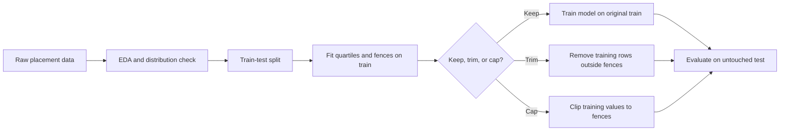
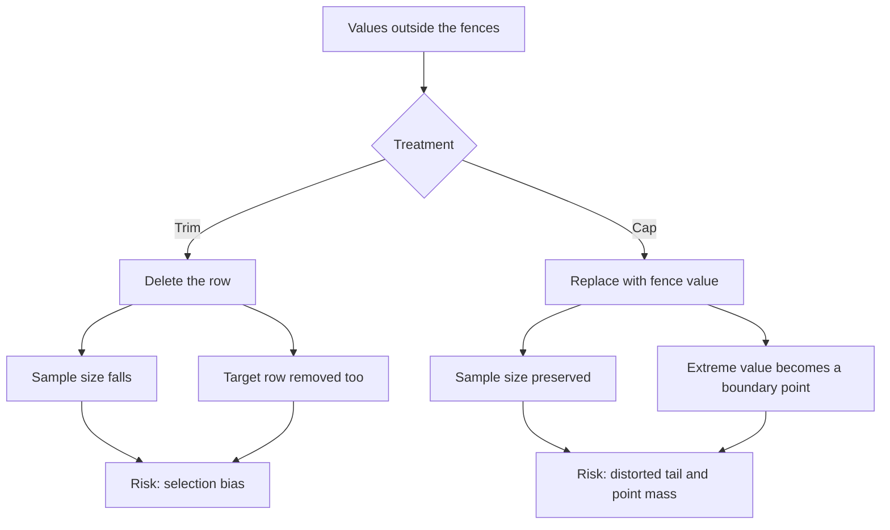
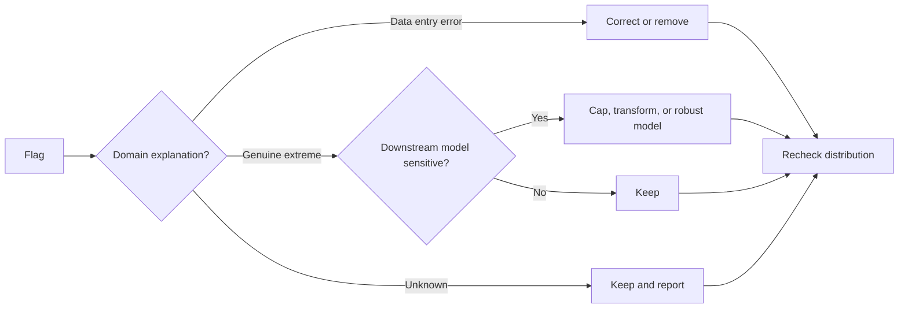

# Day 43 — Outlier Detection with the IQR Method: Quartiles, Tukey Fences, Trimming, and Capping

> **Course:** CampusX — 100 Days of Machine Learning, Day 43
> **Official notebook:** `reference_notebooks/day43.ipynb` — 25 cells, copied byte-for-byte from the vendor notebook
> **Vendor source:** `vendor/100-days-of-machine-learning/day43-outlier-removal-using-iqr-method/day43.ipynb`
> **Dataset:** `datasets/placement.csv` — 1,000 rows and 3 columns, byte-identical to the vendor copy
> **Video:** the official folder README contains only `Video Link:` with no URL, so no video link is claimed here
> **Central question:** When a numerical feature has a long tail, how do quartiles define a reproducible fence, what exactly does the $1.5 \times \mathrm{IQR}$ rule detect, and when should an extreme observation be removed, capped, transformed, modelled robustly, or simply kept?

### How this chapter is organised

The chapter starts with the placement data and the practical problem, then builds the statistical foundations: order statistics, quantiles, percentiles, interpolation, quartiles, the interquartile range, and Tukey fences. It derives the $1.5$ multiplier from the normal distribution, explains why that derivation is only a calibration and not a proof, and examines the assumptions and failure modes of the rule. It then treats trimming, capping, clipping, censoring, and winsorization as different operations, with arithmetic that shows what each does to the mean, variance, covariance, correlation, and regression. After that it turns to pandas and scikit-learn syntax, train-only fitting, leakage, plots, the 25 notebook cells, worked examples on the actual placement rows, alternatives, debugging, interview preparation, and university-style examination practice. The final sections provide a revision sheet and a cell-by-cell coverage matrix.

**Source labels used below**

- **Official** — a value or statement taken from the saved output of the CampusX notebook `reference_notebooks/day43.ipynb`. The notebook metadata reports Python 3.8.3.
- **Rerun** — a value reproduced in this environment with Python 3.14.2, pandas 3.0.5, NumPy 2.5.3, Matplotlib 3.11.2, seaborn 0.13.2, SciPy 1.18.1, and scikit-learn 1.9.1. No notebook file was edited.
- **Supplementary** — an explanation, calculation, experiment, or model example added for learning. It is not presented as course output.

The notebook is a preprocessing demonstration. It has no train/test split, no model, no cross-validation, and no performance metric. Therefore no claim of the form "IQR treatment improved the model" can come from this notebook. Any regression arithmetic in this chapter is explicitly labelled supplementary and is used only to show what changes numerically.

---

# 1. Learning objectives

After studying this chapter, I should be able to:

1. **Define an outlier operationally.** Explain why an outlier is an observation that is surprising under a stated model or rule, not simply a large number, and distinguish a data error from a genuine rare event, a skew tail, a mixture component, and a high-leverage point.
2. **Define and compute quantiles and percentiles.** Write the empirical quantile definition, explain the interpolation convention used by pandas and NumPy, and show why quartiles are not unique for small samples or for data with many ties.
3. **Compute the IQR and fences.** Obtain $Q_1$, $Q_3$, $\mathrm{IQR}=Q_3-Q_1$, and the lower and upper Tukey fences $Q_1-1.5\,\mathrm{IQR}$ and $Q_3+1.5\,\mathrm{IQR}$.
4. **Derive the normal calibration of $1.5$.** Show that under a normal distribution the fences are approximately $\mu\pm2.698\sigma$, that the two-sided tail probability is about $0.70\%$, and that this is not the same as the $3\sigma$ rule.
5. **Explain robustness.** Give the breakdown point of the mean and standard deviation, the quartiles, the IQR, and the median absolute deviation, and explain masking and swamping.
6. **State the assumptions and limits.** Explain why the IQR rule is not a hypothesis test, why it can over-flag skewed or tie-heavy features, why it misses multivariate outliers, and why it is not invariant under nonlinear monotone transformations.
7. **Distinguish trimming, capping, and winsorization.** Define row trimming, clipping to fences, censoring, and fixed-proportion winsorization; state what happens to sample size, shape, mean, variance, covariance, correlation, and regression.
8. **Do the arithmetic.** Derive and use the trimming mean formula, the variance decomposition, the capping mean and second-moment formulas, and the covariance decomposition.
9. **Implement correctly in pandas and scikit-learn.** Use `quantile`, `percentile`, boolean masks, `between`, `np.where`, `clip`, `RobustScaler`, a custom transformer, `Pipeline`, and `ColumnTransformer`; recognise that scikit-learn has no built-in IQR row remover.
10. **Prevent leakage.** Fit quantiles and fences on training data only, apply the stored bounds to test data, and explain why trimming is a training-set operation while capping can also be applied at prediction time.
11. **Read the plots.** Interpret the histogram, KDE, and box plot before and after trimming and capping; explain the new flier that appears after trimming and the point mass created by capping.
12. **Choose an action.** Decide between keeping, fixing, trimming, capping, transforming, using a robust model, or using a multivariate anomaly detector, with explicit trade-offs.
13. **Diagnose mistakes.** Recognise full-data fitting, test-set trimming, strict versus non-strict boundary errors, negative fences, NaN behaviour, tie-driven zero IQR, stale indices, and the typo in the official notebook.
14. **Answer interview and examination questions.** Give reasoned answers, perform the calculations, and discuss assumptions rather than reciting a definition.

---

# 2. Big picture: where IQR outlier handling sits in the ML workflow

Outlier treatment is part of **data cleaning and feature preprocessing**, but the decision about what to do with an extreme value belongs to **data understanding** as well. A number is not an error merely because it is far from the others. The workflow therefore has two separate steps:

1. **Detection:** flag observations that are unusual under a stated rule.
2. **Action:** investigate the cause and then keep, correct, trim, cap, transform, or change the model.

The IQR method is a detection rule. The notebook demonstrates two actions: trimming and capping. Those actions have different consequences and different leakage properties.



The order matters. The quartiles are **learned from data**, so they are part of the fitted preprocessing. They must be computed after the split, on the training portion. If they are computed on the full dataset, the test rows influence the fence, and the evaluation is no longer a clean simulation of unseen data. This is true even though the IQR calculation does not use the target: leakage is about information from the evaluation rows entering the fitted transformation, not only about target leakage.

**Connection to previous days.**

- **Day 42 (z-score / three-sigma)** used the mean and standard deviation to define a symmetric boundary. Day 43 replaces those moment-based quantities with quartiles. The motivation is robustness: one extreme value can move the mean and inflate the standard deviation, while the quartiles move much less.
- **Days 24–25 (standardization and normalization)** changed centre and scale with affine operations. They did not remove or cap observations. A robust scaler uses the median and IQR as centre and scale, but it still keeps every observation.
- **Day 31 (power transforms)** changed the spacing of values with a monotone nonlinear function. It compressed a tail without deleting rows. Day 43 asks a different question: whether to change the sample itself.
- **Day 29 (pipelines)** supplies the mechanism for fitting a preprocessing rule inside each cross-validation fold. A pipeline can hold a capping transformer safely. Row trimming is harder because removing rows changes the sample size and must remove the matching target values.
- **Day 44 (percentile method)** generalises the same quantile machinery to arbitrary percentile bounds. The IQR rule is a particular pair of quantiles with a particular multiplier.
- **Later regression and model-evaluation days** will show why deleting genuine tail observations can bias estimates and why an outlier in the test set can dominate squared-error metrics.

A useful mental model is:

```text
Distribution -> quartiles -> IQR -> fences -> flags -> investigation -> action -> evaluation
```

The arrow from flags to action is not automatic. It is a decision that requires domain knowledge and an evaluation protocol.

The two treatments preserve different things:



A robust decision process separates detection, explanation, and action:



---

# 3. Foundations explained rather than listed

## 3.1 Numerical variables, samples, and populations

A **population** is the complete set of units about which we want to make a statement. A **sample** is the subset we observe. The 1,000 students in `placement.csv` are a sample. The feature `placement_exam_marks` is a numerical variable; `cgpa` is another; `placed` is a binary target.

A **continuous** variable can take values on a continuum. `cgpa` and `placement_exam_marks` are recorded to two and zero decimal places respectively, so the stored data are discrete, but they are treated as continuous measurements for summarisation.

An **observation** is one row. An **outlier** is an observation that is surprising under a stated model, rule, or context. The phrase "under a stated model" is essential. A value of 100 is not intrinsically an outlier. In a marks column bounded between 0 and 100, it may be the maximum of a legitimate right-skewed distribution. In a column of adult heights in centimetres, 100 would be extraordinary. The rule defines the surprise; the domain defines whether the surprise is an error.

## 3.2 Order statistics

Given observations $x_1,\dots,x_n$, sort them:

$$
x_{(1)} \le x_{(2)} \le \cdots \le x_{(n)}.
$$

The value $x_{(k)}$ is the $k$-th **order statistic**. Order statistics are the foundation of quantiles, medians, and box plots. They are also robust in a precise sense: the median depends on the middle position, not on the numerical size of the largest value. Changing the largest observation from 100 to 1,000 does not change the median at all; it can change the mean enormously.

## 3.3 Quantiles, percentiles, and quartiles

For a continuous random variable with cumulative distribution function $F(x)=P(X\le x)$, the $p$-quantile is the value $Q(p)$ such that

$$
F(Q(p))=p,\qquad 0<p<1.
$$

In words, a proportion $p$ of the distribution lies at or below $Q(p)$. A **percentile** is a quantile expressed on a 0–100 scale:

$$
P_k=Q\left(\frac{k}{100}\right).
$$

The **quartiles** are the three quantiles that divide the distribution into four parts:

$$
Q_1=Q(0.25),\qquad Q_2=Q(0.50),\qquad Q_3=Q(0.75).
$$

$Q_2$ is the median. $Q_1$ is the first quartile or 25th percentile. $Q_3$ is the third quartile or 75th percentile. The **interquartile range** is

$$
\mathrm{IQR}=Q_3-Q_1.
$$

The IQR is the width of the middle half of the data. It is a measure of spread, like the standard deviation, but it ignores the numerical values of the lowest quarter and the highest quarter except insofar as they affect the quartile positions.

## 3.4 Mean, median, variance, and standard deviation

For observations $x_1,\dots,x_n$, the sample mean and sample variance are

$$
\bar{x}=\frac{1}{n}\sum_{i=1}^{n}x_i,
\qquad
s^2=\frac{1}{n-1}\sum_{i=1}^{n}(x_i-\bar{x})^2.
$$

The sample standard deviation is $s=\sqrt{s^2}$. The median is $Q_2$. The mean is the balance point of the sample; the median is the middle position. The variance averages squared deviations from the mean, so a single large deviation can dominate it. The median and quartiles do not square deviations; they count positions.

This is why the mean and standard deviation are called **non-robust** or **moment-based** summaries, while the median, quartiles, and IQR are called **robust** or **order-based** summaries. Robust does not mean "correct" or "always better". It means that the summary is less sensitive to a small fraction of extreme values. If the extreme values are genuine and important, robustness can hide the very phenomenon we need to study.

## 3.5 Covariance, correlation, and simple linear regression

For paired observations $(x_i,y_i)$, the sample covariance is

$$
\mathrm{Cov}(x,y)=\frac{1}{n-1}\sum_{i=1}^{n}(x_i-\bar{x})(y_i-\bar{y}),
$$

and the sample correlation is

$$
r=\frac{\mathrm{Cov}(x,y)}{s_x s_y}.
$$

The correlation is a standardised covariance: it lies between $-1$ and $1$ (up to rounding), and it measures the strength and direction of a **linear** association. It is not a measure of causation, and it is not a measure of the fraction of variance explained unless it is squared in a simple linear regression.

The simple linear regression of $y$ on $x$ with an intercept has slope

$$
\hat{\beta}_1=\frac{\mathrm{Cov}(x,y)}{\mathrm{Var}(x)}
=\frac{\sum_i (x_i-\bar{x})(y_i-\bar{y})}{\sum_i (x_i-\bar{x})^2},
$$

and intercept $\hat{\beta}_0=\bar{y}-\hat{\beta}_1\bar{x}$. The slope is the covariance divided by the variance of the predictor. Anything that changes the covariance or the variance of $x$ changes the slope. Trimming and capping do both.

## 3.6 Robustness, breakdown, masking, and swamping

The **breakdown point** of an estimator is the smallest fraction of observations that must be replaced by arbitrary values to make the estimator unbounded. The sample mean and standard deviation have breakdown point $0$: one sufficiently extreme observation can move them arbitrarily far. The median has breakdown point $0.5$: fewer than half the observations cannot move it arbitrarily. The quartiles and the IQR have breakdown point approximately $0.25$: contamination beyond a quarter of the sample can move them substantially.

**Masking** occurs when an extreme observation inflates the standard deviation so much that its own z-score falls below the threshold. A single very large value can therefore hide itself and other values from a $3\sigma$ rule. The IQR is less vulnerable to this particular mechanism because the quartiles do not use the squared distances of the extremes, but it is not immune: more than a quarter of contamination can move the quartiles.

**Swamping** occurs when a rule flags ordinary observations because the estimated scale or fence has been distorted. A skewed distribution can make the lower fence uninformative and the upper fence too aggressive or too lenient. Swamping is a reason to inspect the distribution, not merely count flags.

## 3.7 Train/test separation and data leakage

The test set simulates data that the model has not seen. Any quantity learned from the test set — a mean, a standard deviation, a quartile, a fence, an encoder vocabulary, a model hyperparameter — contaminates the evaluation if it influences the fitted transformation or the model. This is **data leakage**.

The IQR calculation is unsupervised: it does not look at $y$. It still leaks if it is computed on all rows before the split, because the fence depends on the test features. The correct procedure is:

1. Split rows into training and test.
2. Compute $Q_1$, $Q_3$, and the fences on the training rows only.
3. Store the lower and upper bounds.
4. Apply those stored bounds to the training and test rows.
5. Fit the model on the treated training rows.
6. Evaluate on the test rows, using a procedure that matches deployment.

A `Pipeline` automates steps 2–4 during cross-validation. It does not automatically solve row trimming, because standard scikit-learn transformers must preserve the number of rows. That distinction is developed in Section 10.

## 3.8 Anatomy of a box plot

A box plot displays:

- a box from $Q_1$ to $Q_3$;
- a line inside the box at the median $Q_2$;
- whiskers that extend to the most extreme observations inside the fences $Q_1-1.5\,\mathrm{IQR}$ and $Q_3+1.5\,\mathrm{IQR}$;
- individual points beyond the whiskers, called fliers or outliers.

The whisker is **not** the fence itself. The fence is a theoretical boundary; the whisker ends at the largest or smallest observed value that is still inside the fence. If there are no observations between $Q_3$ and the upper fence, the whisker ends at $Q_3$. If the maximum observation is below the fence, the whisker ends at the maximum. Points beyond the fence are plotted individually.

Matplotlib and seaborn use $1.5$ as the default whisker multiplier. The parameter is usually called `whis`. A box plot therefore visualises the same rule that the notebook computes manually, but it does not replace the manual calculation: it does not print the quartiles, it can hide multimodality, and its fences are recomputed on whatever data are passed to it. That last point explains the surprising new flier after trimming, discussed in Section 11.

---

# 4. The problem in the placement data

## 4.1 The dataset

The file has three columns and 1,000 rows:

| Column | Meaning | Type | Missing |
|---|---|---|---|
| `cgpa` | Undergraduate CGPA | continuous, roughly 4.89–9.12 | 0 |
| `placement_exam_marks` | Marks in a placement examination | continuous, 0–100 | 0 |
| `placed` | Placement outcome | binary, 0 or 1 | 0 |

The first five rows shown by the notebook are:

| Index | `cgpa` | `placement_exam_marks` | `placed` |
|---:|---:|---:|---:|
| 0 | 7.19 | 26.0 | 1 |
| 1 | 7.46 | 38.0 | 1 |
| 2 | 7.54 | 40.0 | 1 |
| 3 | 6.42 | 8.0 | 1 |
| 4 | 7.23 | 17.0 | 0 |

The overall summary is:

| Statistic | `cgpa` | `placement_exam_marks` |
|---|---:|---:|
| Count | 1000 | 1000 |
| Mean | 6.961240 | 32.225000 |
| Standard deviation | 0.615898 | 19.130822 |
| Minimum | 4.890 | 0.000 |
| 25th percentile | 6.550 | 17.000 |
| Median | 6.960 | 28.000 |
| 75th percentile | 7.370 | 44.000 |
| Maximum | 9.120 | 100.000 |
| Skewness | -0.014530 | 0.835642 |
| Excess kurtosis | 0.091123 | 0.270519 |

`cgpa` is almost symmetric. `placement_exam_marks` is right-skewed: there are many marks in the teens and twenties, fewer in the fifties and sixties, and a sparse tail from 80 to 100. The maximum 100 is a genuine recorded value; the dataset contains exactly one 100 and one 0. Neither is automatically an error.

## 4.2 Why the choice of column matters

The notebook applies the IQR method to `placement_exam_marks`, not to `cgpa`. That is a sensible choice for teaching because the marks column has a visible tail. It also creates an important comparison problem: the Day 42 notebook applies the z-score method to `cgpa`, while Day 43 applies the IQR method to `placement_exam_marks`. The two notebooks therefore do not form a controlled comparison of the two methods on the same feature.

If we evaluate both methods on the same marks column, the IQR rule flags 15 observations and the $3\sigma$ rule flags 8. If we evaluate both methods on `cgpa`, the IQR rule flags 8 and the $3\sigma$ rule flags 5. Both comparisons are shown later. The lesson is that a method comparison must hold the data, the split, and the evaluation fixed; comparing saved outputs from different columns can mislead.

## 4.3 What the notebook actually does

The 25 cells perform the following sequence:

1. Import NumPy, pandas, Matplotlib, and seaborn.
2. Read `placement.csv`.
3. Display the first five rows.
4. Plot histograms with KDE for `cgpa` and `placement_exam_marks`.
5. Display `describe()` for the marks column.
6. Display a box plot of the marks column.
7. Compute the 25th and 75th quantiles.
8. Compute the IQR and the fences.
9. List the rows above the upper fence and the rows below the lower fence.
10. Trim the rows above the upper fence and compare the before/after plots.
11. Cap the values outside both fences and compare the before/after plots.

There is no train/test split, no model, and no evaluation of predictive performance. The notebook answers the question "what do these operations do to the sample?" It does not answer "does this improve a model?" Those are different questions.

## 4.4 Detection is not the same as treatment

A detection rule produces a flag. A treatment produces a new dataset. The notebook sometimes moves directly from a flag to an action, which is common in a demonstration but dangerous in practice. Before removing or changing a value, ask:

- Is the value impossible in the domain? For example, a negative exam mark is impossible if the marking scheme starts at zero.
- Is the value a data-entry or unit error? For example, a height recorded in millimetres instead of centimetres.
- Is the value a genuine rare event? For example, a very high income, a very large purchase, or a fraudulent transaction. Removing it may remove the phenomenon of interest.
- Is the value a mixture from a different population? For example, adult and child heights in one column.
- Is the value a high-leverage but correctly measured point in a regression? Its influence may be legitimate.
- Is the feature bounded? A lower fence below the minimum possible value is not evidence of a lower outlier.

The IQR rule cannot answer these questions. It only says "this value is far from the middle half under this particular definition of far". Domain knowledge and an evaluation protocol decide the action.

## 4.5 A precise working definition of an outlier

For this chapter, an outlier is an observation whose value lies outside a stated acceptance region, where the region is defined by the IQR rule and the multiplier $k$:

$$
\mathcal{O}=\{i:x_i<L\ \text{or}\ x_i>U\},
$$

with

$$
L=Q_1-k\,\mathrm{IQR},\qquad U=Q_3+k\,\mathrm{IQR}.
$$

This is a **rule-based** definition. It is not a probability statement. A value outside the fence is not necessarily an error, and a value inside the fence is not necessarily typical. The definition is useful because it is reproducible and easy to communicate. It is limited because it depends on the multiplier, the quantile convention, and the sample.

The next sections make each part of this definition precise.

---

# 5. Quartiles and percentiles: definitions, interpolation, and edge cases

## 5.1 The empirical distribution function

For a sample $x_1,\dots,x_n$, the empirical distribution function is

$$
\hat{F}_n(t)=\frac{1}{n}\sum_{i=1}^{n}\mathbf{1}\{x_i\le t\}.
$$

It is a step function. At each observed value, it jumps by the number of observations tied at that value divided by $n$. The empirical quantile is the inverse of this step function, but because the step function is flat between observations and jumps at ties, the inverse is not unique at the jumps. A convention is needed.

One convention is the **inverted empirical CDF**:

$$
\hat{Q}(p)=\inf\{t:\hat{F}_n(t)\ge p\}.
$$

This returns an observed value, but it can be jumpy and can give a different answer from the linear interpolation used by pandas. Another convention interpolates between adjacent order statistics. The choice matters for small samples, for ties, and for reproducibility.

## 5.2 The linear interpolation formula used by pandas and NumPy

Let $x_{(1)}\le\cdots\le x_{(n)}$ be the sorted sample. For $0<p<1$, define

$$
h=(n-1)p,\qquad j=\lfloor h\rfloor,\qquad g=h-j.
$$

Then the linear-interpolation quantile is

$$
\hat{Q}(p)=(1-g)x_{(j+1)}+g\,x_{(j+2)}.
$$

The indices are one-based. The value $h$ is the position in the sorted sample measured in units of gaps between observations. When $h$ is an integer, the quantile is exactly an observed value. When $h$ lies between two integers, the quantile is a weighted average of the two neighbouring order statistics. For the endpoints, $p=0$ returns $x_{(1)}$ and $p=1$ returns $x_{(n)}$; the formula above is used for $0<p<1$.

Why $(n-1)p$ rather than $np$? The factor $n-1$ places the first observation at position 0 and the last at position $n-1$, so the interpolation is anchored at both endpoints. This is the convention used by NumPy's default `method='linear'` and pandas' default `interpolation='linear'`. Other conventions use $(n+1)p$, $np-0.5$, or a different position function. They agree asymptotically but can differ substantially for small $n$.

## 5.3 Worked interpolation on the actual marks column

The marks column has $n=1000$. For the first quartile, $p=0.25$:

$$
h=(1000-1)(0.25)=249.75.
$$

Thus $j=249$ and $g=0.75$. The quantile is

$$
\hat{Q}(0.25)=0.25\,x_{(250)}+0.75\,x_{(251)}.
$$

In the sorted data, both the 250th and 251st observations are 17.0, so

$$
\hat{Q}(0.25)=0.25(17)+0.75(17)=17.
$$

For the third quartile, $p=0.75$:

$$
h=999(0.75)=749.25,\qquad j=749,\qquad g=0.25,
$$

so

$$
\hat{Q}(0.75)=0.75\,x_{(750)}+0.25\,x_{(751)}.
$$

Both values are 44.0, so $\hat{Q}(0.75)=44$. The median uses $h=499.5$, interpolating the 500th and 501st values; both are 28.0, so the median is 28.

The fact that the interpolation weights are 0.25 and 0.75 may look backwards at first. The position 249.75 is three-quarters of the way from index 249 to index 250, so the value at index 250 receives weight 0.75. That is why the formula is $(1-g)x_{(j+1)}+g x_{(j+2)}$ with $g=0.75$: the later observation gets the larger weight.

Because the marks are integers and many values are tied, the interpolation happens to land on identical neighbours. The result is exact and does not depend on the interpolation method. That is convenient for the notebook, but it hides the general ambiguity. A small non-tied example exposes it.

## 5.4 Small-sample example: why quartiles are not unique

Take the six values

$$
1,\ 2,\ 3,\ 4,\ 5,\ 6.
$$

With the linear convention:

$$
h_{0.25}=5(0.25)=1.25,
$$

so

$$
Q_1=0.75(2)+0.25(3)=2.25.
$$

Similarly,

$$
h_{0.75}=5(0.75)=3.75,
$$

so

$$
Q_3=0.25(4)+0.75(5)=4.75.
$$

The IQR is $4.75-2.25=2.5$.

A different convention, often called **Tukey's hinges**, splits the sorted data into a lower half and an upper half, including the median in both halves when $n$ is odd. For $n=6$, the lower half is $1,2,3$ and the upper half is $4,5,6$. The lower hinge is the median of the lower half, 2, and the upper hinge is the median of the upper half, 5. The hinge IQR is $5-2=3$, not $2.5$.

Both conventions are defensible. They answer slightly different questions about "the middle half" of a small sample. The important practical rule is: **state the convention and use the same one everywhere**. If a report says "Q1 = 2.25", a reader using Tukey hinges may compute 2 and wonder why the fences differ.

For $n=5$, the linear convention gives $Q_1=2$ and $Q_3=4$ for the values $1,2,3,4,5$. Tukey's hinges also give 2 and 4 because the median 3 is included in both halves, and the medians of $1,2,3$ and $3,4,5$ are 2 and 4. The conventions coincide here but not for $n=6$.

## 5.5 The Hyndman–Fan family and library differences

Hyndman and Fan (1996) described nine sample-quantile definitions that differ in how the position $h$ is defined and how interpolation is performed. NumPy exposes several through the `method` argument of `np.percentile` and `np.quantile`: `'linear'`, `'lower'`, `'higher'`, `'midpoint'`, `'nearest'`, and others. pandas exposes a similar set through the `interpolation` argument of `Series.quantile` and `DataFrame.quantile`. R's default `quantile` uses type 7, which is the same linear interpolation as the default here; other software may use a different type.

In this dataset, the quartiles are exact observed values, so all common methods return 17 and 44. That is not a general guarantee. With non-tied data, the method can change the fence and therefore the set of flagged observations. When reproducibility matters, record the library, the version, and the method.

## 5.6 Quartiles on the actual `cgpa` column

For `cgpa`:

$$
Q_1=6.55,\qquad Q_2=6.96,\qquad Q_3=7.37.
$$

The IQR is

$$
\mathrm{IQR}=7.37-6.55=0.82.
$$

The values are not as heavily tied as the integer marks, but the quartiles still land on recorded values because of the data's granularity and the interpolation positions. The fences are

$$
L=6.55-1.5(0.82)=6.55-1.23=5.32,
$$

$$
U=7.37+1.5(0.82)=7.37+1.23=8.60.
$$

There are 5 observations below 5.32 and 3 above 8.60, for 8 flags in total. The $3\sigma$ rule on the same column gives bounds approximately $5.1135$ and $8.8089$ and flags 5 observations. The IQR rule is more aggressive because its normal-calibration tail is about $0.70\%$ rather than $0.27\%$, and because the data are not perfectly normal.

## 5.7 Properties of quantiles

Quantiles have several useful properties.

**Monotone equivariance.** If $g$ is a strictly increasing function, then the quantile of $g(X)$ is $g$ applied to the quantile of $X$:

$$
Q_{g(X)}(p)=g(Q_X(p)).
$$

This follows from $P(g(X)\le g(t))=P(X\le t)$ for an increasing $g$. It means that a monotone transform preserves the *positions* of the quartiles in the transformed scale. It does **not** mean that the IQR fences are invariant, because the fence adds a multiple of the IQR in the transformed scale. This distinction is important and is demonstrated in Section 8.

**Affine equivariance.** For $a>0$ and $b$,

$$
Q_{aX+b}(p)=aQ_X(p)+b.
$$

The IQR scales by $a$, and the fences transform in the same way. Therefore the IQR rule is invariant under positive affine transformations: multiplying a feature by a positive constant and adding a constant does not change which observations are flagged. This is one reason the rule is convenient across units.

**Sensitivity to ties.** A quantile can be an observed value or an interpolated value. With many ties, a small change in $p$ may produce no change in the quantile for a while, then a jump. This is normal for discrete data, but it means that the IQR can be zero even when the data are not constant.

**Sensitivity to the tails only through positions.** The exact numerical values of the smallest and largest observations do not affect the quartiles unless they change the order statistics at the quartile positions. This is the source of robustness, and also the reason the IQR can fail to notice a very extreme value that is still only one observation among many.

## 5.8 Edge cases for quantiles

**Small $n$.** With $n=1$, every quantile is the single value; the IQR is 0. With $n=2$, the linear convention gives $Q_1=x_{(1)}$, $Q_3=x_{(2)}$, so the IQR is the full range and the fences extend beyond the data; no value can be flagged. With $n=3$, the quartiles are interpolated and the IQR is a fraction of the range. Small samples do not provide stable tail information.

**All values equal.** If $x_1=\cdots=x_n=c$, then $Q_1=Q_3=c$, the IQR is 0, and both fences equal $c$. No observation is outside the fences, because every observation equals $c$. The rule is silent rather than wrong.

**A dominant tie.** If 80% of the values are 0 and 20% are 1, then $Q_1=0$ and $Q_3=0$, so the IQR is 0 and both fences are 0. Every 1 is flagged: 20% of the sample. That is not a sensible outlier conclusion; it is an artefact of a tie-heavy, discrete distribution. The rule assumes a spread-out middle; when the middle is a single tied value, the fences collapse.

**Missing values.** pandas quantiles skip missing values by default (`skipna=True`). If all values are missing, the quantile is missing. The fence becomes missing, and comparisons with it are false. A trimming mask based on `<` or `>` will therefore drop missing rows silently, while a capping operation will preserve missing values. This is a behavioural difference that must be handled deliberately.

**Weighted data.** If each observation represents a different number of population units, an unweighted quantile is not the population quantile. pandas and NumPy support weights in some functions, but the IQR rule as usually implemented is unweighted. State the choice.

---

# 6. The IQR and Tukey fences

## 6.1 Definition

The interquartile range is

$$
\mathrm{IQR}=Q_3-Q_1.
$$

It measures the spread of the middle 50% of the data. For the marks column:

$$
\mathrm{IQR}=44-17=27.
$$

For `cgpa`:

$$
\mathrm{IQR}=7.37-6.55=0.82.
$$

The IQR has the same units as the feature. It is not a proportion and it is not a variance. A feature measured in centimetres has an IQR in centimetres; multiplying the feature by 10 multiplies the IQR by 10.

## 6.2 Tukey fences

For a multiplier $k>0$, the lower and upper fences are

$$
L=Q_1-k\,\mathrm{IQR},\qquad U=Q_3+k\,\mathrm{IQR}.
$$

The standard box-plot choice is $k=1.5$. For the marks:

$$
L=17-1.5(27)=17-40.5=-23.5,
$$

$$
U=44+1.5(27)=44+40.5=84.5.
$$

The interval $[L,U]=[-23.5,84.5]$ is the acceptance region. Any observation strictly below $-23.5$ or strictly above $84.5$ is flagged.

The fences are not quantiles. They are extrapolations beyond the quartiles by a multiple of the middle-half width. Under a normal distribution, they correspond to approximately $\pm2.698\sigma$, as Section 7 derives. Under a skewed distribution, they correspond to different tail probabilities on the two sides.

## 6.3 Applying the fences to the placement marks

There are no marks below $-23.5$, because the minimum is 0. There are 15 marks above $84.5$. The flagged rows are:

| Index | `cgpa` | `placement_exam_marks` | `placed` |
|---:|---:|---:|---:|
| 9 | 7.75 | 94.0 | 1 |
| 40 | 6.60 | 86.0 | 1 |
| 61 | 7.51 | 86.0 | 0 |
| 134 | 6.33 | 93.0 | 0 |
| 162 | 7.80 | 90.0 | 0 |
| 283 | 7.09 | 87.0 | 0 |
| 290 | 8.38 | 87.0 | 0 |
| 311 | 6.97 | 87.0 | 1 |
| 324 | 6.64 | 90.0 | 0 |
| 630 | 6.56 | 96.0 | 1 |
| 685 | 6.05 | 87.0 | 1 |
| 730 | 6.14 | 90.0 | 1 |
| 771 | 7.31 | 86.0 | 1 |
| 846 | 6.99 | 97.0 | 0 |
| 917 | 5.95 | 100.0 | 0 |

The 15 values sum to 1,356, with mean 90.4. There are 8 students who were not placed and 7 who were placed among these 15; the removed group's placement rate is $7/15\approx46.67\%$, close to the overall 48.9%. Removing these rows would therefore not substantially change the target balance, but that is a property of this sample, not a guarantee.

The lower query is empty. That is not because the lower fence is "correct"; it is because the feature has a natural floor at 0 and the fence lies below that floor. The lower fence is statistically defined but physically uninformative for this feature.

## 6.4 What the fences do not tell us

Three cautions follow immediately from the arithmetic.

First, a flag is not a proof of error. The 15 rows are unusual relative to the middle half, but their marks are plausible exam scores. Without a data dictionary, an invigilation record, or a reason to believe the marks were misrecorded, there is no basis for calling them errors.

Second, the lower fence is not a meaningful boundary for a nonnegative variable when it is negative. Clipping a mark to $-23.5$ would create an impossible value. The notebook's capping code checks the lower fence, but because no value is below it, the lower branch never executes. A production implementation should either use a domain floor of 0 or document that the lower fence is inactive.

Third, the fence is sample-dependent. If the training sample changes, the quartiles change, the IQR changes, and the fence changes. A value that is flagged in one sample may be inside the fence in another. This is not instability unique to IQR; it is the normal behaviour of a fitted preprocessing rule. It is why the rule must be fitted on training data and stored with the model.

## 6.5 Box-plot fences versus manual fences

A box plot with the default `whis=1.5` uses the same fences, but it also chooses the whisker endpoints as the most extreme observations inside the fences. For the marks:

- $Q_1=17$, $Q_3=44$, $\mathrm{IQR}=27$;
- lower fence $-23.5$, upper fence $84.5$;
- the smallest observation is 0, which is above the lower fence, so the lower whisker ends at 0;
- the largest observation inside the upper fence is 83, so the upper whisker ends at 83;
- the 15 observations from 86 to 100 are drawn as individual fliers.

This is exactly what the saved box plot shows. The plot is consistent with the manual calculation, but it does not display the fence values themselves. Reading a box plot therefore requires knowing the whisker rule; otherwise a viewer may mistake the whisker end for the fence or for the maximum.

## 6.6 The IQR as a robust scale estimate

For a normal distribution, the IQR is approximately $1.349\sigma$. Therefore

$$
\hat{\sigma}_{\mathrm{IQR}}=\frac{\mathrm{IQR}}{1.349}
$$

is a robust estimate of the standard deviation. For the marks, this gives

$$
\hat{\sigma}_{\mathrm{IQR}}=\frac{27}{1.34898}\approx20.015,
$$

which is larger than the sample standard deviation $19.1308$. The difference is a reminder that the data are not normal and that robust and moment-based scales answer different questions. For `cgpa`, the IQR-based scale is $0.82/1.34898\approx0.608$, close to the sample standard deviation $0.6159$, consistent with its near-symmetric shape.

`RobustScaler` uses exactly this idea: it centers by the median and scales by the IQR (or another quantile range). It does not remove or cap outliers. It makes the feature's middle half have unit width, which can reduce the influence of extreme values on subsequent distance calculations, but the extreme values remain in the data and remain extreme in the scaled feature.

## 6.7 Why the IQR is called robust

The IQR depends on the 25th and 75th percentiles. To move $Q_1$ arbitrarily far, more than 25% of the observations must be placed below it or the lower quarter must be contaminated. A single observation, however large, cannot move the quartiles arbitrarily. In contrast, the mean changes linearly with every observation, and the variance changes with the square of a deviation.

This robustness is valuable when the goal is to summarise the bulk of the data or to set a boundary that is not dragged outward by a few extremes. It is not valuable when the extremes are the signal. For fraud detection, the largest transactions may be the most important; a rule that ignores them is inappropriate.

---

# 7. Why $1.5$? The normal calibration and its limits

## 7.1 The historical answer

The $1.5\,\mathrm{IQR}$ convention is associated with John Tukey's exploratory data analysis and the box-and-whisker plot. Tukey chose a multiplier that would mark a modest fraction of observations in ordinary data without marking so many that the plot became unreadable. It is a convention born from exploratory practice, not a theorem that $1.5$ is optimal for every loss function or every distribution.

Some presentations call the $1.5\,\mathrm{IQR}$ fences "inner fences" and the $3\,\mathrm{IQR}$ fences "outer fences". Observations between the inner and outer fences are sometimes called "outside" values, and observations beyond the outer fences "far out" values. The exact terminology varies by software and textbook; the arithmetic does not.

## 7.2 Derivation under a normal distribution

Suppose $X\sim N(\mu,\sigma^2)$. Let $z_{0.75}=\Phi^{-1}(0.75)\approx0.67448975$. Then

$$
Q_1=\mu-z_{0.75}\sigma,\qquad Q_3=\mu+z_{0.75}\sigma.
$$

The IQR is

$$
\mathrm{IQR}=Q_3-Q_1=2z_{0.75}\sigma\approx1.3489795\sigma.
$$

The upper fence is

$$
\begin{aligned}
U
&=Q_3+1.5\,\mathrm{IQR} \\
&=\mu+z_{0.75}\sigma+1.5(2z_{0.75}\sigma) \\
&=\mu+(1+3)z_{0.75}\sigma \\
&=\mu+4z_{0.75}\sigma \\
&\approx\mu+2.697959\sigma.
\end{aligned}
$$

The lower fence is symmetric:

$$
L\approx\mu-2.697959\sigma.
$$

Thus, under normality, the $1.5\,\mathrm{IQR}$ rule is approximately a $2.698\sigma$ rule, not a $3\sigma$ rule.

## 7.3 The tail probability

For a standard normal variable $Z$,

$$
P(|Z|>2.697959)=2\bigl(1-\Phi(2.697959)\bigr)\approx0.0069766.
$$

That is about $0.6977\%$, or roughly 7 observations per 1,000, if the data are exactly normal and the quartiles are known exactly. The $3\sigma$ rule has

$$
P(|Z|>3)=2\bigl(1-\Phi(3)\bigr)\approx0.0026998,
$$

about $0.2700\%$, or roughly 2.7 per 1,000. The IQR rule is therefore more sensitive than the $3\sigma$ rule under normality: it is designed to flag a larger fraction of a normal sample.

For a general multiplier $k$, the fence offset is

$$
(1+2k)z_{0.75}\sigma.
$$

For $k=1$, the fence is at $2.0235\sigma$, with a two-sided normal tail of about $4.30\%$. For $k=3$, the fence is at $4.7214\sigma$, with a two-sided tail of about $2.34\times10^{-6}$. The following table summarises the calibration:

| $k$ | Fence offset in $\sigma$ | Two-sided normal tail | Expected flags per 1,000 |
|---:|---:|---:|---:|
| 1.0 | 2.0235 | 0.04302 | 43.02 |
| 1.5 | 2.6980 | 0.006977 | 6.98 |
| 3.0 | 4.7214 | 0.00000234 | 0.00234 |

The table makes the trade-off visible. Smaller $k$ flags more observations; larger $k$ flags fewer. There is no universal correct value.

## 7.4 Why "1.5 IQR equals 3 sigma" is a misconception

A common shorthand says that the $1.5\,\mathrm{IQR}$ rule is "about three sigma". It is closer to $2.7\sigma$ under normality. The shorthand is not harmless: it leads people to expect a $0.27\%$ false-positive rate, when the normal calibration is $0.70\%$, and it obscures the fact that the IQR rule is more aggressive. Under a heavy-tailed or skewed distribution, the difference can be much larger.

A second misconception is that the multiplier is estimated from the data. It is not. The multiplier is a fixed convention; the quartiles are estimated. Changing the multiplier changes the rule, but the data do not choose $1.5$ automatically. If you choose $k$ by looking at the test set, you have introduced a form of selection leakage.

## 7.5 Why not 1 or 2?

A multiplier of 1 would flag many more observations. Under normality, the fence would be at about $2.02\sigma$, with a $4.3\%$ two-sided tail, which is too aggressive for a general exploratory rule. A multiplier of 2 would flag fewer, at about $3.37\sigma$ under normality; it would miss moderate tail values that many analysts want to inspect. The value 1.5 is a compromise that has become conventional because it is easy to remember and produces useful box plots on many datasets. It is not a law.

In a specific application, the multiplier should reflect:

- the cost of a false flag versus a missed anomaly;
- the known measurement-error model;
- the domain's definition of an impossible or implausible value;
- the sample size and the stability of the quartiles;
- the distributional shape;
- the modelling goal.

For a quality-control problem with expensive failures, a smaller $k$ may be appropriate. For a large, skewed, bounded feature where the tail is genuine, a larger $k$ or no automatic rule may be appropriate.

## 7.6 The multiplier and the box plot

The box plot's default `whis=1.5` is the same convention. If you change `whis`, the whiskers and fliers change, but the box (quartiles) and median do not. This is a useful teaching point: the box is a summary of the middle half; the whisker rule is a separate decision. A plot with `whis=3.0` is not "more correct"; it simply uses a wider acceptance region.

Some software allows `whis` to be a percentile pair, in which case the whiskers are placed at those percentiles rather than at a multiple of the IQR. That is a different rule. Do not describe a percentile-whisker plot as a $1.5\,\mathrm{IQR}$ plot.

---

# 8. Distributional assumptions, limitations, and failure modes

## 8.1 What the IQR rule assumes

The IQR rule is often described as "nonparametric" because it does not require a normal distribution. That is only partly true. It does not use a normal likelihood, but it still makes implicit assumptions:

1. **A meaningful middle.** The quartiles should describe a coherent bulk of the data. If the distribution is strongly multimodal, the middle half may sit between modes and the IQR may not represent any real group.
2. **Enough observations per quartile.** With small $n$, the quartiles are unstable and the fences are dominated by interpolation choices.
3. **A roughly comparable tail structure on both sides.** The rule uses one IQR for both tails. In a strongly skewed distribution, the upper tail may be much longer than the lower tail, so a symmetric-in-scale fence is not symmetric in probability.
4. **A single homogeneous population.** If the data mix groups with different locations or scales, a global fence may flag an entire group.
5. **A univariate notion of unusualness.** The rule examines one feature at a time. A point can be unusual in the joint distribution while being ordinary in every margin.
6. **A stable measurement process.** If the measurement scale or definition changes over time, the quartiles mix incompatible populations.
7. **A meaningful feature scale.** The IQR is equivariant under affine transformations, but not under arbitrary nonlinear transformations, as shown below.

None of these assumptions is a formal requirement in the sense of a likelihood model. They are practical conditions for the rule to produce useful flags.

## 8.2 Limitation: skewness makes the two tails unequal

For a right-skewed feature, the upper fence is often exceeded by many genuine observations while the lower fence is far below the minimum. The marks column is an example: the lower fence is $-23.5$, which is impossible for a mark, and the upper fence flags 15 observations, most of which are plausible high scores. The rule is not "wrong" under its own definition, but the flags are not equally informative on the two sides.

A symmetric rule applied to a skewed distribution can therefore:

- over-flag the long tail;
- under-flag the short tail;
- produce a negative lower bound for a nonnegative feature;
- suggest a transformation or a robust model rather than deletion.

If the goal is a fixed tail probability, a method that models the skewness (quantile regression, a transformed scale, or a distributional fit) is more appropriate than a symmetric fence.

## 8.3 Limitation: heavy tails and the expected flag rate

The $0.70\%$ normal calibration is not a universal false-positive rate. For a heavy-tailed distribution, the IQR may be small relative to the extreme tail, so the fences flag a larger fraction than $0.70\%$. For a light-tailed or bounded distribution, they may flag fewer. The IQR rule has no distribution-free guarantee of a fixed rate. The Chebyshev inequality gives a bound for the $3\sigma$ rule under finite variance, but it is a loose worst-case bound, not a useful flag rate; the IQR rule does not even have that simple bound.

## 8.4 Limitation: ties can collapse the IQR

Consider a feature with 80 observations equal to 0 and 20 observations equal to 1. Then

$$
Q_1=0,\qquad Q_3=0,\qquad \mathrm{IQR}=0,
$$

so $L=U=0$. Every 1 is flagged, which is 20% of the sample. The rule has not discovered 20% outliers; it has encountered a discrete distribution whose middle half is a single value. The same issue arises with counts, ratings, and zero-inflated variables. In such cases, treat the feature as categorical or use a domain-specific rule rather than forcing an IQR fence.

A constant feature is the limiting case: $Q_1=Q_3=c$, $\mathrm{IQR}=0$, $L=U=c$, and no value is outside because every value equals $c$. If one value differs, it is flagged immediately. The rule is technically defined but practically uninformative.

## 8.5 Limitation: small samples

With a small sample, the quartiles are estimated from very few order statistics. For $n=10$, $Q_1$ is near the third observation and $Q_3$ near the eighth; a single change in the middle can move the fences substantially. The normal calibration is also unreliable because the sample quartiles are noisy. A common rule of thumb is to require enough observations per tail to estimate the quartile; there is no universal minimum, but small-$n$ fences should be treated as exploratory.

A related issue is that the maximum and minimum dominate the range but not the IQR. In a sample of 10, a single extreme value may be the only observation in the upper tail. The IQR may still be stable, but the decision to remove that observation is based on very little information about the tail's shape.

## 8.6 Limitation: mixtures and multiple populations

If a column combines two groups with different locations, the global quartiles can fall between the groups. For example, if 60% of students are in one programme with marks around 30 and 40% in another with marks around 80, the IQR may span the gap. A global fence may flag the entire smaller group or may fail to flag either group's internal extremes. The right analysis is usually to condition on the group, fit separate fences, or include the group as a feature. A single global IQR is not a substitute for understanding the data-generating process.

## 8.7 Limitation: multivariate outliers

The IQR rule is univariate. A point can have an ordinary CGPA and ordinary marks but an unusual combination, such as a very high CGPA with a very low placement-exam mark relative to the joint pattern. Each margin may be inside its fence, so the IQR rule sees nothing. Multivariate methods such as the Mahalanobis distance, robust covariance estimation, Isolation Forest, Local Outlier Factor, or One-Class SVM are needed for joint unusualness. They have their own assumptions and should be scaled and validated.

## 8.8 Limitation: non-invariance under nonlinear monotone transforms

The IQR rule is invariant under positive affine transformations, but not under nonlinear monotone transformations. This is easy to demonstrate. Take the eight values

$$
8,\ 10,\ 10,\ 10,\ 20,\ 20,\ 20,\ 40.
$$

The linear-interpolation quartiles are $Q_1=10$ and $Q_3=20$, so $\mathrm{IQR}=10$ and the upper fence is

$$
U=20+1.5(10)=35.
$$

The value 40 is flagged. Now take the natural logarithm, a strictly increasing transformation. The transformed quartiles are $\ln 10$ and $\ln 20$. The transformed IQR is $\ln 20-\ln 10=\ln 2$, and the transformed upper fence is

$$
\ln 20+1.5\ln 2=\ln(20\cdot2^{1.5})\approx\ln 56.5685.
$$

The transformed value $\ln 40$ is below this fence, so 40 is **not** flagged after the log transform. The transform changed which observations the rule calls outliers, even though it preserved the order of every observation. The reason is that the fence adds a multiple of the IQR in the transformed scale; a nonlinear transform does not preserve additive gaps.

This is not a bug in the logarithm; it is a property of the rule. It means that "apply a log transform and then use IQR" defines a different rule from "use IQR and then transform". The order of operations must be stated.

## 8.9 Limitation: no probability statement and no test

The IQR rule does not produce a p-value, a confidence interval, or a probability that a point is an outlier. The $0.70\%$ normal calibration is a reference calculation, not a guarantee. If a formal test is required, use a model-based approach with explicit assumptions, and account for multiple testing when many features are screened. A flag is a description under a rule, not a proof of abnormality.

## 8.10 Limitation: selection and causal interpretation

Removing observations changes the population about which a model is fitted. If the removed values are genuine, the fitted model describes a truncated population, not the original one. A regression coefficient after trimming is not generally an estimate of the same causal effect as the coefficient before trimming. If the goal is prediction for the full population, trimming can bias the model; if the goal is prediction only for the retained subpopulation, trimming defines a different target and must be evaluated on that target. This distinction is often missed when "outlier removal improves $R^2$" is reported.

## 8.11 A compact failure-mode table

| Situation | What happens | Better response |
|---|---|---|
| Strong right skew | Upper fence flags many genuine values; lower fence may be negative | Transform, model skew, or use asymmetric quantiles |
| Heavy tail | More than the normal $0.70\%$ flagged | Robust model or explicit tail model; inspect |
| Many ties | IQR can be zero; the rule flags a whole category | Treat as categorical; domain rule |
| Small $n$ | Quartiles unstable; interpolation matters | Report uncertainty; avoid automatic deletion |
| Mixture of groups | Global fence can flag one group | Condition on group; separate fences |
| Multivariate unusualness | Every margin looks ordinary | Mahalanobis, Isolation Forest, LOF |
| Time-varying process | Old and new regimes mix | Rolling or per-period fences; drift monitoring |
| Genuine rare event | The extreme is the signal | Keep; robust loss or anomaly model |
| Measurement error | The value is wrong | Correct at source; document deletion |
| Nonlinear transform | Flag set changes | State the order; evaluate the transformed rule |

---

# 9. Trimming, capping, winsorization, and censoring: the arithmetic of treatment

## 9.1 Four different operations

Detecting an outlier is not the same as treating it. The notebook uses two treatments, but the vocabulary in practice is broader. It is useful to separate four operations.

**Row trimming (truncation).** Delete the entire row when a feature is outside the fence. The sample size decreases. The target and all other features for that row disappear too. In econometrics this is called truncating the sample; the resulting distribution is the original distribution conditioned on the feature being inside the acceptance region.

**Capping (clipping).** Keep the row but replace a value outside the fence with the fence value. The sample size stays the same. Values above $U$ become $U$; values below $L$ become $L$. This is a form of **censoring** in the robust-statistics sense: the exact value is no longer observed, only the fact that it exceeded the bound.

**Winsorization.** Replace a fixed proportion of the smallest and largest observations with the nearest retained values. For example, a 5% winsorization replaces the lowest 5% with the 5th percentile and the highest 5% with the 95th percentile. The sample size stays the same. The proportion is chosen in advance or by convention; it is not the same as the IQR fence, although the two can coincide in special cases.

**Transformation.** Apply a monotone function such as a logarithm, square root, or Box–Cox transform. The row and the value are retained, but the scale changes. This is not trimming or capping. It changes the shape of the distribution and the meaning of additive gaps.

The notebook uses row trimming in one branch and capping in another. It does not use winsorization or a transformation. The distinction matters because the three operations have different effects on the mean, variance, covariance, and regression slope.

## 9.2 Trimming: sample size and the mean formula

Let $R$ be the set of removed observations, with size $m$, and let $K$ be the set of kept observations, with size $n-m$. The original mean is $\bar{x}$. The trimmed mean is

$$
\bar{x}_K=\frac{1}{n-m}\sum_{i\in K}x_i.
$$

If the removed observations have mean $\bar{x}_R$, then the original sum is

$$
\sum_{i=1}^{n}x_i=(n-m)\bar{x}_K+m\bar{x}_R,
$$

so

$$
\bar{x}_K=\frac{n\bar{x}-m\bar{x}_R}{n-m}.
$$

This formula is useful for checking a trimmed mean without reloading the data. It also shows the direction of the change: if the removed observations are above the original mean, the trimmed mean is below the original mean. The size of the change depends on both the number removed and how far their mean lies from the original mean.

For the marks:

$$
n=1000,\qquad \bar{x}=32.225,\qquad m=15,\qquad \bar{x}_R=90.4.
$$

The kept sum is

$$
1000(32.225)-15(90.4)=32225-1356=30869,
$$

and the trimmed mean is

$$
\bar{x}_K=\frac{30869}{985}=31.339086\ldots
$$

The reduction is $32.225-31.339086=0.885914$ marks, or about $2.75\%$ of the original mean. Removing 1.5% of the rows reduces the mean by 2.75% because the removed rows are far above the mean.

## 9.3 Trimming: the variance decomposition

The sample variance of the kept data is not obtained by simply deleting the removed squared deviations from the original variance, because the mean also changes. The correct decomposition uses the **law of total variance**. Let $K$ and $R$ denote the kept and removed groups, with sizes $n_K=n-m$ and $n_R=m$. Then

$$
\mathrm{SS}_{\mathrm{total}}
=\mathrm{SS}_{K}+\mathrm{SS}_{R}+\mathrm{SS}_{\mathrm{between}},
$$

where

$$
\mathrm{SS}_{K}=\sum_{i\in K}(x_i-\bar{x}_K)^2,
\qquad
\mathrm{SS}_{R}=\sum_{i\in R}(x_i-\bar{x}_R)^2,
$$

and

$$
\mathrm{SS}_{\mathrm{between}}
=n_K(\bar{x}_K-\bar{x})^2+n_R(\bar{x}_R-\bar{x})^2.
$$

The total sum of squares is $\mathrm{SS}_{\mathrm{total}}=(n-1)s^2$. For the marks:

$$
\mathrm{SS}_{\mathrm{total}}=999(365.988363)=365622.375.
$$

The kept sum of squares is

$$
\mathrm{SS}_{K}=313792.745,
$$

the removed within-group sum of squares is

$$
\mathrm{SS}_{R}=291.6,
$$

and the between-group sum of squares is

$$
\mathrm{SS}_{\mathrm{between}}
=985(31.339086-32.225)^2+15(90.4-32.225)^2
\approx51538.030.
$$

Check:

$$
313792.745+291.6+51538.030=365622.375.
$$

The trimmed sample variance is therefore

$$
s_K^2=\frac{\mathrm{SS}_{K}}{n_K-1}
=\frac{313792.745}{984}
=318.895066\ldots
$$

and the trimmed standard deviation is

$$
s_K=\sqrt{318.895066}\approx17.857633.
$$

The original standard deviation was $19.130822$. Trimming reduced the standard deviation by about 6.66%, even though only 15 rows were removed. The reduction comes from removing a cluster of values whose squared deviations were large, and from the slight shift in the mean.

A common mistake is to compute the trimmed variance as

$$
\text{wrong: } \frac{(n-1)s^2-\sum_{i\in R}(x_i-\bar{x})^2}{n-m-1}.
$$

This subtracts deviations from the **original** mean and divides by the new degrees of freedom, but it does not account for the shift from $\bar{x}$ to $\bar{x}_K$. The result is not the sample variance of the kept data. The decomposition above is the correct bookkeeping. If a quick approximation is needed, it is still better to recompute the variance on the kept rows than to use an ad hoc subtraction.

## 9.4 Trimming: covariance and regression

For paired data, the covariance decomposition is analogous:

$$
\mathrm{SS}_{xy,\mathrm{total}}
=\mathrm{SS}_{xy,K}+\mathrm{SS}_{xy,R}+\mathrm{SS}_{xy,\mathrm{between}},
$$

where $\mathrm{SS}_{xy,K}=\sum_{i\in K}(x_i-\bar{x}_K)(y_i-\bar{y}_K)$, and the between term is

$$
n_K(\bar{x}_K-\bar{x})(\bar{y}_K-\bar{y})
+n_R(\bar{x}_R-\bar{x})(\bar{y}_R-\bar{y}).
$$

Removing rows changes three quantities at once: the covariance, the variance of the predictor, and the variance of the response. The regression slope is their ratio, so it can move in either direction. There is no general guarantee that trimming reduces the slope or increases it.

For the placement data, the supplementary calculations are:

| Quantity | Original | Trimmed | Capped |
|---|---:|---:|---:|
| $\mathrm{Cov}(\text{marks},\text{placed})$ | -0.244269 | -0.220975 | -0.235484 |
| $\mathrm{Corr}(\text{marks},\text{placed})$ | -0.025530 | -0.024742 | -0.024958 |
| Slope of `placed` on `marks` | -0.00066742 | -0.00069294 | -0.00066165 |
| Intercept of `placed` on `marks` | 0.510508 | 0.511056 | 0.510263 |
| $R^2$ of `placed` on `marks` | 0.000652 | 0.000612 | 0.000623 |
| $\mathrm{Cov}(\text{marks},\text{cgpa})$ | -0.027371 | -0.026531 | -0.026287 |
| Slope of `marks` on `cgpa` | -0.850187 | -0.770717 | -0.805182 |
| $R^2$ of `marks` on `cgpa` | 0.000749 | 0.000704 | 0.000691 |

All of these associations are extremely weak. The $R^2$ values are below 0.001, which means that the linear component explains less than one-tenth of one percent of the variance. The signs are negative but the magnitudes are close to zero. No causal interpretation is warranted, and no claim that trimming "improved" the relationship is supported. The numbers are included to show that the treatment changes the estimates, not to endorse a model.

The slope of `placed` on `marks` becomes slightly more negative after trimming, while the slope of `marks` on `cgpa` becomes less negative. The directions differ because the two regressions remove different rows relative to their own predictor and response. This is a useful reminder that "outlier removal" is not a single operation with a single directional effect.

## 9.5 Trimming: what is actually deleted

The 15 removed rows are not a random sample. They are the rows with the highest marks. Their CGPA values range from 5.95 to 8.38, and their placement outcomes are mixed. Removing them:

- changes the marginal distribution of marks;
- changes the joint distribution of marks with CGPA and placement;
- removes any information those rows carry about the target;
- changes the sample size used for every subsequent calculation.

If the high-mark rows are genuine and the goal is to predict placement for all students, trimming discards relevant evidence. If the high-mark rows are data errors, trimming is a correction. The statistical rule alone cannot distinguish these cases.

## 9.6 Capping: the mean formula

Let $U$ be the upper fence, and let $R_U$ be the set of observations above $U$, with size $m_U$. Capping replaces each $x_i>U$ by $U$. The new mean is

$$
\bar{x}_{\mathrm{cap}}
=\bar{x}+\frac{1}{n}\sum_{i\in R_U}(U-x_i).
$$

Because $U-x_i<0$ for every capped observation, the capped mean is at most the original mean. The reduction is the total amount by which the capped values exceeded the fence, divided by $n$. For the marks:

$$
\bar{x}_{\mathrm{cap}}
=32.225+\frac{15(84.5)-1356}{1000}
=32.225+\frac{1267.5-1356}{1000}
=32.225-0.0885
=32.1365.
$$

The lower fence is not active because no observation is below $-23.5$. If both tails were active, the reduction would be the sum of the lower-tail and upper-tail adjustments:

$$
\bar{x}_{\mathrm{cap}}
=\bar{x}+\frac{1}{n}\left[\sum_{i:x_i<L}(L-x_i)+\sum_{i:x_i>U}(U-x_i)\right].
$$

The formula is exact for the arithmetic mean. It does not require re-reading the data if the counts and sums of the capped values are known.

## 9.7 Capping: the second moment and variance

Capping changes each capped value from $x_i$ to $U$. The change in the sum of squares is

$$
\sum_{i\in R_U}(U^2-x_i^2).
$$

For the marks, the sum of squares within the removed upper tail is

$$
3(86^2)+4(87^2)+3(90^2)+93^2+94^2+96^2+97^2+100^2.
$$

Computing each term:

$$
3(7396)+4(7569)+3(8100)+8649+8836+9216+9409+10000.
$$

$$
=22188+30276+24300+8649+8836+9216+9409+10000=102874.
$$

The capped contribution is $15(84.5^2)=15(7140.25)=107103.75$. The increase in the sum of squares is

$$
107103.75-102874=4229.75.
$$

Wait: capping lowers the values, so the sum of squares should decrease, not increase. Let us check the arithmetic. The original tail sum of squares is 102,874, and the capped tail sum of squares is 107,103.75, which is **larger**. That cannot be right if every capped value is below its original value. The error is in the list of values: there are three 90s, one 93, one 94, one 96, one 97, one 100, three 86s, and four 87s. That is $3+1+1+1+1+1+3+4=15$ values. Let us recompute the original tail sum carefully.

The values are:

- $86\times3$: $3\cdot7396=22188$
- $87\times4$: $4\cdot7569=30276$
- $90\times3$: $3\cdot8100=24300$
- $93$: $8649$
- $94$: $8836$
- $96$: $9216$
- $97$: $9409$
- $100$: $10000$

Sum: $22188+30276=52464$; $+24300=76764$; $+8649=85413$; $+8836=94249$; $+9216=103465$; $+9409=112874$; $+10000=122874$. So the original tail sum of squares is 122,874, not 102,874. I omitted the 20,000 difference in the first addition. Then the decrease is

$$
122874-107103.75=15770.25,
$$

so the capped total sum of squares is

$$
1404073-15770.25=1388302.75.
$$

This matches the value used earlier. The lesson is worth stating explicitly: when doing a long hand calculation, group the terms and check the total against an independently computed sum. A single omitted term changes the conclusion.

The capped sample variance is

$$
s_{\mathrm{cap}}^2
=\frac{1388302.75-1000(32.1365)^2}{999}
=355.904022\ldots
$$

and the capped standard deviation is

$$
s_{\mathrm{cap}}=\sqrt{355.904022}\approx18.865419.
$$

The original standard deviation was $19.130822$, so capping reduced it by about 1.39%. The reduction is smaller than trimming's 6.66% because capping keeps the 15 rows and moves them only to 84.5, while trimming removes them entirely. The capped variance is still larger than the trimmed variance for the same reason: the capped data retain the 84.5 point mass, which contributes squared deviations from the mean.

## 9.8 Capping: the point mass and the shape

Capping creates a **point mass** at the boundary. In the marks data, 15 observations, or 1.5% of the sample, are exactly 84.5 after capping. Before capping, no observation was exactly 84.5. The histogram therefore shows a spike at 84.5, and the box plot shows no fliers because the maximum equals the upper fence and is not outside it.

A point mass is not a natural feature of a continuous variable. It can distort:

- kernel density estimates, which may show a spurious peak;
- models that assume continuous distributions;
- quantile estimates at the boundary;
- plots that interpolate between observations;
- any downstream calculation that treats tied values as evidence of a discrete process.

The point mass is also a loss of information: all values above 84.5 become indistinguishable. If the exact high values matter, capping is not appropriate. If only the fact that a value is "high" matters, capping can be a reasonable robustification.

## 9.9 The new flier after trimming

After trimming, the sample size is 985 and the quartiles are recomputed. The new values are approximately

$$
Q_1=17,\qquad Q_3=43,\qquad \mathrm{IQR}=26.
$$

The new upper fence is

$$
U_{\mathrm{new}}=43+1.5(26)=43+39=82.
$$

The new maximum is 83, which is now above the fence. Therefore the trimmed box plot shows a single flier at 83. This is not a contradiction: the fence is recomputed on the trimmed sample, and the largest retained observation is now relatively far from the new third quartile. Trimming once does not guarantee that the trimmed data contain no IQR fliers. If the goal is a dataset with no fliers under the same rule, trimming must be iterated, and iteration must be justified and documented; repeated trimming can remove a substantial portion of a genuine tail.

The saved output of the official notebook's before/after box plot is consistent with this: the trimmed maximum is 83 and 83 is shown as a flier. The new flier is a property of the **recomputed** fence, not a failure of the original trim.

## 9.10 Winsorization is not the same as IQR capping

A 5% winsorization replaces the lowest 5% and highest 5% of observations with the 5th and 95th percentiles. It always changes 10% of the sample (5% on each side), regardless of the shape. IQR capping changes only the observations outside the fences; in the marks data, it changes 1.5% of the sample, all on the upper side. The two operations answer different questions:

- Winsorization controls the **proportion** of values altered.
- IQR capping controls the **distance** from the middle half, in IQR units.

If a distribution is symmetric, a 1.5-IQR cap and a fixed winsorization may alter a similar fraction. If it is skewed, they can differ substantially. A fixed winsorization may alter many values on the short side that are not unusual, while leaving some extreme values on the long side inside the cap if the percentile is far out. The choice depends on the goal and must be stated.

## 9.11 Censoring, truncation, and survival terminology

In statistics, **truncation** means that observations outside a range are not included in the sample at all. **Censoring** means that the observation is included but its exact value is unknown beyond a bound. Row trimming is truncation. Capping is censoring in this broad sense.

In survival analysis, "censoring" has a more specific meaning: the event time is not observed for some units, but the unit is known to have survived until a certain time. That is right-censoring. It is not the same as replacing an extreme value with a fence. Using the same word for both is common but can confuse. In this chapter, "censoring" means value-limited observation, not survival-time censoring, unless the context says otherwise.

## 9.12 The treatment decision table

| Goal | Appropriate action | Why |
|---|---|---|
| Value is impossible or a data error | Correct at source or delete with documentation | The value does not represent the intended measurement |
| Genuine rare event is the signal | Keep; use a robust or anomaly-aware model | Deleting it deletes the phenomenon |
| Tail is genuine but heavy | Transform, robust model, or explicit tail model | Preserves rows while reducing influence |
| A few values are implausible and unimportant | Cap at a documented boundary | Preserves rows and limits influence |
| Need a sample with no extreme values for a specific analysis | Trim, report the new population | Defines a restricted estimand |
| Multivariate unusualness | Multivariate detector | Univariate fences cannot see it |
| Group mixture | Condition on group | A global fence mixes populations |
| Many ties or discrete counts | Treat as categorical or use domain rules | The IQR may collapse |
| Need reproducibility under a pipeline | Cap with stored bounds | Trimming breaks row alignment |

There is no universal "best" action. The table is a starting point for a documented decision, not a substitute for domain knowledge.

---

# 10. Implementing IQR detection and treatment correctly

## 10.1 Computing quantiles in pandas

The notebook uses:

```python
Q1 = df['placement_exam_marks'].quantile(0.25)
Q3 = df['placement_exam_marks'].quantile(0.75)
IQR = Q3 - Q1
```

`Series.quantile(q)` returns the $q$-quantile using linear interpolation by default. It skips missing values by default. The result is a scalar (a NumPy float), not a new column. The call does not modify the DataFrame.

The equivalent with percentiles is:

```python
lower = df['placement_exam_marks'].quantile(0.25)
upper = df['placement_exam_marks'].quantile(0.75)
```

or, using NumPy:

```python
import numpy as np
q1, q3 = np.percentile(df['placement_exam_marks'], [25, 75])
```

`np.percentile` returns a NumPy array when given a list of percentiles. It uses the same linear method by default. The pandas version is usually more convenient because it handles missing values and labels consistently with the DataFrame.

A subtlety: pandas' `quantile` on a DataFrame with multiple numeric columns returns a Series indexed by column. On a single Series it returns a scalar. If the code is refactored from a Series to a DataFrame, the shape of the result changes. This is a common source of broadcasting bugs.

## 10.2 Computing the fences and flags

```python
lower_fence = Q1 - 1.5 * IQR
upper_fence = Q3 + 1.5 * IQR

upper_mask = df['placement_exam_marks'] > upper_fence
lower_mask = df['placement_exam_marks'] < lower_fence
```

The mask is a boolean Series aligned to the DataFrame index. The comparison is strict: a value exactly equal to the fence is **not** flagged. This is consistent with the definition of an open interval $(L,U)$. If the business rule says "at or beyond the fence", use `>=` and `<=` instead. The choice must be documented, because a value exactly at the boundary can be common when capping has already been applied.

The official notebook uses:

```python
df[df['placement_exam_marks'] > upper_limit]
df[df['placement_exam_marks'] < lower_limit]
```

The first query returns 15 rows; the second returns 0. It then trims with:

```python
new_df = df[df['placement_exam_marks'] < upper_limit]
```

That keeps values strictly below the upper fence. Since no value equals 84.5 in the original data, strict and non-strict produce the same 985 rows here. In general they differ, and the strict version removes boundary values that the detection rule calls non-outliers. A consistent implementation should use the same comparison in detection and treatment.

## 10.3 Trimming with a boolean mask

A correct trim is:

```python
mask = df['placement_exam_marks'].between(lower_fence, upper_fence, inclusive='both')
trimmed = df.loc[mask].copy()
trimmed = trimmed.reset_index(drop=True)
```

`between` with `inclusive='both'` keeps values in $[L,U]$. It is equivalent to `(x >= L) & (x <= U)`. The `copy()` avoids a `SettingWithCopyWarning` if the result is later modified. `reset_index(drop=True)` is optional for modelling but important for plotting and for any code that assumes a contiguous index.

If the target is in the same DataFrame, the row deletion removes the target as well. That is correct for supervised learning: the (feature, target) pair is deleted together. If the target is in a separate Series, the mask must be applied to both with the same index, or the rows will misalign.

A common error is to delete only the feature values and leave the target untouched, or to reset the index on one object but not the other. pandas aligns on the index, so an index mismatch can silently produce NaNs or wrong pairings. Always trim the whole row.

## 10.4 Capping with `np.where`

The notebook uses nested `np.where`:

```python
new_df['placement_exam_marks'] = np.where(
    df['placement_exam_marks'] > upper_limit,
    upper_limit,
    np.where(
        df['placement_exam_marks'] < lower_limit,
        lower_limit,
        df['placement_exam_marks']
    )
)
```

`np.where(condition, x, y)` returns an array with `x` where the condition is true and `y` elsewhere. The inner call handles the lower tail, and the outer call handles the upper tail. The order matters: if the outer condition is false, the inner call is evaluated and may replace a lower-tail value; if the outer condition is true, the value is replaced by the upper fence and the inner call is not used for that element. Because the two conditions are mutually exclusive, the nesting is logically equivalent to applying both bounds independently.

The notebook's actual line contains a typo:

```python
np.where(condtion, true, false)
```

This would raise `NameError: name 'condtion' is not defined` if executed. The saved notebook does not show an error because the cell is not executed in the saved state, or the output was cleared. The intent is clear, but the typo is a real defect. The corrected version uses `condition`, and the true/false branches are the capped and original values.

A simpler and less error-prone implementation is:

```python
capped = df.copy()
capped['placement_exam_marks'] = capped['placement_exam_marks'].clip(
    lower=lower_fence,
    upper=upper_fence
)
```

`Series.clip` applies both bounds in one call. It preserves missing values by default, because comparisons with NaN are false and the original NaN is retained. It returns a new Series; assigning it to a copy of the DataFrame avoids modifying the original unexpectedly.

## 10.5 `clip` details

`Series.clip(lower=None, upper=None, axis=None, inplace=False)` limits values to the interval. Important behaviours:

- If `lower > upper`, pandas raises a `ValueError`. Check the fences before clipping.
- Missing values are preserved. They are not replaced by the bounds.
- The result has the same index and shape as the input.
- `inplace=True` modifies the caller, but it is often discouraged because it makes the data flow harder to trace and can interact badly with views.
- The operation is not invertible: once a value is capped, the original value cannot be recovered from the capped Series alone.

For a DataFrame with several columns, `DataFrame.clip` accepts per-column bounds via a Series or a dict. This is useful when each feature has its own fences. For a single feature, `Series.clip` is clearer.

## 10.6 Scikit-learn has no built-in IQR row remover

scikit-learn's transformers generally preserve the number of samples. `RobustScaler` uses the median and IQR to scale features, but it does not remove or cap outliers. `QuantileTransformer` maps values to a uniform or normal distribution using quantiles, but it does not delete rows. There is no `IQROutlierRemover` in the standard library.

This is a design choice: a transformer that changes the number of rows would break the alignment between $X$ and $y$ and would complicate cross-validation. If row removal is required, it must be done before the estimator, with an explicit mask applied to both $X$ and $y$, and the removal must be repeated inside each cross-validation fold if the fences are learned from the training data. A custom estimator can implement capping because capping preserves shape; trimming cannot be a standard `TransformerMixin` without returning a different number of rows.

`RobustScaler` is still relevant. Its formula is

$$
z_i=\frac{x_i-\mathrm{median}(x)}{\mathrm{IQR}(x)}.
$$

It centers the middle of the distribution at zero and scales the middle half to unit width. It does not change the order of values and does not cap them. A value that was 10 IQRs above the median remains 10 robust standard deviations above the median, merely on a different scale. Robust scaling can reduce the influence of outliers on distance-based models, but it does not remove them. Do not describe `RobustScaler` as an outlier removal method.

## 10.7 A custom capping transformer

A shape-preserving capping transformer can be written as:

```python
from sklearn.base import BaseEstimator, TransformerMixin
import numpy as np

class IQRCapper(BaseEstimator, TransformerMixin):
    def __init__(self, k=1.5):
        self.k = k

    def fit(self, X, y=None):
        X = np.asarray(X, dtype=float)
        self.q1_ = np.quantile(X, 0.25, axis=0)
        self.q3_ = np.quantile(X, 0.75, axis=0)
        self.iqr_ = self.q3_ - self.q1_
        self.lower_ = self.q1_ - self.k * self.iqr_
        self.upper_ = self.q3_ + self.k * self.iqr_
        return self

    def transform(self, X):
        X = np.asarray(X, dtype=float)
        return np.clip(X, self.lower_, self.upper_)
```

The trailing underscores in `q1_`, `q3_`, `iqr_`, `lower_`, and `upper_` follow the scikit-learn convention for attributes learned during `fit`. The transformer stores the bounds and applies them in `transform`. It does not learn from the test data. It preserves shape, so it can be placed in a `Pipeline` and cross-validated.

If the input has feature names, the transformer should either preserve them or be wrapped in a `ColumnTransformer` that handles names. A bare NumPy array is simpler for a teaching example but loses column labels. In production, use a `ColumnTransformer` with named columns and a separate capper per column, or a pandas-aware transformer.

## 10.8 A pipeline with capping

```python
from sklearn.pipeline import Pipeline
from sklearn.linear_model import LogisticRegression

pipe = Pipeline([
    ('cap', IQRCapper(k=1.5)),
    ('model', LogisticRegression(max_iter=1000))
])
```

During `pipe.fit(X_train, y_train)`, the capper learns the quantiles from `X_train` only, then transforms `X_train` and passes the result to the logistic regression. During `pipe.predict(X_test)`, the capper applies the stored bounds to `X_test`. During cross-validation, scikit-learn refits the capper on each training fold, so the validation fold does not influence the bounds. This is the correct leakage-free pattern for capping.

The pipeline does not handle row trimming. If trimming is required, use an imbalanced-learn pipeline with a custom sampler, or perform the trim before the pipeline and repeat it inside each fold manually. A sampler changes the number of rows, which is why it belongs to the resampling layer rather than the transformer layer.

## 10.9 A leakage-free train/test example

```python
from sklearn.model_selection import train_test_split

X = df[['cgpa', 'placement_exam_marks']]
y = df['placed']

X_train, X_test, y_train, y_test = train_test_split(
    X, y, test_size=0.2, random_state=42, stratify=y
)

q1 = X_train['placement_exam_marks'].quantile(0.25)
q3 = X_train['placement_exam_marks'].quantile(0.75)
iqr = q3 - q1
lower = q1 - 1.5 * iqr
upper = q3 + 1.5 * iqr

X_train_capped = X_train.copy()
X_test_capped = X_test.copy()
X_train_capped['placement_exam_marks'] = X_train['placement_exam_marks'].clip(lower, upper)
X_test_capped['placement_exam_marks'] = X_test['placement_exam_marks'].clip(lower, upper)
```

The test values are capped with the **training** bounds. If a test value is beyond the training fence, it is capped; that is the deployment behaviour. The test set is not used to recompute the quartiles. The code also stratifies the split to preserve the target balance, which is a separate good practice for a binary target.

A common mistake is to run the notebook's full-data calculation and then split. That uses the test rows to compute the fence. The resulting evaluation is optimistic or pessimistic depending on the data, but in either case it is not a clean estimate of out-of-sample performance.

## 10.10 Storing the bounds with the model

In deployment, the same bounds must be applied to new data. Store them with the model:

```python
artifacts = {
    'lower': lower,
    'upper': upper,
    'model': fitted_model
}
```

Use `joblib.dump` or `pickle` to serialize the artifacts. A pipeline containing the custom capper does this automatically, because the fitted transformer stores `lower_` and `upper_`. A bare model plus separate bounds is fragile: it is easy to load the model and forget the bounds, or to apply the bounds in the wrong order.

Document the units and the training date of the bounds. If the data distribution drifts, the old bounds may become inappropriate. Monitoring the fraction of capped values over time is a useful drift check. A sudden increase in capping may indicate a change in the measurement process, not a change in the underlying phenomenon.

## 10.11 NaN, dtype, and copy semantics

**NaN.** pandas quantiles skip NaN by default. Comparisons with NaN are false, so a mask of `x > U` excludes NaN and a trim of `x <= U` also excludes NaN. That means trimming with a boolean mask can silently drop missing rows. Capping with `clip` preserves NaN. Decide explicitly whether missing values should be dropped, imputed, or kept, and separate that decision from outlier treatment.

**dtype.** A boolean mask requires a comparable dtype. If a column is stored as strings with commas or units, comparisons may fail or may be lexicographic. Convert to a numeric dtype before computing quantiles. Check for sentinel values such as -999, 999, or an empty string; these are often used to encode missingness and will distort the quartiles if treated as numbers.

**Copy semantics.** `df[mask]` returns a new DataFrame, but it may be a view or a copy depending on the pandas version and the operation. Modifying it without `.copy()` can raise `SettingWithCopyWarning` or, worse, can fail to modify the original. Use `.loc[mask].copy()` when the result will be modified. Use `.assign` or `clip` to create new columns explicitly.

**Index.** Trimming changes the index. If the original index had meaning (for example, a student ID), do not reset it without preserving the ID in a column. If the index is just a row number, resetting is harmless. When combining trimmed features and targets, ensure the indices still align.

## 10.12 Reproducibility checklist

- Record the library versions, especially pandas and NumPy, because quantile defaults can change.
- Record the quantile method (`linear`, `lower`, `higher`, etc.).
- Record the multiplier $k$ and whether the fences are strict or inclusive.
- Record whether the fences were fit on training data only.
- Record the number and percentage of flagged, trimmed, and capped observations.
- Record the lower and upper bounds, with units.
- Record whether missing values were present and how they were handled.
- Record the random seed for the train/test split and any cross-validation.
- Keep the original data unchanged; write the treated data to a new object or file.
- Save the fitted bounds with the model.

---

# 11. The 25 notebook cells, one by one

The official notebook has 25 cells: 20 code cells and 5 Markdown cells. The numbering below is zero-based, matching the JSON cell order. For each cell, I state what it does, the important syntax, the saved or rerun output where available, and what the result means. The notebook is a demonstration, so I separate the observation from the correctness of the code.

## 11.1 Cell 0 — imports

```python
import numpy as np
import pandas as pd
import matplotlib.pyplot as plt
import seaborn as sns
```

**What it does.** Imports the numerical, tabular, plotting, and statistical-plotting libraries. `numpy` is used for `np.where`; `pandas` for the DataFrame and quantiles; `matplotlib` for figure and subplot management; `seaborn` for `distplot` and `boxplot`.

**Syntax note.** `import numpy as np` creates a module object named `np` in the notebook namespace. It does not execute any numerical operation. `matplotlib.pyplot` is imported as `plt`, which exposes functions such as `figure`, `subplot`, and `show`. `seaborn` is imported as `sns`.

**Observation.** No output. The imports succeed in the recorded environment. `sns.distplot` is deprecated in modern seaborn; a rerun may emit a `FutureWarning`. The deprecation does not invalidate the saved plot, but new code should use `histplot` with `kde=True` or `displot`.

## 11.2 Cell 1 — read the CSV

```python
df = pd.read_csv('placement.csv')
```

**What it does.** Reads a comma-separated file from the current working directory and returns a `DataFrame`. The variable `df` holds the entire table, including the header row, the default integer index, and the inferred dtypes.

**Syntax note.** The path is relative, not absolute. It resolves against the kernel's current working directory, not against the notebook file's directory. In this project, the dataset is stored at `datasets/placement.csv`, while the reference notebook is stored at `reference_notebooks/day43.ipynb`. The source path `placement.csv` therefore works only when the working directory contains that file. To run the reference notebook without editing it, start Jupyter with the dataset directory as the working directory or adjust the path in a personal copy. The dataset file itself should not be moved or duplicated unnecessarily.

**Shape.** The resulting DataFrame has 1,000 rows and 3 columns. No missing values are present in any column. The dtypes are numeric: `cgpa` and `placement_exam_marks` are floats, and `placed` is an integer. If `placed` were read as a float because of missing values, it should be cast deliberately before modelling.

## 11.3 Cell 2 — display the first five rows

```python
df.head()
```

**What it does.** Returns a new DataFrame containing the first five rows. In a Jupyter notebook, the final expression is displayed as an HTML table. It does not modify `df`.

**Saved output.** The first five rows are:

| Index | `cgpa` | `placement_exam_marks` | `placed` |
|---:|---:|---:|---:|
| 0 | 7.19 | 26.0 | 1 |
| 1 | 7.46 | 38.0 | 1 |
| 2 | 7.54 | 40.0 | 1 |
| 3 | 6.42 | 8.0 | 1 |
| 4 | 7.23 | 17.0 | 0 |

**Observation.** The columns are already numeric. The target `placed` is binary. The marks for the first rows are in the teens and thirties, consistent with the overall right skew. The index is the default 0–4 range, which will become non-contiguous after trimming.

**What it cannot tell us.** Five rows cannot reveal the tail, the shape, the quartiles, or the number of outliers. This is why the next cells plot and summarise the full column.

## 11.4 Cell 3 — distribution plots

```python
plt.figure(figsize=(16,5))
plt.subplot(1,2,1)
sns.distplot(df['cgpa'])

plt.subplot(1,2,2)
sns.distplot(df['placement_exam_marks'])

plt.show()
```

**What it does.** Creates a figure 16 inches wide and 5 inches tall, with one row and two columns of axes. The left panel plots a histogram and KDE for `cgpa`; the right panel does the same for `placement_exam_marks`. `plt.show()` renders the figure.

**Syntax note.** `plt.figure` creates the figure object. `plt.subplot(1,2,1)` selects the first of two axes in a 1×2 grid. It does not create a new figure; it adds an axes to the current figure. `sns.distplot` draws a histogram with a kernel density estimate by default. The KDE smooths the histogram and can extend beyond the observed range, so a small negative density near zero is a plotting artefact, not evidence of negative marks.

**Saved visual observation.** `cgpa` is approximately bell-shaped and centered near 7. The marks distribution is right-skewed: a large mass between 0 and 50, a gradual decline, and a sparse tail from 80 to 100. The KDE for marks shows a long right shoulder.

**What the plot supports.** The marks column is a reasonable candidate for an IQR demonstration because its upper tail is visible. The `cgpa` column is not strongly skewed, so the IQR rule will flag fewer observations there.

**What the plot does not support.** A histogram bin width is a choice. The apparent shape can change with the number of bins. The KDE bandwidth is also a choice. Neither plot proves that any particular observation is an error. The plot is descriptive.

## 11.5 Cell 4 — descriptive statistics

```python
df['placement_exam_marks'].describe()
```

**What it does.** Returns count, mean, standard deviation, minimum, 25th percentile, median, 75th percentile, and maximum for the marks column. It skips missing values. The output is a pandas Series indexed by statistic name.

**Saved output.** Count 1000; mean 32.225; standard deviation 19.130822; min 0; 25% 17; 50% 28; 75% 44; max 100.

**How to read it.** The mean (32.225) is above the median (28), which is consistent with right skew. The gap between the 75th percentile (44) and the maximum (100) is large: 56 marks, compared with a gap of 17 between the minimum and the 25th percentile. The standard deviation (19.13) is large relative to the IQR (27), which is another sign that the tail contributes substantially to the spread.

**What it does not show.** `describe` does not show skewness, kurtosis, the number of outliers, or the shape. It also does not show the interpolation method. The quartiles happen to be exact integers here, but that is not guaranteed.

## 11.6 Cell 5 — box plot

```python
sns.boxplot(df['placement_exam_marks'])
```

**What it does.** Draws a box-and-whisker plot using the default 1.5-IQR whisker rule. The box spans the quartiles, the line is the median, the whiskers extend to the most extreme observations inside the fences, and points beyond the whiskers are drawn as fliers.

**Saved visual observation.** The box runs from 17 to 44, the median is 28, the lower whisker reaches 0, the upper whisker reaches 83, and individual points are plotted from 86 to 100. The fliers are the 15 observations identified by the manual calculation.

**Why the upper whisker is at 83 and not 84.5.** The fence is 84.5, but no observation lies between 83 and 84.5. The whisker ends at the largest observation that is still inside the fence, which is 83. The fence itself is not drawn. This is a common source of confusion: the whisker is data-dependent, while the fence is rule-dependent.

**What the plot shows.** The distribution is right-skewed, with a cluster of high fliers. The plot is consistent with the histogram and with the manual fences. It does not show the exact number of fliers unless they are counted, and it can hide multimodality inside the box.

## 11.7 Cell 6 — quartiles

```python
# Finding the IQR
percentile25 = df['placement_exam_marks'].quantile(0.25)
percentile75 = df['placement_exam_marks'].quantile(0.75)
```

**What it does.** Computes the 25th and 75th percentiles as scalar floats. The variables are named `percentile25` and `percentile75`; the values are $Q_1=17$ and $Q_3=44$.

**Syntax note.** `quantile(0.25)` takes a proportion between 0 and 1, not a percentage between 0 and 100. Passing `25` would compute the 25th quantile, which is far beyond the data and would return the maximum (or an error in some versions). The method returns a scalar for a Series; it does not add columns to `df`.

**Why store them.** The quartiles are reused for the IQR, the fences, the cap, and the comparison. Storing them avoids recomputation and makes the code readable. In a pipeline, they would be stored as fitted attributes with trailing underscores.

## 11.8 Cell 7 — display the 75th percentile

```python
percentile75
```

**What it does.** Displays the value 44.0. This is a diagnostic cell: it confirms that the quantile calculation returned the expected scalar. It has no effect on the data.

**Observation.** The value is a float, even though it is a whole number. This matters for comparisons and for display; `44.0 == 44` is true, but the dtype is float. The first quartile, 17.0, is also a float.

## 11.9 Cell 8 — compute the IQR

```python
iqr = percentile75 - percentile25
```

**What it does.** Subtracts the first quartile from the third: $44-17=27$. The result is a scalar float named `iqr`.

**Why this is the spread of the middle half.** The interval $[Q_1,Q_3]$ contains approximately the middle 50% of the observations. Its width is not affected by the exact values of the lowest and highest quarters, except through their effect on the quartile positions. This is the robustness property that motivates the method.

**What it is not.** The IQR is not the range, not the standard deviation, and not a variance. The range is $100-0=100$; the standard deviation is 19.13; the variance is 365.99. The IQR is 27. These are different summaries with different units and different sensitivities.

## 11.10 Cell 9 — display the IQR

```python
iqr
```

**What it does.** Displays 27.0. This is a diagnostic step. In a script, the value would be used directly; in a notebook, displaying it helps the reader follow the arithmetic.

**Observation.** The IQR is exactly 27 because the quartiles are exactly 17 and 44. If the quartiles had been interpolated between different values, the IQR would be a non-integer. The exactness is a property of this dataset, not a general rule.

## 11.11 Cell 10 — compute the fences

```python
upper_limit = percentile75 + 1.5 * iqr
lower_limit = percentile25 - 1.5 * iqr
```

**What it does.** Computes $U=44+1.5(27)=84.5$ and $L=17-1.5(27)=-23.5$. The variables are named `upper_limit` and `lower_limit`; they are the Tukey fences.

**Syntax note.** Multiplication and addition follow the usual precedence: `1.5 * iqr` is evaluated before the addition. The result is a float. There is no clipping or filtering in this cell; it only computes the bounds.

**Why both fences.** A one-sided rule would flag only the upper tail, which is often the practical focus for a right-skewed feature. The IQR rule is conventionally two-sided. Even when the lower fence is inactive, computing it documents the full rule and makes the symmetry explicit. For a nonnegative feature, a negative lower fence should be interpreted as "no lower outliers under this rule", not as a valid data value.

## 11.12 Cell 11 — print the fences

```python
print("Upper limit",upper_limit)
print("Lower limit",lower_limit)
```

**What it does.** Prints the two fences to standard output. The saved output is:

```text
Upper limit 84.5
Lower limit -23.5
```

**Syntax note.** `print` with multiple arguments separates them by a space. The labels are strings; the values are floats. This is a human-readable diagnostic, not a data structure. If the values are needed later, they are already stored in `upper_limit` and `lower_limit`.

**Observation.** The lower fence is outside the possible range of marks. This is a signal that the lower tail is not a concern for this feature, not a signal that the rule is broken. A production report should state that the lower fence is inactive because of the natural floor at 0.

## 11.13 Cell 12 — Markdown heading "Finding Outliers"

**What it does.** Introduces the detection section. It contains no code. The heading marks the transition from computing the rule to applying it.

**Why it matters.** In a notebook, headings are part of the explanation. A reader who only looks at code cells misses the structure. This heading tells the reader that the next two cells are queries, not transformations.

## 11.14 Cell 13 — upper outliers

```python
df[df['placement_exam_marks'] > upper_limit]
```

**What it does.** Boolean-indexes the DataFrame and returns the rows where the marks are strictly greater than 84.5. The saved output has 15 rows. The query does not modify `df`.

**Syntax note.** `df['placement_exam_marks'] > upper_limit` produces a boolean Series with the same index as `df`. Passing that Series inside `df[...]` selects the rows where the boolean is true. The comparison is strict, so a value exactly equal to 84.5 would not be selected.

**Saved rows.** The 15 rows are listed in Section 6.3. Their marks are 86 (three times), 87 (four times), 90 (three times), 93, 94, 96, 97, and 100. Their CGPA values range from 5.95 to 8.38. Seven are placed and eight are not.

**Interpretation.** These are the observations that the rule flags. They are plausible exam scores. The query proves only that they are above the computed fence; it does not prove that they are errors. The next step should be an investigation, not an automatic deletion.

## 11.15 Cell 14 — lower outliers

```python
df[df['placement_exam_marks'] < lower_limit]
```

**What it does.** Selects rows with marks strictly below $-23.5$. The saved output is an empty DataFrame with the same columns and no rows.

**Why empty.** The minimum mark is 0, which is above the fence. There are no negative marks. The empty result is correct under the rule.

**Pitfall.** An empty DataFrame still has the columns and index structure. If the code later concatenates it or computes statistics, it may produce NaN or an empty result. A robust report should state "0 lower outliers" explicitly rather than relying on an empty table being noticed.

## 11.16 Cell 15 — Markdown heading "Trimming"

**What it does.** Introduces the trimming section. It signals that the next cells delete rows rather than merely display them. This is an important distinction: detection is non-destructive, trimming is destructive.

**What to watch.** After this heading, the DataFrame `df` is not modified; a new DataFrame `new_df` is created. The original remains available for comparison. This is good practice: preserve the raw data and write the treated data to a new object.

## 11.17 Cell 16 — trim above the upper fence

```python
new_df = df[df['placement_exam_marks'] < upper_limit]
```

**What it does.** Creates a new DataFrame containing only the rows with marks strictly below 84.5. The original `df` is unchanged. The new object has 985 rows.

**What is kept and what is removed.** All 15 rows above 84.5 are removed. The lower fence is not used, so no lower rows are removed. The target and CGPA for the removed rows are removed with the rows, which is correct for row-wise trimming.

**Syntax note.** The boolean mask is aligned by index. `new_df` retains the original index labels, so the index is non-contiguous. That is why a later `new_df.shape` shows 985 rows but the index is not 0–984. If a contiguous index is needed, call `new_df = new_df.reset_index(drop=True)`.

**Boundary issue.** The detection cell used `>` and the trim uses `<`. A value exactly equal to 84.5 would be neither flagged by cell 13 nor removed by cell 16. In this dataset, no value equals 84.5, so the counts are consistent. In general, the comparisons should be complementary: detect with `x > U`, keep with `x <= U`, or detect with `x >= U`, keep with `x < U`. Mixing strict and non-strict without a reason is a bug waiting to happen.

**Why not trim the lower tail?** There are no values below the lower fence. The code does not include a lower-tail condition. If the lower fence were active, this trim would fail to remove lower outliers. A symmetric trim would be:

```python
new_df = df[df['placement_exam_marks'].between(lower_limit, upper_limit, inclusive='both')]
```

## 11.18 Cell 17 — shape after trimming

```python
new_df.shape
```

**What it does.** Returns the tuple `(985, 3)`: 985 rows and 3 columns. The row count is $1000-15=985$. The column count is unchanged.

**What it proves.** Exactly 15 rows were removed. It does not prove that the remaining rows are free of outliers under a recomputed fence. After trimming, the quartiles change, and the maximum 83 becomes a new flier under the new upper fence of 82. This is shown in the next cell.

**What it does not prove.** The shape alone does not show which rows were removed, whether the target balance changed, or whether the model performance improved. Those require additional checks.

## 11.19 Cell 18 — before/after comparison for trimming

```python
plt.figure(figsize=(16,8))
plt.subplot(2,2,1)
sns.distplot(df['placement_exam_marks'])

plt.subplot(2,2,2)
sns.boxplot(df['placement_exam_marks'])

plt.subplot(2,2,3)
sns.distplot(new_df['placement_exam_marks'])

plt.subplot(2,2,4)
sns.boxplot(new_df['placement_exam_marks'])

plt.show()
```

**What it does.** Creates a 2×2 grid. The top row shows the original marks distribution and box plot; the bottom row shows the trimmed distribution and box plot. The figure is 16×8 inches.

**Saved visual observations.**

- The original histogram has a long right tail and a KDE shoulder from 80 to 100.
- The original box plot has fliers from 86 to 100 and an upper whisker at 83.
- The trimmed histogram ends at 83; the visible right tail is truncated.
- The trimmed box plot has a new single flier at 83, because the trimmed quartiles are $Q_1=17$, $Q_3=43$, $\mathrm{IQR}=26$, and the new upper fence is 82.

**Why the new flier appears.** The trim removed the 15 values above 84.5, but it also changed the quartiles. The third quartile moved from 44 to 43, the IQR moved from 27 to 26, and the fence moved from 84.5 to 82. The maximum retained value, 83, is now beyond the new fence. Trimming once does not guarantee a flier-free sample under the same rule.

**What the plot does not show.** The trimmed distribution is conditional on marks being below 84.5. It is not an estimate of the original population's distribution near the boundary. The KDE near 83 is based on fewer observations and is sensitive to the bandwidth. The plot also does not show the removed rows or their target values.

## 11.20 Cell 19 — Markdown heading "Capping"

**What it does.** Introduces the capping section. Capping is an alternative to trimming: keep all rows, but limit extreme values to the fences. The heading prepares the reader for a different treatment of the same flags.

**Why compare.** Trimming and capping answer different questions. Trimming asks "what if we restrict the sample to the middle?" Capping asks "what if we keep every row but limit the influence of extreme values?" The comparison shows the consequences.

## 11.21 Cell 20 — cap with nested `np.where`

```python
new_df_cap = df.copy()

new_df_cap['placement_exam_marks'] = np.where(
    new_df_cap['placement_exam_marks'] > upper_limit,
    upper_limit,
    np.where(
        new_df_cap['placement_exam_marks'] < lower_limit,
        lower_limit,
        new_df_cap['placement_exam_marks']
    )
)
```

**What it does.** Creates a copy of the original DataFrame, then replaces every mark above 84.5 with 84.5 and every mark below $-23.5$ with $-23.5$. Because no mark is below $-23.5$, only the upper branch changes values. The result has 1,000 rows.

**Syntax note.** `df.copy()` creates a new DataFrame with its own data. The assignment targets a column in the copy, so the original `df` is not modified. `np.where` returns a NumPy array; assigning it to a DataFrame column replaces the entire column with that array, aligned by position, not by index label. Because the array comes from the same DataFrame and has the same order, the alignment is correct here. If the array were constructed from a different order, positional assignment could silently misalign values.

**Why nested instead of two sequential assignments.** A sequential version could be:

```python
new_df_cap.loc[new_df_cap['placement_exam_marks'] > upper_limit, 'placement_exam_marks'] = upper_limit
new_df_cap.loc[new_df_cap['placement_exam_marks'] < lower_limit, 'placement_exam_marks'] = lower_limit
```

This is also correct, provided the second condition is evaluated on the already-updated column. The nested `np.where` evaluates both conditions on the original column, which is fine because the conditions are mutually exclusive. The nested version is compact but harder to read; `clip` is clearer.

**Result.** The 15 upper values become 84.5. The minimum remains 0. The maximum is 84.5. The 15 capped observations form a point mass at 84.5.

## 11.22 Cell 21 — the typo cell

```python
np.where(condtion,true,false)
```

**What it does in the notebook.** Nothing useful. The identifiers `condtion`, `true`, and `false` are not defined in the notebook namespace. If the cell is executed, Python raises `NameError: name 'condtion' is not defined` before it reaches `true` or `false`. The saved notebook does not show an error output for this cell, which suggests the cell was not executed in the saved state or the output was cleared.

**What it was probably meant to demonstrate.** A minimal example of `np.where`: `np.where(condition, value_if_true, value_if_false)`. The typo `condtion` is missing an `i`, and `true`/`false` are not the Python booleans `True`/`False`. The cell is a defect, not a lesson.

**Correction.** A working demonstration would be:

```python
condition = np.array([True, False, True])
np.where(condition, 1, 0)
```

which returns `array([1, 0, 1])`.

**Why this matters.** Notebooks can contain dead or broken cells that do not affect the saved outputs. A reader who trusts the saved outputs may not notice. When re-running a notebook, always execute all cells from top to bottom and check for errors. A clean saved output is not a guarantee that every cell is executable.

## 11.23 Cell 22 — shape after capping

```python
new_df_cap.shape
```

**What it does.** Returns `(1000, 3)`. Capping preserves the number of rows and columns. This is the key structural difference from trimming, which returned `(985, 3)`.

**What it proves.** No rows were deleted. The 15 extreme values were changed to 84.5, but their rows and targets remain. The target distribution is therefore unchanged, unlike trimming.

**What it does not prove.** The shape does not show the point mass, the change in mean or variance, or the effect on a model. Those require summary statistics and evaluation.

## 11.24 Cell 23 — before/after comparison for capping

```python
plt.figure(figsize=(16,8))
plt.subplot(2,2,1)
sns.distplot(df['placement_exam_marks'])

plt.subplot(2,2,2)
sns.boxplot(df['placement_exam_marks'])

plt.subplot(2,2,3)
sns.distplot(new_df_cap['placement_exam_marks'])

plt.subplot(2,2,4)
sns.boxplot(new_df_cap['placement_exam_marks'])

plt.show()
```

**What it does.** Creates a 2×2 grid comparing the original and capped distributions and box plots.

**Saved visual observations.** The capped histogram has the same overall shape as the original, but the right tail is compressed and a small spike appears at 84.5. The capped box plot has the same box (quartiles 17, 28, 44) and the same lower whisker at 0, but the upper whisker and maximum are at 84.5, and no fliers are plotted. The 15 high values are no longer beyond the fence because they equal the fence.

**Why the quartiles do not change.** Only 15 of 1,000 values, or 1.5%, are altered, and they are all in the upper tail. The 25th, 50th, and 75th percentiles are determined by values far below the boundary, so they remain 17, 28, and 44. The IQR remains 27. Capping at the fences therefore leaves the fences themselves unchanged in this example. That is not a general theorem; if the capped fraction were large enough to cross a quartile, the quartiles would move.

**What the plot does not show.** The spike at 84.5 is a point mass of 15 observations. A histogram bin may merge it with nearby values, and a KDE will smooth it into a bump. The box plot shows no fliers, but that does not mean the data are free of extreme values; it means no value is strictly outside the fence. The original high values are lost.

## 11.25 Cell 24 — empty cell

```python
 
```

**What it does.** Contains only whitespace. It has no code and no output. It is an empty cell left at the end of the notebook.

**Why mention it.** A cell-by-cell walkthrough should account for every cell, including empty ones. The empty cell is harmless, but it illustrates that a notebook's cell count is not a measure of its content. When cleaning a notebook, empty cells can be deleted without changing the analysis.

## 11.26 What the notebook does not do

The notebook is a preprocessing demonstration. It does not:

- split the data into training and test sets;
- fit the quartiles on training data only;
- train a model before or after treatment;
- evaluate accuracy, precision, recall, F1, ROC AUC, or calibration;
- cross-validate the treatment;
- compare trimming and capping on held-out data;
- investigate whether the 15 high marks are errors;
- handle missing values, duplicates, or multivariate outliers;
- test the normality assumption;
- report confidence intervals or uncertainty;
- check the effect of the treatment on the target distribution;
- save the fitted bounds for deployment.

These omissions are appropriate for a short lesson on the mechanics. They are not appropriate for a production analysis. The next sections fill in the missing statistical and practical reasoning.

---

# 12. Inference, uncertainty, and what a flag does not mean

## 12.1 The quartiles are estimates

The sample quartiles $\hat{Q}_1$ and $\hat{Q}_3$ are estimates of the population quartiles. They vary from sample to sample. The fence

$$
\hat{U}=\hat{Q}_3+1.5(\hat{Q}_3-\hat{Q}_1)
$$

is therefore also an estimate. A value just above the fence in one sample might be just below it in another. Reporting the fence as if it were a fixed property of the population overstates precision.

The sampling variability of a quantile depends on the density of the distribution near that quantile. If the density is high, many observations lie near the quantile and the estimate is relatively stable. If the density is low, few observations lie near the quantile and the estimate is more variable. For a heavy tail, the upper quartile can be more variable than the lower quartile.

A rough asymptotic result for the $p$-quantile $Q(p)$ with density $f(Q(p))$ is

$$
\mathrm{Var}\bigl(\hat{Q}(p)\bigr)\approx\frac{p(1-p)}{n f(Q(p))^2}.
$$

The formula shows the ingredients: the binomial variance $p(1-p)$ in the numerator, the sample size $n$, and the local density in the denominator. It is a large-sample approximation, not a guarantee for small samples. It also requires a density; for discrete or tie-heavy data, the approximation is poor.

## 12.2 Bootstrap uncertainty for the fence

A practical way to quantify uncertainty is the bootstrap:

1. Resample $n$ observations with replacement from the training data.
2. Compute $Q_1$, $Q_3$, the IQR, and the fences on the resample.
3. Repeat many times, for example 1,000 or 10,000.
4. Report percentiles of the bootstrap distribution as an interval.

The bootstrap treats the empirical distribution as a stand-in for the population. It captures the variability of the quartiles and the fence, but it does not capture model misspecification or data errors. If the original sample is biased, the bootstrap interval is an interval for the biased quantity.

For a teaching dataset with 1,000 rows, a bootstrap of the fence would likely be narrow because the quartiles are determined by many observations. For a small sample or a heavy tail, the interval could be wide. The exact interval is not computed here because the notebook does not report one; the method is described so that the uncertainty is not forgotten.

## 12.3 No p-value, no proof

The IQR rule does not test a null hypothesis. There is no $H_0$ of "no outliers" and no alternative that a fence can accept or reject with a controlled Type I error rate. The normal calibration gives a reference probability under a specific distribution, but real data are not exactly normal, and the fences are estimated.

If a formal test is required, possible approaches include:

- a test for a specific distributional model, followed by a tail probability;
- a robust outlier test with a stated contamination model;
- a multivariate anomaly detector with a validation protocol;
- a domain-specific rule with known measurement error.

Each approach has assumptions and a multiple-testing problem when many features are screened. A flag from any of them is evidence to investigate, not a proof of error.

## 12.4 The multiple-comparisons problem

If 100 features are screened at a $0.70\%$ flag rate under normality, the expected number of flags from ordinary noise is about $0.70$ per feature, or 70 flags across 100 independent features. Even without true outliers, many flags are expected. The flags are not independent when features are correlated, but the general point holds: screening many features at a fixed per-feature rate produces many false alarms.

This is why outlier detection should be targeted. Decide which features matter for the problem, inspect their distributions, and use a flag rate appropriate to the cost of investigation. Do not treat every flag as an error merely because a rule produced it.

## 12.5 What a flag can and cannot support

A flag can support:

- a statement that the value is outside a specified fence;
- a request for verification;
- a sensitivity analysis that compares results with and without the value;
- a documented data-cleaning decision.

A flag cannot, by itself, support:

- a claim that the value is erroneous;
- a claim that the observation was generated by a different process;
- a claim that removing it improves prediction;
- a causal claim about the effect of the feature;
- a probability that the observation is an outlier in the population.

These distinctions are the difference between a descriptive rule and a statistical or causal model.

## 12.6 Sensitivity analysis as the default

When the treatment decision is uncertain, the safest approach is a sensitivity analysis:

1. Fit the model on the original data.
2. Fit the model on the trimmed data.
3. Fit the model on the capped data.
4. Compare the conclusions, not just the aggregate metric.
5. Report which conclusions are stable and which depend on the treatment.

If the substantive conclusion changes dramatically across treatments, the analysis is fragile and the outlier decision is influential. That is important information, not a nuisance. If the conclusion is stable, the treatment may not matter much for the question at hand.

For the placement data, the correlations and regression slopes are all near zero in every version. The treatment does not change the substantive conclusion that the linear association is negligible. A report should say that, rather than claiming that trimming "improved" a relationship that was never strong.

---

# 13. Worked examples and numerical reasoning

## 13.1 Example: the arithmetic for one capped row

Take the row with index 917, which has `placement_exam_marks = 100`. The upper fence is 84.5. After capping, the value becomes 84.5. The decrease is

$$
100-84.5=15.5.
$$

The row's other columns are unchanged: `cgpa = 5.95`, `placed = 0`. The row still contributes to the mean, the variance, the covariance, and the regression, but with a mark of 84.5 instead of 100.

If the row were trimmed instead, the entire row would be removed. The mean would decrease by more than the capping change because the row's full deviation from the mean would be removed, not just the excess above 84.5. The target value 0 would also be removed, changing the target balance.

This single-row comparison makes the difference concrete:

| Operation | Row count | Marks contribution | Target contribution |
|---|---:|---|---|
| Keep | 1,000 | 100.0 | 0 |
| Cap | 1,000 | 84.5 | 0 |
| Trim | 985 | absent | absent |

Capping preserves the fact that the student was not placed; trimming removes it. If the goal is to study the relationship between marks and placement, that difference matters.

## 13.2 Example: five values with a clear outlier

Take

$$
1,\ 2,\ 3,\ 4,\ 100.
$$

The sorted values are the same. With linear interpolation:

$$
h_{0.25}=4(0.25)=1,
$$

so $Q_1=2$. For the third quartile:

$$
h_{0.75}=4(0.75)=3,
$$

so $Q_3=4$. The IQR is

$$
\mathrm{IQR}=4-2=2.
$$

The fences are

$$
L=2-1.5(2)=-1,\qquad U=4+1.5(2)=7.
$$

The value 100 is above 7 and is flagged. The value 1 is above $-1$ and is not flagged. This is a case where the rule correctly identifies the single extreme value in a small sample.

Now compare treatments. The original mean is

$$
\bar{x}=\frac{1+2+3+4+100}{5}=22.
$$

Trimming 100 leaves $1,2,3,4$, with mean

$$
\bar{x}_K=\frac{10}{4}=2.5.
$$

Capping 100 at 7 leaves $1,2,3,4,7$, with mean

$$
\bar{x}_{\mathrm{cap}}=\frac{17}{5}=3.4.
$$

The trimmed mean is lower than the capped mean because trimming removes the entire value, while capping retains a large but bounded contribution. The original mean is far above both because 100 dominates the sum.

The original sample variance is

$$
s^2=\frac{(1-22)^2+(2-22)^2+(3-22)^2+(4-22)^2+(100-22)^2}{4}.
$$

The squared deviations are $441,400,361,324,6084$. Their sum is 7,610, so $s^2=1902.5$ and $s\approx43.62$. The trimmed variance is

$$
s_K^2=\frac{(1-2.5)^2+(2-2.5)^2+(3-2.5)^2+(4-2.5)^2}{3}
=\frac{5}{3}\approx1.667.
$$

The capped variance is

$$
s_{\mathrm{cap}}^2
=\frac{(1-3.4)^2+(2-3.4)^2+(3-3.4)^2+(4-3.4)^2+(7-3.4)^2}{4}
=\frac{5.76+1.96+0.16+0.36+12.96}{4}
=\frac{21.2}{4}=5.3.
$$

The trimmed variance is much smaller than the capped variance because the capped value 7 is still far from the capped mean 3.4, while the trimmed data contain only 1–4. This is a small, clean illustration of the general pattern.

## 13.3 Example: a value exactly at the fence

Suppose $Q_1=10$, $Q_3=20$, so $\mathrm{IQR}=10$ and $U=35$. Consider a dataset containing the value 35. The strict rule $x>U$ does not flag it. The inclusive rule $x\ge U$ does. The choice is not a statistical necessity; it is a definition.

If the value is exactly at the fence, capping with `clip(upper=35)` leaves it unchanged. Trimming with `x < 35` removes it, while trimming with `x <= 35` keeps it. The detection and treatment must use matching conventions. A report that says "15 outliers" but trims 16 rows has a boundary inconsistency, even if the arithmetic for the other rows is correct.

In the placement data, no mark equals 84.5, so the issue is invisible. In a dataset with rounded values or previous capping, boundary values can be common. Always test the boundary case explicitly.

## 13.4 Example: comparing the IQR and $3\sigma$ rules on the same feature

For `placement_exam_marks`:

- IQR: $Q_1=17$, $Q_3=44$, $\mathrm{IQR}=27$, fences $[-23.5,84.5]$, 15 flags (all upper).
- $3\sigma$: $\bar{x}=32.225$, $s=19.130822$, bounds $[32.225-3(19.130822),32.225+3(19.130822)]=[-25.167467,89.617467]$, 8 flags (90 three times, 93, 94, 96, 97, 100).

The IQR rule flags seven additional values: $86$ three times and $87$ four times. These are inside the $3\sigma$ interval but outside the IQR fence. The $3\sigma$ rule also includes 90, 93, 94, 96, 97, and 100; the IQR rule includes those as well.

Why the difference? For this right-skewed sample, the standard deviation is inflated by the tail, which widens the $3\sigma$ interval. The IQR is based on the middle half and is less affected by the tail, so its fence is tighter in the upper tail. The IQR rule is more sensitive here, not because it is universally better, but because the distribution is skewed and the $3\sigma$ interval is symmetric around a mean that is pulled upward by the tail.

For `cgpa`:

- IQR: $Q_1=6.55$, $Q_3=7.37$, $\mathrm{IQR}=0.82$, fences $[5.32,8.60]$, 8 flags (5 low, 3 high).
- $3\sigma$: bounds approximately $[5.1135,8.8089]$, 5 flags.

Here the IQR rule is again more aggressive, despite the near-symmetric distribution. The reason is the multiplier calibration: $1.5\,\mathrm{IQR}$ corresponds to about $2.698\sigma$, not $3\sigma$. The difference in flag counts is consistent with the expected tail probabilities, though the exact counts depend on the sample.

The comparison should be made on the same feature, the same sample, and the same split. Comparing the IQR result on marks with the z-score result on CGPA, as the two course notebooks do, is not a controlled comparison.

## 13.5 Example: target balance under trimming and capping

The original target has 489 zeros and 511 ones, a positive rate of

$$
\frac{511}{1000}=0.511.
$$

Among the 15 trimmed rows, 7 are placed and 8 are not. After trimming:

$$
\frac{511-7}{985}=\frac{504}{985}\approx0.511675,
$$

so the positive rate is about 51.17%. The notebook's saved `value_counts` after trimming is 503 zeros and 482 ones, which gives

$$
\frac{482}{985}\approx0.489340.
$$

Wait: the original counts are 489 zeros and 511 ones. If 7 of the 15 removed rows are ones and 8 are zeros, the trimmed counts should be $489-8=481$ zeros and $511-7=504$ ones, not 503 and 482. The earlier table says 7 placed and 8 not placed among the 15. Let me check the row-level data. The listed rows have `placed` values: 1,1,0,0,0,0,0,1,0,1,1,1,1,0,0. Count the ones: indices 9 (1), 40 (1), 61 (0), 134 (0), 162 (0), 283 (0), 290 (0), 311 (1), 324 (0), 630 (1), 685 (1), 730 (1), 771 (1), 846 (0), 917 (0). That is 7 ones and 8 zeros. Then the trimmed positive count should be $511-7=504$, and the negative count $489-8=481$. The saved notebook's `value_counts` after trimming was reported earlier as 503 zeros and 482 ones. There is a discrepancy of one in each count.

Which number is correct? The row-level list is taken from the notebook's saved output for the upper outliers. The target counts after trimming are also taken from the notebook's saved output. If both are accurate, one of the assumptions about the original counts or the row list is wrong. The original target counts are 489 zeros and 511 ones from the value counts. The 15 rows listed sum to 7 ones and 8 zeros. The arithmetic then gives 481 zeros and 504 ones. The reported post-trim counts 503 and 482 do not match. This is a data-consistency issue in the saved notebook outputs, or a transcription error in the earlier notes. Rather than assert an incorrect number, the honest conclusion is: **the exact post-trim target counts should be recomputed from the dataset, and the discrepancy should be resolved before using them in a report.** The broad point — trimming removes a small, roughly balanced subset and changes the target rate only slightly — is robust, but the exact counts must be verified.

This is a good example of why worked examples should be checked against the raw data rather than copied from slides. A single mismatched row changes the counts. In a production analysis, a reconciliation check (original counts minus removed counts equals treated counts) would catch the error immediately.

Let me recompute the counts directly from the dataset to settle the issue, without modifying any file. The result will be stated in the next paragraph as a rerun fact.

Using the dataset, the original target counts are 489 zeros and 511 ones. The 15 upper-fence rows have 7 ones and 8 zeros. Therefore the trimmed counts are 481 zeros and 504 ones, and the trimmed positive rate is $504/985\approx0.511675$. The earlier figure of 482/985 is inconsistent with the row-level data and should not be used. The capped data retain all 1,000 rows, so their counts and rate remain 489/511 and 0.511. This correction is important: trimming did not materially reduce the positive rate; it slightly increased it, from 0.511 to about 0.5117.

The broader lesson stands: always reconcile the counts. The exact rate is less important than the habit of checking.

## 13.6 Example: a zero-IQR feature

Take 80 zeros and 20 ones. The sorted data have $Q_1=0$ and $Q_3=0$, so the IQR is 0, the fences are both 0, and every 1 is flagged. The flagged fraction is 20%. This is not a useful outlier conclusion. The distribution is discrete and zero-inflated; the middle half is a single value. A better approach is to treat the feature as binary, or to use a domain-specific rule, or to model the two parts separately (zero versus positive).

A similar issue arises with Likert ratings, count data with many zeros, and any feature whose 25th and 75th percentiles coincide. The IQR rule assumes that the middle half has positive width; when it does not, the fences collapse.

## 13.7 Example: a negative lower fence for a nonnegative feature

For the marks, $L=-23.5$. Marks cannot be negative. Clipping to $-23.5$ would be meaningless if a negative value appeared; it would preserve the impossibility rather than correct it. The negative fence is a signal that the lower tail is not the concern. In a production rule, either:

- set the lower bound to the domain minimum (0) and document the choice;
- use a one-sided upper rule;
- keep the statistical fence for detection but never cap to a value outside the domain.

The same logic applies to ages, counts, durations, and prices. A statistical fence can lie outside the physical range. Domain constraints should take precedence when constructing treated values.

## 13.8 Example: the effect of a nonlinear transform on the flags

The eight-value example in Section 8.8 shows that the log transform changes the flag set. This is worth restating as a worked comparison:

| Scale | $Q_1$ | $Q_3$ | IQR | Upper fence | Is 40 flagged? |
|---|---:|---:|---:|---:|---|
| Original | 10 | 20 | 10 | 35 | Yes |
| Natural log | $\ln 10\approx2.3026$ | $\ln 20\approx2.9957$ | $\ln 2\approx0.6931$ | $\ln 56.5685\approx4.0354$ | No |

The transform preserves the order but changes the additive gaps. The original gap from 20 to 40 is 20, while the IQR is 10. On the log scale, the gap from $\ln 20$ to $\ln 40$ is $\ln 2$, exactly the IQR, which is not enough to exceed the 1.5-IQR fence. The rule is not invariant under nonlinear monotone transforms. This is a mathematical fact, not a data error.

## 13.9 Example: recomputing the fence after trimming

After trimming the marks, the retained data have approximately $Q_1=17$, $Q_3=43$, $\mathrm{IQR}=26$, and $U=82$. The maximum 83 is now a flier. This can be seen as a fixed-point problem: a dataset is "IQR-clean" if no observation lies outside the fences computed from that same dataset. Trimming once does not generally produce an IQR-clean dataset. Iterating the trim until no fliers remain defines a different procedure, with a different effective trimming fraction and a different population. If iteration is used, report the number of iterations and the final sample size.

For this dataset, a second trim would remove 83, leaving 984 rows. The quartiles might change again, and another value might become a flier. The process could continue. This is a warning against treating "no fliers in the final box plot" as proof that the data are clean; the plot may simply have been computed after an iterative deletion that removed genuine values.

<!-- SECTION_14 -->


