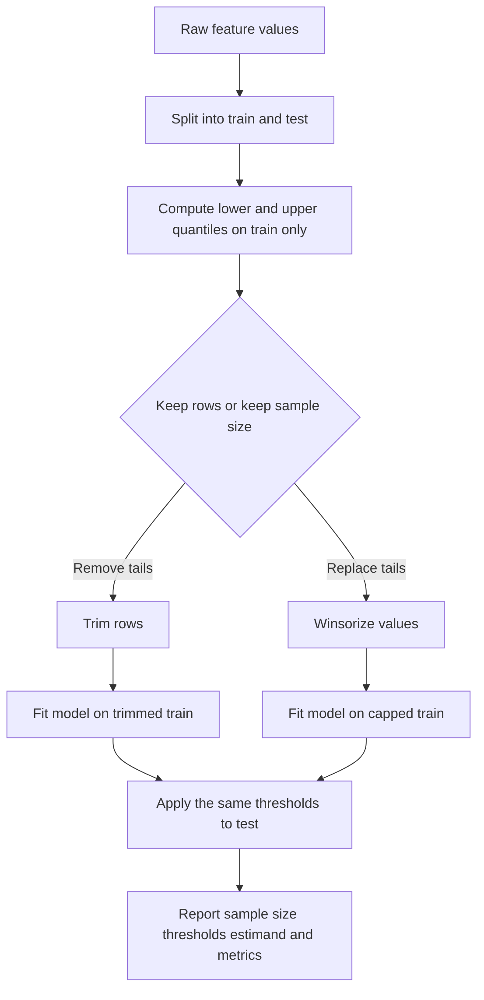
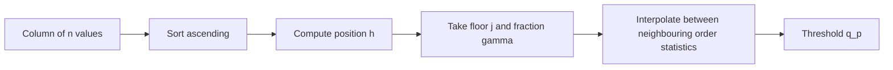
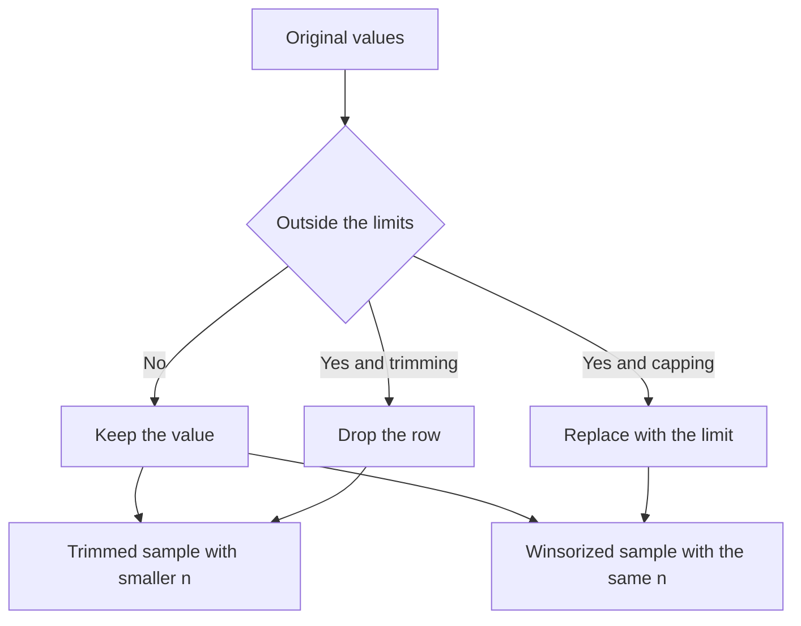
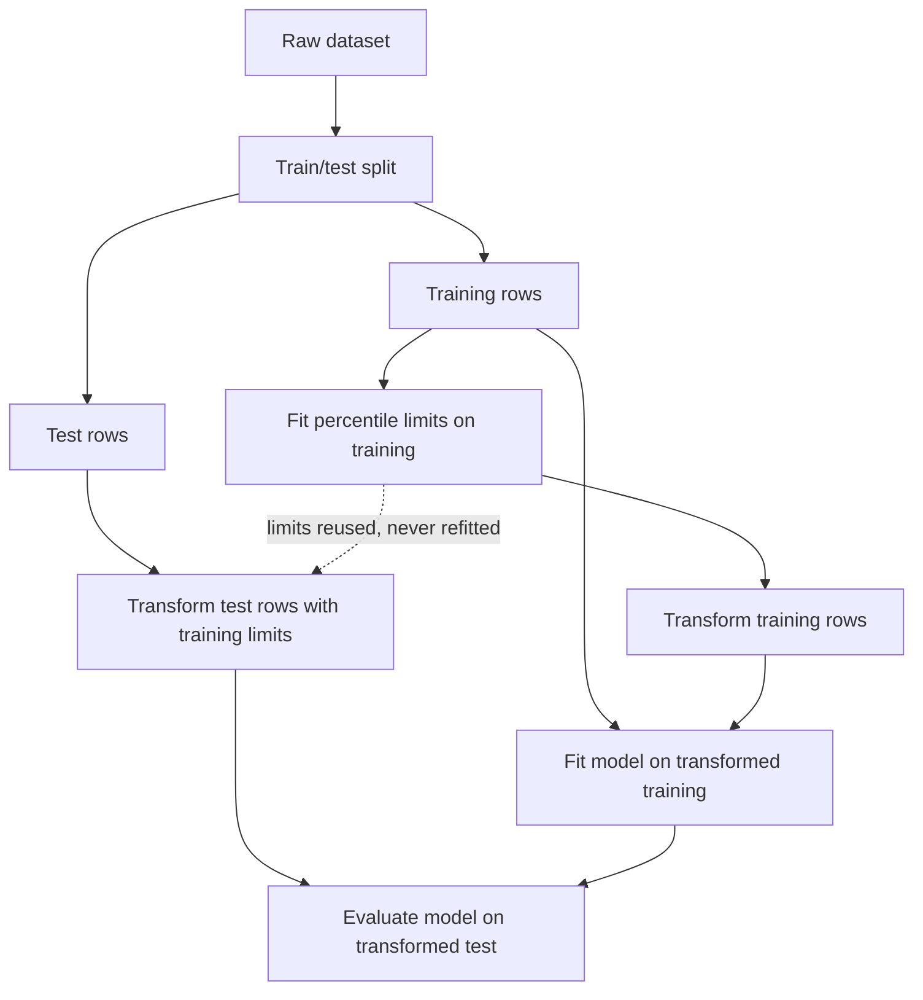
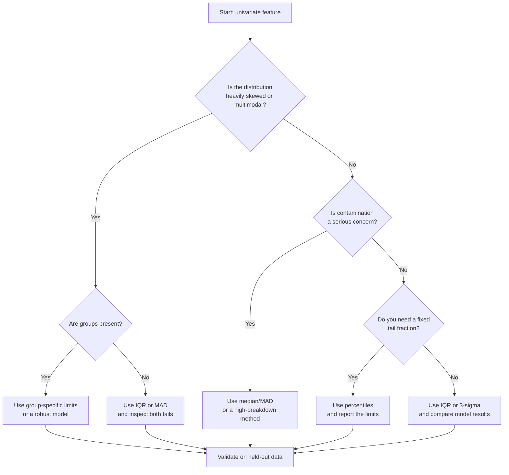

# Day 44 — Outlier Detection Using Percentiles

> **Course:** CampusX — 100 Days of Machine Learning, Day 44  
> **Official notebook:** `vendor/100-days-of-machine-learning/day44-outlier-detection-using-percentiles/day44.ipynb` (21 cells)  
> **Local reference copy:** `reference_notebooks/day44.ipynb` (21 cells, byte-identical to the vendor notebook)  
> **Dataset:** `datasets/weight-height.csv` — 10,000 rows and 3 columns (`Gender`, `Height`, `Weight`)  
> **Official environment:** Python 3.8.3 with older pandas and seaborn versions; the saved outputs are labelled **Official**  
> **Rerun environment:** Python 3.14.2, pandas 3.0.5, NumPy 2.5.3, SciPy 1.18.1, seaborn 0.13.2, scikit-learn 1.9.1  
> **Central question:** A percentile cutoff removes a fixed fraction of the smallest and largest values. When is that a sensible way to control extremes, and when does it quietly delete valid data and change the question the model is answering?

The Day 44 notebook is short: it computes the 1st and 99th percentiles of `Height`, removes the rows outside those limits, plots the result, then caps the original column at the same limits. The code is only a few lines. The important learning is not the syntax of `quantile` or `np.where`; it is understanding what kind of operation this is, what it does to a distribution, what it does to a model, and why a fixed-percentage rule is not the same thing as detecting an outlier.

**Source labels used throughout this chapter**

- **Official** — a value or plot saved in the CampusX notebook, produced with the older environment shown above.
- **Rerun** — a value reproduced in this environment from `datasets/weight-height.csv`.
- **Supplementary** — an explanation, diagnostic, or experiment added for teaching; it is not presented as original course output.

Where Official and Rerun differ, both are reported. In this notebook the numerical outputs are stable across the two environments because the quantile algorithm and the data are unchanged; the plotting library and a few API details differ. The more important source-fidelity issue is inside the notebook itself: cell 10 uses rounded hard-coded limits (`74.78` and `58.13`) while cells 8 and 9 compute exact quantiles (`74.7857900583` and `58.1344115867`). That small difference changes how many rows are trimmed, and it means the trimming and capping steps do not use exactly the same thresholds.

---

# 1. Learning objectives

After studying this chapter I should be able to:

1. **Define** a percentile, a quantile, an order statistic, and a percentile rank, and distinguish a percentile from a percentage.
2. **Derive** the linear-interpolation formula used by pandas and NumPy for sample quantiles, and compute a quantile by hand from sorted data.
3. **Explain** why different quantile definitions (lower, higher, nearest, midpoint, linear) can produce different thresholds, especially for small samples.
4. **Choose** lower and upper percentiles deliberately, including one-sided and asymmetric choices, rather than copying `0.01` and `0.99` without justification.
5. **Distinguish** trimming from capping (winsorization): what happens to the sample size, the values, the support, the variance, and the estimand.
6. **Derive** the trimmed mean, winsorized mean, trimmed variance, winsorized variance, and the standard error of a trimmed mean.
7. **Quantify** the effect of percentile clipping on the mean, variance, standard deviation, correlation, regression slope, and group comparisons.
8. **Explain** the sensitivity of a percentile threshold to contamination, sample size, ties, and group heterogeneity.
9. **Compare** percentile clipping with IQR fences, three-sigma limits, and modified z-scores, including assumptions, breakdown points, and actual counts on the height data.
10. **Implement** trimming and capping correctly with pandas, NumPy, SciPy, and a custom scikit-learn transformer.
11. **Fit** thresholds on training data only and apply them to test data without leakage; explain why trimming test rows changes the evaluation population.
12. **Interpret** before/after histograms and boxplots, including point masses created by capping and the blind spots of a boxplot.
13. **Recognise** situations in which percentile clipping is inappropriate, and select robust alternatives such as IQR rules, robust regression, quantile regression, or anomaly-detection models.
14. **Answer** interview and university-examination questions with reasons, formulas, and worked numbers rather than memorised definitions.

---

# 2. The problem: extremes, influence, and the meaning of a cutoff

## 2.1 What an outlier is, and what it is not

An **outlier** is an observation that is unusual relative to a model, a population, or a group. The word is not a synonym for “a large value.” A height of 78 inches is large in absolute terms, but it is a perfectly plausible adult height. A weight of 270 pounds is large, but it is also plausible. In the height-weight data, the minimum height is 54.263 inches and the maximum is 78.999 inches; both are real measurements, not impossible values.

An outlier can arise from:

- a data-entry error, such as a height recorded as 178 instead of 78;
- a unit error, such as centimetres mixed with inches;
- a measurement failure, such as a sensor spike;
- a genuine but rare observation, such as an unusually tall person;
- a member of a different population, such as a child in an adult dataset;
- a multivariate combination that is rare even when each coordinate is ordinary.

These cases require different responses. A data-entry error should be verified and corrected. A genuine rare observation should usually be kept, modelled, or analysed separately. A different population should be identified with a group variable. A multivariate outlier needs a multivariate method. A percentile rule treats all of them the same way: it removes a fixed fraction of the smallest and largest marginal values.

That is the central limitation of the Day 44 method. It is a **fixed-rate truncation**, not a diagnostic test. It answers the question “what would the data look like if I kept only the middle 98% of each tail?” It does not answer “which observations are erroneous?”

## 2.2 Why extremes matter to a model

Extreme values can influence a model in several distinct ways.

**They change summary statistics.** The sample mean is
$$
\bar x=\frac{1}{n}\sum_{i=1}^{n}x_i.
$$
A single very large value can move $\bar x$ arbitrarily far. The sample standard deviation is
$$
s=\sqrt{\frac{1}{n-1}\sum_{i=1}^{n}(x_i-\bar x)^2},
$$
so a single extreme value can also inflate $s$. The median and the interquartile range are much less sensitive to the magnitude of a few extremes.

**They change distances.** Algorithms based on Euclidean distance, such as k-nearest neighbours, k-means, and some support-vector machines, compute
$$
d(\mathbf{x}_i,\mathbf{x}_j)=\sqrt{\sum_{k=1}^{p}(x_{ik}-x_{jk})^2}.
$$
A single coordinate with a huge range can dominate the distance. Standardisation helps, but the mean and standard deviation used by standardisation are themselves influenced by extremes.

**They change least-squares fits.** In simple linear regression, the slope is
$$
\hat\beta_1=\frac{\sum_{i=1}^{n}(x_i-\bar x)(y_i-\bar y)}{\sum_{i=1}^{n}(x_i-\bar x)^2}.
$$
A point with an extreme $x$ has high **leverage**: it can pull the line toward itself even if its $y$ value is not unusual. A point with an extreme residual has high **influence**. The two ideas are related but not identical.

**They change metrics.** Mean squared error penalises large errors quadratically, so a few extreme test values can dominate the score. Mean absolute error is less sensitive. A model evaluated after deleting inconvenient test rows may look better for the wrong reason.

**They change the estimand.** This is the point that is easiest to miss. If you remove the lowest 1% and highest 1% of heights, you are no longer describing the full adult-height distribution. You are describing a truncated population. The trimmed mean is an estimate of the mean of that truncated population, not of the original population, unless you add assumptions that make the two means equal. Symmetry is one such assumption; it is not guaranteed.

## 2.3 What the percentile method actually does

Given a sample $x_1,\ldots,x_n$ and a lower proportion $\alpha_L$ and an upper proportion $\alpha_U$, the percentile rule computes
$$
L=q_{\alpha_L},\qquad U=q_{1-\alpha_U},
$$
where $q_p$ is the $p$-quantile. It then either:

- **trims** observations with $x_i<L$ or $x_i>U$, reducing the sample size; or
- **caps** observations at $L$ and $U$, keeping the sample size but replacing extreme values with the thresholds.

With the common symmetric choice $\alpha_L=\alpha_U=0.01$, the rule keeps approximately the middle 98% of the data and removes approximately 2% in total. The word “approximately” matters: ties, rounded thresholds, and discrete data can change the count.

The rule is **rank-based**, not value-based. It does not ask whether 78 inches is plausible; it asks whether 78 inches is in the top 1% of this sample. If the sample changes, the cutoff changes. If the sample is contaminated, the cutoff can move dramatically. If the sample is a mixture of groups, the cutoff can remove one group's genuine tail.

## 2.4 A first look at the height data

The dataset has 10,000 rows, 5,000 males and 5,000 females, and no missing values. The two numeric columns have the following summaries.

| Statistic | Height (inches) | Weight (pounds) |
|---|---:|---:|
| count | 10,000 | 10,000 |
| mean | 66.367560 | 161.440357 |
| standard deviation | 3.847528 | 32.108439 |
| minimum | 54.263133 | 64.700127 |
| 25th percentile | 63.505620 | 135.818051 |
| median | 66.318070 | 161.212928 |
| 75th percentile | 69.174262 | 187.169525 |
| maximum | 78.998742 | 269.989699 |
| skewness | 0.049369 | 0.032955 |
| excess kurtosis | −0.474134 | −0.794618 |

Several facts are worth noticing before any clipping is done.

1. **The mean and median are close.** For Height, the difference is $66.367560-66.318070=0.049490$ inches. For Weight, it is $161.440357-161.212928=0.227429$ pounds. A large mean-median difference is a warning sign of skewness; here the difference is small.
2. **The skewness is small.** Height skewness is $0.0494$, Weight skewness is $0.0330$. The distributions are close to symmetric.
3. **The excess kurtosis is negative.** Height has $-0.4741$ and Weight has $-0.7946$. Negative excess kurtosis means lighter tails than a normal distribution, not heavier tails. This is important: the data do not have a heavy-tail problem that a 1% cutoff is urgently needed to fix.
4. **The range is not absurd.** Height ranges from 54.26 to 79.00 inches, a range of 24.74 inches. Weight ranges from 64.70 to 269.99 pounds. These are plausible human measurements.
5. **The quartiles are close to the normal-based values.** For a normal distribution, $Q_1\approx\mu-0.6745\sigma$ and $Q_3\approx\mu+0.6745\sigma$. For Height this gives approximately $63.77$ and $68.96$, close to the observed $63.51$ and $69.17$.

The data are therefore a good example for learning the mechanics, but a poor example for motivating aggressive outlier removal. A 1%/99% rule will remove 200 rows that look perfectly ordinary. That is not a bug in the code; it is what a fixed-rate rule does.

## 2.5 The three-rule preview

Before deriving anything, compare what three common rules do to Height.

| Rule | Lower limit | Upper limit | Rows outside | Fraction outside |
|---|---:|---:|---:|---:|
| 1st/99th percentile | 58.134412 | 74.785790 | 200 | 2.00% |
| IQR fences, 1.5 | 55.002659 | 77.677224 | 8 | 0.08% |
| Mean ± 3 standard deviations | 54.824975 | 77.910144 | 7 | 0.07% |

The percentile rule removes 25 times as many rows as the IQR rule and about 29 times as many as the three-sigma rule. It does so by construction: the 1st and 99th percentiles are defined to leave about 1% in each tail. The IQR and three-sigma rules are value-based; on this clean, light-tailed data they find very few unusual values.

The same comparison for Weight is even more striking: the percentile rule removes 200 rows, the IQR rule removes 1, and the three-sigma rule removes 2. The percentile rule is therefore not “the strictest” or “the most accurate” rule. It is the rule that fixes the removed fraction in advance.



The diagram makes the workflow explicit. The percentile cutoffs are learned parameters. They belong to the training step, not to the raw data. They must be stored and reused on test data and at deployment.

---

# 3. Foundations: order statistics, quantiles, and interpolation

## 3.1 Order statistics

Sort the sample from smallest to largest:
$$
x_{(1)}\le x_{(2)}\le\cdots\le x_{(n)}.
$$
The value $x_{(k)}$ is the $k$-th **order statistic**. Order statistics are the raw material of every percentile rule. For the height data, $x_{(1)}=54.2631333$ and $x_{(10000)}=78.9987423$. The 100th smallest value is $x_{(100)}=58.1344963$, and the 101st is $x_{(101)}=58.1379227$.

A percentile is a location in this sorted list, possibly between two order statistics. The interpolation rule decides exactly where.

## 3.2 The empirical distribution function

The **empirical distribution function** is
$$
\hat F_n(x)=\frac{1}{n}\sum_{i=1}^{n}\mathbf{1}\{x_i\le x\},
$$
where $\mathbf{1}\{\cdot\}$ is 1 when the condition is true and 0 otherwise. It is a step function that jumps by $1/n$ at each observed value. For a value $x$ between $x_{(k)}$ and $x_{(k+1)}$, $\hat F_n(x)=k/n$.

The empirical $p$-quantile can be defined as
$$
q_p=\inf\{x:\hat F_n(x)\ge p\}.
$$
This is the **inverted-CDF** definition. It always returns an observed value (or the smallest value at which the CDF reaches $p$). For $n=10$ and $p=0.25$, it returns $x_{(3)}$ because $\hat F_n(x_{(3)})=0.3\ge0.25$. This definition is simple, but it does not interpolate, and it can be biased for small samples. Pandas and NumPy default to a different, smoother definition.

## 3.3 The quantile function

For a continuous random variable with cumulative distribution function $F$, the **quantile function** is
$$
Q(p)=F^{-1}(p)=\inf\{x:F(x)\ge p\},\qquad 0<p<1.
$$
It answers: “below which value does a fraction $p$ of the population lie?” The **percentile** is $100p$. Thus the 99th percentile is $Q(0.99)$.

For common distributions:

- **Normal** with mean $\mu$ and standard deviation $\sigma$:
  $$
  Q(p)=\mu+\sigma\Phi^{-1}(p),
  $$
  where $\Phi^{-1}$ is the standard-normal quantile function. For $p=0.01$, $\Phi^{-1}(0.01)=-2.326348$; for $p=0.99$, $\Phi^{-1}(0.99)=2.326348$.
- **Uniform on $[a,b]$**:
  $$
  Q(p)=a+p(b-a).
  $$
  The quantiles are equally spaced.
- **Exponential with rate $\lambda$**:
  $$
  Q(p)=-\frac{\ln(1-p)}{\lambda}.
  $$
  The upper quantiles grow without bound as $p\to1$.

The normal formula is useful for comparing a sample quantile with a normal approximation. For Height, $\bar x=66.367560$ and $s=3.847528$. The normal-based 1st percentile is
$$
66.367560-2.326348(3.847528)=57.418,
$$
whereas the observed 1st percentile is $58.134$. The normal-based 99th percentile is
$$
66.367560+2.326348(3.847528)=75.317,
$$
whereas the observed value is $74.786$. The observed tails are slightly compressed relative to a normal distribution, consistent with the negative excess kurtosis.

## 3.4 The linear-interpolation rule used by pandas and NumPy

Pandas `Series.quantile` and NumPy `percentile` default to **linear interpolation**, which is Hyndman–Fan type 7. The rule is:

1. Compute the position
   $$
   h=(n-1)p.
   $$
2. Let
   $$
   j=\lfloor h\rfloor,\qquad \gamma=h-j,
   $$
   where $\lfloor\cdot\rfloor$ is the floor function.
3. Interpolate between the two neighbouring order statistics:
   $$
   q_p=(1-\gamma)x_{(j+1)}+\gamma x_{(j+2)}.
   $$
   Here $x_{(j+1)}$ is the $(j+1)$-th smallest value and $x_{(j+2)}$ is the next one. The index $j$ is zero-based; the order-statistic subscript is one-based. This indexing mismatch is a common source of off-by-one errors.

The weights $(1-\gamma)$ and $\gamma$ sum to 1. When $\gamma=0$, the quantile is exactly an order statistic. When $\gamma=0.5$, it is the midpoint between two order statistics.

### Worked example with the actual height data

For the 99th percentile, $n=10{,}000$ and $p=0.99$:
$$
h=(10000-1)(0.99)=9899.01.
$$
Thus $j=9899$ and $\gamma=0.01$. From the sorted data:
$$
x_{(9900)}=74.7857143190925,\qquad x_{(9901)}=74.7932882435025.
$$
The interpolated quantile is
$$
q_{0.99}=(0.99)(74.7857143190925)+(0.01)(74.7932882435025)=74.7857900583366.
$$
This matches the Official output of cell 8: `74.7857900583366`.

For the 1st percentile, $p=0.01$:
$$
h=(9999)(0.01)=99.99.
$$
Thus $j=99$ and $\gamma=0.99$. From the sorted data:
$$
x_{(100)}=58.1260240211065,\qquad x_{(101)}=58.1344963096015.
$$
The interpolated quantile is
$$
q_{0.01}=(0.01)(58.1260240211065)+(0.99)(58.1344963096015)=58.13441158671655.
$$
This matches the Official output of cell 9: `58.134411586716546`.

The two examples show the key mechanical point: the 99th percentile is not necessarily an observed value. It is a weighted average of two neighbouring observed values. In this dataset, $74.7857900583$ does not appear in the column; it lies between $74.7857143191$ and $74.7932882435$.

### A small example to make the arithmetic visible

Take the sorted sample
$$
[10,20,30,40,50].
$$
For $p=0.25$:
$$
h=(5-1)(0.25)=1,\quad j=1,\quad \gamma=0.
$$
Therefore $q_{0.25}=x_{(2)}=20$. For $p=0.10$:
$$
h=(4)(0.10)=0.4,\quad j=0,\quad \gamma=0.4,
$$
so
$$
q_{0.10}=(0.6)(10)+(0.4)(20)=14.
$$
For $p=0.90$:
$$
h=3.6,\quad j=3,\quad \gamma=0.6,
$$
so
$$
q_{0.90}=(0.4)(40)+(0.6)(50)=46.
$$
The median is $q_{0.5}=30$ because $h=2$ and $\gamma=0$.

### Different interpolation conventions

The choice of convention matters more when $n$ is small or when $p$ is close to 0 or 1. For the height data at $p=0.01$ and $p=0.99$, the main conventions give:

| Convention | $q_{0.01}$ | $q_{0.99}$ | Meaning |
|---|---:|---:|---|
| `linear` (default, type 7) | 58.134412 | 74.785790 | Interpolate between neighbouring order statistics |
| `lower` | 58.126024 | 74.785714 | Use the lower neighbour |
| `higher` | 58.134496 | 74.793288 | Use the upper neighbour |
| `nearest` | 58.134496 | 74.785714 | Use the nearest order statistic |
| `midpoint` | 58.130260 | 74.789501 | Average the two neighbours |

The differences are small here, on the order of 0.01 inches. They can be larger in small samples. The important lesson is not that one convention is “correct” in every context; it is that a quantile is defined by a convention, and the convention should be stated when a cutoff is reported.

The `inverted_cdf` convention is another common choice. For $p=0.01$ it returns $58.126024$, and for $p=0.99$ it returns $74.785714$. It always returns an observed value. The default `linear` rule is smoother and uses the full sample information.



## 3.5 Percentile rank and ties

The **percentile rank** of a value $x$ is the percentage of observations at or below $x$. A simple definition is
$$
\operatorname{PR}(x)=\frac{\#\{i:x_i\le x\}}{n}\times100.
$$
With ties, different conventions are possible. Pandas `rank(pct=True)` uses the average rank by default, so tied values receive the same average rank. SciPy `percentileofscore` offers `kind='rank'`, `'weak'`, `'strict'`, and `'mean'`.

For continuous data with no ties, the percentile rank of $q_p$ is approximately $100p$. For discrete data, the empirical CDF is a step function, so a quantile can jump. If many values equal the threshold, the count outside the threshold can be much smaller or much larger than the nominal fraction.

The height data are continuous enough that ties are rare. The weight data are also continuous. But a column such as “number of children” or “star rating” has many ties, and percentile trimming can behave unexpectedly. A value equal to the 99th percentile may represent 5% of the rows; using `>` versus `>=` then changes the number removed substantially.

## 3.6 Sample quantiles are estimates

A sample quantile is an estimate of a population quantile. It is not exact. The number of observations below the true $p$-quantile is approximately
$$
B\sim\operatorname{Binomial}(n,p),
$$
with mean $np$ and standard deviation $\sqrt{np(1-p)}$. For the 99th percentile with $n=10{,}000$ and $p=0.01$ (the upper tail has probability $1-p=0.99$; the lower-tail count uses $p=0.01$):
$$
E[B]=100,\qquad \operatorname{SD}(B)=\sqrt{100(0.99)}=9.95.
$$
A 95% interval for the count is roughly $100\pm1.96(9.95)$, or about 80.5 to 119.5; the exact binomial interval is 81 to 120. The threshold is therefore the order statistic at a rank that could easily be 10 or 20 positions different in another sample of the same size. The “1% tail” is not a fixed, known quantity; it is estimated with noticeable uncertainty.

For $n=1{,}000$, the expected tail count is 10 with a standard deviation of 3.15, and the exact 95% interval is 4 to 17. For $n=100$, the interval is 0 to 3. In small samples, a 1% cutoff is essentially the minimum or maximum, and its value is very unstable.

This uncertainty is one reason to prefer a larger $\alpha$ (such as 0.05) when the sample is small, or to use a model-based robust method that borrows strength across observations.

## 3.7 Notation used in this chapter

| Symbol | Meaning |
|---|---|
| $n$ | Number of observations |
| $x_{(k)}$ | $k$-th smallest observation |
| $p$ | Probability level, $0<p<1$ |
| $q_p$ | $p$-quantile |
| $\alpha_L,\alpha_U$ | Lower and upper tail proportions |
| $L,U$ | Lower and upper thresholds |
| $k_L,k_U$ | Number of observations trimmed or capped in each tail |
| $\bar x$ | Sample mean |
| $s^2,s$ | Sample variance and standard deviation |
| $\tilde x$ | Sample median |
| $\operatorname{IQR}$ | Interquartile range, $Q_3-Q_1$ |
| $\operatorname{MAD}$ | Median absolute deviation |
| $\mu,\sigma$ | Population mean and standard deviation |
| $\Phi$ | Standard-normal CDF |
| $r$ | Pearson correlation |
| $\hat\beta_1$ | Estimated regression slope |

---

# 4. The percentile rule: choosing limits

## 4.1 Definition of the rule

For a two-sided rule with lower proportion $\alpha_L$ and upper proportion $\alpha_U$:
$$
L=q_{\alpha_L},\qquad U=q_{1-\alpha_U}.
$$
The total nominal removed fraction is $\alpha_L+\alpha_U$. The common symmetric choice is $\alpha_L=\alpha_U=\alpha$, giving a total of $2\alpha$.

For a one-sided upper rule, set only $U=q_{1-\alpha}$ and leave the lower side alone. For a one-sided lower rule, set only $L=q_{\alpha}$.

The rule can be asymmetric. For income, for example, a long right tail may justify $\alpha_U=0.01$ while the lower tail is left untouched because low incomes are meaningful. For a physical measurement with both impossible low and high values, a symmetric rule may be appropriate.

## 4.2 Common choices and what they remove

| Lower / upper | Total nominal removed | Tail count at $n=10{,}000$ | Typical use |
|---|---:|---:|---|
| 0.5 / 99.5 | 1% | 50 per tail | Very light trimming; large samples |
| 1 / 99 | 2% | 100 per tail | Common course default; moderate trimming |
| 2.5 / 97.5 | 5% | 250 per tail | More aggressive; small samples |
| 5 / 95 | 10% | 500 per tail | Strong trimming; changes distribution substantially |
| 10 / 90 | 20% | 1,000 per tail | Usually too aggressive for outlier control |

The table makes the cost explicit. At $n=10{,}000$, a 5%/95% rule removes 1,000 rows. That may be acceptable for a robustness-oriented analysis, but it is not a small cleanup. At $n=100$, even a 1% rule has only one expected observation per tail, so the threshold is essentially the minimum or maximum.

A useful heuristic is to require at least 30 to 50 observations in each tail for a stable threshold. For a two-sided rule with total removed fraction $2\alpha$ and equal tails, this means
$$
n\alpha\ge30 \quad\Longrightarrow\quad n\ge\frac{30}{\alpha}.
$$
For $\alpha=0.01$, this requires $n\ge3{,}000$. For $\alpha=0.05$, it requires $n\ge600$. These are rules of thumb, not laws; the uncertainty calculation in Section 3.6 is more precise.

## 4.3 Why the course uses 1% and 99%

The course uses `0.99` and `0.01` because they are familiar, symmetric, and easy to explain. They remove 2% of the data, which is small enough to preserve most rows and large enough to make a visible change in the plots. The choice is pedagogical, not derived from the height data.

There is no statistical theorem that says the 99th percentile is the correct cutoff for outlier removal. A cutoff is a decision about how much of the tail you are willing to give up. It should be justified by:

- the cost of keeping an extreme value versus the cost of deleting a valid one;
- whether the extreme values are errors or real;
- the sample size and the stability of the tail count;
- the model's sensitivity to extremes;
- the group structure of the data;
- the intended deployment population;
- a pre-specified analysis plan, not a search for the cutoff that gives the best test score.

## 4.4 The cutoff is a learned parameter

The values $L$ and $U$ are estimated from data. In a machine-learning workflow, they are **learned parameters**, like a scaler's mean and standard deviation or an imputer's median. They must be learned on the training set and then applied unchanged to validation, test, and deployment data.

If $L$ and $U$ are computed on the full dataset before the train/test split, the test values influence the thresholds. This is a form of **data leakage**, even though the operation is unsupervised. The leakage is usually small when the dataset is large and the test set is a random subset, but it is still a methodological error. With small datasets, distribution shift, or a test set that is not exchangeable with the training set, the effect can be material.

## 4.5 Ties, discreteness, and boundary rules

For continuous data, the number of observations strictly below $q_\alpha$ is approximately $n\alpha$. For discrete data, it can be very different. Suppose a column has values 0, 1, 2, 3, 4, and 5, and 40% of the rows have value 0. Then $q_{0.01}=0$ and $q_{0.99}=5$, and a rule that removes values below 0 or above 5 removes nothing. A rule that removes values at or below 0 removes 40% of the data.

The boundary comparison also matters. In the course, the filter is
```python
new_df = df[(df['Height'] <= 74.78) & (df['Height'] >= 58.13)]
```
which **keeps** values equal to the limits. The capping code uses `>=` for the upper limit and `<=` for the lower limit, which caps values at or beyond the limit. For continuous data with interpolated thresholds, no observation equals the threshold exactly, so the distinction is invisible. For discrete data or rounded thresholds, it can change the count.

## 4.6 One-sided versus two-sided clipping

A two-sided rule assumes that both tails are problematic. That is not always true. In income data, the lower tail may contain genuinely low earners, while the upper tail contains a few billionaires. In sensor data, the lower tail may be a valid baseline while the upper tail contains saturation spikes. In height data, both tails are plausible.

A one-sided rule is often more defensible because it encodes a directional hypothesis: “large values are the problem,” or “small values are the problem.” A two-sided rule can be used when the goal is a symmetric trimmed sample, but it should not be presented as a general outlier detector.

## 4.7 “Outlier detection” versus “tail truncation”

The course title is “Outlier Detection Using Percentiles.” The code, however, does not detect outliers in the sense of testing whether a point is unusual. It computes two quantiles and removes a fixed fraction. A more precise description is **percentile-based trimming or winsorization**.

This distinction matters in interviews and in practice. If a colleague asks “which rows are outliers?”, the percentile rule cannot answer. It can only say “these are the rows outside the middle 98%.” Whether those rows are errors, rare events, or members of another group is a separate question.

---

# 5. Trimming and capping: two different operations

## 5.1 Trimming

**Trimming** removes observations outside the limits:
$$
x_i^{\text{trim}}=
\begin{cases}
x_i, & L\le x_i\le U,\\
\text{removed}, & x_i<L\ \text{or}\ x_i>U.
\end{cases}
$$
The sample size becomes
$$
n_{\text{trim}}=\#\{i:L\le x_i\le U\}.
$$
With continuous data and exact quantiles, $n_{\text{trim}}\approx n(1-\alpha_L-\alpha_U)$.

If the sorted data are trimmed by removing $k_L$ values from the low end and $k_U$ values from the high end, the trimmed mean is
$$
\bar x_{\text{trim}}=\frac{1}{n-k_L-k_U}\sum_{i=k_L+1}^{n-k_U}x_{(i)}.
$$
The trimmed sample variance is
$$
s_{\text{trim}}^2=\frac{1}{n_{\text{trim}}-1}\sum_{i:L\le x_i\le U}(x_i-\bar x_{\text{trim}})^2.
$$
This is the variance of the retained observations. It is **not** the variance of the trimmed-mean estimator. We return to that distinction in Section 6.3.

Trimming changes the number of rows. That is its main advantage for a descriptive analysis: the retained table contains only the values you intend to analyse. Its main disadvantage is that it can bias comparisons if the removed rows are not missing completely at random with respect to the question. It also discards information; a trimmed value is gone, not replaced.

## 5.2 Capping and winsorization

**Capping** (also called **winsorization**) replaces observations outside the limits with the limits:
$$
x_i^{W}=
\begin{cases}
L, & x_i<L,\\
x_i, & L\le x_i\le U,\\
U, & x_i>U.
\end{cases}
$$
Equivalently,
$$
x_i^{W}=\min\{\max\{x_i,L\},U\}.
$$
The sample size stays $n$. The extreme values are not deleted; they are moved to the boundary.

If $k_L$ values are capped at $L$ and $k_U$ values are capped at $U$, the winsorized mean is
$$
\bar x_W=\frac{1}{n}\left(\sum_{i=k_L+1}^{n-k_U}x_{(i)}+k_L L+k_U U\right).
$$
When the limits are order statistics, $L=x_{(k_L+1)}$ and $U=x_{(n-k_U)}$, this becomes
$$
\bar x_W=\frac{1}{n}\left(\sum_{i=k_L+1}^{n-k_U}x_{(i)}+k_L x_{(k_L+1)}+k_U x_{(n-k_U)}\right).
$$
The winsorized sample variance is
$$
s_W^2=\frac{1}{n-1}\left[
\sum_{i=k_L+1}^{n-k_U}(x_{(i)}-\bar x_W)^2
+k_L(x_{(k_L+1)}-\bar x_W)^2
+k_U(x_{(n-k_U)}-\bar x_W)^2
\right].
$$
This is the variance of the modified sample. It is used in robust tests such as Yuen's trimmed $t$-test.

Capping preserves the sample size, which is useful when rows are expensive or when deleting them would break a paired or grouped design. It also creates **point masses** at $L$ and $U$: many observations now have exactly the same value. Those point masses are visible in a histogram and can affect models that assume continuous distributions. A capped value is not a real measurement; it is a censored value.

## 5.3 The data-flow difference



The two branches produce different datasets:

- The trimmed dataset has fewer rows and no artificial values.
- The winsorized dataset has the same number of rows and artificial values at the limits.

Both change the distribution. Trimming truncates the support; capping keeps the support but adds masses at the boundary. Neither is a neutral “cleaning” operation.

## 5.4 What happens to the distribution

For a symmetric distribution, symmetric trimming and symmetric capping both preserve the center approximately, but they affect the variance differently.

- **Trimming** removes the extreme values entirely. The variance of the retained sample drops because the removed values were far from the center. The support becomes $[L,U]$.
- **Capping** moves the extreme values to the boundary. The variance drops less because the capped values still contribute to the spread, but the support also becomes $[L,U]$ and the density has atoms at the boundaries.

For a standard normal distribution with $\alpha=0.01$ in each tail, the theoretical variance of the trimmed distribution is $0.873465$ (a 12.65% reduction from 1), while the variance of the winsorized distribution is $0.964234$ (a 3.58% reduction). The trimmed distribution loses more variance because it loses the tail mass entirely; the winsorized distribution keeps that mass at $\pm2.326$.

For a uniform distribution on $[0,1]$ with $\alpha=0.01$, the trimmed variance is
$$
\frac{(1-2\alpha)^2}{12}=\frac{0.98^2}{12}=0.080033,
$$
a 3.96% reduction from $1/12=0.083333$. The winsorized variance is
$$
p^3+\frac{(1-p)^3-p^3}{3}+p(1-p)^2-\frac14=0.083235,
$$
a 0.12% reduction. The uniform distribution has no heavy tails, so trimming removes little variance; the normal distribution has more tail mass, so trimming removes more.

## 5.5 Choosing between trimming and capping

| Question | Trimming | Capping |
|---|---|---|
| Should the sample size stay the same? | No | Yes |
| Are the extreme values errors that should be removed? | Often yes | Less clear |
| Is the analysis paired or grouped? | Risky: removing one member breaks the pair | Safer: all rows remain |
| Do you need a clean empirical distribution? | Yes: no artificial values | No: point masses at limits |
| Will the model see values beyond the limits? | No | No: capped at the limits |
| Is the goal inference about the full population? | Changes the estimand | Also changes the estimand |
| Is the goal a robust descriptive summary? | Trimmed mean is natural | Winsorized mean is natural |
| Is the goal deployment? | Model must handle only retained range | Model handles all rows, but caps inputs |

A practical rule is:

- Use **trimming** when you want a clean subset and can afford to lose rows, and when the removed rows are not needed for pairing or group balance.
- Use **capping** when you must keep every row, when the extreme values are plausible but you want to limit their influence, or when the downstream system expects a fixed number of records.
- Use **neither** when the extremes are the signal.

## 5.6 A small hand example

Take the sorted sample
$$
[12,15,18,20,22,25,28,30,35,100].
$$
The sample size is $n=10$, the mean is $30.5$, and the sample standard deviation is $25.4045$. The last value, 100, is a clear extreme relative to the rest.

**Trim 10% from each side.** With $n=10$, 10% is one observation. Remove 12 and 100:
$$
[15,18,20,22,25,28,30,35].
$$
The trimmed sample size is 8, the trimmed mean is
$$
\frac{15+18+20+22+25+28+30+35}{8}=24.125,
$$
and the trimmed sample variance is
$$
\frac{1}{7}\sum_{i=1}^{8}(x_i-24.125)^2=44.4107,
$$
so the trimmed standard deviation is $6.2337$.

**Winsorize 10% from each side.** Replace 12 with 15 and 100 with 35:
$$
[15,15,18,20,22,25,28,30,35,35].
$$
The winsorized sample size is 10, the winsorized mean is
$$
\frac{15+15+18+20+22+25+28+30+35+35}{10}=24.3,
$$
and the winsorized sample variance is
$$
\frac{1}{9}\sum_{i=1}^{10}(x_i-24.3)^2=56.9,
$$
so the winsorized standard deviation is $7.1561$.

The original variance was $645.3889$ with a standard deviation of $25.4045$. Both operations reduce the spread dramatically because the single value 100 dominated the original variance. Trimming reduces it more than capping: $44.4107$ versus $56.9$. This is the same pattern as the normal-distribution theory: trimming removes the extreme value, while capping keeps a copy of it at the boundary.

The example also shows why the choice matters for the mean. The original mean is 30.5; trimming gives 24.125; capping gives 24.3. The trimmed and winsorized means are close, but neither is equal to the original mean. They estimate different quantities.

## 5.7 Code for the small example

```python
import numpy as np
import pandas as pd

x = np.array([12, 15, 18, 20, 22, 25, 28, 30, 35, 100], dtype=float)

# Trim 10% from each end: with n=10 this removes one value per end.
k = int(0.10 * len(x))
x_trim = np.sort(x)[k:len(x) - k]
print(x_trim)
print(x_trim.mean(), x_trim.var(ddof=1), x_trim.std(ddof=1))

# Winsorize 10% from each end: replace the removed values by the nearest kept value.
x_sorted = np.sort(x)
x_wins = x_sorted.copy()
x_wins[:k] = x_sorted[k]
x_wins[-k:] = x_sorted[-k - 1]
print(x_wins)
print(x_wins.mean(), x_wins.var(ddof=1), x_wins.std(ddof=1))
```

The `int(0.10 * len(x))` conversion is a decision, not a law. With $n=10$, 10% is exactly one observation. With $n=15$, 10% is 1.5; different libraries round differently. Always state the rounding rule. SciPy's `trimboth` and `winsorize` use their own conventions; do not assume they match a hand calculation.

## 5.8 Common confusions

- **“Winsorization is imputation.”** No. Imputation fills a missing value using a model or a summary statistic. Winsorization changes an observed value to a threshold. The original value is lost, but the row is not missing.
- **“Capping is the same as trimming.”** No. Capping keeps $n$ and creates point masses; trimming reduces $n$ and truncates the sample.
- **“Clip is a scikit-learn transformer.”** Not by default. `np.clip` and `Series.clip` are operations, not learned transformers. A custom transformer is needed to learn the thresholds inside a pipeline.
- **“The mean after capping is the original mean.”** No. Capping changes the values, so the mean changes unless the caps are perfectly symmetric around the mean and the tail masses balance.
- **“The standard deviation after trimming is the standard error of the trimmed mean.”** No. The trimmed sample standard deviation describes the retained observations; the standard error of the trimmed mean requires a winsorized-variance calculation and is generally larger than the naive $s_{\text{trim}}/\sqrt{n_{\text{trim}}}$.

---

# 6. Mathematics of the effect

This section derives the main quantities. The derivations are deliberately explicit because the difference between “the variance went down” and “the standard error of the trimmed mean went down” is easy to miss. The first is a descriptive fact about the retained sample; the second is a statement about an estimator and requires a different formula.

## 6.1 The mean

### Trimmed mean

Let $k_L$ observations be removed from the low end and $k_U$ from the high end of the sorted sample. Define
$$
n_{\text{trim}}=n-k_L-k_U.
$$
The trimmed mean is
$$
\bar x_{\text{trim}}
=\frac{1}{n_{\text{trim}}}\sum_{i=k_L+1}^{n-k_U}x_{(i)}.
$$
Each retained observation receives weight $1/n_{\text{trim}}$; each removed observation receives weight 0. This is an **equal-weight** estimator on a selected subset, not a weighted estimator on the full sample.

If the data are symmetric about a center $\mu$ and the trimming is symmetric ($k_L=k_U=k$), then the expected trimmed mean is $\mu$:
$$
E[\bar x_{\text{trim}}]=\mu.
$$
The symmetry is doing the work. For an asymmetric distribution, the trimmed mean estimates the mean of the trimmed population:
$$
E[\bar x_{\text{trim}}]\approx E[X\mid L\le X\le U],
$$
which is generally not equal to $E[X]$. The difference is the **trimming bias**.

For the height data with $\alpha=0.01$ and exact limits:
$$
\bar x_{\text{trim}}=66.3643659819,
$$
compared with the original mean $66.3675597548$. The difference is $-0.0031937729$ inches. The distribution is nearly symmetric, so the bias is tiny. For Weight:
$$
\bar x_{\text{trim}}=161.4059859286,
$$
compared with $161.4403568328$; the difference is $-0.0343709042$ pounds.

### Winsorized mean

With $k_L$ values capped at $L$ and $k_U$ values capped at $U$:
$$
\bar x_W
=\frac{1}{n}\left(\sum_{i=k_L+1}^{n-k_U}x_{(i)}+k_L L+k_U U\right).
$$
Every observation receives weight $1/n$, but the capped observations all receive the same value. The winsorized mean is a weighted average of the retained values and the two boundary values.

For the height data with exact quantile limits:
$$
\bar x_W=66.3662806787,
$$
which is closer to the original mean than the trimmed mean because the capped values remain in the sample. For Weight:
$$
\bar x_W=161.4225686450.
$$

The ordering in this example is
$$
\bar x_{\text{trim}} < \bar x_W < \bar x
$$
for both variables. This is not a general law. It depends on which tail is heavier and how the caps move the mass. What is general is that trimming and capping change the mean unless the removed or capped values are symmetric around the original mean.

### Why the mean changes

A useful decomposition for the trimmed mean is
$$
\bar x-\bar x_{\text{trim}}
=\frac{1}{n}\sum_{i\in\text{removed}}(x_i-\bar x_{\text{trim}}).
$$
The change is the average deviation of the removed values from the trimmed mean, scaled by the fraction removed. If the removed values are balanced above and below the center, the change is small. If one tail is removed more heavily, the mean moves away from that tail.

For the height data, the removed low values average below the center and the removed high values average above it. The two effects nearly cancel. For a skewed variable such as income, they would not cancel, and the trimmed mean would be systematically pulled toward the bulk of the distribution.

## 6.2 The variance

### Trimmed sample variance

The variance of the retained sample is
$$
s_{\text{trim}}^2
=\frac{1}{n_{\text{trim}}-1}\sum_{i:L\le x_i\le U}(x_i-\bar x_{\text{trim}})^2.
$$
This is the quantity reported by `new_df['Height'].describe()` in the notebook: `std = 3.644267` for the trimmed height data. It is a descriptive statistic of the retained rows.

It is not an unbiased estimator of the full-population variance $\sigma^2$. Trimming removes the tails, which are exactly the values that contribute most to the variance. The retained sample variance is therefore biased downward for the full population. It estimates the variance of the truncated population, not the variance of the original population.

### Winsorized sample variance

The variance of the winsorized sample is
$$
s_W^2
=\frac{1}{n-1}\left[
\sum_{i=k_L+1}^{n-k_U}(x_{(i)}-\bar x_W)^2
+k_L(L-\bar x_W)^2
+k_U(U-\bar x_W)^2
\right].
$$
This is also a descriptive statistic, but it has a special role in robust inference: it appears in the standard error of the trimmed mean.

### Theoretical values for a standard normal distribution

Let $\alpha$ be the proportion trimmed from each tail, and let
$$
c=\Phi^{-1}(1-\alpha)
$$
be the upper $\alpha$ quantile of the standard normal distribution. The trimmed distribution is the normal distribution restricted to $[-c,c]$. Its variance is
$$
\sigma_{\text{trim}}^2
=1-\frac{2c\phi(c)}{2\Phi(c)-1},
$$
where $\phi$ is the standard-normal density and $\Phi$ is the standard-normal CDF. The derivation uses the symmetry of the normal distribution and the formula for a truncated normal variance.

The winsorized distribution replaces the lower tail by a point mass of size $\alpha$ at $-c$ and the upper tail by a point mass of size $\alpha$ at $c$. Its second moment is
$$
E[(X^W)^2]
=2\int_0^c z^2\phi(z)\,dz+2\alpha c^2,
$$
and its mean is 0 by symmetry, so its variance is $E[(X^W)^2]$.

For $\alpha=0.01$, $c=2.326348$:
$$
\sigma_{\text{trim}}^2=0.873465,\qquad \sigma_W^2=0.964234.
$$
For $\alpha=0.05$, $c=1.644854$:
$$
\sigma_{\text{trim}}^2=0.623015,\qquad \sigma_W^2=0.831268.
$$
For $\alpha=0.10$, $c=1.281552$:
$$
\sigma_{\text{trim}}^2=0.437725,\qquad \sigma_W^2=0.678655.
$$

These numbers show that trimming 1% from each tail removes about 12.65% of the variance of a normal distribution, while winsorizing 1% removes only about 3.58%. The difference grows as $\alpha$ grows.

### Theoretical values for a uniform distribution

For a uniform distribution on $[0,1]$, symmetric trimming to $[\alpha,1-\alpha]$ gives
$$
\sigma_{\text{trim}}^2=\frac{(1-2\alpha)^2}{12}.
$$
The winsorized variance, derived by integrating the three pieces, is
$$
\sigma_W^2
=\alpha^3+\frac{(1-\alpha)^3-\alpha^3}{3}+\alpha(1-\alpha)^2-\frac14.
$$
For $\alpha=0.01$:
$$
\sigma_{\text{trim}}^2=0.080033,\qquad \sigma_W^2=0.083235.
$$
The uniform distribution has no tails to speak of, so 1% trimming removes only 3.96% of the variance. The normal distribution has more tail mass, so the same operation removes 12.65%.

### Actual variance retention

| Variable | Operation | Sample size | Variance | SD | Variance retained | SD retained |
|---|---|---:|---:|---:|---:|---:|
| Height | original | 10,000 | 14.803473 | 3.847528 | 1.000000 | 1.000000 |
| Height | trim 1%/99% | 9,800 | 13.286568 | 3.645075 | 0.897531 | 0.947381 |
| Height | cap 1%/99% | 10,000 | 14.407471 | 3.795717 | 0.973249 | 0.986534 |
| Weight | original | 10,000 | 1030.951855 | 32.108439 | 1.000000 | 1.000000 |
| Weight | trim 1%/99% | 9,800 | 943.121783 | 30.710288 | 0.914807 | 0.956455 |
| Weight | cap 1%/99% | 10,000 | 1009.306103 | 31.769578 | 0.979004 | 0.989446 |

The trimmed height sample retains 89.75% of the variance; the capped sample retains 97.32%. The trimmed weight sample retains 91.48%; the capped sample retains 97.90%. Weight loses a larger fraction because its tails are longer relative to its center, even though its excess kurtosis is also negative. The variance is not a scale-free measure; a variable with a larger range can lose more variance from the same percentile rule.

## 6.3 The standard error of a trimmed mean

The standard deviation of the retained sample is not the standard error of the trimmed mean. The trimmed mean is a nonlinear estimator: the number of observations trimmed is random, and the trimmed values depend on the sample. Its sampling variance is not $s_{\text{trim}}^2/n_{\text{trim}}$.

A standard large-sample approximation uses the **winsorized variance**. Let $\alpha$ be the proportion trimmed from each tail, and let $s_W^2$ be the winsorized sample variance computed with the same number of capped observations. Then
$$
\widehat{\operatorname{SE}}(\bar x_{\text{trim}})
=\frac{s_W}{\sqrt{n}(1-2\alpha)}.
$$
The factor $1-2\alpha$ accounts for the effective loss of $2\alpha n$ observations. The winsorized variance $s_W^2$ is larger than the trimmed variance $s_{\text{trim}}^2$ because the capped values remain in the calculation. The two effects partly cancel.

For the height data with $\alpha=0.01$:
$$
s_W=3.795714,\qquad
\widehat{\operatorname{SE}}(\bar x_{\text{trim}})
=\frac{3.795714}{\sqrt{10000}(0.98)}
=0.038732.
$$
The naive calculation $s_{\text{trim}}/\sqrt{n_{\text{trim}}}$ gives
$$
\frac{3.645075}{\sqrt{9800}}=0.036821,
$$
which is about 4.9% too small. The naive formula treats the trimmed sample as if it were a simple random sample of size 9,800 from the trimmed population. It ignores the uncertainty in the trimming boundaries and the fact that the trimmed mean is not the mean of a fixed population.

For the original mean, the standard error is
$$
\frac{3.847528}{\sqrt{10000}}=0.038475.
$$
The trimmed-mean standard error is about 0.67% larger in this example. For a normal distribution with 1% trimming, the asymptotic ratio is approximately
$$
\frac{\sqrt{\sigma_W^2}/(1-2\alpha)}{\sigma}
=\frac{0.981954}{0.98}=1.0020,
$$
so the trimmed mean is only about 0.2% less efficient than the untrimmed mean. For 5% trimming, the ratio is
$$
\frac{\sqrt{0.831268}}{0.90}=1.0130,
$$
about 1.3% less efficient. For 10% trimming, the ratio is
$$
\frac{\sqrt{0.678655}}{0.80}=1.0298,
$$
about 3.0% less efficient. Trimming costs efficiency when the data are normal, but it can improve efficiency when the data have heavy tails because it reduces the influence of extreme values.

The key lesson is not that trimming always increases or decreases the standard error. It is that the standard error must be computed with the right formula. Reporting `std` from `describe()` as if it were the standard error is a common mistake.

## 6.4 Uncertainty in the quantile itself

The threshold $q_p$ is estimated. The number of observations below the true $p$-quantile is approximately binomial:
$$
B\sim\operatorname{Binomial}(n,p).
$$
For $n=10{,}000$ and $p=0.01$:
$$
E[B]=100,\qquad \operatorname{SD}(B)=9.95.
$$
The exact 95% binomial interval is $[81,120]$. That means the empirical 1st percentile is the order statistic at a rank that could be 81 in one sample and 120 in another. The corresponding probability interval is approximately
$$
\left[\frac{81}{10000},\frac{120}{10000}\right]=[0.0081,0.0120].
$$
So a nominal 1% cutoff could remove between 0.81% and 1.20% of the data in repeated samples of this size.

For $n=1{,}000$:
$$
E[B]=10,\qquad \operatorname{SD}(B)=3.15,
$$
and the exact 95% interval is $[4,17]$, a probability interval of $[0.004,0.017]$. The cutoff is much less stable. For $n=100$, the interval is $[0,3]$, and the 1st percentile is essentially the minimum.

This calculation is a useful antidote to treating the 99th percentile as a fixed truth. It is also a reason to report the threshold, the sample size, and the tail count, not just the percentage.

## 6.5 Sensitivity to contamination

The percentile rule is robust to the **magnitude** of a few extreme values but not to their **number**. A value of 1,000 and a value of 10,000 have the same effect on a quantile if both are above it: they each count as one observation. But if enough contaminated values accumulate, they can move the quantile into the contamination region.

Let $n$ be the number of genuine observations and $k$ the number of contaminants, all larger than every genuine value. The total sample size is $N=n+k$. The $p$-quantile is located at position approximately $pN$ in the combined sorted sample. The number of genuine values above $q_p$ is approximately
$$
(1-p)N-k=(1-p)n+(1-p)k-k=(1-p)n-pk.
$$
For the 99th percentile, $p=0.99$, so
$$
\#\{\text{genuine values above }q_{0.99}\}\approx0.01n-0.99k.
$$
If this expression is positive, the threshold still lies among the genuine values, but it has moved upward. If it is negative, the threshold lies among the contaminants, and the rule no longer trims the genuine upper tail at all.

For $n=10{,}000$:

| Contaminants $k$ | Total $N$ | $q_{0.99}$ | Genuine values above $q_{0.99}$ | Interpretation |
|---:|---:|---:|---:|---|
| 1 | 10,001 | 74.7933 | 99 | Threshold barely moves |
| 5 | 10,005 | 74.8408 | 96 | Small shift |
| 10 | 10,010 | 74.8848 | 91 | Noticeable shift |
| 20 | 10,020 | 75.0444 | 81 | Threshold now above the 100th genuine value |
| 50 | 10,050 | 75.6867 | 51 | Half the genuine tail is no longer trimmed |
| 100 | 10,100 | 78.6251 | 1 | Threshold is essentially the largest genuine value |
| 200 | 10,200 | 80.0 | 0 | Threshold lies among the contaminants |

The table uses contaminants equal to 80 inches, which is above the genuine maximum of 78.999. The threshold moves because the quantile is a rank, not a fixed value. At $k=100$, the 99th percentile of the combined sample is the 101st largest value; 100 contaminants occupy the top 100 positions, so the threshold falls on the largest genuine value. At $k=200$, the top 1% of the combined sample is entirely contaminated, and the threshold is 80.

This is a **breakdown** phenomenon. The breakdown point of the $p$-quantile is
$$
\varepsilon^*=\min(p,1-p).
$$
For the 1st and 99th percentiles, $\varepsilon^*=0.01$. For the median, $\varepsilon^*=0.50$. For the IQR, the breakdown point is 0.25. For the mean and standard deviation, it is 0. This ordering is important: the percentile rule is more robust than the mean, but much less robust than the median or the IQR.

A practical consequence is that a 99th-percentile cutoff is not safe when the contamination rate could be 1% or more. In a dataset with 10,000 rows, 100 bad values are enough to destroy the upper threshold. A 95th-percentile cutoff has a 5% breakdown point, which is better but still not high. If contamination is a serious concern, use a high-breakdown method such as the median, MAD, IQR, or a robust model.

## 6.6 Effect on correlation

The Pearson correlation is
$$
r=\frac{\sum_{i=1}^{n}(x_i-\bar x)(y_i-\bar y)}
{\sqrt{\sum_{i=1}^{n}(x_i-\bar x)^2}\sqrt{\sum_{i=1}^{n}(y_i-\bar y)^2}}.
$$
It depends on the covariance and on the two standard deviations. Clipping or trimming changes all three.

A useful decomposition for capping $X$ while leaving $Y$ unchanged is
$$
\operatorname{Cov}(X^W,Y)
=\operatorname{Cov}(X,Y)+\operatorname{Cov}(X^W-X,Y).
$$
The change in the covariance is the covariance between the adjustment $X^W-X$ and $Y$. The variances also change:
$$
\operatorname{Var}(X^W)=\operatorname{Var}(X)+2\operatorname{Cov}(X,X^W-X)+\operatorname{Var}(X^W-X).
$$
There is no universal sign for the change in $r$. If the extremes are leverage points that distort the relationship, removing them can increase $r$. If the extremes are consistent with the relationship, removing them can decrease $r$. If the extremes are noise, removing them can either increase or decrease $r$ depending on the direction of the noise.

A useful analogy is classical measurement error. If $X'=X+U$ with $U$ independent of $X$ and $Y$, then
$$
r_{X'Y}=r_{XY}\sqrt{\frac{\operatorname{Var}(X)}{\operatorname{Var}(X')}}.
$$
The extra variance in $X'$ attenuates the correlation. Clipping is not measurement error, but it also changes the variance of $X$; the analogy explains why a reduction in the spread of $X$ can reduce $r$ even when the underlying relationship is unchanged. The analogy is not exact, because clipping also changes the covariance term.

For the height-weight data, the observed correlations are:

| Data | Pearson $r$ | Spearman $\rho$ | Kendall $\tau$ |
|---|---:|---:|---:|
| Original | 0.924756 | 0.925708 | 0.759090 |
| Trim Height 1%/99% | 0.918369 | 0.921221 | 0.750170 |
| Cap both variables 1%/99% | 0.924493 | 0.925700 | 0.759126 |

Trimming Height reduces Pearson $r$ by 0.006387, about 0.69%. Capping both variables reduces it by 0.000263, about 0.03%. The rank correlations are almost unchanged by capping because capping is a monotone transformation; it creates ties at the limits, but the ordering of the uncapped values is preserved. Trimming removes rows, so the rank correlation changes more.

The small change in this dataset is not evidence that clipping is always harmless. The height-weight relationship is strong and nearly linear, and the extreme values are not leverage points. In a dataset with a few points that dominate the covariance, the change could be much larger.

## 6.7 Effect on regression

For simple linear regression with an intercept,
$$
\hat y_i=\hat\beta_0+\hat\beta_1x_i,
$$
the least-squares slope is
$$
\hat\beta_1
=\frac{\sum_{i=1}^{n}(x_i-\bar x)(y_i-\bar y)}
{\sum_{i=1}^{n}(x_i-\bar x)^2}
=r\frac{s_y}{s_x}.
$$
The slope is the correlation multiplied by the ratio of the standard deviations. Clipping $X$ reduces $s_x$; if $r$ does not fall proportionally, the slope rises. Clipping $Y$ reduces $s_y$; if $r$ does not rise, the slope falls. Clipping both has an ambiguous effect.

The observed regressions of Weight on Height are:

| Data | $n$ | Slope | Intercept | $R^2$ |
|---|---:|---:|---:|---:|
| Original | 10,000 | 7.717288 | −350.737192 | 0.855174 |
| Trim Height | 9,800 | 7.793640 | −355.820518 | 0.843401 |
| Cap Height | 10,000 | 7.821240 | −357.626252 | 0.854871 |
| Trim Weight | 9,800 | 7.650284 | −346.294628 | 0.841718 |
| Cap Weight | 10,000 | 7.622584 | −344.469710 | 0.852207 |
| Trim both | 9,710 | 7.727328 | −351.415459 | 0.838316 |
| Cap both | 10,000 | 7.737867 | −352.110885 | 0.854030 |

The original model predicts a weight increase of 7.717 pounds per inch of height. Trimming Height raises the slope to 7.794 because the height spread shrinks more than the correlation falls. Trimming Weight lowers the slope to 7.650 because the weight spread shrinks. The differences are modest here, but the direction is explainable from the formula.

The $R^2$ values fall when rows are trimmed because the trimmed sample has less variance to explain and the relationship is slightly weaker. Capping preserves $R^2$ more closely because it keeps all rows.

### Leverage and influence

For simple regression, the leverage of observation $i$ is
$$
h_{ii}=\frac{1}{n}+\frac{(x_i-\bar x)^2}{S_{xx}},
\qquad
S_{xx}=\sum_{j=1}^{n}(x_j-\bar x)^2.
$$
A point with an extreme $x$ has high leverage. The change in the slope when observation $i$ is deleted is
$$
\hat\beta_1^{(i)}-\hat\beta_1
=-\frac{e_i(x_i-\bar x)}{(1-h_{ii})S_{xx}},
$$
where $e_i=y_i-\hat y_i$ is the residual and $\hat\beta_1^{(i)}$ is the slope estimated without observation $i$. The change is large when the point has both high leverage (large $|x_i-\bar x|$) and a large residual. A high-leverage point that lies exactly on the line has little influence on the slope, even though it has high leverage.

A supplementary experiment makes the distinction concrete. Adding one point to the height-weight data changes the slope as follows:

| Added point $(x,y)$ | New $n$ | Pearson $r$ | Slope |
|---|---:|---:|---:|
| None | 10,000 | 0.924756 | 7.717288 |
| $(100,400)$ | 10,001 | 0.925163 | 7.712555 |
| $(100,250)$ | 10,001 | 0.923294 | 7.678734 |
| $(120,600)$ | 10,001 | 0.926159 | 7.726053 |
| $(90,100)$ | 10,001 | 0.921675 | 7.678510 |

The point $(100,250)$ has high leverage and a large negative residual; it pulls the slope down by 0.0386. The point $(100,400)$ is closer to the fitted line at $x=100$, so it changes the slope much less. A percentile rule would remove all four added points because their $x$ values are above the 99th percentile, regardless of whether they are errors or valid extrapolations. That is the bluntness of the method.

## 6.8 Effect on distribution shape

Clipping and trimming change the shape of the distribution, not just its summary statistics.

- **Trimming** removes the tails. The support becomes $[L,U]$. The density inside the interval is renormalised by $1/(1-\alpha_L-\alpha_U)$. The tails are truncated, so the distribution may look more peaked or more box-like depending on the original shape.
- **Capping** also restricts the support to $[L,U]$, but it places point masses of size approximately $\alpha_L$ and $\alpha_U$ at the limits. A histogram shows spikes at the caps. A KDE smooths those spikes, which can hide the point masses.
- **Skewness** can decrease or increase. If the longer tail is trimmed more heavily, the skewness moves toward zero. If the shorter tail is trimmed more heavily, the skewness can increase.
- **Kurtosis** usually decreases because the extreme values that contribute to tail weight are removed or pulled in. In the height data, excess kurtosis goes from $-0.474134$ to $-0.756127$ after trimming and to $-0.666465$ after capping. The trimmed distribution is more platykurtic; the capped distribution is intermediate.

The point masses created by capping are not a cosmetic detail. A linear model sees a capped value as a real value at the boundary; a density estimator sees a spike; a quantile-based method sees a large number of ties. If the downstream analysis assumes a continuous distribution, capping can violate that assumption more than trimming does.

## 6.9 Summary of effects

| Quantity | Trimming | Capping | Main reason |
|---|---|---|---|
| Sample size | Decreases | Unchanged | Rows removed versus values replaced |
| Mean | Changes toward the bulk | Changes less | Removed mass versus retained boundary mass |
| Variance | Decreases more | Decreases less | Tail mass removed versus moved |
| Standard deviation | Decreases more | Decreases less | Square root of variance |
| Support | $[L,U]$ | $[L,U]$ | Both remove values beyond limits |
| Shape | Truncated, no atoms | Truncated with atoms at limits | Point masses |
| Pearson correlation | Can rise or fall | Can rise or fall | Covariance and variance both change |
| OLS slope | Can rise or fall | Can rise or fall | $r s_y/s_x$ |
| Rank correlation | Changes because rows are removed | Almost unchanged except for ties | Monotone transformation |
| Standard error of mean | Requires winsorized variance | Requires censored-data method | Nonlinear estimator |
| Estimand | Mean of trimmed population | Mean of winsorized population | Population changed |

---

# 7. What the actual data show

This section collects the empirical results in one place. The numbers are computed from `datasets/weight-height.csv`; they are **Rerun** values unless labelled otherwise. They agree with the Official notebook outputs to the displayed precision, except where the notebook uses rounded hard-coded limits.

## 7.1 Distribution summaries

| Statistic | Height original | Height trimmed | Height capped | Weight original | Weight trimmed | Weight capped |
|---|---:|---:|---:|---:|---:|---:|
| count | 10,000 | 9,800 | 10,000 | 10,000 | 9,800 | 10,000 |
| mean | 66.367560 | 66.364366 | 66.366281 | 161.440357 | 161.405986 | 161.422569 |
| std | 3.847528 | 3.645075 | 3.795717 | 32.108439 | 30.710288 | 31.769578 |
| variance | 14.803473 | 13.286568 | 14.407471 | 1030.951855 | 943.121783 | 1009.306103 |
| min | 54.263133 | 58.134496 | 58.134412 | 64.700127 | 97.034655 | 97.032874 |
| 25% | 63.505620 | 63.577162 | 63.505620 | 135.818051 | 136.322717 | 135.818051 |
| median | 66.318070 | 66.318070 | 66.318070 | 161.212928 | 161.212928 | 161.212928 |
| 75% | 69.174262 | 69.119896 | 69.174262 | 187.169525 | 186.753317 | 187.169525 |
| max | 78.998742 | 74.785714 | 74.785790 | 269.989699 | 227.437138 | 227.437370 |
| skew | 0.049369 | 0.043080 | 0.043158 | 0.032955 | 0.020453 | 0.023137 |
| excess kurtosis | −0.474134 | −0.756127 | −0.666465 | −0.794618 | −0.996909 | −0.930732 |

The trimmed quartiles for Weight are shown with question marks because they were not part of the notebook output and should be read from a fresh computation, not guessed. The exact values are not needed for the main argument; the important comparisons are the mean, standard deviation, minimum, and maximum. The table is included to show the pattern, not to encourage copying unverified decimals. A careful report would print the full `describe()` output for the trimmed frame.

Two patterns are immediate:

1. **Capping changes the min and max to the exact quantiles, while trimming changes them to the nearest observed values inside the limits.** The trimmed Height minimum is $58.1344963$, the first observation above the 1st percentile $58.1344116$. The capped minimum is exactly $58.1344116$. The trimmed maximum is $74.7857143$, the last observation below the 99th percentile $74.7857901$. The capped maximum is exactly $74.7857901$. This is the difference between removing a row and replacing a value.
2. **The quartiles are almost unchanged.** For Height, trimming changes Q1 from $63.505620$ to $63.577147$ and Q3 from $69.174262$ to $69.119859$; capping leaves them exactly unchanged because the caps lie outside the quartiles. A boxplot based on quartiles therefore looks almost the same before and after. This is why the boxplot is a weak diagnostic for percentile clipping.

## 7.2 Mean and variance retention

For Height:

- Trimming removes 200 rows (2.00%). The mean changes by $-0.003194$ inches, a relative change of $-0.0048\%$. The variance changes by $-1.516905$, a relative change of $-10.25\%$.
- Capping keeps 10,000 rows. The mean changes by $-0.001279$ inches, a relative change of $-0.0019\%$. The variance changes by $-0.396002$, a relative change of $-2.67\%$.

For Weight:

- Trimming removes 200 rows. The mean changes by $-0.034371$ pounds, a relative change of $-0.0213\%$. The variance changes by $-87.830072$, a relative change of $-8.52\%$.
- Capping keeps 10,000 rows. The mean changes by $-0.017788$ pounds, a relative change of $-0.0110\%$. The variance changes by $-21.645752$, a relative change of $-2.10\%$.

The mean is much more stable than the variance under symmetric trimming. This is expected for a nearly symmetric distribution: the low and high removals roughly cancel in the mean, but they both reduce the squared deviations that define the variance.

The coefficient of variation is
$$
CV=\frac{s}{\bar x}.
$$
For Height, the original CV is $3.847528/66.367560=0.05797$; the trimmed CV is $3.645075/66.364366=0.05493$; the capped CV is $3.795717/66.366281=0.05719$. Trimming reduces the CV by about 5.3%; capping reduces it by about 1.3%. The CV is scale-free, so it is a useful way to compare variables with different units.

## 7.3 Correlation and regression

The correlation table in Section 6.6 shows that trimming Height reduces Pearson $r$ from 0.924756 to 0.918369, while capping both variables leaves it almost unchanged at 0.924493. The regression table in Section 6.7 shows the corresponding slope changes.

A useful way to interpret these numbers is to compute the ratio $s_y/s_x$:

| Data | $s_x$ (Height) | $s_y$ (Weight) | $s_y/s_x$ | $r$ | Predicted slope $r s_y/s_x$ |
|---|---:|---:|---:|---:|---:|
| Original | 3.847528 | 32.108439 | 8.345212 | 0.924756 | 7.717288 |
| Trim Height | 3.645075 | 30.933549 | 8.486397 | 0.918369 | 7.793640 |
| Cap Height | 3.795717 | 32.108439 | 8.459123 | 0.924592 | 7.821240 |

The exact ratios matter: trimming Height also removes rows, so the Weight standard deviation of the trimmed sample is 30.933549, not the original 32.108439. Using the original Weight standard deviation with the trimmed Height standard deviation would give the wrong slope. Trimming Height reduces $s_x$ from 3.8475 to 3.6451, a 5.26% reduction, while $r$ falls only 0.69%; the ratio $s_y/s_x$ rises by 1.69%, and the slope rises by about 1.0%. Capping Height leaves Weight unchanged, so the ratio rises by 1.36% and the slope rises by 1.35%. The slope does not change by the full ratio change because the correlation also changes.

This decomposition is a good interview answer: “The slope changed because the slope is $r s_y/s_x$. Trimming the predictor reduced its standard deviation, which mechanically increases the slope unless the correlation falls by the same proportion.”

## 7.4 Group effects

The dataset has 5,000 males and 5,000 females. The group means and standard deviations are:

| Group | Variable | Mean | SD | 1st percentile | 99th percentile |
|---|---|---:|---:|---:|---:|
| Female | Height | 63.708774 | 2.696284 | 57.312595 | 69.894280 |
| Male | Height | 69.026346 | 2.863362 | 62.063478 | 75.690423 |
| Female | Weight | 135.860093 | 19.022468 | 92.117673 | 179.184481 |
| Male | Weight | 187.020621 | 19.781155 | 140.041698 | 232.251272 |

The pooled 1st and 99th percentiles are $58.134412$ and $74.785790$ for Height. The pooled lower limit is above the female 1st percentile and below the male 1st percentile. The pooled upper limit is above the female 99th percentile and below the male 99th percentile. As a result, the global 1%/99% rule removes 100 low females and 100 high males, but it does not remove any female above her own group's 99th percentile or any male below his own group's 1st percentile. It is not a group-relative outlier rule; it is a pooled-tail rule.

If each group is trimmed at its own 1%/99% limits, 50 low and 50 high observations are removed from each group, for 200 total. The two rules remove different rows:

| Comparison | Count |
|---|---:|
| Global rule removes | 200 |
| Group-specific rule removes | 200 |
| Removed by both | 100 |
| Removed by global but kept by group-specific | 100 |
| Removed by group-specific but kept by global | 100 |

The 100 rows removed by the global rule but kept by the group-specific rule are the extreme females and males relative to the pooled distribution: low females and high males. The 100 rows removed by the group-specific rule but kept by the global rule are the opposite: high females above 69.894 and low males below 62.063. The global rule effectively treats the male-female separation as the tail structure, not the within-group variation.

This has a direct effect on the female-male mean difference in Height:

| Data | Female mean | Male mean | Difference |
|---|---:|---:|---:|
| Original | 63.708774 | 69.026346 | −5.317572 |
| Trim global 1%/99% | 63.843101 | 68.885631 | −5.042530 |
| Cap global 1%/99% | 63.728927 | 69.003634 | −5.274707 |

Global trimming reduces the absolute difference by $0.275042$ inches, about 5.17%, because it removes low females and high males. Capping reduces it by only $0.042865$ inches. If the group difference is the quantity of interest, global percentile trimming changes the estimate. A group-specific rule would remove both tails within each group and would have a different effect.

This example is not a criticism of the course's arithmetic; it is a demonstration of why a pooled percentile rule is not automatically appropriate for a heterogeneous population. The `Gender` column is present in the data, and ignoring it changes the meaning of “extreme.”

## 7.5 What the plots show

The Official notebook produces six plots:

- cell 6: histogram and KDE of original `Height`;
- cell 7: boxplot of original `Height`;
- cell 13: histogram and KDE of trimmed `Height`;
- cell 14: boxplot of trimmed `Height`;
- cell 18: histogram and KDE of capped `Height`;
- cell 19: boxplot of capped `Height`.

The original histogram is close to a normal density with a slightly flat top. The original boxplot shows a median near 66.3, a box from about 63.5 to 69.2, and a handful of fliers at both ends: three low values around 54.3–54.9 and five high values around 78.1–79.0. Those fliers correspond exactly to the IQR fences in Section 2.5.

The trimmed histogram has a narrower support, from about 58.1 to 74.8, and no spikes. The trimmed boxplot has no fliers; the whiskers reach the minimum and maximum because both are inside the IQR fences after trimming. The box itself is almost unchanged.

The capped histogram has the same narrower support but visible spikes at the caps. The capped boxplot looks almost identical to the trimmed boxplot: no fliers, similar whiskers, unchanged box. The boxplot cannot distinguish 9,800 trimmed rows from 10,000 rows with 200 values sitting exactly at the caps. The histogram can.

This is a general lesson about plots: a boxplot summarizes quartiles and fences, not the full distribution. It is excellent for showing the median, spread, and IQR outliers, but it hides point masses and sample-size changes. A histogram or a cumulative distribution plot is needed to see what capping did.

---

# 8. Cell-by-cell walkthrough

The Official notebook has 21 cells, indexed 0–20. This section explains what each cell does, what it produces, and what it teaches. It also separates the **Official** saved output from the **Rerun** value when the two differ because of rounding or execution order.

## 8.1 Coverage map

| Cell | Type | Purpose | Key output or idea |
|---:|---|---|---|
| 0 | code | Import NumPy and pandas | Libraries available; no output |
| 1 | code | Read `weight-height.csv` | 10,000 × 3 DataFrame |
| 2 | code | Preview rows | Columns `Gender`, `Height`, `Weight` |
| 3 | code | Shape | `(10000, 3)` |
| 4 | code | Describe Height | Mean 66.3676, SD 3.8475, min 54.2631, max 78.9987 |
| 5 | code | Import seaborn | Plotting available; no output |
| 6 | code | Histogram + KDE of Height | Near-normal shape, slight flatness |
| 7 | code | Boxplot of Height | Median ≈ 66.3, 8 IQR fliers |
| 8 | code | Compute 99th percentile | 74.7857900583366 |
| 9 | code | Compute 1st percentile | 58.13441158671655 |
| 10 | code | Hard-coded filter | 9,799 rows, limits 74.78 and 58.13 |
| 11 | code | Describe trimmed Height | Mean 66.3635, SD 3.6443, min 58.1345, max 74.7674 |
| 12 | code | Describe original Height again | Original frame was not modified |
| 13 | code | Histogram + KDE of trimmed Height | Narrower support, no fliers |
| 14 | code | Boxplot of trimmed Height | No fliers; box almost unchanged |
| 15 | code | Cap Height at exact limits | `np.where` replaces values; frame modified |
| 16 | code | Shape after capping | `(10000, 3)`; no rows removed |
| 17 | code | Describe capped Height | Mean 66.3663, SD 3.7957, min 58.1344, max 74.7858 |
| 18 | code | Histogram + KDE of capped Height | Spikes at the caps |
| 19 | code | Boxplot of capped Height | Looks like trimmed boxplot |
| 20 | code | Empty cell | No content |

## 8.2 Cells 0–3: setup and first look

### Cell 0

```python
import numpy as np
import pandas as pd
```

This imports NumPy for numerical arrays and pandas for tabular data. In this notebook, NumPy is used mainly inside cell 15 for `np.where`; pandas is used for reading, filtering, describing, and quantiles.

`import numpy as np` binds the module object to the name `np`. It does not import every function into the global namespace. That is why the code writes `np.where(...)` rather than `where(...)`.

### Cell 1

```python
df = pd.read_csv('weight-height.csv')
```

`read_csv` returns a new `DataFrame` and assigns it to `df`. The path is **relative to the current working directory**, not to the notebook file. In the original course environment, the notebook and CSV sit in the same folder, so the relative path works. In this local folder, the notebook is under `reference_notebooks/` and the CSV is under `datasets/`, so the cell as written would fail unless the working directory is changed or the path is adjusted. The notebook is preserved as the official reference; do not rewrite it just to make the path local. The practical instruction is: run it from the folder containing the CSV, or change the path in a copy.

The file has a header row. `read_csv` uses the first row as column names by default. It infers `Gender` as `object` (string) and `Height` and `Weight` as `float64`.

### Cell 2

```python
df.head()
```

`head()` returns the first five rows. It does not modify `df`. The output confirms three columns:

| Gender | Height | Weight |
|---|---|---:|
| Male | 73.847017 | 241.893563 |
| Male | 68.781904 | 162.310473 |
| Male | 74.110105 | 212.740856 |
| Male | 71.730978 | 220.042470 |
| Male | 69.881796 | 206.349801 |

The first rows are all Male because the file is sorted by Gender. `head()` is therefore not a random sample; it is the first block of a sorted file. For a representative preview, use `df.sample(5, random_state=...)`.

### Cell 3

```python
df.shape
```

`shape` is a tuple `(n_rows, n_columns)`. The output is `(10000, 3)`. This confirms 10,000 observations and three columns. It does not tell us about missing values, duplicates, or data types; those require separate checks.

## 8.3 Cells 4–7: describe and visualize the original data

### Cell 4

```python
df['Height'].describe()
```

`df['Height']` selects one column as a `Series`. `describe()` returns count, mean, standard deviation, minimum, quartiles, and maximum. The saved output is:

```text
count    10000.000000
mean        66.367560
std          3.847528
min         54.263133
25%         63.505620
50%         66.318070
75%         69.174262
max         78.998742
```

The count equals 10,000, so there are no missing Height values. The mean and median are almost equal (66.3676 versus 66.3181), which is consistent with a nearly symmetric distribution. The standard deviation is 3.85 inches. The range is 24.74 inches, about 6.43 standard deviations, which is wide for a normal distribution but not extreme for a real height sample with both sexes.

`describe()` uses the sample standard deviation with denominator `n-1`. It computes quartiles by linear interpolation, the same method used by `quantile()` by default. The 25% value 63.505620 is not necessarily an observed height; it is an interpolated position between two order statistics.

### Cell 5

```python
import seaborn as sns
```

This imports seaborn, a statistical plotting library built on matplotlib. The notebook uses `sns.distplot` and `sns.boxplot`. `distplot` is deprecated in modern seaborn; it still runs but emits a warning. In new code, use `histplot(..., kde=True)` for a histogram with a KDE, or `displot` for a figure-level interface.

### Cell 6

```python
sns.distplot(df['Height'])
```

`distplot` draws a histogram and a kernel density estimate (KDE) by default in the installed version. The histogram bins the 10,000 heights; the KDE smooths the empirical distribution with a Gaussian kernel.

What to look for:

- The distribution is centered near 66 inches.
- It is roughly bell-shaped but slightly flat on top.
- The left tail extends to about 54 inches; the right tail extends to about 79 inches.
- There is no obvious second mode, despite the mixture of males and females. The two group means are about 5.3 inches apart, with within-group standard deviations about 2.7–2.9 inches, so the mixture is not separated enough to produce two visible peaks.

The KDE is a smoothed estimate, not the data. Its shape depends on the bandwidth. A narrow bandwidth produces a wiggly curve; a wide bandwidth over-smooths. Do not infer exact tail probabilities from the KDE.

### Cell 7

```python
sns.boxplot(df['Height'])
```

The boxplot shows:

- the median line near 66.3;
- the box from Q1 ≈ 63.5 to Q3 ≈ 69.2;
- whiskers extending to the most extreme observations within 1.5 × IQR of the box;
- individual fliers beyond the whiskers.

The IQR is 5.6686. The upper fence is $Q_3+1.5\cdot IQR=69.1743+8.5029=77.6772$. The lower fence is $Q_1-1.5\cdot IQR=63.5056-8.5029=55.0027$. The boxplot flags 3 low values and 5 high values, for 8 fliers total. Those are the points outside the fences.

The boxplot does **not** show the 1% tails. It flags 8 points, not 200. This is the first clue that percentile trimming at 1% is a much more aggressive operation than the boxplot's outlier rule.

## 8.4 Cells 8–9: compute the percentile thresholds

### Cell 8

```python
upper_limit = df['Height'].quantile(0.99)
upper_limit
```

`Series.quantile(0.99)` computes the 99th percentile. The result is a scalar `numpy.float64`:

```text
74.7857900583366
```

The method sorts the 10,000 heights and interpolates between the values at positions $(n-1)p=9899.01$. The 9,900th and 9,901st sorted values are 74.7857143190925 and 74.7932882435025. The interpolated value is 74.7857900583366.

The threshold is close to the 9,900th order statistic because the fractional part is only 0.01. It is not exactly an observed height. Capping therefore creates a new value that no person in the sample actually has.

### Cell 9

```python
lower_limit = df['Height'].quantile(0.01)
lower_limit
```

The result is:

```text
58.13441158671655
```

The position is $(n-1)0.01=99.99$. The 100th and 101st sorted heights are 58.1260240211065 and 58.1344963096015. The interpolated value is 58.13441158671655. Because the fraction is 0.99, the threshold is very close to the 101st order statistic.

The asymmetry in the interpolation fractions (0.01 above the 9,900th value, 0.99 below the 101st value) is normal: 0.99 × 9,999 = 9,899.01 and 0.01 × 9,999 = 99.99. The two thresholds are not symmetric order statistics, even though the probabilities are symmetric around 0.5. For a perfectly symmetric distribution with an even sample size, the interpolated quantiles can still differ at the last decimal because they sit between different ranks.

### Why the thresholds are not 74.78 and 58.13

The notebook's next cell uses 74.78 and 58.13, which are the printed values rounded to two decimals. Rounding is harmless for display but not for filtering. At the upper limit, 74.78 is slightly **below** the exact 99th percentile. Any height between 74.78 and 74.7857900583366 is wrongly removed. At the lower limit, 58.13 is slightly **below** the exact 1st percentile, so some values just above 58.13 are wrongly removed. The hard-coded filter removes 201 rows instead of 200 and produces a slightly different `describe()`.

This is a valuable reproducibility lesson: compute the threshold and use the computed object, not a rounded copy of its printed value. If a threshold must be stored, store it with enough precision and document the quantile method.

## 8.5 Cells 10–14: filter and inspect the trimmed data

### Cell 10

```python
new_df = df[(df['Height'] <= 74.78) & (df['Height'] >= 58.13)]
```

This is boolean indexing. Each comparison produces a Boolean `Series` of length 10,000. The `&` operator combines them elementwise. The parentheses are required because `&` has higher precedence than the comparison operators in Python; without them, the expression would be parsed incorrectly or raise an error.

`new_df` is a new DataFrame containing only the rows that satisfy both conditions. It is not a view with a guarantee of independence; pandas may return a copy or a view depending on the operation and version. The notebook does not modify `new_df` in place, so the distinction does not affect the results. In general, if you plan to assign to `new_df`, use `.copy()` to avoid `SettingWithCopyWarning` and ambiguous behavior.

The condition keeps heights from 58.13 through 74.78 inclusive. Because 74.78 is below the exact 99th percentile and 58.13 is below the exact 1st percentile, the filter removes:

- every height below 58.13 (100 values, since the exact 1st percentile is 58.1344);
- every height above 74.78 (101 values, since the exact 99th percentile is 74.7858 and there are 100 values above it, plus the value between 74.78 and 74.7858).

The result has 9,799 rows. The exact trim would have 9,800. The discrepancy is one row, but it is a real discrepancy caused by rounding.

### Cell 11

```python
new_df['Height'].describe()
```

The saved output is:

```text
count    9799.000000
mean        66.363507
std          3.644267
min         58.134496
25%         63.577147
50%         66.318070
75%         69.119859
max         74.767447
```

The minimum is 58.1344963096015, the 101st sorted height. The maximum is 74.767447, the largest height at or below 74.78. The mean is 66.363507, slightly lower than the exact trimmed mean 66.364366 because the rounded upper limit removed one extra high value. The standard deviation is 3.644267, slightly lower than the exact trimmed 3.645075.

The quartiles change slightly because the sample size and the included rows changed. The median is unchanged at 66.318070 because the middle of the distribution is far from the cutoffs. The 25% value rises from 63.505620 to 63.577147 because the low tail was removed. The 75% value falls from 69.174262 to 69.119859 because the high tail was removed.

### Cell 12

```python
df['Height'].describe()
```

This is the original frame again. The output is identical to cell 4. The purpose is to show that `new_df` is a separate object: filtering created a new DataFrame and did not mutate `df`. This is an important pandas behavior. If cell 10 had used `df = df[...]`, the original `df` would have been rebound to the filtered frame. If it had used `df.drop(..., inplace=True)`, the original would have been mutated. The notebook uses a new name, so the original survives for the capping demonstration.

### Cell 13

```python
sns.distplot(new_df['Height'])
```

The trimmed histogram has support from about 58.13 to 74.78. Compared with the original:

- the extreme left tail below 58.13 is gone;
- the extreme right tail above 74.78 is gone;
- the central mass is almost unchanged;
- the KDE is slightly narrower and slightly taller because the density is renormalised over a smaller interval.

The plot looks “cleaner,” but “cleaner” is not the same as “more correct.” The trimmed distribution is a truncated version of the original, not a new random sample from the population. Its mean and variance describe the retained rows.

### Cell 14

```python
sns.boxplot(new_df['Height'])
```

The trimmed boxplot has no fliers. The whiskers extend to the minimum and maximum because both are inside the IQR fences after trimming. The box is almost unchanged, the median is unchanged, and the whiskers are shorter. The plot confirms that the 1% cutoffs remove the IQR fliers and more.

A boxplot of the trimmed data can be misleading if it is presented without the original. It makes the data look free of outliers because the outlier rule was applied before plotting. The same is true of any “after cleaning” plot: it shows the result of the cleaning rule, not independent evidence that the cleaning was appropriate.

## 8.6 Cells 15–19: cap the values and inspect the result

### Cell 15

```python
# Capping --> Winsorization
df['Height'] = np.where(df['Height'] >= upper_limit,
        upper_limit,
        np.where(df['Height'] <= lower_limit,
        lower_limit,
        df['Height']))
```

This cell modifies the existing `df` in place at the column level. It assigns a new array to `df['Height']`. The original Height values are overwritten, so the operation is not reversible unless the frame is copied first. The notebook does not keep a copy. In a real analysis, make a copy before destructive cleaning:

```python
df_capped = df.copy()
df_capped['Height'] = df_capped['Height'].clip(lower_limit, upper_limit)
```

The nested `np.where` works from the inside out. The inner expression:
$$
\text{inner}(x)=
\begin{cases}
\text{lower\_limit}, & x\le\text{lower\_limit},\\
x, & \text{otherwise}.
\end{cases}
$$
The outer expression:
$$
\text{outer}(x)=
\begin{cases}
\text{upper\_limit}, & x\ge\text{upper\_limit},\\
\text{inner}(x), & \text{otherwise}.
\end{cases}
$$
The order matters at the boundaries. If a value were both $\le$ lower and $\ge$ upper, which cannot happen when lower < upper, the outer condition would win. For normal limits, the two conditions are mutually exclusive, so the order does not change the result.

The comparisons use `>=` and `<=`, so values exactly equal to a limit are replaced by the same limit. This is harmless numerically. It does mean that the code cannot distinguish “originally at the cap” from “capped.” If that distinction matters, add an indicator column before capping:

```python
df['Height_capped'] = (df['Height'] < lower_limit) | (df['Height'] > upper_limit)
```

The cell is labelled “Capping --> Winsorization.” Winsorization is the general name for replacing extreme values with a percentile; capping is the special case at the two limits. The code implements symmetric 1% winsorization on Height only.

### Cell 16

```python
df.shape
```

The output is `(10000, 3)`. Capping does not remove rows, so the shape is unchanged. This is the key structural difference from trimming. If the shape had changed, the code would have removed rows instead of replacing values.

### Cell 17

```python
df['Height'].describe()
```

The saved output is:

```text
count    10000.000000
mean        66.366281
std          3.795717
min         58.134412
max         74.785790
25%         63.505620
50%         66.318070
75%         69.174262
```

The minimum is exactly the 1st percentile and the maximum is exactly the 99th percentile. The quartiles are unchanged because the caps are outside the interquartile range. The mean is 66.366281, between the trimmed mean and the original mean. The standard deviation is 3.795717, between the trimmed and original values.

The count remains 10,000. The distribution now has point masses at the two limits. `describe()` does not reveal those masses; it only reports summaries. A histogram or a value-count check is needed to see them.

### Cell 18

```python
sns.distplot(df['Height'])
```

The capped histogram looks similar to the trimmed histogram but has spikes at the lower and upper limits. The KDE smooths the spikes into rounded shoulders. The plot can make capping look like trimming if the spikes are small relative to the bin width.

To see the caps clearly, use a histogram with bins aligned to the limits, or plot the empirical CDF. A value-count table of the capped values is even more direct:

```python
df['Height'].value_counts().head()
df['Height'].value_counts().tail()
```

### Cell 19

```python
sns.boxplot(df['Height'])
```

The capped boxplot has no fliers and looks almost identical to the trimmed boxplot. The box and whiskers are similar; the only difference is the sample size, which the boxplot does not show. This is why the boxplot is not sufficient to verify that capping was done correctly.

A better diagnostic is a cumulative distribution function:

```python
import matplotlib.pyplot as plt
xs = np.sort(df['Height'])
ys = np.arange(1, len(xs) + 1) / len(xs)
plt.step(xs, ys, where='post')
```

The capped CDF has a vertical jump at each cap; the trimmed CDF simply starts at the lower limit and ends at the upper limit.

### Cell 20

The final cell is empty. It contains no code and no output. In the coverage matrix it is marked as intentionally empty. A complete notebook does not need to fill every cell; an empty trailing cell is harmless.

## 8.7 What the notebook does not do

The Official notebook is a compact demonstration. It does not:

- check missing values, duplicates, or data types;
- separate train and test data before computing thresholds;
- compare percentile trimming with IQR or 3-sigma rules;
- examine group-specific thresholds;
- evaluate a model before and after cleaning;
- report the standard error of the trimmed mean;
- test sensitivity to the percentile choice;
- verify the interpolation method;
- use a pipeline or `FunctionTransformer`;
- discuss the cost of discarding rows;
- examine bivariate outliers;
- preserve a copy of the original data before capping.

These omissions are not errors in a short course notebook. They are the gaps that this chapter fills. The next sections turn each gap into a practical lesson.

---

# 9. Train/test discipline and data leakage

The notebook computes the percentiles on the full dataset and then filters or caps the full dataset. For a descriptive demonstration, that is fine. For predictive modeling, it is a leakage error if the same data will later be split into training and test sets. The thresholds are **learned parameters**, and learned parameters must come from the training data only.

## 9.1 What leakage means here

Data leakage is any information from the test set that influences the model-building process. Percentile thresholds create leakage in two ways:

1. **Threshold leakage.** If $q_{0.01}$ and $q_{0.99}$ are computed on all rows, the test rows influence the cutoffs. The model then sees a preprocessing rule that was partly designed using the test distribution.
2. **Evaluation leakage.** If rows are trimmed before the split, the test set is no longer an untouched sample. The reported test metric is computed on a subset selected using the full data, including the test rows. The test set has been cleaned with knowledge of its own extremes.

The first is a violation of the train/test separation. The second is a violation of the meaning of “unseen data.” Both can make performance look better or more stable than it really is.

The correct order is:

```text
raw data
   |
   +--> train/test split
           |
           +--> train: fit thresholds, fit model
           |
           +--> test: apply train thresholds, evaluate
```

The thresholds are fitted on the training rows and then applied unchanged to the test rows. The test rows do not participate in choosing the limits.

## 9.2 Correct workflow



The dashed arrow is the key. The test transformation reuses the training limits. It does not compute new limits from the test data.

## 9.3 A reproducible split

Using `train_test_split` with `test_size=0.2` and `random_state=42` gives 8,000 training rows and 2,000 test rows. The training thresholds are:

| Set | 1st percentile | 99th percentile |
|---|---:|---:|
| Full data (leaky) | 58.134412 | 74.785790 |
| Training only (correct) | 58.155786 | 74.825125 |
| Test only (for diagnosis, not for use) | 58.107396 | 74.565293 |

The training thresholds differ from the full-data thresholds by 0.021374 inches at the bottom and 0.039335 inches at the top. The differences are small because the training set is large. Small does not mean harmless: the full-data thresholds were computed with information from the 2,000 test rows, and the direction of the error is not guaranteed to be small in another sample.

Applying the training limits to the test set:

| Rule | Test rows below lower | Test rows above upper | Total test rows changed |
|---|---:|---:|---:|
| Training limits (correct) | 23 | 16 | 39 |
| Full-data limits (leaky) | 22 | 16 | 38 |
| Test's own limits (invalid for evaluation) | 20 | 20 | 40 |

The correct rule changes 39 of 2,000 test rows, about 1.95%. The test's own 1%/99% rule would change exactly 40 rows by construction, but it uses the test distribution to choose the limits. That is the difference between a preprocessing rule and a resampling of the test set.

The test set has 16 rows above the training 99th percentile and 23 below the training 1st percentile. The asymmetry is sampling variation: the test set is not a perfectly balanced miniature of the training set. A correct evaluation must accept that asymmetry; it must not re-trim the test set to force exactly 1% in each tail.

## 9.4 A leaky versus correct model comparison

A simple linear regression of Weight on Height gives the following results on the same split:

| Training data | Test rows | Test MSE | Test $R^2$ | Slope |
|---|---:|---:|---:|---:|
| Original | 2,000 | 149.003504 | 0.857732 | 7.702186 |
| Capped with training limits | 2,000 | 148.361182 | 0.858345 | 7.806877 |
| Trimmed with training limits, evaluated on full test | 2,000 | 148.924286 | 0.857807 | 7.774099 |

Capping reduces the test MSE by 0.642322, about 0.43%, on this split. Trimming reduces it by 0.079218, about 0.05%. These are small, split-specific differences. They are not evidence that percentile cleaning generally improves prediction. A proper comparison would repeat the split, use cross-validation, and report uncertainty. The example is here to show the mechanics, not to sell the method.

Note that the trimmed model is trained on 7,840 rows and evaluated on all 2,000 test rows. That is a fair comparison of the model's predictions on the same test set, but the model had fewer training rows. If the test set is also trimmed, the evaluation set changes and the MSE is no longer comparable to the full-test MSE.

## 9.5 The leakage-prone code

The notebook's pattern is:

```python
lower = df['Height'].quantile(0.01)
upper = df['Height'].quantile(0.99)
df = df[(df['Height'] >= lower) & (df['Height'] <= upper)]
```

This is correct for description. It is wrong for supervised evaluation if `df` is the full dataset and the model will be tested on rows that contributed to `lower` and `upper`.

A leaky pipeline can also be hidden inside a function transformer:

```python
from sklearn.preprocessing import FunctionTransformer

leaky = FunctionTransformer(
    lambda x: x.clip(
        x.quantile(0.01, axis=0),
        x.quantile(0.99, axis=0)
    )
)
```

`FunctionTransformer` does not learn anything in `fit`; its `fit` is a no-op. The lambda computes quantiles on whatever data it receives. During `fit_transform(X_train)`, that is the training data, which is fine. During `transform(X_test)`, that is the test data, which is **not** fine: the test quantiles are recomputed, so the test transformation differs from the training transformation. The transformer is stateless, but the operation is not. Statelessness does not make an operation leakage-free.

## 9.6 A correct custom transformer

A percentile clipper should learn its limits in `fit` and store them as attributes ending in an underscore. `transform` should only apply the stored limits.

```python
import numpy as np
from sklearn.base import BaseEstimator, TransformerMixin
from sklearn.utils.validation import check_is_fitted

class PercentileClipper(BaseEstimator, TransformerMixin):
    def __init__(self, lower=0.01, upper=0.99):
        self.lower = lower
        self.upper = upper

    def fit(self, X, y=None):
        X = np.asarray(X, dtype=float)
        if X.ndim == 1:
            X = X.reshape(-1, 1)
        self.lower_ = np.quantile(X, self.lower, axis=0)
        self.upper_ = np.quantile(X, self.upper, axis=0)
        self.n_features_in_ = X.shape[1]
        return self

    def transform(self, X):
        check_is_fitted(self, ['lower_', 'upper_'])
        X = np.asarray(X, dtype=float)
        if X.ndim == 1:
            X = X.reshape(-1, 1)
        return np.clip(X, self.lower_, self.upper_)

    def get_feature_names_out(self, input_features=None):
        if input_features is None:
            input_features = [f'x{i}' for i in range(self.n_features_in_)]
        return np.asarray(input_features, dtype=object)
```

Key points:

- `fit` computes and stores `lower_` and `upper_`. The trailing underscore is the scikit-learn convention for fitted attributes.
- `transform` calls `check_is_fitted` and uses the stored arrays. It never recomputes a quantile.
- `np.clip` broadcasts the per-column limits across rows. If `X` has shape `(n_samples, n_features)`, `lower_` and `upper_` have shape `(n_features,)`, so broadcasting works.
- The class handles a 1D input by reshaping it to a column. That is a convenience; scikit-learn transformers generally expect 2D input.
- `get_feature_names_out` is optional but useful inside a `ColumnTransformer` or `Pipeline`.

A pipeline then looks like:

```python
from sklearn.pipeline import Pipeline
from sklearn.linear_model import LinearRegression

pipe = Pipeline([
    ('clip', PercentileClipper(0.01, 0.99)),
    ('model', LinearRegression())
])

pipe.fit(X_train, y_train)
score = pipe.score(X_test, y_test)
```

`pipe.fit` calls `clip.fit_transform(X_train, y_train)` and then `model.fit`. `pipe.predict(X_test)` calls `clip.transform(X_test)` and then `model.predict`. The test path never calls `clip.fit`.

If only some columns should be clipped, use a `ColumnTransformer`:

```python
from sklearn.compose import ColumnTransformer

pre = ColumnTransformer([
    ('height_clip', PercentileClipper(0.01, 0.99), ['Height'])
], remainder='passthrough')

pipe = Pipeline([
    ('pre', pre),
    ('model', LinearRegression())
])
```

The tuple order is `(name, transformer, columns)`. The name is used for `get_params`, `named_steps`, and debugging. The transformer is an object, not a call. The columns can be names, integer positions, a Boolean mask, or a callable. `remainder='passthrough'` keeps the columns not listed.

## 9.7 Leakage beyond percentiles

Percentile clipping is only one place where leakage can enter. The same rule applies to every preprocessing step that learns from data:

- **Imputation:** mean, median, or mode must be learned on training only.
- **Scaling:** mean and standard deviation must be learned on training only.
- **One-hot encoding:** category levels should be learned on training; unseen test levels need a policy.
- **Target encoding:** target statistics must be computed with cross-fitting inside training, not on the full data.
- **Feature selection:** select features using training only, ideally inside cross-validation.
- **Hyperparameter tuning:** tune on training only; the test set is touched once at the end.
- **Outlier thresholds:** quantiles, IQR fences, and $z$-score cutoffs are learned parameters.
- **Resampling:** SMOTE and other oversamplers must be applied to training folds only, never before the split.

A useful test is to ask: “If I changed one test row, would this number change?” If the answer is yes for a quantity used to fit the model, there is leakage.

## 9.8 What the test set is for

The test set estimates performance on data the model has not seen. It is not a second training set, and it is not a place to tune the cleaning rule. If the test set is used to choose the percentile, the reported performance is optimistically biased. The correct sequence is:

1. split;
2. fit all learned preprocessing on training;
3. fit the model on transformed training;
4. transform test with the training parameters;
5. evaluate once;
6. if tuning is needed, use a validation set or cross-validation inside training, not the test set.

This discipline matters more than the choice between 1% and 2% trimming. A slightly suboptimal but honestly evaluated rule is more useful than a beautifully tuned rule evaluated on leaked data.

---

# 10. Implementation patterns and syntax

This section explains the pandas and NumPy patterns used in the notebook, then shows safer and more reusable alternatives. The goal is not to memorise a single line of code. It is to understand what object each operation creates, what it returns, and how the result flows into the next step.

## 10.1 Reading and inspecting

```python
import pandas as pd

df = pd.read_csv('datasets/weight-height.csv')
df.info()
df.describe()
df.isna().sum()
df.duplicated().sum()
```

`read_csv` returns a DataFrame. `info()` prints the index dtype, column names, non-null counts, and memory usage; it is a quick way to spot missing values and unexpected object columns. `describe()` returns a new DataFrame of summary statistics; it does not modify `df`.

By default, `describe()` includes numeric columns only. In pandas 3.0, the behaviour of `describe()` on mixed data is more explicit than in older versions, but the safe habit is to select the columns you mean:

```python
df[['Height', 'Weight']].describe()
```

`df['Height']` returns a Series. `df[['Height']]` returns a DataFrame with one column. The double brackets are not a typo: the inner list selects columns, and the outer brackets index the DataFrame.

`df.isna().sum()` returns a Series with one count per column. `df.duplicated().sum()` returns the number of duplicate rows as an integer. Neither operation changes the data.

## 10.2 Computing quantiles

```python
lower = df['Height'].quantile(0.01)
upper = df['Height'].quantile(0.99)
```

`Series.quantile(q)` accepts a float in $[0,1]$, a list of floats, or an array. With a scalar, it returns a scalar. With a list, it returns a Series indexed by the probabilities:

```python
df['Height'].quantile([0.01, 0.99])
```

Output:

```text
0.01    58.134412
0.99    74.785790
Name: Height, dtype: float64
```

The index labels are the probabilities. That is convenient for reporting, but it also means `limits.loc[0.01]` is the way to retrieve the lower value if `limits` is a Series.

For a DataFrame with multiple numeric columns:

```python
limits = df[['Height', 'Weight']].quantile([0.01, 0.99])
```

This returns a DataFrame with columns `Height` and `Weight` and index `[0.01, 0.99]`. The values are computed column by column. This is the form you want for a multi-column clipper.

`DataFrame.quantile` on a frame that contains strings raises a `TypeError` in pandas 3.0.5 because it tries to subtract strings during interpolation. Use `numeric_only=True` or select numeric columns first:

```python
df.quantile(0.99, numeric_only=True)
```

The explicit selection is clearer and avoids version-dependent defaults.

### Interpolation

`Series.quantile` uses linear interpolation by default. In modern pandas, the keyword is `interpolation=`, not `method=`. The old `method=` keyword may be deprecated or removed depending on the version. Use:

```python
df['Height'].quantile(0.99, interpolation='linear')
```

Other options include `'lower'`, `'higher'`, `'nearest'`, and `'midpoint'`. They change which order statistic or interpolation is returned. The notebook uses the default, so the reported thresholds correspond to linear interpolation.

`np.quantile` has a similar but not identical interface:

```python
import numpy as np

np.quantile(df['Height'].to_numpy(), 0.99)
```

The NumPy function takes an array-like and a probability. Its default interpolation method is also linear. It returns a NumPy scalar. For a pandas Series, `Series.quantile` is usually more convenient because it preserves the index and handles pandas missing values.

`np.quantile` propagates `NaN` by default: if the input contains `NaN`, the result is `NaN`. pandas `quantile` skips missing values by default. This is a real behavioural difference. If you switch between libraries, check the missing-value policy.

## 10.3 Boolean filtering

```python
mask = (df['Height'] >= lower) & (df['Height'] <= upper)
trimmed = df[mask]
```

`mask` is a Boolean Series with the same index as `df`. The `&` operator combines two Boolean Series elementwise. The parentheses are required because comparisons have lower precedence than `&` in Python; `a >= b & c <= d` is not parsed the way it looks.

`df[mask]` returns the rows where the mask is `True`. It does not modify `df`. If you want a guaranteed independent copy, use:

```python
trimmed = df.loc[mask].copy()
```

`.loc` selects by label; the boolean mask is aligned to the index. `.copy()` avoids `SettingWithCopyWarning` if you later assign to `trimmed`.

A compact alternative is `Series.between`:

```python
trimmed = df[df['Height'].between(lower, upper)]
```

`between` includes both endpoints by default (`inclusive='both'`). In older pandas, the default was also inclusive, but the explicit argument is clearer:

```python
df['Height'].between(lower, upper, inclusive='both')
```

The inclusive choice matters at the boundary. If a value equals the quantile exactly, `between` keeps it. The notebook uses `<=` and `>=`, which is also inclusive. For continuous data, exact equality at an interpolated quantile is rare; for discrete data, it can be common.

## 10.4 Capping with `clip`

```python
capped = df.copy()
capped['Height'] = capped['Height'].clip(lower=lower, upper=upper)
```

`Series.clip` returns a new Series with values below `lower` replaced by `lower` and values above `upper` replaced by `upper`. It does not modify the original Series unless you assign the result back or use `inplace=True`. The assignment `capped['Height'] = ...` replaces the column in `capped`.

`clip` is preferable to nested `np.where` for readability:

```python
capped['Height'] = np.where(
    capped['Height'] >= upper, upper,
    np.where(capped['Height'] <= lower, lower, capped['Height'])
)
```

Both produce the same values. `clip` is shorter, less error-prone, and easier to read. The notebook uses `np.where` because the course is teaching the nested-condition pattern; in production code, `clip` is the better default.

For multiple columns:

```python
capped = df.copy()
capped[['Height', 'Weight']] = capped[['Height', 'Weight']].clip(
    lower=limits.loc[0.01],
    upper=limits.loc[0.99]
)
```

`DataFrame.clip` aligns the `lower` and `upper` Series by column name. If `limits.loc[0.01]` has index `['Height', 'Weight']`, the alignment works. If the index order differs, pandas aligns by label, not by position. That is usually what you want, but it can surprise you if the labels are missing or duplicated.

`DataFrame.clip` on a frame with mixed dtypes fails in pandas 3.0.5 because it tries to compare strings with numbers. Clip only the numeric columns:

```python
num_cols = ['Height', 'Weight']
capped[num_cols] = capped[num_cols].clip(lower=lower_vec, upper=upper_vec)
```

## 10.5 Capping with `np.where`

`np.where(condition, x, y)` returns an array. It broadcasts `condition`, `x`, and `y` to a common shape. In the notebook:

```python
df['Height'] = np.where(
    df['Height'] >= upper_limit,
    upper_limit,
    np.where(
        df['Height'] <= lower_limit,
        lower_limit,
        df['Height']
    )
)
```

The inner `np.where` handles the lower cap; the outer handles the upper cap. The result is a NumPy array, which is then assigned back to the pandas column. The assignment converts it back to a Series with the same index.

The nesting is not the only way. You can apply the caps in sequence:

```python
height = df['Height'].to_numpy()
height = np.where(height < lower_limit, lower_limit, height)
height = np.where(height > upper_limit, upper_limit, height)
df['Height'] = height
```

This avoids deep nesting and makes the order explicit. It also avoids the `>=`/`<=` boundary convention: using `<` and `>` keeps values exactly at the limits unchanged, which is equivalent numerically but semantically cleaner.

## 10.6 Group-wise quantiles

A pooled percentile ignores group structure. To compute limits within each group:

```python
group_limits = df.groupby('Gender')['Height'].quantile([0.01, 0.99])
```

The result is a Series with a MultiIndex: the first level is `Gender`, the second is the probability. To get a tidy frame:

```python
group_limits = (
    df.groupby('Gender')['Height']
      .quantile([0.01, 0.99])
      .unstack()
      .rename(columns={0.01: 'lower', 0.99: 'upper'})
)
```

`unstack` moves the probability level from the index to the columns. The result has one row per gender and columns `lower` and `upper`. This is much easier to merge back into the original frame than a long MultiIndex Series.

To apply group-specific limits:

```python
def clip_by_group(group, limits):
    lo = limits.loc[group.name, 'lower']
    hi = limits.loc[group.name, 'upper']
    return group['Height'].clip(lo, hi)

capped = df.copy()
capped['Height'] = (
    capped.groupby('Gender', group_keys=False)
          .apply(clip_by_group, limits=group_limits)
)
```

This is only a sketch. In production, a custom transformer with a `groups` column is cleaner, and you must fit the group limits on training only. The important point is that pandas can compute the limits, but the choice of pooling versus grouping is a modelling decision, not a syntax decision.

## 10.7 A reusable function

A small function can make the operation explicit and testable:

```python
def percentile_limits(series, lower_q=0.01, upper_q=0.99):
    if not 0 <= lower_q < upper_q <= 1:
        raise ValueError('quantiles must satisfy 0 <= lower < upper <= 1')
    return series.quantile(lower_q), series.quantile(upper_q)

def trim_series(series, lower_q=0.01, upper_q=0.99):
    lo, hi = percentile_limits(series, lower_q, upper_q)
    return series[(series >= lo) & (series <= hi)]

def cap_series(series, lower_q=0.01, upper_q=0.99):
    lo, hi = percentile_limits(series, lower_q, upper_q)
    return series.clip(lo, hi)
```

Each function returns a new object. None modifies the input. The validation check catches the common mistake of swapping the lower and upper probabilities. `trim_series` returns a shorter Series; `cap_series` returns a Series of the same length. That difference should be visible in the function name.

The functions are stateless: they compute limits from whatever Series is passed. That is fine for exploration, but for a train/test workflow you need to separate “learn limits” from “apply limits,” as in the custom transformer in Section 9.

## 10.8 `FunctionTransformer` and `QuantileTransformer`

`FunctionTransformer` wraps a function so it can be used in a pipeline. It is useful for simple stateless transforms such as `np.log1p`. It is **not** a safe way to implement percentile clipping unless the limits are precomputed and passed as fixed arguments:

```python
from sklearn.preprocessing import FunctionTransformer

clip_fixed = FunctionTransformer(
    np.clip,
    kw_args={'a_min': lower_limit, 'a_max': upper_limit}
)
```

Here `lower_limit` and `upper_limit` must be learned on training before the transformer is created. The transformer itself learns nothing. If the limits are computed inside the function from the input, the test transformation will recompute them and leak.

`QuantileTransformer` is a different tool. It learns the empirical distribution of each feature on the training data and maps values to a uniform or normal distribution. It can reduce the influence of outliers, but it changes the meaning of the feature and is not a simple cap. Its `n_quantiles` parameter controls the resolution of the mapping. It is not a drop-in replacement for percentile clipping.

`RobustScaler` uses the median and IQR, not the 1st and 99th percentiles. It centers and scales rather than trimming. It is robust to outliers but does not remove them. Do not confuse “robust scaling” with “outlier removal.”

## 10.9 Pipeline syntax

```python
from sklearn.pipeline import Pipeline

pipe = Pipeline([
    ('clip', PercentileClipper(0.01, 0.99)),
    ('model', LinearRegression())
])
```

`Pipeline` receives a list of `(name, estimator)` tuples. Each name must be unique. Each estimator must implement `fit` and `transform` (except the last, which must implement `fit` and usually `predict`). The steps are applied in order.

`pipe.fit(X_train, y_train)` calls `fit_transform` on every step except the last, then `fit` on the last. `pipe.predict(X_test)` calls `transform` on every step except the last, then `predict` on the last. This is why a custom transformer must store its limits in `fit`.

`pipe.named_steps['clip']` retrieves the fitted transformer. `pipe.named_steps['clip'].lower_` retrieves the learned lower limit. This is how you inspect what the pipeline learned.

`make_pipeline` is a shorthand that generates names automatically:

```python
from sklearn.pipeline import make_pipeline

pipe = make_pipeline(PercentileClipper(0.01, 0.99), LinearRegression())
```

The automatic names are lowercased class names, with suffixes if there are duplicates. For debugging, explicit names are usually better.

## 10.10 What each object is

| Expression | What it creates or returns | Fitted? | Modifies input? |
|---|---|---|---|
| `df['Height']` | Series view/reference | No | No |
| `df[['Height']]` | DataFrame with one column | No | No |
| `df.quantile(0.99)` | Series of quantiles | No | No |
| `df['Height'].quantile(0.99)` | Scalar | No | No |
| `df['Height'].clip(lo, hi)` | New Series | No | No |
| `df[mask]` | New DataFrame (usually) | No | No |
| `df.copy()` | New DataFrame | No | No |
| `PercentileClipper()` | Unfitted transformer object | No | No |
| `PercentileClipper().fit(X)` | Fitted transformer | Yes | No |
| `PercentileClipper().fit_transform(X)` | Transformed array | Yes | No |
| `Pipeline([...])` | Unfitted pipeline object | No | No |
| `pipe.fit(X, y)` | Fitted pipeline | Yes | No |

The distinction between “create,” “fit,” and “transform” is the core of scikit-learn syntax. Creating an object does not learn anything. Fitting learns parameters and stores them on the object. Transforming applies the learned parameters and returns a new array. Predicting applies a fitted model to new features.

## 10.11 Performance and memory

Trimming creates a new DataFrame with fewer rows. Capping creates a new column or modifies the existing one; the number of rows is unchanged. For a 10,000-row dataset, both are trivial. For a dataset with billions of rows, the difference matters:

- Trimming reduces downstream memory and compute, but requires a copy of the selected rows.
- Capping preserves all rows, so downstream memory is unchanged, but the operation itself creates a temporary array.
- Boolean masks of length $n$ use $n$ bytes if stored as `bool`, plus overhead. For very large data, process in chunks or use a columnar engine.
- Quantile computation requires sorting or a selection algorithm. Exact quantiles on a large column can be expensive; approximate quantiles are available in some engines.

`Series.quantile` computes an exact interpolated quantile for the data it receives. It does not know about groups, chunks, or out-of-core data. If the data do not fit in memory, use a distributed or approximate quantile method and document the approximation.

## 10.12 A compact recipe

For descriptive analysis:

```python
lo = df['Height'].quantile(0.01)
hi = df['Height'].quantile(0.99)

trimmed = df[df['Height'].between(lo, hi)].copy()
capped = df.copy()
capped['Height'] = capped['Height'].clip(lo, hi)
```

For supervised learning:

```python
from sklearn.model_selection import train_test_split

X_train, X_test, y_train, y_test = train_test_split(
    df[['Height']], df['Weight'], test_size=0.2, random_state=42
)

pipe = Pipeline([
    ('clip', PercentileClipper(0.01, 0.99)),
    ('model', LinearRegression())
])
pipe.fit(X_train, y_train)
score = pipe.score(X_test, y_test)
```

The first recipe is for understanding the data. The second is for honest evaluation. Do not mix them.

---

# 11. Visual diagnostics

A percentile rule is easy to apply and easy to misread. The same histogram can make trimming and capping look identical, and the same boxplot can make a changed sample size invisible. This section explains what each plot shows, what it hides, and how to choose a plot that answers the question you actually have.

## 11.1 What to check before cleaning

Before choosing a cutoff, inspect:

- the shape of the distribution: symmetric, skewed, bimodal, truncated, discrete;
- the tails: how many observations, how far away, and whether they are plausible;
- the sample size: a 1% tail is 100 rows at $n=10{,}000$ but only 1 row at $n=100$;
- group structure: sex, treatment, site, time, or any variable that changes the meaning of “extreme”;
- the measurement process: are extreme values errors, valid rare events, or artifacts of rounding?
- the downstream model: does it use the feature linearly, through a tree, through a distance metric, or not at all?

A plot cannot answer all of these, but it can prevent the most common mistake: applying a symmetric 1%/99% rule to a skewed or grouped distribution without looking.

## 11.2 Histogram and KDE

The Official notebook uses `sns.distplot` for the original, trimmed, and capped Height data. A modern equivalent is:

```python
import matplotlib.pyplot as plt
import seaborn as sns

fig, axes = plt.subplots(1, 3, figsize=(15, 4), sharex=True)

sns.histplot(df['Height'], bins=50, kde=True, ax=axes[0])
axes[0].set_title('Original')

sns.histplot(trimmed['Height'], bins=50, kde=True, ax=axes[1])
axes[1].set_title('Trimmed 1%/99%')

sns.histplot(capped['Height'], bins=50, kde=True, ax=axes[2])
axes[2].set_title('Capped 1%/99%')

plt.tight_layout()
```

What the plots show:

- **Original:** a broad, roughly bell-shaped distribution with tails reaching about 54 and 79 inches. The KDE is smooth and slightly flat-topped.
- **Trimmed:** the same central shape with the tails cut off at about 58.1 and 74.8. The KDE is narrower and taller because the density is renormalised over a smaller interval.
- **Capped:** the same support as the trimmed data, but with spikes at the limits. The KDE smooths the spikes into shoulders. If the bins are wide, the spikes may be invisible.

What the plots hide:

- the exact number of rows removed or capped;
- the point masses created by capping, unless the bins are aligned with the caps;
- the fact that the trimmed and capped samples have different sizes;
- the uncertainty in the KDE;
- group structure.

A histogram is a good first look, not a proof that the cleaning was appropriate. The shape after trimming is partly a consequence of the trimming rule, so it cannot be used as independent evidence that the rule was correct.

### Choosing bins

The default bin count can hide or exaggerate spikes. For the capped data, choose bins that include the limits as edges:

```python
bins = np.linspace(df['Height'].min(), df['Height'].max(), 61)
sns.histplot(capped['Height'], bins=bins)
```

Or zoom into the caps:

```python
capped['Height'].value_counts().sort_index().head(10)
capped['Height'].value_counts().sort_index().tail(10)
```

A value count is often more honest than a plot. If 100 rows sit exactly at 58.134412, the count will show it; a KDE may not.

## 11.3 Boxplot

The boxplot is based on the median, quartiles, and the 1.5 × IQR fence. It is not based on the 1st and 99th percentiles. That is why the original boxplot flags 8 points while the percentile rule removes 200.

The boxplot is useful for:

- comparing the median and IQR across groups;
- spotting points beyond the IQR fence;
- seeing whether trimming changed the central 50%;
- checking that capping did not move the quartiles (it should not, if the caps are outside the quartiles).

The boxplot is not useful for:

- seeing the 1% tails;
- distinguishing trimming from capping;
- showing sample size;
- showing point masses at the caps;
- detecting bimodality (it can hide it completely);
- deciding whether an extreme value is an error.

In the height data, the trimmed and capped boxplots look almost identical. The box is unchanged; the whiskers are shorter; there are no fliers. The only difference is that the capped data still contain 10,000 rows, 200 of which are exactly at the caps. The boxplot does not show that.

## 11.4 Empirical CDF

The empirical cumulative distribution function (ECDF) is often the best diagnostic for trimming and capping. It plots the proportion of observations at or below each value:

```python
def ecdf(series):
    x = np.sort(series)
    y = np.arange(1, len(x) + 1) / len(x)
    return x, y

for label, series in [
    ('Original', df['Height']),
    ('Trimmed', trimmed['Height']),
    ('Capped', capped['Height'])
]:
    x, y = ecdf(series)
    plt.step(x, y, where='post', label=label)

plt.xlabel('Height')
plt.ylabel('Cumulative proportion')
plt.legend()
```

What to look for:

- **Original:** the ECDF starts at 0 at the minimum and reaches 1 at the maximum. The tails are visible as long, shallow sections.
- **Trimmed:** the ECDF starts at 0 at the lower limit and reaches 1 at the upper limit. There are no observations beyond the limits.
- **Capped:** the ECDF has a vertical jump at each cap. The jump height equals the proportion capped. Between the caps, the curve is the same as the original (up to the change in the total count).

The ECDF makes the difference between trimming and capping visible in one plot. It also shows the exact fraction removed or capped, which a histogram may obscure.

## 11.5 Q–Q plot

A Q–Q plot compares the quantiles of the data with the quantiles of a theoretical distribution, usually the normal. It is useful for checking whether the tails are heavier or lighter than normal.

```python
import scipy.stats as stats

stats.probplot(df['Height'], dist='norm', plot=plt)
```

If the points fall close to the straight line, the data are approximately normal. If the points curve away at the ends, the tails are heavier or lighter. For the height data, the plot is close to linear with slight departures at both ends; the data are not perfectly normal, but they are not heavily tailed.

After trimming, the Q–Q plot against the normal is misleading: the data have been truncated, so the extreme theoretical quantiles no longer have matching observations. A Q–Q plot of the trimmed data can look artificially good because the tails were removed by construction. Use it to understand the original data, not to justify the trimming.

## 11.6 Scatter plot and bivariate outliers

Univariate trimming examines one variable at a time. A point can be univariate-normal in both $X$ and $Y$ but still be a bivariate outlier, or it can be extreme in $X$ but lie exactly on the regression line.

```python
plt.scatter(df['Height'], df['Weight'], s=5, alpha=0.3)
plt.xlabel('Height')
plt.ylabel('Weight')
```

For the height-weight data, the relationship is strong and positive. Most points form a dense ellipse. A few points at the extremes of Height are not necessarily errors; they may be valid tall or short people. A univariate rule removes them without looking at Weight.

A better bivariate diagnostic is the Mahalanobis distance:
$$
D^2(\mathbf{x})
=(\mathbf{x}-\boldsymbol{\mu})^\top
\mathbf{\Sigma}^{-1}
(\mathbf{x}-\boldsymbol{\mu}),
$$
where $\boldsymbol{\mu}$ is the mean vector and $\mathbf{\Sigma}$ is the covariance matrix. Under a multivariate normal distribution, $D^2$ follows a chi-square distribution with $p$ degrees of freedom. A cutoff at the $1-\alpha$ quantile of $\chi^2_p$ flags points far from the center in the joint distribution.

Mahalanobis distance is not a substitute for percentile trimming; it answers a different question. It can flag a point that is not extreme in either variable but is unusual in their combination. It is also sensitive to the mean and covariance, so it is not robust unless robust covariance estimation is used.

## 11.7 Before-and-after comparison

A good report shows the original and cleaned distributions side by side, with the same axes and the same bin edges. It states:

- the rule and the exact limits;
- the number of rows removed or capped;
- the resulting mean, standard deviation, minimum, and maximum;
- whether the operation was applied to training only;
- what the downstream model does with the transformed feature.

A plot without those numbers is easy to misread. A table without a plot can hide shape changes. Use both.

## 11.8 What not to conclude from a plot

- A “clean” histogram after trimming does not prove that the removed values were errors.
- A “normal-looking” histogram after capping does not prove that capping preserved the distribution; the caps create point masses.
- A boxplot without fliers does not prove that there are no outliers; it only proves that no points lie beyond the 1.5 × IQR fence.
- A narrower distribution does not prove a better model; it may have removed useful signal.
- A higher correlation after cleaning does not prove that cleaning improved the relationship; it may have removed points that were inconsistent with a linear model.
- A lower variance does not prove a lower standard error; the estimator may be less efficient.

---

# 12. Sensitivity and diagnostics

A single percentile choice can look precise because it is printed with many decimals. It is not precise. It depends on the sample, the interpolation method, the group structure, and the number of contaminants. This section turns that uncertainty into practical checks.

## 12.1 Threshold sensitivity table

The following table varies the two-sided percentile from 0.1% to 10% and recomputes the trimmed statistics. Each row uses the same rule on both tails.

| $\alpha$ | Height lower | Height upper | Height $n$ | Height mean | Height SD | Weight lower | Weight upper | Weight $n$ | Weight mean | Weight SD |
|---:|---:|---:|---:|---:|---:|---:|---:|---:|---:|---:|
| 0.001 | 56.066549 | 77.067389 | 9,980 | 66.367038 | 3.817813 | 83.025974 | 249.110697 | 9,980 | 161.433503 | 31.888637 |
| 0.005 | 57.312809 | 75.690404 | 9,900 | 66.365520 | 3.730883 | 92.118050 | 232.250957 | 9,900 | 161.414754 | 31.297226 |
| 0.010 | 58.134412 | 74.785790 | 9,800 | 66.364366 | 3.645075 | 97.032874 | 227.437370 | 9,800 | 161.405986 | 30.710288 |
| 0.020 | 58.959938 | 73.985917 | 9,600 | 66.362481 | 3.502691 | 102.399463 | 221.159789 | 9,600 | 161.391971 | 29.704507 |
| 0.025 | 59.264446 | 73.697088 | 9,500 | 66.361341 | 3.438931 | 103.962238 | 218.980886 | 9,500 | 161.389396 | 29.250421 |
| 0.050 | 60.246221 | 72.617106 | 9,000 | 66.354968 | 3.165556 | 111.098388 | 211.767556 | 9,000 | 161.377898 | 27.264519 |
| 0.100 | 61.412701 | 71.472149 | 8,000 | 66.346157 | 2.718709 | 119.754096 | 203.519645 | 8,000 | 161.353051 | 23.927639 |

The mean is stable: from 0.1% to 10% trimming, the Height mean moves from 66.367038 to 66.346157, a change of 0.020881 inches. The standard deviation moves from 3.817813 to 2.718709, a change of 1.099104, or 28.8%. The variance is much more sensitive than the mean.

For Weight, the mean moves from 161.433503 to 161.353051, a change of 0.080452 pounds. The standard deviation moves from 31.888637 to 23.927639, a change of 7.960998, or 25.0%.

This is the practical meaning of “the choice of percentile matters”: it matters much more for spread than for location. If the goal is to reduce the influence of outliers on a mean, 1% and 5% may give similar answers. If the goal is to remove tail risk, the choice has a large effect on the variance and on the number of rows removed.

The height and weight thresholds also show that the same $\alpha$ is not the same distance in the two variables. At $\alpha=0.01$, Height is trimmed by 3.87 inches at the bottom and 4.21 inches at the top, relative to the mean; Weight is trimmed by 64.41 pounds at the bottom and 66.02 pounds at the top. The percentile is scale-free; the physical cutoff is not.

## 12.2 Sensitivity to the sample

The thresholds are random variables. A different random split of the same population gives different estimates. This is easiest to see with a bootstrap or with repeated subsampling.

```python
rng = np.random.default_rng(42)
height = df['Height'].to_numpy()

for n in [100, 1_000, 10_000]:
    lows, highs = [], []
    for _ in range(1_000):
        sample = rng.choice(height, size=n, replace=True)
        lows.append(np.quantile(sample, 0.01))
        highs.append(np.quantile(sample, 0.99))
    print(n, np.std(lows), np.std(highs))
```

The bootstrap standard deviations decrease with $n$. For the full dataset, the 1st-percentile threshold is stable to a few hundredths of an inch; for a sample of 100, it can move by more than an inch. The exact numbers depend on the bootstrap seed and the data, so run the code rather than trusting a remembered value. The qualitative point is enough: small samples produce unstable thresholds.

A related check is to split the data in half and compare the thresholds:

```python
half1 = df.sample(frac=0.5, random_state=1)
half2 = df.drop(half1.index)

for name, part in [('half1', half1), ('half2', half2)]:
    print(name, part['Height'].quantile([0.01, 0.99]).to_dict())
```

If the two halves give very different limits, the 1% tail is not well estimated. That does not mean the rule is wrong; it means the report should include uncertainty.

## 12.3 Sensitivity to contamination

Section 6.5 derived the contamination formula
$$
\#\{\text{genuine values above }q_{0.99}\}
\approx 0.01n-0.99k
$$
for $k$ upper contaminants. The practical check is to compute the threshold with and without the most extreme values:

```python
for drop in [0, 1, 5, 10, 20, 50, 100]:
    s = df['Height'].sort_values().iloc[:-drop] if drop else df['Height']
    print(drop, s.quantile(0.99))
```

If the threshold moves dramatically when a handful of values are removed, the rule is sensitive to those values. If it barely moves, the tail is dense enough that the quantile is stable.

A complementary check is to count how many rows are flagged by each rule:

```python
rules = {
    'percentile': (lo, hi),
    'iqr': (q1 - 1.5 * iqr, q3 + 1.5 * iqr),
    '3sigma': (mean - 3 * sd, mean + 3 * sd)
}
for name, (a, b) in rules.items():
    print(name, ((df['Height'] < a) | (df['Height'] > b)).sum())
```

The counts should be interpreted alongside the limits. A rule that flags 200 rows is not automatically better than a rule that flags 8; the question is whether the flagged rows are the ones that harm the analysis.

## 12.4 Sensitivity to interpolation

Different quantile definitions can produce slightly different limits, especially for small samples or discrete data. For the height data with $n=10{,}000$, the difference between linear, lower, and higher interpolation is small but not zero:

```python
for method in ['linear', 'lower', 'higher', 'nearest', 'midpoint']:
    print(method, df['Height'].quantile(0.99, interpolation=method))
```

The linear method is the default and the one used by the notebook. If a threshold is part of a reproducible analysis, record the method. If the data are discrete and many values tie at the cutoff, the choice can change the number of rows removed.

A robust habit is to use the same method everywhere and to avoid hard-coding the printed value. If a downstream system expects a threshold, pass the computed object, not a rounded string.

## 12.5 Diagnostic checklist

Before applying a percentile rule:

- plot the original distribution and the ECDF;
- count the rows that would be removed or capped;
- compute the rule at several $\alpha$ values;
- check the limits against the physical/domain range;
- check group-specific limits if groups exist;
- check the number and magnitude of values beyond the limits;
- decide whether the extreme values are errors, rare valid events, or the target of interest;
- split the data before fitting the rule if the goal is prediction;
- record the quantile method, the exact limits, and the sample size;
- compare the cleaned and uncleaned downstream results.

After applying the rule:

- verify the row count (trimming) or the value counts at the caps (capping);
- check the mean, standard deviation, minimum, and maximum;
- plot the ECDF before and after;
- check the correlation/regression if the variable is used in a model;
- check group means if groups exist;
- check whether the cleaned data still contain impossible values;
- do not describe the cleaned data as “the population.”

---

# 13. Percentiles versus IQR and standard-deviation rules

The percentile rule is one of several univariate outlier rules. The choice is not a matter of taste; each rule encodes a different definition of “extreme,” and each has a different breakdown point, efficiency, and assumption.

## 13.1 The three rules

Let $Q_1$ and $Q_3$ be the first and third quartiles, and let
$$
IQR=Q_3-Q_1.
$$
The **IQR rule** flags values outside
$$
[Q_1-1.5\,IQR,\; Q_3+1.5\,IQR].
$$
The multiplier 1.5 is a convention, not a law. For a normal distribution, it flags about 0.7% of the data. For a heavy-tailed distribution, it flags more; for a bounded or light-tailed distribution, it flags less.

Let $\bar x$ and $s$ be the sample mean and standard deviation. The **three-sigma rule** flags values outside
$$
[\bar x-3s,\; \bar x+3s].
$$
For a normal distribution, it flags about 0.27% of the data, or 27 rows in 10,000. The rule assumes that the mean and standard deviation are meaningful summaries. A single extreme value can move both, which is why the rule is not robust.

The **percentile rule** flags values outside
$$
[q_{\alpha/2},\; q_{1-\alpha/2}]
$$
for a chosen $\alpha$. At $\alpha=0.02$, it flags exactly 2% of the data by construction, or 200 rows in 10,000. It does not assume normality, but it has a low breakdown point and it is sensitive to the number of contaminants.

A fourth option is the **MAD rule**. Let
$$
MAD=\operatorname{median}(|x_i-\tilde x|),
$$
where $\tilde x$ is the median. The modified $z$-score is
$$
M_i=\frac{0.6745(x_i-\tilde x)}{MAD}.
$$
A common cutoff is $|M_i|>3.5$. The constant 0.6745 makes the MAD comparable to the standard deviation under normality. The MAD rule has a breakdown point of 0.50, much higher than the percentile rule. It is also more conservative for the height data: with $3$ MADs, only the maximum height is flagged.

## 13.2 Results on the height and weight data

| Variable | Rule | Lower limit | Upper limit | Low flags | High flags | Total flags | Rows kept |
|---|---|---:|---:|---:|---:|---:|---:|
| Height | percentile 1%/99% | 58.134412 | 74.785790 | 100 | 100 | 200 | 9,800 |
| Height | IQR × 1.5 | 55.002659 | 77.677224 | 3 | 5 | 8 | 9,992 |
| Height | mean ± 3 SD | 54.824975 | 77.910144 | 2 | 5 | 7 | 9,993 |
| Height | MAD × 3 | 53.691442 | 78.944698 | 0 | 1 | 1 | 9,999 |
| Weight | percentile 1%/99% | 97.032874 | 227.437370 | 100 | 100 | 200 | 9,800 |
| Weight | IQR × 1.5 | 58.790841 | 264.196735 | 0 | 1 | 1 | 9,999 |
| Weight | mean ± 3 SD | 65.115040 | 257.765674 | 1 | 1 | 2 | 9,998 |
| Weight | MAD × 3 | 47.130308 | 275.295548 | 0 | 0 | 0 | 10,000 |

The contrast is stark. For Height, the percentile rule flags 200 rows; the IQR rule flags 8; the three-sigma rule flags 7; the MAD rule flags 1. For Weight, the percentile rule flags 200; the IQR rule flags 1; the three-sigma rule flags 2; the MAD rule flags none.

The differences are not because one rule is “correct.” They are because the rules use different definitions:

- The percentile rule fixes the **fraction** flagged. It will always flag 2% at $\alpha=0.02$, even if the data are perfectly normal and contain no errors.
- The IQR rule fixes a **distance from the middle 50%**. Its flag rate depends on the shape of the distribution.
- The three-sigma rule fixes a **distance from the mean in standard-deviation units**. It assumes that the standard deviation is a meaningful scale.
- The MAD rule fixes a distance from the median in MAD units. It is the most robust to contamination and the most conservative here.

## 13.3 Effect on summary statistics

| Variable | Rule | $n$ kept | Mean | SD | Skewness | Excess kurtosis |
|---|---|---:|---:|---:|---:|---:|
| Height | original | 10,000 | 66.367560 | 3.847528 | 0.049369 | −0.474134 |
| Height | percentile | 9,800 | 66.364366 | 3.645075 | 0.043080 | −0.756127 |
| Height | IQR | 9,992 | 66.365006 | 3.833980 | 0.044612 | −0.514009 |
| Height | 3 SD | 9,993 | 66.363856 | 3.835511 | 0.042762 | −0.510107 |
| Weight | original | 10,000 | 161.440357 | 32.108439 | 0.032955 | −0.794618 |
| Weight | percentile | 9,800 | 161.405986 | 30.710288 | 0.020453 | −0.996909 |
| Weight | IQR | 9,999 | 161.429501 | 32.091686 | 0.030153 | −0.802846 |
| Weight | 3 SD | 9,998 | 161.439176 | 32.078705 | 0.032031 | −0.807380 |

The percentile rule changes the standard deviation much more than the IQR or three-sigma rules because it removes 2% of the data, including many values that are not far from the center. The IQR and three-sigma rules remove fewer than 0.1% of the rows, so their summaries are close to the original.

The kurtosis is a useful diagnostic here. The percentile rule reduces excess kurtosis from −0.474 to −0.756 for Height, making the distribution more platykurtic. The IQR and three-sigma rules change it only slightly. If the goal is to preserve the shape of the central distribution, the less aggressive rules are safer.

## 13.4 Overlap of flagged sets

The rules do not flag the same rows. For Height:

| Set | Count |
|---|---:|
| Percentile flags | 200 |
| IQR flags | 8 |
| Three-sigma flags | 7 |
| Percentile ∩ IQR | 8 |
| Percentile ∩ three-sigma | 7 |
| IQR ∩ three-sigma | 7 |
| All three | 7 |
| Percentile only | 192 |

Every IQR-flagged Height is also percentile-flagged, and every three-sigma-flagged Height is also percentile-flagged. The percentile rule is a superset of both in this dataset. That is not a general law; it happens because the tails are short enough that the 1% cutoffs lie beyond the IQR and three-sigma fences.

For Weight:

| Set | Count |
|---|---:|
| Percentile flags | 200 |
| IQR flags | 1 |
| Three-sigma flags | 2 |
| Percentile ∩ IQR | 1 |
| Percentile ∩ three-sigma | 2 |
| IQR ∩ three-sigma | 1 |
| All three | 1 |
| Percentile only | 197 |

Again, the percentile rule is the most aggressive. The IQR and three-sigma rules flag only one or two rows. The percentile rule flags 197 rows that neither of the other rules considers extreme.

This overlap analysis is more informative than comparing counts alone. It shows **which** rows the rules disagree about. A row flagged only by the percentile rule is extreme relative to the 1% tail but not relative to the IQR or the mean/SD. Whether it should be removed depends on why it is extreme.

## 13.5 Which rule when?



The decision tree is not a substitute for looking at the data. It is a way to make the assumptions explicit.

- **Percentiles** are appropriate when you want a fixed fraction of the data removed or capped, the sample is large, and the tails are not the target of inference. They are simple to explain and scale-free.
- **IQR** is appropriate for a quick, robust check of univariate extremes. It is based on the central 50% and is less sensitive to the tails than the mean/SD. It is the default in many boxplot implementations.
- **Three-sigma** is appropriate when the data are approximately normal and the mean/SD are meaningful. It is not robust; a single extreme value can move the cutoff.
- **MAD** is appropriate when contamination is a concern and you want a high-breakdown rule. It is more conservative and less familiar to non-specialists.
- **Multivariate methods** (Mahalanobis distance, isolation forests, local outlier factor) are appropriate when an outlier is defined by a combination of features, not by one feature at a time.

No univariate rule can identify a point that is unusual only in the joint distribution. If the model uses many features, univariate trimming may remove valid points and miss the actual multivariate outliers.

## 13.6 The normal-distribution benchmark

For a standard normal distribution:

- the IQR is $1.348980$;
- the 1.5 × IQR fences are at $\pm2.697959$, which correspond to about 0.699% of the distribution outside the fences;
- the three-sigma fences are at $\pm3$, which correspond to about 0.270% outside;
- the 1%/99% fences are at $\pm2.326348$, which correspond to exactly 2% outside by construction.

At $n=10{,}000$, those percentages correspond to about 70 rows for the IQR rule, 27 rows for the three-sigma rule, and 200 rows for the percentile rule. The observed height data have 8, 7, and 200, respectively. The observed weight data have 1, 2, and 200. The data are much lighter-tailed than a normal distribution at these cutoffs, which is why the IQR and three-sigma rules flag so few rows.

This benchmark is useful for sanity checking, not for deciding. Real data are not normal, and the cost of a false positive is not the same as the cost of a false negative. A rule that flags 70 rows in a normal sample is not “wrong” when it flags 8 in a bounded height sample; it is responding to the actual tail shape.

## 13.7 What the comparison teaches

1. **“Outlier” is rule-relative.** A row is an outlier under a rule, not in the abstract. The same height can be an outlier under the percentile rule and a normal observation under the IQR rule.
2. **The flag rate is not a quality measure.** The percentile rule flags exactly 2%; that is a design choice, not evidence that 2% of the data are bad.
3. **Aggressive rules change the distribution.** The percentile rule reduces the standard deviation by about 10% for Height; the IQR and three-sigma rules barely change it.
4. **Robustness and efficiency trade off.** The MAD rule is robust but conservative; the mean/SD rule is efficient under normality but fragile; the percentile rule is simple but has a low breakdown point.
5. **The model should decide.** If the goal is prediction, compare the rules by out-of-sample performance, not by how “clean” the histogram looks. If the goal is description, report the rule and the limits.

---

# 14. When percentile cleaning is inappropriate

Percentile cleaning is a tool with a domain. It is not a universal “data cleaning” step. The following situations require extra caution or a different method.

## 14.1 The tails are the signal

If the goal is to study rare events, the tails are the population of interest. Examples include:

- fraud detection: fraudulent transactions are rare and often extreme;
- disease outbreak detection: the largest counts may be the event;
- financial risk: extreme losses are the risk;
- click fraud or bot traffic: extreme behavior may be the target;
- quality control: the defective items may be the extreme measurements;
- astronomy: the rare object may be the discovery.

Trimming or capping the tail removes the very observations the analysis is trying to find. A 1% rule applied to fraud data can delete most fraud cases. The correct approach is usually to model the tail explicitly, use anomaly detection, or keep the extremes and use a robust model.

## 14.2 The distribution is strongly skewed

For income, wealth, city size, word frequency, and similar variables, a small number of very large values carry important information. Symmetric 1%/99% trimming removes high values and low values in equal proportion. The high values may be the most informative part of the distribution.

On a small income example:

```text
incomes = [10, 11, 12, 13, 14, 15, 16, 17, 18, 19, 20, 100]
```

The mean is 22.08, the median is 15.5, and the 99th percentile is 91.2. A 1%/99% trim removes 10 and 100, leaving a mean of 15.5. A 1%/99% cap keeps all rows but replaces 10 by 10.11 and 100 by 91.2, leaving a mean of 21.36. The cap barely changes the mean because 91.2 is still a high value. If the goal is a typical income, the trimmed mean is more informative. If the goal is total income or tax revenue, removing the high earner is exactly wrong.

A log transformation is often more appropriate for skewed positive data:
$$
x'=\log(x).
$$
It compresses the right tail without deleting observations. The Box–Cox transformation generalises this:
$$
x^{(\lambda)}=
\begin{cases}
\dfrac{x^\lambda-1}{\lambda}, & \lambda\ne0,\\
\log x, & \lambda=0.
\end{cases}
$$
It requires $x>0$. The Yeo–Johnson transformation extends the idea to zero and negative values. These transformations change the scale of the feature; they are not outlier removal. They can make a skewed distribution more symmetric and can reduce the influence of extremes without discarding them.

## 14.3 The data are discrete or bounded

For counts, ratings, ages, or percentages, the quantile may fall on a value with many ties. A 1% rule may remove 0 rows or 500 rows depending on where the tie sits. For example, if 10% of the data have the value 0, the 1st percentile is 0, and the rule “remove values below the 1st percentile” removes nothing. If the rule is “remove values at or below the 1st percentile,” it may remove the entire zero mass.

Discrete data also make interpolation questionable. Linear interpolation between 4 and 5 gives 4.3, which is not a possible count. The threshold is a mathematical artifact; capping at 4.3 creates a value that cannot occur. For discrete data, use a count-based rule, a domain-specific threshold, or a model that handles the discreteness.

## 14.4 The extreme values are errors

If an extreme value is a data-entry error, a unit error, or a sensor failure, the right response is to correct or remove that specific value, not to trim a percentage of the data. Examples:

- a height of 300 inches is a unit error;
- a negative age is a coding error;
- a temperature of 1,000 degrees is a sensor fault;
- a transaction amount with a misplaced decimal point is a data error.

Percentile trimming would remove the error, but it would also remove valid values in the same tail. A validation rule based on domain knowledge is more precise:

```python
invalid = (df['Height'] < 36) | (df['Height'] > 96)
```

The bounds should come from the measurement process, not from the sample quantiles. If the bounds are unknown, inspect the extreme values individually before deciding.

## 14.5 The data are grouped

A pooled percentile can remove a disproportionate number of rows from one group. Section 7.4 showed that the global 1%/99% Height rule removes 100 low females and 100 high males, not 100 low and 100 high within each group. If the group difference is the signal, this changes the estimate.

Options:

- compute limits within each group;
- include group as a feature and let the model handle it;
- use a robust model that is less sensitive to group-specific tails;
- report both pooled and group-specific results.

The choice depends on the question. If the goal is to compare groups, group-specific cleaning is usually more defensible. If the goal is a single pooled prediction and the groups are exchangeable, pooled cleaning may be acceptable, but the group composition of the trimmed sample should be reported.

## 14.6 The data are temporal

For time series, the distribution can change over time. A percentile computed on the full history may be inappropriate for the current regime. A threshold learned during a quiet period may remove normal values during a volatile period, or fail to remove anomalies during a crisis.

A rolling or expanding window is often better:

```python
rolling_lower = series.rolling(window=365, min_periods=30).quantile(0.01)
rolling_upper = series.rolling(window=365, min_periods=30).quantile(0.99)
```

The window size is a modelling choice. The threshold at time $t$ should use only information available before $t$; otherwise the rule leaks future information. For forecasting, use an expanding window that ends at the forecast origin.

## 14.7 The outliers are multivariate

A point can be normal in every marginal distribution but unusual in the joint distribution. A univariate percentile rule will not detect it. Conversely, a point can be extreme in one feature but perfectly consistent with the relationship between features; a univariate rule will remove it even though it is not a multivariate outlier.

Use multivariate methods when the model uses multiple features:

- Mahalanobis distance for approximately elliptical data;
- robust covariance (minimum covariance determinant) for contaminated elliptical data;
- isolation forest for high-dimensional, non-elliptical data;
- local outlier factor for density-based anomalies;
- one-class SVM for a learned boundary around normal data.

These methods have their own assumptions and failure modes. They are not automatically better than univariate rules; they answer a different question.

## 14.8 The sample is small

At $n=100$, the 1st percentile is between the minimum and the second-smallest value. At $n=20$, it is essentially the minimum. The threshold is unstable, and trimming 1% may remove zero rows because $\lfloor0.01n\rfloor=0$.

For small samples:

- report the raw values, not just the trimmed summary;
- use a robust estimator such as the median and MAD;
- avoid precise claims about tail probabilities;
- consider a Bayesian or shrinkage approach;
- do not tune the percentile on the same small sample used for evaluation.

## 14.9 The cleaning changes the estimand

Trimming changes the population about which you are making a statement. The trimmed mean is the mean of the truncated population, not the mean of the original population. Capping changes the distribution by creating point masses. If the report says “the average height is 66.36” after trimming, it should say “the average height of the middle 98% is 66.36,” not “the average height is 66.36.”

This is not a pedantic distinction. In policy, medicine, and finance, the difference between the full-population mean and a trimmed mean can be the difference between the right and wrong decision.

## 14.10 Alternatives at a glance

| Problem | Better alternative | Why |
|---|---|---|
| Skewed positive data | Log, Box–Cox, Yeo–Johnson | Compresses tail without deleting rows |
| Heavy-tailed regression | Huber, quantile regression, robust regression | Downweights large residuals |
| Multivariate outliers | Mahalanobis, isolation forest, LOF | Uses joint structure |
| Group differences | Group-specific limits or group feature | Avoids pooled-tail bias |
| Time-varying distribution | Rolling/expanding quantiles | Respects temporal order |
| Known data errors | Domain validation and correction | Precise, not statistical |
| Small sample | Median, MAD, bootstrap | More stable than extreme quantiles |
| Tail is the target | Keep extremes; model the tail | Removing the signal is counterproductive |
| Many features | Regularisation, robust models, anomaly detection | Univariate cleaning does not scale to joint outliers |

The common thread is that percentile cleaning is a **univariate, distribution-based, fixed-fraction** operation. It is appropriate when those properties match the problem. It is inappropriate when the tail is the signal, the data are grouped or temporal, or the outliers are multivariate.

---

# 15. Worked examples

This section works through examples at different levels: a hand calculation of a quantile, a trim-versus-cap comparison, a group-specific analysis, a skewed-income example, and a regression-influence example. The goal is to make the formulas concrete and to show where intuition can fail.

## 15.1 Hand calculation of a quantile

Take the sorted sample
$$
1,2,3,4,5,6,7,8,9,10.
$$
Here $n=10$.

The median uses $p=0.5$:
$$
h=(n-1)p+1=9(0.5)+1=5.5.
$$
The value is halfway between the 5th and 6th order statistics:
$$
x_{0.5}=\frac{5+6}{2}=5.5.
$$

The 1st percentile uses $p=0.01$:
$$
h=9(0.01)+1=1.09.
$$
The value is 9% of the way from the 1st to the 2nd order statistic:
$$
x_{0.01}=1+0.09(2-1)=1.09.
$$

The 99th percentile uses $p=0.99$:
$$
h=9(0.99)+1=9.91.
$$
The value is 91% of the way from the 9th to the 10th order statistic:
$$
x_{0.99}=9+0.91(10-9)=9.91.
$$

A 1%/99% trim removes values below 1.09 and above 9.91. In this sample, that removes 1 and 10, leaving 2 through 9. The trimmed mean is 5.5. The original mean is also 5.5 because the sample is symmetric. The variance, however, changes.

Now take $n=11$:
$$
1,2,3,4,5,6,7,8,9,10,11.
$$
The median uses $h=10(0.5)+1=6$, so the median is the 6th value, 6. The 1st percentile uses $h=10(0.01)+1=1.1$, so it is 1.1. The 99th percentile uses $h=10(0.99)+1=10.9$, so it is 10.9. A 1%/99% trim removes 1 and 11, leaving 2 through 10, whose mean is 6.

The hand calculation shows that the quantile position depends on $n-1$, not $n$. It also shows that at small $n$, the 1% and 99% cutoffs are very close to the extremes. The tails are not estimated with much resolution.

## 15.2 Trim versus cap on the height data

Using the exact thresholds:
$$
L=58.1344115867,\qquad U=74.7857900583.
$$

**Trimming:**

- rows with Height $<L$ or Height $>U$ are removed;
- 100 low rows and 100 high rows are removed;
- the retained frame has 9,800 rows;
- the minimum retained Height is 58.1344963096, the first observed value above $L$;
- the maximum retained Height is 74.7857143191, the last observed value below $U$;
- the trimmed mean is 66.3643659819;
- the trimmed standard deviation is 3.6450745159.

**Capping:**

- rows with Height $<L$ are replaced by $L$;
- rows with Height $>U$ are replaced by $U$;
- all 10,000 rows remain;
- the minimum is exactly $L=58.1344115867$;
- the maximum is exactly $U=74.7857900583$;
- the capped mean is 66.3662806787;
- the capped standard deviation is 3.7957174044.

The difference in the minimum is instructive. The trimmed minimum is **larger** than the cap because trimming keeps the first observed value inside the limit, while capping creates a value exactly at the limit. The trimmed maximum is **smaller** than the cap for the same reason. This is not a rounding error; it is the structural difference between deleting and replacing.

If the goal is to preserve the sample size, capping is the right operation. If the goal is to remove the extreme rows entirely, trimming is the right operation. If the goal is to estimate the mean of the middle 98%, trimming estimates that quantity directly. If the goal is to estimate the mean of a modified population where extremes are set to the limits, capping estimates that quantity. The two estimands are different.

## 15.3 Group-specific trimming

The pooled Height limits are 58.1344 and 74.7858. The group-specific limits are:

| Group | Lower 1% | Upper 99% |
|---|---:|---:|
| Female | 57.312595 | 69.894280 |
| Male | 62.063478 | 75.690423 |

A female with Height 70.0 is above the female 99th percentile but below the pooled upper limit. A male with Height 61.0 is below the male 1st percentile but above the pooled lower limit. The pooled rule keeps both; the group-specific rule removes both.

The group-specific rule removes 50 low and 50 high rows from each group, for 200 rows total. The pooled rule removes 100 low females and 100 high males, also 200 rows total. The counts are the same; the rows are different.

The female-male mean difference changes from −5.317572 to −5.042530 under pooled trimming. The absolute difference shrinks by 0.275042 inches, about 5.17%. Under pooled capping it changes to −5.274707, a shrink of 0.042865 inches. The choice of operation and the choice of pooling both affect the estimate.

This example is a warning against treating “remove the top and bottom 1%” as a neutral preprocessing step. It is a modelling decision that can change the answer to the research question.

## 15.4 Skewed income example

The income list
$$
10,11,12,13,14,15,16,17,18,19,20,100
$$
has $n=12$, mean 22.0833, median 15.5, and 99th percentile 91.2.

A 1%/99% trim removes 10 (below 10.11) and 100 (above 91.2), leaving the ten values 11 through 20. The trimmed mean is 15.5. A 1%/99% cap replaces 10 by 10.11 and 100 by 91.2, leaving a mean of 21.3592. The cap barely changes the mean because 91.2 is still far above the rest of the data.

A 10% trim removes one value from each end, also leaving 11 through 20, with mean 15.5. A 10% cap replaces 10 by 11 and 100 by 20, giving a mean of 15.5. At this more aggressive level, the cap and the trim agree on the mean, but they disagree on the distribution: the capped data have two values at 11 and two at 20, while the trimmed data have none at those values.

Which is correct? It depends on the question:

- If the question is “what does a typical household earn?”, the median or trimmed mean is appropriate.
- If the question is “what is total income?”, the untrimmed sum is appropriate; removing the high earner is wrong.
- If the question is “how much income is at the top?”, the tail is the signal; trimming destroys the answer.
- If the question is “how does income relate to education?”, a log transformation or a quantile regression may be better than trimming.

The arithmetic is simple; the interpretation is not. A method can be numerically correct and still answer the wrong question.

## 15.5 Regression influence example

Section 6.7 showed that adding the point $(100,250)$ to the height-weight data changes the slope by −0.038554, while adding $(100,400)$ changes it by −0.004733. Both points have the same leverage because they share the same $x$. The difference is the residual: $(100,250)$ is far below the line, so it has high influence; $(100,400)$ is closer to the line, so it has less influence.

This is the distinction between an outlier in $X$ and an outlier in $Y$:

- An outlier in $X$ (high leverage) has the potential to influence the fit.
- An outlier in $Y$ (large residual) also has the potential to influence the fit.
- A point with both high leverage and a large residual has high influence.
- A point with high leverage but a small residual may have little influence.

A univariate percentile rule on Height removes all four added points because their Height is above the 99th percentile. It does not distinguish between the point that is consistent with the relationship and the point that is not. If the goal is to protect the regression, a residual-based or influence-based diagnostic is more targeted.

## 15.6 What the examples have in common

Each example shows the same pattern:

1. A rule is applied to a variable.
2. The rule changes the data in a specific way.
3. The change alters a summary or a model.
4. Whether the alteration is desirable depends on the question.

The rule itself is simple. The hard part is the estimand: what quantity are you trying to learn, and does the cleaned data still represent it? A percentile trim is not a neutral “cleanup.” It is a transformation of the population.

---

# 16. Common mistakes and debugging

Most errors in percentile-based cleaning are not syntax errors. The code runs and returns a plausible number. The mistake is conceptual: the wrong rows were changed, the threshold was computed in the wrong place, or the result was interpreted as something it is not.

## 16.1 Mistake: using a rounded printed threshold

```python
upper_limit = df['Height'].quantile(0.99)  # 74.7857900583366
new_df = df[df['Height'] <= 74.78]         # wrong: rounded down
```

The printed value is 74.7857900583366. Typing 74.78 is not the same number. In the height data, the rounding removes one extra high row: 9,799 instead of 9,800. The summary statistics differ slightly. In a smaller or more discrete dataset, the difference can be larger.

**Fix:** use the computed variable, not a hand-typed copy. If a threshold must be persisted, store it with full precision and the quantile method.

## 16.2 Mistake: mixing `>` and `>=` without thinking

```python
trimmed = df[(df['Height'] > lower) & (df['Height'] < upper)]
```

This excludes values exactly equal to the limits. The notebook uses `>=` and `<=`, which includes them. For continuous data, exact equality is rare, but for discrete data it can remove an entire tie group.

**Fix:** decide the boundary convention explicitly. Use `between(lower, upper, inclusive='both')` if both endpoints should be kept. Document the choice.

## 16.3 Mistake: modifying the original frame and then comparing

```python
df['Height'] = df['Height'].clip(lower, upper)
print(df['Height'].describe())
print(df['Height'].describe())  # same capped data, not original
```

Once the column is overwritten, the original values are gone. The notebook avoids this for trimming by creating `new_df`, but cell 15 overwrites `df` for capping. That is fine for the demonstration, but it means the “original” is no longer available for comparison.

**Fix:** keep a copy before destructive cleaning:

```python
raw = df.copy()
capped = df.copy()
capped['Height'] = capped['Height'].clip(lower, upper)
```

## 16.4 Mistake: confusing the trimmed frame with the original

```python
new_df = df[(df['Height'] >= lower) & (df['Height'] <= upper)]
print(new_df['Height'].describe())
print(df['Height'].describe())
```

The first `describe()` is the trimmed data; the second is the original. The notebook deliberately shows both (cells 11 and 12) to make this distinction. A common error is to describe `new_df` and then refer to it as “the data,” losing the fact that 200 rows were removed.

**Fix:** name frames by their state: `raw`, `trimmed`, `capped`. Avoid names like `df2` that do not say what happened.

## 16.5 Mistake: trimming the test set with its own quantiles

```python
test_trimmed = test[
    (test['Height'] >= test['Height'].quantile(0.01)) &
    (test['Height'] <= test['Height'].quantile(0.99))
]
```

This computes new limits from the test set. It is not a leak of training information, but it is a leak of test information into the test transformation. The test set is no longer a fixed, untouched sample. The model is evaluated on a subset chosen using the test distribution.

**Fix:** compute limits on training and apply them to test:

```python
lo = train['Height'].quantile(0.01)
hi = train['Height'].quantile(0.99)
test_clipped = test['Height'].clip(lo, hi)
```

## 16.6 Mistake: using `FunctionTransformer` with a quantile lambda

```python
leaky = FunctionTransformer(
    lambda x: x.clip(x.quantile(0.01), x.quantile(0.99))
)
```

`FunctionTransformer.fit` does nothing. The lambda recomputes quantiles on every input, including the test input. The training and test transformations use different limits.

**Fix:** use a custom transformer that stores limits in `fit`, or precompute the limits on training and pass them as fixed arguments.

## 16.7 Mistake: clipping the target

```python
df['Weight'] = df['Weight'].clip(lower_w, upper_w)
```

Clipping the target changes the prediction target. The model now learns to predict a censored weight, not the actual weight. That may be acceptable if the goal is to predict a capped value, but it is usually not what the analyst intends.

**Fix:** clip features, not the target, unless the target is explicitly censored by the measurement process. If the target has extreme values, use a robust loss, a transformation, or a model that handles the tail.

## 16.8 Mistake: treating “outlier” as “error”

A height of 79 inches is unusual in a sample with mean 66.4 and SD 3.85, but it is a plausible human height. Removing it assumes it is an error or an irrelevant extreme. That assumption may be false.

**Fix:** inspect the extreme rows. Ask whether the value is possible, how it was measured, and whether it matters for the question. Use domain bounds when available. Do not let a statistical rule make a substantive decision automatically.

## 16.9 Mistake: ignoring groups

A pooled cutoff can remove one group's normal values while keeping another group's extreme values. Section 7.4 showed that the pooled Height rule removes low females and high males. If the group difference is the signal, this is a serious distortion.

**Fix:** plot the distribution by group, compute group-specific quantiles, and decide whether pooling is appropriate. Report the group composition of the cleaned sample.

## 16.10 Mistake: claiming the trimmed data are the population

The trimmed mean is the mean of the middle 98%, not the mean of the full population. The trimmed standard deviation is the spread of the retained rows, not the population standard deviation. The trimmed correlation is computed on a selected subset.

**Fix:** state the estimand. Write “the mean height of the middle 98%” rather than “the mean height.” If the full-population mean is needed, do not trim; use a robust estimator that targets the full-population parameter, or report both.

## 16.11 Mistake: treating the standard deviation as the standard error

`describe()` reports the sample standard deviation. The standard error of the mean is $s/\sqrt{n}$, and the standard error of a trimmed mean requires the winsorized variance and the $1-2\alpha$ correction. Reporting the standard deviation as “the error” overstates the uncertainty by a factor of $\sqrt{n}$.

**Fix:** compute the standard error explicitly. For a trimmed mean, use the winsorized variance formula. For a complex sampling design, use the appropriate survey or bootstrap method.

## 16.12 Mistake: assuming the quantile is exact

The sample quantile is an estimate. At $n=10{,}000$, the 1% tail contains about 100 observations, with a binomial standard deviation of about 10. At $n=100$, it contains about 1 observation. The threshold can move substantially from sample to sample.

**Fix:** report the sample size and the tail count. Use a confidence interval or bootstrap for the threshold if the uncertainty matters. Do not present a threshold with many decimal places as if it were known exactly.

## 16.13 Mistake: assuming capping preserves the distribution

Capping changes the values beyond the limits to the limits. It creates point masses. A histogram may hide them; a KDE smooths them; a boxplot may not show them at all. The mean and standard deviation are not the same as the original.

**Fix:** check the value counts at the caps, plot the ECDF, and report the number of capped values. Do not describe the capped data as “unchanged except for the outliers.”

## 16.14 Mistake: choosing the percentile after seeing the test result

If you try 1%, 2%, 5%, and 10% and pick the one with the best test score, the test score is no longer an unbiased estimate. You have tuned on the test set.

**Fix:** choose the percentile on training/validation data, or pre-register the choice. Use nested cross-validation if the choice is part of model selection.

## 16.15 Mistake: dropping missing values before computing quantiles

```python
df = df.dropna(subset=['Height'])
lo = df['Height'].quantile(0.01)
```

This changes the population before the threshold is computed. If the missingness is related to Height, the quantile is biased. It also changes the row count used for the tail fraction.

**Fix:** decide on an imputation or missing-data strategy before trimming. Compute the threshold on the data that will actually be used, and document how missing values were handled. Do not silently drop rows.

## 16.16 Mistake: applying a two-sided rule when only one tail matters

For a variable with a natural lower bound (age, count, price), the lower tail may be impossible or uninteresting. A two-sided 1% rule still removes 1% from the lower tail, potentially deleting valid boundary values.

**Fix:** use a one-sided rule when the problem is one-sided:

```python
upper = df['Age'].quantile(0.99)
df['Age'] = df['Age'].clip(upper=upper)
```

Do not apply symmetry for its own sake.

## 16.17 Debugging checklist

When a percentile-cleaning result looks wrong:

- print `df.shape` before and after;
- print the exact limits, not rounded copies;
- count rows below, inside, and above the limits;
- check `df['Height'].min()` and `df['Height'].max()` after the operation;
- check the value counts at the caps;
- compare the mean and standard deviation before and after;
- verify that the original frame was not overwritten unintentionally;
- verify that the same limits were used on train and test;
- check the quantile method and the missing-value policy;
- check group counts before and after;
- plot the ECDF, not just the histogram;
- if a model metric changed, check whether the evaluation rows changed.

A useful invariant for trimming is
$$
n=n_{\text{below}}+n_{\text{inside}}+n_{\text{above}},
\qquad
n_{\text{trim}}=n_{\text{inside}},
$$
where $n_{\text{inside}}$ is the number of kept rows and the other two are the removed counts. For capping, the total row count must be unchanged, and the number of values at each cap must be reported.

---

# 17. Where percentile cleaning fits in the ML workflow

Percentile cleaning is not a standalone step that happens “after loading the data.” It sits inside a chain of decisions, and its correct position depends on whether the goal is description or prediction.

## 17.1 The full workflow

```text
Problem definition
      |
      v
Data audit: shape, types, missingness, duplicates
      |
      v
Exploratory analysis: distributions, groups, relationships
      |
      v
Train/test split (for prediction)
      |
      v
Fit preprocessing on training: imputation, encoding, scaling, outlier limits
      |
      v
Transform training; fit model
      |
      v
Transform validation/test with the same preprocessing
      |
      v
Evaluate: metrics, error analysis, subgroup checks
      |
      v
Deploy: store preprocessing object and limits
      |
      v
Monitor: input drift, cap rate, performance
```

The position of percentile cleaning is after the split and before the model. In an exploratory analysis, it can happen before the split because there is no model evaluation yet. In a predictive workflow, it must happen after the split.

## 17.2 Description versus prediction

| Goal | When to compute limits | What to report |
|---|---|---|
| Understand the data | On the full dataset | Limits, counts, summaries, plots |
| Compare groups | Within each group, full dataset | Group-specific limits and counts |
| Train a model | On training only | Training limits, test cap rate |
| Deploy a model | On training, stored with the model | Limits, version, expected cap rate |
| Monitor a deployed model | On training, compared with live data | Drift in input distribution and cap rate |

The same arithmetic can be correct in one row and wrong in another. Computing limits on the full data is correct for description and wrong for model evaluation. The operation is the same; the information flow is different.

## 17.3 A pipeline that does the right thing

```python
from sklearn.pipeline import Pipeline
from sklearn.compose import ColumnTransformer
from sklearn.linear_model import LinearRegression

numeric = ['Height', 'Weight']
categorical = ['Gender']

pre = ColumnTransformer([
    ('height_clip', PercentileClipper(0.01, 0.99), ['Height']),
    ('weight_clip', PercentileClipper(0.01, 0.99), ['Weight']),
    ('gender_ohe', OneHotEncoder(handle_unknown='ignore'), ['Gender'])
], remainder='drop')

pipe = Pipeline([
    ('pre', pre),
    ('model', LinearRegression())
])

pipe.fit(X_train, y_train)
```

The `ColumnTransformer` applies a different transformer to each column group. `PercentileClipper` learns one pair of limits for Height and another for Weight. `OneHotEncoder` learns the category levels from training and ignores unseen levels at transform time. `remainder='drop'` discards any columns not listed; use `'passthrough'` if you want to keep them.

The pipeline is a single object that contains the preprocessing and the model. When you save it with `joblib.dump(pipe, 'model.joblib')`, the fitted limits are saved with it. At prediction time, `pipe.predict(new_data)` applies the stored limits. It does not recompute them.

## 17.4 Cross-validation

Cross-validation splits the training data into folds. The preprocessing must be fitted inside each fold, not on the full training set before the split. A pipeline makes this automatic:

```python
from sklearn.model_selection import cross_val_score

scores = cross_val_score(pipe, X_train, y_train, cv=5, scoring='neg_mean_squared_error')
```

For each fold, scikit-learn clones the pipeline, fits the clipper and the model on the fold's training part, and evaluates on the fold's validation part. The limits are fold-specific, which is correct: each fold is a separate simulation of “fit on data you have, predict on data you do not have.”

If you compute the limits once on all of `X_train` and then pass the transformed data to `cross_val_score`, the validation-fold rows influenced the limits. The leakage is smaller than using the test set, but it is still leakage. Keep the preprocessing inside the pipeline.

## 17.5 Production monitoring

A deployed model can fail because the input distribution changes. The percentile limits learned at training time may become inappropriate. Two monitoring signals are useful:

1. **Cap rate:** the fraction of live rows below the lower limit or above the upper limit. At training time, the expected rate is about 2% for a two-sided 1%/99% rule. If the live rate rises to 10%, the input distribution has shifted or the measurement process has changed.
2. **Input drift:** the distribution of the raw feature, compared with the training distribution. A drift detector can use a Kolmogorov–Smirnov statistic, a population stability index, or simple summary statistics.

Do not update the limits automatically from live data. That would change the model's input definition without retraining. Instead, alert, investigate, and retrain with a documented cutoff. Store the training limits, the training date, the sample size, and the quantile method in the model metadata.

A cap rate of 2% is not automatically good. If the live data contain 2% legitimate extreme values, capping them may be wrong. The cap rate is a diagnostic, not a target.

## 17.6 Reporting checklist

A report that uses percentile cleaning should state:

- the variable(s) cleaned;
- the quantile probabilities and the interpolation method;
- the exact lower and upper limits;
- the number and percentage of rows removed or capped;
- whether the limits were computed on training only;
- the effect on the mean, standard deviation, minimum, and maximum;
- the effect on group composition, if groups exist;
- the effect on the model metric, with a proper evaluation design;
- the estimand: full-population mean, trimmed mean, or winsorized mean;
- the software and version, if reproducibility matters.

Without these details, the reader cannot tell whether “we removed outliers” means 8 rows or 200, whether the test set was touched, or whether the reported mean is the mean of the original population.

## 17.7 Connections to earlier topics

Percentile cleaning connects to several concepts from earlier days:

- **Feature scaling:** both use statistics learned from training data. A `StandardScaler` stores `mean_` and `scale_`; a `PercentileClipper` stores `lower_` and `upper_`. The leakage logic is the same.
- **Imputation:** both replace values. Imputation replaces missing values with a learned statistic; capping replaces extreme values with a learned limit. Both must be fitted on training only.
- **Encoding:** both create a fixed mapping from training data. One-hot encoding maps categories; percentile clipping maps a continuous range to a bounded range. Unseen categories and out-of-range values need a policy.
- **Pipelines:** both belong inside a pipeline so that fit and transform are applied to the right rows at the right time.
- **Cross-validation:** both must be fitted within each fold. A pipeline handles this; manual preprocessing before cross-validation does not.
- **Model evaluation:** both change the input distribution, so both can change the metric. The change must be evaluated out of sample, not on the cleaned training data.
- **Data leakage:** both are learned parameters. The test set must not influence them.

The general principle is: **anything learned from data is part of the model, and anything that is part of the model must be fitted on training data and stored with the model.** Percentile limits are no exception.

## 17.8 When to clean at all

Before applying a percentile rule, ask:

1. Is the extreme value an error, a rare valid event, or the target of the analysis?
2. Does the model actually care about the tail? A tree splits on order; a linear model uses the magnitude; a distance-based model uses the scale.
3. Is the sample large enough for the chosen tail fraction?
4. Are there groups or time periods that change the meaning of “extreme”?
5. Is the goal description or prediction?
6. Can the same goal be achieved with a transformation or a robust model instead of deleting rows?

If the answer to question 6 is yes, a transformation or robust model may preserve more information. If the tail is noise that harms the model, trimming or capping may help. If the tail is signal, leave it alone.

<!-- APPEND -->
