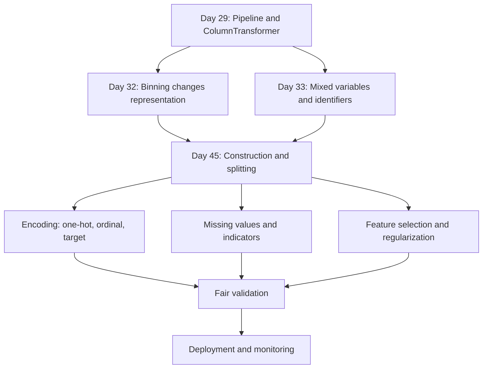
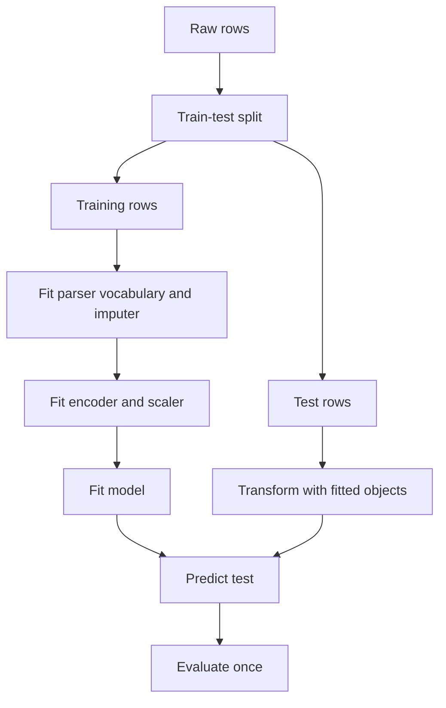
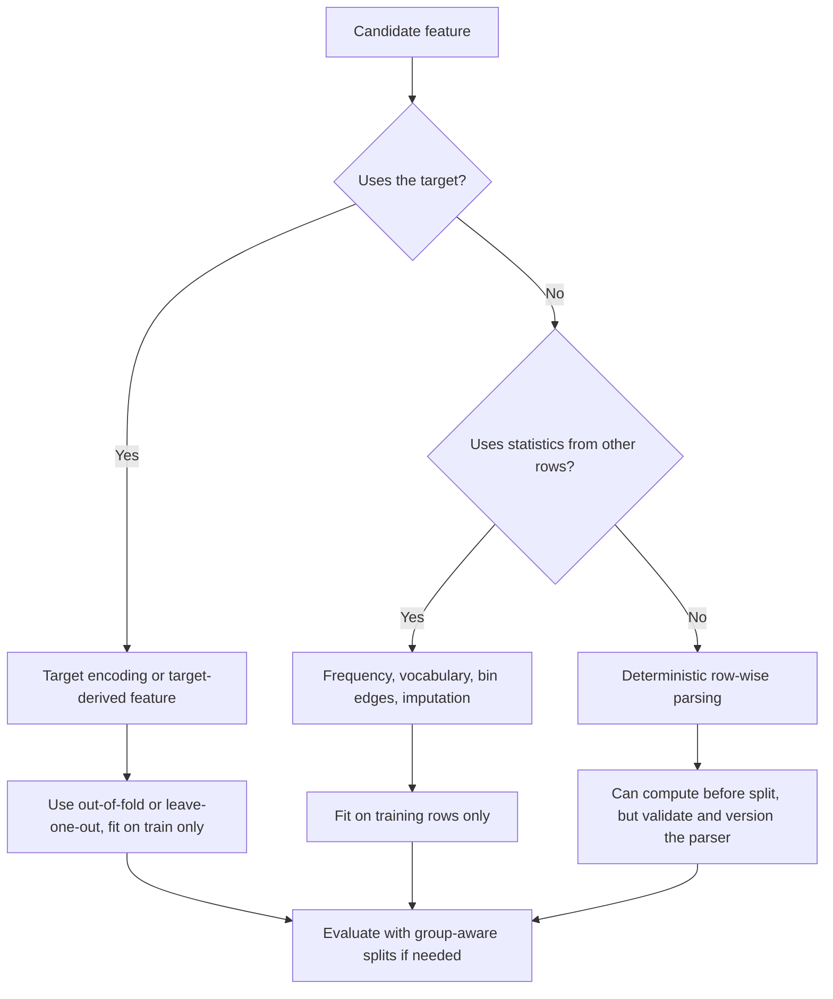

# Day 45 — Feature Construction and Feature Splitting

> **Course:** CampusX — 100 Days of Machine Learning, Day 45  
> **Official notebook:** `reference_notebooks/day45.ipynb` — 29 cells, copied byte-identically from the vendor source (SHA-256 `F4C305AA2D426F37A8F0E428E1486D10A99D78AB95F8D67AC3FAEDB5A3726FFB`)  
> **Official source path:** `vendor/100-days-of-machine-learning/day45-feature-construction-and-feature-splitting/day45.ipynb`  
> **Dataset:** `datasets/train.csv` — 891 rows and 12 columns; SHA-256 `7D118FEF8B6CCF7F81111877BC388536F7B1E498A655E3D649D19AAA010E9F6F`, identical to the vendor copy  
> **Personal notebook:** none. No personal notebook is created or modified for this day.  
> **Transcript:** no Day 45 transcript exists in `ML_Notes_Videos_31_40/transcripts/`; that folder covers Days 31–40 only. The official video link is recorded in `README.md`, but no transcript is quoted or invented here.  
> **Central question:** A raw table gives every passenger one row and every column one meaning. Why can a new column such as `FamilySize`, `IsAlone`, `Age * Pclass`, `Title`, or `Deck` be more useful than the columns it came from — and when is the new column merely a rename, a leak, or a source of overfitting?

This chapter is a study of **representation**, not a catalogue of tricks. Feature construction and feature splitting change what the model is allowed to see. That change can reduce bias by expressing domain structure, and it can increase variance by adding parameters, cardinality, leakage, or arbitrary choices. The engineering question is therefore always the same: does this new representation earn its place under a fair evaluation?

**Source labels used throughout**

- **Official** — the saved output in the CampusX notebook, produced in the author's environment (the notebook metadata records Python 3.8.3).
- **Rerun** — a result reproduced in this environment with Python 3.14.2, pandas 3.0.5, NumPy 2.5.3, scikit-learn 1.9.1, and SciPy 1.18.1, using `Day_45/datasets/train.csv`.
- **Supplementary** — an explanation or experiment added for learning. It is never presented as original course output.

Where official and rerun results differ, both are reported. The most important difference in this day is not a score: the official `Is_Married` cell uses chained assignment, which behaves differently in modern pandas. That cell is a compact lesson in how syntax and library version can change a result without changing the apparent code.

### How this chapter is organised

The chapter follows the notebook in order. Part A covers cells 0–17: loading five columns, complete-case deletion, the baseline cross-validation, `Family_size`, `Family_type`, dropping the raw family columns, and the second cross-validation. Part B covers cells 18–28: reloading the full table, extracting `Title` from `Name`, examining title-level survival, and the flawed `Is_Married` assignment. After the cell-by-cell walkthrough, the chapter extends the lesson to `IsAlone`, `Age * Pclass`, surname, ticket, and cabin splitting, then treats encoding, missing values, leakage, selection, overfitting, a supplementary experiment, interview preparation, and examination practice.

### Notation

| Symbol | Meaning |
|---|---|
| $n$ | number of rows in the current analysis table |
| $p$ | number of raw input columns |
| $x_i$ | the raw feature vector of row $i$ |
| $y_i$ | the target of row $i$; here $y_i\in\{0,1\}$ for `Survived` |
| $\phi$ | a feature-construction map, $x\mapsto\phi(x)$ |
| $\phi_k(x)$ | the $k$-th constructed feature |
| $S$ | a subset of feature indices selected for the model |
| $\beta$ | model coefficients |
| $\hat y_i$ | the model's predicted probability or label for row $i$ |
| $R_i$ | missingness indicator; $R_i=1$ when the row is fully observed for the selected columns |
| $\mathbf{1}\{\cdot\}$ | indicator function: 1 when the condition is true, 0 otherwise |
| $\operatorname{logit}(q)$ | $\ln\left(q/(1-q)\right)$ for $q\in(0,1)$ |
| $\operatorname{SE}$ | standard error of an estimate |

The target is binary, so accuracy is the proportion of correctly classified rows. The positive class is `Survived = 1`; the negative class is `Survived = 0`.

---

# 1. Learning objectives

After studying this chapter I should be able to:

1. **Distinguish four operations.** Explain the difference between feature construction, feature splitting (extraction), feature transformation, and feature selection, and identify which operation a given line of code performs.
2. **Explain why raw columns are not always the best representation.** Connect a representation choice to domain knowledge, model family, functional form, and evaluation.
3. **Construct family features correctly.** Derive `FamilySize`, `IsAlone`, and `Family_type`; explain the off-by-one role of the passenger themself; and state what each feature keeps and discards.
4. **Construct and interpret an interaction.** Write the linear model that contains `Age * Pclass`, derive the marginal effect of age, explain centering and hierarchy, and say why a product is not a universal interaction.
5. **Split composite strings.** Extract title and surname from `Name`, prefix and number from `Ticket`, and deck and number from `Cabin`; validate the extraction with row accounting rather than `head()`.
6. **Reason about cardinality.** Compute one-hot dimensions, identify rare categories, explain why 667 surnames are not 667 useful features, and choose an encoding that respects the train/test contract.
7. **Handle missing values after construction.** Distinguish original, structural, and created missingness; explain complete-case bias; and place imputation inside a pipeline fitted on training data only.
8. **Detect leakage.** Recognise target leakage, train/test contamination, group leakage from shared surnames or tickets, and the difference between deterministic parsing and learned statistics.
9. **Evaluate honestly.** Use paired fold comparisons, report uncertainty, avoid selecting features on the test set, and explain why a small mean improvement can be noise.
10. **Answer interview and examination questions.** Produce the formula, the worked number, the implementation detail, and the caveat, not only a definition.

---

# 2. Big picture: where feature construction and splitting sit

## 2.1 The workflow

Feature construction and splitting belong to **feature engineering**, before encoding and model training:


The diagram separates two kinds of operation:

- **Row-wise deterministic engineering** — `FamilySize = SibSp + Parch + 1`, `Title = parse(Name)`, `Deck = first letter of Cabin`. These rules do not use the target and do not estimate a statistic from the data. They can be written before the split, although they still need validation and a production parser.
- **Data-dependent engineering** — target encoding, frequency counts, quantile bins, category grouping learned from observed frequencies, imputation statistics. These quantities must be learned on the training portion only and then applied to validation, test, and production data.

A useful rule: **the code may be written before the split; the learned numbers may not be computed before the split.** Domain knowledge can choose the formula before seeing any rows. The formula's parameters, vocabularies, and thresholds must be fitted inside the training fold.

## 2.2 The four operations, distinguished

| Operation | Input | Output | Example | Learned from data? |
|---|---|---|---|---|
| Feature construction | one or more columns | a new column defined by a rule | `FamilySize = SibSp + Parch + 1` | No, if the rule is fixed |
| Feature splitting / extraction | one composite column | several columns | `Title` from `Name`; `Deck` from `Cabin` | No, if the parser is deterministic |
| Feature transformation | one column | a changed version of the same information | `log(Fare)`, standardization, binning | Sometimes; a power parameter or bin edge is learned |
| Feature selection | a set of columns | a subset of columns | keep the top $k$ by mutual information | Yes; selection uses data and must be validated |

The boundaries are not rigid. A target encoder is both a construction and a learned transformation. A parser that groups rare titles using training frequencies is deterministic in its string logic but learned in its vocabulary. What matters is not the label but the **dependency structure**: does the operation use $y$? does it use validation rows? does it estimate a parameter that must travel with the model?

## 2.3 What the course actually does

The official notebook contains two demonstrations:

1. **Family construction (cells 9–17).** It builds `Family_size` from `SibSp` and `Parch`, maps it into three codes with `myfunc`, drops `SibSp`, `Parch`, and `Family_size`, and compares a logistic-regression cross-validation score before and after.
2. **Name splitting (cells 19–27).** It reloads the full table, extracts `Title` from `Name`, groups survival by title, and creates a binary `Is_Married` flag.

The course does not build `IsAlone`, `Age * Class`, surname, ticket, or cabin features, and it does not fit a model on `Title`. Those are extensions in this chapter. The extension is clearly separated from the official cells so that the reader can tell what the course demonstrated from what is additional reasoning.

## 2.4 Connection map



The arrows are conceptual dependencies, not a strict chronological order. Day 45 depends on earlier lessons about parsing, encoders, pipelines, and leakage; later lessons on selection, regularisation, and model interpretation depend on the distinction between a new representation and a new column count.

## 2.5 The central claim

A model does not see a table. It sees a **design matrix**. If two representations produce the same matrix up to a linear reparameterisation, a linear model cannot distinguish them. If a construction produces a genuinely new nonlinear direction, the model's hypothesis space changes. This is why:

- `FamilySize` alone is exactly a linear combination of `SibSp`, `Parch`, and the intercept; adding it to a linear logistic model does not change the fitted probabilities.
- `Family_type` is a nonlinear map of the same count; it can change the model, but its three codes impose an ordering and a linear effect that may be wrong.
- One-hot encoding of `Family_type` lets the model learn a separate effect for each family category; that is a different hypothesis space again.
- `Title` is a parsed string category, but its predictive power may largely be a proxy for `Sex`, age, and marital status. A useful feature is not necessarily a new causal variable.

The rest of the chapter turns these claims into checked arithmetic.

---

# 3. The dataset and the 29-cell map

## 3.1 The raw table

`datasets/train.csv` is the Titanic training table:

| Property | Value |
|---|---|
| Rows | 891 |
| Columns | 12 |
| Target | `Survived` |
| Positive class | 342 rows (38.38%) |
| Negative class | 549 rows (61.62%) |

The columns are:

| Column | Type in the file | Missing | Role in this lesson |
|---|---|---:|---|
| `PassengerId` | integer | 0 | identifier; not a feature |
| `Survived` | integer 0/1 | 0 | target |
| `Pclass` | integer 1/2/3 | 0 | ordinal ticket class |
| `Name` | text | 0 | composite: surname, title, given name, nickname |
| `Sex` | text | 0 | binary category |
| `Age` | float | 177 | continuous, with missingness |
| `SibSp` | integer | 0 | siblings/spouses aboard |
| `Parch` | integer | 0 | parents/children aboard |
| `Ticket` | text | 0 | composite: prefix and number |
| `Fare` | float | 0 | continuous |
| `Cabin` | text | 687 | composite: deck and cabin number; mostly missing |
| `Embarked` | text | 2 | port category |

The official notebook selects only `Age`, `Pclass`, `SibSp`, `Parch`, and `Survived` for Part A. That subset has 891 rows and only one column with missing values: `Age` has 177 missing entries. Dropping rows with any missing value therefore leaves

$$
n = 891 - 177 = 714.
$$

The target distribution changes from 342/891 = 0.3838 in the full table to 290/714 = 0.4062 in the complete-case table. The 177 excluded rows have a survival rate of 52/177 = 0.2938. This is not a random sample of the original rows, a fact that matters for every score in Part A. Section 5.3 works through the arithmetic.

## 3.2 Why the notebook selects five columns

The selection is a deliberate simplification:

- `Age`, `Pclass`, `SibSp`, and `Parch` are numeric or ordinal and need no text parsing.
- `Survived` is the target.
- `Name`, `Sex`, `Ticket`, `Fare`, `Cabin`, and `Embarked` are omitted so that the first demonstration isolates family construction.
- `Sex` is omitted even though it is the strongest single predictor in the table. Consequently, the baseline is not a strong Titanic baseline; it is a baseline for the five-column experiment.

That omission is not a mistake in the notebook; it is the scope of the experiment. It becomes important when interpreting `Title`: title looks powerful partly because it restores information that `Sex` would have supplied directly.

## 3.3 Cell map

| Cells | Part | What happens |
|---|---|---|
| 0 | setup | imports NumPy, pandas, `cross_val_score`, `LogisticRegression`, seaborn |
| 1–6 | data | select five columns, inspect `head`, drop missing rows, define `X` and `y` |
| 7 | baseline | 20-fold cross-validated logistic regression on the raw four features |
| 8 | heading | "Applying Feature Construction" |
| 9–14 | construction | `Family_size`, `myfunc`, `Family_type`, inspect |
| 15–16 | pruning | drop `SibSp`, `Parch`, `Family_size` |
| 17 | comparison | 20-fold cross-validation after construction |
| 18 | heading | "Feature Splitting" |
| 19–20 | reload | read the full table again and inspect it |
| 21–24 | name parsing | inspect `Name`, extract `Title`, show components |
| 25 | analysis | survival rate by title |
| 26–27 | binary flag | create `Is_Married` and display it |
| 28 | empty | no code, no output |

The exact cell-by-cell mapping, including execution counts and output availability, is in Section 20.

## 3.4 Environment and source fidelity

The saved notebook metadata records Python 3.8.3. The reruns in this chapter use Python 3.14.2, pandas 3.0.5, NumPy 2.5.3, and scikit-learn 1.9.1. Three consequences are visible:

1. The two logistic-regression cross-validation scores reproduce exactly: 0.6933333333333332 before construction and 0.7003174603174602 after. The fold split and the optimisation are stable for these cells.
2. The `Is_Married` cell does **not** reproduce. The official output shows ones for `Mrs`; the rerun leaves the column at all zeros and emits a `ChainedAssignmentError`. The code relies on chained assignment, whose behaviour changed.
3. Text display details differ across pandas versions, but the parsed title values are identical. The rerun finds 17 titles and zero parse failures, matching the official output.

The notebook reads `train.csv` with a relative path. The local dataset is in `datasets/train.csv`, while the reference notebook lives in `reference_notebooks/`. Running the notebook from its own folder without changing the path will therefore fail to find the file. This is an environment issue, not a data issue. The README states the path; the reference notebook is not edited.

---

# 4. Why raw columns are not always the best representation

## 4.1 The raw representation is additive

A logistic regression on the five selected columns models the log-odds as

$$
\operatorname{logit}\Pr(Y=1\mid x)
= \beta_0 + \beta_1\,\text{Age}
+ \beta_2\,\text{Pclass}
+ \beta_3\,\text{SibSp}
+ \beta_4\,\text{Parch}.
$$

Each feature enters additively with a constant coefficient. The model assumes that changing `SibSp` by one has the same effect on the log-odds regardless of `Parch`, and that the effect of age is a straight line in the log-odds. Those are strong assumptions.

Consider two actual rows:

| Row | Name | Age | Pclass | SibSp | Parch | Family size | Survived |
|---:|---|---:|---:|---:|---:|---:|---:|
| 0 | Braund, Mr. Owen Harris | 22.0 | 3 | 1 | 0 | 2 | 0 |
| 7 | Palsson, Master. Gosta Leonard | 2.0 | 3 | 3 | 1 | 5 | 0 |

The raw model sees row 0 as `(22, 3, 1, 0)` and row 7 as `(2, 3, 3, 1)`. It has no single coordinate for "traveling with family" and no coordinate for "alone". A domain feature can express that structure directly.

## 4.2 Domain knowledge supplies the hypothesis

Feature construction starts from a question about the world, not from a list of pandas methods:

- On a passenger ship, survival may depend on **family size**: a lone traveller has no one to help, a small family can coordinate, and a very large family may struggle.
- **Title** encodes sex, marital status, and sometimes age or profession: `Mr`, `Mrs`, `Miss`, `Master`, `Dr`, `Rev`.
- **Surname** identifies a family group, although unrelated passengers can share a common surname.
- **Ticket** identifies passengers who booked together; repeated ticket numbers are evidence of a travel group.
- **Cabin deck** may proxy for class and location; a missing cabin is itself informative.
- **Fare per person** can be more meaningful than the total fare paid by a group.

These are hypotheses. A hypothesis becomes a feature only after a parser, a validation check, and an evaluation. Domain knowledge can suggest the formula, but it cannot certify that the formula improves generalisation on this finite sample.

## 4.3 Construction changes the hypothesis space

Let the raw feature vector be $x\in\mathbb{R}^p$. A linear model on raw features can represent functions of the form

$$
f(x)=\beta_0+\sum_{j=1}^{p}\beta_j x_j.
$$

A construction map $\phi:\mathbb{R}^p\to\mathbb{R}^q$ produces a new design matrix with columns $\phi_1(x),\dots,\phi_q(x)$. The model becomes

$$
f_\phi(x)=\beta_0+\sum_{k=1}^{q}\beta_k\phi_k(x).
$$

If every $\phi_k$ is a linear combination of the original $x_j$, then $f_\phi$ is still a linear function of $x$; the linear hypothesis space has not expanded. The representation may be more interpretable or better conditioned, but it cannot fit a pattern that the raw linear model could not fit.

If some $\phi_k$ is nonlinear in $x$, the hypothesis space can expand. For example, with two binary features $A,B\in\{0,1\}$, the raw linear model can represent

$$
f(A,B)=\beta_0+\beta_1 A+\beta_2 B.
$$

It cannot represent the exclusive-or pattern $A\ne B$ with a single linear boundary in the original two-dimensional space. Adding the product $AB$ gives

$$
f(A,B)=\beta_0+\beta_1 A+\beta_2 B+\beta_3 AB,
$$

which can represent the interaction. The product is a new direction in the design matrix, not merely a rename of $A$ or $B$.

This distinction explains the course result: `FamilySize = SibSp + Parch + 1` is a linear combination of `SibSp`, `Parch`, and the intercept. In a logistic regression with an intercept, adding it does not change the fitted probabilities. The supplementary experiment confirms this exactly: the cross-validated accuracy is identical to the baseline. `Family_type`, by contrast, is a nonlinear map, so it can change the model. Whether it changes it *usefully* is an empirical question.

## 4.4 A small worked interaction example

Suppose a toy target is 1 when a passenger is both young and in first class, and 0 otherwise. Let age be coded as `young = 1` for age below 15, and class as `first = 1` for `Pclass = 1`. The pattern is

| `young` | `first` | target |
|---:|---:|---:|
| 0 | 0 | 0 |
| 0 | 1 | 0 |
| 1 | 0 | 0 |
| 1 | 1 | 1 |

A model with only main effects predicts a target that increases with `young` and with `first`, but it cannot isolate the single cell $(1,1)$. The product `young * first` is 1 only in that cell. A linear model on the three columns `young`, `first`, and `young * first` can fit the table exactly.

The Titanic `Age * Pclass` feature is a continuous analogue: it lets the slope of age depend on class. It is not guaranteed to help, because the true relationship may not have that form, the product may be collinear with its components, and the sample may be too small to estimate the extra coefficient precisely.

## 4.5 When the raw column is better

Construction is not automatically an improvement. Raw columns can be better when:

- the model is a tree ensemble that can already represent interactions and nonlinearity;
- the constructed feature is a deterministic linear combination of existing features, so a linear model gains nothing;
- the construction is chosen after looking at the test set, which turns exploration into leakage;
- the new feature has high cardinality and few observations per category;
- the parser is brittle and fails on future formats;
- the new feature is a proxy for a protected attribute and creates fairness or legal risk;
- the raw feature is needed for interpretation, auditing, or regulatory reporting.

The correct default is to keep the raw column available, add the constructed candidate, and compare complete workflows under the same validation protocol.

---

# 5. Foundations

## 5.1 Features, targets, and the design matrix

A **feature** is an input variable used for prediction. A **target** is the quantity being predicted. The **design matrix** is the two-dimensional array of features, one row per observation and one column per feature.

For $n$ rows and $q$ features, write

$$
\mathbf{X}=
\begin{bmatrix}
x_{11} & x_{12} & \cdots & x_{1q}\\
x_{21} & x_{22} & \cdots & x_{2q}\\
\vdots & \vdots & \ddots & \vdots\\
x_{n1} & x_{n2} & \cdots & x_{nq}
\end{bmatrix},
\qquad
\mathbf{y}=
\begin{bmatrix}
y_1\\ y_2\\ \vdots\\ y_n
\end{bmatrix}.
$$

The entry $x_{ij}$ is the value of feature $j$ for row $i$. A construction adds a column; a split replaces one column with several; a selection removes columns. These operations change the shape and the meaning of $\mathbf{X}$, not the rows or the target.

## 5.2 Deterministic rules versus learned parameters

| Property | Deterministic construction | Learned construction |
|---|---|---|
| Example | `FamilySize = SibSp + Parch + 1` | target encoding of `Title` |
| Uses the target? | No | Usually yes |
| Uses other rows? | No, if row-wise | Yes; it estimates group statistics |
| Can be computed before the split? | The formula can; validation still needed | No; fit on training data only |
| Must travel with the model? | The code must, but there is no fitted number | Yes; vocabulary and statistics must be saved |
| Main risk | wrong domain rule, brittle parser | leakage, unstable rare categories, train-serving skew |

A deterministic parser is not automatically safe. If it uses a category list discovered by inspecting the full dataset, the list is a learned object even if the per-row string operation looks deterministic. The safe design is to define the parser's rules from domain knowledge and to fit any data-dependent vocabulary inside the training pipeline.

## 5.3 Missingness, complete-case analysis, and selection bias

### The three mechanisms

For a column $X$ and a missingness indicator $M=1$ when $X$ is missing:

- **MCAR (missing completely at random):** $\Pr(M=1\mid X,Y)=\Pr(M=1)$. The missing rows are a random sample of the full table, so complete-case analysis is unbiased for the full population (though it loses precision).
- **MAR (missing at random):** $\Pr(M=1\mid X,Y)=\Pr(M=1\mid X_{\text{observed}})$. Missingness depends on observed variables but not on the missing value itself, conditional on what is observed. Complete-case analysis can be biased if the observed variables that drive missingness are related to the target.
- **MNAR (missing not at random):** missingness depends on the unobserved value even after conditioning. Complete-case analysis can be strongly biased, and no method can fully repair it without a model for the missingness.

The labels are about the conditional distribution, not about a causal story. In the Titanic table, `Age` is missing for 177 rows. Those rows are disproportionately third class and male, and their survival rate is lower. That pattern is evidence against MCAR; it does not by itself prove MAR or MNAR.

### The selection-bias identity

Let $R=1$ mean "complete case for the selected columns" and $R=0$ mean "excluded". The full-population mean of the target is

$$
\Pr(Y=1)
=
\Pr(Y=1\mid R=1)\Pr(R=1)
+
\Pr(Y=1\mid R=0)\Pr(R=0).
$$

The complete-case estimate reports only the first conditional mean, $\Pr(Y=1\mid R=1)$. Its bias relative to the full mean is

$$
\text{bias}
=
\Pr(Y=1\mid R=1)-\Pr(Y=1)
=
\left[\Pr(Y=1\mid R=1)-\Pr(Y=1\mid R=0)\right]\Pr(R=0).
$$

For the Titanic selection:

$$
\Pr(R=1)=\frac{714}{891}=0.801346,
\qquad
\Pr(R=0)=\frac{177}{891}=0.198654.
$$

The observed survival rates are

$$
\Pr(Y=1\mid R=1)=\frac{290}{714}=0.406162,
\qquad
\Pr(Y=1\mid R=0)=\frac{52}{177}=0.293785.
$$

The identity gives

$$
0.406162(0.801346)+0.293785(0.198654)
=0.383838,
$$

which is the full-table rate $342/891$. The complete-case estimate is therefore about $0.4062-0.3838=0.0223$ above the full-table rate. This does not mean the complete-case model is "wrong"; it means the estimand has changed. The model is being evaluated on passengers whose age is recorded, not on all passengers.

### Why the official `head()` does not reveal the deletion

Cells 2 and 4 both show the first five rows. Those rows have ages, so they look identical before and after `dropna`. The deletion is invisible in a `head()` display. The shape changed from 891 to 714, and the target distribution changed. A validation habit follows: always print `shape`, `isna().sum()`, and the target counts after a filtering step, not only the first rows.

## 5.4 Cardinality, encoding, and degrees of freedom

The **cardinality** of a categorical feature is its number of distinct values. It determines the width of a one-hot encoding and the number of parameters a model may need.

For a categorical feature with $K$ observed categories, one-hot encoding with a dropped reference level produces $K-1$ columns (plus the intercept). Without dropping a level, it produces $K$ columns and introduces perfect collinearity with the intercept. For $m$ categorical features, the naive one-hot width is

$$
\sum_{j=1}^{m}K_j,
$$

or $\sum_j (K_j-1)$ after dropping one level per feature.

Examples from this dataset:

| Feature | Distinct values | Naive one-hot width | Comment |
|---|---:|---:|---|
| `Title` raw | 17 | 17 | 11 titles occur at most twice; many singletons |
| `TitleGroup` | 5 | 5 | `Mr`, `Mrs`, `Miss`, `Master`, `Rare` |
| `FamilyType` | 3 | 3 | alone, small, large |
| `Pclass` | 3 | 3 | already ordinal |
| `Surname` | 667 | 667 | 534 surnames occur once |
| `Ticket` | 681 | 681 | 210 extra rows share a ticket |
| `Ticket` prefix raw | 44 | 44 | many spelling variants |
| `Cabin` deck | 8 plus missing | 9 with explicit missing | C, B, D, E, A, F, G, T |
| `Cabin` number | many | not a sensible one-hot | identifier-like |

A feature with $K$ categories and $n$ rows has an average of $n/K$ rows per category. When $n/K$ is small, a category's estimated effect is unstable, and a model can memorise individual rows. This is the **curse of dimensionality** in its practical, tabular form: many columns, sparse counts, high variance.

## 5.5 Leakage taxonomy

**Data leakage** is any information in the training procedure that would not be available at prediction time, or any use of validation/test information that contaminates the estimate. Four forms matter here:

1. **Target leakage.** A feature is computed from the target, directly or through a group statistic that includes the row's own outcome. Example: `FamilySurvival = mean(Survived)` within the passenger's surname, computed on the full table.
2. **Train/test contamination.** A preprocessing statistic is fitted on all rows before splitting. Example: computing the title vocabulary, frequency counts, or imputation mean on the full table, then cross-validating.
3. **Group leakage.** Related rows are split across training and validation. Example: members of the same family or ticket appear in both folds, so a surname or ticket feature can memorise group outcomes.
4. **Temporal leakage.** Future information is used to predict the past. Example: using a fare distribution from a later period to normalise earlier bookings.

Deterministic row-wise parsing is not leakage by itself. `Title = parse(Name)` uses only the current row's `Name`; it does not use $y$ or another row. The leakage enters when the parser's vocabulary, rare-category grouping, frequency counts, or target statistics are estimated from data that should have been held out.

## 5.6 Cross-validation and paired comparisons

**$k$-fold cross-validation** partitions the rows into $k$ folds. For each fold, the model is trained on the other $k-1$ folds and evaluated on the held-out fold. The mean score is

$$
\bar{s}=\frac{1}{k}\sum_{j=1}^{k}s_j.
$$

The sample standard deviation of the fold scores is

$$
s_{\text{fold}}=
\sqrt{\frac{1}{k-1}\sum_{j=1}^{k}(s_j-\bar{s})^2}.
$$

The standard error of the mean is approximately $s_{\text{fold}}/\sqrt{k}$, but the folds are not independent because their training sets overlap. Treat the interval as a rough description of variability, not an exact confidence interval.

For two workflows evaluated on the **same folds**, the paired difference is more informative than comparing two means:

$$
d_j=s_j^{(B)}-s_j^{(A)},
\qquad
\bar{d}=\frac{1}{k}\sum_{j=1}^{k}d_j.
$$

If the differences are consistently positive, the evidence is stronger than a slightly higher mean with differences that change sign. A rough normal interval is

$$
\bar{d}\pm z_{1-\alpha/2}\frac{s_d}{\sqrt{k}},
$$

where $s_d$ is the sample standard deviation of the $d_j$. For $k=20$ and a 95% interval, $z\approx1.96$.

The official comparison uses `cv=20` on 714 rows with no shuffling. The test folds contain 36 rows in 14 folds and 35 rows in 6 folds. An accuracy difference of one row is therefore

$$
\frac{1}{36}=0.02778
\quad\text{or}\quad
\frac{1}{35}=0.02857.
$$

The reported mean difference between the two course models is 0.00698, which is smaller than one test row in a single fold before averaging. That does not make the difference meaningless, but it sets the scale: the comparison is coarse.

## 5.7 Logistic regression, odds, and coefficient interpretation

A logistic regression models the probability of the positive class as

$$
\Pr(Y=1\mid x)=\sigma(\eta),
\qquad
\eta=\beta_0+\sum_{j=1}^{p}\beta_j x_j,
$$

where $\sigma(\eta)=1/(1+e^{-\eta})$ is the logistic function. The log-odds, or logit, is linear:

$$
\operatorname{logit}\Pr(Y=1\mid x)
=
\ln\frac{\Pr(Y=1\mid x)}{1-\Pr(Y=1\mid x)}
=
\eta.
$$

A one-unit increase in feature $x_j$, holding the others fixed, adds $\beta_j$ to the log-odds. The odds multiply by $e^{\beta_j}$. This is why a coefficient of $-1.247$ on `Pclass` corresponds to an odds ratio of

$$
e^{-1.247}=0.287.
$$

The interpretation is conditional on the other features and on the model being correctly specified. It is not a causal effect. A coefficient near zero does not prove that the feature is irrelevant in every representation; it means this linear specification, with these other columns, estimates a near-zero additive contribution.

Accuracy is

$$
\text{accuracy}=\frac{1}{n}\sum_{i=1}^{n}\mathbf{1}\{\hat y_i=y_i\},
$$

where $\hat y_i$ is the predicted class. For an imbalanced target, always compare with the majority-class rate. On the complete-case table, always predicting "died" gives

$$
\frac{424}{714}=0.5938.
$$

The course baseline of 0.6933 is about 10 percentage points above that naive rate. On the full table, always predicting "died" gives $549/891=0.6162$.

## 5.8 Bias, variance, and the cost of adding features

For squared-error prediction, the expected test error at a point can be decomposed as

$$
\mathbb{E}\left[(y-\hat f(x))^2\right]
=
\sigma^2
+
\left(\operatorname{Bias}[\hat f(x)]\right)^2
+
\operatorname{Var}[\hat f(x)].
$$

The irreducible noise $\sigma^2$ cannot be removed by modelling. Bias is the gap between the average prediction and the truth. Variance is the sensitivity of the fitted model to the particular training sample.

Adding a feature can reduce bias if it expresses a real pattern. It can increase variance because the model has more parameters, more categories, or more opportunities to fit noise. The net effect is empirical. A construction that improves the training fit but worsens validation has increased variance more than it reduced bias.

The same logic applies to the **garden of forking paths**: if many constructions are tried and the best one is chosen on the same validation data, the reported score is optimistic even if each individual construction was deterministic. The selection among candidates is itself a fitting step.

---

# 6. Part A — constructing family features, cells 0–17

## 6.0 What Part A is trying to show

Part A asks a narrow question: can two raw counts, `SibSp` and `Parch`, be replaced by a small family-size category that is easier for a linear model to use? The notebook does not test every possible family feature. It makes one construction, prunes the raw columns, and compares two cross-validation means. The value of the demonstration is in the execution details: what is dropped, what is kept, what the comparison does and does not establish.

## 6.1 Cell 0 — imports

```python
import numpy as np
import pandas as pd

from sklearn.model_selection import cross_val_score
from sklearn.linear_model import LogisticRegression

import seaborn as sns
```

What each import provides:

- `numpy` supplies `np.mean`, used to average the cross-validation scores.
- `pandas` supplies the DataFrame operations.
- `cross_val_score` runs the same estimator over multiple train/validation splits.
- `LogisticRegression` is the classifier.
- `seaborn` is imported but never used in the notebook. It is harmless, but it is an unnecessary dependency for this lesson. The notebook contains no plots.

The cell creates no data and no model. It only makes names available.

## 6.2 Cell 1 — selecting five columns

```python
df = pd.read_csv('train.csv')[['Age','Pclass','SibSp','Parch','Survived']]
```

Execution order:

1. `pd.read_csv('train.csv')` reads 891 rows and 12 columns.
2. The list of five column names selects a subset.
3. The result is assigned to `df`.

The resulting table has 891 rows and 5 columns. `Name`, `Sex`, `Ticket`, `Fare`, `Cabin`, and `Embarked` are discarded. That is the scope of Part A.

Two implementation lessons:

- The list selection is explicit and readable. It is safer than `df.iloc[:, [1,2,3,4]]`, which depends on column order.
- The notebook relies on `train.csv` being in the current working directory. The local file is in `datasets/`, so a rerun must use the correct path or working directory.

The selected table has missing values only in `Age`:

| Column | Missing |
|---|---:|
| `Age` | 177 |
| `Pclass` | 0 |
| `SibSp` | 0 |
| `Parch` | 0 |
| `Survived` | 0 |

## 6.3 Cell 2 — the first inspection

```python
df.head()
```

Saved output:

```text
    Age  Pclass  SibSp  Parch  Survived
0  22.0       3      1      0         0
1  38.0       1      1      0         1
2  26.0       3      0      0         1
3  35.0       1      1      0         1
4  35.0       3      0      0         0
```

What the output establishes:

- The selected columns are present.
- `Age` is a float because it contains missing values elsewhere.
- The first five passengers all have recorded ages.
- The target is already encoded as 0/1.

What the output does **not** establish:

- The table has no missing values. It does: `Age` is missing for 177 rows.
- The first five rows represent the full table.
- The target is balanced. It is not: 549 died and 342 survived.

`head()` is a display method. It is not a validation method.

## 6.4 Cells 3–4 — complete-case deletion and the illusion of sameness

```python
df.dropna(inplace=True)
```

`dropna()` with no arguments drops a row if **any** column is missing. Because only `Age` is missing in this five-column table, the operation removes exactly the 177 rows with missing age. The shape becomes 714 rows.

`inplace=True` means the method modifies `df` and returns `None`. A common mistake is:

```python
df = df.dropna(inplace=True)   # df becomes None
```

The correct alternatives are:

```python
df.dropna(inplace=True)        # modify in place
df = df.dropna()               # reassign the returned DataFrame
```

Cell 4 then displays `df.head()` and produces exactly the same first five rows. This is the important teaching moment: the display looks unchanged because rows 0–4 are complete. The deletion is invisible in the head. The actual changes are:

$$
891 \longrightarrow 714
\quad\text{rows},
$$

and the target distribution changes from $342/891=0.3838$ to $290/714=0.4062$.

Always inspect after filtering:

```python
print(df.shape)
print(df.isna().sum())
print(df["Survived"].value_counts())
```

The complete-case table is not a random subsample. Passengers with missing age are more likely to be third class and male, and their survival rate is lower. Section 5.3 gives the selection-bias arithmetic.

## 6.5 Cells 5–6 — defining `X` and `y`

```python
X = df.iloc[:,0:4]
y = df.iloc[:,-1]
```

`X` contains the first four columns in positional order: `Age`, `Pclass`, `SibSp`, `Parch`. `y` contains the last column: `Survived`.

This works because the table was just built with that order. It is fragile:

- If someone reorders the columns, `iloc[:,0:4]` selects different features.
- If someone adds a column before the target, `iloc[:,-1]` no longer selects `Survived`.
- The code does not record the feature names in a separate list, so a later reader must inspect the table.

A more explicit version is:

```python
feature_cols = ["Age", "Pclass", "SibSp", "Parch"]
X = df[feature_cols].copy()
y = df["Survived"].copy()
```

The `.copy()` makes the independence of `X` from `df` explicit. In modern pandas, copy-on-write already reduces accidental sharing, but explicit copying documents intent.

Cell 6 prints `X.head()`:

```text
    Age  Pclass  SibSp  Parch
0  22.0       3      1      0
1  38.0       1      1      0
2  26.0       3      0      0
3  35.0       1      1      0
4  35.0       3      0      0
```

The shapes are `X.shape == (714, 4)` and `y.shape == (714,)`.

## 6.6 Cell 7 — the baseline cross-validation

```python
np.mean(cross_val_score(LogisticRegression(),X,y,scoring='accuracy',cv=20))
```

Saved output:

```text
0.6933333333333332
```

### What `cross_val_score` does

For `cv=20` and a classifier, scikit-learn uses `StratifiedKFold(n_splits=20, shuffle=False, random_state=None)`. The data are split into 20 folds while approximately preserving the class ratio in each fold. For each fold:

1. Train on the other 19 folds.
2. Predict the held-out fold.
3. Compute accuracy.
4. Discard the fitted model.

The function returns 20 scores. `np.mean` averages them.

`cv=20` does **not** mean 20 repetitions, 20 different random seeds, or 20 independent test sets. It means one 20-fold partition. The folds are not shuffled. Row order therefore influences which passengers land together.

With 714 rows and 20 folds, the test-fold sizes are 36 rows in 14 folds and 35 rows in 6 folds. An accuracy value is a multiple of $1/36$ or $1/35$, so the fold scores are coarse.

### The baseline result in context

| Quantity | Value |
|---|---:|
| Mean accuracy | 0.693333 |
| Standard deviation of folds | 0.091329 |
| Minimum fold | 0.542857 |
| Maximum fold | 0.885714 |
| Majority-class rate | 0.593838 |
| Naive improvement over majority | 0.099495 |

The fold standard deviation is large: 0.0913. A rough standard error of the mean is

$$
\frac{0.0913}{\sqrt{20}}=0.0204,
$$

so a rough 95% interval is about $0.693\pm0.040$. The interval is approximate because the folds share training rows.

### The fitted coefficients

Fitting the same unscaled logistic regression on all 714 rows gives:

| Feature | Coefficient | Odds ratio |
|---|---:|---:|
| `Age` | -0.04454 | 0.9564 |
| `Pclass` | -1.24746 | 0.2872 |
| `SibSp` | -0.26749 | 0.7653 |
| `Parch` | +0.27555 | 1.3173 |
| Intercept | +3.69212 | — |

These are associations conditional on the other columns, not causal effects. `Pclass` is coded 1, 2, 3, so the model treats class as a one-unit ordinal scale. That is a modelling assumption; one-hot class dummies would be more flexible.

### What the baseline does not have

- No scaling. Logistic regression with L2 regularisation is not scale-invariant, so the penalty depends on feature units. The notebook uses the default penalty. A pipeline with `StandardScaler` would change the regularisation geometry and possibly the coefficients, though not necessarily the accuracy much.
- No holdout. The reported score is cross-validated on all 714 rows. It is a model-selection estimate, not a pristine final test.
- No `Sex`. The strongest predictor in the full table is omitted by the five-column scope.
- No `random_state` for the folds. The result is deterministic for this fixed row order, but not robust to reshuffling.

## 6.7 Cell 8 — the section heading

The markdown cell says only:

```text
## Applying Feature Construction
```

It marks the transition from the raw baseline to the family construction. It contains no executable content.

## 6.8 Cell 9 — `Family_size`

```python
X['Family_size'] = X['SibSp'] + X['Parch'] + 1
```

### The formula

For passenger $i$,

$$
\text{FamilySize}_i
=
\text{SibSp}_i+\text{Parch}_i+1.
$$

The variables:

- `SibSp` is the number of siblings and spouses aboard.
- `Parch` is the number of parents and children aboard.
- The $+1$ counts the passenger themself.

Without the $+1$, the feature would be the number of **other** family members. Then a value of 0 would mean "alone", and a value of 1 could mean "one companion". With the $+1$, a value of 1 means "alone", and a value of 2 means "one companion". The course uses the second convention.

The full table's family sizes range from 1 to 11. The complete-case table ranges from 1 to 8, because the seven members of the Sage family (size 11) all have missing age and were removed. This is a concrete example of how `dropna` changes the feature distribution, not just the row count.

Complete-case distribution:

| Family size | Rows | Survival rate |
|---:|---:|---:|
| 1 | 404 | 0.321782 |
| 2 | 139 | 0.546763 |
| 3 | 93 | 0.569892 |
| 4 | 27 | 0.777778 |
| 5 | 11 | 0.272727 |
| 6 | 22 | 0.136364 |
| 7 | 12 | 0.333333 |
| 8 | 6 | 0.000000 |

The survival pattern is not monotone. Small families (2–4) have higher survival than lone travellers, but very large families (5–8) have lower survival. This is exactly the kind of nonmonotonic relationship that a single numeric code may fail to capture.

Full-table distribution:

| Family size | Rows |
|---:|---:|
| 1 | 537 |
| 2 | 161 |
| 3 | 102 |
| 4 | 29 |
| 5 | 15 |
| 6 | 22 |
| 7 | 12 |
| 8 | 6 |
| 11 | 7 |

The complete-case table has 404 alone passengers out of 714, or 56.58%. The full table has 537 out of 891, or 60.27%. The filtering removed 133 alone passengers, 22 with size 2, 9 with size 3, 2 with size 4, 4 with size 5, and 7 with size 11. These counts sum to 177.

### Implementation detail

`X['SibSp'] + X['Parch'] + 1` uses pandas index-aligned arithmetic. Because both Series share the same index, the result aligns row by row. The `+1` is scalar broadcasting.

The new column is `int64` because both inputs are integers and the result has no missing values.

## 6.9 Cell 10 — inspecting the constructed column

```python
X.head()
```

Saved output:

```text
    Age  Pclass  SibSp  Parch  Family_size
0  22.0       3      1      0            2
1  38.0       1      1      0            2
2  26.0       3      0      0            1
3  35.0       1      1      0            2
4  35.0       3      0      0            1
```

Worked checks:

- Row 0: $1+0+1=2$.
- Row 1: $1+0+1=2$.
- Row 2: $0+0+1=1$.
- Row 3: $1+0+1=2$.
- Row 4: $0+0+1=1$.

Row 7, not shown in the head, has `SibSp=3`, `Parch=1`, so $3+1+1=5$.

The head confirms arithmetic on five rows. It does not confirm the distribution, the maximum, or the absence of anomalies. Those require `value_counts()`, `describe()`, and a comparison with the full table.

## 6.10 Cells 11–12 — `myfunc` and its test call

```python
def myfunc(num):
    if num == 1:
        #alone
        return 0
    elif num >1 and num <=4:
        # small family
        return 1
    else:
        # large family
        return 2
```

The function maps a family size $f$ to a code:

$$
\text{myfunc}(f)=
\begin{cases}
0, & f=1,\\
1, & 2\le f\le4,\\
2, & f\ge5.
\end{cases}
$$

The three codes mean:

- 0: alone.
- 1: small family.
- 2: large family.

Cell 12 calls `myfunc(4)` and prints `1`. That is a unit check of the boundary: 4 belongs to the small-family branch, not the large-family branch.

Worked values:

| $f$ | 1 | 2 | 3 | 4 | 5 | 6 | 7 | 8 | 11 |
|---:|---:|---:|---:|---:|---:|---:|---:|---:|---:|
| `myfunc(f)` | 0 | 1 | 1 | 1 | 2 | 2 | 2 | 2 | 2 |

### Edge cases the function does not handle

- `f = 0`: the first condition is false, the second is false, so the function returns 2 ("large family"). A data error of 0 would be silently classified as large.
- `f < 0`: same problem.
- `f = NaN`: both comparisons are false, so the function returns 2. Missing family size would be silently called large.
- `f = 1.5`: the first condition is false; `1.5 > 1 and 1.5 <= 4` is true, so it returns 1. A non-integer family size is accepted.

A robust version validates the domain first:

```python
def family_type(f):
    if pd.isna(f) or f < 1:
        return np.nan
    if f == 1:
        return 0
    if f <= 4:
        return 1
    return 2
```

The lesson is not that the course function is unusable on this clean column. It is that a construction rule should state its domain and its missing-value policy.

### The thresholds are a choice

The cut points 1 and 4 are domain heuristics, not estimated parameters. Another analyst could choose 1, 2–3, 4+; or 1, 2–5, 6+; or quantile bins. The survival table shows why the choice matters: size 4 has the highest observed survival (0.7778), while size 5 drops to 0.2727. A boundary between 4 and 5 separates those groups; a boundary between 5 and 6 would merge them.

Because the thresholds are chosen by the analyst, they are part of the model-selection process. Trying many thresholds and picking the one with the best cross-validation score is a form of hyperparameter tuning. It must happen inside the validation protocol, not on the test set.

## 6.11 Cell 13 — applying the function

```python
X['Family_type'] = X['Family_size'].apply(myfunc)
```

Execution:

1. `X['Family_size']` is a Series of 714 integers.
2. `.apply(myfunc)` calls the Python function once per element.
3. The returned Series has the same index.
4. It is assigned to a new column, `Family_type`.

The result is `int64`. The first rows are:

```text
    Age  Pclass  SibSp  Parch  Family_size  Family_type
0  22.0       3      1      0            2            1
1  38.0       1      1      0            2            1
2  26.0       3      0      0            1            0
3  35.0       1      1      0            2            1
4  35.0       3      0      0            1            0
```

The distribution over the 714 complete rows is:

| `Family_type` | Meaning | Rows | Survival rate |
|---:|---|---:|---:|
| 0 | alone | 404 | 0.321782 |
| 1 | small family | 259 | 0.579151 |
| 2 | large family | 51 | 0.196078 |

The survival rates are not ordered like the codes. Code 1 has the highest survival, code 2 the lowest, and code 0 is in between. A linear model that treats `Family_type` as a number assumes the effect increases or decreases monotonically with the code. That assumption is false in this table.

### A vectorised alternative

`apply` is readable but calls Python for every row. For large data, use a vectorised rule:

```python
X["Family_type"] = np.select(
    [X["Family_size"] == 1, X["Family_size"].between(2, 4)],
    [0, 1],
    default=2,
)
```

or `pd.cut`:

```python
X["Family_type"] = pd.cut(
    X["Family_size"],
    bins=[0, 1, 4, np.inf],
    labels=[0, 1, 2],
    right=True,
).astype(int)
```

Both produce the same codes on this clean column. `np.select` evaluates conditions in order; `pd.cut` makes the interval convention explicit. The `apply` version is acceptable for 714 rows; the vectorised version is preferable for production.

## 6.12 Cell 14 — inspecting the constructed category

`X.head()` shows the six columns after construction. The output is identical to the table in Section 6.11. The important checks are not the first five rows but:

```python
X["Family_type"].value_counts().sort_index()
X.groupby("Family_type")["Survived"].agg(["mean", "count"])
```

The first confirms the counts 404, 259, 51. The second confirms the nonmonotone survival pattern.

## 6.13 Cell 15 — dropping the raw components

```python
X.drop(columns=['SibSp','Parch','Family_size'],inplace=True)
```

The columns removed:

- `SibSp` and `Parch`: the raw counts.
- `Family_size`: the intermediate count.

The columns retained:

- `Age`
- `Pclass`
- `Family_type`

Why the course does this:

- It avoids redundancy: `Family_size` is a deterministic function of `SibSp` and `Parch`.
- It forces the model to use the constructed category rather than the raw counts.
- It reduces the feature count from six to three.

What it costs:

- The model can no longer distinguish family size 2 from 3 or 4 within the small-family code.
- It can no longer distinguish 5 from 8 within the large-family code.
- It loses the separate effects of siblings/spouses versus parents/children.
- If `Family_type` is encoded as a single numeric column, the model imposes a monotone linear effect that the data do not support.

The drop is a modelling decision, not a data-cleaning necessity. A safer experiment keeps the raw columns and adds the constructed candidates, then compares representations. The supplementary experiment does exactly that in Section 14.

### `inplace=True` and notebook order

`inplace=True` mutates `X` and returns `None`. After this cell, the columns `SibSp`, `Parch`, and `Family_size` no longer exist. Re-running cell 9 or cell 13 without re-running the earlier cells will raise a `KeyError`. Notebooks are often executed out of order; this is one reason the official execution counts jump around. A reproducible notebook should either use explicit reassignment or be run top to bottom.

## 6.14 Cell 16 — the reduced table

```python
X.head()
```

Saved output:

```text
    Age  Pclass  Family_type
0  22.0       3            1
1  38.0       1            1
2  26.0       3            0
3  35.0       1            1
4  35.0       3            0
```

The table now has three features. The model will estimate an intercept plus three coefficients. The raw family counts are gone.

## 6.15 Cell 17 — the constructed cross-validation

```python
np.mean(cross_val_score(LogisticRegression(),X,y,scoring='accuracy',cv=20))
```

Saved output:

```text
0.7003174603174602
```

The exact difference from the baseline is

$$
0.7003174603174602-0.6933333333333332
=
0.0069841269841270.
$$

That is about 0.70 percentage points. The fold-level comparison is more informative:

| Quantity | Value |
|---|---:|
| Mean difference | +0.006984 |
| Standard deviation of paired differences | 0.039536 |
| Folds where constructed is better | 6 |
| Folds where the two tie | 7 |
| Folds where constructed is worse | 7 |
| Paired $t$ statistic | 0.7900 |
| Two-sided $p$-value | 0.4393 |
| Rough 95% interval for the mean difference | [-0.01152, 0.02549] |

The interval includes zero. The direction is positive on average, but the evidence is weak. Six wins, seven ties, and seven losses are not a consistent pattern.

Why the paired comparison is appropriate: the same 20 folds, the same rows, and the same target are used for both models. The only change is the feature set. The differences are therefore paired by fold. A two-sample comparison of two means would ignore that pairing and be less precise.

Why the interval is still approximate: the 20 training sets overlap heavily, the fold scores are not independent, and the model is refitted. The interval is a useful description of variability, not a exact frequentist confidence interval for a future test score.

### What the course comparison does not establish

- It does not establish that family construction improves Titanic survival prediction in general. The sample is 714 complete-age rows, the model is one logistic regression, and the folds are one unshuffled partition.
- It does not establish that dropping `SibSp` and `Parch` is harmless. The comparison changes both the construction and the feature set: the constructed model has three features, the baseline has four. The difference is not a clean "construction effect".
- It does not establish that `Family_type` is the best family representation. It is one of many possible maps.
- It does not establish statistical significance. The mean difference is much smaller than the fold variability.

The honest conclusion is: on this split and this model, the course's construction produced a small positive mean difference that is consistent with noise. The construction may still be useful for interpretation or for another model, but this experiment does not prove it.

## 6.16 Why the result is theoretically predictable

There are two reasons the course's construction might produce little change.

### Reason 1: the constructed feature is a coarse nonlinear map

`Family_type` collapses eight family sizes into three codes. The map is nonlinear, so it can change the linear model. But it also destroys information. The baseline can use the separate counts; the constructed model cannot. The net effect could be positive, negative, or zero.

### Reason 2: the code imposes the wrong shape

A single numeric `Family_type` coefficient assumes that moving from 0 to 1 has the same log-odds effect as moving from 1 to 2. The observed survival rates are 0.3218, 0.5792, and 0.1961. The pattern rises and then falls. A monotone linear effect cannot represent it. The fitted coefficient is a compromise:

| Model | `Age` | `Pclass` | `Family_type` | Intercept |
|---|---:|---:|---:|---:|
| Course constructed, unscaled | -0.04018 | -1.21544 | +0.09138 | +3.42220 |
| Baseline, unscaled | -0.04454 | -1.24746 | — | +3.69212 |

The `Family_type` coefficient is only +0.0914 in log-odds. Its odds ratio is $e^{0.0914}=1.0957$, a 9.6% increase per code step. That tiny average masks the strong nonmonotone group differences.

A one-hot version estimates separate effects. Fitting on the same 714 rows gives (unscaled):

| Feature | Coefficient |
|---|---:|
| `Age` | -0.04150 |
| `Pclass` | -1.12736 |
| `Family_type = 1` vs 0 | +0.63314 |
| `Family_type = 2` vs 0 | -0.79877 |
| Intercept | +3.12603 |

Now the pattern is visible: small family is strongly positive relative to alone, and large family is strongly negative. The one-hot representation matches the observed nonmonotonicity. This is a representation lesson, not a new dataset.

## 6.17 `FamilySize` alone is collinear with the raw counts

A natural first construction is to add `Family_size` and keep `SibSp` and `Parch`. For a linear model with an intercept, that adds no new direction:

$$
\text{FamilySize}
=
\text{SibSp}+\text{Parch}+1.
$$

The column is an exact linear combination of the existing columns and the intercept. In the supplementary repeated cross-validation, the baseline and the `base + FamilySize` model produce **identical** scores on every fold:

| Model | Mean accuracy | Fold standard deviation |
|---|---:|---:|
| `Age, Pclass, SibSp, Parch` | 0.696330 | 0.050985 |
| plus `FamilySize` | 0.696330 | 0.050985 |

This is not a bug. It is the definition of linear dependence. For a linear model, a feature must add a direction that is not already in the span of the design matrix, or it must interact with another feature, to change the fitted function.

For a tree, the situation is different: `FamilySize` is a new axis, and a split on it can separate combinations of `SibSp` and `Parch` that are not separable by axis-aligned splits on the raw counts. So the same feature can be useless for one model family and useful for another. Representation and model are not independent choices.

## 6.18 `IsAlone` as an alternative construction

`IsAlone` is the indicator

$$
\text{IsAlone}_i=\mathbf{1}\{\text{FamilySize}_i=1\}.
$$

It is equivalent to

$$
\mathbf{1}\{\text{SibSp}_i+\text{Parch}_i=0\}.
$$

In the complete-case table, 404 of 714 passengers (56.58%) are alone. In the full table, 537 of 891 (60.27%) are alone.

The feature is nonlinear, so it can add a direction that the raw counts do not span. It is also highly interpretable: "traveling alone" is a meaningful state, not an arbitrary bin.

The supplementary repeated cross-validation gives:

| Model | Mean accuracy | Difference from baseline | 95% interval for difference |
|---|---:|---:|---|
| Baseline | 0.696330 | — | — |
| plus `IsAlone` | 0.720955 | +0.024624 | [+0.016441, +0.032808] |

This is a larger and more consistent improvement than the course's `Family_type` map, at least in this repeated-CV protocol. The lesson is not that `IsAlone` is universally better. The lesson is that **how** the count is mapped matters: a single meaningful indicator can outperform a three-level ordinal code that imposes the wrong shape.

## 6.19 One-hot `Family_type` versus numeric `Family_type`

The supplementary comparison isolates the encoding:

| Representation | Mean accuracy | Difference from baseline |
|---|---:|---:|
| Course numeric `Family_type` only | 0.696322 | -0.000008 |
| One-hot `Family_type` only | 0.727085 | +0.030755 |
| Baseline plus numeric `Family_type` | 0.705880 | +0.009550 |
| Baseline plus one-hot `Family_type` | 0.726260 | +0.029930 |

All rows use the same 714 rows, the same repeated 10-fold cross-validation with five repetitions, `StandardScaler`, and `LogisticRegression(max_iter=2000)`. They are supplementary, not official. The pattern is clear: one-hot encoding lets the model represent the nonmonotone family effect; numeric encoding cannot.

The cost of one-hot is two extra columns for three categories. That is small. For a 17-level title or a 667-level surname, the cost is much larger, and grouping or regularisation becomes necessary.

## 6.20 Putting family construction inside a pipeline

A clean implementation does not mutate a global `X` in several cells. It defines a transformer and lets a pipeline fit it inside each fold.

A simple function transformer:

```python
from sklearn.preprocessing import FunctionTransformer

def add_family_size(frame):
    out = frame.copy()
    out["FamilySize"] = out["SibSp"] + out["Parch"] + 1
    return out

add_family = FunctionTransformer(add_family_size, validate=False)
```

A custom transformer is clearer when several columns are created and dropped:

```python
from sklearn.base import BaseEstimator, TransformerMixin

class FamilyFeatures(BaseEstimator, TransformerMixin):
    def fit(self, X, y=None):
        return self

    def transform(self, X):
        out = X.copy()
        out["FamilySize"] = out["SibSp"] + out["Parch"] + 1
        out["IsAlone"] = (out["FamilySize"] == 1).astype(int)
        out["FamilyType"] = np.select(
            [out["FamilySize"] == 1, out["FamilySize"].between(2, 4)],
            [0, 1],
            default=2,
        )
        return out[["Age", "Pclass", "FamilyType", "IsAlone"]]
```

The transformer is stateless: `fit` learns nothing. It is still a transformer because it implements `fit` and `transform`, so it can live in a `Pipeline` and be cloned by cross-validation.

A pipeline:

```python
from sklearn.pipeline import Pipeline
from sklearn.preprocessing import StandardScaler
from sklearn.linear_model import LogisticRegression

pipe = Pipeline([
    ("family", FamilyFeatures()),
    ("scale", StandardScaler()),
    ("model", LogisticRegression(max_iter=2000)),
])

scores = cross_val_score(pipe, X_raw, y, cv=10, scoring="accuracy")
```

Here `X_raw` must contain `Age`, `Pclass`, `SibSp`, and `Parch`. The pipeline creates the family features inside each training fold, scales using training-fold statistics, and fits the model. The validation fold is transformed with the same fitted objects. This is the leakage-safe pattern that Day 29 introduced.

If the transformer were fitted on the full dataset before `cross_val_score`, the validation rows would influence the scaling and any learned category vocabulary. The family formulas themselves are deterministic, but the scaler is learned, so the pipeline still matters.

---

# 7. Part B — splitting composite strings, cells 18–28

## 7.0 What Part B is trying to show

Part B switches from numeric construction to text splitting. The `Name` column is a composite string:

```text
Surname, Title. Given names (nickname)
```

The notebook extracts the title and then examines survival by title. It does not build a model with the title. The section is therefore a demonstration of parsing and descriptive analysis, not a complete feature-engineering experiment.

The same pattern applies to `Ticket` and `Cabin`, which this chapter adds as extensions. A composite column can contain several semantic variables. The engineering task is to separate them, validate the separation, and decide which parts are features rather than identifiers.

## 7.1 Cell 18 — the section heading

The markdown cell says:

```text
## Feature Splitting
```

It marks the transition from Part A to Part B. No code executes.

## 7.2 Cells 19–20 — reloading the full table

```python
df = pd.read_csv('train.csv')
```

The reload is necessary because Part A's `df` was replaced by a five-column subset and then filtered. The full table is needed to access `Name` and the other text columns.

Cell 20 displays `df.head()` and shows 12 columns. The saved output is wrapped across lines because the `Name` field is long. The first rows include:

| Row | Name | Sex | Age | SibSp | Parch | Ticket | Fare | Cabin | Embarked | Survived |
|---:|---|---|---:|---:|---:|---|---:|---|---|---:|
| 0 | Braund, Mr. Owen Harris | male | 22.0 | 1 | 0 | A/5 21171 | 7.2500 | NaN | S | 0 |
| 1 | Cumings, Mrs. John Bradley (Florence Briggs Thayer) | female | 38.0 | 1 | 0 | PC 17599 | 71.2833 | C85 | C | 1 |
| 2 | Heikkinen, Miss. Laina | female | 26.0 | 0 | 0 | STON/O2. 3101282 | 7.9250 | NaN | S | 1 |
| 3 | Futrelle, Mrs. Jacques Heath (Lily May Peel) | female | 35.0 | 1 | 0 | 113803 | 53.1000 | C123 | S | 1 |
| 4 | Allen, Mr. William Henry | male | 35.0 | 0 | 0 | 373450 | 8.0500 | NaN | S | 0 |

The full table has the same 891 rows as before. Reloading resets the index and restores all columns. It also resets any mutations from Part A, which is why the `Family_size` columns are gone.

## 7.3 Cell 21 — inspecting `Name`

```python
df['Name']
```

The output is a 891-row Series. Names are unique in this table; the exact count is 891, so `Name` is an identifier, not a categorical feature with repeated levels. Its value is in the **structure** inside each string, not in the full string.

The format is consistent:

- A surname before the first comma.
- A comma and a space.
- A title ending with a period.
- Given names, sometimes with a nickname in parentheses or quotes.

Examples:

| Row | Raw `Name` | Parsed surname | Parsed title |
|---:|---|---|---|
| 0 | `Braund, Mr. Owen Harris` | `Braund` | `Mr` |
| 1 | `Cumings, Mrs. John Bradley (Florence Briggs Thayer)` | `Cumings` | `Mrs` |
| 2 | `Heikkinen, Miss. Laina` | `Heikkinen` | `Miss` |
| 3 | `Futrelle, Mrs. Jacques Heath (Lily May Peel)` | `Futrelle` | `Mrs` |
| 30 | `Uruchurtu, Don. Manuel E` | `Uruchurtu` | `Don` |
| 556 | `Duff Gordon, Lady. (Lucille Christiana Sutherland) ("Mrs Morgan")` | `Duff Gordon` | `Lady` |
| 759 | `Rothes, the Countess. of (Lucy Noel Martha Dyer-Edwards)` | `Rothes` | `the Countess` |
| 863 | `Sage, Miss. Dorothy Edith "Dolly"` | `Sage` | `Miss` |

Notice that row 759 produces the title `the Countess`, with a lowercase article and a space. A parser that assumes titles are one token would fail or produce `the`. A parser that case-folds and strips would produce `countess`, which may be desirable for grouping. The raw output preserves the original text; normalisation is a separate decision.

## 7.4 Cell 22 — extracting `Title`

```python
df['Title'] = df['Name'].str.split(', ', expand=True)[1].str.split('.', expand=True)[0]
```

This single line performs two splits. Break it down from the inside out.

### Step 1: split on the comma-space

```python
df['Name'].str.split(', ', expand=True)
```

`.str.split(', ', expand=True)` returns a DataFrame with one column per resulting token. For row 0:

```text
"Braund, Mr. Owen Harris"
    -> ["Braund", "Mr. Owen Harris"]
```

The DataFrame columns are `0` and `1`:

| Column 0 | Column 1 |
|---|---|
| `Braund` | `Mr. Owen Harris` |
| `Cumings` | `Mrs. John Bradley (Florence Briggs Thayer)` |

`[1]` selects the second column, the part after the comma.

### Step 2: split on the period

```python
... [1].str.split('.', expand=True)[0]
```

For row 0, `"Mr. Owen Harris"` splits into `["Mr", " Owen Harris"]`; `[0]` selects `"Mr"`. For row 1, `"Mrs. John Bradley (...)"` splits into `["Mrs", " John Bradley (...)"]`; `[0]` selects `"Mrs"`.

### Why `expand=True` matters

Without `expand=True`, `.str.split` returns a Series of Python lists. Indexing `[0]` on that Series would select the first **row**, not the first token. With `expand=True`, the result is a DataFrame, and `[0]` selects the first **column**. This is a common source of confusion.

A more explicit equivalent:

```python
name_parts = df["Name"].str.split(", ", expand=True)
title_part = name_parts[1]
df["Title"] = title_part.str.split(".", expand=True)[0]
```

The explicit version is easier to debug and to explain in code review.

### The output

Cell 23 displays the title Series separately. The values are:

```text
0        Mr
1       Mrs
2      Miss
3       Mrs
4        Mr
       ...
886     Rev
887    Miss
888    Miss
889      Mr
890      Mr
```

Cell 24 displays `df[['Title','Name']]`, showing the title next to the original string.

### The cardinality

The extraction produces 17 distinct titles and zero missing values:

| Title | Count |
|---|---:|
| `Mr` | 517 |
| `Miss` | 182 |
| `Mrs` | 125 |
| `Master` | 40 |
| `Dr` | 7 |
| `Rev` | 6 |
| `Major` | 2 |
| `Mlle` | 2 |
| `Col` | 2 |
| `Don` | 1 |
| `Mme` | 1 |
| `Ms` | 1 |
| `Lady` | 1 |
| `Sir` | 1 |
| `Capt` | 1 |
| `the Countess` | 1 |
| `Jonkheer` | 1 |

Eleven titles occur at most twice. A one-hot encoding of the raw title would create 17 columns, most of them nearly empty. Section 9 treats the encoding implications.

### A regex alternative

The same title can be extracted with a regular expression:

```python
df["Title"] = df["Name"].str.extract(r",\s*([^.]+)\.")[0].str.strip()
```

The capture group `([^.]+)` matches one or more characters that are not a period, after a comma and optional whitespace. On this dataset it produces the same 17 titles with zero differences, because the title is always the first period-delimited token after the comma.

The regex is more explicit about the grammar, but it is not automatically more robust. It still assumes:

- a comma separates surname and the rest;
- the title ends at the first period;
- the title contains no period itself;
- there is at least one character between them.

A production parser needs tests for names that violate these assumptions, and a fallback category for unparseable rows.

### Validation, not `head()`

The extraction should be validated with:

```python
assert df["Title"].notna().all()
assert df["Title"].nunique() == 17
assert len(df) == 891
assert df["Title"].value_counts().sum() == 891
```

The `notna()` check catches a name that lacks the comma-space pattern. The unique count catches a parser change. The length and count checks catch row loss. A `head()` of five names cannot catch any of these.

## 7.5 Cell 23 — the extracted Series

```python
df['Name'].str.split(', ', expand=True)[1].str.split('.', expand=True)[0]
```

This is the same expression as the right-hand side of cell 22, evaluated again and displayed without assignment. It confirms that the extraction is reproducible and that the index is preserved.

The output is a Series with the original index 0–890. The dtype is `object` (or a pandas string dtype in newer versions), not a numeric type. The values are text.

## 7.6 Cell 24 — title next to name

```python
df[['Title','Name']]
```

The output is a two-column DataFrame with 891 rows. It is a sanity check: the title should match the text after the comma. The display is truncated in the middle, but the first and last rows look correct.

This is still a visual check. The stronger checks are the assertions in Section 7.4 and the group counts in Section 7.7.

## 7.7 Cell 25 — survival by title

```python
(df.groupby('Title').mean()['Survived']).sort_values(ascending=False)
```

### What the expression does

1. `df.groupby('Title')` groups the 891 rows by title.
2. `.mean()` computes the mean of every numeric column in each group. String columns are excluded by pandas.
3. `['Survived']` selects the survival mean.
4. `.sort_values(ascending=False)` orders titles from highest to lowest survival.

A more direct and readable version is:

```python
df.groupby("Title")["Survived"].agg(["mean", "count"]).sort_values("mean", ascending=False)
```

The direct version also reports the group size, which is essential for interpreting the mean.

### The full table

| Title | Rows | Survival rate | Approximate 95% Wilson interval |
|---|---:|---:|---|
| `the Countess` | 1 | 1.0000 | — |
| `Mlle` | 2 | 1.0000 | — |
| `Lady` | 1 | 1.0000 | — |
| `Ms` | 1 | 1.0000 | — |
| `Sir` | 1 | 1.0000 | — |
| `Mme` | 1 | 1.0000 | — |
| `Mrs` | 125 | 0.7920 | [0.7127, 0.8539] |
| `Miss` | 182 | 0.6978 | [0.6276, 0.7599] |
| `Master` | 40 | 0.5750 | [0.4219, 0.7149] |
| `Major` | 2 | 0.5000 | — |
| `Col` | 2 | 0.5000 | — |
| `Dr` | 7 | 0.4286 | — |
| `Mr` | 517 | 0.1567 | [0.1279, 0.1905] |
| `Rev` | 6 | 0.0000 | — |
| `Jonkheer` | 1 | 0.0000 | — |
| `Don` | 1 | 0.0000 | — |
| `Capt` | 1 | 0.0000 | — |

For the five larger groups, the Wilson intervals are informative:

- `Mr`: 0.1567 with 517 rows; the interval is roughly 0.128–0.191. The estimate is precise because the group is large.
- `Mrs`: 0.7920 with 125 rows; the interval is roughly 0.713–0.854.
- `Miss`: 0.6978 with 182 rows; the interval is roughly 0.628–0.760.
- `Master`: 0.5750 with 40 rows; the interval is roughly 0.422–0.715. The uncertainty is much wider.
- Rare grouped: 0.4444 with 27 rows; the interval is roughly 0.276–0.627.

For a title with one observation, the observed rate is either 0 or 1, but the uncertainty is almost the entire interval from 0 to 1. A bar chart of raw rates would make `the Countess` look like a perfect predictor. It is one row.

### Weighted check

The overall survival count can be reconstructed from the group counts:

$$
517(0.156673)+182(0.697802)+125(0.792)+40(0.575)+12
=342.
$$

The five terms are:

- `Mr`: 81 survivors.
- `Miss`: 127 survivors.
- `Mrs`: 99 survivors.
- `Master`: 23 survivors.
- The 12 survivors among the 27 rare-title passengers.

The sum is 342, the total number of survivors. This arithmetic confirms that the group means and counts are consistent with the target.

### What the group means do not show

- They do not show a causal effect of title. Title is correlated with sex, age, class, and family role.
- They do not adjust for confounding. `Mrs` passengers are more likely female and first/second class; `Mr` passengers are more likely male and third class.
- They do not account for multiple comparisons. Seventeen titles were examined; the extremes are likely to look strong by chance.
- They do not validate a model. The title feature has not been used in a classifier here.

## 7.8 Cell 26 — `Is_Married` and the chained-assignment trap

```python
df['Is_Married'] = 0
df['Is_Married'].loc[df['Title'] == 'Mrs'] = 1
```

The intention is:

1. Create a column of zeros.
2. Set it to 1 where the title is exactly `Mrs`.

The first line works. The second line is **chained assignment**:

- `df['Is_Married']` selects a Series.
- `.loc[df['Title'] == 'Mrs']` selects positions in that Series.
- `= 1` assigns into the selected positions.

The problem is that `df['Is_Married']` may be a temporary object or a copy, not a writable view of the DataFrame column. Assigning into the temporary may not update `df`.

### The official output

The saved output shows a `SettingWithCopyWarning`:

```text
SettingWithCopyWarning:
A value is trying to be set on a copy of a slice from a DataFrame
```

Despite the warning, the saved `Is_Married` Series shows 1 for `Mrs` rows. In the author's pandas version, the assignment happened to write through.

### The rerun in this environment

With pandas 3.0.5, the same code emits a `ChainedAssignmentError` and **does not update the column**. The printed `Is_Married` values are all zeros. The official saved output and the rerun therefore disagree.

This is not a modelling difference. It is a semantics change:

- Older pandas sometimes allowed chained assignment through a view.
- Modern pandas uses copy-on-write and treats the intermediate Series as a copy.
- The correct pattern uses a single `.loc` on the DataFrame:

```python
df.loc[df["Title"] == "Mrs", "Is_Married"] = 1
```

or avoids assignment entirely:

```python
df["Is_Married"] = (df["Title"] == "Mrs").astype(int)
```

The second form is the clearest: it creates the full column in one expression and has no hidden view semantics.

### Why the feature is semantically weak

Even when the assignment works, `Is_Married` is not a clean marital-status variable:

- `Mrs` usually indicates a married woman, but `Mme` is the French equivalent and is coded separately.
- `the Countess`, `Lady`, and `Sir` may be married or titled; the title does not state marital status directly.
- `Miss` usually indicates an unmarried woman; `Ms` is ambiguous.
- `Mr` does not state whether the man is married.
- `Master` indicates a boy, not a marital status.

The variable is therefore better named `Is_Mrs` or `Title_is_Mrs`. It is a title indicator, not a general married flag. If the goal is marital status, the mapping must be defined explicitly, documented, and validated.

The feature is also redundant with `Title`. If `Title` is already in the model, `Is_Married` adds no new information; it is a deterministic function of one title level. For a linear model, it is a reparameterisation, not a new direction. It may still be useful for interpretation or for a simpler model, but it is not independent evidence.

### A correct version with an explicit mapping

```python
married_titles = {"Mrs", "Mme", "the Countess"}
df["Is_Married"] = df["Title"].isin(married_titles).astype(int)
```

This is still a domain assumption. The set should be justified, not guessed. It should also be tested on the title counts:

```python
df.groupby("Title")["Is_Married"].mean()
```

Every title in the set should have mean 1; every other title should have mean 0. If a title is missing from the set by mistake, the check exposes it.

## 7.9 Cell 27 — displaying the flag

```python
df['Is_Married']
```

Official saved output:

```text
0      0
1      1
2      0
3      1
4      0
      ..
886    0
887    0
888    0
889    0
890    0
Name: Is_Married, Length: 891, dtype: int64
```

The values 1 at rows 1 and 3 match `Mrs` for Cumings and Futrelle. The rerun in this environment prints all zeros because the chained assignment failed. The correct code in Section 7.8 produces the intended values.

This cell is a source-fidelity warning: a saved output is evidence of what happened in the author's environment, not proof that the code is portable. When reproducing a notebook, compare values and read warnings; do not assume that a displayed result will reappear.

## 7.10 Cell 28 — empty

Cell 28 has no source and no output. It is an empty trailing cell. It contributes nothing to the analysis and is mapped as empty in the coverage matrix.

## 7.11 Surname extraction — an extension

The surname is the text before the first comma:

```python
df["Surname"] = df["Name"].str.split(",", n=1).str[0]
```

`n=1` limits the split to the first comma. This matters for names such as `Duff Gordon, Lady. (...)`: the surname is `Duff Gordon`, including the space. It also avoids splitting on any comma inside a nickname, if one existed.

### Counts

- 891 rows.
- 667 distinct surnames.
- 534 surnames occur exactly once.
- 83 occur twice.
- 28 occur three times.
- 14 occur four times.
- 1 occurs five times.
- 5 occur six times.
- 1 occurs seven times.
- 1 occurs nine times.

The largest groups are:

| Surname | Rows |
|---|---:|
| `Andersson` | 9 |
| `Sage` | 7 |
| `Johnson` | 6 |
| `Panula` | 6 |
| `Goodwin` | 6 |
| `Skoog` | 6 |
| `Carter` | 6 |
| `Rice` | 5 |
| `Palsson` | 4 |
| `Williams` | 4 |

A surname group is not the same as a family-size group. The `SibSp + Parch + 1` count agrees with the surname count in only 65.1% of rows. Reasons:

- Married women may travel under a different surname from their husband, while `SibSp` counts the spouse.
- Extended family, in-laws, cousins, and servants may share a surname or travel together.
- Unrelated passengers can share a common surname such as `Williams`.
- The surname string can include a compound name such as `Duff Gordon`.
- A family group may be split across several tickets, or a ticket may include several surnames.

Surname frequency is therefore a **group-size proxy**, not a direct family-size measurement. It can be useful, but it must be described as a proxy.

### High cardinality and leakage

One-hot encoding 667 surnames would create 667 columns, 534 of them with one row. That is a memorisation machine, not a generalisable feature. Better options:

- Use surname frequency as a single numeric column.
- Group rare surnames into `Other`.
- Use surname only for group-aware splitting, not as a model feature.
- Use ticket group size, which is closer to the travel group.

Surname is also a sensitive identifier. It can proxy for ethnicity, family, and social class. Using it in a model can create privacy and fairness risks even if it improves accuracy. The Titanic dataset is historical, but the engineering lesson applies to modern data.

### Group leakage

If members of the same family appear in both training and validation, a surname feature can memorise the family's outcome. A random row split does not prevent this. A group split does:

```python
from sklearn.model_selection import GroupShuffleSplit

groups = df["Surname"]
splitter = GroupShuffleSplit(n_splits=1, test_size=0.2, random_state=42)
train_idx, test_idx = next(splitter.split(df, groups=groups))
```

For the Titanic table, a ticket group is often a better grouping key than a surname because it captures the actual booking party. A family can have several tickets, and a ticket can contain several surnames. The grouping key should match the generalisation question: "predict a new passenger from a new family" is different from "predict a new passenger from a family already seen".

## 7.12 Ticket splitting — an extension

### The structure

`Ticket` values have three forms:

- A prefix and a number: `PC 17599`, `A/5 21171`, `STON/O2. 3101282`.
- A number alone: `113803`, `373450`.
- A special word: `LINE`.

### Extraction code

```python
tokens = df["Ticket"].str.split()

df["Ticket_Number"] = pd.to_numeric(tokens.str[-1], errors="coerce")
df["Ticket_Prefix"] = tokens.str[:-1].str.join(" ").replace("", np.nan)
```

What happens:

- `tokens.str[-1]` takes the last whitespace-separated token. For `PC 17599`, it is `17599`; for `LINE`, it is `LINE`.
- `pd.to_numeric(..., errors="coerce")` converts numeric strings to numbers and turns `LINE` into `NaN`.
- `tokens.str[:-1].str.join(" ")` joins all tokens except the last. For `PC 17599`, it is `PC`; for a numeric-only ticket, it is the empty string, replaced by `NaN`.
- For `LINE`, the prefix becomes the empty string and is replaced by `NaN`; a more informative parser should keep `LINE` as a special prefix.

A more explicit parser:

```python
def parse_ticket(value):
    parts = value.split()
    if parts[-1].isdigit():
        number = int(parts[-1])
        prefix = " ".join(parts[:-1]) or np.nan
        return prefix, number
    return value, np.nan

parsed = df["Ticket"].apply(parse_ticket)
df["Ticket_Prefix"] = [p[0] for p in parsed]
df["Ticket_Number"] = [p[1] for p in parsed]
```

The explicit version handles `LINE` as a prefix and avoids a silent empty string.

### Counts

| Quantity | Value |
|---|---:|
| Rows | 891 |
| Distinct tickets | 681 |
| Rows sharing a duplicated ticket | 344 |
| Extra rows beyond the first ticket occurrence | 210 |
| Numeric-only tickets | 665 |
| Raw prefix values including empty | 44 |
| Distinct numeric ticket numbers | 679 |

The 344 duplicated rows are not 344 duplicate tickets. They are the rows that belong to a ticket group of size at least two. The 210 extra rows are the difference between 891 rows and 681 distinct tickets.

Examples:

| Ticket | Rows | Interpretation |
|---|---:|---|
| `110152` | 3 | Cherry, Rothes, Maioni; a shared booking group |
| `110413` | 3 | Taussig family |
| `110465` | 2 | Porter and Clifford |
| `113760` | 4 | Carter family |
| `113572` | 2 | Stone and Icard |
| `CA. 2343` | 7 | Sage family; all died |

A ticket group is not always a family. It can include servants, friends, or unrelated passengers who booked together.

### Prefix normalisation

The raw prefixes contain spelling variants:

| Raw forms | Plausible canonical form |
|---|---|
| `C.A.`, `CA.`, `CA` | `CA` |
| `STON/O 2.`, `STON/O2.`, `STON/O2` | `STON/O2` |
| `SOTON/O.Q.`, `SOTON/OQ` | `SOTON/OQ` |
| `A/5`, `A/5.`, `A./5.`, `A.5.` | `A/5` |
| `SC/PARIS`, `SC/Paris` | `SC/PARIS` |

These mappings are plausible, not authoritative. The data dictionary does not explain the prefixes. A production system should verify each mapping with domain experts, record it in a versioned configuration, and test it against the observed values. The engineering point is that raw string categories often need normalisation before encoding; the normalisation itself is a learned or curated artifact.

After normalisation, the prefix cardinality is lower, but still high relative to the number of rows. Group rare prefixes into `Other`, or use frequency encoding.

### Ticket number is not a measurement

`Ticket_Number` has 679 distinct values among 891 rows. A one-unit increase in ticket number does not mean one more unit of anything. Using it as a continuous feature invites the model to split on arbitrary numeric thresholds. It is an identifier.

Useful derived features from a ticket:

- `TicketGroupSize`: number of rows sharing the ticket.
- `TicketFrequency`: group size divided by the number of rows, or a count.
- `TicketPrefix`: a categorical booking channel or class indicator.
- `IsSharedTicket`: 1 if the ticket appears more than once.

The group size is a **data-dependent** feature. If computed on the full table, it uses validation rows. In a pipeline, compute it on the training portion and map test tickets to the training counts, with a fallback for unseen tickets. This is the same contract as frequency encoding.

### Group leakage

If a ticket appears in both training and validation, a ticket-level feature can leak the group's outcome. The Sage ticket `CA. 2343` is a dramatic example: seven passengers, all died. If five are in training and two in validation, a ticket-group feature can effectively encode "this is the Sage group". That may be legitimate if the group identity is known at prediction time, but it is not evidence that the model generalises to new groups. Use `GroupShuffleSplit` with `Ticket` when the generalisation question is "new booking group".

## 7.13 Cabin splitting — an extension

### The structure

`Cabin` values have four forms:

- Missing: `NaN`.
- A deck letter plus a number: `C85`, `C123`, `E46`.
- Several cabins separated by spaces: `C23 C25 C27`, `B57 B59 B63 B66`.
- A letter alone: `D`, `T`.

### Extraction code

```python
df["Cabin_Deck"] = df["Cabin"].str.split().str[0].str[0]
df["Cabin_Count"] = df["Cabin"].str.split().str.len()
df["Cabin_Number"] = df["Cabin"].str.extract(r"(\d+)")[0]
```

What happens:

- `.str.split().str[0]` takes the first cabin token. For `C23 C25 C27`, it is `C23`.
- `.str[0]` takes the first character of that token: `C`.
- `.str.split().str.len()` counts cabins: 1 for `C85`, 3 for `C23 C25 C27`.
- `.str.extract(r"(\d+)")` captures the first run of digits: 85 for `C85`, 23 for `C23 C25 C27`, `NaN` for `D` or `T`.

### Counts

| Quantity | Value |
|---|---:|
| Missing `Cabin` | 687 |
| Observed `Cabin` | 204 |
| One cabin | 180 |
| Two cabins | 16 |
| Three cabins | 6 |
| Four cabins | 2 |

Deck counts among the 204 observed cabins:

| Deck | Count |
|---|---:|
| C | 59 |
| B | 47 |
| D | 33 |
| E | 32 |
| A | 15 |
| F | 13 |
| G | 4 |
| T | 1 |

The missing rate is 687/891 = 77.10%. Dropping rows with missing cabin would leave only 204 rows, a different and much smaller population. A missing indicator is essential if cabin information is used.

### Examples

| Row | `Cabin` | Deck | Count | First number | `Pclass` | `Fare` | `Survived` |
|---:|---|---|---:|---:|---:|---:|---:|
| 1 | `C85` | C | 1 | 85 | 1 | 71.2833 | 1 |
| 3 | `C123` | C | 1 | 123 | 1 | 53.1000 | 1 |
| 27 | `C23 C25 C27` | C | 3 | 23 | 1 | 263.0000 | 0 |
| 311 | `B57 B59 B63 B66` | B | 4 | 57 | 1 | 262.3750 | 1 |
| 7 | `NaN` | `NaN` | `NaN` | `NaN` | 3 | 21.0750 | 0 |

Row 27 shows why the first number is not the whole story: the cabin group has three cabins, but the extraction keeps only 23. A count feature recovers some of that information; a sum or list feature would keep more.

### Missingness and association

| Cabin observed? | Rows | Survival rate |
|---|---:|---:|
| Yes | 204 | 0.6667 |
| No | 687 | 0.2999 |

The association is strong, but it is not causal. Passengers with recorded cabins are more likely to be first class, and first-class passengers had higher survival. The missing indicator may capture class, wealth, or record-keeping, not the physical benefit of a cabin. A model that uses the indicator without class may attribute too much to missingness.

### Encoding

- `Cabin_Deck`: nominal category with 8 observed levels plus missing. One-hot with an explicit `Unknown` level is reasonable.
- `Cabin_Count`: small integer 1–4; could be numeric or ordinal. It is a proxy for the number of cabins booked, not a physical measurement.
- `Cabin_Number`: identifier-like. Do not mean-impute it. If used, treat it as a category, a frequency, or a binned location, not a continuous quantity.
- Missing indicator: 1 if `Cabin` is missing. It can be informative, but it must be interpreted with class and fare.

## 7.14 Robust parsing and validation

A parser is a program with an assumed grammar. The grammar must be stated and tested.

### Name parser checks

```python
assert df["Name"].str.contains(", ").all()
assert df["Name"].str.count(", ").eq(1).all()
assert df["Title"].notna().all()
assert df["Title"].nunique() == 17
assert df["Title"].value_counts().sum() == len(df)
```

The second assertion is specific to this dataset: every name has exactly one comma-space. A production parser should not assume that for all names; it should handle zero, one, and multiple commas with explicit rules.

### Ticket parser checks

```python
tokens = df["Ticket"].str.split()
assert tokens.str.len().ge(1).all()
assert tokens.str[-1].notna().all()
assert df["Ticket_Prefix"].notna().sum() + df["Ticket_Number"].notna().sum() >= len(df)
```

The last check is weak; a stronger row-accounting check is:

```python
numeric_ticket = df["Ticket"].str.split().str[-1].str.isdigit()
assert numeric_ticket.sum() == 887
assert (~numeric_ticket).sum() == 4
```

The four non-numeric endings are `LINE`. The exact count should be verified from the data, not assumed.

### Cabin parser checks

```python
observed = df["Cabin"].notna()
assert observed.sum() == 204
assert df.loc[observed, "Cabin_Deck"].notna().all()
assert df.loc[observed, "Cabin_Count"].notna().all()
assert df.loc[observed, "Cabin_Count"].sum() == 180 + 2*16 + 3*6 + 4*2
```

The last sum is 180 + 32 + 18 + 8 = 238 cabins across 204 rows. This is a row-accounting check: it verifies that the count feature is consistent with the multi-cabin strings.

### Index alignment

`str.split`, `str.extract`, and `str[0]` preserve the Series index. Assigning the result to a DataFrame column aligns on that index. If you filter a Series first and then assign it to the full DataFrame, pandas fills the missing indices with `NaN`. That may be correct for a structural missing value, but it can also hide a row-loss bug. Always check the assignment's missing count.

### A production parser

A production parser should have:

- a versioned grammar and a schema for the output columns;
- explicit handling of missing, malformed, and unexpected values;
- a fallback category such as `Unknown_Title` or `Unknown_Deck`;
- unit tests with representative and adversarial strings;
- logging of parse-failure rates;
- monitoring of category drift after deployment.

The notebook parser is a teaching parser. It is not a production service.

---

# 8. Interaction features: `Age * Class` and beyond

## 8.1 What an interaction means

An **interaction** exists when the effect of one feature on the target depends on the value of another feature. In a linear model, an interaction is represented by a product term. For age $A$ and class $C$:

$$
\text{AgeClass}_i=A_i C_i.
$$

The model with main effects and the product is

$$
\operatorname{logit} p_i
=
\beta_0+\beta_A A_i+\beta_C C_i+\beta_{AC}A_i C_i.
$$

The variables:

- $A_i$ is the passenger's age.
- $C_i$ is the ticket class, coded 1, 2, or 3.
- $\beta_A$ is the age slope when $C=0$ in the algebraic parameterisation. Because $C$ is never 0 in the data, this coefficient is not directly interpretable as a real-class slope; it is a baseline that combines with the product.
- $\beta_C$ is the class effect when $A=0$, which is also outside the observed age range for most passengers.
- $\beta_{AC}$ is the change in the age slope per one-unit change in the class code.

The last point is the important one. Differentiating the log-odds with respect to age gives

$$
\frac{\partial\,\operatorname{logit} p_i}{\partial A_i}
=
\beta_A+\beta_{AC}C_i.
$$

So the age slope is:

| Class | Age slope |
|---:|---|
| 1 | $\beta_A+\beta_{AC}$ |
| 2 | $\beta_A+2\beta_{AC}$ |
| 3 | $\beta_A+3\beta_{AC}$ |

This specification assumes that the slope changes by the same amount for each class step. That is a strong assumption. It is why a product with an ordinal class code is not the same as a fully flexible class-specific age effect.

## 8.2 The hierarchy principle

When a model contains an interaction $A C$, it should usually contain the main effects $A$ and $C$ as well. This is the **hierarchy principle**. Reasons:

- An interaction without main effects forces the effect of $A$ to be exactly zero when $C=0$, which may be an arbitrary constraint.
- The interpretation of the interaction coefficient depends on the coding and centering of the main effects.
- Leaving out a main effect can make the model fit worse even when the interaction is real.

The course does not build `Age * Class`, so there is no official hierarchy choice to audit. The supplementary experiment always includes the main effects.

## 8.3 Worked values on actual rows

The product is easy to compute but easy to misread. Using the complete-case rows:

| Row | Age | Pclass | `AgeClass` | `AgeClass` divided by 10 | Survived |
|---:|---:|---:|---:|---:|---:|
| 0 | 22.0 | 3 | 66.0 | 6.6 | 0 |
| 1 | 38.0 | 1 | 38.0 | 3.8 | 1 |
| 2 | 26.0 | 3 | 78.0 | 7.8 | 1 |
| 3 | 35.0 | 1 | 35.0 | 3.5 | 1 |
| 4 | 35.0 | 3 | 105.0 | 10.5 | 0 |
| 7 | 2.0 | 3 | 6.0 | 0.6 | 0 |
| 8 | 27.0 | 3 | 81.0 | 8.1 | 1 |

The product is not on the same scale as age. Row 4 has `AgeClass = 105`, which is larger than any age in the table. A model with an unregularised coefficient on this column can be numerically unstable, and the coefficient's units are "log-odds per year-class unit", which is not a natural quantity.

Centering reduces the numerical scale but does not change the fitted function if the main effects are included. Let

$$
\tilde A=A-\bar A,
\qquad
\tilde C=C-\bar C,
$$

where $\bar A=29.6991$ and $\bar C=2.3081$ are the complete-case means. Then

$$
\beta_A A+\beta_C C+\beta_{AC}AC
=
\beta_A'\tilde A+\beta_C'\tilde C+\beta_{AC}'\tilde A\tilde C+\text{constant}.
$$

The design matrices span the same column space, so a linear model with an intercept produces the same fitted probabilities. Only the coefficients and their interpretation change. Centering is useful for optimization and for making lower-order terms interpretable at the mean, not for creating new information.

## 8.4 A more flexible interaction

If the concern is that age has a different slope in each class, use class dummies and interact age with each dummy:

$$
\operatorname{logit} p_i
=
\beta_0
+\beta_A A_i
+\gamma_2 C_{i2}
+\gamma_3 C_{i3}
+\delta_2 A_i C_{i2}
+\delta_3 A_i C_{i3},
$$

where $C_{i2}=1$ when passenger $i$ is in class 2 and $C_{i3}=1$ when in class 3; class 1 is the reference. The age slopes are:

| Class | Age slope |
|---:|---|
| 1 | $\beta_A$ |
| 2 | $\beta_A+\delta_2$ |
| 3 | $\beta_A+\delta_3$ |

This is more flexible than the single product with the ordinal code. It uses two interaction columns instead of one, and it does not assume equal slope increments.

A third option is a spline in age, possibly interacted with class. `SplineTransformer` can represent smooth nonlinear age effects; interactions with class dummies then allow the curve to differ by class. That is a larger model and needs more data or stronger regularisation.

## 8.5 Supplementary experiment for `Age * Class`

Protocol: 714 complete-age rows, `StandardScaler`, `LogisticRegression(max_iter=2000)`, repeated stratified 10-fold cross-validation with five repetitions (`random_state=42`), 50 fold scores. The numbers are supplementary, not official.

| Model | Mean accuracy | Difference from base | 95% interval | Paired $p$-value |
|---|---:|---:|---|---:|
| Base: `Age, Pclass, SibSp, Parch` | 0.696330 | — | — | — |
| plus `Age * Pclass` | 0.694108 | -0.002222 | [-0.006645, 0.002200] | 0.3176 |
| plus class-specific age slopes | 0.692969 | -0.003361 | [-0.008546, 0.001825] | 0.1989 |

The product did not improve accuracy in this experiment. The class-specific slopes did not help either. The intervals include zero, and the point estimates are slightly negative.

Why might this happen?

- The main effect of age and the main effect of class already carry much of the signal. The interaction adds a coefficient that is hard to estimate precisely.
- The product is highly correlated with age ($r=0.6017$) and with class ($r=0.4475$), so the extra coefficient is not based on a lot of independent variation.
- The true age effect may not be linear or may not differ by class in the way the product assumes.
- Logistic regression with L2 regularisation shrinks the extra coefficient, especially when the sample is small relative to the number of parameters.
- Accuracy is a coarse metric; a small change in ranking may not cross the 0.5 decision threshold.

The result does not prove that age-class interaction is absent. It shows that this particular interaction, in this model, on this split, did not improve accuracy. A different encoding, a different model, or a different metric could tell a different story.

## 8.6 Interaction with `Sex`

A more promising interaction in the Titanic data is age with sex. The survival pattern differs strongly by sex, and the effect of age may differ between men and women. In the supplementary protocol:

| Model | Mean accuracy | AUC |
|---|---:|---:|
| Base plus `Sex` | 0.804793 | 0.856725 |
| Base plus `Sex` and `Age * Sex` | 0.806984 | 0.859039 |

The improvement is about 0.0022 in accuracy, much smaller than the jump from adding `Sex` itself. The AUC also rises slightly. This is a reminder that the main effect can be large while the interaction is modest. Interactions should be tested after the main effects are in the model.

## 8.7 Implementation with scikit-learn

### PolynomialFeatures

For numeric columns, `PolynomialFeatures` can generate products:

```python
from sklearn.preprocessing import PolynomialFeatures

poly = PolynomialFeatures(
    degree=2,
    interaction_only=True,
    include_bias=False,
)
X_interactions = poly.fit_transform(X[["Age", "Pclass"]])
```

With `interaction_only=True`, the output columns are `Age`, `Pclass`, and `Age * Pclass`; squared terms are excluded. With `include_bias=False`, no constant column is added because the logistic regression has its own intercept.

`PolynomialFeatures` learns the number and names of output columns during `fit`. It is stateless in the sense that it does not estimate data-dependent values, but it must still be fitted to record `n_features_in_` and `feature_names_in_`.

### A custom transformer

A custom transformer is clearer when the interaction is domain-specific:

```python
from sklearn.base import BaseEstimator, TransformerMixin

class AgeClassInteraction(BaseEstimator, TransformerMixin):
    def fit(self, X, y=None):
        return self

    def transform(self, X):
        out = X.copy()
        out["AgeClass"] = out["Age"] * out["Pclass"]
        return out
```

Place it in a pipeline before scaling:

```python
from sklearn.pipeline import Pipeline
from sklearn.preprocessing import StandardScaler
from sklearn.linear_model import LogisticRegression

pipe = Pipeline([
    ("interaction", AgeClassInteraction()),
    ("scale", StandardScaler()),
    ("model", LogisticRegression(max_iter=2000)),
])
```

### ColumnTransformer

When different columns need different treatment, `ColumnTransformer` selects them:

```python
from sklearn.compose import ColumnTransformer
from sklearn.preprocessing import OneHotEncoder

preprocess = ColumnTransformer([
    ("age_class", PolynomialFeatures(degree=2, interaction_only=True, include_bias=False), ["Age", "Pclass"]),
    ("family", "passthrough", ["SibSp", "Parch"]),
])
```

The transformer output order is the order of the transformer specifications, followed by any passthrough columns. The output is an array or sparse matrix, not a DataFrame, unless `set_output` is configured. Column names must be tracked separately if they are needed for interpretation.

### Splines

For a smooth nonlinear age effect:

```python
from sklearn.preprocessing import SplineTransformer

spline = SplineTransformer(n_knots=5, degree=3, include_bias=False)
```

A spline expands one column into several basis columns. It is more flexible than a single product but also higher-dimensional. Fit it inside the pipeline and regularise the downstream model.

## 8.8 Missing age and interactions

`Age` is missing for 177 rows. The product `Age * Pclass` is missing whenever `Age` is missing. There are three choices:

1. **Complete-case analysis.** Drop the 177 rows. This is what the official notebook does before Part A. It changes the population and reduces the sample.
2. **Impute age, then construct.** Fit an imputer on the training data, fill age, then compute the product. The product inherits the imputation; it is not real information for the missing rows.
3. **Use a model that handles missing values natively.** Histogram-based gradient boosting can route missing values; the interaction is learned by the tree rather than written as a product.

If an imputer is used, the missing indicator should usually be kept:

```python
from sklearn.impute import SimpleImputer

imputer = SimpleImputer(strategy="median", add_indicator=True)
```

The indicator records that the value was missing; the imputed value is a guess. Do not interpret an interaction involving an imputed age as if the age were observed.

## 8.9 Trees and other model families

A decision tree can represent interactions through successive splits. For example, it can split on age, then split the young branch on class, producing an age-class interaction without an explicit product. A deep tree can represent many interactions; a shallow tree may not.

Consequences:

- Adding `Age * Pclass` to a tree often adds little, because the tree can already approximate the interaction.
- Adding it can still help a shallow tree by making the interaction available in one split, but the effect is empirical.
- For linear models, the product is the natural way to add the interaction.
- For distance-based models, the product changes the geometry and may help or hurt; scaling is essential.

| Model family | Interaction handling | Effect of adding a product |
|---|---|---|
| Logistic / linear regression | Explicit product required | Can help if the product matches the true relationship |
| Decision tree | Learned through splits | Often redundant, sometimes helpful for shallow trees |
| Random forest / boosting | Learned through many splits | Usually redundant; test empirically |
| k-NN / SVM with RBF | Implicit through distance or kernel | Product changes geometry; scaling matters |
| Naive Bayes | Conditional independence assumption | Product may violate independence further |

## 8.10 What `Age * Class` teaches

The feature is a useful case study because it is easy to write and hard to justify:

- It is **interpretable** as "age slope depends on class" only under a specific linear specification.
- It is **scale-sensitive**; centering and scaling matter for optimization and regularisation.
- It is **not guaranteed** to help; the supplementary experiment shows no accuracy gain.
- It is **not a substitute** for a properly specified nonlinear model or a tree.
- It is **not causal**; it is a predictive interaction.

The correct workflow is: state the hypothesis, add the main effects, add the interaction, fit inside cross-validation, compare paired scores, and inspect the coefficient and its stability. The product itself is one line of code; the reasoning is the hard part.

---

# 9. Encoding constructed and split features

## 9.1 The representation decision

After construction and splitting, each new column has a semantic type:

- numeric continuous;
- numeric count or ordinal;
- nominal category;
- identifier;
- missingness indicator.

The encoding must match the type and the model. A single numeric code for a nominal category imposes an order and a distance that may not exist. A one-hot encoding of a 667-level identifier creates a sparse, high-variance design matrix. A target encoding can be powerful but must be fitted out-of-fold.

## 9.2 A feature-by-feature table

| Feature | Semantic type | Cardinality | Missing | Recommended starting point |
|---|---|---|---:|---|
| `Age` | continuous | many | 177 | median impute + indicator, or native missing support |
| `Pclass` | ordinal 1–3 | 3 | 0 | one-hot or ordinal; test both |
| `SibSp` | count | 0–8 | 0 | numeric |
| `Parch` | count | 0–6 | 0 | numeric |
| `FamilySize` | count | 1–11 | 0 | numeric; may be collinear with raw counts |
| `FamilyType` | ordinal-ish category | 3 | 0 | one-hot; numeric only with caution |
| `IsAlone` | binary | 2 | 0 | binary numeric |
| `Title` raw | nominal | 17 | 0 | group rare titles, then one-hot |
| `TitleGroup` | nominal | 5 | 0 | one-hot |
| `Is_Married` | binary title indicator | 2 | 0 | binary; redundant with title |
| `Surname` | identifier / group | 667 | 0 | frequency or group size; not one-hot |
| `Ticket` | identifier / group | 681 | 0 | group size or frequency; not one-hot |
| `TicketPrefix` | nominal | 44 raw | 0 | normalise, group rare, one-hot |
| `TicketNumber` | identifier | 679 | 0 | drop or treat as category; not continuous |
| `CabinDeck` | nominal | 8 plus missing | 687 | one-hot with `Unknown` |
| `CabinNumber` | identifier | many | 687 | drop, category, or frequency; not continuous |
| `CabinCount` | count | 1–4 | 687 | numeric or ordinal |
| `Fare` | continuous, skewed | many | 0 | log transform or tree |
| `Embarked` | nominal | 3 plus missing | 2 | one-hot with `Unknown` |
| `Sex` | binary | 2 | 0 | binary or one-hot |

The table is a starting point, not a prescription. The model family and the validation result decide.

## 9.3 One-hot encoding: dimensions and collinearity

For a categorical feature $X$ with levels $c_1,\dots,c_K$, a one-hot encoder creates

$$
B_{ik}=\mathbf{1}\{X_i=c_k\},
\qquad k=1,\dots,K.
$$

If all $K$ columns are kept, they sum to 1 for every row, which is collinear with the intercept. Dropping one reference level gives $K-1$ independent columns. The reference level's effect is absorbed into the intercept.

For `FamilyType` with levels 0, 1, 2:

- Keep all three: columns `FamilyType_0`, `FamilyType_1`, `FamilyType_2`; sum to 1.
- Drop the first: columns `FamilyType_1`, `FamilyType_2`; level 0 is the reference.
- Coefficients of the dropped version are contrasts relative to level 0.

The one-hot representation fits the nonmonotone survival pattern. The numeric representation cannot. This is the main encoding lesson of Part A.

## 9.4 `OneHotEncoder` implementation

```python
from sklearn.preprocessing import OneHotEncoder
from sklearn.compose import ColumnTransformer
from sklearn.pipeline import Pipeline
from sklearn.impute import SimpleImputer
from sklearn.linear_model import LogisticRegression

numeric_features = ["Age", "SibSp", "Parch"]
categorical_features = ["Pclass", "Sex", "Embarked", "TitleGroup", "FamilyType", "CabinDeck"]

numeric_pipe = Pipeline([
    ("impute", SimpleImputer(strategy="median", add_indicator=True)),
    ("scale", StandardScaler()),
])

categorical_pipe = Pipeline([
    ("impute", SimpleImputer(strategy="constant", fill_value="Unknown")),
    ("onehot", OneHotEncoder(handle_unknown="ignore", drop="first", sparse_output=False)),
])

preprocess = ColumnTransformer([
    ("num", numeric_pipe, numeric_features),
    ("cat", categorical_pipe, categorical_features),
])

model = Pipeline([
    ("preprocess", preprocess),
    ("classifier", LogisticRegression(max_iter=2000)),
])
```

Important arguments:

- `handle_unknown="ignore"` ensures that a category seen at prediction time but not during fitting does not raise an error. The unseen category is encoded as all zeros (the reference-like state). This is convenient but can hide distribution shift; monitor unseen rates.
- `drop="first"` avoids perfect collinearity with the intercept. It also means the dropped category is the reference for coefficient interpretation.
- `sparse_output=False` returns a dense array. For high-cardinality features, the default sparse output saves memory.
- `min_frequency` and `max_categories` can group rare categories during fitting. They are learned from the training data and therefore belong inside the pipeline.
- `SimpleImputer(strategy="constant", fill_value="Unknown")` creates an explicit missing category for categorical columns. Using the most frequent category would merge missingness with an observed level and lose information.

`OneHotEncoder` is fitted on the training fold. It stores `categories_` and `feature_names_in_` (when the input is a DataFrame). The fitted encoder must travel with the model.

## 9.5 Why `pd.get_dummies` is risky for train/test work

`pd.get_dummies` is convenient for exploration:

```python
pd.get_dummies(df, columns=["Title"], drop_first=True)
```

But it has no persistent vocabulary:

- A category present in training but absent in test creates a different number of columns.
- A category present in test but absent in training is silently dropped.
- Column order can differ between the two calls.
- There is no `handle_unknown` policy.

For a notebook demonstration, `get_dummies` is fine. For a model that must transform future data consistently, use `OneHotEncoder` inside a pipeline.

## 9.6 Ordinal encoding: when it is defensible

Ordinal encoding assigns an integer to each category. It is defensible when:

- the categories have a genuine order;
- the distance between adjacent codes is meaningful, or the model can use a monotone effect;
- the number of categories is small;
- the analyst is willing to impose the ordering as a modelling assumption.

`Pclass` is ordinal in the sense that 1, 2, 3 represent a ranked class, but the "distance" between 1 and 2 is not necessarily the same as between 2 and 3. `FamilyType` is ordered by size, but survival is not monotone in size. `CabinDeck` has a rough physical order, but the decks are not equally spaced in any meaningful unit.

For a tree, ordinal codes allow splits at thresholds; the tree can use the order without assuming linearity. For a linear model, ordinal codes impose a linear effect. If the effect is nonmonotone, one-hot is safer.

## 9.7 Target encoding: formula, smoothing, and leakage

Target encoding replaces a category with a summary of the target in that category. The unsmoothed mean is

$$
\text{TE}_g=\frac{1}{n_g}\sum_{i\in g}y_i,
$$

where $g$ is the category, $n_g$ is its row count, and $y_i$ is the binary target. For a category with one row, $\text{TE}_g$ is exactly that row's target: a direct leak.

Smoothing pulls small categories toward the global mean:

$$
\text{TE}_g
=
\frac{\sum_{i\in g}y_i + m\bar y}{n_g+m},
$$

where $\bar y$ is the global training mean and $m$ is a smoothing strength. When $n_g$ is large, the category mean dominates; when $n_g$ is small, the global mean dominates. The parameter $m$ is a modelling choice.

Even with smoothing, computing the encoding on the same rows used to fit the model leaks the target. Two common protections:

1. **Out-of-fold encoding.** For each training fold, compute category means from the other folds and apply them to the held-out fold. The final model is fitted on the encoded training data; test data use the full training means.
2. **Leave-one-out encoding.** For row $i$ in group $g$:

$$
\text{TE}_{i,\text{LOO}}
=
\frac{\sum_{j\in g,\,j\ne i}y_j}{n_g-1}
\quad\text{when }n_g>1,
$$

with the global mean used for singleton groups. The row's own target is excluded. LOO reduces self-leakage but can still leak group information if groups span train and test.

Scikit-learn's `TargetEncoder` performs cross-fitting internally. Check the installed version's parameters and behaviour; do not assume that a target encoder is leakage-free just because it is inside a pipeline. The encoder must be fitted on training folds and applied to validation/test rows with the learned mapping.

## 9.8 Frequency and group-size encoding

For a category $c$ with count $n_c$ in the training data, the frequency encoding is

$$
\text{freq}(c)=\frac{n_c}{n_{\text{train}}}.
$$

For a row $i$ with ticket $T_i$, the ticket group size is

$$
\text{GroupSize}_i
=
\sum_{j=1}^{n_{\text{train}}}
\mathbf{1}\{T_j=T_i\}.
$$

These encodings are useful for high-cardinality identifiers:

- `SurnameFrequency` measures how common the surname is in the training data.
- `TicketGroupSize` measures how many passengers share the ticket.
- `CabinCount` is already a within-row count, not a frequency.

They are data-dependent. Compute them on the training portion only. For a test row with an unseen ticket, the training group size is zero; use an explicit `Unknown` or global fallback. A frequency computed on the full table includes validation rows and is a form of train/test contamination.

## 9.9 Grouping rare categories

A category with very few rows has an unstable effect. Grouping rare levels reduces cardinality and variance:

```python
from sklearn.preprocessing import OneHotEncoder

encoder = OneHotEncoder(
    handle_unknown="infrequent_if_exist",
    min_frequency=10,
    drop="first",
    sparse_output=False,
)
```

`min_frequency=10` means categories with fewer than 10 training rows are grouped into an "infrequent" category. The threshold is learned from the training fold. `handle_unknown="infrequent_if_exist"` maps unseen categories to that group when it exists.

For `Title`, a domain-defined grouping is often clearer than a frequency threshold:

```python
common_titles = {"Mr", "Mrs", "Miss", "Master"}
df["TitleGroup"] = np.where(df["Title"].isin(common_titles), df["Title"], "Rare")
```

This mapping is defined by domain knowledge, not estimated from the target. It is safe to compute before the split, although the resulting category distribution should still be monitored.

For `Surname` with 667 levels, even a frequency threshold may leave too many categories. A single frequency column or a group-size column is usually better than one-hot.

## 9.10 Encoding interactions

If an interaction involves a categorical feature, encode it explicitly or let the model learn it:

- One-hot the category first, then multiply the dummy by the numeric feature.
- Use `PolynomialFeatures` on numeric columns, then one-hot the categorical columns.
- Use a tree, which learns the interaction through splits.

For `Age * Pclass`, the class is ordinal. The product treats it as a numeric modifier. A one-hot interaction uses separate age slopes for classes 2 and 3 relative to class 1, as in Section 8.4. The latter is more flexible and usually preferable when the class effect is not linear.

## 9.11 A complete encoding example

```python
import numpy as np
import pandas as pd
from sklearn.compose import ColumnTransformer
from sklearn.impute import SimpleImputer
from sklearn.linear_model import LogisticRegression
from sklearn.model_selection import cross_val_score
from sklearn.pipeline import Pipeline
from sklearn.preprocessing import OneHotEncoder, StandardScaler

df = pd.read_csv("datasets/train.csv")
df["Title"] = df["Name"].str.split(", ", expand=True)[1].str.split(".", expand=True)[0]
df["TitleGroup"] = np.where(
    df["Title"].isin(["Mr", "Mrs", "Miss", "Master"]), df["Title"], "Rare"
)
df["FamilySize"] = df["SibSp"] + df["Parch"] + 1
df["FamilyType"] = np.select(
    [df["FamilySize"] == 1, df["FamilySize"].between(2, 4)],
    [0, 1],
    default=2,
)
df["CabinDeck"] = df["Cabin"].str.split().str[0].str[0]

num_cols = ["Age", "SibSp", "Parch", "Fare"]
cat_cols = ["Pclass", "Sex", "Embarked", "TitleGroup", "FamilyType", "CabinDeck"]

num_pipe = Pipeline([
    ("impute", SimpleImputer(strategy="median", add_indicator=True)),
    ("scale", StandardScaler()),
])
cat_pipe = Pipeline([
    ("impute", SimpleImputer(strategy="constant", fill_value="Unknown")),
    ("onehot", OneHotEncoder(handle_unknown="ignore", drop="first", sparse_output=False)),
])

pre = ColumnTransformer([
    ("num", num_pipe, num_cols),
    ("cat", cat_pipe, cat_cols),
])

pipe = Pipeline([
    ("pre", pre),
    ("model", LogisticRegression(max_iter=2000)),
])

X = df[num_cols + cat_cols]
y = df["Survived"]
scores = cross_val_score(pipe, X, y, cv=5, scoring="accuracy")
print(scores.mean())
```

This pipeline is leakage-safe for imputation, scaling, and one-hot encoding because each is fitted inside the training fold. The deterministic feature constructions happen before the pipeline; that is acceptable because they do not use the target or other rows. If `TitleGroup` were defined by a frequency threshold learned from the full data, it would need to move inside the pipeline.

---

# 10. Missing values after construction and splitting

## 10.1 The missingness map

| Column | Missing | Share of 891 | Type of missingness |
|---|---:|---:|---|
| `Age` | 177 | 19.87% | original; associated with class, sex, survival |
| `Cabin` | 687 | 77.10% | original; associated with class and survival |
| `Embarked` | 2 | 0.22% | original; tiny |
| `Title` | 0 | 0% | no original missingness; parser could create it |
| `Surname` | 0 | 0% | no original missingness |
| `Ticket` | 0 | 0% | no original missingness; parser can create prefix/number missingness |
| `Cabin_Number` | 691 | 77.55% | 687 original plus 4 letter-only cabins (`D`, `T`) |
| `Ticket_Number` | 4 | 0.45% | 4 `LINE` tickets |
| `FamilySize` | 0 | 0% | no original missingness |
| `AgeClass` | 177 | 19.87% | inherits `Age` missingness |

The distinction between **original** and **created** missingness matters:

- `Cabin` missing means the cabin was not recorded.
- `Cabin_Number` missing for `D` or `T` means a cabin was recorded but it has no digits. That is structural, not a missing record.
- `Ticket_Number` missing for `LINE` means the ticket is a special code, not a numeric ticket.
- `AgeClass` missing means the product cannot be computed because age is missing. It is inherited, not a new source of missingness.

## 10.2 Complete-case analysis

The official notebook uses complete-case analysis for Part A: it drops the 177 rows with missing age. This is simple and avoids imputation, but it changes the estimand. The complete-case population has:

- 714 rows instead of 891;
- 290 survivors instead of 342;
- a survival rate of 40.62% instead of 38.38%;
- a different class distribution: 26.05% first class, 24.23% second, 49.72% third, compared with 24.24%, 20.65%, 55.11% in the full table;
- a different sex distribution: 63.45% male, 36.55% female, compared with 64.76% male, 35.24% female.

The missing-age rows are 70.06% male, 76.84% third class, and have a 29.38% survival rate. The complete-case table is therefore not a miniature of the full table.

Complete-case analysis is defensible when:

- the missingness is plausibly MCAR or the bias is small relative to the conclusion;
- the lost sample is small;
- the analysis is explicitly about the complete-case population;
- imputation would add more assumption than it removes.

It is risky when:

- missingness is associated with the target;
- the lost rows are a large share;
- the model will be deployed on a population that includes the missing pattern;
- the missingness itself is informative.

## 10.3 Imputation inside a pipeline

For a numeric column such as `Age`, a median imputer is a common baseline:

```python
from sklearn.impute import SimpleImputer

imputer = SimpleImputer(strategy="median", add_indicator=True)
```

`strategy="median"` replaces missing values with the training median. `add_indicator=True` adds a binary column for each feature that had missing values during `fit`. The indicator is 1 for rows that were imputed.

The imputer learns the median and the indicator columns from the training data. It must be fitted inside the pipeline:

```python
from sklearn.pipeline import Pipeline
from sklearn.preprocessing import StandardScaler
from sklearn.linear_model import LogisticRegression

pipe = Pipeline([
    ("impute", SimpleImputer(strategy="median", add_indicator=True)),
    ("scale", StandardScaler()),
    ("model", LogisticRegression(max_iter=2000)),
])
```

If the imputer is fitted on the full dataset before cross-validation, the validation rows influence the median and the indicator vocabulary. That is train/test contamination, even though it is not target leakage.

For categorical columns, use an explicit missing category:

```python
cat_imputer = SimpleImputer(strategy="constant", fill_value="Unknown")
```

Do not fill a categorical column with the most frequent category unless you deliberately want to merge missingness with that category. For `CabinDeck`, `Unknown` is a meaningful state; for `Embarked`, `Unknown` is also reasonable because only two rows are missing.

## 10.4 Missing indicators

A missing indicator is

$$
M_{ij}=\mathbf{1}\{X_{ij}\text{ is missing}\}.
$$

It lets the model estimate a separate effect for missingness. For `Cabin`, the indicator is strongly associated with survival:

| Cabin observed? | Rows | Survival rate |
|---|---:|---:|
| Yes | 204 | 0.6667 |
| No | 687 | 0.2999 |

But the association is confounded by class: cabin records are much more common in first class. An indicator can capture "first class / recorded" rather than a causal effect of missingness. Always inspect the indicator's relationship with other features.

For `Age`, the indicator is also associated with survival:

| Age observed? | Rows | Survival rate |
|---|---:|---:|
| Yes | 714 | 0.4062 |
| No | 177 | 0.2938 |

Again, the missing group is disproportionately third class and male. The indicator is a proxy for those variables as well as for missingness.

## 10.5 Imputation and constructed features

If a constructed feature depends on a missing input, decide the order:

1. **Impute first, then construct.** `Age` is filled, then `AgeClass = Age * Pclass` is computed. The product uses the imputed age.
2. **Construct first, then impute.** `AgeClass` is missing where age is missing, then imputed separately. The imputed product may not equal the product of the imputed age and class, so the two features can be inconsistent.
3. **Use a model that handles missingness.** No explicit imputation; the model routes missing values.

The first option is usually the most coherent: one imputation for age, then all derived features use the same filled value. Keep the indicator so the model knows which rows were imputed. If the interaction is important, consider adding an interaction between the indicator and class, but that increases complexity and needs validation.

## 10.6 Do not impute identifiers

`Cabin_Number` and `Ticket_Number` are identifier-like. Mean-imputing them creates a fabricated cabin or ticket number with no physical meaning. Better:

- keep them missing and add an indicator;
- treat them as categories, with `Unknown` as a level;
- use frequency or group size, not the raw number;
- drop them if they add no validated value.

The same rule applies to `Surname`: it has no missing values, but if it did, imputing a surname would be meaningless. A missing surname is a missing identity, not a central value.

## 10.7 Missingness in production

A production pipeline must handle:

- missing values in columns that had no missing values during training;
- new categories in categorical columns;
- parser failures that create missing values;
- a different missingness rate from the training population.

Monitor the missingness rate per column and the rate of `Unknown` categories. A sudden increase can signal a schema change, a data-pipeline failure, or a population shift. Do not silently impute and continue without an alert.

---

# 11. Leakage and train/test consistency

## 11.1 The pipeline contract



The contract is:

1. Split first.
2. Fit every learned object on the training rows.
3. Transform the test rows with those fitted objects.
4. Evaluate once on the test set.
5. Save the entire fitted pipeline.

Deterministic row-wise constructions can be computed before the split because they do not learn from other rows. But if a construction uses a vocabulary, a frequency, a target mean, a bin edge, or an imputation statistic, it is a learned object and belongs after the split.

## 11.2 The leakage decision



The decision is about **dependencies**, not about the function name. `str.split` is deterministic; `groupby(...).transform("mean")` is not.

## 11.3 Target leakage in family features

A tempting construction is family survival:

```python
# Wrong: uses the target and the row's own outcome
df["FamilySurvival"] = df.groupby("Surname")["Survived"].transform("mean")
```

This feature is the average survival of the passenger's surname group, including the passenger. It is available only after the outcome is known, so it cannot be used at prediction time. It also leaks the row's own target directly. A model trained with it will look excellent in cross-validation and fail in deployment.

Even a leave-one-out version:

$$
\text{FamilySurvival}_{i,\text{LOO}}
=
\frac{\sum_{j\in g,\,j\ne i}y_j}{n_g-1}
$$

is a target-derived feature. It may be legitimate in a setting where the outcomes of other group members are known at prediction time, but that must be true in deployment. For a passenger's own survival prediction, the outcomes of travelling companions are not known in advance. The feature is therefore not deployable.

## 11.4 Group leakage from surnames and tickets

Random cross-validation assumes that rows are exchangeable. Family members and ticket companions are not independent: they share genes, class, cabin, and fate. If the same family appears in training and validation, a model can memorise group-level patterns.

Example: the Sage family has seven rows, all with `SibSp=8`, `Parch=2`, ticket `CA. 2343`, and all died. If five are in training and two in validation, a feature such as `SurnameFrequency` or `TicketGroupSize` can identify the group. The validation score may be optimistic relative to predicting a new family.

Use `GroupShuffleSplit` or `GroupKFold` when the generalisation question is about new groups:

```python
from sklearn.model_selection import GroupKFold, cross_val_score

groups = df["Ticket"]
scores = cross_val_score(pipe, X, y, cv=GroupKFold(n_splits=5), groups=groups)
```

The groups must be defined before the split and must not use the target. A ticket group is usually a better travel-group key than a surname because it reflects the booking party. A surname group is broader and noisier.

## 11.5 Train/test consistency for categorical vocabularies

A one-hot encoder fitted on training data has a fixed vocabulary. At test time:

- A category seen in training is encoded normally.
- A category unseen in training is handled by `handle_unknown`.
- A category that was rare in training may be grouped into an infrequent category.

The same applies to a target encoder: unseen categories need a fallback, usually the global mean or an `Unknown` level. The fallback must be part of the fitted object, not an ad-hoc rule in the prediction script.

A common bug is to fit `pd.get_dummies` separately on train and test. The column sets differ, and the model receives a different feature order or missing columns. A `Pipeline` with `OneHotEncoder` avoids this.

## 11.6 Train-serving skew

**Train-serving skew** is a difference between the data transformation used during training and the transformation used at serving time. Examples:

- The training pipeline parses `Title` with one regex; the serving service uses a different regex.
- The training pipeline imputes age with the training median; the serving service uses the current batch median.
- The training pipeline groups rare titles by a fixed set; the serving service uses a different set.
- The training pipeline expects a column order; the serving service sends a different order.

Prevention:

- Save the entire fitted pipeline, including parsers, imputers, encoders, and the model.
- Use the same code path for training and serving.
- Version the parser and the schema.
- Test the pipeline on raw production-like rows, not on preprocessed arrays.
- Monitor input schema and output distributions.

## 11.7 What must be saved

For this day's features, a deployed artifact should include:

- the parser for `Name`, `Ticket`, and `Cabin`, with its version;
- the title grouping rules;
- the fitted imputer statistics and indicator columns;
- the fitted one-hot vocabulary and unknown policy;
- the fitted scaler;
- the model coefficients;
- the expected feature order and dtypes;
- the training date and data version.

A pickle or joblib file of the pipeline can store the scikit-learn objects. The custom parser code must be importable in the serving environment; a pickle of a custom class is not portable if the class definition is missing. Package the code and the artifact together.

---

# 12. Feature selection versus feature construction

## 12.1 Definitions

**Feature construction** creates new columns from existing ones:

$$
x\longmapsto\phi(x)=(\phi_1(x),\dots,\phi_q(x)).
$$

**Feature selection** chooses a subset of the available columns:

$$
S\subseteq\{1,\dots,q\},
\qquad
f_S(x)=\beta_0+\sum_{k\in S}\beta_k\phi_k(x).
$$

Construction changes the candidate set; selection chooses from it. Selection cannot create a column that construction did not produce. If the true relationship is an interaction and no interaction column exists, selection cannot find it; it can only choose among main effects.

## 12.2 The comparison

| Question | Feature construction | Feature selection |
|---|---|---|
| What changes? | The feature space | The subset of features used |
| Can it create interactions? | Yes, if the construction is nonlinear | No |
| Can it reduce overfitting? | Sometimes, by encoding a constraint | Yes, by removing noisy columns |
| Can it increase overfitting? | Yes, by adding many columns or leakage | Yes, if selection uses the test set |
| Must it be inside CV? | Learned constructions yes; deterministic rules no | Yes, because selection uses data |
| Typical methods | domain formulas, parsers, interactions, splines | filter, wrapper, embedded |
| Interpretability | depends on the formula | often improved by fewer columns |

## 12.3 Selection methods

### Filter methods

Filter methods score each feature independently of the model:

- correlation with the target for numeric features;
- mutual information;
- chi-square for categorical features;
- variance threshold (removes near-constant columns).

They are fast but ignore interactions and redundancy. A feature that is useless alone can be useful in an interaction.

```python
from sklearn.feature_selection import SelectKBest, mutual_info_classif

selector = SelectKBest(score_func=mutual_info_classif, k=10)
X_selected = selector.fit_transform(X_train, y_train)
```

The selector must be fitted on training data inside the pipeline. If it is fitted on all rows, the selection is contaminated.

### Wrapper methods

Wrapper methods evaluate subsets by fitting a model:

- recursive feature elimination (RFE);
- forward selection;
- backward elimination.

They are more expensive and can overfit the validation process if not nested. `RFECV` performs cross-validated RFE, but the outer evaluation still needs its own loop if the selected feature count is tuned.

### Embedded methods

Embedded methods select during model fitting:

- L1 (lasso) regularisation drives some coefficients to zero;
- tree-based feature importance;
- elastic net.

L1 is a natural baseline for a linear model with many constructed features. It does not guarantee that correlated features are handled sensibly; it may pick one arbitrarily.

## 12.4 Selection must be inside the validation loop

The wrong pattern:

```python
# Wrong: selection sees the validation rows
selector = SelectKBest(k=10).fit(X, y)
X_selected = selector.transform(X)
scores = cross_val_score(model, X_selected, y, cv=5)
```

The right pattern:

```python
from sklearn.pipeline import Pipeline
from sklearn.feature_selection import SelectKBest

pipe = Pipeline([
    ("select", SelectKBest(k=10)),
    ("model", LogisticRegression(max_iter=2000)),
])
scores = cross_val_score(pipe, X, y, cv=5)
```

The pipeline fits the selector on each training fold and applies the selected columns to the validation fold. The validation rows never influence the selection.

For a final unbiased estimate, use nested cross-validation: an inner loop selects features and tunes hyperparameters, an outer loop evaluates the entire selection-and-fitting procedure. The outer loop is the estimate of generalisation.

## 12.5 Construction, then selection

A sensible order:

1. State domain hypotheses.
2. Construct a modest set of candidate features.
3. Encode them appropriately.
4. Use regularisation or selection inside cross-validation.
5. Evaluate on a held-out set.
6. Keep the simplest representation that performs comparably.

Construction before selection is necessary because selection cannot invent an interaction. Selection after construction is necessary because not every candidate earns its place. The two operations are complementary, not alternatives.

## 12.6 When to stop constructing

Stop when:

- the validation improvement is consistent and meaningful;
- the feature has a clear interpretation or a documented business reason;
- the parser is stable and maintainable;
- the additional columns do not create unacceptable latency or memory cost;
- the feature does not rely on sensitive proxies without justification;
- the complexity is justified by the decision the model supports.

Do not stop merely because a feature is available. Availability is not usefulness.

---

# 13. Overfitting and interpretability trade-offs

## 13.1 The bias-variance trade-off in practice

Adding a feature can reduce bias by giving the model a better representation. It can increase variance by adding parameters. The expected test error decomposition in Section 5.8 is the formal statement:

$$
\mathbb{E}\left[(y-\hat f(x))^2\right]
=
\sigma^2+\operatorname{Bias}^2+\operatorname{Variance}.
$$

For a classification model, the same intuition applies to the log-loss or the probability estimates, even though the decomposition is not identical.

A feature that improves training accuracy but worsens validation has increased variance more than it reduced bias. A feature that improves both may be capturing a real pattern, but the improvement still needs to be distinguished from noise.

## 13.2 The garden of forking paths

Suppose an analyst tries 20 independent feature constructions and keeps the one with the best cross-validation score. If each construction has no true effect and the tests are independent at $\alpha=0.05$, the probability of at least one false positive is

$$
1-(1-0.05)^{20}
=
1-0.95^{20}
\approx
0.6415.
$$

The selected feature will look better than it is. The same problem arises with thresholds, rare-category cutoffs, and encoding choices. The solution is not to avoid exploration; it is to account for it:

- pre-register the main hypothesis;
- use a held-out set that is touched once;
- use nested cross-validation when tuning many choices;
- report the number of candidates tried;
- prefer simpler features with a domain rationale.

## 13.3 Effect size and uncertainty

A feature should be judged by an effect size with an interval, not only by a direction. For accuracy differences, report:

- the mean paired difference;
- the standard deviation of the differences;
- the number of folds;
- an interval;
- the number of wins, ties, and losses.

A difference of 0.007 with a standard deviation of 0.04 across 20 folds is not strong evidence. A difference of 0.12 with a consistent sign across folds is much stronger.

For group survival rates, report counts and intervals. A title with one row has an observed rate of 0 or 1 and almost no precision. A title with 500 rows has a much tighter interval.

## 13.4 Coefficient stability

Constructed features are often correlated with their inputs. `FamilySize` is a linear combination of `SibSp` and `Parch`; `AgeClass` is correlated with both `Age` and `Pclass`. Correlated columns can produce unstable coefficients:

- the overall fit may be stable while individual coefficients change sign;
- regularisation may shrink one coefficient and expand another;
- a small change in the sample can change the interpretation.

Check stability by refitting on bootstrap samples or cross-validation folds:

```python
import numpy as np
from sklearn.linear_model import LogisticRegression
from sklearn.model_selection import KFold

coefs = []
for train_idx, _ in KFold(5, shuffle=True, random_state=0).split(X):
    model = LogisticRegression(max_iter=2000).fit(X.iloc[train_idx], y.iloc[train_idx])
    coefs.append(model.coef_[0])

coefs = np.array(coefs)
print(coefs.mean(axis=0))
print(coefs.std(axis=0))
```

A coefficient with a large standard deviation across folds is not a stable explanation. It may still improve prediction, but it should not be over-interpreted.

## 13.5 Interpretability

Constructed features can improve or harm interpretability:

| Feature | Interpretability | Risk |
|---|---|---|
| `FamilySize` | high: number of travelling family members | conflates siblings, spouses, parents, children |
| `IsAlone` | high: a clear state | loses information about family size |
| `FamilyType` | medium: thresholds are arbitrary | nonmonotone effect hidden by numeric coding |
| `AgeClass` | medium: "age slope depends on class" | scale-dependent, not causal |
| `Title` | high: social role | proxies sex, age, marital status, class |
| `SurnameFrequency` | low: group-size proxy | sensitive identifier, group leakage |
| `TicketGroupSize` | medium: travel group size | group leakage, not family size |
| `CabinDeck` | medium: location/class proxy | missingness confounded with class |

A feature can be predictive and uninterpretable, or interpretable and weak. The choice depends on the use case:

- For a clinical or credit decision, interpretability and fairness may dominate.
- For a Kaggle competition, predictive performance may dominate.
- For a teaching example, the mechanism matters more than the score.

## 13.6 Fairness and sensitive proxies

`Title`, `Surname`, `Sex`, and `Cabin` can proxy for protected characteristics or socioeconomic status. A model that uses them may perform well on historical data while encoding historical discrimination. The Titanic dataset is a historical survival table, not a modern decision system, but the engineering pattern transfers:

- A "married" flag derived from title is a gender-and-marital-status proxy.
- A surname frequency can proxy for family, ethnicity, or social network.
- A cabin deck can proxy for class and wealth.
- A ticket group can proxy for travelling companions and class.

Before deploying a constructed feature, ask:

1. Is the feature available at prediction time?
2. Is it a proxy for a protected attribute?
3. Is the proxy justified by the decision?
4. Would the model's performance be similar without it?
5. Can the decision be explained and audited?

These questions are not optional in high-stakes settings.

## 13.7 A decision framework

```text
Problem
  -> hypothesis about the world
  -> candidate construction
  -> implementation with validation
  -> leakage and missingness audit
  -> paired evaluation with uncertainty
  -> interpretability and fairness review
  -> deploy, monitor, retrain
```

If any step fails, do not promote the feature. A feature that cannot be implemented consistently in production should not be used, even if it improves a notebook score.

---

# 14. A complete supplementary experiment

## 14.1 Purpose and protocol

The official notebook compares only two models. To understand which representation choices matter, a supplementary experiment compares several candidates on the same rows and folds. It is **supplementary**, not official.

Protocol:

| Item | Value |
|---|---|
| Rows | 714 complete-age rows from the five-column selection |
| Target | `Survived` |
| Positive class | 290 (40.62%) |
| Model | `LogisticRegression(max_iter=2000)` |
| Scaling | `StandardScaler` |
| Cross-validation | `RepeatedStratifiedKFold(n_splits=10, n_repeats=5, random_state=42)` |
| Fold scores | 50 |
| Metric | accuracy; AUC reported for context |
| Feature construction | deterministic, before the pipeline |
| Encoding | one-hot for categorical candidates, `handle_unknown="ignore"`, `drop="first"` |

The official protocol differs: unscaled logistic regression, 20-fold unshuffled CV, 20 scores, no repeated folds. The two protocols should not be mixed when reporting a single comparison.

## 14.2 The official result, restated

| Model | Mean accuracy | Difference | 95% interval | Paired $p$-value |
|---|---:|---:|---|---:|
| Baseline: `Age, Pclass, SibSp, Parch` | 0.693333 | — | — | — |
| Course construction: `Age, Pclass, FamilyType` | 0.700317 | +0.006984 | [-0.011519, 0.025487] | 0.4393 |

Fold-level: 6 wins, 7 ties, 7 losses. The constructed model is not consistently better.

## 14.3 The supplementary result

| Model | Mean accuracy | Fold SD | Difference from base | 95% interval for difference |
|---|---:|---:|---:|---|
| Base | 0.696330 | 0.050985 | — | — |
| Base + `FamilySize` | 0.696330 | 0.050985 | 0.000000 | [0.000000, 0.000000] |
| Base + `IsAlone` | 0.720955 | 0.051144 | +0.024624 | [+0.016441, +0.032808] |
| Course `FamilyType` only | 0.696322 | 0.053318 | -0.000008 | [-0.006761, +0.006745] |
| One-hot `FamilyType` only | 0.727085 | 0.051380 | +0.030755 | [+0.020610, +0.040900] |
| Base + one-hot `FamilyType` | 0.726260 | 0.051726 | +0.029930 | [+0.020563, +0.039296] |
| Base + numeric `FamilyType` | 0.705880 | 0.051439 | +0.009550 | [+0.003510, +0.015590] |
| Base + `TitleGroup` | 0.817926 | 0.041683 | +0.121596 | [+0.105446, +0.137746] |
| Base + `Sex` | 0.804793 | 0.034582 | +0.108462 | [+0.093261, +0.123664] |

The intervals are normal approximations based on the 50 paired fold differences. They are descriptive, not exact, because the folds overlap.

## 14.4 What the table shows

### `FamilySize` adds nothing to a linear model

The baseline and `base + FamilySize` have identical scores on every fold. This is the collinearity result from Section 6.17. It is a clean demonstration that a new column is not automatically a new direction.

### `FamilyType` numeric is a poor encoding

The course's numeric `FamilyType` is essentially identical to the baseline mean, and worse than keeping the raw counts with a numeric type. The one-hot version is better by about 0.0308. The difference is the nonmonotone family effect: one-hot can represent it; a single numeric coefficient cannot.

### `IsAlone` is a useful simple feature

`IsAlone` improves by about 0.0246 with an interval that excludes zero. It is a single, interpretable binary feature. It also shows that a meaningful nonlinear map can beat a three-level arbitrary bin.

### `Title` is powerful, but partly a proxy

`Title` improves by about 0.1216. That is a large gain, but the baseline omits `Sex`, which is the strongest predictor in the full table. Adding `Sex` alone improves by about 0.1085. Title is therefore largely a richer encoding of sex, plus marital status and age role.

Comparing title and sex directly:

| Comparison | Difference | 95% interval | Paired $p$-value |
|---|---:|---|---:|
| `Sex` to `Title` | +0.013134 | [+0.004838, +0.021429] | 0.00254 |
| `Sex` to `Sex + Title` | +0.010344 | [+0.003481, +0.017207] | 0.00391 |
| `Title` to `Title + Sex` | -0.002790 | [-0.007343, +0.001764] | 0.22414 |

Title adds a small amount beyond sex, but the two are highly redundant. The safest statement is: title is a strong predictor in this feature set, and much of its strength is sex-related. It is not evidence that title is a causal mechanism.

### `Age * Class` does not improve accuracy here

The product and the class-specific slopes both have point estimates slightly below the baseline, with intervals that include zero. This is a useful negative result: an interaction that sounds plausible is not automatically useful. The model may not have enough data, the functional form may be wrong, or accuracy may be too coarse.

## 14.5 Code for the supplementary comparison

```python
import numpy as np
import pandas as pd
from sklearn.compose import ColumnTransformer
from sklearn.linear_model import LogisticRegression
from sklearn.model_selection import RepeatedStratifiedKFold, cross_val_score
from sklearn.pipeline import Pipeline
from sklearn.preprocessing import OneHotEncoder, StandardScaler

df = pd.read_csv("datasets/train.csv")
df = df[["Age", "Pclass", "SibSp", "Parch", "Survived", "Name", "Sex"]].dropna(subset=["Age"]).copy()
df["FamilySize"] = df["SibSp"] + df["Parch"] + 1
df["FamilyType"] = np.select(
    [df["FamilySize"] == 1, df["FamilySize"].between(2, 4)],
    [0, 1],
    default=2,
)
df["IsAlone"] = (df["FamilySize"] == 1).astype(int)
df["Title"] = df["Name"].str.split(", ", expand=True)[1].str.split(".", expand=True)[0]
df["TitleGroup"] = np.where(
    df["Title"].isin(["Mr", "Mrs", "Miss", "Master"]), df["Title"], "Rare"
)

y = df["Survived"]
cv = RepeatedStratifiedKFold(n_splits=10, n_repeats=5, random_state=42)

def make_pipe(num_cols, cat_cols=()):
    transformers = [("num", StandardScaler(), list(num_cols))]
    if cat_cols:
        transformers.append((
            "cat",
            OneHotEncoder(handle_unknown="ignore", drop="first", sparse_output=False),
            list(cat_cols),
        ))
    return Pipeline([
        ("pre", ColumnTransformer(transformers)),
        ("model", LogisticRegression(max_iter=2000)),
    ])

variants = {
    "base": (["Age", "Pclass", "SibSp", "Parch"], ()),
    "is_alone": (["Age", "Pclass", "SibSp", "Parch", "IsAlone"], ()),
    "type_onehot": (["Age", "Pclass"], ("FamilyType",)),
    "title": (["Age", "Pclass", "SibSp", "Parch"], ("TitleGroup",)),
    "sex": (["Age", "Pclass", "SibSp", "Parch"], ("Sex",)),
}

scores = {}
for name, (num_cols, cat_cols) in variants.items():
    X = df[num_cols + list(cat_cols)]
    scores[name] = cross_val_score(make_pipe(num_cols, cat_cols), X, y, cv=cv, scoring="accuracy")
    print(name, scores[name].mean(), scores[name].std())
```

The code is illustrative; the exact numbers in the table were produced by the same protocol. The `FamilyType` one-hot variant uses a categorical column with integer levels; `OneHotEncoder` treats them as categories. The base and `IsAlone` variants are numeric and use `StandardScaler`.

## 14.6 What the experiment cannot conclude

- It cannot conclude that `Title` is a causal feature.
- It cannot conclude that `Age * Class` is useless in every model or dataset.
- It cannot conclude that the supplementary scores will transfer to a different split or population.
- It cannot conclude that the official 0.7003 is worse than the supplementary 0.7271; the protocols differ.
- It cannot conclude that one feature is "best" without a decision context and a cost matrix.

The experiment is evidence about representations under one protocol. It is not a universal ranking.

---

# 15. Before/after model and workflow implications

## 15.1 Before and after at the row level

Take row 0:

| Stage | Representation |
|---|---|
| Raw | `Age=22.0, Pclass=3, SibSp=1, Parch=0, Name='Braund, Mr. Owen Harris', Ticket='A/5 21171', Cabin=NaN` |
| Family constructed | `FamilySize=2, FamilyType=1, IsAlone=0` |
| Name split | `Surname='Braund', Title='Mr'` |
| Ticket split | `TicketPrefix='A/5', TicketNumber=21171, TicketGroupSize=1` |
| Cabin split | `Deck=Unknown, CabinCount=0, CabinNumber=Unknown` |
| Interaction | `AgeClass=66.0` |

The row has not changed. The model's view of it has changed. The raw string `Name` is not a feature; the parsed `Title` is. The raw `SibSp=1, Parch=0` become `FamilySize=2` and `FamilyType=1`. The missing cabin becomes an explicit missing state, not a silent `NaN`.

## 15.2 Model-family implications

| Model family | Effect of construction | Caution |
|---|---|---|
| Logistic / linear regression | Nonlinear constructions can add curvature and interactions | Collinear constructions add nothing; scale matters |
| Decision tree | New axes can separate combinations; trees already learn interactions | Deep trees may ignore the domain feature; shallow trees may benefit |
| Random forest / boosting | Often robust; construction can still help with domain structure | High-cardinality features can dominate split selection |
| k-NN | Scaling and meaningful distances are essential | A high-cardinality one-hot can dominate distance |
| SVM | Kernel can learn interactions; explicit features change geometry | Sparse one-hot and unscaled counts can hurt |
| Naive Bayes | Conditional independence assumption | Correlated constructed features violate it more |

A feature is not "good" in the abstract. It is good for a model, a metric, a population, and a decision.

## 15.3 Workflow implications

| Stage | Before construction | After construction |
|---|---|---|
| Data understanding | inspect raw columns and domain | inspect distributions and parse failures |
| Cleaning | handle missing values, duplicates | preserve provenance of created missingness |
| Feature engineering | raw columns | constructed and split candidates |
| Split | split rows or groups | split before fitting learned encoders |
| Preprocessing | impute and scale | fit imputers, encoders, target encoders on train |
| Model | fit on raw features | fit on encoded constructed features |
| Evaluation | baseline and holdout | paired comparison, multiple metrics, uncertainty |
| Deployment | save model | save parser, encoders, imputer, model, schema |

The biggest workflow change is that the **feature engineering code becomes part of the model artifact**. A regex, a title vocabulary, and a cabin parser are not external cleaning steps; they are transformations that must be applied identically at serving time.

## 15.4 Evaluation implications

A before/after comparison should report:

- the same rows and folds for both workflows;
- the same model and hyperparameters, unless the model is part of the comparison;
- accuracy and at least one ranking metric such as ROC-AUC;
- the confusion matrix and minority-class recall if the positive class matters;
- the number of features and the fit time;
- the fold-level differences, not only the means;
- an interval or a repeated-CV summary;
- a final held-out evaluation if a test set is available.

The official notebook reports only two accuracy means. That is enough for a demonstration, not enough for a deployment decision.

## 15.5 Monitoring after deployment

Monitor:

- the distribution of parsed titles, including `Unknown`;
- the rate of parse failures;
- the missingness rate of `Age`, `Cabin`, and `Embarked`;
- the distribution of family sizes and ticket group sizes;
- the rate of unseen categories at serving time;
- the model's calibration and decision distribution;
- performance against delayed labels, if available.

A shift in the title vocabulary or the cabin format can break the parser silently. A shift in family size can change the meaning of `FamilyType`. Monitoring is part of the feature contract, not an afterthought.

---

# 16. Common mistakes and debugging

The mistakes below are grouped by stage. Each has a symptom, a cause, and a fix.

## 16.1 Data selection and filtering

### Mistake 1: trusting `head()` after `dropna`

**Symptom:** the table looks unchanged; the row count silently falls from 891 to 714.  
**Cause:** the first rows are complete, so `head()` does not show the deleted rows.  
**Fix:** print `shape`, `isna().sum()`, and target counts after every filter.

### Mistake 2: dropping rows on the wrong subset

**Symptom:** more rows disappear than expected.  
**Cause:** `dropna()` on a table with `Cabin` drops 687 rows, not 177.  
**Fix:** select the analysis columns first, or pass `subset=[...]` explicitly:

```python
df = df.dropna(subset=["Age", "Pclass", "SibSp", "Parch"])
```

### Mistake 3: forgetting that complete-case analysis changes the population

**Symptom:** the model looks better or worse than the full-table baseline, but the comparison is not like-for-like.  
**Cause:** the excluded rows have a different target rate and class distribution.  
**Fix:** report the excluded count, target rate, and key distributions; state the estimand.

### Mistake 4: using `inplace=True` and assigning the result

**Symptom:** `df` becomes `None`.  
**Cause:** `df = df.dropna(inplace=True)` assigns the return value, which is `None`.  
**Fix:** use `df.dropna(inplace=True)` or `df = df.dropna()`.

## 16.2 Family construction

### Mistake 5: forgetting the passenger in `FamilySize`

**Symptom:** a solo traveller has family size 0, and the "alone" rule is off by one.  
**Cause:** `SibSp + Parch` counts other family members, not the passenger.  
**Fix:** add 1, or define `IsAlone = (SibSp + Parch == 0)` explicitly.

### Mistake 6: assuming `FamilySize` adds information to a linear model

**Symptom:** the new column has a coefficient but the predictions and CV score are unchanged.  
**Cause:** `FamilySize` is a linear combination of `SibSp`, `Parch`, and the intercept.  
**Fix:** use a nonlinear map, an interaction, or a model that can use the new axis; test whether the new column changes the fitted function.

### Mistake 7: treating an ordinal code as a continuous effect

**Symptom:** the coefficient on `FamilyType` is near zero even though the group survival rates differ strongly.  
**Cause:** the three codes impose a monotone linear effect; the true pattern rises and falls.  
**Fix:** one-hot encode the categories, or use a model that can represent nonmonotonicity.

### Mistake 8: choosing thresholds on the test set

**Symptom:** the reported improvement is optimistic.  
**Cause:** the cut points 1 and 4 were tuned by looking at the evaluation data.  
**Fix:** choose thresholds inside cross-validation or from domain knowledge; reserve the test set for one final evaluation.

### Mistake 9: dropping raw columns without testing

**Symptom:** the model loses information and the score drops, or the comparison is confounded.  
**Cause:** the constructed category is coarser than the raw counts.  
**Fix:** compare raw, constructed, and raw-plus-constructed representations on the same folds.

### Mistake 10: `apply` with an unsafe domain

**Symptom:** a missing or zero family size is silently classified as "large".  
**Cause:** the `else` branch catches all values not covered by the first two conditions.  
**Fix:** validate the domain and return `NaN` for invalid or missing values.

## 16.3 String splitting

### Mistake 11: splitting without `expand=True`

**Symptom:** `[0]` selects the first row instead of the first token.  
**Cause:** without `expand=True`, `str.split` returns a Series of lists.  
**Fix:** use `expand=True`, then select the column.

### Mistake 12: assuming every name has the expected format

**Symptom:** `Title` is `NaN` for some rows, or the parser silently returns the wrong token.  
**Cause:** a name lacks `, ` or has an unusual period pattern.  
**Fix:** assert the format, count nulls, and provide a fallback category.

### Mistake 13: using `startswith` for surname matching

**Symptom:** `Sagesser` is grouped with `Sage`.  
**Cause:** a prefix match is not an exact surname match.  
**Fix:** split at the comma and compare the full surname, or use a documented fuzzy rule.

### Mistake 14: ignoring multi-cabin strings

**Symptom:** `C23 C25 C27` is treated as a single cabin `C23`, losing the other cabins.  
**Cause:** `str.extract` returns only the first match.  
**Fix:** use `str.findall` to count all numbers, or add a cabin-count feature.

### Mistake 15: treating a ticket number as a continuous measurement

**Symptom:** the model splits on arbitrary ticket-number thresholds and overfits.  
**Cause:** the number is an identifier, not a magnitude.  
**Fix:** drop it, treat it as a category, or use group size/frequency.

### Mistake 16: mean-imputing a cabin or ticket number

**Symptom:** fabricated identifiers with no physical meaning.  
**Cause:** numeric imputation is applied to identifier-like columns.  
**Fix:** keep missingness, use an `Unknown` category, or drop the column.

## 16.4 Encoding and cardinality

### Mistake 17: one-hot encoding 667 surnames

**Symptom:** a huge sparse matrix, many singleton columns, and overfitting.  
**Cause:** high cardinality plus one-hot.  
**Fix:** use frequency, group size, rare grouping, or drop the identifier.

### Mistake 18: one-hot encoding 17 raw titles with singletons

**Symptom:** unstable coefficients for titles with one or two rows.  
**Cause:** rare categories have almost no support.  
**Fix:** group rare titles into `Rare`; use a domain-defined mapping or a training-fold frequency threshold.

### Mistake 19: using `pd.get_dummies` separately on train and test

**Symptom:** column mismatch or missing features at prediction time.  
**Cause:** no persistent vocabulary.  
**Fix:** use `OneHotEncoder` inside a pipeline.

### Mistake 20: forgetting `handle_unknown`

**Symptom:** inference fails when a new title or prefix appears.  
**Cause:** the encoder was fitted without an unknown policy.  
**Fix:** `handle_unknown="ignore"` or an explicit `Unknown` category; monitor unseen rates.

## 16.5 Leakage and evaluation

### Mistake 21: target encoding on the full table

**Symptom:** excellent cross-validation, poor deployment.  
**Cause:** the encoding uses the row's own target and validation rows.  
**Fix:** out-of-fold or leave-one-out encoding, fitted on training data only.

### Mistake 22: frequency encoding on the full table

**Symptom:** validation rows influence the counts.  
**Cause:** `groupby(...).transform("size")` was computed before the split.  
**Fix:** compute on the training portion; map test rows with a fallback.

### Mistake 23: random splitting of families or tickets

**Symptom:** optimistic validation because group members appear in both sets.  
**Cause:** rows are not independent.  
**Fix:** use `GroupShuffleSplit` or `GroupKFold` with a travel-group key.

### Mistake 24: selecting features on the test set

**Symptom:** the final score is optimistic and does not reproduce.  
**Cause:** the test set influenced the feature choice.  
**Fix:** select inside cross-validation; touch the test set once.

### Mistake 25: comparing CV means without pairing

**Symptom:** a small mean difference is over-interpreted.  
**Cause:** the two workflows were evaluated on different folds or with different seeds.  
**Fix:** use the same folds, report paired differences, and include uncertainty.

### Mistake 26: using accuracy on an imbalanced target without context

**Symptom:** a model that predicts the majority class looks strong.  
**Cause:** accuracy hides the minority class.  
**Fix:** report the majority baseline, confusion matrix, recall, precision, F1, and ROC-AUC where appropriate.

## 16.6 Interpretation and deployment

### Mistake 27: treating a predictive feature as causal

**Symptom:** a policy conclusion is drawn from a coefficient.  
**Cause:** the model captures association, not intervention.  
**Fix:** state the predictive scope; use causal methods for causal questions.

### Mistake 28: using a sensitive proxy without review

**Symptom:** the model encodes sex, class, or family status through a constructed feature.  
**Cause:** title, surname, cabin, and ticket are social proxies.  
**Fix:** review fairness, necessity, and legal constraints; test performance without the proxy.

### Mistake 29: not saving the parser with the model

**Symptom:** training and serving produce different features.  
**Cause:** the model artifact contains only coefficients.  
**Fix:** save the full pipeline and the parser code; version the schema.

### Mistake 30: assuming a saved output proves portability

**Symptom:** the `Is_Married` cell produces different values on a new pandas version.  
**Cause:** chained assignment behaviour changed.  
**Fix:** use `.loc` on the DataFrame or a vectorised expression; test on the installed version.

---

# 17. Interview preparation

The questions below are arranged in seven levels. Level 1 checks vocabulary; Levels 2 and 3 test execution and mathematics; Levels 4 and 5 test experimental judgement and leakage control; Levels 6 and 7 test design, criticism, and deployment thinking. A strong answer gives the direct point first, then a concrete example, then the limitation.

## 17.1 Level 1 - vocabulary and purpose

### Question 1: What is feature construction, and how does it differ from feature selection?

**Answer.** Feature construction creates a new representation from existing columns. If the raw row is $x$, construction defines a map

$$
x \longmapsto \phi(x) = (\phi_1(x), \dots, \phi_q(x)).
$$

For example, `FamilySize = SibSp + Parch + 1` is a construction. Feature selection chooses a subset of the columns that already exist:

$$
S \subseteq \{1,\dots,q\}, \qquad
f_S(x) = \beta_0 + \sum_{k \in S} \beta_k \phi_k(x).
$$

Selection can remove a column, but it cannot invent an interaction or a parsed title. Construction changes the candidate set; selection chooses from that set. In practice they are complementary: construct a modest set of domain-motivated candidates, then let regularisation or selection decide which ones earn their place.

**Follow-up.** Does construction always increase the number of columns? No. Replacing `SibSp` and `Parch` with `FamilySize` can reduce the column count while changing the hypothesis space. The defining feature of construction is a new representation, not a larger table.

### Question 2: What is feature splitting, and why is it a kind of construction?

**Answer.** Feature splitting takes a compound field and exposes its components. The `Name` column contains a surname, a title, and given names. Splitting it produces `Surname` and `Title`. A ticket such as `A/5 21171` contains a prefix and a number. Splitting produces `TicketPrefix` and `TicketNumber`.

Splitting is construction because the new columns did not exist in the raw table. It is a particularly interpretable form of construction when the original field has a documented structure. The danger is that the structure is assumed rather than validated: a parser that silently returns `Unknown` for every unusual name can destroy information without raising an error.

### Question 3: Why is `FamilySize` defined as `SibSp + Parch + 1` rather than just `SibSp + Parch`?

**Answer.** `SibSp` counts siblings and spouses aboard; `Parch` counts parents and children aboard. Neither count includes the passenger. Adding one makes the value the number of people in the passenger's travelling family, including the passenger. A solo traveller then has size 1, a couple has size 2, and a family of four has size 4.

Without the plus one, a solo traveller has value 0 and a couple has value 1. The column would still be ordinal, but its name would be misleading and the threshold mapping would shift. The plus one is a semantic choice, not a mathematical necessity; it must be documented and applied consistently at serving time.

### Question 4: What is complete-case analysis, and what changes when the notebook applies it?

**Answer.** Complete-case analysis keeps only rows with no missing values in the columns required by the analysis. In the official notebook, `dropna()` is applied after selecting `Age`, `Pclass`, `SibSp`, `Parch`, and `Survived`. Because `Age` is missing for 177 rows, the table falls from 891 to 714 rows.

The important consequence is that the estimand changes. The model is no longer describing all 891 passengers; it is describing the 714 passengers with observed values in that selected set. The observed survival rate rises from $342/891 = 0.383838$ to $290/714 = 0.406162$. Excluded passengers were less likely to survive, so the complete-case sample is not a random subset with respect to the target.

### Question 5: Why can we not simply feed integer category codes into a logistic regression?

**Answer.** Integer codes impose an ordering and a spacing that may not exist. If `FamilyType` is coded 0, 1, 2, a linear model treats the change from 0 to 1 as the same as the change from 1 to 2. The observed survival rates do not support that assumption: the three groups have different, nonmonotone rates. The model is forced to compromise.

One-hot encoding gives each category its own indicator and therefore its own coefficient. It avoids a false metric, at the cost of more parameters. Ordinal coding is defensible only when the order and the spacing are meaningful, such as a documented severity grade.

## 17.2 Level 2 - code reading and execution

### Question 6: What are the shapes and contents after this code?

```python
df = pd.read_csv("train.csv")
df2 = df[["Age", "Pclass", "SibSp", "Parch", "Survived"]].dropna()
X = df2[["Age", "Pclass", "SibSp", "Parch"]]
y = df2["Survived"]
```

**Answer.** `df` has 891 rows and 12 columns. The selected five-column frame has 891 rows before `dropna()`, but `dropna()` removes the 177 rows with missing `Age`, leaving 714 rows. `df2` therefore has 714 rows and five columns.

`X` has shape `(714, 4)`: 714 rows and four predictor columns. `y` is a Series of length 714. The target contains 290 ones and 424 zeros. `X` no longer contains `Survived`; keeping the target inside `X` would be target leakage.

**Follow-up.** Why does `df2` still contain `Survived` even though `X` does not? Because `df2` is the cleaned analysis frame. `X` and `y` are separate views created from it for modelling. Keeping the target in the frame is useful for inspection; keeping it in the predictor matrix is a bug.

### Question 7: What does `myfunc` return for 1, 3, 4, 5, and 8?

```python
def myfunc(num):
    if num == 1:
        return 0
    elif num > 1 and num <= 4:
        return 1
    else:
        return 2
```

**Answer.** The mapping is

$$
\text{myfunc}(f)=
\begin{cases}
0, & f=1,\\
1, & 2 \le f \le 4,\\
2, & f \ge 5.
\end{cases}
$$

Therefore the outputs are 0, 1, 1, 2, and 2 respectively. Cell 12 calls `myfunc(4)` and returns 1, which checks the upper boundary of the small-family branch. The function does not handle 0, negative numbers, `NaN`, or non-integers explicitly; those inputs fall into the large-family branch or pass through the numeric comparison. The course data does not contain those invalid values, but a robust function should validate the domain.

### Question 8: What is the difference between `X["Family_size"].apply(myfunc)` and `X.apply(myfunc, axis=1)`?

**Answer.** `X["Family_size"]` is a Series. `.apply(myfunc)` calls `myfunc` once for each scalar value in that Series. The result is a Series with the same index, which is assigned to `X["Family_type"]`.

`X.apply(myfunc, axis=1)` would call `myfunc` once for each row, passing a Series whose index is the column names. A row-wise function would have to access `row["Family_size"]`. Passing the scalar function to a row-wise `apply` would fail or produce nonsense, because equality comparisons would be against a row object rather than a number. The correct choice follows the function's contract: scalar input means apply to a Series; row input means `axis=1`.

### Question 9: What does `df["Name"].str.split(", ", expand=True)[1].str.split(".", expand=True)[0]` return?

**Answer.** The first `str.split` splits each full name at the comma-space. With `expand=True`, pandas returns a DataFrame; column 0 is the surname and column 1 is the remainder beginning with the title. Selecting `[1]` gives a Series of remainders such as `"Mr. Owen Harris"`.

The second `str.split` splits each remainder at the period. With `expand=True`, it returns a DataFrame; column 0 is the title, such as `"Mr"`. Selecting `[0]` returns the title Series. The final result has the same index as `df`.

If `expand=False` were used, the result would be a Series of Python lists, and `[1]` would attempt to select the element with index label 1 rather than the second component. That is why `expand=True` is important in this chained expression.

### Question 10: Why does `df["Is_Married"].loc[df["Title"] == "Mrs"] = 1` fail to update the DataFrame in pandas 3.0.5?

**Answer.** The expression first obtains the Series `df["Is_Married"]`. It then uses `.loc` on that Series to assign values where the mask is true. The assignment may modify a temporary object rather than the DataFrame column. Older pandas versions often allowed this chained assignment and emitted a warning; pandas 3 enables copy-on-write and raises a `ChainedAssignmentError`, leaving the column unchanged.

The correct form uses a single `.loc` on the DataFrame:

```python
df.loc[df["Title"] == "Mrs", "Is_Married"] = 1
```

A vectorised alternative is `df["Is_Married"] = (df["Title"] == "Mrs").astype(int)`. Both express the dependency explicitly. The notebook's saved output shows the intended 0/1 flags because it was produced in an older environment; the local rerun exposes the version-sensitive behaviour.

### Question 11: What does `cross_val_score(..., cv=20)` actually do?

**Answer.** For a classifier, `cross_val_score` uses a stratified cross-validation splitter when `cv` is an integer. It partitions the rows into 20 folds while approximately preserving the class proportions. For each fold, it clones the estimator, fits the clone on the other 19 folds, and scores the held-out fold. It returns 20 scores; it does not return one model fitted on all rows.

With 714 rows, 20 folds cannot all be the same size: 14 folds contain 36 rows and 6 contain 35 rows. The mean of the 20 scores is the reported 0.6933 for the baseline. The score is an estimate of the procedure's performance, not a property of a single fitted model.

## 17.3 Level 3 - mathematics and statistical reasoning

### Question 12: The official notebook compares 714 complete-age rows with the full table. Quantify the selection effect.

**Answer.** Let $S=1$ mean survived, $M=1$ mean missing age, and $M=0$ mean observed age. The complete-case survival rate is

$$
P(S=1 \mid M=0) = \frac{290}{714} = 0.406162.
$$

The missing-age survival rate is

$$
P(S=1 \mid M=1) = \frac{52}{177} = 0.293785.
$$

The missing share is $177/891 = 0.198653$, and the observed share is $714/891 = 0.801347$. By the law of total probability,

$$
\begin{aligned}
P(S=1)
&= P(S=1 \mid M=0)P(M=0)
 + P(S=1 \mid M=1)P(M=1)\\
&\approx 0.406162(0.801347) + 0.293785(0.198653)\\
&\approx 0.383876.
\end{aligned}
$$

The full-table rate is $342/891 = 0.383838$; the small difference is rounding in the reported conditional rates. The point is that complete-case deletion changes the target distribution. If age missingness is related to survival, the complete-case model is not estimating the full-population relationship.

### Question 13: Why does adding `FamilySize` to a model that already contains `SibSp` and `Parch` add no new linear direction?

**Answer.** The constructed column is exactly

$$
F = S + P + 1,
$$

where $S$ is `SibSp` and $P$ is `Parch`. In a model with an intercept, the columns $1$, $S$, $P$, and $F$ satisfy

$$
F - S - P = 1.
$$

Therefore $F$ is an affine combination of the intercept, $S$, and $P$. The design matrix does not gain rank. In an unregularised linear or logistic model, any coefficient assigned to $F$ can be offset by changes to the intercept and the coefficients of $S$ and $P$ without changing the fitted values. The new column is a relabelling of an existing direction, not a new source of variation.

This explains the supplementary result: the baseline and the baseline plus `FamilySize` have identical fold scores. With L2 regularisation, the penalty can select a different coefficient vector, but the feature still does not add an independent direction. The practical lesson is that a feature can be meaningful and still be redundant in a particular model.

### Question 14: Interpret the official coefficient of `Family_type`.

**Answer.** The official fitted model is approximately

$$
\operatorname{logit}(\hat p)
= 3.42220 - 0.04018\,\text{Age}
 - 1.21544\,\text{Pclass}
 + 0.09138\,\text{FamilyType}.
$$

Holding the other variables fixed, a one-unit increase in the numeric `FamilyType` code changes the log-odds by $0.09138$. The odds ratio is $e^{0.09138} \approx 1.0957$. A one-year increase in age multiplies the odds by $e^{-0.04018} \approx 0.9606$; a one-class increase in `Pclass` multiplies the odds by $e^{-1.21544} \approx 0.2966$.

The positive `FamilyType` coefficient must not be read as "larger families protect people." The code is 0 for alone, 1 for size 2-4, and 2 for size 5 or more. The observed survival rates are 0.3218, 0.5792, and 0.1961. A single linear slope cannot represent a rise followed by a fall; the positive coefficient is a compromise across the three levels, further adjusted for age and class. A one-hot encoding lets the model estimate separate effects, which is why the one-hot version performs differently.

### Question 15: How was the paired confidence interval for the official CV comparison computed?

**Answer.** For each of the 20 folds, let $d_j = a_j - b_j$ be the accuracy of the constructed model minus the accuracy of the baseline on the same fold. The notebook reports

$$
\bar d = 0.006984, \qquad s_d = 0.0395357, \qquad n = 20.
$$

The standard error is

$$
\operatorname{SE}(\bar d)
= \frac{s_d}{\sqrt n}
= \frac{0.0395357}{\sqrt{20}}
\approx 0.008840.
$$

The paired test statistic is

$$
t = \frac{\bar d}{\operatorname{SE}(\bar d)}
= \frac{0.006984}{0.008840}
\approx 0.790.
$$

With 19 degrees of freedom, the two-sided $p$-value is about 0.4393. A 95% interval using $t_{19,0.975} \approx 2.093$ is

$$
0.006984 \pm 2.093(0.008840)
\approx [-0.011519,\ 0.025487].
$$

The interval includes zero. The point estimate is positive, but the data are compatible with no difference, and the fold counts are 6 wins, 7 ties, and 7 losses. The interval is descriptive rather than exact because cross-validation folds overlap and the fold scores are not independent.

### Question 16: The complete-case target is 40.62% positive. Why is accuracy alone a weak metric?

**Answer.** A majority-class predictor would obtain $424/714 = 0.593838$ accuracy by predicting "did not survive" for every row. The baseline CV accuracy of 0.6933 is above that, so the model is learning something. But accuracy still compresses two different errors: predicting death for a survivor and predicting survival for a non-survivor. It also depends on the 0.5 threshold and on the class balance.

A useful report includes the confusion matrix, sensitivity/recall for the positive class, specificity, precision, F1, and a ranking metric such as ROC-AUC. If the positive class is rare or the costs are asymmetric, precision-recall and a cost-sensitive threshold are more informative. The notebook's single accuracy number is a demonstration, not a complete evaluation.

### Question 17: How many degrees of freedom does a 17-level title feature use, and why does that matter?

**Answer.** A full set of 17 indicators plus an intercept is collinear: the indicators sum to one. In a model with an intercept, one level is usually dropped, leaving 16 free coefficients. Each coefficient is a deviation from the reference level. If the model has 714 rows, 16 parameters may be estimable, but titles with one or two observations provide almost no information about their own effect; their coefficients can be driven by a single row.

Grouping `Mr`, `Miss`, `Mrs`, `Master`, and `Rare` reduces the feature to five levels and four free coefficients. This is a bias-variance choice: the rare group is less flexible, but its estimates are more stable. The cutoff for "rare" should be defined from training data or from domain knowledge, not chosen after looking at test-set survival rates.

### Question 18: What does an interaction feature represent, and how is it different from a main effect?

**Answer.** An interaction says that the effect of one variable depends on another. In a model

$$
\operatorname{logit}(p)
= \beta_0 + \beta_A A + \beta_C C + \beta_{AC}(A \times C),
$$

the slope with respect to age is $\beta_A + \beta_{AC}C$. If $\beta_{AC}\neq 0$, the age slope differs across classes. The product alone is usually not enough; the main effects should be included so that the interaction is a deviation from an additive baseline. This is the hierarchy principle.

An interaction is not a causal claim. It is a functional-form hypothesis: the model is allowed to fit a different slope. In the supplementary experiment, `Age * Pclass` did not improve accuracy, which means this particular interaction did not help under that protocol. It does not prove that age and class never interact.

## 17.4 Level 4 - experiments and evaluation

### Question 19: How would you test whether `FamilyType` is useful?

**Answer.** Fix the rows, the model family, the preprocessing, and the folds. Fit a baseline with the raw family counts and a candidate with the chosen family representation. Evaluate both on the same fold indices, using the same metric and the same decision threshold.

Report the mean difference, the fold-level differences, the standard deviation, a confidence interval, and the win/tie/loss count. If the model has hyperparameters, tune them inside each training fold or use nested cross-validation. Keep a final test set untouched until the comparison procedure is fixed. The question is not "is the candidate's mean higher?" but "is the difference stable enough to justify the added complexity?"

**Follow-up.** Why not compare the candidate's best score with the baseline's default score? Because that confounds the feature with tuning effort. Both workflows must receive a comparable search budget.

### Question 20: The official constructed model scores 0.7003 versus 0.6933 for the baseline. Can we conclude that construction improved the model?

**Answer.** No. The difference is $+0.006984$, the paired 95% interval is approximately $[-0.011519, 0.025487]$, and the paired $p$-value is 0.4393. The candidate wins 6 folds, ties 7, and loses 7. This is insufficient evidence of a real improvement in mean accuracy.

The correct conclusion is narrower: under this particular 20-fold protocol, the constructed model's mean accuracy was slightly higher, but the result is compatible with no difference. The notebook also lacks a held-out test set, repeated splits, and a secondary metric. A non-significant result is not proof that the feature is useless; it means this experiment did not establish a benefit.

### Question 21: What is the difference between repeated cross-validation and nested cross-validation?

**Answer.** Repeated cross-validation runs the same procedure on several different partitions. It reduces the variance caused by one particular fold assignment and gives a more stable estimate of the procedure. The repeats are correlated, so the resulting intervals should not be treated as independent samples.

Nested cross-validation has an inner loop and an outer loop. The inner loop selects features or tunes hyperparameters; the outer loop evaluates the entire selection-and-fitting procedure on data that the inner loop did not see. It is the right design when you want an unbiased estimate of a pipeline that includes model selection. Repeated CV is not a substitute for nested CV when tuning is part of the procedure.

### Question 22: Why can a numeric encoding of `FamilyType` perform worse than a one-hot encoding?

**Answer.** The numeric encoding assumes that the effect of moving from level 0 to 1 is the same as moving from 1 to 2, and that the direction is constant. The observed survival pattern is nonmonotone: alone has a low rate, small families have the highest rate, and large families have the lowest rate. A single slope cannot fit both the rise and the fall.

One-hot encoding gives each level its own coefficient. It can represent the nonmonotone pattern, but it uses more parameters and can overfit rare levels. The right choice depends on the sample size, the stability of the levels, and whether the ordering has a defensible meaning. The supplementary results show a large difference between the numeric and one-hot versions, but those results are protocol-specific and should not be generalised without validation.

### Question 23: What is the multiple-comparisons problem in feature construction?

**Answer.** If an analyst tries many constructions and keeps the one with the best validation score, the selected score is optimistically biased. With 20 independent candidates that have no true effect and a one-sided 0.05 threshold, the chance of at least one apparent success is approximately

$$
1 - (1-0.05)^{20} \approx 1 - 0.95^{20} \approx 0.6415.
$$

The candidates are usually correlated, so this is an illustration rather than an exact calculation, but the direction is right. The remedy is to pre-specify the primary hypothesis, count the alternatives tried, use a held-out set that is touched once, or use nested cross-validation. A correction such as Bonferroni is conservative but can be appropriate when the family of tests is clearly defined.

### Question 24: What is the role of the test set, and how can it be contaminated?

**Answer.** The test set provides a final estimate of performance on data that played no role in model selection. It is contaminated if its rows influence imputation, scaling, encoding, feature selection, threshold choice, or the number of candidate features compared. Even looking at test-set performance and then going back to revise the model turns the test set into a validation set.

For a small dataset, a single split can be noisy. Use cross-validation for development, keep a separate holdout if enough data exist, and report the final estimate once. If the holdout is reused, it no longer provides an unbiased final estimate without a new, untouched sample.

## 17.5 Level 5 - leakage and deployment

### Question 25: Name the main leakage risks in this day's feature engineering.

**Answer.** The main risks are:

1. **Target leakage:** a feature computed from the target, such as surname-level survival, including the passenger's own outcome.
2. **Train-test contamination:** imputers, scalers, encoders, frequency counts, rare-category cutoffs, or feature selectors fitted on all rows before splitting.
3. **Group leakage:** family members or ticket companions appearing in both training and validation, so the model can memorise group patterns.
4. **Temporal leakage:** using future information that would not be available at prediction time; less central for Titanic, but essential in production.
5. **Train-serving skew:** a different parser, vocabulary, or imputation rule at serving time.

The deterministic plus-one family formula is safe if it is applied row by row and uses no other rows. A surname frequency or target mean is not safe before the split because it uses information from the evaluation rows.

### Question 26: Why is a random row split risky for Titanic family and ticket features?

**Answer.** Passengers in the same family or on the same ticket are not independent. They share class, cabin, destination, and often fate. If the Sage family has seven rows and five appear in training while two appear in validation, a model that uses surname frequency or ticket group size can identify the group. The validation score then measures memorisation of group-specific patterns rather than generalisation to new groups.

Use `GroupShuffleSplit` or `GroupKFold` with a group key defined before the split. A ticket is usually a better travel-group key than a surname because it reflects the booking party. Report both random and group-aware results when the difference matters; the random result is optimistic if the deployment question is about new groups.

### Question 27: What is train-serving skew, and how do you prevent it?

**Answer.** Train-serving skew is any difference between the transformation applied during training and the transformation applied when the model is used. Examples include a different title regex, an imputation median recomputed on the serving batch, a different rare-category map, or a different column order.

Prevention starts with packaging the parser and the fitted preprocessing objects together with the model. The serving path should call the same code, not a reimplementation. Version the schema and the parser, test on raw production-like rows, and monitor parse-failure rates, unseen categories, and input distributions. A model artifact that contains only coefficients is incomplete for this kind of feature engineering.

### Question 28: Why did the `Is_Married` example behave differently across pandas versions?

**Answer.** The official code uses chained assignment:

```python
df["Is_Married"] = 0
df["Is_Married"].loc[df["Title"] == "Mrs"] = 1
```

The left-hand side selects a column and then applies `.loc` to that Series. Under older pandas semantics, this often modified the underlying data and emitted a `SettingWithCopyWarning`. Under pandas 3 with copy-on-write, the intermediate Series is treated as a copy; the assignment raises a `ChainedAssignmentError` and the original column remains all zeros.

The fix is to use one `.loc` on the DataFrame:

```python
df.loc[df["Title"] == "Mrs", "Is_Married"] = 1
```

or a vectorised expression. This is not merely a style issue. A saved notebook output can be correct while the code is not portable; the environment is part of the experiment.

### Question 29: Sketch a leakage-safe pipeline for a Titanic model with categorical and missing data.

**Answer.** A defensible structure is:

```python
from sklearn.compose import ColumnTransformer
from sklearn.impute import SimpleImputer
from sklearn.linear_model import LogisticRegression
from sklearn.model_selection import StratifiedKFold, cross_val_score
from sklearn.pipeline import Pipeline
from sklearn.preprocessing import OneHotEncoder, StandardScaler

numeric = ["Age", "Pclass", "SibSp", "Parch"]
categorical = ["Sex", "Embarked"]

num_pipe = Pipeline([
    ("impute", SimpleImputer(strategy="median")),
    ("scale", StandardScaler()),
])

cat_pipe = Pipeline([
    ("impute", SimpleImputer(strategy="most_frequent")),
    ("onehot", OneHotEncoder(handle_unknown="ignore")),
])

preprocess = ColumnTransformer([
    ("num", num_pipe, numeric),
    ("cat", cat_pipe, categorical),
])

pipe = Pipeline([
    ("preprocess", preprocess),
    ("model", LogisticRegression(max_iter=2000)),
])

cv = StratifiedKFold(n_splits=5, shuffle=True, random_state=42)
scores = cross_val_score(pipe, X, y, cv=cv, scoring="accuracy")
```

Every learned statistic is fitted inside each training fold. The held-out fold is transformed with the objects fitted on the training portion. If a row-wise family feature is added, it can be created before the split only if it uses just that row and its own columns. A target encoding or a frequency encoding belongs inside the pipeline or must be computed from training rows alone.

## 17.6 Level 6 - design and criticism

### Question 30: Design a feature set for the full Titanic table. What do you keep, transform, or drop?

**Answer.** A reasonable starting set is:

- **Keep and impute:** `Age` with a median or model-based imputer plus a missing indicator; `Embarked` with a most-frequent category plus a missing indicator.
- **Keep as numeric:** `Pclass`, `SibSp`, `Parch`, and a documented `FamilySize` or `IsAlone` construction.
- **Keep as categorical:** `Sex`, grouped `Title`, and an `Unknown` deck category.
- **Construct from `Name`:** `Title` and a grouped title; `Surname` only for group-aware validation, not as a 667-level one-hot feature.
- **Construct from `Ticket`:** ticket group size or frequency; the raw ticket number is an identifier, not a continuous measurement.
- **Construct from `Cabin`:** deck letter, cabin count, and missingness. Do not mean-impute a cabin number.
- **Drop or use only for audit:** raw `Name`, raw `Ticket`, raw `Cabin`, and `PassengerId`.
- **Never use:** a feature derived from `Survived` and available only after the outcome.

The final choice must be tested. The list is a candidate set, not a claim that all features improve the model. High-cardinality features need regularisation, grouping, or group-aware evaluation, and sensitive proxies such as title or sex require a fairness review in any real application.

### Question 31: How would you make the title parser robust?

**Answer.** Define the expected grammar, validate it, and provide an explicit fallback. A basic parser is:

```python
import pandas as pd

def parse_title(name):
    if pd.isna(name):
        return "Unknown"
    text = str(name).strip()
    if "," not in text or "." not in text:
        return "Unknown"
    remainder = text.split(", ", 1)[1]
    title = remainder.split(".", 1)[0].strip()
    return title if title else "Unknown"

titles = df["Name"].map(parse_title)
```

Tests should cover a normal name, a missing value, a name without a comma, a name without a period, a title with extra spaces, and a suffix or multiple periods. Check that the output length equals the input length, count the distinct titles, inspect the rare ones, and compare the parsed counts with a manual sample. A parser that returns `Unknown` silently is safer than one that crashes at serving time, but the unknown rate must be monitored; a rising rate means the input format has changed.

### Question 32: When would a tree-based model make feature construction less important, and when would it still matter?

**Answer.** Trees can learn interactions and thresholds without an explicit product or bin. A deep tree can approximate a nonlinear family-size effect, so adding a hand-built `FamilyType` may not improve it. But trees still benefit from meaningful representations when the raw feature is a string, when the identifier has excessive cardinality, or when a domain construction encodes a constraint that would be hard to learn from limited data.

Trees are also sensitive to high-cardinality categorical features: a surname or ticket number can create many splits and overfit. Construction can reduce that cardinality to a group size or a title. The right comparison is empirical, with the same folds and a complexity control. "Trees learn interactions" is not a reason to skip feature understanding.

### Question 33: What fairness issues arise from using title, sex, family, or cabin?

**Answer.** These features can act as proxies for sex, gender, marital status, age role, class, and family structure. A model that uses them may reproduce historical inequalities or make decisions that are unjust even if the feature is predictive. The Titanic data is observational and historical, so the issue is especially clear: survival was shaped by social norms and access to lifeboats.

A responsible analysis states the purpose, checks whether the sensitive attribute is necessary, measures performance and error rates across relevant groups, and tests whether the model still works without the proxy. Predictive usefulness does not settle the ethical or legal question. Fairness is a design constraint, not a post-hoc metric.

### Question 34: What would you monitor after deploying a model built from these features?

**Answer.** Monitor the input schema and raw formats first: missing rates for `Age`, `Cabin`, and `Embarked`; the distribution of parsed titles; the rate of `Unknown` titles; ticket-prefix and cabin-format changes; and the share of unseen categories. Then monitor model behaviour: prediction distribution, calibration, and performance against delayed labels. A change in the parser can shift the feature distribution without changing the raw table in an obvious way.

Also monitor the population and the decision context. A model trained on historical passengers may not be appropriate for a different population, and a feature such as family size may have a different meaning in a new setting. Retraining is not automatically the answer; the feature contract and the causal assumptions must be rechecked.

## 17.7 Level 7 - advanced and open-ended

### Question 35: If `FamilySize` is collinear with the raw counts, why might an analyst still include it?

**Answer.** There are several legitimate reasons. It may be the only family variable used in a simpler model, so the collinearity disappears. It may be easier to explain to a stakeholder. It may interact with another feature, or a tree may use it as a convenient split. It may also be part of a pre-specified domain hypothesis that should be reported even if it does not improve this particular linear fit.

The mistake is to include it and claim it adds information when the model already contains its components. Check the design rank, compare predictions, and state the redundancy. If the goal is interpretability, decide whether the raw counts or the summary is the primary representation. If the goal is prediction, let validation decide, but do not attribute a gain to a column that is an exact relabelling.

### Question 36: Critique the official notebook as an experiment.

**Answer.** The notebook is a clear demonstration of feature construction and splitting, but it is not a complete model study. Its limitations include:

- one 20-fold CV run, with no repeated splits or holdout;
- accuracy as the only metric;
- a complete-case subset whose target distribution differs from the full table;
- no confidence interval in the notebook's main comparison;
- arbitrary family thresholds chosen without a tuning protocol;
- a non-significant improvement presented without a formal uncertainty statement;
- no group-aware split for family or ticket structures;
- a chained-assignment cell whose output is environment-dependent;
- no evaluation of the title, surname, ticket, or cabin extensions.

A stronger study would pre-specify a small candidate set, use repeated stratified CV and a separate test set, report paired differences with intervals, include a ranking metric and a confusion matrix, audit leakage and group structure, and test the parser on edge cases. The pedagogical value of the notebook is high even though the experimental evidence is limited.

### Question 37: When can a constructed feature make a model worse even if the domain idea is sensible?

**Answer.** A sensible feature can hurt through several mechanisms:

- **Noise:** the construction adds a noisy measurement or a parser with many errors.
- **Variance:** the extra flexibility increases the number of parameters without adding enough signal.
- **Collinearity:** the feature duplicates existing directions and makes coefficients unstable.
- **Leakage or shift:** the feature is computed with information that will not be available or will change at serving time.
- **Overfitting the construction:** thresholds or categories are tuned on validation data.
- **Fairness or policy:** the feature is an unacceptable proxy even if it predicts well.

The bias-variance decomposition is the abstract frame, but the practical check is a paired validation comparison with a complexity penalty and a leakage audit. A domain story is a reason to test a feature, not a substitute for testing it.

### Question 38: Why is a predictive coefficient not a causal effect?

**Answer.** A predictive model estimates an association conditional on the variables and functional form included. A causal effect asks what would happen under an intervention. The two differ when there are confounders, selection effects, measurement error, or feedback. In the Titanic data, class, sex, age, and family structure are entangled with boarding, access to lifeboats, and historical norms. A coefficient for `FamilyType` does not tell us what would happen if we changed a passenger's family size.

To answer a causal question, state the estimand, draw a causal graph, identify confounders, and use an appropriate design such as a randomised experiment, matching, or instrumental variables. A predictive model can still be useful, but its coefficients should be described as adjusted associations within the model, not as intervention effects.

### Question 39: You must deploy this feature pipeline. What belongs in the artifact and in the tests?

**Answer.** The artifact should contain the raw-column schema, the parser version, the title vocabulary and rare-group rules, the fitted imputer statistics, the one-hot vocabulary and unknown policy, the scaler, the model, the feature order, and the training data version. If a custom transformer is used, its code must be importable in the serving environment.

Tests should cover:

- parsing a normal row, a missing name, a malformed name, and an unseen title;
- the expected number and order of output columns;
- a missing-value row through the full pipeline;
- an unseen category at inference;
- equality between a batch prediction and a single-row prediction;
- a regression test with a frozen sample and expected probabilities;
- schema validation and a clear failure mode for bad input.

A pickled scikit-learn pipeline is not sufficient if the custom parser code is not packaged with it. The deployment contract includes the code path, not just the fitted coefficients.

### Question 40: How would you decide whether a 1% accuracy gain is worth deploying?

**Answer.** First check whether the gain is statistically and practically credible: the confidence interval, the number of folds or test rows, the win/loss pattern, and whether the gain survives a fresh holdout. Then translate accuracy into the decision: how many errors are avoided, what a false positive or false negative costs, and whether the gain is concentrated in a subgroup that matters.

A 1% gain on a small dataset can be noise; a 1% gain on a large, representative sample can be valuable. The deployment decision also includes maintenance cost, latency, interpretability, fairness, and the risk of train-serving skew. Statistical significance is necessary but not sufficient.

### Question 41: What is the single most important lesson of Day 45?

**Answer.** A feature is a **representation decision**, not a column that appears automatically. `FamilySize`, `Title`, `Deck`, and `IsAlone` each encode a hypothesis about how the world works. The hypothesis must be stated, the parser or formula must be validated, the representation must be tested against a baseline on the same rows and folds, and the whole transformation must be reproduced at serving time without leakage.

The notebook's biggest practical lesson is smaller but sharper: a new column is not automatically a new direction. `FamilySize` is collinear with `SibSp` and `Parch`, and the official CV improvement is not statistically convincing. Understanding why is more valuable than memorising the API.

---

<!-- PART5 -->


