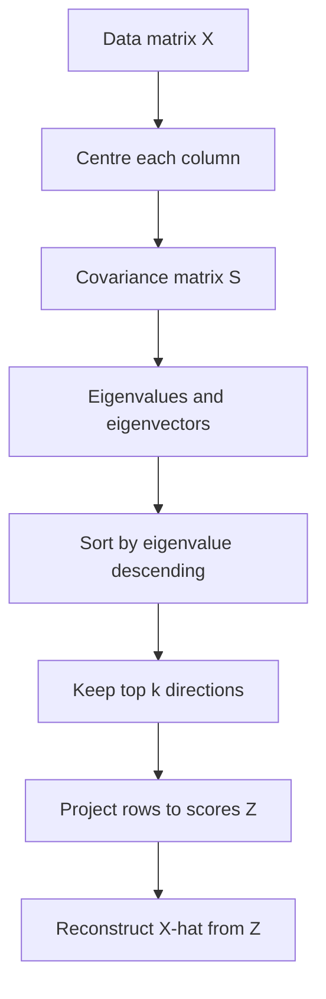
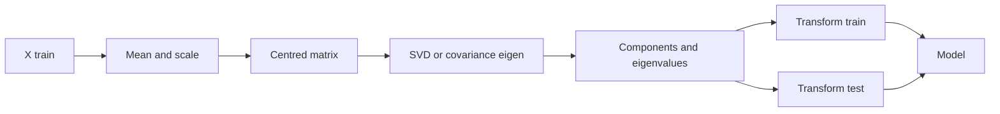
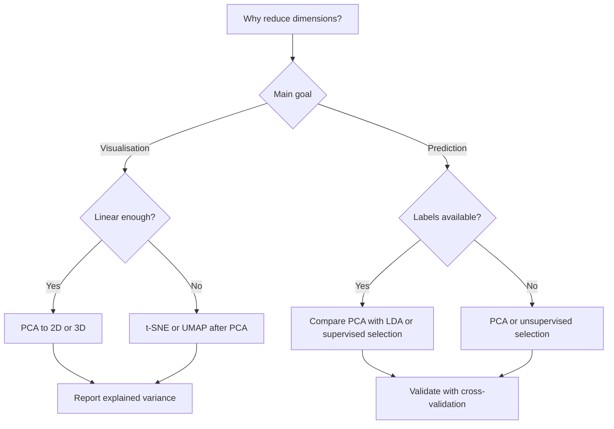
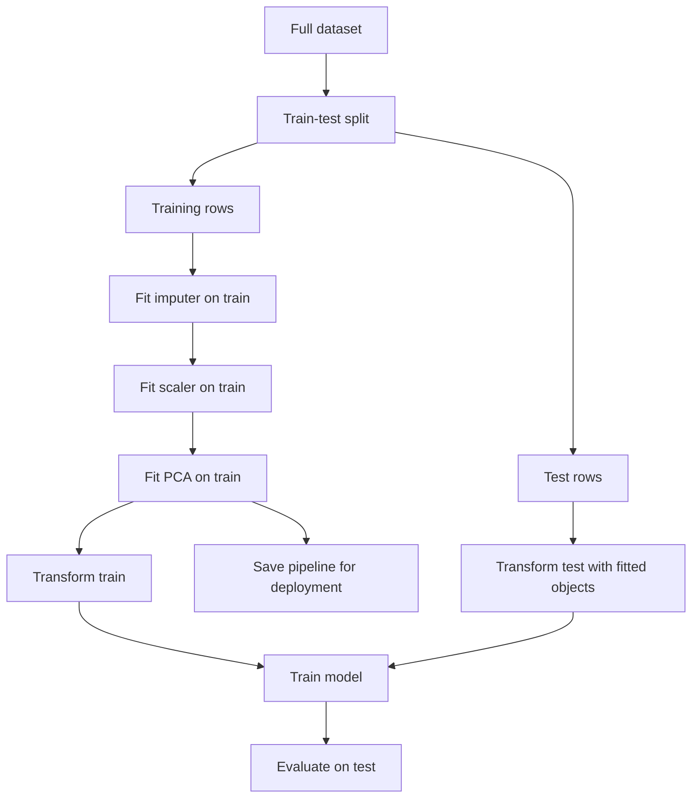

# Day 47 — Principal Component Analysis: Step by Step

> **Course:** CampusX — 100 Days of Machine Learning, Day 47
> **Official notebook:** `reference_notebooks/pca_step_by_step (1).ipynb` (13 code cells, copied byte-identically from `vendor/100-days-of-machine-learning/day47-pca/`)
> **Personal notebook:** none; this day is documentation-only
> **Dataset:** none on disk; the notebook generates a synthetic three-feature, two-class sample with NumPy
> **Transcript:** none available for Day 47
> **Central question:** When several measured features move together, can we replace them with a smaller set of new, uncorrelated directions that preserve most of the information — and what exactly do we lose when we do that?

### How this chapter is organised

The chapter starts with the problem PCA is meant to solve, builds the linear-algebra and statistical foundations, reproduces the official notebook number by number, derives PCA from two equivalent optimisation principles, and then moves into implementation, interpretation, comparisons, leakage, debugging, interview preparation, and examination practice. Every number attributed to the official notebook comes from its saved output. Numbers labelled **Rerun** were reproduced in this environment and agree with the saved output at the displayed precision unless a version difference is stated. Numbers labelled **Supplementary** are calculations or experiments added for teaching and are not claimed as course output.

**A source-fidelity warning that matters from the start.** The notebook's final two-dimensional projection uses `eigen_vectors[0:2]`. NumPy returns eigenvectors as **columns**, so this expression selects two **rows** of the eigenvector matrix. Those rows are orthonormal, but they are not the first two principal components. The notebook therefore plots a valid two-dimensional projection that is *not* the top-two PCA projection. This is documented in detail in §10, and both the notebook's numbers and the corrected numbers are reported. Do not silently "fix" the notebook; understand exactly what it did.

---

# 1. Learning objectives

After studying this chapter, I should be able to:

1. **Explain the problem.** Describe why high-dimensional data can be difficult to model, how correlated features duplicate information, and why a smaller representation can help visualisation, speed, stability, and noise reduction.
2. **Build the statistical objects.** Write the data matrix, mean vector, covariance matrix, and correlation matrix; explain every entry; distinguish population and sample conventions.
3. **Explain eigenvalues and eigenvectors.** Define them, interpret them geometrically, verify them numerically, and explain why a covariance matrix has a real orthonormal eigenbasis.
4. **Derive PCA.** Obtain the first principal component by maximising projected variance, extend the argument to later components, and prove the equivalence between variance maximisation and reconstruction-error minimisation.
5. **Connect PCA to SVD.** Show that the right singular vectors of the centred data matrix are the principal directions, and that squared singular values are proportional to eigenvalues.
6. **Read the notebook exactly.** Explain all 13 cells, reproduce the saved covariance matrix, eigenvalues, eigenvectors, and transformed rows, and identify the row-versus-column indexing error in the projection step.
7. **Interpret components.** Distinguish component directions, loadings, and scores; read explained-variance ratios; discuss sign ambiguity and rotation ambiguity.
8. **Choose the number of components.** Apply cumulative explained variance, the scree plot, the Kaiser heuristic, reconstruction error, and downstream cross-validation, and explain the limits of each.
9. **Implement correctly.** Use `StandardScaler`, `PCA`, `fit`, `transform`, `fit_transform`, and `inverse_transform`; place both preprocessing steps inside a `Pipeline`; avoid train/test and cross-validation leakage.
10. **Compare and critique.** Contrast PCA with feature selection, LDA, t-SNE, UMAP, factor analysis, autoencoders, and `TruncatedSVD`; state PCA's assumptions and failure modes.
11. **Answer interview and examination questions.** Give reasoned explanations, perform the numerical work, and discuss trade-offs rather than reciting definitions.

---

# 2. Big picture: where PCA sits in the machine-learning workflow

PCA is an **unsupervised linear feature transformation**. It does not predict a target, select original columns, or discover nonlinear structure. It learns a new coordinate system from the feature matrix and represents each row by a few coordinates in that system.

```mermaid
flowchart LR
    A[Raw data] --> B[Data understanding]
    B --> C[Cleaning and imputation]
    C --> D[Train-test split]
    D --> E[Fit scaler on train]
    E --> F[Fit PCA on train]
    F --> G[Transform train and test]
    G --> H[Train model]
    H --> I[Evaluate on test]
    I --> J[Deploy the full pipeline]
```



The geometry of PCA is a sequence of well-defined operations:



**Connection to previous days.**

- **Day 24 (standardisation)** changed each feature to zero mean and unit scale. PCA uses the same idea as an optional but often essential first step, because covariance-based PCA is scale-dependent.
- **Day 25 (normalisation)** mapped values to a fixed interval. That is not the same as standardisation and is not generally what PCA needs; PCA needs centring and, when units differ, scaling by standard deviation.
- **Day 29 (pipelines)** provides the mechanism that keeps scaler and PCA inside each cross-validation fold. PCA is unsupervised, but it still learns from data, so it can leak information if fitted before the split.
- **Day 45 (feature construction and splitting)** created new columns from existing ones using domain reasoning. PCA creates new columns using an unsupervised variance criterion. The new columns are linear combinations, not hand-designed features.
- **Day 48 and later (regression and classification)** will consume the transformed matrix. PCA can be placed before a model, but it is not automatically beneficial; it must be validated against the model and metric that matter.

**What PCA is not.**

- It is not feature selection: every component is usually a combination of all original features.
- It is not supervised: the target is not used when fitting the components.
- It is not nonlinear: it finds a linear subspace.
- It is not a guarantee of better prediction: discarding low-variance directions can discard exactly the signal a classifier needs.
- It is not a solution to missing values, categorical variables, or outliers by itself.

---

# 3. Prerequisites, explained rather than listed

## 3.1 The data matrix and notation

Suppose there are $n$ observations and $p$ numerical features. Arrange the features in a matrix

$$
X \in \mathbb{R}^{n\times p},
\qquad
X=
\begin{bmatrix}
x_{11} & x_{12} & \cdots & x_{1p}\\
x_{21} & x_{22} & \cdots & x_{2p}\\
\vdots & \vdots & \ddots & \vdots\\
x_{n1} & x_{n2} & \cdots & x_{np}
\end{bmatrix}.
$$

Row $i$ is one observation, written as the row vector $x_i^\top\in\mathbb{R}^p$. Column $j$ is one feature, written as $x_{\cdot j}\in\mathbb{R}^n$. The entry $x_{ij}$ is the value of feature $j$ for observation $i$. In the Day 47 notebook, $n=40$ and $p=3$; the target column is kept separately and is not part of $X$ during PCA fitting.

A **linear combination** of the features uses a weight vector $w=(w_1,\dots,w_p)^\top$:

$$
z_i = w^\top x_i = w_1x_{i1}+w_2x_{i2}+\cdots+w_px_{ip}.
$$

The scalar $z_i$ is the coordinate of observation $i$ along the direction $w$. If $\lVert w\rVert_2=1$, then $z_i$ is the signed length of the projection of $x_i$ onto the line spanned by $w$.

## 3.2 Mean, variance, covariance, and correlation

For a single feature with values $x_1,\dots,x_n$, the sample mean is

$$
\bar{x}=\frac{1}{n}\sum_{i=1}^{n}x_i.
$$

The **population-style variance** divides by $n$:

$$
\sigma^2=\frac{1}{n}\sum_{i=1}^{n}(x_i-\bar{x})^2.
$$

The **unbiased sample variance** divides by $n-1$:

$$
s^2=\frac{1}{n-1}\sum_{i=1}^{n}(x_i-\bar{x})^2.
$$

The difference matters throughout this day. `StandardScaler` uses the population standard deviation (divisor $n$), while `np.cov` uses the sample covariance (divisor $n-1$). That is why the covariance matrix of the standardised notebook data has diagonal entries $40/39$, not $1$.

For two features $x$ and $y$, the sample covariance is

$$
s_{xy}=\frac{1}{n-1}\sum_{i=1}^{n}(x_i-\bar{x})(y_i-\bar{y}).
$$

- If $s_{xy}>0$, the features tend to be above their means together and below their means together.
- If $s_{xy}<0$, one tends to be above its mean when the other is below.
- If $s_{xy}\approx0$, there is no **linear** co-movement, though a nonlinear relationship can still exist.

Covariance depends on the units of $x$ and $y$. The **correlation** removes the units:

$$
r_{xy}=\frac{s_{xy}}{s_x s_y},
\qquad -1\le r_{xy}\le 1.
$$

Correlation is covariance after each feature is divided by its own standard deviation. This is why "PCA on the correlation matrix" is the same as "standardise each feature, then run PCA on the covariance matrix" up to a constant factor.

## 3.3 Vectors, dot products, norms, and orthogonality

The dot product of two vectors is

$$
a^\top b=\sum_{j=1}^{p}a_jb_j.
$$

The Euclidean norm is

$$
\lVert a\rVert_2=\sqrt{a^\top a}.
$$

Two vectors are **orthogonal** when $a^\top b=0$. A set of vectors is **orthonormal** when every pair is orthogonal and every vector has unit norm. If $V$ is a matrix whose columns are orthonormal, then

$$
V^\top V=I,
\qquad
V^\top=V^{-1}.
$$

Such a matrix is called **orthogonal**. Orthogonal transformations preserve lengths and angles: $\lVert V a\rVert_2=\lVert a\rVert_2$. PCA uses an orthogonal rotation of the coordinate system; it does not stretch or shear the data cloud.

The projection of a vector $x$ onto the direction $w$ (with $\lVert w\rVert_2=1$) is the scalar $w^\top x$; the projected vector is $(w^\top x)w$. Projecting onto several orthonormal directions at once gives coordinates

$$
z = V_k^\top x,
$$

where the columns of $V_k$ are the chosen directions. In matrix form for all rows, $Z=X V_k$ if $X$ stores observations as rows.

## 3.4 Symmetric matrices, eigenvalues, and eigenvectors

A square matrix $S$ is **symmetric** when $S^\top=S$. The covariance matrix is always symmetric because $s_{jk}=s_{kj}$.

A nonzero vector $v$ is an **eigenvector** of $S$ with **eigenvalue** $\lambda$ when

$$
S v=\lambda v.
$$

The eigenvector is a direction that the matrix does not rotate; the eigenvalue is the factor by which that direction is stretched. Rearranging,

$$
(S-\lambda I)v=0.
$$

A nonzero solution exists only when the matrix $S-\lambda I$ is singular:

$$
\det(S-\lambda I)=0.
$$

This is the **characteristic equation**. For a $p\times p$ matrix it is a polynomial of degree $p$ in $\lambda$, so there are $p$ eigenvalues counted with multiplicity.

For a real symmetric matrix:

1. All eigenvalues are real.
2. Eigenvectors belonging to distinct eigenvalues are orthogonal.
3. There exists an orthonormal basis of eigenvectors, so $S=V\Lambda V^\top$ with $V^\top V=I$ and $\Lambda=\operatorname{diag}(\lambda_1,\dots,\lambda_p)$.
4. If $S$ is a covariance matrix, it is positive semidefinite, so every $\lambda_j\ge0$.

The **trace** is the sum of the diagonal entries and also the sum of the eigenvalues:

$$
\operatorname{tr}(S)=\sum_{j=1}^{p}s_{jj}=\sum_{j=1}^{p}\lambda_j.
$$

The **determinant** is the product of the eigenvalues:

$$
\det(S)=\prod_{j=1}^{p}\lambda_j.
$$

These two identities are quick numerical checks. If a computed set of eigenvalues does not sum to the trace, something is wrong.

## 3.5 Standardisation

For a feature $x$, the standardised value is

$$
z=\frac{x-\bar{x}}{s},
$$

where $\bar{x}$ is the mean and $s$ is a standard deviation. `StandardScaler` uses the population standard deviation by default. After transformation, each column has mean zero and population variance one. The sample variance is then $n/(n-1)$, not exactly one, because the sample variance uses $n-1$.

Standardisation is **affine**: it shifts and scales. It does not change the shape of a distribution, the skewness, or the ordering of values. It changes the units and prevents a feature measured in large numbers from dominating a covariance or distance calculation.

## 3.6 Variance of a linear combination

This is the key identity behind PCA. Let $x$ be a centred random vector with covariance matrix $S$. For a fixed weight vector $w$, the linear combination $w^\top x$ has variance

$$
\operatorname{Var}(w^\top x)=w^\top S w.
$$

For a sample matrix $X_c$ whose rows are centred observations,

$$
\operatorname{Var}_{\text{sample}}(X_c w)
=\frac{1}{n-1}(X_c w)^\top(X_c w)
=w^\top\left(\frac{1}{n-1}X_c^\top X_c\right)w
=w^\top S w.
$$

So maximising the variance of the projected data is the same as maximising the quadratic form $w^\top S w$. The constraint $\lVert w\rVert_2=1$ prevents the trivial escape of making $w$ arbitrarily large.

## 3.7 Singular value decomposition in one paragraph

Any real matrix $X_c$ of shape $n\times p$ can be written as

$$
X_c=U\Sigma V^\top,
$$

where $U$ has orthonormal columns, $V$ has orthonormal columns, and $\Sigma$ is diagonal with nonnegative **singular values** $\sigma_1\ge\sigma_2\ge\cdots\ge0$. The columns of $V$ are the right singular vectors. For centred data, they are exactly the principal directions, and

$$
S=\frac{1}{n-1}X_c^\top X_c
=V\frac{\Sigma^2}{n-1}V^\top.
$$

Thus the eigenvalues of $S$ are $\lambda_j=\sigma_j^2/(n-1)$. This connection is developed fully in §13; it is also how Scikit-learn computes PCA in practice.

## 3.8 Train/test separation and leakage

The test set simulates future, unseen data. Anything learned from it — a mean, a standard deviation, a covariance matrix, an eigenvector, a chosen number of components — contaminates an evaluation. This is **data leakage**. PCA is unsupervised, but it is not exempt: the covariance matrix is estimated from data. Fit the scaler and PCA on the training portion only, then apply the same fitted objects to the test portion.

---

# 4. The problem: dimensionality, redundancy, and distance

## 4.1 The curse of dimensionality

As the number of features grows, several things happen at once:

1. **The volume grows exponentially.** A grid with 10 values per axis has $10^p$ cells. With $p=10$ that is ten billion cells; with $p=20$ it is $10^{20}$. A fixed sample becomes sparse.
2. **Distances concentrate.** In high dimensions, the distance from a point to its nearest neighbour and to its farthest neighbour become similar in relative terms, so "nearest" becomes less meaningful.
3. **Models have more parameters to estimate.** More features mean more coefficients, more split candidates, and more opportunities to fit noise.
4. **Correlated features duplicate information.** If two columns carry almost the same signal, the model pays for both but gains little.
5. **Visualisation becomes impossible.** Humans cannot inspect a 100-dimensional scatter plot.

A useful mathematical illustration is the squared Euclidean norm of a random point uniformly distributed in the unit cube $[0,1]^p$. Each coordinate $X_j$ has

$$
\mathbb{E}[X_j^2]=\frac13,
\qquad
\operatorname{Var}(X_j^2)=\frac15-\frac19=\frac{4}{45}.
$$

Therefore

$$
\mathbb{E}\left[\sum_{j=1}^{p}X_j^2\right]=\frac{p}{3},
\qquad
\operatorname{Var}\left(\sum_{j=1}^{p}X_j^2\right)=\frac{4p}{45}.
$$

The coefficient of variation of the squared norm is

$$
\frac{\sqrt{4p/45}}{p/3}=\frac{2}{\sqrt{5p}},
$$

and the coefficient of variation of the distance itself is approximately half of that, $1/\sqrt{5p}$. The relative spread shrinks as $p$ grows even though the absolute distances grow.

| Dimensions $p$ | Mean squared norm $p/3$ | CV of squared norm $2/\sqrt{5p}$ | Approximate CV of distance |
|---:|---:|---:|---:|
| 2 | 0.667 | 0.632 | 0.316 |
| 10 | 3.333 | 0.283 | 0.141 |
| 100 | 33.333 | 0.089 | 0.045 |
| 1000 | 333.333 | 0.028 | 0.014 |

This is a mathematical illustration, not a course output. It explains why distance-based intuition from two or three dimensions does not transfer unchanged to high dimensions.

## 4.2 Correlated features and redundancy

Suppose two features are almost perfectly correlated. Their covariance is large and positive, and the covariance matrix is nearly singular: one eigenvalue is large, one is near zero. The near-zero direction contains little independent variation. PCA can drop it with little reconstruction loss.

In the notebook data, the three features are generated independently **within each class**, but the mixture of two classes with different means induces positive covariance between features. The covariance matrix is not diagonal, so the features are correlated in the combined sample. PCA rotates the cloud to a basis in which the sample covariance is diagonal. That does not mean the original features were "wrong"; it means the new coordinates are uncorrelated by construction.

## 4.3 What dimensionality reduction buys and costs

**Benefits.**

- Fewer dimensions can reduce variance and overfitting when the discarded directions are mostly noise.
- Storage and computation can be reduced.
- Multicollinearity can be removed because principal components are uncorrelated.
- Visualisation in two or three dimensions becomes possible.
- Noise can be reduced by reconstructing from a low-rank approximation.

**Costs.**

- Discarding directions discards information; the discarded directions may be exactly the ones a supervised model needs.
- Components are linear combinations, so they are usually harder to interpret than original features.
- The transformation is learned from data and can leak if fitted on the full dataset.
- The method is linear; it cannot unfold a curved manifold.
- The variance criterion is unsupervised; high variance is not the same as predictive value.
- Results depend on scaling, outliers, and the number of components chosen.

## 4.4 The synthetic dataset as a controlled example

The notebook generates two Gaussian clouds:

- Class label $1$: mean $(0,0,0)$, covariance $I_3$.
- Class label $0$: mean $(1,1,1)$, covariance $I_3$.

Each class has 20 observations, so $n=40$. Within each class the features are independent and have equal variance. Across the combined sample, the difference in class means creates positive covariance: observations with large feature 1 also tend to have large feature 2 and feature 3, because they are more likely to come from class 0.

This is a favourable but still imperfect example for PCA:

- The class-mean difference points along $(1,1,1)$.
- The first principal component is close to that direction, so it separates the classes reasonably well.
- The clouds still overlap because each class has unit covariance and the mean separation is only $\sqrt{3}\approx1.732$ in three dimensions.
- PCA never sees the labels; the separation is a property of the data geometry, not something PCA optimised.

The notebook does **not** split the data, train a classifier, or report accuracy. It is a geometry demonstration, not a supervised learning experiment.

---

# 5. The dataset and the exact reproduction

## 5.1 Cell 1: imports, generation, concatenation, and permutation

The first cell contains the entire data-generation pipeline:

```python
import numpy as np
import pandas as pd

np.random.seed(23)

mu_vec1 = np.array([0, 0, 0])
cov_mat1 = np.array([[1, 0, 0], [0, 1, 0], [0, 0, 1]])
class1_sample = np.random.multivariate_normal(mu_vec1, cov_mat1, 20)

df = pd.DataFrame(class1_sample, columns=['feature1', 'feature2', 'feature3'])
df['target'] = 1

mu_vec2 = np.array([1, 1, 1])
cov_mat2 = np.array([[1, 0, 0], [0, 1, 0], [0, 0, 1]])
class2_sample = np.random.multivariate_normal(mu_vec2, cov_mat2, 20)

df1 = pd.DataFrame(class2_sample, columns=['feature1', 'feature2', 'feature3'])
df1['target'] = 0

df = df.append(df1, ignore_index=True)
df = df.sample(40)
```

**What each line does.**

- `np.random.seed(23)` fixes the pseudo-random sequence. The same seed and the same NumPy algorithm produce the same normal draws. This is why the saved notebook outputs can be reproduced.
- `np.random.multivariate_normal(mean, covariance, 20)` draws 20 rows from a three-dimensional normal distribution. With covariance $I_3$, the three coordinates are independent standard normals shifted by the mean.
- The first data frame is labelled `target = 1`; the second is labelled `target = 0`. Notice the counter-intuitive assignment: the cloud centred at the origin is class 1, and the cloud centred at $(1,1,1)$ is class 0.
- `df.append(df1, ignore_index=True)` stacks the two data frames and renumbers the rows. `DataFrame.append` was deprecated in pandas 1.4 and removed in pandas 2.0. In a modern environment the equivalent is `pd.concat([df, df1], ignore_index=True)`.
- `df.sample(40)` draws 40 rows without replacement. Since there are exactly 40 rows, it returns **all rows in a random order**. It is a permutation, not a bootstrap and not a train/test split. The index is shuffled; the saved head begins with original indices 2, 34, 14, 11, 12.

**A reproducibility detail.** `df.sample(40)` has no `random_state`. In the saved run it consumed the NumPy global random state after the normal draws, so the permutation was deterministic for that environment. It is not guaranteed across pandas versions. For reproducible teaching code, write `df.sample(40, random_state=23)` or omit the shuffle entirely; the set of rows is unchanged either way.

## 5.2 Cell 2: the saved head

The saved output of `df.head()` is:

|  | feature1 | feature2 | feature3 | target |
|---:|---:|---:|---:|---:|
| 2 | -0.367548 | -1.137460 | -1.322148 | 1 |
| 34 | 0.177061 | -0.598109 | 1.226512 | 0 |
| 14 | 0.420623 | 0.411620 | -0.071324 | 1 |
| 11 | 1.968435 | -0.547788 | -0.679418 | 1 |
| 12 | -2.506230 | 0.146960 | 0.606195 | 1 |

The first row has original index 2 because of the shuffle. Its target is 1, so it belongs to the cloud centred at the origin. The row values are plausible draws from that cloud.

**Rerun.** In this environment, using `pd.concat` in place of `append` and the same seed, the same first five rows and the same covariance and eigen quantities were reproduced exactly at the displayed precision.

## 5.3 Raw summary statistics

Before standardisation, the 40-row sample has:

| Quantity | feature1 | feature2 | feature3 |
|---|---:|---:|---:|
| Mean | 0.433721 | 0.460790 | 0.667670 |
| Sample standard deviation | 1.157915 | 1.060976 | 1.152079 |
| Class 1 mean (target = 1) | 0.136180 | -0.087280 | 0.005184 |
| Class 0 mean (target = 0) | 0.731263 | 1.008860 | 1.330157 |

The class means are not exactly $(0,0,0)$ and $(1,1,1)$ because each class has only 20 draws. The difference between the class means is approximately

$$
(0.136180-0.731263,\ -0.087280-1.008860,\ 0.005184-1.330157)
=(-0.595083,\ -1.096140,\ -1.324973).
$$

After standardisation this difference becomes approximately $(-0.520474,-1.046305,-1.164722)$, with length $1.649917$. The theoretical separation of the population means is $\sqrt{3}=1.732051$; the sample is a bit closer because of sampling variation.

The raw sample covariance matrix is

$$
S_{\text{raw}}=
\begin{bmatrix}
1.340767 & 0.245288 & 0.104206\\
0.245288 & 1.125670 & 0.236434\\
0.104206 & 0.236434 & 1.327287
\end{bmatrix}.
$$

All three variances are near 1.1–1.3, so in this particular dataset standardisation does not dramatically change the PCA solution. That is a property of the synthetic data, not a general rule.

## 5.4 What this dataset can and cannot demonstrate

**It can demonstrate:**

- how a covariance matrix is computed;
- how eigenvalues and eigenvectors are extracted;
- how a linear projection is formed;
- how explained variance is calculated;
- how a two-dimensional visualisation is produced;
- the difference between an unsupervised transformation and a labelled plot.

**It cannot demonstrate:**

- generalisation to unseen data, because there is no train/test split;
- classification accuracy, because there is no model;
- the effect of feature units, because all features are on comparable synthetic scales;
- robustness to outliers, missing values, or categorical variables;
- that PCA improves a real predictive task.

Those questions require a separate, properly validated experiment.

---

# 6. Standardisation: cell 4

## 6.1 The code and what it changes

```python
from sklearn.preprocessing import StandardScaler
scaler = StandardScaler()

df.iloc[:, 0:3] = scaler.fit_transform(df.iloc[:, 0:3])
```

`StandardScaler()` creates a transformer object with no learned state yet. `fit_transform` does two things in one call:

1. `fit` computes the mean and population standard deviation of each of the three feature columns.
2. `transform` subtracts the corresponding mean and divides by the corresponding standard deviation.

The result is assigned back into the first three columns of `df`. The `target` column is untouched. After this cell, `df` contains standardised features and integer labels.

## 6.2 Exact learned statistics

The fitted scaler stores:

| Feature | Mean $\bar{x}_j$ | Population standard deviation $s_j$ |
|---|---:|---:|
| feature1 | 0.43372142 | 1.14334953 |
| feature2 | 0.46078965 | 1.04762963 |
| feature3 | 0.66767044 | 1.13758728 |

The raw sample standard deviations were slightly larger: 1.157915, 1.060976, and 1.152079. The ratio is

$$
\frac{s_{\text{sample}}}{s_{\text{population}}}
=\sqrt{\frac{n}{n-1}}
=\sqrt{\frac{40}{39}}
\approx1.012739.
$$

For example, $1.14334953\times1.012739\approx1.157915$.

## 6.3 The standardised head

After standardisation, the first five rows become:

|  | feature1 | feature2 | feature3 | target |
|---:|---:|---:|---:|---:|
| 2 | -0.700809 | -1.525586 | -1.749156 | 1 |
| 34 | -0.224481 | -1.010757 | 0.491251 | 0 |
| 14 | -0.011456 | -0.046935 | -0.649616 | 1 |
| 11 | 1.342296 | -0.962723 | -1.184163 | 1 |
| 12 | -2.571350 | -0.299561 | -0.054040 | 1 |

Check the first value manually:

$$
\frac{-0.367548-0.43372142}{1.14334953}
=\frac{-0.80126942}{1.14334953}
\approx-0.700809.
$$

The other entries follow the same formula.

## 6.4 Why centring is required

PCA looks for directions of maximum variance. Variance is defined around the mean. If the data are not centred, a direction pointing toward the mean can have a large raw second moment without describing variation. Centring removes the location and makes the origin the centre of the cloud.

The covariance matrix automatically centres: its entries use $x_i-\bar{x}$. If you compute PCA from a covariance matrix, the centring is implicit. If you project raw, uncentred rows onto eigenvectors, the scores have a nonzero mean and the variance decomposition no longer matches the eigenvalues. In the notebook, the scaler centres the data before the covariance is computed, so both the covariance step and the projection step operate on centred data.

## 6.5 Why scaling is often required

Covariance is unit-dependent. If feature 1 is measured in metres and feature 2 in millimetres, feature 2's numerical values are 1000 times larger, and its variance can dominate the first principal component purely because of the unit choice. Standardising each feature to unit variance prevents this.

Scaling is not always desirable. If all features are measured in the same meaningful unit and their variances reflect real importance, covariance PCA may be more appropriate. The decision is a modelling choice, not a law. In the notebook all three features are synthetic and comparable, so the choice has only a modest effect: raw explained-variance ratios are approximately $(0.4368,0.3241,0.2391)$, while standardised ratios are $(0.4399,0.3073,0.2528)$.

## 6.6 Why the covariance diagonal is $40/39$, not 1

After `StandardScaler`, each feature has population variance exactly 1. But `np.cov` estimates the sample covariance with divisor $n-1=39$. For a standardised feature,

$$
s^2=\frac{1}{n-1}\sum_{i=1}^{n}z_i^2
=\frac{n}{n-1}\cdot\frac{1}{n}\sum_{i=1}^{n}z_i^2
=\frac{40}{39}\cdot1
=1.02564103.
$$

That is exactly the diagonal entry in the notebook's covariance matrix. The off-diagonal entries are also scaled by $40/39$ relative to the correlation matrix. This is a common source of confusion: "standardised" does not mean "sample covariance exactly identity"; it means "population variance one".

## 6.7 Leakage warning

In a real supervised workflow, the scaler must be fitted on `X_train` only:

```python
scaler = StandardScaler()
X_train_scaled = scaler.fit_transform(X_train)
X_test_scaled = scaler.transform(X_test)
```

Calling `fit_transform` on the full dataset before splitting lets the test set influence the means and standard deviations. The notebook has no train/test split, so this is a demonstration, not a leakage-free evaluation. The correct production pattern is a `Pipeline`, shown in §22.

---

# 7. The covariance matrix: cell 5

## 7.1 Definition and the notebook code

For a centred data matrix $X_c$ with $n$ rows and $p$ columns, the sample covariance matrix is

$$
S=\frac{1}{n-1}X_c^\top X_c.
$$

Its entry in row $j$, column $k$ is the sample covariance of features $j$ and $k$:

$$
s_{jk}=\frac{1}{n-1}\sum_{i=1}^{n}(x_{ij}-\bar{x}_j)(x_{ik}-\bar{x}_k).
$$

The diagonal entry $s_{jj}$ is the sample variance of feature $j$. The matrix is symmetric: $s_{jk}=s_{kj}$.

The notebook computes it with:

```python
covariance_matrix = np.cov([df.iloc[:, 0], df.iloc[:, 1], df.iloc[:, 2]])
print('Covariance Matrix:\n', covariance_matrix)
```

`np.cov` treats each argument as a variable. With `rowvar=True` (the default), each row of the input is a variable and each column is an observation. Here each `df.iloc[:, j]` is a length-40 Series, so the result is $3\times3$. If you pass a data frame directly, `np.cov` also treats columns as variables by default.

## 7.2 The exact matrix

The saved output is:

$$
S=
\begin{bmatrix}
1.02564103 & 0.20478114 & 0.08011800\\
0.20478114 & 1.02564103 & 0.19838882\\
0.08011800 & 0.19838882 & 1.02564103
\end{bmatrix}.
$$

**Reading the entries.**

- The diagonal is the sample variance of each standardised feature: $40/39=1.02564103$.
- $s_{12}=0.20478114$: features 1 and 2 have positive covariance.
- $s_{13}=0.08011800$: features 1 and 3 have weaker positive covariance.
- $s_{23}=0.19838882$: features 2 and 3 have positive covariance.

The covariance matrix is symmetric, as it must be. The positive off-diagonal entries are induced by the mixture of the two class clouds, not by within-class dependence.

## 7.3 The correlation matrix

Because all three standardised features have the same sample variance $40/39$, the covariance matrix is a scalar multiple of the correlation matrix:

$$
S=\frac{40}{39}R,
\qquad
R=
\begin{bmatrix}
1 & 0.19966161 & 0.07811505\\
0.19966161 & 1 & 0.19342910\\
0.07811505 & 0.19342910 & 1
\end{bmatrix}.
$$

Check one entry:

$$
\frac{0.20478114}{40/39}=0.20478114\times0.975=0.19966161.
$$

In general, if the features have different sample variances, $S$ and $R$ are not scalar multiples. Standardising first makes the diagonal equal and turns covariance PCA into correlation PCA up to the constant $n/(n-1)$.

## 7.4 Properties of a covariance matrix

1. **Symmetric:** $S^\top=S$.
2. **Positive semidefinite:** for any vector $a$, $a^\top S a\ge0$. This is the variance of the linear combination $a^\top x$, which cannot be negative.
3. **Real nonnegative eigenvalues:** a consequence of symmetry and positive semidefiniteness.
4. **Trace equals total variance:** $\operatorname{tr}(S)=\sum_j s_{jj}=\sum_j\lambda_j$.
5. **Determinant equals the product of eigenvalues:** $\det(S)=\prod_j\lambda_j$. A zero determinant means at least one eigenvalue is zero, which means the features are linearly dependent (or a feature is constant).
6. **Units:** entries have squared units of the features. This is why scale matters.

For the notebook matrix:

$$
\operatorname{tr}(S)=3\times1.02564103=3.07692308,
$$

which is the total variance of the three standardised features. The determinant is

$$
\det(S)=0.99546075,
$$

and the product of the three eigenvalues below is the same number. The pairwise eigenvalue sum is $3.06810621$, which is the coefficient of $\lambda$ in the characteristic polynomial.

## 7.5 A complete two-feature worked example

Take four observations:

$$
(1,2),\quad (2,1),\quad (3,4),\quad (4,3).
$$

The means are $\bar{x}=2.5$ and $\bar{y}=2.5$. The centred rows are

$$
(-1.5,-0.5),\quad(-0.5,-1.5),\quad(0.5,1.5),\quad(1.5,0.5).
$$

The sums of squares and cross-products are

$$
\sum x_c^2=5,\qquad
\sum y_c^2=5,\qquad
\sum x_cy_c=3.
$$

With $n-1=3$,

$$
S=
\begin{bmatrix}
5/3 & 3/3\\
3/3 & 5/3
\end{bmatrix}
=
\begin{bmatrix}
1.6667 & 1.0000\\
1.0000 & 1.6667
\end{bmatrix}.
$$

The characteristic equation is

$$
\det\begin{bmatrix}
1.6667-\lambda & 1\\
1 & 1.6667-\lambda
\end{bmatrix}=0,
$$

so

$$
(1.6667-\lambda)^2-1=0
\quad\Longrightarrow\quad
1.6667-\lambda=\pm1.
$$

The eigenvalues are $\lambda_1=2.6667$ and $\lambda_2=0.6667$. The corresponding unit eigenvectors are

$$
v_1=\frac{1}{\sqrt2}\begin{bmatrix}1\\1\end{bmatrix},
\qquad
v_2=\frac{1}{\sqrt2}\begin{bmatrix}-1\\1\end{bmatrix}.
$$

The first component explains

$$
\frac{2.6667}{2.6667+0.6667}=\frac{2.6667}{3.3333}=0.8=80\%
$$

of the total variance; the second explains 20%. The scores are

$$
Z=X_cV=
\begin{bmatrix}
-1.4142 & 0.7071\\
-1.4142 & -0.7071\\
1.4142 & 0.7071\\
1.4142 & -0.7071
\end{bmatrix}.
$$

The first score is large in magnitude for points far along the diagonal; the second captures the perpendicular offset. Reconstructing with only the first component gives $(1.5,1.5),(1.5,1.5),(3.5,3.5),(3.5,3.5)$, and the residual sum of squares is $(n-1)\lambda_2=3\times0.6667=2.0$. This small example contains the entire logic of PCA.

## 7.6 Covariance or correlation?

| Situation | Better default | Reason |
|---|---|---|
| Features have different units or wildly different scales | Correlation (standardise first) | Prevents large-unit features from dominating |
| Features share a meaningful common unit and variance reflects importance | Covariance | Preserves the intended weighting |
| You want each feature to have equal initial influence | Correlation | Each standardised feature has unit population variance |
| A low-variance feature is known to be important | Covariance, or domain-weighted scaling | Correlation may amplify noise in that feature |
| You need comparability with common software defaults | Correlation is often the textbook default | Many PCA descriptions assume standardised variables |

There is no universal answer. The decision should be stated explicitly and validated.

---

# 8. Eigenvalues and eigenvectors: cells 6–8

## 8.1 The definitions again, with geometry

For the covariance matrix $S$, an eigenvector $v$ and eigenvalue $\lambda$ satisfy

$$
S v=\lambda v.
$$

Geometrically, $S$ maps the direction $v$ to a scaled copy of itself. The scale factor is $\lambda$. In PCA:

- $v$ is a **principal direction** (a unit vector in feature space).
- $\lambda$ is the **variance of the data along that direction**.
- The eigenvectors are orthogonal because $S$ is symmetric.
- Sorting eigenvalues from largest to smallest sorts the directions from most variance to least.

The characteristic polynomial for a $3\times3$ matrix is

$$
\det(S-\lambda I)
=-\lambda^3+\operatorname{tr}(S)\lambda^2
-\left(\sum_{j<k}\lambda_j\lambda_k\right)\lambda
+\det(S).
$$

For the notebook matrix, this becomes

$$
-\lambda^3+3.07692308\lambda^2-3.06810621\lambda+0.99546075=0,
$$

or, multiplying by $-1$,

$$
\lambda^3-3.07692308\lambda^2+3.06810621\lambda-0.99546075=0.
$$

The three roots are the eigenvalues reported by NumPy.

## 8.2 Why a covariance matrix has an orthonormal eigenbasis

The spectral theorem for real symmetric matrices guarantees:

- real eigenvalues;
- orthogonal eigenvectors for distinct eigenvalues;
- a complete orthonormal basis of eigenvectors.

If two eigenvalues are equal, the corresponding eigenspace has dimension greater than one, and any orthonormal basis of that eigenspace is a valid choice. This is the source of **rotation ambiguity** in degenerate cases.

For a covariance matrix, positive semidefiniteness gives $\lambda_j\ge0$. A zero eigenvalue means there is a direction with zero variance: the data are constant along that direction, which implies linear dependence among the features.

## 8.3 The notebook code and the saved output

```python
eigen_values, eigen_vectors = np.linalg.eig(covariance_matrix)
```

`np.linalg.eig` returns a 1D array of eigenvalues and a 2D array whose **columns** are the corresponding eigenvectors. The saved eigenvalues are:

$$
\lambda=
\begin{bmatrix}
1.35360650\\
0.94557084\\
0.77774573
\end{bmatrix}.
$$

The saved eigenvector matrix is:

$$
V=
\begin{bmatrix}
-0.53875915 & -0.69363291 & 0.47813384\\
-0.65608325 & -0.01057596 & -0.75461442\\
-0.52848211 & 0.72025103 & 0.44938304
\end{bmatrix}.
$$

Each **column** is an eigenvector:

$$
v_1=
\begin{bmatrix}
-0.53875915\\
-0.65608325\\
-0.52848211
\end{bmatrix},
\quad
v_2=
\begin{bmatrix}
-0.69363291\\
-0.01057596\\
0.72025103
\end{bmatrix},
\quad
v_3=
\begin{bmatrix}
0.47813384\\
-0.75461442\\
0.44938304
\end{bmatrix}.
$$

The columns have unit norm and are mutually orthogonal:

$$
v_1^\top v_2\approx-2.47\times10^{-16},
\qquad
v_1^\top v_3\approx0,
\qquad
v_2^\top v_3\approx0.
$$

The eigenvalues happen to be in descending order in the saved output, but `np.linalg.eig` does **not** guarantee sorted order. Always sort explicitly before selecting the top components.

## 8.4 Numerical verification

**Trace check.**

$$
\lambda_1+\lambda_2+\lambda_3
=1.35360650+0.94557084+0.77774573
=3.07692307,
$$

which equals $\operatorname{tr}(S)=3.07692308$ up to rounding.

**Determinant check.**

$$
\lambda_1\lambda_2\lambda_3
=0.99546075,
$$

which equals $\det(S)$.

**Pairwise sum check.**

$$
\lambda_1\lambda_2+\lambda_1\lambda_3+\lambda_2\lambda_3
=3.06810621,
$$

which matches the coefficient in the characteristic polynomial.

**Eigenvector check for $v_1$.**

$$
S v_1=
\begin{bmatrix}
-0.72926789\\
-0.88807855\\
-0.71535683
\end{bmatrix},
\qquad
\lambda_1 v_1=
\begin{bmatrix}
-0.72926789\\
-0.88807855\\
-0.71535683
\end{bmatrix}.
$$

The two sides agree. A similar check holds for $v_2$ and $v_3$.

**Diagonalisation check.**

$$
V\Lambda V^\top=S
$$

to numerical precision, where $\Lambda=\operatorname{diag}(\lambda_1,\lambda_2,\lambda_3)$. In this environment the maximum absolute reconstruction error of the covariance matrix was approximately $4.9\times10^{-16}$.

## 8.5 Interpreting the three directions

Because the features were standardised, the loadings are comparable in magnitude.

- $v_1=(-0.539,-0.656,-0.528)$ has all three entries negative and roughly equal. Multiplying by $-1$ gives $(0.539,0.656,0.528)$, a weighted average of the three features. This direction is close to $(1,1,1)/\sqrt3$, the direction of the class-mean difference. The sign is arbitrary; the direction is what matters.
- $v_2=(-0.694,-0.011,0.720)$ contrasts feature 1 with feature 3, with feature 2 nearly silent.
- $v_3=(0.478,-0.755,0.449)$ contrasts feature 2 with features 1 and 3.

The first component explains the largest share of total variance because the two class clouds are displaced along a direction close to $v_1$. This is a property of this synthetic dataset. In another dataset, the largest-variance direction may have nothing to do with the class labels.

The cosine between $v_1$ and the standardised class-mean difference is approximately $0.959$, corresponding to an angle of about $16.45^\circ$. Thus $v_1$ captures most, but not all, of the between-class separation. The second component has cosine approximately $-0.283$ with the mean difference. These are supplementary calculations, not notebook output.

## 8.6 `eig` versus `eigh`, sorting, and complex dtype

For a symmetric matrix, prefer `np.linalg.eigh`:

```python
eigen_values, eigen_vectors = np.linalg.eigh(covariance_matrix)
order = np.argsort(eigen_values)[::-1]
eigen_values = eigen_values[order]
eigen_vectors = eigen_vectors[:, order]
```

`eigh` exploits symmetry, returns real eigenvalues, and is generally more stable. It returns eigenvalues in ascending order, so the sort is still needed if you want descending order.

`np.linalg.eig` is a general solver. In NumPy 2.5.3 in this environment, it returned a complex dtype for this real matrix, with all imaginary parts equal to zero. Taking `.real` reproduces the saved real arrays. The saved Colab output shows a real dtype because it was produced by an older NumPy version. The numerical values agree. Do not let the dtype difference mislead you into thinking the eigenvalues are genuinely complex; a real symmetric matrix has real eigenvalues.

## 8.7 Sign ambiguity and rotation ambiguity

If $v$ is an eigenvector, then $-v$ is also an eigenvector with the same eigenvalue:

$$
S(-v)=-\lambda v=\lambda(-v).
$$

The sign carries no information. Different libraries, different runs, and different numerical paths may return opposite signs. Scikit-learn applies a deterministic sign convention (`svd_flip`) to make results reproducible within its own implementation, but that convention need not match NumPy's. In this notebook, Scikit-learn's first component is the negative of NumPy's $v_1$, while its second component matches $v_2$.

If an eigenvalue has multiplicity greater than one, the corresponding eigenspace is a plane (or higher-dimensional subspace), and any orthonormal basis of that subspace is valid. PCA is then not unique even up to sign: the individual components can rotate within the degenerate subspace. The subspace and the reconstruction are still well defined.

**Practical consequence.** Do not compare component signs or individual loadings across libraries without aligning them. Compare subspaces, absolute correlations, or reconstruction error. If you must compare signs, choose a convention such as "make the largest absolute loading positive" and apply it consistently.

## 8.8 What eigenvalues do and do not mean

An eigenvalue $\lambda_j$ is the sample variance of the scores along $v_j$. It is **not**:

- a p-value;
- a measure of statistical significance;
- a guarantee that the direction is useful for prediction;
- comparable across datasets with different scales or different numbers of features without normalisation;
- necessarily greater than 1, even for an "important" component.

The ratio $\lambda_j/\sum_k\lambda_k$ is the fraction of total variance explained by component $j$. It is a descriptive quantity, not a hypothesis test.

---

# 9. Principal components and explained variance

## 9.1 Directions, loadings, and scores

Three objects are easy to confuse:

1. **Component direction (eigenvector):** a unit vector $v_j\in\mathbb{R}^p$. It says which linear combination of features defines the component.
2. **Loading:** the weight of each original feature in that component. In these notes, the loading vector is the eigenvector itself; some texts instead report the correlation between the original feature and the component, or the eigenvector multiplied by $\sqrt{\lambda_j}$. Always state the convention.
3. **Score:** the coordinate of an observation in the new system, $z_{ij}=v_j^\top x_i$. Scores are what `fit_transform` returns and what is plotted.

For all observations, with $V_k$ containing the first $k$ eigenvectors as columns,

$$
Z_k=X_cV_k.
$$

$Z_k$ has shape $n\times k$. Row $i$ gives the coordinates of observation $i$ in the new $k$-dimensional space.

## 9.2 Why the scores are uncorrelated

The sample covariance of the scores is

$$
\frac{1}{n-1}Z_k^\top Z_k
=\frac{1}{n-1}V_k^\top X_c^\top X_c V_k
=V_k^\top S V_k.
$$

If the columns of $V_k$ are eigenvectors of $S$ with eigenvalues $\lambda_1,\dots,\lambda_k$, then

$$
V_k^\top S V_k
=\operatorname{diag}(\lambda_1,\dots,\lambda_k).
$$

Therefore:

- the sample covariance between any two distinct principal component scores is zero;
- the sample variance of component $j$ is $\lambda_j$;
- the components are ordered by variance if the eigenvalues are sorted.

This is the precise meaning of "PCA produces uncorrelated features". It is a linear, sample-level statement, not a claim that the original features are independent or that the components are causally meaningful.

## 9.3 Explained variance ratio

The total variance is

$$
\sum_{j=1}^{p}\lambda_j=\operatorname{tr}(S).
$$

The proportion of variance explained by component $j$ is

$$
r_j=\frac{\lambda_j}{\sum_{k=1}^{p}\lambda_k}.
$$

The cumulative proportion for the first $k$ components is

$$
R_k=\sum_{j=1}^{k}r_j
=\frac{\sum_{j=1}^{k}\lambda_j}{\sum_{j=1}^{p}\lambda_j}.
$$

For the notebook:

| Component | Eigenvalue $\lambda_j$ | Explained ratio $r_j$ | Cumulative $R_k$ |
|---:|---:|---:|---:|
| PC1 | 1.35360650 | 0.43992211 | 0.43992211 |
| PC2 | 0.94557084 | 0.30731052 | 0.74723264 |
| PC3 | 0.77774573 | 0.25276736 | 1.00000000 |

So:

- PC1 alone explains about **43.99%** of the total variance.
- PC1 and PC2 together explain about **74.72%**.
- All three components explain **100%** by construction.

The discarded variance when keeping two components is

$$
\lambda_3=0.77774573,
$$

which is **25.28%** of the total. Keeping two components is a real compression, not a lossless rotation.

## 9.4 What "explains 43.99% of variance" means

It means that the sample variance of the PC1 scores is 43.99% of the sum of the sample variances of the three standardised features. It does **not** mean:

- 43.99% of the information in a semantic sense;
- 43.99% of the predictive signal;
- 43.99% accuracy;
- that 56.01% of the data is "noise";
- that PC1 is the most important feature for a classifier.

Variance is a particular scalar summary. A low-variance direction can be highly discriminative. A high-variance direction can be dominated by an irrelevant nuisance factor. This is why PCA must be evaluated against the downstream task, not only against explained variance.

## 9.5 Choosing the number of components

There is no universal rule. Common approaches:

1. **Cumulative variance threshold.** Keep enough components to reach a chosen proportion, such as 80%, 90%, or 95%. The threshold is a modelling choice.
2. **Scree plot.** Plot eigenvalues or explained variance against component number and look for an "elbow" where the curve flattens. The elbow is often ambiguous.
3. **Kaiser rule.** On standardised data, keep components with eigenvalue greater than 1. This is a heuristic, not a test; it is not meaningful on unstandardised covariance matrices with arbitrary units.
4. **Reconstruction error.** Choose $k$ so that the retained reconstruction error is acceptable for the application.
5. **Downstream cross-validation.** Choose $k$ by the metric that matters for the model, using only training folds. This is the most defensible approach for prediction.
6. **Parallel analysis.** Compare observed eigenvalues with eigenvalues from random data of the same shape. This is more principled than Kaiser but still a heuristic.
7. **Domain interpretability.** A component may be worth keeping because it is interpretable and actionable, even if it explains little variance.

For the notebook data:

| Criterion | Result |
|---|---|
| 70% cumulative variance | 2 components (74.72% with 2; 43.99% with 1) |
| 80% cumulative variance | 3 components |
| 90% cumulative variance | 3 components |
| 95% cumulative variance | 3 components |
| Kaiser, eigenvalue > 1 | 1 component (only 1.3536 > 1) |
| Two-dimensional visualisation | 2 components, by choice |
| Downstream predictive metric | Must be determined by validation, not by these eigenvalues |

The disagreement between "Kaiser says 1" and "80% says 3" is normal. The rules answer different questions. For a visualisation, two components are chosen because the plot is two-dimensional, not because two is statistically optimal.

## 9.6 Component order and sign

The eigenvalues should be sorted in descending order before the components are interpreted. In the saved output they happen to be descending, but relying on that is unsafe. The sign of each component is arbitrary. If a component's loadings are all negative and you prefer a positive average, multiply the whole component by $-1$; the scores also change sign, and the reconstruction is unchanged.

The **order** of components is meaningful when eigenvalues are distinct: PC1 has the largest variance, PC2 the next, and so on. When eigenvalues are equal, the order within the tied group is arbitrary, and the individual directions can rotate.

## 9.7 PCA on covariance versus correlation in this notebook

Because the standardised features all have sample variance $40/39$, the covariance matrix is $(40/39)R$. Therefore:

- the eigenvectors of $S$ and $R$ are identical;
- the eigenvalues satisfy $\lambda_j(S)=(40/39)\lambda_j(R)$;
- the explained-variance ratios are identical.

The correlation eigenvalues are

$$
(1.31976634,\ 0.92193157,\ 0.75830209),
$$

which sum to 3. Multiplying by $40/39$ gives the covariance eigenvalues. This exact proportionality is a consequence of equal sample variances after standardisation; it is not a general identity for arbitrary covariance and correlation matrices.

## 9.8 A note on "loadings" terminology

Different texts use "loading" differently:

- **Eigenvector convention:** loading = unit eigenvector. This is what Scikit-learn stores in `components_`.
- **Scaled loading convention:** loading = eigenvector multiplied by $\sqrt{\lambda_j}$, so the squared loading sums to the eigenvalue.
- **Correlation convention:** loading = correlation between the original feature and the component score.

None is wrong, but mixing them causes confusion. In this chapter, "component direction" and "eigenvector" mean the unit vector; "score" means the projected coordinate. When interpreting a table of loadings, check which convention produced it.

---

# 10. Projection and the notebook's row-versus-column bug

## 10.1 The projection formula

After centring (and, in the notebook, standardising), the coordinates of the data in the new basis are

$$
Z=X_cV_k,
$$

where:

- $X_c$ has shape $n\times p$;
- $V_k$ has shape $p\times k$, with the first $k$ unit eigenvectors as **columns**;
- $Z$ has shape $n\times k$.

For one row $x_i^\top$,

$$
z_i^\top=x_i^\top V_k
=\left(v_1^\top x_i,\ \dots,\ v_k^\top x_i\right).
$$

Each score is a dot product between the observation and a component direction. The operation is a rotation (and possibly a reflection), not a change of the data's geometry.

## 10.2 The correct code

The correct selection of the first two components is:

```python
# eigen_vectors has shape (3, 3); columns are eigenvectors
V_k = eigen_vectors[:, :2]          # shape (3, 2)
Z = df.iloc[:, 0:3].to_numpy() @ V_k  # shape (40, 2)
```

Equivalently:

```python
pc = eigen_vectors[:, :2].T          # shape (2, 3), rows are components
Z = np.dot(df.iloc[:, 0:3], pc.T)    # shape (40, 2)
```

Both versions use the **columns** of `eigen_vectors`. The second version transposes them so that each row of `pc` is one component, which matches the notebook's later `np.dot(..., pc.T)` pattern.

## 10.3 What the notebook actually does

The notebook writes:

```python
pc = eigen_vectors[0:2]
pc
```

`eigen_vectors[0:2]` selects the first two **rows** of the matrix:

$$
\texttt{pc}=
\begin{bmatrix}
-0.53875915 & -0.69363291 & 0.47813384\\
-0.65608325 & -0.01057596 & -0.75461442
\end{bmatrix}.
$$

Then:

```python
transformed_df = np.dot(df.iloc[:, 0:3], pc.T)
```

`pc` has shape $2\times3$, so `pc.T` has shape $3\times2$, and the product has shape $40\times2$. The shapes are compatible, so no error is raised. The rows of `pc` are orthonormal because $V$ is orthogonal, so the result is an orthonormal projection onto a two-dimensional subspace. But that subspace is **not** the span of the first two eigenvectors.

The saved output of `pc` is exactly the first two rows above. The saved head of `new_df` is:

|  | PC1 | PC2 | target |
|---:|---:|---:|---:|
| 0 | 0.599433 | 1.795862 | 1 |
| 1 | 1.056919 | -0.212737 | 0 |
| 2 | -0.271876 | 0.498222 | 1 |
| 3 | -0.621586 | 0.023110 | 1 |
| 4 | 1.567286 | 1.730967 | 1 |

These are the projections onto the two **rows**, not onto the top two eigenvectors.

## 10.4 Row 0: correct versus notebook projection

The first standardised row is

$$
x_0=
\begin{bmatrix}
-0.70080891\\
-1.52558622\\
-1.74915630
\end{bmatrix}.
$$

**Correct projection onto $v_1$ and $v_2$:**

$$
z_1=v_1^\top x_0
=(-0.53875915)(-0.70080891)
+(-0.65608325)(-1.52558622)
+(-0.52848211)(-1.74915630).
$$

The three products are approximately

$$
0.37756721,\qquad 1.00091157,\qquad 0.92439782,
$$

so

$$
z_1\approx2.30287660.
$$

Similarly,

$$
z_2=v_2^\top x_0
=(-0.69363291)(-0.70080891)
+(-0.01057596)(-1.52558622)
+(0.72025103)(-1.74915630),
$$

with products

$$
0.48610412,\qquad 0.01613454,\qquad -1.25983162,
$$

so

$$
z_2\approx-0.75759296.
$$

The correct first score is therefore $(2.302877,-0.757593)$.

**Notebook projection onto rows 0 and 1:**

The first row of $V$ is $r_0=(-0.53875915,-0.69363291,0.47813384)$. Its dot product with $x_0$ is

$$
r_0^\top x_0
=0.37756721+1.05819681-0.83633081
\approx0.59943321.
$$

The second row is $r_1=(-0.65608325,-0.01057596,-0.75461442)$, and

$$
r_1^\top x_0
=0.45978899+0.01613454+1.31993856
\approx1.79586208.
$$

These match the saved `new_df` row 0 exactly. The difference is not a rounding issue; it is a different basis.

| Quantity | Correct top-two PCA | Notebook rows 0 and 1 |
|---|---:|---:|
| First score for row 0 | 2.302877 | 0.599433 |
| Second score for row 0 | -0.757593 | 1.795862 |
| Variance of first score | 1.353607 | 1.005827 |
| Variance of second score | 0.945571 | 1.110981 |
| Variance captured by both | 2.299177 | 2.116808 |
| Share of total variance | 74.7233% | 68.7963% |
| Reconstruction SSE | 30.332084 | 37.444493 |
| Reconstruction SSE / SST | 25.2767% | 31.2037% |
| Class-centroid distance in 2D | 1.649826 | 1.310849 |

Notice that the notebook's second axis has **larger** sample variance than its first axis (1.110981 versus 1.005827). A genuine PCA projection would have the first axis at least as variable as the second. This is a diagnostic symptom of the indexing error.

## 10.5 Why rows of the eigenvector matrix are not eigenvectors

The eigendecomposition is

$$
S V=V\Lambda.
$$

Column $j$ of this equation is

$$
S v_j=\lambda_j v_j,
$$

so **columns** of $V$ are eigenvectors. Row $i$ of $V$ is a different object. In general,

$$
S r_i\ne\lambda_i r_i.
$$

For the notebook matrix and the first row $r_0$:

$$
S r_0=
\begin{bmatrix}
-0.65630930\\
-0.72688967\\
0.30962036
\end{bmatrix},
\qquad
\lambda_1 r_0=
\begin{bmatrix}
-0.72926789\\
-0.93890601\\
0.64720507
\end{bmatrix}.
$$

The difference is

$$
\begin{bmatrix}
0.07295860\\
0.21201634\\
-0.33758471
\end{bmatrix},
$$

which is far from zero. So $r_0$ is not an eigenvector with eigenvalue $\lambda_1$.

The rows are not arbitrary, however. Because $V$ is orthogonal,

$$
V^\top V=I,
\qquad
V^\top=V^{-1}.
$$

Multiplying $S V=V\Lambda$ on the left by $V^\top$ gives

$$
V^\top S V=\Lambda,
$$

and multiplying on the right by $V^\top$ gives

$$
V^\top S=\Lambda V^\top.
$$

Row $i$ of $V^\top S$ is the row vector $(V^\top)_{i,:}S$, which is the **column** $i$ of $V$ times $S$ on the left. This equation says that the columns of $V$ are left eigenvectors. For a symmetric matrix, left and right eigenvectors coincide, so the columns are also right eigenvectors. The **rows** of $V$ are not columns of $V$, so they are not eigenvectors in general.

A simple way to remember it: the eigenvectors are stacked **side by side** as columns, not one below another as rows. `eigen_vectors[0:2]` asks for the first two rows, which is the wrong slice.

## 10.6 Why the rows still look plausible

The rows of an orthogonal matrix are orthonormal. Therefore:

- the projection is a valid orthonormal projection;
- the two axes are perpendicular;
- the transformation preserves lengths in the projected subspace;
- the plot is not meaningless.

This is exactly why the bug is easy to miss. The code runs, the shapes match, the scatter plot looks reasonable, and the numbers are not absurd. The error is not "the matrix is invalid"; the error is "the selected subspace is not the principal subspace". The difference shows up in the captured variance (68.80% instead of 74.72%) and in the ordering of the axes.

## 10.7 The corrected output

With the correct columns, the first five score rows are:

| Row | Correct PC1 | Correct PC2 | Notebook PC1 | Notebook PC2 |
|---:|---:|---:|---:|---:|
| 0 | 2.302877 | -0.757593 | 0.599433 | 1.795862 |
| 1 | 0.524464 | 0.520221 | 1.056919 | -0.212737 |
| 2 | 0.380275 | -0.459443 | -0.271876 | 0.498222 |
| 3 | 0.534262 | -1.773773 | -0.621586 | 0.023110 |
| 4 | 1.610434 | 1.747819 | 1.567286 | 1.730967 |

Scikit-learn with `PCA(n_components=2)` returns the correct subspace. Its scores are the negatives of the first column above for PC1 because of its sign convention:

| Row | sklearn PC1 | sklearn PC2 |
|---:|---:|---:|
| 0 | -2.302877 | -0.757593 |
| 1 | -0.524464 | 0.520221 |
| 2 | -0.380275 | -0.459443 |
| 3 | -0.534262 | -1.773773 |
| 4 | -1.610434 | 1.747819 |

The sign flip changes the direction of the axis, not the subspace, the explained variance, or the reconstruction error.

## 10.8 The lesson

When using NumPy's `eig` or `svd`, always inspect the shape and the documentation:

- `np.linalg.eig` returns eigenvectors as columns.
- `np.linalg.svd` returns `Vt`, whose **rows** are right singular vectors.
- Scikit-learn's `PCA.components_` has shape `(n_components, n_features)`, so its **rows** are components.

The same mathematical object can be stored row-wise or column-wise. A shape-compatible multiplication is not proof of correctness. Check that the selected directions are actually the top eigenvectors, and verify that their score variances equal the corresponding eigenvalues.

---

# 11. Reconstruction and reconstruction error

## 11.1 From scores back to features

If $V$ is a full orthonormal basis ($p$ components), then

$$
Z=X_cV,
\qquad
X_c=ZV^\top.
$$

If only the first $k$ components are kept, the reconstruction is

$$
\hat X_c=Z_kV_k^\top,
\qquad
Z_k=X_cV_k.
$$

The reconstructed matrix $\hat X_c$ has the same shape as $X_c$, but it is constrained to lie in the $k$-dimensional subspace spanned by the retained components. The discarded part is

$$
X_c-\hat X_c
=X_c\left(I-V_kV_k^\top\right).
$$

`PCA.inverse_transform(Z_k)` performs the same operation in Scikit-learn, adding back the mean that was subtracted during `fit`.

## 11.2 Reconstruction error equals discarded variance

For centred data, the squared reconstruction error summed over all entries is

$$
\lVert X_c-\hat X_c\rVert_F^2
=\sum_{j=k+1}^{p}(n-1)\lambda_j.
$$

This is a special case of the Eckart–Young–Mirsky theorem: the best rank-$k$ approximation in the Frobenius norm is obtained by keeping the top $k$ singular directions. Dividing by $n-1$ gives the average discarded variance:

$$
\frac{1}{n-1}\lVert X_c-\hat X_c\rVert_F^2
=\sum_{j=k+1}^{p}\lambda_j.
$$

The total centred sum of squares is

$$
\lVert X_c\rVert_F^2=(n-1)\sum_{j=1}^{p}\lambda_j.
$$

Therefore the fraction of variance captured by $k$ components is

$$
1-\frac{\lVert X_c-\hat X_c\rVert_F^2}{\lVert X_c\rVert_F^2}
=\frac{\sum_{j=1}^{k}\lambda_j}{\sum_{j=1}^{p}\lambda_j}
=R_k.
$$

This is the exact link between "explained variance" and "reconstruction error". They are two views of the same quantity.

## 11.3 The notebook numbers

For the correct top-$k$ PCA:

| Components kept $k$ | Retained variance | Discarded variance | Cumulative share | SSE | SSE / SST |
|---:|---:|---:|---:|---:|---:|
| 0 | 0.000000 | 3.076923 | 0.00% | 120.000000 | 100.00% |
| 1 | 1.353607 | 1.723316 | 43.99% | 67.209346 | 56.01% |
| 2 | 2.299177 | 0.777746 | 74.72% | 30.332084 | 25.28% |
| 3 | 3.076923 | 0.000000 | 100.00% | 0.000000 | 0.00% |

The total centred sum of squares is

$$
SST=(n-1)\operatorname{tr}(S)=39\times3.07692308=120.
$$

For $k=1$, the discarded variance is $\lambda_2+\lambda_3=0.94557084+0.77774573=1.72331657$, and $39\times1.72331657=67.209346$. For $k=2$, the discarded variance is $\lambda_3=0.77774573$, and $39\times0.77774573=30.332083$.

The notebook's **incorrect** two-direction projection gives

$$
\text{SSE}=37.444493,
\qquad
\frac{\text{SSE}}{\text{SST}}=0.312037,
$$

so it captures only 68.80% of the variance, not 74.72%. This is a direct numerical consequence of using the wrong two directions.

## 11.4 Row 0 reconstruction

With the correct two components,

$$
\hat x_0
=z_1v_1+z_2v_2
=2.30287660\,v_1-0.75759296\,v_2.
$$

Numerically,

$$
\hat x_0=
\begin{bmatrix}
-0.71520444\\
-1.50286649\\
-1.76268621
\end{bmatrix}.
$$

The residual is

$$
x_0-\hat x_0=
\begin{bmatrix}
0.01439553\\
-0.02271973\\
0.01352991
\end{bmatrix},
$$

with squared norm approximately

$$
0.00090648.
$$

The reconstruction is close because row 0 happens to lie near the retained plane; other rows have larger residuals. The total SSE is the sum over all rows, not the error of one row.

With the notebook's two rows,

$$
\hat x_0^{\text{notebook}}
=0.59943321\,r_0+1.79586208\,r_1
=
\begin{bmatrix}
-1.50118516\\
-0.43477956\\
-1.06857412
\end{bmatrix},
$$

and the residual is

$$
\begin{bmatrix}
0.80037625\\
-1.09080667\\
-0.68058218
\end{bmatrix},
$$

with squared norm approximately $2.29365342$. The notebook's reconstruction of this row is much worse, even though the projection looked plausible.

## 11.5 Reconstruction in the original units

If the data were standardised before PCA, `inverse_transform` returns values in the **standardised** space. To return to the original units, apply the scaler's inverse:

```python
Z = pca.fit_transform(X_train_scaled)
X_train_reconstructed_scaled = pca.inverse_transform(Z)
X_train_reconstructed = scaler.inverse_transform(X_train_reconstructed_scaled)
```

For new data, use `pca.transform(scaler.transform(X_new))` and reverse in the opposite order. Keeping the scaler and PCA together in a `Pipeline` avoids mistakes about the order.

## 11.6 Reconstruction error is not the downstream metric

A low reconstruction error means the retained subspace preserves squared Euclidean distances well. It does not guarantee:

- better classification accuracy;
- better regression $R^2$;
- preservation of local neighborhoods;
- preservation of class separation;
- robustness to outliers.

A classifier may care about a low-variance direction that reconstruction discards. Always validate the complete preprocessing-plus-model pipeline on the metric that matters.

---

# 12. Derivation: variance maximisation and reconstruction equivalence

## 12.1 The first principal component

Let $X_c$ be the centred data matrix and $S=\frac{1}{n-1}X_c^\top X_c$. We want a unit vector $w$ that maximises the sample variance of the projected scores $X_cw$:

$$
\max_{w}\ w^\top S w
\quad\text{subject to}\quad
w^\top w=1.
$$

Introduce a Lagrange multiplier $\lambda$:

$$
\mathcal{L}(w,\lambda)
=w^\top S w-\lambda(w^\top w-1).
$$

Differentiate with respect to $w$:

$$
\frac{\partial\mathcal{L}}{\partial w}
=2Sw-2\lambda w.
$$

Set the derivative to zero:

$$
Sw=\lambda w.
$$

Thus the maximising direction is an eigenvector of $S$, and the multiplier is its eigenvalue. The achieved variance is

$$
w^\top S w=w^\top(\lambda w)=\lambda w^\top w=\lambda.
$$

To maximise the variance, choose the eigenvector with the largest eigenvalue. This is the first principal component.

**Second-order check.** For a symmetric matrix, the stationary points are eigenvectors, and the largest eigenvalue gives the global maximum of $w^\top S w$ on the unit sphere. The smallest eigenvalue gives the minimum; the others are saddle points.

## 12.2 Later components

The second component must be orthogonal to the first, because we want a new direction that adds variance rather than repeating the first. Maximise

$$
w^\top S w
\quad\text{subject to}\quad
w^\top w=1,
\quad
w^\top v_1=0.
$$

The Lagrangian now has two multipliers:

$$
\mathcal{L}
=w^\top S w-\lambda(w^\top w-1)-\mu(w^\top v_1).
$$

Differentiating gives

$$
2Sw-2\lambda w-\mu v_1=0.
$$

Multiply on the left by $v_1^\top$ and use $v_1^\top S=\lambda_1v_1^\top$ and $v_1^\top v_1=1$:

$$
2\lambda_1v_1^\top w-2\lambda v_1^\top w-\mu=0.
$$

Since $v_1^\top w=0$, this gives $\mu=0$. Therefore

$$
Sw=\lambda w,
$$

so the second component is also an eigenvector, and it must be the eigenvector with the next-largest eigenvalue among those orthogonal to $v_1$. Inductively, the first $k$ components are the eigenvectors corresponding to the $k$ largest eigenvalues, sorted in descending order.

## 12.3 Reconstruction equivalence

For any orthonormal matrix $V_k$ with $k$ columns, the rank-$k$ projection of $X_c$ is

$$
\hat X_c=X_cV_kV_k^\top.
$$

The squared Frobenius reconstruction error is

$$
\begin{aligned}
\lVert X_c-\hat X_c\rVert_F^2
&=\lVert X_c(I-V_kV_k^\top)\rVert_F^2\\
&=\operatorname{tr}\left((I-V_kV_k^\top)X_c^\top X_c(I-V_kV_k^\top)\right)\\
&=\operatorname{tr}(X_c^\top X_c)
-\operatorname{tr}(V_k^\top X_c^\top X_cV_k)\\
&=(n-1)\left(\operatorname{tr}(S)-\operatorname{tr}(V_k^\top S V_k)\right).
\end{aligned}
$$

The first term is fixed. Minimising the error is equivalent to maximising

$$
\operatorname{tr}(V_k^\top S V_k)
=\sum_{j=1}^{k}v_j^\top S v_j.
$$

Each $v_j^\top S v_j$ is the variance captured by direction $v_j$. The maximum over orthonormal $V_k$ is achieved by choosing the top $k$ eigenvectors, by the same eigenvalue argument. Therefore:

- maximising retained variance;
- minimising squared reconstruction error;
- keeping the top $k$ eigenvectors;

are three descriptions of the same optimisation.

## 12.4 The covariance of the scores is diagonal

For $Z=X_cV$ with a full orthonormal $V$,

$$
\frac{1}{n-1}Z^\top Z
=\frac{1}{n-1}V^\top X_c^\top X_cV
=V^\top S V
=\Lambda.
$$

The off-diagonal entries are zero, so distinct principal component scores have zero sample covariance. The diagonal entries are the eigenvalues, so the variance of component $j$ is $\lambda_j$.

This is a **linear decorrelation**. It does not make the original features independent, and it does not remove nonlinear dependence. Two components can have zero covariance and still be dependent through a curved relationship.

## 12.5 Why the eigenvectors are ordered by variance

The eigenvalues of a positive semidefinite covariance matrix are nonnegative. Sorting them descending gives

$$
\lambda_1\ge\lambda_2\ge\cdots\ge\lambda_p\ge0.
$$

The first component has the largest possible projected variance; the second has the largest possible variance among directions orthogonal to the first; and so on. If two eigenvalues are equal, the corresponding directions are tied, and any orthonormal basis of that eigenspace is equally good.

## 12.6 What the derivation assumes

The derivation uses:

- a finite sample with a well-defined sample covariance;
- real-valued, complete, numeric features;
- a linear projection;
- squared Euclidean variance as the objective;
- an orthonormal basis.

It does **not** require the data to be Gaussian. Gaussianity becomes relevant when PCA is interpreted as a probabilistic latent-variable model, or when eigenvalues are used for inference under a normal model. Classical PCA is a linear algebraic variance decomposition, not a normality test.

## 12.7 Standardisation inside the derivation

If the columns of $X$ are standardised first, the covariance matrix is the correlation matrix up to the factor $n/(n-1)$. The derivation is unchanged; only the matrix $S$ changes. Standardisation is therefore not a separate algorithm. It is a choice of metric: it says that one unit of standard deviation in every feature should count equally.

---

# 13. Relationship to singular value decomposition

## 13.1 The SVD

For the centred matrix $X_c\in\mathbb{R}^{n\times p}$, the economy SVD is

$$
X_c=U\Sigma V^\top,
$$

where:

- $U\in\mathbb{R}^{n\times r}$ has orthonormal columns;
- $\Sigma\in\mathbb{R}^{r\times r}$ is diagonal with $\sigma_1\ge\cdots\ge\sigma_r>0$;
- $V\in\mathbb{R}^{p\times r}$ has orthonormal columns;
- $r\le\min(n,p)$ is the rank.

The columns of $V$ are the right singular vectors. The columns of $U$ are the left singular vectors. The singular values are the square roots of the eigenvalues of $X_c^\top X_c$ (and of $X_cX_c^\top$).

## 13.2 The exact link to PCA

Starting from the SVD,

$$
X_c^\top X_c
=V\Sigma U^\top U\Sigma V^\top
=V\Sigma^2V^\top.
$$

Therefore

$$
S=\frac{1}{n-1}X_c^\top X_c
=V\frac{\Sigma^2}{n-1}V^\top.
$$

Comparing with $S=V\Lambda V^\top$:

$$
\lambda_j=\frac{\sigma_j^2}{n-1}.
$$

The principal directions are the right singular vectors (columns of $V$). The scores are

$$
Z=X_cV=U\Sigma.
$$

The score for component $j$ has sample variance

$$
\frac{1}{n-1}\sum_{i=1}^{n}(U_{ij}\sigma_j)^2
=\frac{\sigma_j^2}{n-1}
=\lambda_j,
$$

because the columns of $U$ have unit norm.

## 13.3 The notebook's singular values

For the standardised notebook data, the singular values are

$$
\sigma=
\begin{bmatrix}
7.26571769\\
6.07266521\\
5.50745709
\end{bmatrix}.
$$

Squaring and dividing by $n-1=39$ gives

$$
\frac{\sigma^2}{39}
=
\begin{bmatrix}
1.35360650\\
0.94557084\\
0.77774573
\end{bmatrix},
$$

which are exactly the covariance eigenvalues. The right singular vectors are the columns of $V$ (up to sign). The left singular vectors times the singular values give the scores.

## 13.4 Why Scikit-learn uses SVD

Forming $X_c^\top X_c$ squares the condition number: small singular values become much smaller in the covariance matrix, and numerical precision can suffer. SVD works directly on $X_c$, so it is generally more stable. Scikit-learn's `PCA` uses SVD-based solvers (with options for full, randomized, or ARPACK truncated SVD, and a covariance-eigen decomposition solver in newer versions). The public result is the same up to sign and numerical error.

The computational cost depends on the solver and the shape:

- full SVD: roughly $O(\min(n^2p,np^2))$;
- forming the covariance and eigendecomposing: $O(np^2+p^3)$;
- randomized truncated SVD: faster for large matrices when only a few components are needed, but approximate;
- ARPACK: iterative, useful for a small number of components.

## 13.5 `TruncatedSVD` is not centred PCA

`TruncatedSVD` computes a low-rank SVD of the data **without centring**. It is useful for sparse matrices, such as term-frequency matrices in text processing, where centring would destroy sparsity. It is not the same as PCA: the first component of `TruncatedSVD` is not a variance-maximising direction around the mean, and the explained-variance interpretation differs. For dense, centred data, use `PCA`; for sparse data, consider `TruncatedSVD` or sparse PCA.

## 13.6 A compact equivalence table

| PCA object | SVD object | Shape |
|---|---|---|
| Centred data $X_c$ | $U\Sigma V^\top$ | $n\times p$ |
| Component directions $V$ | Right singular vectors | $p\times r$ |
| Scores $Z$ | $U\Sigma$ | $n\times r$ |
| Eigenvalues $\lambda_j$ | $\sigma_j^2/(n-1)$ | $r$ |
| Explained variance ratio | $\sigma_j^2/\sum_k\sigma_k^2$ | $r$ |
| Reconstruction $\hat X_c$ | $U_k\Sigma_kV_k^\top$ | $n\times p$ |

The ratio form is convenient because the factor $n-1$ cancels.

---

# 14. Choosing the number of components in practice

## 14.1 A cumulative-variance workflow

The simplest defensible workflow is:

1. Fit the scaler and PCA on the training data with all components.
2. Inspect the cumulative explained-variance curve.
3. Choose a candidate range of $k$.
4. Evaluate each $k$ with cross-validation on the training data, using the downstream model and metric.
5. Refit the final pipeline on the full training set with the chosen $k$.
6. Evaluate once on the held-out test set.

The cumulative curve is descriptive. The cross-validation step is what turns it into a model-selection decision.

```python
import numpy as np
from sklearn.pipeline import Pipeline
from sklearn.preprocessing import StandardScaler
from sklearn.decomposition import PCA
from sklearn.linear_model import LogisticRegression
from sklearn.model_selection import GridSearchCV

pipe = Pipeline([
    ("scaler", StandardScaler()),
    ("pca", PCA()),
    ("model", LogisticRegression(max_iter=1000)),
])

param_grid = {
    "pca__n_components": [1, 2, 3, 4, 5],
}

search = GridSearchCV(
    pipe,
    param_grid,
    cv=5,
    scoring="accuracy",
    n_jobs=-1,
)
search.fit(X_train, y_train)
print(search.best_params_)
```

In this grid, PCA is refitted inside every fold on that fold's training portion. The validation rows never influence the scaler or the components.

## 14.2 A float `n_components`

Scikit-learn accepts a float between 0 and 1 for `n_components`. It then selects the smallest number of components whose cumulative explained variance is at least that fraction:

```python
pca = PCA(n_components=0.95)
```

This is convenient, but it is still a variance-based rule, not a supervised one. It can choose a different $k$ on different training folds, which is acceptable inside a pipeline but should be reported. `n_components="mle"` uses Minka's maximum-likelihood estimate for the intrinsic dimension; it has its own assumptions and is not a universal answer.

## 14.3 A note on the Kaiser rule

The Kaiser rule keeps components with eigenvalue greater than 1 **when PCA is run on the correlation matrix**. The rationale is that a component should explain at least as much variance as one standardised variable. It is a heuristic:

- it can keep too many components when $p$ is large;
- it can keep too few when the signal is spread across several correlated variables;
- it is not meaningful on an unstandardised covariance matrix with arbitrary units;
- it does not use the target.

For the notebook, the correlation eigenvalues are 1.3198, 0.9219, and 0.7583, so Kaiser keeps one component. A cumulative 80% rule keeps three. Neither is "correct" without a downstream objective.

## 14.4 Choosing $k$ for visualisation

For a two-dimensional scatter plot, $k=2$ is chosen by the display, not by the data. Report the cumulative variance so the reader knows how much is missing. For a three-dimensional interactive plot, $k=3$; for the notebook's three-feature data, $k=3$ is lossless.

A good visualisation caption states:

- how many components are shown;
- the cumulative explained variance;
- whether the axes are scores or original features;
- whether the sign is arbitrary;
- whether the projection is the correct top-$k$ subspace.

## 14.5 Choosing $k$ by reconstruction error

If the goal is compression or denoising, plot the reconstruction error against $k$:

```python
pca = PCA().fit(X_train_scaled)
cumulative = np.cumsum(pca.explained_variance_ratio_)
sse_fraction = 1 - cumulative
```

Choose the smallest $k$ whose discarded fraction is acceptable. For the notebook:

| $k$ | Discarded fraction |
|---:|---:|
| 0 | 100.00% |
| 1 | 56.01% |
| 2 | 25.28% |
| 3 | 0.00% |

If 25% discarded variance is too much, keep three components; if the application tolerates it, two components give a 2D representation.

## 14.6 The selection must not use the test set

A frequent mistake is to fit PCA on all data, look at the cumulative curve, choose $k$, and then report test performance. The choice of $k$ has then used the test set. The correct sequence is:

1. split;
2. choose $k$ by cross-validation on the training set;
3. refit on the training set;
4. evaluate once on the test set.

If the test set is used repeatedly for model selection, it is no longer a clean test set.

---

# 15. Interpreting the notebook's graphs

## 15.1 Cell 3: the three-dimensional scatter

The code uses Plotly Express:

```python
fig = px.scatter_3d(
    df,
    x=df["feature1"],
    y=df["feature2"],
    z=df["feature3"],
    color=df["target"].astype("str"),
)
```

**Axes.** The three axes are the raw (before standardisation) feature values. **Colour.** The target is converted to a string so Plotly treats it as a categorical colour. **Markers.** Size 12 with a dark outline.

**What the plot shows.** Two overlapping three-dimensional clouds. Because class 1 is centred at the origin and class 0 at $(1,1,1)$, class 0 tends to lie toward the upper-right-back of the plot. The overlap is substantial: the within-class covariance is the identity, and the mean separation is only about 1.73 in a three-dimensional space.

**What it does not show.** It does not show principal components, explained variance, or a decision boundary. It is a raw-data plot. The visual separation can look better or worse depending on the interactive viewing angle; do not infer a classification accuracy from it.

**Why the plot is useful.** It establishes the geometry before PCA: a roughly ellipsoidal cloud with two labels. After PCA, the same data will be rotated and projected.

## 15.2 Cell 9: the eigenvector figure

The code defines a custom `Arrow3D` class and plots:

- all 40 standardised observations as blue dots;
- the mean of each feature as a red dot;
- one red arrow for each eigenvector, starting at the mean.

**Axes.** `x_values`, `y_values`, `z_values` are standardised feature values. **Blue dots.** All observations, regardless of class; the plot does not use the target. **Red dot.** The mean vector, which is approximately $(0,0,0)$ after standardisation. **Red arrows.** The eigenvector directions, drawn from the mean to the unit vector endpoint. Because the mean is near zero, the arrows effectively start at the origin.

**What the figure shows.** The three principal directions are orthogonal. The first direction points roughly along the diagonal $(1,1,1)$, the second contrasts feature 1 with feature 3, and the third contrasts feature 2 with the others. The arrows are directions, not data points; their length is one, not the eigenvalue. The eigenvalues are the variances along those directions, not the arrow lengths.

**What it does not show.** It does not colour the classes, so it cannot show class separation. It does not show the projected scores. It does not show explained variance. The perspective can make two arrows look closer than they are; the numerical dot products confirm orthogonality.

**Version note.** The notebook uses `%pylab inline` and an old `Arrow3D` implementation that calls `proj3d.proj_transform(..., renderer.M)`. In modern Matplotlib, the renderer may not expose `.M`; the recommended pattern is to pass `ax.get_proj()`. The saved figure was produced by the older environment. The figure is still interpretable; the code may need adjustment if rerun.

## 15.3 Cell 12: the two-dimensional scatter

The code plots `PC1` on the x-axis, `PC2` on the y-axis, and colours by target:

```python
fig = px.scatter(
    x=new_df["PC1"],
    y=new_df["PC2"],
    color=new_df["target"],
    color_discrete_sequence=px.colors.qualitative.G10,
)
```

**Axes.** The axes are labelled PC1 and PC2, but because of the row-slice bug they are projections onto rows 0 and 1 of the eigenvector matrix, not the top two principal components. **Colour.** Target 0 versus target 1. **Pattern.** The two classes are partially separated along the displayed axes, but there is overlap.

**What the plot shows.** A two-dimensional linear projection of the three-dimensional data. The projection preserves 68.80% of the total variance, not the 74.72% that a correct top-two PCA would preserve. The first displayed axis has lower variance than the second, which is the opposite of a proper PCA ordering.

**What it does not show.** It does not show the third dimension, the discarded variance, or the correct principal plane. It does not prove that the classes are linearly separable; the overlap is visible. It does not show a classifier's decision boundary.

**A corrected plot** would use `Z = X_scaled @ eigen_vectors[:, :2]` (or `PCA(n_components=2)`), label the axes with the explained-variance percentages, and state the sign convention. The corrected two-dimensional projection separates the class centroids by about 1.65 units; the notebook's two displayed axes separate them by about 1.31 units. Both are two-dimensional views, but the correct one retains more of the class geometry.

## 15.4 How to read a PCA plot responsibly

Ask:

1. **What are the axes?** Scores, not original features. A unit on PC1 is not a unit of feature 1.
2. **How much variance is shown?** Report the cumulative ratio. A two-dimensional plot of a 100-dimensional dataset may show only 20% of the variance.
3. **Is the sign arbitrary?** Yes. A component can be flipped without changing the subspace.
4. **Is the projection correct?** Check that the score variances match the eigenvalues and are in descending order.
5. **What is not shown?** The discarded dimensions may contain the class-separating signal.
6. **Are distances meaningful?** Only approximately, and only in the retained subspace. PCA preserves Euclidean distances in that subspace, not geodesic distances on a nonlinear manifold.
7. **Are the classes balanced?** Colour can reveal separation, but overlap and class frequencies matter.

## 15.5 A diagnostic table for the notebook figures

| Figure | Correct? | What it shows | What to check |
|---|---|---|---|
| Cell 3, 3D scatter | Yes | Raw data geometry and labels | Axes are raw features; overlap is substantial |
| Cell 9, eigenvectors | Yes for arrows | Eigenvector directions from the mean | Arrows are unit directions; classes are not coloured |
| Cell 12, 2D scatter | No, not top-two PCA | Projection onto rows 0 and 1 | Score variances are not the top eigenvalues; captured variance is 68.80%, not 74.72% |

---

# 16. Internal working of Scikit-learn `PCA`

## 16.1 Creating the object

```python
from sklearn.decomposition import PCA

pca = PCA(
    n_components=2,
    whiten=False,
    svd_solver="auto",
    random_state=None,
)
```

Important parameters:

- `n_components`: number of components, a variance fraction, `"mle"`, or `None`.
- `whiten`: if `True`, scale the scores to unit variance. This changes distances and is not the same as standardisation of the input.
- `svd_solver`: `"auto"`, `"full"`, `"covariance_eigh"`, `"arpack"`, or `"randomized"` depending on the installed version.
- `random_state`: controls the randomized solver.
- `copy`: whether to copy the input.

Creating the object does not fit anything. It only stores the configuration.

## 16.2 What `fit` learns

`fit(X)` performs these conceptual steps:

1. Validate the input and check the number of features.
2. Compute the column means $\bar{x}$.
3. Centre the data: $X_c=X-\mathbf{1}\bar{x}^\top$.
4. Compute the SVD (or covariance eigendecomposition) of $X_c$.
5. Derive the component directions, singular values, and explained variances.
6. Store the fitted attributes.
7. Return `self`.

The fitted attributes include:

| Attribute | Shape | Meaning |
|---|---|---|
| `components_` | `(n_components, n_features)` | Rows are the retained component directions |
| `explained_variance_` | `(n_components,)` | Sample variance along each component, $\lambda_j$ |
| `explained_variance_ratio_` | `(n_components,)` | Fraction of total variance, $\lambda_j/\sum_k\lambda_k$ |
| `singular_values_` | `(n_components,)` | Singular values $\sigma_j$ |
| `mean_` | `(n_features,)` | Column means subtracted before projection |
| `n_components_` | scalar | Number of retained components |
| `n_features_in_` | scalar | Number of input features |
| `feature_names_in_` | `(n_features,)` | Present when fitted on a data frame with string columns |
| `noise_variance_` | scalar | Estimated noise variance in the probabilistic interpretation, when applicable |

The exact set can vary with the solver and the Scikit-learn version; the table lists the public attributes relevant to this chapter.

## 16.3 What `transform` does

`transform(X)`:

1. Checks that the number of features matches `n_features_in_`.
2. Subtracts `mean_`.
3. Multiplies by the transpose of `components_`: $Z=(X-\bar{x})V_k$.
4. Returns an array of shape `(n_samples, n_components)`.

`fit_transform(X)` is equivalent to `fit(X).transform(X)` but may use a more efficient SVD path. It fits on the data it transforms. Never call it on test data unless you intentionally want to re-fit.

## 16.4 What `inverse_transform` does

`inverse_transform(Z)`:

1. Multiplies the scores by `components_`: $\hat X_c=Z V_k^\top$.
2. Adds `mean_` back.
3. Returns an array in the original feature space (but in the standardised space if the input to PCA was standardised).

It does not recover the discarded components. The reconstruction is the best rank-$k$ approximation in the squared Frobenius sense.

## 16.5 Whitening

With `whiten=True`, Scikit-learn scales each score so that its sample variance is 1:

$$
Z_{\text{white},j}=\frac{Z_j}{\sqrt{\lambda_j}}.
$$

This can help some models that assume isotropic features, but it also amplifies low-variance directions and noise. Whitening changes the geometry; it is not a default cure. If you standardise the input and then whiten the PCA scores, you are applying two different scalings; decide why.

## 16.6 Solvers and large data

- **Full SVD** is exact and robust but can be expensive for very large matrices.
- **Randomized SVD** is approximate and fast when only a few components are needed; set `random_state` for reproducibility.
- **ARPACK** is iterative and useful for a small number of components; it can be sensitive to convergence settings.
- **Covariance eigendecomposition** forms the covariance matrix and is efficient when $p$ is much smaller than $n$, but squaring the condition number can reduce numerical accuracy.
- **IncrementalPCA** processes batches and is useful when the data do not fit in memory.
- **KernelPCA** applies PCA in a kernel-induced feature space for nonlinear structure.
- **SparsePCA** adds sparsity to the loadings for interpretability.

## 16.7 A compact data-flow diagram



The fitted means, scales, components, and eigenvalues are learned state. They must be saved with the model and reused for every future transform.

## 16.8 A small API example with the notebook data

```python
from sklearn.decomposition import PCA

pca = PCA(n_components=2)
Z = pca.fit_transform(df.iloc[:, 0:3])
print(pca.explained_variance_ratio_)
print(pca.components_)
print(pca.mean_)
```

The printed ratios are approximately `[0.43992211, 0.30731052]`; the cumulative ratio is `0.74723264`. The components are the first two eigenvectors, with Scikit-learn's sign convention. The mean is essentially zero because the input was standardised.

## 16.9 Common API confusions

- `components_` rows are components; `eigen_vectors` columns are eigenvectors. The transpose is easy to miss.
- `explained_variance_` contains variances, not standard deviations. Take the square root if you need standard deviations.
- `explained_variance_ratio_` sums to 1 only when all components are retained.
- `fit_transform` on test data re-fits; use `transform`.
- `inverse_transform` does not undo standardisation unless you apply the scaler inverse.
- `whiten=True` is not the same as `StandardScaler`.
- `PCA` centres but does not scale; `StandardScaler` is a separate step.
- `PCA` does not accept missing values; impute first.
- `PCA` on sparse input may densify it; consider `TruncatedSVD`.

---

# 17. The official notebook, cell by cell

The notebook has 13 cells, all code, no Markdown. The following walkthrough covers every cell, including the empty final cell. The coverage matrix in §26 maps each cell to the relevant sections.

## 17.1 Cell 1 — imports, synthetic data, append, shuffle

**Code.** Imports NumPy and Pandas; sets seed 23; draws two 20-row Gaussian clouds; labels them 1 and 0; appends; samples 40 rows.

**Output.** None.

**What it teaches.** How to create a controlled two-class three-dimensional dataset. The class means differ along $(1,1,1)$; the covariances are identity within each class. The combined sample has positive covariance because of the mean difference.

**What to notice.**

- The seed makes the normal draws reproducible.
- `df.append` is legacy pandas; use `pd.concat`.
- `df.sample(40)` permutes all rows; it is not a train/test split.
- The target is created before the shuffle, so labels stay attached to rows.

**What is missing for a real workflow.** No train/test split, no missing-value handling, no scaling inside a pipeline, no model.

## 17.2 Cell 2 — `df.head()`

**Output.** The five-row table shown in §5.2.

**What it teaches.** The row order after sampling and the raw feature scale. The first index is 2, confirming the shuffle.

**What to check.** The target column is integer; the features are floats; the values are plausible for the generating distributions.

## 17.3 Cell 3 — Plotly 3D scatter

**Code.** `px.scatter_3d` with feature1, feature2, feature3 and colour by target as a string; marker size 12 and dark outline.

**Output.** An HTML interactive figure (no static PNG in the notebook JSON).

**What it teaches.** The raw geometry: two overlapping clouds, class 0 shifted toward larger values. The plot is exploratory; it does not compute PCA.

**Dependency.** Plotly. If Plotly is not installed, the cell cannot run; the saved HTML output is still in the notebook.

## 17.4 Cell 4 — StandardScaler

**Code.** Fit and transform the first three columns; assign back into `df`.

**Output.** None, but the DataFrame is modified.

**What it teaches.** Centring and scaling before covariance PCA. The scaler learns the means and population standard deviations in §6.2. The target is untouched.

**What to check.** The scaled columns have mean approximately zero; their sample variances are $40/39$, not exactly 1.

**Leakage note.** In a supervised workflow, fit this on training rows only.

## 17.5 Cell 5 — covariance matrix

**Code.** `np.cov` on the three standardised columns; print.

**Output.** The $3\times3$ matrix in §7.2.

**What it teaches.** The diagonal is the sample variance of each standardised feature; the off-diagonals are positive. The matrix is symmetric and positive definite (all eigenvalues positive).

**What to check.** Trace $=3.07692308$; determinant $=0.99546075$; the matrix equals $(40/39)R$.

## 17.6 Cell 6 — eigendecomposition

**Code.** `eigen_values, eigen_vectors = np.linalg.eig(covariance_matrix)`.

**Output.** None.

**What it teaches.** The covariance matrix is decomposed into eigenvalues and eigenvectors. The eigenvectors are stored as columns.

**What to check.** `eigen_vectors.shape == (3, 3)`; each column has unit norm; the columns are orthogonal; the eigenvalues are nonnegative.

**Version note.** In NumPy 2.5.3, the returned dtype was complex with zero imaginary parts; the saved output is real. Use `.real` or `eigh` for a real symmetric matrix.

## 17.7 Cell 7 — eigenvalues

**Output.**

```text
array([1.3536065 , 0.94557084, 0.77774573])
```

**What it teaches.** The variances along the three principal directions. The first is largest; the second and third are smaller but not negligible.

**What to check.** Sum equals the trace; product equals the determinant; all values are positive. The ratios are 43.99%, 30.73%, and 25.28%.

## 17.8 Cell 8 — eigenvectors

**Output.**

```text
array([[-0.53875915, -0.69363291,  0.47813384],
       [-0.65608325, -0.01057596, -0.75461442],
       [-0.52848211,  0.72025103,  0.44938304]])
```

**What it teaches.** The columns are the principal directions. The first column has roughly equal negative loadings; the second contrasts features 1 and 3; the third contrasts feature 2 with the others.

**What to check.** Column norms are 1; pairwise dot products are 0; multiplying a column by $-1$ gives an equally valid eigenvector.

**The critical point.** The **rows** of this printed matrix are not the principal directions. The next cells make the mistake of selecting rows.

## 17.9 Cell 9 — eigenvector arrows

**Code.** `%pylab inline`; imports Matplotlib 3D tools; defines `Arrow3D`; plots all points in blue, the mean in red, and one red arrow per eigenvector.

**Output.** A 504-by-504 PNG showing a 3D scatter and red arrows.

**What it teaches.** The eigenvectors are orthogonal directions in the feature space. The arrows are drawn from the mean; because the data are standardised, the mean is near the origin.

**What to notice.** The plot uses `eigen_vectors.T`, so it iterates over **columns** and draws the correct eigenvectors. This is inconsistent with cell 10, which uses rows. The plot is correct about the arrows; the projection is not.

**Version note.** `%pylab` is legacy; the `Arrow3D` code may need `ax.get_proj()` in modern Matplotlib.

## 17.10 Cell 10 — `pc = eigen_vectors[0:2]`

**Output.** The first two rows of the eigenvector matrix:

```text
array([[-0.53875915, -0.69363291,  0.47813384],
       [-0.65608325, -0.01057596, -0.75461442]])
```

**What it teaches.** This is the source of the bug. The intent was to select the first two components, but the code selects the first two rows. The correct slice is `eigen_vectors[:, 0:2]` (columns), or `eigen_vectors.T[0:2]` (rows of the transpose).

**What to check.** Compare the variance of the resulting scores with the top two eigenvalues. If the variances do not match, the selected directions are wrong.

## 17.11 Cell 11 — projection and `new_df`

**Code.** `np.dot(df.iloc[:, 0:3], pc.T)`; build a data frame with PC1, PC2, target.

**Output.** The five-row table in §10.3.

**What it teaches.** The mechanics of matrix multiplication: $(40,3)\times(3,2)\to(40,2)$. The shapes are correct, so the bug is silent. The scores are projections onto the rows, not the top eigenvectors.

**What to check.** The first score should have variance 1.353607 and the second 0.945571 for correct PCA; the notebook's first two score variances are 1.005827 and 1.110981, which are not the top eigenvalues and are not ordered.

## 17.12 Cell 12 — Plotly 2D scatter

**Code.** `px.scatter` with PC1, PC2, colour by target; G10 palette.

**Output.** An HTML interactive figure.

**What it teaches.** A two-dimensional visualisation of a linear projection. The classes overlap; the plot is exploratory.

**What is wrong.** The axes are not the top two principal components. The plot captures 68.80% of the variance, not 74.72%. The first axis is not the highest-variance direction. The visual separation is therefore not the best two-dimensional PCA view.

**What to do instead.** Use the correct columns, label the axes with explained variance, and compare with `PCA(n_components=2)`.

## 17.13 Cell 13 — empty cell

**Code.** Empty.

**Output.** None.

**What it teaches.** Nothing mathematical; it is a trailing empty cell. The notebook ends after the 2D scatter. There is no reconstruction, no inverse transform, no model, and no validation.

## 17.14 Cell-level summary

| Cell | Purpose | Output | Main lesson | Issue |
|---:|---|---|---|---|
| 1 | Generate and shuffle data | None | Controlled 3D two-class sample | `append` legacy; no split |
| 2 | Inspect head | Table | Raw scale and shuffled index | None |
| 3 | 3D scatter | HTML | Raw geometry and overlap | No PCA yet |
| 4 | Standardise | None | Centre and scale | Fit on all rows |
| 5 | Covariance | Matrix | Variance and co-variance | `np.cov` uses $n-1$ |
| 6 | Eigendecomposition | None | Eigenvectors as columns | `eig` not `eigh` |
| 7 | Eigenvalues | Array | Variance per direction | Unsorted by contract |
| 8 | Eigenvectors | Matrix | Principal directions | Rows are not components |
| 9 | Arrow plot | PNG | Orthogonal eigenbasis | Legacy Matplotlib |
| 10 | Select two rows | Array | The indexing bug | Wrong slice |
| 11 | Project | Table | Matrix multiplication | Wrong subspace |
| 12 | 2D scatter | HTML | Class overlap | Not top-two PCA |
| 13 | Empty | None | Notebook ends | No validation |

---

# 18. Worked examples

## 18.1 Example 1: a two-feature PCA by hand

This is the example from §7.5, completed as a template for any small PCA.

**Data.** $(1,2),(2,1),(3,4),(4,3)$.

**Mean.** $(2.5,2.5)$.

**Centred data.**

$$
(-1.5,-0.5),\quad(-0.5,-1.5),\quad(0.5,1.5),\quad(1.5,0.5).
$$

**Covariance.**

$$
S=
\begin{bmatrix}
1.6667 & 1.0000\\
1.0000 & 1.6667
\end{bmatrix}.
$$

**Eigenvalues.** $2.6667$ and $0.6667$.

**Eigenvectors.**

$$
v_1=\frac{1}{\sqrt2}(1,1)^\top,
\qquad
v_2=\frac{1}{\sqrt2}(-1,1)^\top.
$$

**Scores.** $(-1.4142,0.7071),(-1.4142,-0.7071),(1.4142,0.7071),(1.4142,-0.7071)$.

**Explained variance.** $80\%$ and $20\%$.

**Reconstruction with $k=1$.** $(1.5,1.5),(1.5,1.5),(3.5,3.5),(3.5,3.5)$; SSE $=2.0$.

**Check.** $SST=(n-1)(\lambda_1+\lambda_2)=3(3.3333)=10$; $SSE/SST=2/10=20\%$, which equals the discarded variance fraction.

## 18.2 Example 2: verify the notebook eigenvalues

**Given.**

$$
S=
\begin{bmatrix}
1.02564103 & 0.20478114 & 0.08011800\\
0.20478114 & 1.02564103 & 0.19838882\\
0.08011800 & 0.19838882 & 1.02564103
\end{bmatrix}.
$$

**Trace.**

$$
\operatorname{tr}(S)=3(1.02564103)=3.07692309.
$$

**Eigenvalue sum.**

$$
1.35360650+0.94557084+0.77774573=3.07692307.
$$

The small difference is rounding.

**Determinant.** $\det(S)=0.99546075$.

**Eigenvalue product.**

$$
1.35360650\times0.94557084\times0.77774573=0.99546075.
$$

**Characteristic polynomial.**

$$
\lambda^3-3.07692308\lambda^2+3.06810621\lambda-0.99546075=0.
$$

The roots are the three eigenvalues. This is a complete consistency check.

## 18.3 Example 3: verify an eigenvector

Take

$$
v_1=
\begin{bmatrix}
-0.53875915\\
-0.65608325\\
-0.52848211
\end{bmatrix}.
$$

Compute $S v_1$:

$$
\begin{aligned}
\text{row 1} &= 1.02564103(-0.53875915)+0.20478114(-0.65608325)+0.08011800(-0.52848211)\\
&\approx -0.552564-0.134349-0.042341\\
&\approx -0.729254.
\end{aligned}
$$

The exact value is $-0.72926789$. The small difference is rounding in the displayed matrix. The other rows similarly match $\lambda_1v_1$. The check is not just "the numbers look close"; the residual $\lVert Sv_1-\lambda_1v_1\rVert$ is near machine precision when computed from the full-precision matrix.

## 18.4 Example 4: explained variance and cumulative variance

**Eigenvalues.** $1.35360650,0.94557084,0.77774573$.

**Total.** $3.07692307$.

**Ratios.**

$$
r_1=\frac{1.35360650}{3.07692307}=0.43992211,
$$

$$
r_2=\frac{0.94557084}{3.07692307}=0.30731052,
$$

$$
r_3=\frac{0.77774573}{3.07692307}=0.25276736.
$$

**Cumulative.**

$$
R_1=0.43992211,
\qquad
R_2=0.74723264,
\qquad
R_3=1.
$$

**Interpretation.** Two components retain 74.72% of the total variance; the third retains 25.28%. If the application needs at least 80%, all three components are required. If a two-dimensional visualisation is the goal, two components are used by choice, and the caption should state that 25.28% is not shown.

## 18.5 Example 5: reconstruction error for $k=1$ and $k=2$

**$k=1$.**

$$
\text{SSE}=(n-1)(\lambda_2+\lambda_3)
=39(0.94557084+0.77774573)
=39(1.72331657)
=67.209346.
$$

The total is $SST=39(3.07692307)=120$. The captured fraction is

$$
1-\frac{67.209346}{120}=0.43992211,
$$

which is exactly $R_1$.

**$k=2$.**

$$
\text{SSE}=39\lambda_3=39(0.77774573)=30.332083.
$$

The captured fraction is

$$
1-\frac{30.332083}{120}=0.74723264,
$$

which is exactly $R_2$.

**$k=3$.** The reconstruction is exact (up to floating point); SSE is approximately zero.

This is the cleanest way to see that explained variance and reconstruction error are the same quantity viewed from opposite sides.

## 18.6 Example 6: why the covariance diagonal is $40/39$

For a standardised feature $z$ with population variance 1,

$$
\frac{1}{n-1}\sum_{i=1}^{n}z_i^2
=\frac{n}{n-1}\cdot\frac{1}{n}\sum_{i=1}^{n}z_i^2
=\frac{40}{39}\cdot1
=1.02564103.
$$

If the notebook had used `np.cov(..., bias=True)`, the diagonal would be 1. If it had used a divisor of $n$, the covariance would be the population covariance. The choice of divisor is a convention, not an error, but it must be understood when comparing to the correlation matrix.

## 18.7 Example 7: correlation eigenvalues

The correlation matrix is

$$
R=
\begin{bmatrix}
1 & 0.19966161 & 0.07811505\\
0.19966161 & 1 & 0.19342910\\
0.07811505 & 0.19342910 & 1
\end{bmatrix}.
$$

Its eigenvalues are

$$
1.31976634,\quad0.92193157,\quad0.75830209.
$$

They sum to 3, the trace of a $3\times3$ correlation matrix. Multiplying by $40/39$ gives the covariance eigenvalues:

$$
1.31976634\times1.02564103=1.35360650,
$$

and similarly for the other two. The eigenvectors are identical because $S=(40/39)R$. This is a special case of equal sample variances after standardisation.

## 18.8 Example 8: sign ambiguity does not change the reconstruction

Suppose $v_1$ is replaced by $-v_1$. The score for every row becomes $-z_1$. The reconstruction is

$$
(-z_1)(-v_1)=z_1v_1,
$$

so the reconstructed matrix is unchanged. The explained variance is unchanged because $(-z_1)^2=z_1^2$. The only change is the direction of the axis and the sign of the loadings. This is why two libraries can report opposite signs and both be correct.

## 18.9 Example 9: repeated eigenvalues

Consider

$$
S=
\begin{bmatrix}
2 & 0\\
0 & 2
\end{bmatrix}.
$$

Both eigenvalues are 2. Any unit vector is an eigenvector:

$$
S v=2v
$$

for every unit $v$. PCA can choose any orthonormal pair. The two components are not identifiable individually; only the two-dimensional subspace is. If a downstream interpretation depends on "the first component", that interpretation is not stable under rotations within the tied eigenspace.

## 18.10 Example 10: an outlier can rotate the components

Covariance uses squared deviations, so a single extreme row can dominate. Suppose a two-dimensional cloud lies along the diagonal, and one point is moved far along the vertical axis. The covariance matrix's $yy$ entry and $xy$ entry grow, and the first eigenvector rotates toward the outlier. The outlier may be a legitimate observation or a recording error; either way, PCA is not robust by default. Check scatter plots and consider robust covariance, trimming, or robust PCA when outliers are suspected.

---

# 19. Supervised versus unsupervised, and comparisons with alternatives

## 19.1 PCA versus feature selection

| Aspect | PCA | Feature selection |
|---|---|---|
| Output | New linear combinations | A subset of original columns |
| Uses labels? | No | Can be supervised or unsupervised |
| Interpretability | Lower; components mix features | Higher; original features remain |
| Redundancy | Removes linear redundancy by rotation | May keep correlated columns |
| Dimensionality | Up to $p$ components, often fewer | Up to $p$ original features |
| Risk | Discards low-variance signal | May miss useful combinations |
| Typical use | Compression, denoising, visualisation, multicollinearity | Interpretable models, cost reduction, domain constraints |

PCA is not a replacement for feature selection when the stakeholder needs to know which original measurement matters. A component such as $0.54x_1+0.66x_2+0.53x_3$ is harder to act on than "keep feature 2 and drop feature 3". Conversely, feature selection cannot create a compact summary of several correlated measurements the way PCA can.

## 19.2 PCA versus LDA

Linear discriminant analysis (LDA) is supervised. It looks for directions that maximise the ratio of between-class scatter to within-class scatter:

$$
\max_{w}\frac{w^\top S_Bw}{w^\top S_Ww},
$$

where $S_B$ is the between-class scatter matrix and $S_W$ is the within-class scatter matrix. The solution is a generalised eigenproblem:

$$
S_Bw=\lambda S_Ww.
$$

LDA uses the labels and can find a low-variance direction that separates classes well. PCA uses no labels and finds high-variance directions. LDA has at most $C-1$ meaningful components for $C$ classes; PCA can have up to $p$.

In the notebook, the class-mean difference is close to the first PCA direction, so PCA happens to separate the classes reasonably. This is a favourable coincidence of the synthetic geometry. In a real dataset, the highest-variance direction might be a nuisance variable such as measurement scale, session, or noise, while the class-separating direction has low variance. In that case PCA can hurt a classifier while LDA helps.

LDA also has stronger assumptions for classification (such as Gaussian class-conditional distributions with a shared covariance matrix) and can overfit when the number of samples per class is small. PCA has no label-based separation objective, so it cannot overfit the labels — but it can still overfit the covariance structure.

## 19.3 PCA versus t-SNE and UMAP

| Aspect | PCA | t-SNE | UMAP |
|---|---|---|---|
| Type | Linear projection | Nonlinear embedding | Nonlinear embedding |
| Preserves | Global variance, Euclidean distances in retained subspace | Local neighborhoods | Local and some global topology |
| Uses labels? | No | No | No |
| Deterministic? | Yes up to sign, with deterministic solvers | Stochastic | Stochastic |
| New data | `transform` | Typically no direct out-of-sample transform | Can transform approximately |
| Typical use | Compression, preprocessing, visualisation | Visualisation of clusters | Visualisation and exploration |
| Main risk | Misses nonlinear structure | Distances between clusters not meaningful; perplexity sensitivity | Hyperparameter sensitivity; topology distortions |

PCA is a **projection** with a reusable transformation. t-SNE and UMAP are **embeddings** designed mainly for visualisation. Their axes have no interpretable units, and the distances between distant clusters should not be read as global distances. It is common to run PCA first to reduce noise and dimension, then t-SNE or UMAP for a two-dimensional view. That does not make t-SNE or UMAP a substitute for PCA in a predictive pipeline.

## 19.4 PCA versus factor analysis, probabilistic PCA, and autoencoders

**Factor analysis** models each observed feature as a linear combination of latent factors plus feature-specific noise:

$$
x=\mu+\Lambda f+\epsilon,
\qquad
f\sim\mathcal N(0,I),
\qquad
\epsilon\sim\mathcal N(0,\Psi),
$$

where $\Psi$ is diagonal. PCA constrains the noise to be isotropic and is a variance decomposition, not a latent-variable model with feature-specific noise. Factor analysis can be more appropriate when features have different noise levels.

**Probabilistic PCA** adds an isotropic noise term:

$$
x=\mu+Wz+\epsilon,
\qquad
z\sim\mathcal N(0,I),
\qquad
\epsilon\sim\mathcal N(0,\sigma^2I).
$$

The maximum-likelihood solution spans the same subspace as classical PCA in the limit $\sigma^2\to0$, but the probabilistic formulation supports missing data, likelihood-based model selection, and sampling. Classical PCA is the fast, deterministic special case.

**Linear autoencoders** with a bottleneck and squared reconstruction loss learn the same subspace as PCA (up to rotation) when the encoder and decoder are linear and there is no nonlinearity. **Nonlinear autoencoders** can learn curved manifolds, but they need more data, tuning, and validation; they are not a drop-in replacement for PCA.

## 19.5 PCA versus `TruncatedSVD`

`TruncatedSVD` computes a low-rank approximation without centring. It is the standard tool for sparse matrices, such as TF-IDF document-term matrices, where centring would make the matrix dense. PCA centres the data and therefore has a different objective. For dense data, use PCA; for sparse data, `TruncatedSVD` is often the practical choice. Latent semantic analysis (LSA) in text processing is based on truncated SVD, not on centred PCA.

## 19.6 PCR versus PLS

**Principal component regression (PCR)** runs PCA on $X$ and then regresses $y$ on the scores. It uses no labels in the PCA step. **Partial least squares (PLS)** chooses components that maximise covariance with $y$, so it is supervised. PLS can be better when the predictive directions have low variance, but it is also more prone to overfitting and harder to interpret. PCR is simple and stable; PLS is a supervised alternative when PCA's unsupervised criterion is a poor match to the prediction task.

## 19.7 Supervised versus unsupervised in one table

| Method | Uses $y$? | Objective | Output |
|---|---|---|---|
| PCA | No | Maximise projected variance | Uncorrelated linear components |
| Feature selection (filter) | Maybe | Score features by a statistic | Original columns |
| Feature selection (wrapper) | Yes | Optimise model performance | Original columns |
| LDA | Yes | Maximise between/within scatter | Discriminative directions |
| PLS | Yes | Maximise covariance with $y$ | Supervised components |
| t-SNE | No | Preserve local neighborhoods | 2D/3D embedding |
| UMAP | No | Preserve topology | 2D/3D embedding |
| Autoencoder | No (usually) | Minimise reconstruction loss | Learned latent code |
| Factor analysis | No | Latent factors plus noise | Latent factors |

The fact that PCA is unsupervised is not a flaw; it is a design choice. It means PCA can be used without labels, but it also means PCA cannot know which directions are predictive.

## 19.8 A decision guide



---

# 20. Limitations, assumptions, and failure modes

## 20.1 Linearity

PCA finds a linear subspace. If the data lie on a curved manifold, such as a Swiss roll, a linear projection can collapse distant parts of the manifold onto each other. Kernel PCA, t-SNE, UMAP, or a nonlinear autoencoder may be more appropriate. A quick diagnostic is to compare PCA with a nonlinear embedding on a labelled or colour-coded scatter plot; if the nonlinear method reveals structure that PCA destroys, linearity is a limitation for that task.

## 20.2 Variance is not importance

The central assumption is that directions of high variance carry the most useful information. This is often true for compression and denoising, but not necessarily for prediction. A low-variance feature can be the best predictor. A high-variance direction can be dominated by an irrelevant nuisance factor. Always validate PCA with the downstream model and metric.

## 20.3 Sensitivity to scaling

Covariance PCA depends on units. A feature measured in millimetres rather than metres can dominate the first component. Standardise when units differ or when equal initial influence is desired. Do not standardise blindly when the original scale is meaningful and variance reflects importance.

## 20.4 Sensitivity to outliers

Covariance uses squared deviations. A single extreme observation can inflate a variance and rotate the components. Standardisation can also be distorted by outliers. Inspect scatter plots, compute robust covariance, or use robust PCA when outliers are suspected. Removing an outlier is a separate decision with its own justification; PCA itself does not identify whether a point is an error.

## 20.5 Missing values

Classical PCA requires a complete numeric matrix. Scikit-learn's `PCA` does not accept missing values. Options include:

- impute before PCA, fitting the imputer on training data only;
- use probabilistic PCA or iterative PCA, which can handle missing entries under a model;
- use a method designed for missing data.

Imputation introduces assumptions and uncertainty; it is not a neutral preprocessing step.

## 20.6 Categorical and mixed data

PCA is defined for numeric features. One-hot encoding followed by PCA is possible, but the result mixes binary indicators and can be dominated by rare categories. Multiple correspondence analysis (MCA) and factor analysis of mixed data (FAMD) are designed for categorical and mixed data. Do not treat arbitrary integer codes as numeric measurements.

## 20.7 Small samples and high dimensions

When $n$ is small relative to $p$, the sample covariance is noisy and can be singular. PCA can fit the training data too well: with $n-1$ components, it can reconstruct the training set almost exactly, including noise. Regularisation, shrinkage covariance, probabilistic PCA, or cross-validation is needed. The notebook has $n=40$ and $p=3$, so this is not a problem there, but it is a major issue in genomics, text, and image data.

## 20.8 Interpretability

Components are linear combinations of all features. A component with loadings $(0.54,0.66,0.53)$ is a weighted average, not a named measurement. Rotation methods (varimax, promax) can make loadings more interpretable, but they change the components and are no longer strictly PCA. Sparse PCA can produce loadings with many zeros, at the cost of orthogonality and explained variance.

## 20.9 Sign and rotation ambiguity

Component signs are arbitrary; tied eigenvalues allow rotations. This is not a numerical bug, but it complicates reproducibility and comparison. Fix a convention, report it, and compare subspaces rather than individual signs.

## 20.10 Leakage

PCA learns means, scales, and covariance from data. Fitting on the full dataset before splitting or cross-validation leaks information. The leakage can be subtle because PCA is unsupervised: the test rows influence the directions even though their labels are not used. Always fit inside a pipeline on training folds.

## 20.11 Reconstruction error is not the task metric

A low reconstruction error means the retained subspace preserves squared Euclidean structure. It does not guarantee class separation, regression accuracy, or robustness. Choose $k$ by the metric that matters, not only by the reconstruction curve.

## 20.12 When not to use PCA

Do not use PCA when:

- the original features are already few and interpretable;
- the task requires feature-level explanations;
- the signal is known to lie in a low-variance direction;
- the data are highly nonlinear and a linear projection destroys the structure;
- missing values or categorical variables have not been handled;
- the sample is too small for a stable covariance estimate;
- the model is a tree-based method that can handle correlated features and does not benefit from rotation;
- the cost of losing interpretability outweighs the compression benefit.

PCA is a tool, not a default.

---

# 21. Common mistakes and debugging

## 21.1 Mistake catalogue

### Mistake 1: projecting uncentred data manually

**Wrong.**

```python
Z = X @ V[:, :2]
```

if `X` has not been centred. The scores have a nonzero mean, and the variance decomposition does not match the eigenvalues.

**Right.**

```python
Xc = X - X.mean(axis=0)
Z = Xc @ V[:, :2]
```

or use `PCA`, which centres internally.

### Mistake 2: forgetting to scale when units differ

**Wrong.**

```python
pca = PCA(n_components=2).fit(X)  # X has metres and millimetres
```

**Right.**

```python
pipe = Pipeline([
    ("scaler", StandardScaler()),
    ("pca", PCA(n_components=2)),
])
```

Scale when units differ or when equal influence is desired. State the choice.

### Mistake 3: fitting the scaler or PCA on all data

**Wrong.**

```python
X_scaled = StandardScaler().fit_transform(X)
pca = PCA(n_components=2).fit(X_scaled)
scores = cross_val_score(model, pca.transform(X_scaled), y, cv=5)
```

The scaler and PCA have seen the validation rows.

**Right.**

```python
pipe = Pipeline([
    ("scaler", StandardScaler()),
    ("pca", PCA(n_components=2)),
    ("model", model),
])
scores = cross_val_score(pipe, X, y, cv=5)
```

### Mistake 4: `fit_transform` on the test set

**Wrong.**

```python
X_test_pca = pca.fit_transform(X_test)
```

This re-fits the components on the test set.

**Right.**

```python
X_test_pca = pca.transform(X_test)
```

### Mistake 5: selecting rows instead of columns

**Wrong.**

```python
pc = eigen_vectors[0:2]
```

**Right.**

```python
pc = eigen_vectors[:, :2].T
```

or use `PCA.components_`, whose rows are components.

### Mistake 6: assuming `eig` returns sorted eigenvalues

**Wrong.**

```python
pc = eigen_vectors[:, :2]  # without sorting
```

**Right.**

```python
order = np.argsort(eigen_values)[::-1]
eigen_values = eigen_values[order]
eigen_vectors = eigen_vectors[:, order]
pc = eigen_vectors[:, :2]
```

### Mistake 7: using `eig` instead of `eigh` for a symmetric matrix

`eig` works but can return complex dtype and is less stable. Use `eigh` for covariance matrices. This is a numerical hygiene issue, not a mathematical one.

### Mistake 8: expecting the covariance diagonal to be exactly 1 after scaling

`StandardScaler` makes the population variance 1; `np.cov` uses $n-1$, so the diagonal is $n/(n-1)$. This is not an error. Use `bias=True` if you want the population covariance.

### Mistake 9: confusing covariance and correlation PCA

Covariance PCA is scale-dependent; correlation PCA standardises first. They can give different components. State which one you used.

### Mistake 10: comparing component signs across libraries

NumPy and Scikit-learn may return opposite signs. Compare subspaces, absolute correlations, or reconstruction error, not raw signs.

### Mistake 11: treating loadings as feature importance

A loading is a weight in a linear combination. It is not a causal effect, a p-value, or a measure of predictive importance. A feature with a small loading can still be important through interactions or in a low-variance direction.

### Mistake 12: using PCA for classification without checking class separation

PCA maximises total variance, not between-class variance. Always compare with a baseline and, if labels are available, with LDA or supervised selection.

### Mistake 13: reading t-SNE or UMAP distances as global distances

Those methods preserve local neighborhoods, not global geometry. PCA is the linear method with a clear global variance interpretation; t-SNE and UMAP are visualisation tools.

### Mistake 14: including the target in `X`

**Wrong.**

```python
X = df[["feature1", "feature2", "feature3", "target"]]
```

This leaks the label into the unsupervised transformation and any downstream model. Keep the target separate.

### Mistake 15: ignoring missing values and outliers

`PCA` does not accept NaN. Covariance is not robust. Inspect, impute, or use a robust method.

### Mistake 16: using PCA on sparse data

Centring makes sparse data dense. Use `TruncatedSVD` or sparse PCA for text-like data.

### Mistake 17: misunderstanding `n_components=0.95`

A float selects enough components to reach 95% **training** explained variance. It is not a guarantee of 95% test performance or 95% information retention in a semantic sense.

### Mistake 18: misunderstanding `whiten=True`

Whitening scales scores to unit variance and amplifies low-variance directions. It is not the same as standardising the input and is not always helpful.

### Mistake 19: choosing $k$ on the test set

Looking at test reconstruction error or test accuracy for each $k$ and then reporting the best is leakage. Choose $k$ inside cross-validation on the training set.

### Mistake 20: claiming PCA "removed" features

PCA creates new features. It does not delete original columns from the data; it projects them. If you need a subset of original columns, use feature selection.

## 21.2 Debugging checklist

1. Check the input shape and dtype.
2. Check for NaN, infinity, and constant columns.
3. Check means before and after centring.
4. Check the covariance matrix is symmetric.
5. Check eigenvalues are nonnegative; clip tiny negative values if needed.
6. Check the eigenvalue sum equals the trace.
7. Check the eigenvalue product equals the determinant.
8. Check eigenvectors are unit norm and orthogonal.
9. Check the selected directions are columns, not rows.
10. Check score variances equal the retained eigenvalues.
11. Check the first score variance is at least the second.
12. Check reconstruction error equals the discarded eigenvalue sum.
13. Check the sign convention and document it.
14. Check the scaler and PCA were fitted on training data only.
15. Check the test transform uses `transform`, not `fit_transform`.
16. Check the number of components is chosen without the test set.
17. Check the downstream metric against a no-PCA baseline.
18. Check whether a nonlinear method or supervised method is more appropriate.

---

# 22. Connection to the machine-learning workflow and leakage

## 22.1 Where PCA belongs

A defensible supervised workflow is:

1. Understand the data and the meaning of each feature.
2. Clean obvious errors and decide how to handle missing values.
3. Split into training and test sets.
4. Fit imputation, scaling, and PCA on the training set.
5. Transform the training and test sets with the fitted objects.
6. Train the model on the transformed training set.
7. Evaluate on the transformed test set.
8. Refit the complete pipeline on the full training set for deployment.
9. Save the pipeline, including the scaler and PCA.

The order of imputation, scaling, and PCA matters. Impute before scaling if the imputer needs raw units; scale before PCA if correlation PCA is intended. All learned steps must be fitted on training data only.

## 22.2 A leakage-safe pipeline



The test rows are never used to estimate a mean, a standard deviation, a covariance matrix, an eigenvector, or the number of components.

## 22.3 Pipeline code

```python
from sklearn.pipeline import Pipeline
from sklearn.impute import SimpleImputer
from sklearn.preprocessing import StandardScaler
from sklearn.decomposition import PCA
from sklearn.linear_model import LogisticRegression

pipe = Pipeline([
    ("imputer", SimpleImputer(strategy="median")),
    ("scaler", StandardScaler()),
    ("pca", PCA(n_components=0.95)),
    ("model", LogisticRegression(max_iter=1000)),
])

pipe.fit(X_train, y_train)
test_score = pipe.score(X_test, y_test)
```

`Pipeline` clones and refits every step inside each cross-validation fold. This is the executable form of the train-only rule.

## 22.4 Choosing $k$ without leakage

```python
from sklearn.model_selection import GridSearchCV

param_grid = {
    "pca__n_components": [1, 2, 3, 4, 5],
}

search = GridSearchCV(
    pipe,
    param_grid,
    cv=5,
    scoring="accuracy",
)
search.fit(X_train, y_train)
```

The grid search evaluates each $k$ on validation folds within the training set. The test set is used only after the search.

## 22.5 Exploratory PCA versus evaluation PCA

It is acceptable to run PCA on the full dataset for **exploratory** visualisation, provided you label it as exploratory and do not use it to report a leakage-free predictive score. It is not acceptable to:

- fit the scaler or PCA on the full dataset and then cross-validate a model on the transformed matrix;
- choose $k$ using test labels or test reconstruction error;
- report test accuracy after selecting components on the test set.

The distinction is between "looking at the data to form hypotheses" and "estimating generalisation performance". The former can use all data; the latter must respect the split.

## 22.6 Target leakage and supervised component selection

PCA itself does not use the target, so it cannot directly leak labels. But if you:

- choose $k$ by test accuracy;
- select components by correlation with the target on the full data;
- use LDA or PLS after seeing the test labels;

then the selection is supervised and can leak. Any label-dependent choice belongs inside the cross-validation loop.

## 22.7 Production and monitoring

In production, save the fitted pipeline, not just the model. The pipeline contains:

- the imputer statistics;
- the scaler means and scales;
- the PCA mean, components, and explained variances;
- the model coefficients.

When new data arrive, call `pipeline.transform` (or `predict`, which transforms internally). Monitor:

- feature distributions and missingness;
- the distribution of PC scores;
- reconstruction error, which can signal distribution shift;
- model performance when labels become available.

A PCA fitted on old data may become stale if the covariance structure changes. Re-fitting is a model update, not a routine transform.

## 22.8 Reproducibility checklist

- Set `random_state` for randomized SVD and any stochastic model.
- Record the library versions.
- Record whether PCA was run on covariance or correlation.
- Record the number of components and the cumulative explained variance.
- Record the sign convention if components are reported.
- Save the fitted scaler and PCA with the model.
- Keep the train/test split and CV folds fixed for comparisons.

---

# 23. Interview preparation

The answers below are written to be spoken. A useful structure is: direct answer, mechanism, a small example or calculation, then a caveat. Follow-up paragraphs go deeper.

## Level 1 — Fundamentals

**Q1. What is principal component analysis?**

PCA is an unsupervised linear dimensionality-reduction method. It finds a new orthonormal coordinate system in which the first coordinate has the largest possible sample variance, the second has the largest remaining variance subject to being orthogonal to the first, and so on. The new coordinates are linear combinations of the original features. PCA is used for compression, visualisation, denoising, and removing linear redundancy. It does not use the target and does not select original features.

**Follow-up.** If the interviewer asks "so it selects the most important features", correct that: PCA creates new features. A component is a direction, and its loadings say how much each original feature contributes. A feature can have a small loading on PC1 and still be important for prediction. If the goal is a subset of original columns, use feature selection instead.

**Q2. Why do we need dimensionality reduction?**

High-dimensional data are sparse, distances concentrate, models have more parameters, and correlated features duplicate information. Reducing dimensions can improve speed, storage, stability, and visualisation, and can reduce overfitting when the discarded directions are mostly noise. It is not automatically beneficial: discarding a low-variance but predictive direction can hurt. The decision should be validated against the downstream task.

**Q3. What is a principal component?**

A principal component is a unit direction in feature space along which the projected data have maximal variance, subject to being orthogonal to the previously chosen components. The direction is an eigenvector of the covariance matrix; the variance along it is the corresponding eigenvalue. The projected coordinates are called scores.

**Q4. What is explained variance?**

Explained variance is the sample variance of the scores along a component, which equals the corresponding eigenvalue of the covariance matrix. The explained-variance ratio is that eigenvalue divided by the sum of all eigenvalues. It measures share of total variance, not share of predictive information.

**Q5. Is PCA supervised or unsupervised?**

Unsupervised. The target is not used when fitting the components. This is why PCA can be applied without labels, but it also means PCA cannot know which directions are discriminative. If labels are used to choose components or the number of components, the procedure becomes supervised and must be validated accordingly.

## Level 2 — Conceptual reasoning

**Q6. Why must the data be centred before PCA?**

Variance is measured around the mean. Without centring, a direction pointing toward the mean can have a large second moment that is not variation. The covariance matrix centres implicitly, and Scikit-learn's `PCA` subtracts the mean. If you project uncentred rows manually, the scores have a nonzero mean and the variance decomposition no longer matches the eigenvalues.

**Follow-up.** Centring does not change the shape of the cloud or the distances between rows; it only moves the origin. That is why a covariance matrix is translation-invariant. Scaling, by contrast, changes distances and the relative importance of features. This is why "PCA on covariance" and "PCA on correlation" can differ: one changes only the origin, the other changes the metric.

**Q7. Why standardise before PCA?**

Covariance is unit-dependent. A feature with a large numerical scale can dominate the first component purely because of its units. Standardising each feature to unit variance makes the analysis scale-invariant and corresponds to PCA on the correlation matrix. Standardisation is not always desirable: if the features share a meaningful unit and their variances reflect importance, covariance PCA may be better.

**Q8. What is the difference between covariance and correlation PCA?**

Covariance PCA uses the covariance matrix of the original features; correlation PCA standardises each feature first, which is equivalent to using the correlation matrix. Correlation PCA gives each feature equal initial weight; covariance PCA preserves the original scales. They can produce different components. The notebook standardises first, so its covariance matrix is $(40/39)$ times the correlation matrix.

**Q9. What does an eigenvalue mean in PCA?**

An eigenvalue is the sample variance of the data along the corresponding eigenvector. Large eigenvalues indicate directions of large spread. The sum of eigenvalues is the total variance (trace of the covariance matrix), and the ratio of an eigenvalue to the sum is the explained-variance ratio.

**Follow-up.** Do not say "an eigenvalue greater than 1 is significant" unless you are running PCA on a correlation matrix and using the Kaiser heuristic. On an unstandardised covariance matrix, the eigenvalues carry the units of the features squared, so a threshold of 1 is meaningless. Even on a correlation matrix, Kaiser is a heuristic, not a hypothesis test.

**Q10. What does an eigenvector mean in PCA?**

An eigenvector is a unit direction that the covariance matrix maps to a scaled copy of itself. In PCA, it is a principal direction: a linear combination of features along which the data vary without being rotated by the covariance structure. The eigenvectors form an orthonormal basis because the covariance matrix is symmetric.

**Q11. Why are principal components orthogonal?**

The covariance matrix is real and symmetric. The spectral theorem guarantees an orthonormal basis of eigenvectors for distinct eigenvalues, and orthogonal eigenspaces for repeated eigenvalues. Orthogonality means the new axes are perpendicular, so the components capture non-overlapping linear directions. It also makes the transformation a rotation/reflection, which preserves lengths and angles.

**Q12. What is reconstruction error in PCA?**

If you keep the first $k$ components, the reconstruction is $\hat X_c=X_cV_kV_k^\top$. The reconstruction error is the squared Frobenius norm of $X_c-\hat X_c$. For centred data, it equals $(n-1)\sum_{j>k}\lambda_j$. Thus keeping the top $k$ eigenvectors minimises squared reconstruction error among all rank-$k$ linear projections.

## Level 3 — Mathematical reasoning

**Q13. Derive the first principal component.**

Maximise $w^\top S w$ subject to $w^\top w=1$. The Lagrangian is $w^\top S w-\lambda(w^\top w-1)$. Differentiating gives $2Sw-2\lambda w=0$, so $Sw=\lambda w$. The stationary directions are eigenvectors, and the achieved variance is $\lambda$. The maximum is the largest eigenvalue, so the first component is the eigenvector with the largest eigenvalue.

**Follow-up.** The constraint is essential. Without it, $w^\top S w$ can be made arbitrarily large by scaling $w$. The unit-norm constraint fixes the scale of the direction. The eigenvalue then plays two roles: it is the Lagrange multiplier and the variance along the chosen direction.

**Q14. Show that principal component scores are uncorrelated.**

For $Z=X_cV$ with orthonormal $V$, the score covariance is

$$
\frac{1}{n-1}Z^\top Z=V^\top S V=\Lambda,
$$

which is diagonal. Therefore distinct scores have zero sample covariance, and the variance of component $j$ is $\lambda_j$.

**Q15. Show that reconstruction error equals discarded variance.**

For $\hat X_c=X_cV_kV_k^\top$,

$$
\lVert X_c-\hat X_c\rVert_F^2
=(n-1)\left(\operatorname{tr}(S)-\operatorname{tr}(V_k^\top S V_k)\right)
=(n-1)\sum_{j>k}\lambda_j.
$$

The first equality uses the trace identity for the Frobenius norm; the second uses $V_k^\top S V_k=\operatorname{diag}(\lambda_1,\dots,\lambda_k)$.

**Follow-up.** This is the Eckart–Young–Mirsky theorem in the Frobenius norm. It says that truncating the SVD after $k$ terms gives the best rank-$k$ approximation. PCA and SVD are therefore not just related; they are the same approximation viewed through two factorisations. The "best" is with respect to squared Euclidean error, not accuracy, AUC, or any other task metric.

**Q16. What is the relationship between PCA and SVD?**

For centred $X_c=U\Sigma V^\top$, the covariance is $S=V\Sigma^2V^\top/(n-1)$. The right singular vectors are the principal directions, the eigenvalues are $\sigma_j^2/(n-1)$, and the scores are $U\Sigma$. SVD avoids forming $X_c^\top X_c$ and is more numerically stable.

**Q17. Why does the trace equal the total variance?**

The trace is the sum of the diagonal entries of the covariance matrix, and the diagonal entries are the variances of the individual features. The total variance is the sum of those variances. Since the trace also equals the sum of eigenvalues, the eigenvalues partition the total variance.

**Q18. What happens if the covariance matrix is singular?**

At least one eigenvalue is zero. The data have a direction of zero variance, which means the features are linearly dependent or a feature is constant. PCA can drop the zero-variance directions without loss. In regression, singularity signals multicollinearity; PCA can remove it, but the resulting components have different interpretations.

**Q19. What happens if two eigenvalues are equal?**

The corresponding eigenspace has dimension greater than one. Any orthonormal basis of that subspace is a valid set of principal components. The individual components are not unique, and their loadings can rotate. The subspace and the reconstruction are still well defined. This is rotation ambiguity.

**Q20. Why is the sign of a component arbitrary?**

If $Sv=\lambda v$, then $S(-v)=\lambda(-v)$. Both $v$ and $-v$ are eigenvectors with the same eigenvalue. The sign changes the direction of the axis and the sign of the scores, but not the subspace, the variance, or the reconstruction. Libraries choose different sign conventions.

## Level 4 — Internal working and implementation

**Q21. What does `PCA.fit` learn?**

It learns the column means, the component directions, the explained variances, the singular values, and, depending on the solver, a noise-variance estimate. These are stored in `mean_`, `components_`, `explained_variance_`, `singular_values_`, and related attributes. `fit` returns the estimator; it does not return the transformed data.

**Follow-up.** `fit_transform` is not simply a convenience alias in every implementation; it can use a more efficient SVD path because it already has the factored matrix. But conceptually it is `fit(X).transform(X)`. The important operational difference is that `fit_transform` learns from the data passed to it, so it must not be used on test data.

**Q22. What is the shape and meaning of `components_`?**

`components_` has shape `(n_components, n_features)`. Each **row** is a unit vector in the original feature space, representing one principal direction. This is the transpose of the column-oriented eigenvector matrix returned by NumPy. Confusing rows and columns is the bug in the Day 47 notebook.

**Q23. What is `explained_variance_ratio_`?**

It is the fraction of total variance explained by each retained component:

$$
\text{ratio}_j=\frac{\lambda_j}{\sum_{k=1}^{p}\lambda_k}.
$$

It sums to 1 only if all components are retained. It is a descriptive variance share, not a measure of predictive importance.

**Q24. What is the difference between `fit_transform` and `transform`?**

`fit_transform(X)` fits the transformer on `X` and returns the transformed `X`. `transform(X)` applies already-learned parameters to `X`. Use `fit_transform` on training data and `transform` on test or new data. Calling `fit_transform` on test data re-fits the components and leaks information.

**Q25. What does `inverse_transform` do?**

It maps scores back to the original feature space using the retained components and the mean: $\hat X=Z V_k^\top+\bar{x}$. It does not recover the discarded components. If the input to PCA was standardised, the output is in the standardised space; apply the scaler's inverse to return to original units.

**Q26. What does `whiten=True` do?**

It scales each score to unit sample variance, $Z_j/\sqrt{\lambda_j}$. This can help models that assume isotropic features, but it amplifies low-variance directions and noise. It is not the same as standardising the input and is not a default cure.

**Q27. How does Scikit-learn choose a solver?**

`svd_solver="auto"` chooses a solver based on the matrix shape and the number of components. `"full"` is exact; `"randomized"` is approximate and fast for a few components; `"arpack"` is iterative for a small number of components; `"covariance_eigh"` forms the covariance and uses a symmetric eigensolver. The public results agree up to numerical error and sign.

**Q28. What does `n_components=0.95` mean?**

It selects the smallest number of components whose cumulative explained variance on the fitted data is at least 95%. It is a variance-based rule, not a guarantee of 95% test accuracy. `n_components="mle"` uses a maximum-likelihood estimate of the intrinsic dimension under a probabilistic model.

## Level 5 — Programming, syntax, and debugging

**Q29. Explain the Day 47 projection bug.**

The notebook writes `pc = eigen_vectors[0:2]`, which selects the first two **rows** of the eigenvector matrix. NumPy stores eigenvectors as **columns**, so the correct slice is `eigen_vectors[:, :2]`. The rows are orthonormal but not eigenvectors; the resulting projection captures 68.80% of the variance instead of 74.72%, and the first axis is not the highest-variance direction.

**Follow-up.** The bug is silent because the shapes are compatible and the rows are orthonormal. A good detection test is to compute the sample variance of each score and compare it with the eigenvalues. For correct PCA, the first two score variances must equal 1.353607 and 0.945571, in that order. The notebook's first two score variances are 1.005827 and 1.110981, which are neither the top eigenvalues nor in descending order. This test catches the error without needing to inspect the slicing code.

**Q30. How do you choose the number of components in code?**

Fit `PCA()` with all components on the training data, compute `np.cumsum(pca.explained_variance_ratio_)`, and choose a candidate range. Then evaluate each candidate with `GridSearchCV` over a pipeline. For a variance threshold, use `PCA(n_components=0.95)`, but still validate the downstream model.

**Q31. Write a leakage-safe PCA pipeline.**

```python
pipe = Pipeline([
    ("scaler", StandardScaler()),
    ("pca", PCA(n_components=0.95)),
    ("model", LogisticRegression(max_iter=1000)),
])
scores = cross_val_score(pipe, X, y, cv=5)
```

The pipeline fits the scaler and PCA inside each fold on that fold's training rows.

**Q32. Why is PCA inside cross-validation still important even though it is unsupervised?**

Because PCA learns the mean, scale, and covariance from the rows it sees. If it is fitted on all rows before cross-validation, the validation rows influence the components. The model's validation score is then optimistic. The fact that labels are not used does not make the transformation independent of the validation data.

**Q33. How do you transform new data?**

Use the fitted objects in the same order:

```python
X_new_scaled = scaler.transform(X_new)
Z_new = pca.transform(X_new_scaled)
```

Do not re-fit the scaler or PCA on new data. In a pipeline, call `pipe.transform(X_new)` or `pipe.predict(X_new)`.

**Q34. How do you reconstruct data after PCA?**

```python
Z = pca.transform(X_scaled)
X_scaled_hat = pca.inverse_transform(Z)
X_hat = scaler.inverse_transform(X_scaled_hat)
```

The reconstruction is the best rank-$k$ approximation in the squared Frobenius sense, not an exact recovery.

**Q35. How do you plot cumulative explained variance?**

```python
pca = PCA().fit(X_train_scaled)
cumulative = np.cumsum(pca.explained_variance_ratio_)
plt.plot(range(1, len(cumulative) + 1), cumulative, marker="o")
plt.xlabel("Number of components")
plt.ylabel("Cumulative explained variance")
plt.axhline(0.90, linestyle="--")
plt.show()
```

Label the chosen threshold and report the actual cumulative value.

**Q36. How do you compare PCA with no PCA?**

Use the same train/test split, the same model, and the same cross-validation folds:

```python
baseline = cross_val_score(model, X_train, y_train, cv=5)
pca_pipe = Pipeline([
    ("scaler", StandardScaler()),
    ("pca", PCA(n_components=2)),
    ("model", clone(model)),
])
with_pca = cross_val_score(pca_pipe, X_train, y_train, cv=5)
```

Report mean and spread, not a single number. If the difference is small relative to the fold-to-fold variation, do not claim a win.

## Level 6 — Applied scenarios

**Q37. When can PCA help a classifier?**

PCA can help when the discarded directions are mostly noise, when the sample is small relative to the number of features, when features are highly correlated, or when a compact representation improves speed and stability. It can hurt when the class-separating signal lies in a low-variance direction or when the model already handles correlated features well. Validate against a no-PCA baseline.

**Follow-up.** A fair comparison holds the model, the split, the CV folds, and the preprocessing outside PCA constant. If the baseline uses raw features and the PCA pipeline uses standardised features, the difference includes scaling as well as PCA. Report both a standardised no-PCA baseline and the PCA pipeline so the effect of PCA is isolated.

**Q38. How is PCA used for anomaly detection?**

Fit PCA on normal training data, project new observations, reconstruct them, and compute the reconstruction error. A large error indicates that the observation lies outside the learned subspace. The threshold must be chosen on validation data. PCA itself is not robust to outliers in the training set; robust PCA or trimming may be needed.

**Q39. How is PCA used for images and text?**

For images, PCA can compress patches or faces ("eigenfaces") after centring; randomized SVD is useful for large image matrices. For text, TF-IDF matrices are sparse, so `TruncatedSVD` (LSA) is more appropriate than centred PCA. In both cases, interpretability and preprocessing choices matter.

**Q40. What if the data have missing values or categorical features?**

Classical PCA requires a complete numeric matrix. For missing values, impute on training data or use probabilistic/iterative PCA. For categorical features, use MCA or FAMD, or encode carefully and recognise the limitations. Do not feed arbitrary category codes to PCA as if they were numeric measurements.

**Q41. PCA or LDA for a classification problem?**

If labels are available and the goal is class separation, compare PCA with LDA. LDA uses the labels and can find low-variance discriminative directions; PCA ignores labels and may discard them. LDA has stronger assumptions and at most $C-1$ components. Use cross-validation to decide, and consider that PCA may still help as a denoising step before LDA.

**Follow-up.** LDA assumes Gaussian class-conditional distributions with a shared covariance matrix for the standard classifier interpretation, although the discriminant directions can be computed without that assumption. When the shared-covariance assumption is badly violated, quadratic discriminant analysis or a nonlinear classifier may be better. PCA has no label model, so it cannot be "wrong" about class separation; it is simply answering a different question.

**Q42. PCA or t-SNE/UMAP for visualisation?**

Use PCA when you need a linear, global, reproducible projection with a reusable transform and an explained-variance interpretation. Use t-SNE or UMAP when local neighborhoods or nonlinear structure are the focus. Do not read global distances from t-SNE or UMAP. It is common to run PCA first, then a nonlinear embedding.

## Level 7 — Advanced and research-oriented

**Q43. What is probabilistic PCA?**

Probabilistic PCA models $x=\mu+Wz+\epsilon$ with $z\sim\mathcal N(0,I)$ and $\epsilon\sim\mathcal N(0,\sigma^2I)$. It provides a likelihood, handles missing data via EM, and supports model selection. Classical PCA is the limit $\sigma^2\to0$ and shares the same principal subspace. The probabilistic view clarifies when PCA is a sensible density model.

**Follow-up.** The noise term is what makes the model generative. In classical PCA, the discarded directions are simply thrown away; in probabilistic PCA, they are modelled as isotropic noise. This distinction matters when you want a likelihood, a posterior over latent variables, or principled imputation. It also explains why classical PCA can reconstruct training data perfectly with enough components while probabilistic PCA retains a nonzero noise floor.

**Q44. What is kernel PCA?**

Kernel PCA applies PCA in a feature space induced by a kernel. It computes the kernel matrix, centres it in feature space, and eigendecomposes it. It can capture nonlinear structure, but it scales poorly with $n$, requires a kernel choice, and does not provide an explicit linear map back to the original features. Out-of-sample projection uses kernel evaluations against training points.

**Q45. What are sparse PCA and robust PCA?**

Sparse PCA adds a sparsity penalty to the loadings, producing components that use few original features; the components are no longer exactly orthogonal, and explained variance may decrease. Robust PCA decomposes the data into a low-rank component and a sparse outlier component, which is useful when classical PCA is distorted by gross errors. Both are extensions, not drop-in replacements.

**Q46. Is PCA consistent in high dimensions?**

Classical PCA is consistent when $n\to\infty$ with $p$ fixed, under suitable conditions. When $p$ grows with $n$, sample eigenvalues and eigenvectors can be inconsistent; the largest sample eigenvalues can be biased upward, and the components can be unstable. Regularised, sparse, or probabilistic variants are needed. This is a major issue in genomics and finance.

**Q47. How would you test whether PCA is justified?**

Compare a no-PCA baseline with PCA at several $k$ values using the same cross-validation folds and the same downstream model. Check whether the improvement is larger than the fold-to-fold variability, whether the selected $k$ is stable, and whether the components are interpretable enough for the application. Also inspect reconstruction error and the distribution of scores. A lower reconstruction error alone is not evidence of better prediction.

**Follow-up.** If $k$ itself is selected by cross-validation, the reported score for the selected $k$ is slightly optimistic unless nested cross-validation is used. In nested CV, the inner loop chooses $k$ and the outer loop estimates performance. For a small dataset, the difference can be material. At minimum, report the selection procedure and avoid reusing the test set for repeated choices.

**Q48. Explain the Day 47 notebook's result in one paragraph.**

The notebook standardises a 40-row synthetic three-feature dataset, computes the $3\times3$ covariance matrix, and obtains eigenvalues 1.3536, 0.9456, and 0.7777, explaining 43.99%, 30.73%, and 25.28% of the variance. The eigenvectors are the columns of the printed matrix. The notebook then selects the first two **rows** of that matrix instead of the first two columns, so its 2D projection is an orthonormal projection onto the wrong subspace; it captures 68.80% of the variance instead of 74.72%. The scatter plot still shows partial class separation because the class-mean direction is close to the first true component, but the axes are not the top two principal components. The corrected projection uses `eigen_vectors[:, :2]` or `PCA(n_components=2)`.

**Follow-up.** The saved covariance matrix, eigenvalues, eigenvectors, and projected rows are reproducible; the bug is not a corrupted output. It is a semantic error in selecting a slice. This is a useful interview example because it tests whether a candidate checks the meaning of a shape-compatible operation, not just whether the code runs.

---

# 24. Examination-style practice

## 24.1 Short-answer questions

**Q1. Define PCA in one sentence.**

PCA is an unsupervised linear transformation that finds orthogonal directions of maximum variance and represents the data by a few of those directions.

**Q2. What is the covariance matrix?**

The $p\times p$ symmetric matrix whose $(j,k)$ entry is the sample covariance of features $j$ and $k$, with variances on the diagonal.

**Q3. State the eigenvalue equation for PCA.**

$Sv=\lambda v$, where $S$ is the covariance matrix, $v$ a principal direction, and $\lambda$ the variance along it.

**Q4. What is the explained-variance ratio?**

$\lambda_j/\sum_{k=1}^{p}\lambda_k$, the share of total variance attributable to component $j$.

**Q5. Why is centring necessary?**

Variance is defined around the mean; without centring, a direction toward the mean can have a large second moment that is not variation.

**Q6. Why is scaling often necessary?**

Covariance is unit-dependent; without scaling, a large-unit feature can dominate the components.

**Q7. What is reconstruction error?**

The squared Frobenius norm of the difference between the centred data and its rank-$k$ PCA reconstruction; for centred data it equals $(n-1)\sum_{j>k}\lambda_j$.

**Q8. Give one difference between PCA and feature selection.**

PCA creates new linear combinations; feature selection keeps a subset of original features.

## 24.2 Long-answer questions

**Q1. Explain the curse of dimensionality and how PCA addresses it.**

High-dimensional spaces are sparse, distances concentrate, and models have many parameters. PCA addresses the linear part of the problem by finding a low-dimensional subspace that captures most of the variance. It reduces storage and computation, removes linear redundancy, and can reduce overfitting when the discarded directions are noise. It does not increase the sample size, does not handle nonlinear manifolds, and can discard predictive low-variance directions. Therefore it must be validated against the downstream task.

**Q2. Derive PCA by variance maximisation and explain the role of the constraint.**

Maximise $w^\top S w$ subject to $w^\top w=1$. The constraint prevents the trivial solution of increasing $w$ without bound. The Lagrangian gives $Sw=\lambda w$, so the optimum is an eigenvector and the achieved variance is its eigenvalue. The largest eigenvalue gives the first component; subsequent components maximise the same objective subject to orthogonality to the previous ones. The result is the top eigenvectors of $S$.

**Q3. Show that PCA minimises reconstruction error.**

For any orthonormal $V_k$, the rank-$k$ projection is $\hat X_c=X_cV_kV_k^\top$. The squared Frobenius error is

$$
\lVert X_c-\hat X_c\rVert_F^2
=(n-1)\left(\operatorname{tr}(S)-\operatorname{tr}(V_k^\top S V_k)\right).
$$

Minimising the error is equivalent to maximising $\operatorname{tr}(V_k^\top S V_k)=\sum_{j=1}^{k}v_j^\top S v_j$, which is maximised by the top $k$ eigenvectors. Thus variance maximisation and reconstruction-error minimisation give the same subspace.

**Q4. Discuss the assumptions and limitations of PCA.**

PCA assumes a linear subspace, uses variance as the importance criterion, is sensitive to scaling and outliers, requires complete numeric data, and is unsupervised. It can be unstable when $n$ is small relative to $p$, and its components can be hard to interpret. It does not guarantee better prediction and can discard low-variance discriminative signal. Extensions include kernel PCA, sparse PCA, robust PCA, probabilistic PCA, and factor analysis.

**Q5. Compare PCA with LDA and t-SNE.**

PCA is unsupervised and linear, maximises total variance, and provides a reusable transform. LDA is supervised and linear, maximises between-class relative to within-class scatter, and is limited to $C-1$ components. t-SNE is unsupervised and nonlinear, preserves local neighborhoods for visualisation, and does not provide a meaningful global coordinate system or an out-of-sample transform. The choice depends on whether the goal is compression, classification, or visualisation.

## 24.3 Derivation questions

**Q1. Derive the characteristic equation for a $2\times2$ covariance matrix.**

For

$$
S=
\begin{bmatrix}
a & b\\
b & c
\end{bmatrix},
$$

the characteristic equation is

$$
\det(S-\lambda I)
=(a-\lambda)(c-\lambda)-b^2
=\lambda^2-(a+c)\lambda+(ac-b^2)=0.
$$

The roots are

$$
\lambda=\frac{(a+c)\pm\sqrt{(a+c)^2-4(ac-b^2)}}{2}.
$$

The sum is $a+c=\operatorname{tr}(S)$ and the product is $ac-b^2=\det(S)$.

**Q2. Show that the score covariance is diagonal.**

For $Z=X_cV$ and $S=X_c^\top X_c/(n-1)$,

$$
\frac{1}{n-1}Z^\top Z
=\frac{1}{n-1}V^\top X_c^\top X_cV
=V^\top S V.
$$

If $V$ contains eigenvectors of $S$, then $V^\top S V=\Lambda$, a diagonal matrix of eigenvalues. Therefore distinct scores have zero sample covariance and each score variance is the corresponding eigenvalue.

**Q3. Derive the relation between PCA eigenvalues and singular values.**

From $X_c=U\Sigma V^\top$,

$$
X_c^\top X_c=V\Sigma^2V^\top.
$$

Dividing by $n-1$ gives $S=V\Sigma^2V^\top/(n-1)$. Comparing with $S=V\Lambda V^\top$ gives $\lambda_j=\sigma_j^2/(n-1)$. The right singular vectors are the principal directions.

**Q4. Show that standardisation turns covariance PCA into correlation PCA.**

Let $z_j=(x_j-\bar{x}_j)/s_j$ be the standardised feature. The sample covariance of $z_j$ and $z_k$ is

$$
\frac{1}{n-1}\sum_i z_{ij}z_{ik}
=\frac{1}{n-1}\sum_i\frac{(x_{ij}-\bar{x}_j)(x_{ik}-\bar{x}_k)}{s_js_k}
=\frac{s_{jk}}{s_js_k}
=r_{jk}.
$$

Therefore the covariance matrix of the standardised features is the correlation matrix (up to the $n/(n-1)$ factor when population standard deviations are used by `StandardScaler`). PCA on that matrix is correlation PCA.

## 24.4 Numerical questions

**Q1. For $S=\begin{bmatrix}2&1\\1&2\end{bmatrix}$, find the eigenvalues and eigenvectors.**

The characteristic equation is $(2-\lambda)^2-1=0$, so $\lambda=1$ or $3$. For $\lambda=3$, $(S-3I)v=0$ gives $-v_1+v_2=0$, so $v=(1,1)/\sqrt2$. For $\lambda=1$, $v=(1,-1)/\sqrt2$. The first component explains $3/4=75\%$ of the variance.

**Q2. For the notebook eigenvalues $1.35360650,0.94557084,0.77774573$, compute the cumulative explained variance for $k=2$.**

The total is $3.07692307$. The first two sum to $2.29917734$. The cumulative ratio is $2.29917734/3.07692307=0.74723264$, or 74.72%.

**Q3. For the notebook covariance matrix, verify the trace and determinant.**

The trace is $3\times1.02564103=3.07692309$. The determinant is $0.99546075$. The eigenvalue sum is $3.07692307$ and the eigenvalue product is $0.99546075$, matching within rounding.

**Q4. A dataset has $n=40$ and total variance $3.07692307$. If two components are kept and the discarded eigenvalue is $0.77774573$, compute the SSE.**

$SSE=(n-1)\lambda_{\text{discarded}}=39\times0.77774573=30.332083$. The total SST is $39\times3.07692307=120$. The captured fraction is $1-30.332083/120=0.74723264$.

**Q5. After `StandardScaler` on $n=40$ rows, what is the diagonal of `np.cov`?**

The population variance of each standardised feature is 1, so the sample variance is $n/(n-1)=40/39=1.02564103$. The diagonal entries are all $1.02564103$.

**Q6. A component has loadings $(0.6,0.0,-0.8)$ and the data are standardised. What does it represent?**

It is a contrast between feature 1 and feature 3, with feature 2 ignored. A positive score means the observation is above the mean on feature 1 and below the mean on feature 3, relative to the other features. The sign of the component is arbitrary; multiplying by $-1$ reverses the interpretation.

**Q7. If `PCA(n_components=0.90)` is fitted and `explained_variance_ratio_` is `[0.44,0.31,0.25]`, how many components are retained?**

The cumulative ratios are 0.44, 0.75, and 1.00. The smallest number reaching 0.90 is 3. The attribute `n_components_` would be 3.

**Q8. The notebook's wrong projection captures 68.80% of the variance. What percentage is discarded?**

$100\%-68.80\%=31.20\%$. The correct top-two projection discards 25.28%.

---

# 25. Revision sheet and mastery checklist

## 25.1 Formula sheet

**Data and covariance.**

$$
S=\frac{1}{n-1}X_c^\top X_c,
\qquad
s_{jk}=\frac{1}{n-1}\sum_i(x_{ij}-\bar{x}_j)(x_{ik}-\bar{x}_k).
$$

**Correlation.**

$$
r_{jk}=\frac{s_{jk}}{s_js_k}.
$$

**Eigenproblem.**

$$
Sv_j=\lambda_jv_j,
\qquad
S=V\Lambda V^\top,
\qquad
V^\top V=I.
$$

**Scores and reconstruction.**

$$
Z_k=X_cV_k,
\qquad
\hat X_c=Z_kV_k^\top.
$$

**Variance and explained ratio.**

$$
\operatorname{Var}(z_j)=\lambda_j,
\qquad
r_j=\frac{\lambda_j}{\sum_{k=1}^{p}\lambda_k},
\qquad
R_k=\sum_{j=1}^{k}r_j.
$$

**Reconstruction error.**

$$
\lVert X_c-\hat X_c\rVert_F^2
=(n-1)\sum_{j=k+1}^{p}\lambda_j.
$$

**SVD link.**

$$
X_c=U\Sigma V^\top,
\qquad
\lambda_j=\frac{\sigma_j^2}{n-1}.
$$

**Standardisation.**

$$
z=\frac{x-\bar{x}}{s},
\qquad
s^2_{\text{sample}}=\frac{n}{n-1}s^2_{\text{population}}.
$$

## 25.2 The notebook numbers to remember

| Quantity | Value |
|---|---:|
| Rows | 40 |
| Features | 3 |
| Classes | 2, 20 rows each |
| Covariance diagonal | 1.02564103 = 40/39 |
| Covariance off-diagonals | 0.20478114, 0.08011800, 0.19838882 |
| Eigenvalues | 1.35360650, 0.94557084, 0.77774573 |
| Explained ratios | 43.99%, 30.73%, 25.28% |
| Cumulative two components | 74.72% |
| Total variance | 3.07692308 |
| Determinant | 0.99546075 |
| Singular values | 7.26571769, 6.07266521, 5.50745709 |
| Correct row-0 scores | 2.302877, -0.757593 |
| Notebook row-0 scores | 0.599433, 1.795862 |
| Correct 2D captured variance | 74.72% |
| Notebook 2D captured variance | 68.80% |
| Correct SSE for $k=2$ | 30.332083 |
| Notebook SSE for two rows | 37.444493 |

## 25.3 API reminders

```python
from sklearn.preprocessing import StandardScaler
from sklearn.decomposition import PCA
from sklearn.pipeline import Pipeline

scaler = StandardScaler()
X_train_scaled = scaler.fit_transform(X_train)
X_test_scaled = scaler.transform(X_test)

pca = PCA(n_components=2)
Z_train = pca.fit_transform(X_train_scaled)
Z_test = pca.transform(X_test_scaled)
X_train_hat = pca.inverse_transform(Z_train)

print(pca.components_)              # rows are components
print(pca.explained_variance_)      # eigenvalues
print(pca.explained_variance_ratio_)
print(pca.singular_values_)
print(pca.mean_)
```

Pipeline:

```python
pipe = Pipeline([
    ("scaler", StandardScaler()),
    ("pca", PCA(n_components=0.95)),
    ("model", model),
])
```

## 25.4 Key distinctions

- PCA vs feature selection: new combinations vs original subset.
- PCA vs LDA: unsupervised total variance vs supervised class separation.
- PCA vs t-SNE/UMAP: linear global projection vs nonlinear local embedding.
- Covariance PCA vs correlation PCA: original scales vs standardised scales.
- Component direction vs score: weights vs coordinates.
- Eigenvalue vs explained ratio: absolute variance vs share of total.
- Reconstruction error vs downstream metric: squared Euclidean structure vs task performance.
- Sign ambiguity vs rotation ambiguity: arbitrary flip vs arbitrary basis in a tied eigenspace.
- `fit_transform` vs `transform`: learn and apply vs apply only.
- `PCA` vs `TruncatedSVD`: centred dense vs uncentred sparse.

## 25.5 Common pitfalls in one line each

1. Not centring before manual projection.
2. Not scaling when units differ.
3. Fitting scaler/PCA on all data before CV.
4. Using `fit_transform` on test data.
5. Selecting rows instead of columns of the eigenvector matrix.
6. Assuming `eig` returns sorted eigenvalues.
7. Using `eig` instead of `eigh` for a symmetric matrix.
8. Expecting covariance diagonal 1 after `StandardScaler`.
9. Confusing covariance and correlation PCA.
10. Comparing signs across libraries.
11. Treating loadings as causal importance.
12. Using PCA blindly for classification.
13. Reading global distances from t-SNE/UMAP.
14. Including the target in `X`.
15. Ignoring missing values and outliers.
16. Using PCA on sparse text data.
17. Misunderstanding `n_components=0.95`.
18. Misunderstanding `whiten=True`.
19. Choosing $k$ on the test set.
20. Claiming PCA "removed" features.

## 25.6 Mastery checklist

- [ ] I can explain the problem PCA solves and when it is not appropriate.
- [ ] I can write the data matrix, covariance matrix, and correlation matrix with correct dimensions.
- [ ] I can define eigenvalues and eigenvectors and verify them numerically.
- [ ] I can derive the first principal component by variance maximisation.
- [ ] I can explain why later components are orthogonal.
- [ ] I can prove that reconstruction error equals discarded variance.
- [ ] I can relate PCA to SVD and compute singular values from eigenvalues.
- [ ] I can reproduce the notebook's covariance, eigenvalues, eigenvectors, and scores.
- [ ] I can identify and correct the row-versus-column projection bug.
- [ ] I can interpret loadings, scores, explained variance, and cumulative variance.
- [ ] I can choose $k$ using cumulative variance, reconstruction error, and cross-validation.
- [ ] I can explain sign and rotation ambiguity.
- [ ] I can build a leakage-safe `Pipeline` with scaling and PCA.
- [ ] I can compare PCA with feature selection, LDA, t-SNE, UMAP, and autoencoders.
- [ ] I can diagnose common PCA mistakes and debug a fitted model.
- [ ] I can answer the interview questions with reasoning and examples.
- [ ] I can solve the numerical and derivation questions.

---

# 26. Coverage matrix

The official notebook has 13 code cells and no Markdown cells. The table maps every cell to the sections that explain it.

| Cell | Type | Content | Saved output | Notes sections |
|---:|---|---|---|---|
| 1 | Code | Imports; seed 23; two 20-row Gaussian clouds; labels; `append`; `sample(40)` | None | §5.1, §5.3, §17.1 |
| 2 | Code | `df.head()` | Five-row table | §5.2, §17.2 |
| 3 | Code | Plotly 3D scatter coloured by target | HTML figure | §15.1, §17.3 |
| 4 | Code | `StandardScaler.fit_transform` on first three columns | None | §6, §17.4 |
| 5 | Code | `np.cov` of the three standardised columns | $3\times3$ matrix | §7, §17.5 |
| 6 | Code | `np.linalg.eig` on the covariance matrix | None | §8.3, §17.6 |
| 7 | Code | Eigenvalues | Array of three values | §8.3, §9.3, §17.7 |
| 8 | Code | Eigenvectors | $3\times3$ matrix | §8.3, §8.5, §17.8 |
| 9 | Code | `%pylab`; `Arrow3D`; 3D scatter; mean; eigenvector arrows | PNG figure | §15.2, §17.9 |
| 10 | Code | `pc = eigen_vectors[0:2]` | Two-row array | §10.3, §17.10 |
| 11 | Code | `np.dot` projection; `new_df` with PC1, PC2, target | Five-row table | §10.4, §10.7, §17.11 |
| 12 | Code | Plotly 2D scatter of PC1 vs PC2 coloured by target | HTML figure | §15.3, §17.12 |
| 13 | Code | Empty trailing cell | None | §17.13 |

**Coverage summary.** All 13 cells are explained. The notebook contains no Markdown cells, no dataset file, no model, no train/test split, and no validation. The notes add the theory, derivations, corrected projection, comparisons, interview material, and examination practice that the notebook does not contain.

**Source fidelity.** The local reference notebook is byte-identical to the vendor file (`SHA-256` match). The saved outputs are from the course environment. The rerun in this environment used Python 3.14.2, NumPy 2.5.3, pandas 3.0.5, and Scikit-learn 1.9.1; `DataFrame.append` was replaced by `pd.concat`, and `np.linalg.eig` returned a complex dtype with zero imaginary parts. The numerical values in §5–§11 match the saved outputs at the displayed precision. The projection bug is present in the official code and is documented, not silently corrected.

**Additions beyond the course.** The curse-of-dimensionality calculation, the 2×2 worked example, the trace/determinant/characteristic-polynomial checks, the full variance-maximisation and reconstruction derivations, the SVD equivalence, the row-versus-column diagnosis, the corrected scores and reconstruction errors, the class-separation calculations, the leakage-safe pipeline, the comparison tables, the interview questions, and the examination practice are supplementary teaching material. They are consistent with the notebook but are not claimed as spoken course content.

---

# 27. References and further reading

**Course sources**

1. CampusX, *100 Days of Machine Learning*, Day 47 — PCA. Official repository: https://github.com/campusx-official/100-days-of-machine-learning
2. Official notebook: `vendor/100-days-of-machine-learning/day47-pca/pca_step_by_step (1).ipynb` (local read-only master copy).
3. Course video: https://youtu.be/tXXnxjj2wM4
4. Kaggle notebook referenced by the course: https://www.kaggle.com/nitsin/pca-demo-1

**Documentation**

5. Scikit-learn, `PCA`: https://scikit-learn.org/stable/modules/generated/sklearn.decomposition.PCA.html
6. Scikit-learn, decomposition overview: https://scikit-learn.org/stable/modules/decomposition.html
7. NumPy, `numpy.linalg.eig`: https://numpy.org/doc/stable/reference/generated/numpy.linalg.eig.html
8. NumPy, `numpy.linalg.eigh`: https://numpy.org/doc/stable/reference/generated/numpy.linalg.eigh.html
9. NumPy, `numpy.cov`: https://numpy.org/doc/stable/reference/generated/numpy.cov.html
10. NumPy, `numpy.linalg.svd`: https://numpy.org/doc/stable/reference/generated/numpy.linalg.svd.html
11. SciPy, `scipy.linalg.svd`: https://docs.scipy.org/doc/scipy/reference/generated/scipy.linalg.svd.html

**Books and tutorials**

12. Jolliffe, I. T. and Cadima, J. (2016). “Principal component analysis: a review and recent developments.” *Philosophical Transactions of the Royal Society A*, 374, 20150202.
13. Jolliffe, I. T. *Principal Component Analysis*. Springer Series in Statistics.
14. Hastie, T., Tibshirani, R., and Friedman, J. *The Elements of Statistical Learning*. Springer. Chapters on principal components, PCR, and PLS.
15. Shlens, J. (2014). “A Tutorial on Principal Component Analysis.” arXiv:1404.1100.
16. Pearson, K. (1901). “On Lines and Planes of Closest Fit to Systems of Points in Space.” *Philosophical Magazine*.
17. Hotelling, H. (1933). “Analysis of a Complex of Statistical Variables into Principal Components.” *Journal of Educational Psychology*.

**Related methods**

18. Fisher, R. A. (1936). “The Use of Multiple Measurements in Taxonomic Problems.” *Annals of Eugenics* — linear discriminant analysis.
19. van der Maaten, L. and Hinton, G. (2008). “Visualizing Data using t-SNE.” *Journal of Machine Learning Research*.
20. McInnes, L., Healy, J., and Melville, J. (2018). “UMAP: Uniform Manifold Approximation and Projection for Dimension Reduction.” arXiv:1802.03426.
21. Tipping, M. E. and Bishop, C. M. (1999). “Probabilistic Principal Component Analysis.” *Journal of the Royal Statistical Society: Series B*.
22. Zou, H., Hastie, T., and Tibshirani, R. (2006). “Sparse Principal Component Analysis.” *Journal of Computational and Graphical Statistics*.
23. Candès, E. J., Li, X., Ma, Y., and Wright, J. (2011). “Robust Principal Component Analysis?” *Journal of the ACM*.

**Reproducibility note.** The official notebook was produced in a different environment. The rerun for this chapter used Python 3.14.2, NumPy 2.5.3, pandas 3.0.5, Matplotlib 3.11.2, and Scikit-learn 1.9.1. The data generation, covariance matrix, eigenvalues, eigenvectors, and transformed rows were reproduced at the displayed precision. The saved Plotly HTML outputs were not re-rendered because Plotly is not installed in the verification environment; the code and the saved outputs were inspected directly. No dataset file is required.

---

# 28. Final summary and connections

PCA is a rotation of the feature space followed by a selection of the most variable axes. The rotation is defined by the eigenvectors of the covariance matrix; the variances are the eigenvalues; the coordinates are the scores. Keeping the top $k$ axes gives the best rank-$k$ linear approximation in the squared Frobenius sense. That single fact connects variance maximisation, reconstruction error, and SVD.

The Day 47 notebook demonstrates the mechanics on a controlled three-feature, two-class sample. Its covariance matrix, eigenvalues, eigenvectors, and first projected rows are internally consistent. Its final projection, however, selects rows of the eigenvector matrix rather than columns. The code runs, the shapes match, and the plot looks plausible, but the resulting two-dimensional subspace is not the top-two PCA subspace. This is a valuable practical lesson: in numerical linear algebra, a successful matrix multiplication is not proof that the right mathematical object was selected.

For a real workflow, the safe pattern is:

```text
clean -> split -> fit imputer on train -> fit scaler on train -> fit PCA on train
      -> transform train and test -> train model -> evaluate on test -> save pipeline
```

PCA is not a universal improvement. It is a linear, unsupervised, variance-based compression method. Use it when its assumptions match the problem, validate it against the metric that matters, and report the choices — scaling, covariance versus correlation, number of components, sign convention, and explained variance — that make the result reproducible.

**Connection to Day 48.** The next topic, simple linear regression, will use a single feature to predict a target. PCA can be placed before regression (PCR), but the regression coefficient interpretation then changes: the model predicts from components, not from original features. Keep that distinction in mind when moving from unsupervised structure to supervised prediction.


