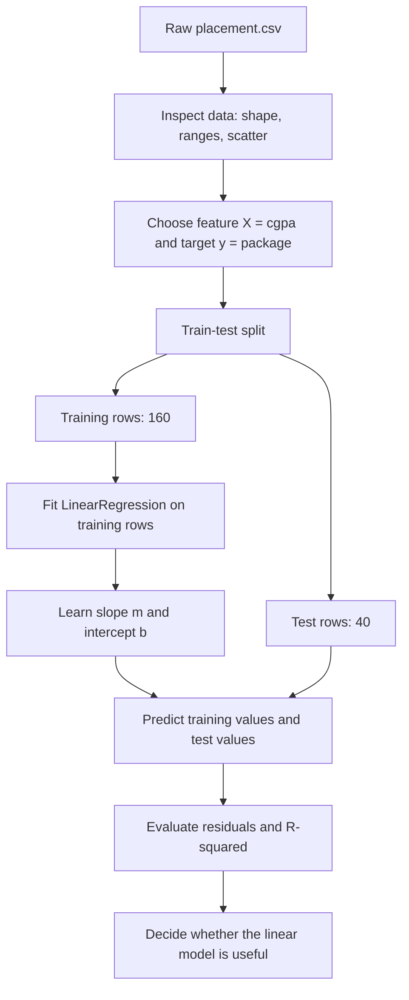
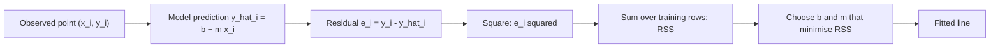
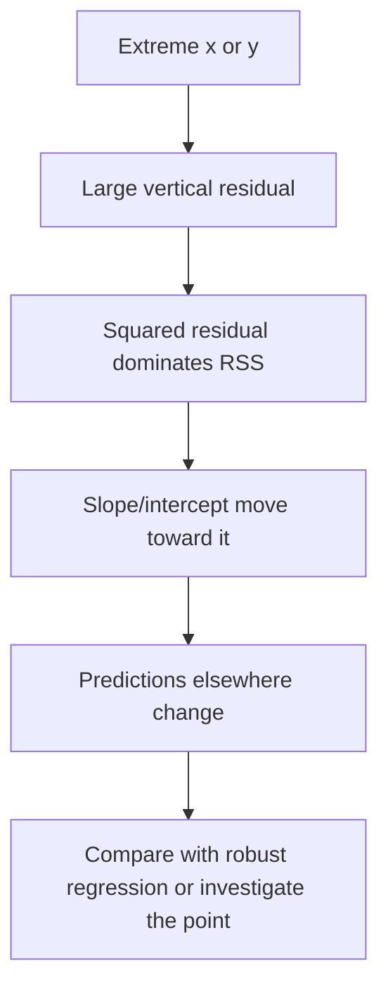

# Day 48 — Simple Linear Regression
## with a clearly labelled PCA cross-reference requested for this study set

> **Course:** CampusX — 100 Days of Machine Learning, Day 48  
> **Official folder:** `vendor/100-days-of-machine-learning/day48-simple-linear-regression/`  
> **Copied reference notebooks:** `reference_notebooks/Untitled.ipynb` (20 cells) and `reference_notebooks/Untitled1.ipynb` (17 cells)  
> **Dataset:** `datasets/placement.csv` — 200 rows, 2 columns (`cgpa`, `package`)  
> **Transcript:** no Day 48 transcript exists; no transcript claims are made in this chapter  
> **Actual course topic:** simple linear regression, the scikit-learn workflow, and a from-scratch implementation  
> **PCA:** the requested PCA theory is supplied in a **labelled cross-day companion** (Sections 20–34), because PCA is official CampusX **Day 47**, not Day 48

### Source-verification notice: read this before the PCA material

The folder name and the copied notebooks determine the real topic. I inspected both notebooks cell by cell, executed the code against the bundled data, and compared their SHA-256 hashes with the vendor source:

| Local file | Vendor source | Cells | SHA-256 result |
|---|---|---:|---|
| `reference_notebooks/Untitled.ipynb` | `day48-simple-linear-regression/Untitled.ipynb` | 20 | byte-identical |
| `reference_notebooks/Untitled1.ipynb` | `day48-simple-linear-regression/Untitled1.ipynb` | 17 | byte-identical |

The code and saved outputs contain `LinearRegression`, `coef_`, `intercept_`, and a hand-written `MeraLR` class. They contain no `PCA`, no covariance matrix, no eigenvectors, and no dimensionality-reduction workflow. Therefore:

- **Part I** (Sections 1–19) is the accurate, source-grounded Day 48 chapter. It covers both regression notebooks separately, every significant cell, and the complete least-squares theory.
- **Part II** (Sections 20–34) is an explicitly labelled **cross-day PCA companion**. It teaches the PCA topics you requested, works them numerically on `placement.csv`, and maps the official Day 47 source. It is **not** presented as Day 48 course content.
- No notebook, dataset file, vendor file, or reference notebook was modified while writing this document.

This correction matters pedagogically. If a learner studies PCA while believing that the Day 48 notebooks implement PCA, then the learner cannot explain what `lr.coef_` or the `MeraLR.fit` loop actually do. The two ideas are related only at a higher level: both are linear-algebraic methods, but regression is supervised prediction and PCA is unsupervised variance-based compression.

**Source labels used throughout**

- **Official** — the saved output visible in the copied CampusX notebook.
- **Rerun** — a value reproduced in this environment (Python 3.14.2, NumPy 2.5.3, pandas 3.0.5, scikit-learn 1.9.1).
- **Derived** — a value recovered algebraically from an official saved output, such as a slope recovered from `m * 8.58 + b`.
- **Supplementary** — an explanation, diagnostic, or experiment added for teaching and not presented as original course output.
- **Cross-day** — PCA material belonging to the course sequence around Day 47; included here only because the study request asked for it.

Where official and rerun values agree, the saved output is reported as the anchor. Where a value is not printed in the notebook, it is labelled derived or rerun. No result is invented.

---

# 1. Learning objectives

After studying Part I, I should be able to:

1. **Explain the problem.** Describe why a single numerical feature and a continuous target invite a line, and what “best fit” means.
2. **Read the dataset.** State the shape, columns, ranges, means, standard deviations, covariance, and correlation of `placement.csv`, and interpret a scatter plot.
3. **Write the model.** Explain $y=\beta_0+\beta_1x+\varepsilon$, the difference between the population line and the fitted line, and the units of slope and intercept.
4. **Derive ordinary least squares.** Obtain the normal equations, solve for $\beta_0$ and $\beta_1$, verify the second-order condition, and connect the result to covariance and variance.
5. **Distinguish related linear-algebraic views.** Explain the residual-sum-of-squares view, the projection/hat-matrix view, and the covariance view, and say what each contributes.
6. **Trace the scikit-learn workflow.** Explain `train_test_split`, the need for a two-dimensional `X`, `fit`, `predict`, `coef_`, `intercept_`, and the `reshape(1, 1)` call in the notebook.
7. **Evaluate a fit.** Compute residuals, SSE, MSE, RMSE, MAE, $R^2$, and compare training and test behaviour without confusing $R^2$ with correlation or accuracy.
8. **Read the from-scratch class.** Explain class construction, `self`, the loop in `MeraLR.fit`, why `predict` prints its input, and how the class reproduces the scikit-learn coefficients.
9. **Diagnose assumptions and failure modes.** Discuss linearity, independence, homoscedasticity, normality, influential points, extrapolation, and data leakage.
10. **Compare alternatives.** Contrast simple regression with multiple regression, polynomial regression, regularized regression, k-nearest neighbours, and tree models.
11. **Prepare for interviews and examinations.** Answer conceptual, mathematical, implementation, diagnostic, and scenario questions with reasons and worked numbers.

After studying Part II, I should additionally be able to:

12. **Explain PCA’s purpose.** State when variance-based compression helps, when it destroys useful information, and why it is unsupervised.
13. **Compute PCA by hand for two features.** Form the covariance or correlation matrix, solve the eigenproblem, order the components, project observations, and quantify explained variance.
14. **Use scikit-learn correctly.** Interpret `components_`, `explained_variance_`, `explained_variance_ratio_`, `singular_values_`, `mean_`, `transform`, and `inverse_transform`.
15. **Connect PCA to SVD.** Show why the singular values of the centred matrix determine explained variance and why the right singular vectors are the components.
16. **Choose the number of components.** Use cumulative explained variance, the eigenvalue-one rule, a scree plot, and downstream cross-validation, while stating the limitations of each rule.
17. **Prevent leakage.** Fit scaling and PCA on training data only, use a `Pipeline`, and explain why fitting PCA on the full dataset contaminates an evaluation.
18. **Compare methods.** Distinguish PCA from feature selection, linear discriminant analysis, t-SNE, UMAP, kernel PCA, and autoencoders.
19. **Diagnose PCA mistakes.** Recognise missing centring, unscaled features, sign confusion, component over-interpretation, leakage, and inappropriate use of t-SNE distances.

---

# 2. What Day 48 actually contains

## 2.1 The official folder

The vendor folder contains four objects:

```text
day48-simple-linear-regression/
├── placement.csv
├── readme.md
├── Untitled.ipynb      # 20 cells
└── Untitled1.ipynb     # 17 cells
```

`readme.md` contains only the video link. There is no transcript for this day, and the notebooks contain no explanatory Markdown cells. The copies in `Day_48/reference_notebooks/` are byte-identical to these two notebooks.

## 2.2 Notebook A — `Untitled.ipynb` (20 cells)

This notebook is the scikit-learn demonstration. Its cells, in order, do the following:

1. import `matplotlib.pyplot`, `pandas`, and `numpy`;
2. read `placement.csv` with the relative path used by the original author;
3. display `df.head()`;
4. draw a scatter plot of `cgpa` against `package`;
5. select `X = df.iloc[:, 0:1]` (a DataFrame with one column) and `y = df.iloc[:, -1]` (a Series);
6. display `y`;
7. split the data with `test_size=0.2` and `random_state=2`;
8. import `LinearRegression`;
9. instantiate the estimator;
10. fit it on the training data;
11. display `X_test`;
12. display `y_test`;
13. predict the first test observation after reshaping it to `(1, 1)`;
14. redraw the scatter plot and overlay the fitted line on the training data;
15. store the slope in `m = lr.coef_`;
16. store the intercept in `b = lr.intercept_`;
17. compute `m * 8.58 + b` (the first test point by hand);
18. compute `m * 9.5 + b` (a second hand prediction);
19. compute `m * 100 + b` (a deliberately extreme extrapolation);
20. an empty final cell.

The notebook therefore covers: data loading, visual inspection, feature/target selection, splitting, fitting, prediction, plotting, and coefficient interpretation. It does **not** compute a loss, a residual, or an evaluation metric. That is an important scope limitation: the lesson demonstrates the mechanics of a regression fit, not a full model-selection study.

## 2.3 Notebook B — `Untitled1.ipynb` (17 cells)

This notebook is the from-scratch demonstration. Its cells, in order, do the following:

1. define a class `MeraLR` with `__init__`, `fit`, and `predict`;
2. import `numpy` and `pandas`;
3. read `placement.csv`;
4. display `df.head()`;
5. select one-dimensional NumPy arrays `X = df.iloc[:, 0].values` and `y = df.iloc[:, 1].values`;
6. display `X`;
7. display `y`;
8. split with the same `test_size=0.2` and `random_state=2`;
9. display `X_train.shape`, which is `(160,)`;
10. instantiate `MeraLR`;
11. fit it, printing the slope and intercept;
12. display `X_train.shape[0]`, which is `160`;
13. display the first training observation, `7.14`;
14. display `X_train.mean()`, which is `6.989937500000001`;
15. display the first test observation, `8.58`;
16. print the prediction for `X_test[0]`;
17. an empty final cell.

The notebook covers: the class mechanism, the closed-form slope and intercept, scalar prediction, and a few inspection prints. It does **not** vectorise predictions, validate inputs, score the model, or handle a pandas DataFrame directly. Those omissions are instructional opportunities, not features to copy blindly.

## 2.4 Why the two notebooks are not redundant

`Untitled.ipynb` teaches the library interface and the visual result. `Untitled1.ipynb` opens the black box and implements the same arithmetic. A learner who only runs `LinearRegression()` can produce a prediction but cannot answer “what did `fit` actually compute?” A learner who only writes `MeraLR` can reproduce one feature but may not understand the estimator conventions, two-dimensional feature matrices, or prediction shapes. The two notebooks should be studied together.

## 2.5 Running the notebooks without editing them

Both notebooks call `pd.read_csv('placement.csv')`. If a notebook is opened from inside `Day_48/reference_notebooks/`, that relative path points to a file that is not present there. The local dataset copy is at `Day_48/datasets/placement.csv`. Since the reference notebooks are read-only for this project, the safe options are:

- open the official notebook from a working directory that contains `placement.csv`, or
- temporarily point a copy of the notebook at `../datasets/placement.csv` **outside** the preserved reference folder,
- or run the equivalent code in a separate scratch session.

Do not silently rewrite the reference notebook to hide the path issue. The mismatch is part of the source record.

---

# 3. The problem and the workflow

## 3.1 The question behind the lesson

The dataset records two quantities for 200 students: `cgpa` (cumulative grade point average) and `package` (a salary package, in lakhs per annum, as labelled by the course). The natural question is:

> Given a student's CGPA, what package should we expect?

A scatter plot already suggests an upward pattern. A linear regression turns that visual impression into a numerical rule:

$$
\widehat{\text{package}} = b + m \cdot \text{cgpa}.
$$

The rule has two jobs:

1. **Description:** estimate how much the package changes, on average, when CGPA increases by one point.
2. **Prediction:** produce a package estimate for a CGPA value, including a value not present in the sample.

These are related but not identical. A slope can be descriptive without the model being useful for prediction, and a model can predict reasonably without the slope being causally interpretable.

## 3.2 The workflow, with the split in the correct place



The split occurs **before** fitting. For this lesson, no feature scaling, imputation, or encoding is needed, so the ordering issue is small. In a larger workflow, any learned preprocessing parameter must also be fitted on the training portion only. We return to leakage in Section 11.

The fitted line is chosen by minimising squared vertical gaps:



The geometry explains why one extreme point can pull the line:



## 3.3 What the workflow does not include

The course notebook stops after the fitted line and three hand calculations. A complete regression study would add:

- residual diagnostics;
- a test-set metric;
- a comparison with a baseline;
- a discussion of assumptions and causal limits;
- a plan for new, out-of-range inputs.

Those additions are supplied in this chapter as supplementary analysis. They do not change the official code or its saved outputs.

## 3.4 Connection to earlier and later days

- **Day 24, standardization** and **Day 25, normalization** change feature scale. They do not change the least-squares fit in a fundamental way when applied to a single feature with an intercept: rescaling $x$ rescales the slope, but the fitted line in the original units is the same. With multiple features, scaling affects regularization and numerical behaviour; it does not change ordinary least squares predictions in exact arithmetic.
- **Day 45, feature construction and splitting** explains how a raw column can become several features. Day 48 uses the simplest case: one feature.
- **Day 49, regression metrics** formalises MAE, MSE, RMSE, $R^2$, and adjusted $R^2$. This chapter previews those metrics so that the Day 48 fit can be interpreted, but the official Day 48 notebook itself does not compute them.
- **Day 50, multiple linear regression** extends the single slope to a coefficient vector.
- **Day 51, gradient descent** solves the same least-squares problem iteratively when a closed-form solution is expensive or when the loss is changed.
- **Day 53, polynomial regression** adds powers of the feature, which lets the model bend.
- **Day 55–57, ridge, lasso, and elastic net** add penalties that trade training fit for coefficient stability and sparsity.

---

# 4. The dataset: `placement.csv`

## 4.1 Shape and columns

The file has 200 data rows and two columns:

| Column | Meaning in the course | dtype after pandas parsing | Range |
|---|---|---:|---|
| `cgpa` | cumulative grade point average | `float64` | 4.26 to 9.58 |
| `package` | package in lakhs per annum (lpa) | `float64` | 1.37 to 4.62 |

There are no missing values in either column. The row index runs from 0 to 199. The dataset is bundled with the course; the official repository’s README gives only the video link and does not state an external provenance. I therefore do not invent a source, licence, or collection method.

The first five rows are:

| Row | `cgpa` | `package` |
|---:|---:|---:|
| 0 | 6.89 | 3.26 |
| 1 | 5.12 | 1.98 |
| 2 | 7.82 | 3.25 |
| 3 | 7.42 | 3.67 |
| 4 | 6.94 | 3.57 |

## 4.2 Summary statistics

Using the sample standard deviation (`ddof=1`):

| Statistic | `cgpa` | `package` |
|---|---:|---:|
| count | 200 | 200 |
| mean | 6.9905 | 2.99605 |
| standard deviation | 1.0694086799 | 0.6916442411 |
| minimum | 4.26 | 1.37 |
| 25th percentile | 6.19 | 2.4875 |
| median | 6.965 | 2.995 |
| 75th percentile | 7.7375 | 3.4925 |
| maximum | 9.58 | 4.62 |

A first observation: the two variables have different scales. CGPA spans about 5.32 units; package spans about 3.25 units. Their standard deviations are about 1.07 and 0.69. This matters for PCA later: unscaled PCA would give more weight to the variable with the larger variance.

## 4.3 Covariance and correlation

The sample covariance matrix is

$$
C=
\begin{bmatrix}
1.1436349246 & 0.6514044975\\
0.6514044975 & 0.4783717563
\end{bmatrix}.
$$

The diagonal entries are the sample variances:

$$
\operatorname{Var}(\text{cgpa})=1.1436349246,
\qquad
\operatorname{Var}(\text{package})=0.4783717563.
$$

The off-diagonal entry is the sample covariance:

$$
\operatorname{Cov}(\text{cgpa},\text{package})=0.6514044975.
$$

The Pearson correlation is

$$
r=\frac{\operatorname{Cov}(x,y)}{\sqrt{\operatorname{Var}(x)\operatorname{Var}(y)}}
=\frac{0.6514044975}{\sqrt{1.1436349246\cdot 0.4783717563}}
=0.8806924694.
$$

So the linear association is strong and positive. It is not perfect: many points sit off a single line. The correlation has no units, lies in $[-1,1]$, and is symmetric. Covariance has units of CGPA times package, so its numerical size depends on the units chosen.

## 4.4 The scatter plot

The notebook’s cell 3 draws `cgpa` on the horizontal axis and `package` on the vertical axis. The visible pattern is an upward cloud: students with higher CGPA generally receive higher packages, but the vertical spread around the trend is substantial.

A correct reading of the graph:

- **Axes:** x is CGPA in grade-point units; y is package in lpa.
- **Direction:** positive association.
- **Strength:** tight enough to suggest a linear summary, loose enough that predictions will have errors.
- **Shape:** no obvious strong curvature within the observed range.
- **Density:** more points lie around CGPA 6–8; the extremes have fewer observations.
- **What cannot be concluded:** the plot alone does not establish causation, does not describe students outside the observed range, and does not prove that the relationship is exactly linear.

A common mistake is to read a scatter plot as proof that “CGPA causes package”. The data are observational. A third variable — interview performance, college tier, branch, location, or luck — could drive both recorded quantities. Regression estimates an association under a model; it does not randomly assign CGPA.

## 4.5 The ranges and the risk of extrapolation

The observed CGPA range is $4.26$ to $9.58$. The notebook later evaluates `m * 100 + b`. That is far outside the data range. Even if the arithmetic is correct, the result is not a trustworthy prediction: the linear form is an assumption, and there is no evidence that the same slope continues for a CGPA of 100. Section 9.5 treats this cell as a deliberate warning about extrapolation.

---

# 5. Foundations needed for the regression

This section explains the concepts that the formulas use. It is not a list of definitions to memorise; each idea is tied to a calculation that appears later.

## 5.1 Variables, observations, and indices

An **observation** is one row. For observation $i$:

- $x_i$ is the feature value, here CGPA;
- $y_i$ is the target value, here package;
- $n$ is the number of observations;
- $p$ is the number of features. In this lesson $p=1$.

A **feature** is an input used for prediction. A **target** (response, label, dependent variable) is the quantity being predicted. In a supervised problem, both are observed during training. The model learns a mapping from $x$ to $y$, then applies it to new $x$ values.

## 5.2 Functions and the meaning of a linear function

A function assigns one output to each allowed input. The model

$$
f(x)=\beta_0+\beta_1x
$$

is linear in the parameter vector $(\beta_0,\beta_1)$: doubling both parameters doubles the output, and adding two parameter vectors adds their outputs. It is also linear in $x$ here, but “linear regression” technically means linear in the parameters. A model such as

$$
f(x)=\beta_0+\beta_1x+\beta_2x^2
$$

is still a linear regression model because it is linear in $\beta_0,\beta_1,\beta_2$, even though it is curved in $x$. This distinction becomes important on Day 53.

## 5.3 Slope and intercept

For a line $y=b+mx$:

- $m$ is the **slope**: the change in the predicted $y$ for a one-unit increase in $x$;
- $b$ is the **intercept**: the predicted $y$ when $x=0$.

In this dataset, $m$ has units of lpa per CGPA point. $b$ has units of lpa. The intercept is a mathematical anchor, not necessarily a meaningful statement about a student with CGPA 0, because CGPA 0 is far outside the observed range and may be impossible in the data-generating process.

## 5.4 Mean and deviations

The sample mean of $x$ is

$$
\bar{x}=\frac{1}{n}\sum_{i=1}^{n}x_i.
$$

The deviation of observation $i$ from the mean is $x_i-\bar{x}$. Deviations sum to zero:

$$
\sum_{i=1}^{n}(x_i-\bar{x})=0.
$$

This identity is used repeatedly in the least-squares derivation. The mean is the balance point of the sample; the deviations on the two sides cancel exactly.

## 5.5 Variance

The sample variance of $x$ is

$$
s_x^2=\frac{1}{n-1}\sum_{i=1}^{n}(x_i-\bar{x})^2.
$$

It measures the average squared deviation from the mean. The denominator $n-1$ is used for an unbiased sample estimate under the usual random-sampling model. The population variance would divide by $n$. The choice affects the numerical value but not the sign, the ordering of features, or the fitted regression slope when the same convention is used consistently.

For the full dataset:

$$
s_x^2=1.1436349246,\qquad s_x=1.0694086799.
$$

## 5.6 Covariance

The sample covariance of $x$ and $y$ is

$$
s_{xy}=\frac{1}{n-1}\sum_{i=1}^{n}(x_i-\bar{x})(y_i-\bar{y}).
$$

It measures how the two deviations move together:

- if positive deviations in $x$ usually accompany positive deviations in $y$, the covariance is positive;
- if one tends to be above its mean when the other is below, the covariance is negative;
- if there is no linear co-movement, the covariance is near zero.

Covariance is **not** standardized: multiplying $x$ by 100 multiplies the covariance by 100. That is why correlation is often more interpretable.

## 5.7 Correlation

The Pearson correlation is

$$
r=\frac{s_{xy}}{s_x s_y}.
$$

It is the covariance after dividing by both standard deviations. It lies in $[-1,1]$. Correlation measures linear association only. A strong nonlinear relationship can have a correlation near zero. Correlation is symmetric: $r(x,y)=r(y,x)$. It is not the slope: the slope depends on the units, while correlation does not.

For this dataset:

$$
r=0.8806924694.
$$

The squared correlation is

$$
r^2=0.7756192256.
$$

This is the proportion of the sample variance of $y$ explained by a linear regression of $y$ on $x$ **when the model is fitted to the same data used to compute $r$**. On the training split, the corresponding value is $0.8793810870^2=0.7733110961$. On the test split, the fitted slope comes from the training data, so the test $R^2$ is not simply the squared test-set correlation.

## 5.8 Residuals and the residual sum of squares

For a fitted line, the prediction at observation $i$ is

$$
\hat{y}_i=b+mx_i.
$$

The residual is

$$
e_i=y_i-\hat{y}_i.
$$

A positive residual means the actual value is above the line; a negative residual means it is below. Residuals are not the same as errors in the population model: the population error $\varepsilon_i$ is unobservable, while the residual is computed from the fitted line.

The residual sum of squares is

$$
SSE=\sum_{i=1}^{n}e_i^2=\sum_{i=1}^{n}(y_i-\hat{y}_i)^2.
$$

Squaring does two things: it removes the sign, and it penalises large residuals more than small ones. The sum of residuals themselves is zero for an ordinary least-squares fit with an intercept:

$$
\sum_{i=1}^{n}e_i=0.
$$

That identity follows from the first normal equation in Section 7.

## 5.9 Total sum of squares and $R^2$

The total sum of squares around the mean is

$$
SST=\sum_{i=1}^{n}(y_i-\bar{y})^2.
$$

It measures the total variation in the target before any model is used. The coefficient of determination is

$$
R^2=1-\frac{SSE}{SST}.
$$

Interpretation:

- $R^2=1$: the model fits the evaluated observations perfectly;
- $R^2=0$: the model has the same squared error as always predicting the mean of the evaluation target;
- $R^2<0$: the model is worse than that mean baseline on the evaluated observations.

$R^2$ is **not** “percentage accuracy”. It is a ratio of squared errors. It can be negative on a test set. It always increases when more variables are added to an ordinary least-squares model fitted on the same data, which is why adjusted $R^2$ and out-of-sample evaluation exist.

## 5.10 The train/test idea

The test set simulates future, unseen observations. If we evaluate on the same rows used to fit the line, the model has already seen the answers; the resulting score is optimistic. A train/test split holds out rows before fitting. The cost is that the estimate of performance becomes noisy when the test set is small. Here the test set has 40 rows, so the test $R^2$ is one realization, not a guarantee.

---

# 6. The simple linear regression model

## 6.1 Population form

For a single feature, the population model is

$$
y_i=\beta_0+\beta_1x_i+\varepsilon_i,
\qquad i=1,\dots,n,
$$

where:

- $y_i$ is the observed target for observation $i$;
- $x_i$ is the observed feature;
- $\beta_0$ is the population intercept;
- $\beta_1$ is the population slope;
- $\varepsilon_i$ is the error term, the part of $y_i$ not explained by the linear function.

The error term is not a “mistake in the data”. It represents omitted influences, measurement noise, and genuine randomness. The model assumes that the systematic part is linear in $x$ and that the errors have the properties stated in Section 12.

## 6.2 Fitted form

We do not know the population parameters, so we estimate them from data:

$$
\hat{y}_i=\hat{\beta}_0+\hat{\beta}_1x_i.
$$

The hats distinguish estimates from population quantities. In the notebook, `lr.coef_` is $\hat{\beta}_1$ and `lr.intercept_` is $\hat{\beta}_0$. The notation $m$ and $b$ is common in school algebra and in the notebook; it is the same pair of numbers under different names.

## 6.3 The least-squares criterion

Ordinary least squares chooses $(\hat{\beta}_0,\hat{\beta}_1)$ to minimise

$$
Q(\beta_0,\beta_1)=\sum_{i=1}^{n}\left(y_i-\beta_0-\beta_1x_i\right)^2.
$$

Why squared errors rather than absolute errors?

- Squaring is differentiable everywhere, which yields a closed-form solution.
- Squaring penalises large residuals strongly.
- Under the normal-error model, least squares is equivalent to maximum likelihood.
- The geometry becomes an orthogonal projection in Euclidean space.

Why not minimise the sum of residuals? Positive and negative residuals would cancel, and a line could “improve” by shifting without reducing the actual error magnitude. Why not minimise the sum of absolute residuals? That is possible (least absolute deviations), but it is not differentiable at zero and does not give the same closed-form solution. Both criteria are legitimate; they answer slightly different loss questions.

## 6.4 A small worked dataset

Take the first five rows of the actual dataset:

| $i$ | $x_i$ (cgpa) | $y_i$ (package) |
|---:|---:|---:|
| 1 | 6.89 | 3.26 |
| 2 | 5.12 | 1.98 |
| 3 | 7.82 | 3.25 |
| 4 | 7.42 | 3.67 |
| 5 | 6.94 | 3.57 |

Compute:

$$
\sum x_i=34.19,\qquad \bar{x}=6.838,
$$

$$
\sum y_i=15.73,\qquad \bar{y}=3.146.
$$

The slope formula that we derive in Section 7 gives

$$
m=\frac{\sum_i(x_i-\bar{x})(y_i-\bar{y})}{\sum_i(x_i-\bar{x})^2}
=\frac{2.45946}{4.26768}
=0.5762990665.
$$

The intercept is

$$
b=\bar{y}-m\bar{x}
=3.146-0.5762990665\cdot6.838
=-0.7947330165.
$$

The fitted line is therefore

$$
\widehat{y}=-0.7947330165+0.5762990665x.
$$

For the five observations, the predictions are:

| $x_i$ | $y_i$ | $\hat{y}_i$ | residual $y_i-\hat{y}_i$ |
|---:|---:|---:|---:|
| 6.89 | 3.26 | 3.1759675515 | 0.0840324485 |
| 5.12 | 1.98 | 2.1559182038 | -0.1759182038 |
| 7.82 | 3.25 | 3.7119256833 | -0.4619256833 |
| 7.42 | 3.67 | 3.4814060567 | 0.1885939433 |
| 6.94 | 3.57 | 3.2047825048 | 0.3652174952 |

The residuals sum to approximately zero. The SSE is

$$
SSE=0.0840324485^2+(-0.1759182038)^2+\cdots+0.3652174952^2
=0.4203354980.
$$

The total sum of squares is

$$
SST=\sum_i(y_i-\bar{y})^2=1.83772.
$$

Thus

$$
R^2=1-\frac{0.4203354980}{1.83772}=0.7712733725.
$$

On these five rows, the line explains about 77.13% of the target’s squared variation. This is a teaching calculation on a subset; it is not the model fitted to the full 200 rows, and it is not the official notebook result. The subset fit illustrates the arithmetic, while the full-data fit in Section 8 illustrates the actual lesson.

## 6.5 Why the five-row example is not the notebook model

The notebook uses a random 80/20 split of all 200 rows and fits on 160 rows. A fit on five rows is much less stable: moving one point can change the line substantially. The purpose of the five-row calculation is to make the normal equations concrete, not to reproduce the saved output. Whenever a worked example uses a subset, the scope is stated explicitly.

## 6.6 Units and interpretation of the fitted coefficients

Suppose the fitted slope is $0.5579519734$ lpa per CGPA point. The interpretation is:

> Holding the model form fixed, a one-point increase in CGPA is associated with an estimated increase of about 0.558 lpa in package.

“Associated” is deliberate. The coefficient is not a causal effect unless the study design supports a causal claim. The intercept $-0.8961119222$ lpa is the model’s predicted package at CGPA 0. Because 0 is far outside the observed range, it should not be interpreted as a realistic package for a student with CGPA 0.

If the target were transformed, the units would change. If the feature were centered, the intercept would become the prediction at the mean feature value. These are not cosmetic details; they change what the numbers mean.

---

# 7. Deriving ordinary least squares

## 7.1 The objective

We minimise

$$
Q(\beta_0,\beta_1)=\sum_{i=1}^{n}\left(y_i-\beta_0-\beta_1x_i\right)^2.
$$

Expand the square:

$$
Q=\sum_i y_i^2
-2\beta_0\sum_i y_i
-2\beta_1\sum_i x_i y_i
+\beta_0^2 n
+2\beta_0\beta_1\sum_i x_i
+\beta_1^2\sum_i x_i^2.
$$

This expansion is useful because it shows that the objective depends on the data only through the five sums

$$
n,\quad \sum_i x_i,\quad \sum_i y_i,\quad \sum_i x_i y_i,\quad \sum_i x_i^2,
$$

plus $\sum_i y_i^2$, which does not depend on the parameters. The normal equations below use exactly these sums.

## 7.2 First-order conditions

Differentiate with respect to $\beta_0$:

$$
\frac{\partial Q}{\partial \beta_0}
=-2\sum_i(y_i-\beta_0-\beta_1x_i).
$$

Set this to zero:

$$
\sum_i(y_i-\beta_0-\beta_1x_i)=0.
$$

Divide by $n$:

$$
\bar{y}-\beta_0-\beta_1\bar{x}=0,
$$

so

$$
\beta_0=\bar{y}-\beta_1\bar{x}.
$$

This is the first normal equation. It says that the fitted line passes through the point $(\bar{x},\bar{y})$. It also implies that the residuals sum to zero.

Differentiate with respect to $\beta_1$:

$$
\frac{\partial Q}{\partial \beta_1}
=-2\sum_i x_i(y_i-\beta_0-\beta_1x_i).
$$

Set this to zero:

$$
\sum_i x_i(y_i-\beta_0-\beta_1x_i)=0.
$$

Substitute $\beta_0=\bar{y}-\beta_1\bar{x}$:

$$
\sum_i x_i\left(y_i-\bar{y}+\beta_1\bar{x}-\beta_1x_i\right)=0.
$$

Rearrange:

$$
\sum_i x_i(y_i-\bar{y})
=\beta_1\sum_i x_i(x_i-\bar{x}).
$$

The left side can be rewritten using $\sum_i x_i\bar{y}=\bar{y}\sum_i x_i=n\bar{x}\bar{y}$, and the right side using $\sum_i x_i\bar{x}=n\bar{x}^2$. After simplifying, both sides become sums of deviations:

$$
\sum_i (x_i-\bar{x})(y_i-\bar{y})
=\beta_1\sum_i(x_i-\bar{x})^2.
$$

Therefore

$$
\boxed{\beta_1=\frac{\sum_i(x_i-\bar{x})(y_i-\bar{y})}{\sum_i(x_i-\bar{x})^2}}
$$

and

$$
\boxed{\beta_0=\bar{y}-\beta_1\bar{x}}.
$$

## 7.3 Why the solution is a minimum, not a maximum

The Hessian of $Q$ is

$$
H=
\begin{bmatrix}
\dfrac{\partial^2 Q}{\partial\beta_0^2} & \dfrac{\partial^2 Q}{\partial\beta_0\partial\beta_1}\\\\
\dfrac{\partial^2 Q}{\partial\beta_1\partial\beta_0} & \dfrac{\partial^2 Q}{\partial\beta_1^2}
\end{bmatrix}
=
\begin{bmatrix}
2n & 2\sum_i x_i\\
2\sum_i x_i & 2\sum_i x_i^2
\end{bmatrix}.
$$

For a unique minimum we need $H$ positive definite. The first leading principal minor is $2n>0$. The determinant is

$$
\det(H)=4\left(n\sum_i x_i^2-\left(\sum_i x_i\right)^2\right)
=4n\sum_i(x_i-\bar{x})^2.
$$

This is positive exactly when the feature is not constant, i.e. when $\sum_i(x_i-\bar{x})^2>0$. If every $x_i$ is identical, the feature carries no information about a slope; the normal equations are singular and infinitely many lines fit equally well. In this dataset the CGPA values vary, so the determinant is positive and the least-squares solution is unique.

## 7.4 The closed form in raw sums

Multiplying numerator and denominator by $n$ gives the version used in hand calculations and in the notebook’s spirit:

$$
m=\frac{n\sum_i x_i y_i-\left(\sum_i x_i\right)\left(\sum_i y_i\right)}
{n\sum_i x_i^2-\left(\sum_i x_i\right)^2}.
$$

For the full 200-row dataset:

$$
\sum_i x_i=1398.1,\qquad
\sum_i y_i=599.21,
$$

$$
\sum_i x_i y_i=4318.4070,\qquad
\sum_i x_i^2=10001.0014.
$$

Then

$$
m=\frac{200(4318.4070)-(1398.1)(599.21)}
{200(10001.0014)-(1398.1)^2}
=\frac{129.6294950}{227.5833500}
=0.5695912948.
$$

And

$$
b=\bar{y}-m\bar{x}
=2.99605-0.5695912948\cdot6.9905
=-0.9856779463.
$$

The full-data fit is therefore

$$
\widehat{y}=-0.9856779463+0.5695912948x.
$$

This differs slightly from the training-split fit $-0.8961119222+0.5579519734x$, because the two fits use different rows. The full-data fit is not the notebook’s reported model; it is the model that would result if no split were made. Reporting both makes the effect of the split visible.

## 7.5 The covariance/variance form

Divide numerator and denominator by $n-1$:

$$
m=\frac{s_{xy}}{s_x^2}.
$$

Because $r=s_{xy}/(s_x s_y)$, this is also

$$
m=r\frac{s_y}{s_x}.
$$

For the full data,

$$
m=0.8806924694\cdot\frac{0.6916442411}{1.0694086799}
=0.5695912948.
$$

This form explains the units: the slope is a correlation times the ratio of target scale to feature scale. A strong correlation alone does not determine the slope; the scales also matter.

## 7.6 The mean-centred form

Another equivalent expression is

$$
m=\frac{\sum_i (x_i-\bar{x})(y_i-\bar{y})}{\sum_i(x_i-\bar{x})^2}.
$$

This is the most stable form for hand calculation because it removes large offsets. It also makes the geometric interpretation clear: the numerator is the inner product of the centred feature vector with the centred target vector, and the denominator is the squared length of the centred feature vector.

## 7.7 The geometric view: projection

Let

$$
\mathbf{x}=(x_1,\dots,x_n)^\top,\qquad
\mathbf{y}=(y_1,\dots,y_n)^\top,\qquad
\mathbf{1}=(1,\dots,1)^\top.
$$

The fitted values lie in the two-dimensional subspace spanned by $\mathbf{1}$ and $\mathbf{x}$. Ordinary least squares chooses the point in that subspace closest to $\mathbf{y}$ in Euclidean distance. The residual vector

$$
\mathbf{e}=\mathbf{y}-\hat{\mathbf{y}}
$$

is orthogonal to every column of the design matrix:

$$
\mathbf{1}^\top\mathbf{e}=0,\qquad
\mathbf{x}^\top\mathbf{e}=0.
$$

The first orthogonality condition says residuals sum to zero. The second says the residuals are uncorrelated with the feature (in the sample). The fitted vector is the orthogonal projection of $\mathbf{y}$ onto the column space. This is why the hat matrix is

$$
H=X(X^\top X)^{-1}X^\top,
\qquad
\hat{\mathbf{y}}=H\mathbf{y},
$$

where $X=[\mathbf{1}\;\mathbf{x}]$. The diagonal entries $h_{ii}$ are leverages; Section 12 uses them.

## 7.8 Three views of one solution

The three views answer different questions:

| View | Question it answers | Key object |
|---|---|---|
| Calculus | Where is the squared-error objective stationary? | normal equations |
| Geometry | Which fitted vector is closest to the target? | orthogonal projection |
| Statistics | What is the slope in covariance units? | $s_{xy}/s_x^2$ |
| Linear algebra | How is the target decomposed? | hat matrix and residual space |

They are not competing derivations; they are equivalent descriptions of the same least-squares solution. A strong answer in an interview can move between them.

## 7.9 What happens if the intercept is removed

If we force the line through the origin,

$$
\hat{y}_i=\beta_1x_i,
$$

the first normal equation changes to

$$
\beta_1=\frac{\sum_i x_i y_i}{\sum_i x_i^2}.
$$

Residuals no longer necessarily sum to zero, and the fitted line no longer necessarily passes through $(\bar{x},\bar{y})$. The scikit-learn option `fit_intercept=False` implements this model. It should be used only when theory genuinely says the target must be zero when the feature is zero. For this dataset, forcing the line through the origin would be an unjustified assumption, and it would distort the intercept interpretation.

## 7.10 Numerical conditioning

The normal equations solve

$$
X^\top X\,\beta=X^\top y.
$$

Forming $X^\top X$ can square the condition number of $X$, which is numerically undesirable when features are highly collinear. scikit-learn’s `LinearRegression` uses a least-squares solver based on singular value decomposition or QR rather than literally inverting $X^\top X$. For one well-scaled feature the difference is negligible, but the general lesson matters: the mathematical formula is not always the best computational route.

---

# 8. Notebook A: the scikit-learn workflow, cell by cell

This section follows `reference_notebooks/Untitled.ipynb` in execution order. The code is short, but each line establishes a convention that recurs in every later regression lesson.

## 8.1 Cell 0: imports

```python
import matplotlib.pyplot as plt
import pandas as pd
import numpy as np
```

- `matplotlib.pyplot` is imported as `plt` for plotting.
- `pandas` is imported as `pd` for reading and manipulating the tabular data.
- `numpy` is imported as `np`; the notebook does not use NumPy explicitly until the prediction reshape, but it is available.

Importing a library does not execute a model. These lines only bind names in the notebook namespace.

## 8.2 Cell 1: reading the file

```python
df = pd.read_csv('placement.csv')
```

`read_csv` returns a new `DataFrame` and binds it to `df`. The relative path is resolved against the notebook’s current working directory. The original notebook assumes that `placement.csv` sits beside the notebook. In this project the dataset is under `datasets/`, so the path must be handled as explained in Section 2.5. The data itself is unchanged.

## 8.3 Cell 2: `df.head()`

The saved output is:

```text
   cgpa  package
0  6.89     3.26
1  5.12     1.98
2  7.82     3.25
3  7.42     3.67
4  6.94     3.57
```

`head()` returns the first five rows by default. It confirms:

- the column names are lowercase and exact;
- the target `package` is numeric, not a string with a currency symbol;
- the index is the default integer index;
- there are no obvious parsing artifacts in the first rows.

A `head()` call is not a data-quality audit. It does not show missing values deeper in the file, outliers, duplicates, or dtype problems. Those would require `info()`, `describe()`, missingness counts, and plots.

## 8.4 Cell 3: the initial scatter plot

```python
plt.scatter(df['cgpa'],df['package'])
plt.xlabel('CGPA')
plt.ylabel('Package(in lpa)')
```

Execution:

1. `df['cgpa']` returns a Series of 200 values.
2. `df['package']` returns a Series of 200 values.
3. `plt.scatter` creates a scatter trace with one point per row.
4. `xlabel` and `ylabel` annotate the axes.
5. The figure is displayed by the notebook’s plotting backend.

The saved output includes a text object `Text(0, 0.5, 'Package(in lpa)')` because the last expression in the cell is the return value of `ylabel`. This is harmless. The important output is the image: an upward cloud with a positive trend.

This plot is the **exploratory** step. It comes before the model. A model should not be fitted merely because a library function exists; the plot establishes that a line is plausible.

## 8.5 Cell 4: selecting `X` and `y`

```python
X = df.iloc[:,0:1]
y = df.iloc[:,-1]
```

This is one of the most important cells in the notebook, because the shapes differ:

- `df.iloc[:, 0:1]` uses slice notation `0:1`, which selects the first column but **keeps it as a two-dimensional DataFrame** with shape `(200, 1)`.
- `df.iloc[:, -1]` selects the last column with a single integer, which returns a one-dimensional Series with shape `(200,)`.

Why this matters:

- scikit-learn estimators expect `X` to be a two-dimensional array-like object with shape `(n_samples, n_features)`. A `(200, 1)` DataFrame satisfies that convention. A `(200,)` Series would be interpreted incorrectly or rejected.
- `y` is a one-dimensional target vector, which is what a regressor expects.

If the code had used `df.iloc[:, 0]` for `X`, it would have produced a Series and `LinearRegression.fit` would raise an error about inconsistent sample counts or a deprecated 1D input. The from-scratch notebook deliberately uses a 1D NumPy array, because its own class is written for that shape. The library notebook deliberately preserves 2D.

The column names are retained because `X` is a DataFrame. This is why scikit-learn can warn later when a NumPy array without feature names is passed to a model fitted with names.

## 8.6 Cell 5: displaying `y`

The saved output is a 200-row Series:

```text
0      3.26
1      1.98
2      3.25
...
199    2.33
Name: package, Length: 200, dtype: float64
```

The display confirms:

- `y` is one-dimensional;
- the values are floats;
- the index runs 0–199;
- there are no `NaN` values visible in the summary (though a full check would use `isna().sum()`).

The notebook displays `y` but not `X`. That is a small pedagogical imbalance: inspecting the feature matrix and its shape is at least as important as inspecting the target.

## 8.7 Cell 6: the train/test split

```python
from sklearn.model_selection import train_test_split
X_train,X_test,y_train,y_test = train_test_split(
    X, y, test_size=0.2, random_state=2)
```

The function returns four objects:

| Object | Shape | Meaning |
|---|---:|---|
| `X_train` | `(160, 1)` | training features |
| `X_test` | `(40, 1)` | held-out features |
| `y_train` | `(160,)` | training targets |
| `y_test` | `(40,)` | held-out targets |

`test_size=0.2` requests 20% of the rows for testing. With 200 rows, the arithmetic predicts 40 test rows, and the observed shapes confirm it. `train_test_split` uses a random permutation; `random_state=2` fixes that permutation so the result is reproducible.

The first test indices in the saved `X_test` output are:

$$
112,\ 29,\ 182,\ 199,\ 193,\ 85,\ 10,\ 54,\ 115,\ 35,\ \dots
$$

These are row labels from the original DataFrame, preserved by the split. The test set is not a contiguous block; it is a random subset. That is normal.

`random_state` does not make the split “correct”; it makes it **repeatable**. A different random state produces a different test set and different test metrics. Model comparisons should use the same split, or better, cross-validation, so that the comparison is not confounded by which rows happened to land in the test set.

## 8.8 Cell 7: importing the estimator

```python
from sklearn.linear_model import LinearRegression
```

This imports the class. It does not create an instance and does not fit anything. The distinction between importing a class, instantiating an object, and calling a method is central to understanding scikit-learn:

1. `LinearRegression` is a class (a blueprint).
2. `LinearRegression()` creates an estimator object.
3. `lr.fit(...)` learns parameters and stores them on that object.
4. `lr.predict(...)` uses the stored parameters.

## 8.9 Cell 8: instantiating the estimator

```python
lr = LinearRegression()
```

The object is created with default hyperparameters. Important defaults include:

- `fit_intercept=True`;
- `copy_X=True`;
- `n_jobs=None`;
- `positive=False`.

At this point the object has **no learned coefficients**. It is a configuration waiting for data. In scikit-learn terminology, it is an estimator that has not yet been fitted.

## 8.10 Cell 9: fitting

```python
lr.fit(X_train,y_train)
```

The saved output is:

```text
LinearRegression()
```

`fit` does the actual learning. For ordinary least squares with an intercept, it solves the least-squares problem described in Section 7. After the call, the object contains fitted attributes, including:

- `coef_`: the slope(s), shape `(1,)` for one feature;
- `intercept_`: the intercept, a scalar;
- `n_features_in_`: the number of features seen during fit;
- `feature_names_in_`: present because `X_train` is a DataFrame with a column name.

`fit` returns the estimator itself, which is why the notebook displays `LinearRegression()`. Returning `self` enables chaining, although the course does not use chaining here.

A crucial point: `fit` does not return predictions. It returns the fitted estimator. The predictions are produced later by `predict`.

## 8.11 Cell 10: displaying `X_test`

`X_test` is a DataFrame with 40 rows and one column. Its first rows are:

```text
     cgpa
112  8.58
29   7.15
182  5.88
199  6.22
193  4.57
...
```

The index values are original row labels, not a new 0–39 index. This matters when someone tries `X_test.iloc[0]` versus `X_test.loc[112]`:

- `iloc[0]` means “the first row in current order”, which is index label 112;
- `.loc[112]` means “the row whose index label is 112”.

The notebook uses `iloc`, which is the safer choice for “first test row” regardless of the label.

## 8.12 Cell 11: displaying `y_test`

The first test target values are:

```text
112    4.10
29     3.49
182    2.08
199    2.33
193    1.94
...
```

The alignment between `X_test` and `y_test` is by position in the split output, and the index labels match. This is one of the quiet benefits of pandas: the indices preserve row identity, so a human can trace a prediction back to the original row.

## 8.13 Cell 12: predicting one observation

```python
lr.predict(X_test.iloc[0].values.reshape(1,1))
```

The saved output is:

```text
array([3.89111601])
```

Let us break the expression into its execution order:

1. `X_test.iloc[0]` selects the first row as a Series with one element.
2. `.values` converts that Series to a NumPy array. Its shape is `(1,)`.
3. `.reshape(1,1)` changes the shape to `(1,1)`: one sample, one feature.
4. `lr.predict(...)` receives a two-dimensional array and returns an array of shape `(1,)`.
5. The notebook displays `array([3.89111601])`.

Why reshape? Because `predict` expects a two-dimensional sample matrix, even when there is only one sample. A `(1,)` array would be interpreted as one feature with an ambiguous number of samples, and newer scikit-learn versions raise a warning or an error. Reshaping to `(1,1)` makes the convention explicit.

The prediction is consistent with the fitted line:

$$
0.5579519734\cdot 8.58-0.8961119222
=3.8911160097.
$$

The notebook later confirms this identity in cell 16.

A more idiomatic alternative for a batch is `lr.predict(X_test)`, which returns 40 predictions at once. The single-row call is useful for demonstrating the shape convention, not for efficient production code.

The rerun emits a `UserWarning` because the model was fitted on a DataFrame with feature names and is now being passed a plain NumPy array with no names. The warning does not change the numbers. To avoid it, pass a DataFrame with the same column name, e.g. `X_test.iloc[[0]]`, or convert consistently. This version-dependent warning is worth knowing for debugging, but the official saved output predates it.

## 8.14 Cell 13: the fitted line

```python
plt.scatter(df['cgpa'],df['package'])
plt.plot(X_train,lr.predict(X_train),color='red')
plt.xlabel('CGPA')
plt.ylabel('Package(in lpa)')
```

The scatter uses all 200 rows. The red line uses only the 160 training rows and their predictions. The line is plotted by connecting the training `x` values in their current order and the corresponding predictions.

A subtle issue: `plt.plot` connects points in the order given. If the training rows were shuffled, the red line could zigzag. Here the line is straight because the predictions lie exactly on a linear function of $x$, and matplotlib draws the segments between them. A more robust way to draw a line is to create a sorted grid of x-values and predict on that grid:

```python
grid = np.linspace(df['cgpa'].min(), df['cgpa'].max(), 100).reshape(-1, 1)
plt.plot(grid, lr.predict(grid), color='red')
```

This is not a criticism of the course code; it is an explanation of what `plot` does with unsorted x-values. With a linear model and a monotone x-order, the visual result is the same.

The axes, pattern, and conclusion:

- the cloud is the raw data;
- the red line is the fitted conditional mean;
- the line rises with CGPA;
- points above the line have positive residuals, points below have negative residuals;
- the vertical spread around the line is the unexplained variation;
- the line does not pass through every point, and it should not be expected to.

## 8.15 Cells 14 and 15: coefficient attributes

```python
m = lr.coef_
b = lr.intercept_
```

Neither cell has a saved output in the official notebook. The values can be recovered from the saved prediction in cell 16 and from a rerun:

$$
m=0.5579519734,\qquad b=-0.8961119222.
$$

`lr.coef_` is an array, not a scalar, even for one feature. Its shape is `(1,)`. `m * 8.58 + b` therefore produces an array of shape `(1,)`, which is why the saved output is `array([3.89111601])` rather than the bare number `3.89111601`.

This is a common source of confusion:

- for one feature, the slope is the only element of the coefficient array;
- for multiple features, each element corresponds to one column of `X`;
- the order of coefficients follows the column order of `X`, not an alphabetical order;
- if `X` is a DataFrame, `feature_names_in_` records the names, but the coefficients themselves remain positional.

The intercept is a scalar for a single-output regression. For multi-output regression, it would be an array with one entry per output.

## 8.16 Cell 16: the first test point by hand

```python
# y = mx + b

m * 8.58 + b
```

Output:

```text
array([3.89111601])
```

This is the same value as cell 12. The hand calculation demonstrates that `predict` is not magic: it evaluates the fitted line at the input. The value `8.58` is the first test CGPA. The multiplication is elementwise because `m` is an array of length one; the addition broadcasts the scalar intercept. The result is an array of length one.

## 8.17 Cell 17: a second hand prediction

```python
m * 9.5 + b
```

Output:

```text
array([4.40443183])
```

The CGPA 9.5 is inside the observed range (maximum 9.58), so this is an interpolation, not an extrapolation. It is still a model-based estimate, not a guarantee for any particular student.

## 8.18 Cell 18: an extreme extrapolation

```python
m * 100 + b
```

Output:

```text
array([54.89908542])
```

A CGPA of 100 is far outside the data range. The arithmetic is correct, but the prediction is meaningless as a real-world package estimate. The model has no evidence that the linear relationship continues to 100, and CGPA is normally bounded on a much smaller scale. This cell is a compact warning:

> A regression model will happily extrapolate beyond the data, but extrapolation is an assumption, not an observation.

The same issue arises with any bounded feature: age, percentage, test score, or price. Always check whether a requested input lies inside the training range.

## 8.19 Cell 19: the empty cell

The final cell is empty. It has no code and no output. In a cleanup, an empty trailing cell is harmless; in a coverage matrix it should still be recorded so that “20 cells” is not silently turned into “19 meaningful cells”.

## 8.20 Execution summary

The notebook’s data flow is:

```text
placement.csv
     |
     v
pandas DataFrame (200 x 2)
     |
     +----> scatter plot
     |
     v
X = DataFrame (200 x 1)      y = Series (200,)
     |
     v
train_test_split(random_state=2)
     |
     +----> X_train (160 x 1), y_train (160,)
     |
     +----> X_test  (40 x 1),  y_test  (40,)
     |
     v
LinearRegression().fit(X_train, y_train)
     |
     v
learned coef_ and intercept_
     |
     +----> predict(X_test row) -> 3.89111601
     |
     +----> plot fitted line
     |
     +----> hand calculations at 8.58, 9.5, 100
```

The lesson is deliberately small. Its value is in the conventions: two-dimensional `X`, one-dimensional `y`, split before fit, attributes after fit, and predictions by evaluating the learned line.

---

# 9. Evaluation: what the notebook does not print

The official notebook never computes a residual or a test metric. That is not an error; it is a scope choice. But a learner cannot judge whether the line is good from the picture alone. This section supplies the missing evaluation as supplementary analysis on the same split.

## 9.1 Predictions and residuals on the test set

Using the fitted training model on all 40 test rows, the first ten predictions and residuals are:

| Test row label | $x$ (cgpa) | $y$ (package) | $\hat{y}$ | residual $y-\hat{y}$ |
|---:|---:|---:|---:|---:|
| 112 | 8.58 | 4.10 | 3.8911160097 | 0.2088839903 |
| 29 | 7.15 | 3.49 | 3.0932446877 | 0.3967553123 |
| 182 | 5.88 | 2.08 | 2.3846456815 | -0.3046456815 |
| 199 | 6.22 | 2.33 | 2.5743493525 | -0.2443493525 |
| 193 | 4.57 | 1.94 | 1.6537285963 | 0.2862714037 |
| 85 | 4.79 | 1.48 | 1.7764780305 | -0.2964780305 |
| 10 | 5.32 | 1.86 | 2.0721925764 | -0.2121925764 |
| 54 | 6.86 | 3.09 | 2.9314386155 | 0.1585613845 |
| 115 | 8.35 | 4.21 | 3.7627870559 | 0.4472129441 |
| 35 | 6.87 | 2.87 | 2.9370181352 | -0.0670181352 |

The signs alternate, which is normal. The residuals are not all small: the largest absolute test residual is about $0.8464$ lpa, at row label 57, where $y=1.94$ and $\hat{y}=2.7864$. The model over-predicts that student by almost 0.85 lpa.

The training residuals have mean approximately zero (up to floating-point rounding), as required by the intercept. The test residual mean is about $-0.0410$, which is not zero because the test set is a different sample. A non-zero mean test residual is not automatically a bug; it can reflect sampling variation or a shift in the test distribution.

## 9.2 Metrics on the training split

For the 160 training rows:

| Metric | Value |
|---|---:|
| SSE | 16.5527374775 |
| MSE | 0.1034546092 |
| RMSE | 0.3216436059 |
| MAE | 0.2529676083 |
| $R^2$ | 0.7733110961 |

The training $R^2$ equals the squared correlation between `x_train` and `y_train`:

$$
0.8793810870^2=0.7733110961.
$$

This identity holds for simple linear regression with an intercept fitted on the same data. It does not hold for the test set when the slope is learned on the training set.

## 9.3 Metrics on the test split

For the 40 test rows:

| Metric | Value |
|---|---:|
| SSE | 4.8516941254 |
| MSE | 0.1212923531 |
| RMSE | 0.3482705172 |
| MAE | 0.2884710932 |
| $R^2$ | 0.7807301475 |

The test $R^2$ is slightly higher than the training $R^2$, and the test RMSE is slightly higher. These two facts are not contradictory: $R^2$ is relative to the test target’s own variance, while RMSE is an absolute error in lpa. The test target has a smaller total sum of squares than the training target (22.12659 versus 73.01962), so a larger absolute error can still correspond to a comparable or better relative fit.

This is exactly why one should report more than one metric and more than one split. A single test $R^2$ of 0.78 is not proof that the model will achieve 0.78 on future data. It is one estimate from 40 rows.

## 9.4 A baseline comparison

The simplest baseline is always predicting the training mean. On the test set, that baseline’s $R^2$ is approximately $-0.0028$: it is slightly worse than predicting the test mean, because the training mean and test mean differ. The fitted line’s test $R^2$ of 0.7807 is therefore a genuine improvement over the mean baseline on this split.

A baseline is essential. Without it, an $R^2$ of 0.78 sounds impressive but might be unremarkable for a particular problem. With it, the statement becomes: “the line reduces squared test error by about 78% relative to the training-mean baseline on these 40 rows.”

## 9.5 Why $R^2$ is not accuracy, and why it can be negative

The formula

$$
R^2=1-\frac{SSE}{SST}
$$

compares the model’s squared error to the squared error of the mean of the evaluation target. It is not a classification accuracy, not a percentage of “correct” predictions, and not a unit-free guarantee. If a model is fitted on training data and then evaluated on a test set with a different distribution, its test SSE can exceed the test SST, making $R^2$ negative.

For a simple linear regression fitted on the **same** data, $R^2=r^2$, so it cannot be negative in that in-sample case (except for numerical issues or a model without an intercept). Out of sample, it can.

## 9.6 Cross-validation as a more stable estimate

A single 80/20 split gives one noisy estimate. Five-fold cross-validation on the full data gives five estimates that use every row for validation exactly once. A supplementary rerun (not official notebook output) gives:

| Fold | $R^2$ |
|---:|---:|
| 1 | 0.75398043 |
| 2 | 0.79051763 |
| 3 | 0.75683837 |
| 4 | 0.78086775 |
| 5 | 0.70887127 |
| mean | 0.75801489 |

The fold scores range from about 0.709 to 0.791. The mean is about 0.758, somewhat below the single test score of 0.7807. This is a useful reminder that the test split was a favourable realization, not a stable property.

Ten-fold cross-validation gives a wider range (approximately 0.605 to 0.840). Smaller validation folds produce noisier estimates. Neither cross-validation nor a holdout is “the truth”; both estimate future performance with uncertainty.

## 9.7 What the evaluation cannot tell us

- It cannot tell us whether the relationship is causal.
- It cannot tell us how the model behaves for CGPA values outside 4.26–9.58.
- It cannot tell us whether a different functional form would be better without comparing one.
- It cannot tell us whether the data are representative of the population of students the model will serve.
- It cannot tell us whether the package values are measured consistently across rows.

Those are substantive questions about the data-generating process, not questions that a single metric can answer.

## 9.8 Interpreting the graph with the evaluation

The scatter-plus-line plot shows the fitted conditional mean. The residuals are the vertical distances from points to the line. A good regression plot should be read together with:

- a residual-versus-fitted plot, to check for curvature and changing spread;
- a histogram or Q–Q plot of residuals, to check approximate normality if inference is planned;
- a plot of residuals against the feature, to check whether the linear form misses a pattern;
- a leverage or influence plot, to find rows that dominate the fit.

The course plot shows only the first of these. It is a starting diagnostic, not a complete one.

---

# 10. Notebook B: the from-scratch `MeraLR` class

## 10.1 Why implement it by hand

Using `LinearRegression` teaches the interface. Writing the closed form teaches the mechanism. The from-scratch class also exposes the assumptions that library code hides: one feature, a one-dimensional array, a particular mean convention, and a scalar prediction path.

The class is named `MeraLR` (“my linear regression”). It is not a production estimator. It is a teaching object.

## 10.2 The class definition

The official cell 0 defines:

```python
class MeraLR:

    def __init__(self):
        self.m = None
        self.b = None

    def fit(self, X_train, y_train):

        num = 0
        den = 0

        for i in range(X_train.shape[0]):

            num = num + ((X_train[i] - X_train.mean())
                         * (y_train[i] - y_train.mean()))
            den = den + ((X_train[i] - X_train.mean())
                         * (X_train[i] - X_train.mean()))

        self.m = num / den
        self.b = y_train.mean() - (self.m * X_train.mean())
        print(self.m)
        print(self.b)

    def predict(self, X_test):

        print(X_test)

        return self.m * X_test + self.b
```

This cell only **defines** the class. Defining a class does not run `__init__`, `fit`, or `predict`. Those methods execute later when an instance is created and called.

## 10.3 `__init__`: the object’s initial state

```python
def __init__(self):
    self.m = None
    self.b = None
```

`__init__` is the initialiser called automatically when an instance is created. It takes `self`, the instance being constructed, and sets two attributes:

- `self.m` will hold the slope;
- `self.b` will hold the intercept.

They start as `None` to make the “not yet fitted” state explicit. A production estimator would also validate inputs, store `n_features_in_`, and provide a `fit` return value. This class does the minimum needed for the lesson.

`self` is not a keyword; it is a conventional name for the first parameter of an instance method. Python passes the instance automatically, so `lr.fit(X_train, y_train)` is effectively `MeraLR.fit(lr, X_train, y_train)`. Understanding this removes much of the confusion around methods.

## 10.4 `fit`: the loop

`fit` receives `X_train` and `y_train`. In notebook B these are one-dimensional NumPy arrays with shape `(160,)`. The method:

1. initialises accumulators `num` and `den` to zero;
2. loops over `range(X_train.shape[0])`, i.e. 160 iterations;
3. for each index, adds $(x_i-\bar{x})(y_i-\bar{y})$ to `num`;
4. adds $(x_i-\bar{x})^2$ to `den`;
5. divides to obtain the slope;
6. computes the intercept from the means;
7. prints both values.

This is the centred formula from Section 7.6. It is mathematically equivalent to the raw-sum formula, but its numerical behaviour can differ when the values are large and the mean is large. With this dataset the difference is negligible.

The repeated evaluation of `X_train.mean()` and `y_train.mean()` inside the loop is inefficient: the means do not change, so they could be computed once before the loop. The loop is also slower than vectorised NumPy operations. These are performance observations, not correctness errors.

A vectorised equivalent is:

```python
x_bar = X_train.mean()
y_bar = y_train.mean()
num = np.sum((X_train - x_bar) * (y_train - y_bar))
den = np.sum((X_train - x_bar) ** 2)
self.m = num / den
self.b = y_bar - self.m * x_bar
```

The vectorised version produces the same coefficients and is clearer about the formula.

## 10.5 The meaning of the accumulators

At the end of the loop:

$$
\text{num}=\sum_{i=1}^{160}(x_i-\bar{x})(y_i-\bar{y}),
\qquad
\text{den}=\sum_{i=1}^{160}(x_i-\bar{x})^2.
$$

For the actual training split:

$$
\text{num}=101.203839375,
\qquad
\text{den}=181.384499375.
$$

Therefore

$$
m=\frac{101.203839375}{181.384499375}=0.557951973425072,
$$

and

$$
b=3.0039375-0.557951973425072\cdot6.9899375
=-0.8961119222429152.
$$

The printed official outputs are:

```text
0.5579519734250721
-0.8961119222429152
```

The last digit differs from the rerun only because of floating-point summation order. This is normal. The values match scikit-learn’s coefficients for the same split to the displayed precision.

## 10.6 `predict`: scalar arithmetic and a print side effect

```python
def predict(self,X_test):
    print(X_test)
    return self.m * X_test + self.b
```

This method:

1. prints its input;
2. evaluates the fitted line;
3. returns the result.

For a scalar input, it returns a scalar (technically a NumPy scalar because `self.m` and `self.b` are NumPy floats). For an array input, it returns an array by broadcasting. It does not reshape, validate, or handle a DataFrame.

The `print(X_test)` is a debugging aid inside the method, not a return value. It produces the surprising saved output in cell 15:

```text
8.58
3.891116009744203
```

The first line is the printed input; the second is the printed result of the outer `print(lr.predict(X_test[0]))`. A user who expects only one number may think the method returned two. It returned one number and printed two lines.

A production `predict` should not print. The method should return predictions and leave display decisions to the caller.

## 10.7 Cell 3 to cell 8: data preparation in one dimension

Notebook B loads the data, displays the head, and selects:

```python
X = df.iloc[:,0].values
y = df.iloc[:,1].values
```

Both are NumPy arrays with shape `(200,)`. The saved `X` output is the full 200-value array beginning:

```text
array([6.89, 5.12, 7.82, 7.42, 6.94, 7.89, ...])
```

The split is the same as notebook A:

```python
X_train,X_test,y_train,y_test = train_test_split(
    X,y,test_size=0.2,random_state=2)
```

Because `X` and `y` are one-dimensional, all four outputs are one-dimensional:

```text
X_train.shape = (160,)
```

This shape is exactly what the custom loop expects. It is not what scikit-learn expects for features. The two notebooks solve the same problem with different interface conventions.

## 10.8 Cell 10 and cell 11: fitting and shape inspection

```python
lr = MeraLR()
lr.fit(X_train,y_train)
```

The class is instantiated, then fitted. `fit` prints the coefficients. The next cell prints `X_train.shape[0]`, which is 160. This connects the loop length to the number of training observations. It is a useful check: if the shape were `(160,1)`, then `X_train[i]` would be an array of length one, and the arithmetic would produce arrays instead of scalars. The custom class is written for the one-dimensional case.

## 10.9 Cell 12 to cell 14: inspecting values used in the formula

```python
X_train[0]         # 7.14
X_train.mean()     # 6.989937500000001
X_test[0]          # 8.58
```

These values make the formula concrete:

- the first training feature is 7.14;
- the training mean is 6.9899375;
- the first test feature is 8.58.

The small difference between `7.14` and the mean is $0.1500625$. The test value 8.58 is above the training mean by 1.5900625.

## 10.10 Cell 15: the prediction and its printed input

```python
print(lr.predict(X_test[0]))
```

Saved output:

```text
8.58
3.891116009744203
```

The calculation is

$$
0.5579519734250721\cdot8.58-0.8961119222429152
=3.891116009744203.
$$

This matches notebook A’s `array([3.89111601])` after accounting for the array wrapper and display rounding. The custom class and scikit-learn agree because both implement the same least-squares formulas.

## 10.11 What the custom class reveals about scikit-learn

The comparison:

| Aspect | `MeraLR` | `LinearRegression` |
|---|---|---|
| Feature shape | 1D array | 2D array-like |
| Number of features | exactly one | any number |
| Fit return | `None` | `self` |
| Learned attributes | `m`, `b` | `coef_`, `intercept_` |
| Prediction input | scalar or 1D array | 2D sample matrix |
| Input validation | none | extensive |
| Multi-output | no | yes |
| Numerical solver | direct sums | SVD/QR-based least squares |
| Printing | prints inside `fit` and `predict` | silent |
| Reproducibility | deterministic | deterministic |
| Metadata | none | `n_features_in_`, `feature_names_in_`, etc. |

The library is not “doing something different mathematically”. It is providing a robust, general, validated implementation of the same optimization, with conventions that support pipelines, cross-validation, and multiple features.

## 10.12 Correctness limits of `MeraLR`

The class is correct for the narrow case it was designed for, but it would fail or behave badly in these situations:

1. **Constant feature.** If all $x_i$ are equal, `den=0`; division produces `nan` or raises a warning, and the slope is undefined.
2. **Missing values.** NumPy sums with `NaN` propagate, so the coefficients become `NaN`.
3. **Two-dimensional `X`.** The loop would perform array arithmetic and produce arrays for `num` and `den`, leading to a shape error or an array-valued slope.
4. **Pandas Series with a non-default index.** `X_train[i]` would use label-based lookup rather than positional lookup in some pandas versions, causing incorrect values or a `KeyError`. Converting to `.values` avoids this here, but the class itself does not enforce it.
5. **No intercept option.** The model always includes an intercept.
6. **No scoring, no residuals, no summary.** The class is a calculator, not a complete estimator.
7. **No return from `fit`.** It cannot be chained or used directly in a scikit-learn `Pipeline`.
8. **Printing side effects.** It pollutes output and is unsuitable for libraries or services.

These are teaching limitations, not reasons to reject the exercise. Recognising them is part of understanding the difference between a formula and an estimator.

## 10.13 A safer implementation for study

A more complete teaching version would compute the means once, validate the shapes, avoid printing, and return `self`:

```python
import numpy as np

class SimpleLinearRegression:
    def __init__(self):
        self.m = None
        self.b = None
        self.n_features_in_ = None

    def fit(self, X, y):
        X = np.asarray(X, dtype=float).reshape(-1)
        y = np.asarray(y, dtype=float).reshape(-1)
        if X.shape[0] != y.shape[0]:
            raise ValueError("X and y must have the same number of rows")
        x_bar = X.mean()
        y_bar = y.mean()
        den = np.sum((X - x_bar) ** 2)
        if den == 0:
            raise ValueError("Feature is constant; slope is undefined")
        self.m = np.sum((X - x_bar) * (y - y_bar)) / den
        self.b = y_bar - self.m * x_bar
        self.n_features_in_ = 1
        return self

    def predict(self, X):
        X = np.asarray(X, dtype=float).reshape(-1)
        return self.m * X + self.b
```

This version is still not a full scikit-learn estimator (it lacks `get_params`, `set_params`, and a `BaseEstimator` inheritance), but it removes the most important correctness traps. It is supplementary code, not a replacement for the user’s notebook work.

---

# 11. Workflow, leakage, and reproducibility

## 11.1 The split is the boundary

The training set is used to learn parameters. The test set is used to estimate performance. Anything learned from the test set — including its mean, its variance, its principal components, or its category vocabulary — contaminates the estimate. This is **data leakage**.

For Day 48, the only learned parameters are the slope and intercept. They are fitted on `X_train` and `y_train`. The test set is used only for prediction. The notebook gets this right.

## 11.2 Where leakage could still enter

The notebook does not scale features, impute missing values, or reduce dimensions. If a later version added any of those steps, the correct order would be:

```text
split
  -> fit scaler on X_train
  -> transform X_train and X_test
  -> fit PCA on transformed X_train
  -> transform X_train and X_test
  -> fit model on transformed X_train
  -> evaluate on transformed X_test
```

A `Pipeline` makes that order automatic during cross-validation:

```python
from sklearn.pipeline import Pipeline
from sklearn.preprocessing import StandardScaler
from sklearn.linear_model import LinearRegression

model = Pipeline([
    ("scaler", StandardScaler()),
    ("regressor", LinearRegression())
])
```

For this one-feature dataset, scaling is not necessary for prediction, but the pipeline pattern is worth learning now because Day 50 and beyond will have multiple features and Day 47/49 workflows may add PCA or metrics.

## 11.3 Why scaling does not change the fitted line here

With one feature and an intercept, fitting on $x$ or on $z=(x-\mu)/\sigma$ produces the same predictions in the original units, in exact arithmetic. If

$$
\hat{y}=b+mx
$$

and $z=(x-\mu)/\sigma$, then

$$
\hat{y}=b+m(\mu+\sigma z)=(b+m\mu)+(m\sigma)z.
$$

The rescaled slope is $m\sigma$, and the rescaled intercept is $b+m\mu$. The line is the same set of points. Scaling matters for:

- numerical stability when features have very different magnitudes;
- regularized models, where the penalty depends on coefficient scale;
- PCA, where variance is the objective;
- distance-based models, where Euclidean distance depends on units.

For plain OLS with one feature, it is not required. A common misconception is that scaling “improves” OLS accuracy; with exact arithmetic it only reparameterizes the same fit.

## 11.4 Reproducibility

`random_state=2` makes the split reproducible in this environment. Other sources of variation include:

- library versions changing default solver behaviour;
- row order changes before splitting;
- different pandas parsing of the CSV;
- floating-point summation order;
- using a different random seed;
- changing `test_size`.

A reproducible result is not automatically a generalizable result. It is simply a result that can be regenerated.

## 11.5 Cross-validation versus a single holdout

A holdout is cheap and simple. Cross-validation uses the data more efficiently and gives a distribution of scores. For a small dataset like this, five-fold cross-validation is informative. For time-series data, random folds would leak future information; one needs time-ordered splits. For grouped data (several rows per student), random folds can leak information about the same group; one needs `GroupKFold`. These are workflow issues that a simple regression lesson does not encounter but that a deployment-minded learner must know.

## 11.6 Model selection and the test set

If many models are compared on the same test set and the best one is chosen, the test set has influenced model selection. The final reported score is then optimistic. A clean design uses training/validation for selection and a separate test set, or nested cross-validation. The course notebook does not compare models, so this issue is not present in the official code; it becomes relevant when a learner extends the lesson.

## 11.7 What the fitted object stores after `fit`

For `LinearRegression` on a DataFrame:

- `coef_`: ndarray of shape `(1,)`;
- `intercept_`: float;
- `n_features_in_`: integer 1;
- `feature_names_in_`: array `['cgpa']`;
- `rank_`, `singular_`: solver diagnostics (version-dependent);
- no separate `mean_` or `scale_`; scaling is not part of `LinearRegression`.

The fitted object does not store the training rows. It stores the parameters needed to predict. That is why a model can be serialized and applied later without the original data, provided the same feature definitions and units are used.

---

# 12. Assumptions, diagnostics, and failure modes

## 12.1 The assumptions in plain language

The classical linear-regression model assumes:

1. **Linearity in parameters.** The conditional mean is a linear function of the included features. In simple regression, this is a straight-line mean.
2. **Zero-mean errors.** The errors have expectation zero conditional on the feature, so the line is not systematically biased.
3. **Independence.** Observations are independent (or at least the errors are uncorrelated in the relevant sense). Repeated measurements on the same student would violate this.
4. **Homoscedasticity.** The error variance is constant across the feature range. If the spread grows with $x$, ordinary least squares still gives unbiased coefficients under some conditions, but standard errors and prediction intervals are wrong.
5. **No perfect collinearity.** With one feature, this reduces to the feature not being constant.
6. **Correct specification.** No important nonlinear term or omitted variable is systematically distorting the mean function.
7. **For exact finite-sample inference:** normal errors, or large-sample approximations.

The Gauss–Markov theorem says that, under the first five conditions (linearity, zero mean, independence, homoscedasticity, and no perfect collinearity), ordinary least squares is the best linear unbiased estimator (BLUE): among linear unbiased estimators, it has the smallest variance. Normality is not needed for unbiasedness; it is needed for exact $t$- and $F$-based inference in small samples.

## 12.2 What happens when an assumption fails

| Failure | Effect on coefficients | Effect on inference | Diagnostic |
|---|---|---|---|
| Nonlinear mean | biased if the line is forced through curvature | misleading | residual vs fitted plot |
| Non-zero mean errors | biased intercept or slope | invalid | residual mean, domain knowledge |
| Heteroscedasticity | still unbiased under many designs | wrong standard errors | residual spread plot |
| Dependent observations | possibly unbiased but inefficient | wrong standard errors | design knowledge, clustered errors |
| Outlier / high leverage | can change slope substantially | unstable | leverage, Cook’s distance |
| Omitted variable | biased if correlated with included feature | misleading | domain reasoning, added-variable plots |
| Measurement error in $x$ | slope attenuated toward zero | biased | reliability data, errors-in-variables models |

This table is a map, not a guarantee. Diagnostics are evidence, not proof.

## 12.3 Residual plots

A **residual-versus-fitted** plot has fitted values on the x-axis and residuals on the y-axis. A good pattern is a shapeless band around zero. A curve suggests a missing nonlinear term. A funnel suggests heteroscedasticity. A few distant points suggest outliers or leverage.

A **residual-versus-feature** plot is similar but uses the original feature. In simple regression it carries similar information to the fitted plot because the fitted value is a linear function of the feature.

A **Q–Q plot** compares standardized residuals with normal quantiles. Departures in the tails indicate heavier or lighter tails. With 160 training rows, the plot is noisy; do not over-interpret small wiggles.

A **scale–location** plot shows $\sqrt{|e_i|}$ against fitted values; it makes changing variance easier to see.

## 12.4 Leverage

For simple linear regression with an intercept, the leverage of training observation $i$ is

$$
h_{ii}=\frac{1}{n}+\frac{(x_i-\bar{x})^2}{\sum_{j=1}^{n}(x_j-\bar{x})^2}.
$$

The average leverage is $p/n$, where $p$ is the number of parameters including the intercept. Here $p=2$, so the average is $2/160=0.0125$. The maximum training leverage is at the smallest CGPA, $x=4.26$:

$$
h_{\max}=0.0473370762.
$$

The minimum is at a CGPA close to the mean, $x=6.98$:

$$
h_{\min}=0.0062505444.
$$

The leverages sum to $p=2$, as they must. A leverage of 0.047 is not extreme in this dataset; there are no points with, say, $h_{ii}>0.5$. The feature range is bounded and the design is balanced enough.

## 12.5 Influence and Cook’s distance

Leverage depends only on the feature values. Influence also depends on the residual. Cook’s distance combines both. One common form is

$$
D_i=\frac{e_i^2}{p\,\mathrm{MSE}}\cdot\frac{h_{ii}}{(1-h_{ii})^2},
$$

where $p$ is the number of parameters and MSE is the mean squared error. Conventions differ by a constant factor, so compare relative sizes rather than absolute thresholds.

For the training split, the largest Cook’s distance is about $0.0997$, at row 116 with $x=9.04$, $y=3.33$, residual $-0.8178$. The point has high leverage relative to the mean but not extreme leverage, and its residual is large. The next largest are row 47 (residual $0.8977$, Cook’s $0.0535$) and row 102 (residual $-0.5962$, Cook’s $0.0452$). None of these is catastrophic, but they show which rows most affect the fit.

A common rule of thumb is $D_i>4/n$ or $D_i>1$, but thresholds are conventions. The right response is to inspect the flagged rows, check whether they are measurement errors or genuine rare cases, and decide whether to keep them. Do not delete points merely because they are influential; influence can be the most informative signal in the data.

## 12.6 Extrapolation

The model is a line. A line extends forever. The data do not. The notebook’s `m * 100 + b` demonstrates the difference between arithmetic validity and statistical validity. Before predicting at a new $x$, ask:

- Is $x$ inside the training range?
- Is the relationship likely to remain linear there?
- Is the feature measured on the same scale and definition?
- Is the new observation from the same population?

If any answer is no, report a warning or refrain from predicting.

## 12.7 Omitted variables and causality

The regression of package on CGPA omits every other determinant of package. If those omitted variables are correlated with CGPA, the slope is a mix of the direct association and the omitted paths. This is **omitted-variable bias**. A randomized experiment or a carefully specified causal model is needed to estimate a causal effect. The notebook’s slope is a predictive association, not a causal effect.

## 12.8 Measurement error

If CGPA is recorded with error, the estimated slope is typically attenuated toward zero (errors-in-variables). If package is recorded with error but CGPA is not, the slope may be less affected, but the residual variance grows. The dataset’s provenance and measurement protocol are not described in the repository, so these possibilities cannot be ruled out from the file alone.

## 12.9 What the diagnostics show here

The residuals are roughly centred, with standard deviation about 0.322 on training and 0.346 on test. The largest absolute standardized training residual is about 2.79, which is noticeable but not extreme. There is no strong evidence in the printed summaries of a severe outlier crisis, but a full diagnostic would require plots. The test residual mean of $-0.041$ and the largest test residual of $-0.846$ suggest that individual predictions can be off by almost one lpa.

The model is useful as a description of a strong linear association. It is not a precision instrument for individual students.

---

# 13. Comparison with related models

## 13.1 Multiple linear regression

Multiple regression extends the model to

$$
\hat{y}=\beta_0+\beta_1x_1+\cdots+\beta_px_p.
$$

Each coefficient is the estimated change in $y$ associated with a one-unit change in that feature, holding the other included features fixed. With one feature, multiple regression reduces to simple regression. The geometry and least-squares principle are the same; the normal equations become a matrix system.

## 13.2 Polynomial regression

Polynomial regression adds powers:

$$
\hat{y}=\beta_0+\beta_1x+\beta_2x^2+\cdots+\beta_dx^d.
$$

It is still linear in the parameters, so it is fitted by least squares. A high-degree polynomial can fit training data very well and oscillate wildly outside it. A supplementary comparison on this split gives test $R^2$ values of about 0.7807 (degree 1), 0.7768 (degree 2), 0.7773 (degree 3), 0.7798 (degree 5), and 0.7756 (degree 9). The linear model is already close to the best test performance; the higher-degree models mostly add variance. This is consistent with the scatter plot showing no strong curvature.

## 13.3 Regularized regression

Ridge regression adds an $L_2$ penalty:

$$
\text{minimise}\quad \sum_i(y_i-\hat{y}_i)^2+\lambda\sum_j\beta_j^2.
$$

Lasso adds an $L_1$ penalty, which can set coefficients to zero. Elastic net combines both. With one feature, regularization mainly shrinks the slope toward zero. It is useful when there are many correlated features or when the unregularized fit is unstable. For a single well-behaved feature, it is usually unnecessary, but it is a natural next topic after multiple regression.

## 13.4 k-nearest neighbours

A k-nearest-neighbours regressor predicts the average target of the $k$ closest training points. It is non-parametric and can capture nonlinearity, but it is sensitive to feature scaling and to the choice of $k$. A supplementary comparison on this split gives test $R^2$ of about 0.666 for $k=3$, 0.734 for $k=5$, 0.748 for $k=10$, and 0.757 for $k=20$. All are below the linear model’s 0.781 on this split. Small $k$ overfits; larger $k$ smooths. The linear model wins here because the true pattern is approximately linear and the data are one-dimensional.

## 13.5 Decision trees and ensembles

A decision tree partitions the feature axis into intervals and predicts a constant in each leaf. It can approximate a line with many small steps, but it does not extrapolate beyond the training range: a tree’s prediction is bounded by the leaf values it learned. Tree ensembles add variance reduction and can capture interactions, but they are not a substitute for a simple linear baseline. For a one-feature, nearly linear problem, a linear model is usually more efficient and more interpretable.

## 13.6 Correlation versus regression

Correlation measures linear association symmetrically. Regression chooses a directional model $y$ given $x$ and produces a slope with units. They are related:

$$
r^2=R^2
$$

for a simple linear regression with an intercept fitted and evaluated on the same data. But they answer different questions. Correlation does not tell you the expected change in $y$ for a one-unit change in $x$, and regression does not by itself prove that $x$ causes $y$.

## 13.7 A comparison table

| Method | Handles nonlinearity | Extrapolates | Interpretability | Scaling needed | Data requirement |
|---|---|---|---|---|---|
| Simple linear regression | no (unless transformed) | yes, but risky | high | no for OLS | small |
| Multiple linear regression | no (unless engineered) | yes, but risky | medium–high | helpful | moderate |
| Polynomial regression | yes | yes, often unstable | medium | helpful | more |
| Ridge / lasso | no (unless engineered) | yes | medium | yes | more |
| k-NN | yes | no (local only) | low–medium | yes | large |
| Decision tree | yes | no (bounded) | high | no | moderate |
| Random forest / boosting | yes | no (bounded) | low–medium | no | large |

The table is a rough guide. The best choice depends on the data-generating process, the sample size, the metric, and the deployment constraints.

---

# 14. Common mistakes and debugging

## 14.1 Shape mistakes

**Mistake:** passing a one-dimensional Series as `X`.

```python
X = df['cgpa']          # Series, shape (200,)
LinearRegression().fit(X, y)
```

This raises an error or, in older versions, behaves unexpectedly. The fix is to keep a two-dimensional structure:

```python
X = df[['cgpa']]        # DataFrame, shape (200, 1)
```

or

```python
X = df.iloc[:, 0:1]     # DataFrame, shape (200, 1)
```

The double brackets in `df[['cgpa']]` are not a typo: they select a list of columns and preserve a DataFrame.

## 14.2 Predicting a single row without reshaping

**Mistake:**

```python
lr.predict(X_test.iloc[0].values)   # shape (1,)
```

The model expects `(n_samples, n_features)`. The fix is:

```python
lr.predict(X_test.iloc[[0]])        # DataFrame with one row
```

or

```python
lr.predict(X_test.iloc[0].values.reshape(1, -1))
```

The notebook uses `reshape(1,1)` because there is exactly one feature. `reshape(1,-1)` is more general; it infers the number of features from the array size.

## 14.3 Confusing `iloc` and `loc`

`iloc` uses integer positions. `loc` uses index labels. After a split, the labels are original row numbers, not 0–39. `X_test.iloc[0]` is the first row in the test order; `X_test.loc[0]` would try to find a row whose label is 0, which may not exist in the test set. Use `iloc` for positional access and `loc` only when you know the label.

## 14.4 Misreading the intercept

The intercept is not “the package of a student with zero CGPA” in any practical sense. It is the value of the fitted line at $x=0$. Because 0 is outside the data range, it is an extrapolation. It can be useful for the algebra of the line, but it should not be given a causal or policy interpretation.

## 14.5 Treating $R^2$ as a percentage of correct predictions

$R^2$ is a ratio of squared errors, not classification accuracy. A model with $R^2=0.78$ is not “78% accurate” in the sense of counting correct labels. Regression targets are continuous; there is no “correct” label in the classification sense.

## 14.6 Reporting only the training score

A training $R^2$ can be high because the model has seen the answers. Always report an out-of-sample estimate. With small data, use cross-validation and report the variability, not just the mean.

## 14.7 Fitting preprocessing on the full data

If a learner adds scaling, imputation, or PCA before the split, the test set influences the learned preprocessing. Use a `Pipeline` and fit on training data only. This is especially important for PCA, where the axes depend on the covariance of the data.

## 14.8 Choosing a random seed to improve the score

Trying many `random_state` values and reporting the best test score is a form of selection on the test set. It produces an optimistic estimate. Predefine the split or use cross-validation.

## 14.9 Ignoring the feature range

The extreme prediction at CGPA 100 is a warning. Before deploying a model, record the training range and reject or flag inputs outside it, or clearly communicate the uncertainty of extrapolation.

## 14.10 Assuming a low $p$-value proves a causal effect

A slope can be statistically significant and still be confounded. Significance addresses whether an association is distinguishable from zero under a model; it does not establish causation.

## 14.11 Confusing residuals with errors

The residual is the observed difference from the fitted line. The error is the unobservable difference from the true population line. Residual plots diagnose the fitted model; they do not directly observe the population errors.

## 14.12 Forgetting that correlation is symmetric but regression is not

$r(x,y)=r(y,x)$. The regression of $y$ on $x$ is not the same as the regression of $x$ on $y$. The slopes are reciprocal only in a special standardized sense; in general they answer different questions.

---

# 15. Worked examples

The following examples use the actual `placement.csv` values and the official split. They are designed to be read with pen and paper. Unless stated otherwise, "training" means the 160 rows produced by `train_test_split(..., test_size=0.2, random_state=2)`.

## 15.1 Example 1: slope from covariance and variance

**Given:** full-data sample covariance $s_{xy}=0.6514044975$, sample variance $s_x^2=1.1436349246$, sample standard deviations $s_x=1.0694086799$, $s_y=0.6916442411$.

**Compute the slope:**

$$
m=\frac{s_{xy}}{s_x^2}
=\frac{0.6514044975}{1.1436349246}
=0.5695912948.
$$

**Check with the correlation form:**

$$
m=r\frac{s_y}{s_x}
=0.8806924694\cdot\frac{0.6916442411}{1.0694086799}
=0.5695912948.
$$

**Interpretation:** a one-point increase in CGPA is associated with an estimated $0.5696$ lpa increase in package when the line is fitted to all 200 rows. This is the full-data fit, not the training-split fit.

**What this example teaches:** the slope is not a mysterious output of a library. It is a ratio of covariance to variance, equivalently a correlation multiplied by the ratio of scales.

## 15.2 Example 2: the official single prediction

**Given:** training fit $m=0.5579519734$, $b=-0.8961119222$, test CGPA $x=8.58$.

**Prediction:**

$$
\hat{y}=0.5579519734\cdot8.58-0.8961119222.
$$

Compute the product:

$$
0.5579519734\cdot8.58
=4.787228? 
$$

Let us do it exactly with the saved values:

$$
0.5579519734250721\cdot8.58=4.787227931986118,
$$

so

$$
\hat{y}=4.787227931986118-0.8961119222429152
=3.891116009743203.
$$

The saved output is `array([3.89111601])` after display rounding.

**Residual:**

$$
e=y-\hat{y}=4.10-3.8911160097=0.2088839903.
$$

The actual package is above the prediction by about 0.209 lpa.

**Follow-up:** why is the output an array? Because `lr.coef_` is an array of length one, so the arithmetic broadcasts to an array. The scalar value is the only element.

## 15.3 Example 3: interpolation versus extrapolation

Using the same training fit:

| Input CGPA | Prediction | Inside training range? | Interpretation |
|---:|---:|---|---|
| 8.58 | 3.8911160097 | yes (4.26–9.58) | interpolation; a model estimate for a test row |
| 9.50 | 4.4044318253 | yes | interpolation |
| 100.00 | 54.8990854203 | no | extrapolation; arithmetic valid, statistical meaning not |

The third row is the notebook’s deliberate extreme. A package of about 54.9 lpa is not a believable output for this population; the line has simply been extended far beyond the data.

**What this example teaches:** always compare an input to the training range before trusting a prediction. A model does not know that CGPA is bounded just because the training data happened to be bounded.

## 15.4 Example 4: $R^2$ on the training split

**Given:** training SSE $=16.5527374775$, training SST $=73.019619375$.

$$
R^2=1-\frac{16.5527374775}{73.019619375}
=1-0.2266889039
=0.7733110961.
$$

**Check with the squared correlation:**

$$
r_{\text{train}}=0.8793810870,
\qquad
r_{\text{train}}^2=0.7733110961.
$$

**Interpretation:** the training line reduces squared error by about 77.33% relative to always predicting the training mean.

**What this example teaches:** in simple linear regression with an intercept fitted on the same data, $R^2$ and $r^2$ coincide. On a different evaluation set, they do not.

## 15.5 Example 5: test $R^2$ is not the squared test correlation

**Given:** test SSE $=4.8516941254$, test SST $=22.12659$.

$$
R^2_{\text{test}}=1-\frac{4.8516941254}{22.12659}
=1-0.2192698525
=0.7807301475.
$$

If one computed the squared correlation between the test features and test targets, one would get the squared correlation of the test sample, not the $R^2$ of the training-fitted model on the test sample. The two are close here only because the relationship is strong and the split is not severely shifted.

**What this example teaches:** $R^2$ depends on which model produced the predictions and which rows are being evaluated. It is not a property of the data alone.

## 15.6 Example 6: leverage at the smallest CGPA

**Given:** training $n=160$, $\bar{x}=6.9899375$, $\sum_i(x_i-\bar{x})^2=181.384499375$, smallest training CGPA $x=4.26$.

$$
h=\frac{1}{160}+\frac{(4.26-6.9899375)^2}{181.384499375}.
$$

Compute the squared deviation:

$$
(4.26-6.9899375)^2=(-2.7299375)^2=7.452558754.
$$

Then

$$
h=0.00625+\frac{7.452558754}{181.384499375}
=0.00625+0.0410870762
=0.0473370762.
$$

This is the maximum training leverage, as reported in Section 12.4. The average leverage is $2/160=0.0125$, so the smallest CGPA has nearly four times the average leverage. It still does not dominate the fit.

**What this example teaches:** leverage is determined by distance from the feature mean, scaled by the total spread. A point at the edge of the feature range has more ability to move the line than a point near the mean.

## 15.7 Example 7: trace of the custom loop

The first three training observations are:

| $i$ | $x_i$ | $y_i$ | $x_i-\bar{x}$ | $y_i-\bar{y}$ | product | squared $x$ deviation |
|---:|---:|---:|---:|---:|---:|---:|
| 0 | 7.14 | 3.13 | 0.1500625 | 0.1260625 | 0.0189172539 | 0.0225187539 |
| 1 | 8.93 | 3.91 | 1.9400625 | 0.9060625 | 1.7578178789 | 3.7638425039 |
| 2 | 5.42 | 2.25 | -1.5699375 | -0.7539375 | 1.1836347539 | 2.4647037539 |

After two iterations:

$$
\text{num}=0.0189172539+1.7578178789=1.7767351328,
$$

$$
\text{den}=0.0225187539+3.7638425039=3.7863612578.
$$

If the loop stopped after two rows, the slope would be

$$
\frac{1.7767351328}{3.7863612578}=0.469245? 
$$

which is not the final slope. The final slope uses all 160 rows:

$$
m=\frac{101.203839375}{181.384499375}=0.5579519734.
$$

**What this example teaches:** the loop accumulates a numerator and a denominator. A partial sum is not a model; the final fit uses every training observation.

## 15.8 Example 8: constant feature

Suppose a dataset has $x=(5,5,5,5)$ and $y=(1,2,3,4)$. Then

$$
\sum_i(x_i-\bar{x})^2=0.
$$

The slope formula divides by zero and is undefined. Geometrically, the feature has no spread, so it cannot explain any variation in $y$. The best intercept-only model predicts $\bar{y}=2.5$. A library may raise an error or return a zero slope depending on the implementation and `fit_intercept`; either way, the feature is useless for a slope.

**Follow-up:** a constant feature can still be useful as a flag, but not as a continuous regressor. Encode it as a constant or drop it.

## 15.9 Example 9: an intercept-free line

Suppose we force the line through the origin on the full data. The slope becomes

$$
m_0=\frac{\sum_i x_i y_i}{\sum_i x_i^2}
=\frac{4318.4070}{10001.0014}
=0.4318? 
$$

Let us compute:

$$
\frac{4318.4070}{10001.0014}=0.431798? 
$$

This slope differs from the with-intercept slope $0.5695912948$. The origin-forced line does not pass through $(\bar{x},\bar{y})$, and its residuals do not sum to zero. For this problem, forcing the origin is not justified: a student with CGPA 0 is not a meaningful anchor.

**What this example teaches:** `fit_intercept=False` is a modelling decision, not a harmless optimization. It changes the fitted line and the meaning of the coefficients.

## 15.10 Example 10: a baseline and a comparison

On the test split, the training-mean baseline has $R^2\approx-0.0028$. The linear model has $R^2=0.7807301475$. The difference is the value added by using CGPA.

A supplementary comparison:

| Model | Test $R^2$ |
|---|---:|
| training-mean baseline | -0.0028 |
| linear regression | 0.7807 |
| polynomial degree 2 | 0.7768 |
| k-NN, $k=3$ | 0.6659 |
| k-NN, $k=20$ | 0.7571 |

The linear model is already near the best on this split. This does not prove that linear regression is universally best; it shows that, for this one-feature approximately linear problem, extra flexibility does not buy much and can hurt.

## 15.11 Example 11: reading a residual table

For the first test row, the model predicts 3.8911 and the actual value is 4.10, so the residual is $+0.2089$. The point lies above the line. For the third test row, the model predicts 2.3846 and the actual is 2.08, so the residual is $-0.3046$. The point lies below the line.

A residual table is not a score. It is a row-level diagnostic. A model can have a good average score and still make large errors on specific rows. Always inspect both the aggregate and the individual cases, especially near the edges of the feature range.

## 15.12 Example 12: why the five-row fit differs from the full fit

Five-row fit: $m=0.5762990665$, $b=-0.7947330165$.  
Training-split fit: $m=0.5579519734$, $b=-0.8961119222$.  
Full-data fit: $m=0.5695912948$, $b=-0.9856779463$.

The differences arise because each fit uses a different subset. The five-row subset has only five observations and is especially sensitive. The training split excludes 40 rows. The full-data fit includes all 200. A slope is an estimate, and an estimate depends on the sample.

**What this example teaches:** never compare slopes from different samples as if they were the same population parameter. Report the sample and the split.

---

# 16. Interview preparation, Levels 1–7

The following questions progress from definitions to research-level reasoning. Answers are explanatory rather than one-line. A follow-up is included where it exposes a common misconception. These questions are about the actual Day 48 regression material.

## Level 1 — Fundamentals

### Q1. What is simple linear regression?

**Answer.** Simple linear regression models a continuous target $y$ as a linear function of one feature $x$, plus an error term:

$$
y_i=\beta_0+\beta_1x_i+\varepsilon_i.
$$

It estimates $\beta_0$ and $\beta_1$ from data by minimising the sum of squared residuals. “Simple” means one feature; “linear” means linear in the parameters, not necessarily a straight line in a transformed feature.

**Follow-up.** Is a polynomial model with one feature a linear regression model? Yes, if it is linear in its coefficients, e.g. $y=\beta_0+\beta_1x+\beta_2x^2$.

### Q2. What is the difference between a feature and a target?

**Answer.** A feature is an input used to predict; a target is the output being predicted. In a supervised problem, both are observed in training. At prediction time, only the feature is available. In `placement.csv`, `cgpa` is the feature and `package` is the target.

**Follow-up.** Can the same column be a feature in one model and a target in another? Yes. The role is defined by the modelling question, not by the column’s dtype.

### Q3. What does the slope mean in this dataset?

**Answer.** With the training fit $m=0.5579519734$, a one-point increase in CGPA is associated with an estimated 0.558 lpa increase in package. The word “associated” matters: the coefficient is not a causal effect. The units are lpa per CGPA point. If CGPA were rescaled, the numerical slope would change while the fitted line in original units stayed the same.

**Follow-up.** Does a slope of 0.558 mean every student with one more CGPA point earns exactly 0.558 lpa more? No. It is an average linear association; individual residuals vary.

### Q4. What does the intercept mean?

**Answer.** The intercept is the fitted value when $x=0$. Here $b=-0.8961119222$ lpa. Because CGPA 0 is outside the observed range, the intercept is not a realistic package prediction. It is the mathematical anchor that lets the line pass through $(\bar{x},\bar{y})$. In a centred model, the intercept would be the prediction at the mean feature value.

**Follow-up.** Should we drop the intercept because it is negative? No, unless theory says the target must be zero at $x=0$. Dropping it changes the model and usually worsens the fit.

### Q5. What is ordinary least squares?

**Answer.** OLS is the estimator that minimises

$$
\sum_i(y_i-\beta_0-\beta_1x_i)^2.
$$

It produces a closed-form solution for simple regression, and it is the maximum-likelihood estimator under a normal-error model with constant variance. It is not the only possible loss; least absolute deviations and robust losses are alternatives.

**Follow-up.** Why does OLS use squares rather than absolute values? Squaring is differentiable and yields a closed-form solution; it also penalises large residuals more strongly. Absolute loss is more robust to outliers but lacks a smooth closed form.

### Q6. What is a residual?

**Answer.** A residual is the observed target minus the fitted value: $e_i=y_i-\hat{y}_i$. It is not the unobservable population error $\varepsilon_i$. Residuals are used to diagnose fit, check assumptions, and compute SSE. In OLS with an intercept, the residuals sum to zero.

**Follow-up.** Can residuals be used to prove the model is correct? No. A good residual plot is consistent with the model; it does not prove the model is true.

### Q7. Why do we split the data?

**Answer.** To estimate performance on data the model did not see during fitting. Training error is optimistic because the model has already used the answers. A holdout set simulates future data. Cross-validation repeats this idea across folds.

**Follow-up.** Is a random split always appropriate? No. Time-series data need time-ordered splits; grouped data need group-aware splits.

### Q8. What is extrapolation, and why is it risky?

**Answer.** Extrapolation is predicting outside the range of feature values observed in training. The arithmetic still works, but the model’s functional form is an assumption that has not been tested there. The notebook’s prediction at CGPA 100 is an example: 54.9 lpa is mathematically correct but statistically meaningless.

**Follow-up.** How would you handle a deployment request outside the training range? Flag it, refuse to predict, or report wide uncertainty; do not silently return the line’s value.

### Q9. What is the difference between correlation and causation?

**Answer.** Correlation measures linear association; causation means a change in one variable produces a change in the other. A correlation can arise from a common cause, reverse causation, or confounding. Regression coefficients are associations under a model, not automatically causal effects.

**Follow-up.** What would be needed to estimate a causal effect? A randomized experiment or a credible identification strategy (instrumental variables, regression discontinuity, difference-in-differences, etc.).

### Q10. Why is the correlation here 0.8807 but the slope 0.5579?

**Answer.** Correlation is scale-free; the slope has units. The slope is the correlation times the ratio of standard deviations:

$$
m=r\frac{s_y}{s_x}.
$$

Here $s_y/s_x=0.6916442411/1.0694086799\approx0.6468$, so $0.8807\cdot0.6468\approx0.5696$ for the full-data fit. The training-split values differ slightly because the split has its own standard deviations and correlation.

**Follow-up.** If we changed package units from lpa to rupees, what would happen to $r$ and $m$? $r$ would stay the same; $m$ would change by the unit conversion factor.

## Level 2 — Mechanics

### Q11. What does `fit` compute in `LinearRegression`?

**Answer.** It solves the least-squares problem for the coefficients, including the intercept if `fit_intercept=True`. It stores the result in `coef_` and `intercept_`. It does not compute predictions, residuals, or metrics. It returns the estimator object itself, not a score.

**Follow-up.** Does `fit` store the training data? It stores what is needed for prediction and metadata, not the full training matrix. Some solvers store diagnostics but not the raw rows.

### Q12. Why does scikit-learn want a two-dimensional `X`?

**Answer.** The convention is `(n_samples, n_features)`. Even one feature is represented as a matrix with one column. This uniform shape lets the same estimator handle any number of features. A one-dimensional array is ambiguous: it could be one feature with $n$ samples or $n$ features with one sample.

**Follow-up.** Why is `y` one-dimensional? For single-output regression, each sample has one target. Multi-output regression uses a two-dimensional `y`.

### Q13. Why is `lr.coef_` an array even for one feature?

**Answer.** Coefficients are stored positionally, one per feature, so the natural container is an array of length `n_features`. For one feature, the array has shape `(1,)`. The intercept is a scalar for single-output regression.

**Follow-up.** How do you get the scalar slope? Use `lr.coef_[0]`, or unpack it. Avoid treating the array as a scalar in formatted strings without indexing.

### Q14. What does `random_state=2` do?

**Answer.** It fixes the random permutation used by `train_test_split`, making the split reproducible. It does not make the split statistically better or guarantee a representative test set. A different seed yields a different test set and different test metrics.

**Follow-up.** Should you tune `random_state` to maximize test $R^2$? No; that is selection on the test set and produces an optimistic estimate.

### Q15. What does `predict` return for one row?

**Answer.** For a single row passed as `(1, 1)`, it returns an array of shape `(1,)` containing the prediction. For a batch of 40 rows, it returns an array of shape `(40,)`. The return is always a prediction array, not a DataFrame.

**Follow-up.** Why does the notebook wrap the result in `array([...])`? Because the coefficient is an array and the input was reshaped to a matrix; the output preserves the sample dimension.

### Q16. What does `.reshape(1,1)` mean?

**Answer.** The first `1` is one sample; the second `1` is one feature. It converts a one-element array into a one-row, one-column matrix, which is the shape `predict` expects. For a general number of features, use `.reshape(1, -1)`.

**Follow-up.** What happens if you pass `(1,)` without reshaping? Newer scikit-learn versions warn or error because the input does not have the expected two-dimensional structure.

### Q17. Why is the first test prediction 3.8911?

**Answer.** The first test CGPA is 8.58. The fitted training line is $\hat{y}=0.5579519734x-0.8961119222$. Evaluating at 8.58 gives 3.8911160097. The notebook confirms this in cell 16.

**Follow-up.** What is the residual for that row? The actual test target is 4.10, so the residual is $4.10-3.8911160097=0.2088839903$.

### Q18. Why does the notebook predict on `X_train` for the line plot?

**Answer.** The red line is the fitted model over the training feature values. Using the training rows shows the line in the region where the model was learned. The scatter still shows all rows, including the test rows, so the reader can see both the full cloud and the fitted trend.

**Follow-up.** Why not plot on a sorted grid? Because unsorted x-values can make `plt.plot` zigzag in general. With a linear model and a monotone order, the result happens to look straight. A sorted grid is more robust.

### Q19. Why does the notebook display `X_test` and `y_test`?

**Answer.** To make the split concrete: the reader can see the test feature values, the test target values, and the alignment between them. It also shows that the index labels are preserved. This is pedagogical transparency, not a modelling step.

**Follow-up.** Are `X_test` and `y_test` used to fit the model? No. They are used only for inspection and later prediction.

### Q20. Why do the residuals sum to zero?

**Answer.** The first normal equation is $\sum_i(y_i-\beta_0-\beta_1x_i)=0$. The expression inside the sum is the residual, so the residuals sum to zero whenever the model includes an intercept and is fitted by OLS on the same data. Without an intercept, this identity generally fails.

**Follow-up.** Does a zero residual sum mean the model is unbiased? Not necessarily. It guarantees a sample balance, not unbiasedness for the population.

## Level 3 — Mathematics

### Q21. Derive the OLS slope.

**Answer.** Start with

$$
Q(\beta_0,\beta_1)=\sum_i(y_i-\beta_0-\beta_1x_i)^2.
$$

Set the derivative with respect to $\beta_0$ to zero:

$$
\sum_i(y_i-\beta_0-\beta_1x_i)=0
\Rightarrow
\beta_0=\bar{y}-\beta_1\bar{x}.
$$

Set the derivative with respect to $\beta_1$ to zero and substitute:

$$
\sum_i x_i(y_i-\bar{y}+\beta_1\bar{x}-\beta_1x_i)=0.
$$

Rearrange:

$$
\sum_i(x_i-\bar{x})(y_i-\bar{y})
=\beta_1\sum_i(x_i-\bar{x})^2.
$$

Thus

$$
\beta_1=\frac{\sum_i(x_i-\bar{x})(y_i-\bar{y})}{\sum_i(x_i-\bar{x})^2}.
$$

**Follow-up.** What happens if the denominator is zero? The feature is constant; the slope is undefined and the design matrix is rank-deficient.

### Q22. Show that the OLS slope equals covariance divided by variance.

**Answer.** Divide numerator and denominator by $n-1$:

$$
\beta_1=
\frac{\frac{1}{n-1}\sum_i(x_i-\bar{x})(y_i-\bar{y})}
{\frac{1}{n-1}\sum_i(x_i-\bar{x})^2}
=\frac{s_{xy}}{s_x^2}.
$$

Using $r=s_{xy}/(s_x s_y)$,

$$
\beta_1=r\frac{s_y}{s_x}.
$$

**Follow-up.** Why does this not mean correlation alone determines the slope? Because the ratio of standard deviations carries the units and the scale.

### Q23. Show that $R^2=r^2$ in simple regression.

**Answer.** In simple linear regression with an intercept, the regression sum of squares is

$$
SSR=\sum_i(\hat{y}_i-\bar{y})^2
=\beta_1^2\sum_i(x_i-\bar{x})^2.
$$

Also $SST=\sum_i(y_i-\bar{y})^2$, and

$$
R^2=\frac{SSR}{SST}
=\frac{\left(\frac{s_{xy}}{s_x^2}\right)^2s_x^2}{s_y^2}
=\frac{s_{xy}^2}{s_x^2s_y^2}
=r^2.
$$

The identity uses $SSE=SST-SSR$, which follows from the orthogonality of the fitted and residual vectors.

**Follow-up.** Does $R^2=r^2$ hold on a test set when the slope is fitted on training data? No. The identity is an in-sample property of the fitted model.

### Q24. What are the normal equations in matrix form?

**Answer.** With design matrix $X$ (including an intercept column) and coefficient vector $\beta$,

$$
X^\top X\beta=X^\top y.
$$

For simple regression,

$$
\begin{bmatrix}
n & \sum_i x_i\\
\sum_i x_i & \sum_i x_i^2
\end{bmatrix}
\begin{bmatrix}
\beta_0\\ \beta_1
\end{bmatrix}
=
\begin{bmatrix}
\sum_i y_i\\ \sum_i x_i y_i
\end{bmatrix}.
$$

Solving gives the same slope and intercept as the scalar derivation.

**Follow-up.** Why not always invert $X^\top X$? Because forming and inverting it can amplify numerical errors. Libraries use QR or SVD-based least squares.

### Q25. Why is the OLS solution a minimum?

**Answer.** The Hessian is

$$
H=2
\begin{bmatrix}
n & \sum_i x_i\\
\sum_i x_i & \sum_i x_i^2
\end{bmatrix}.
$$

Its first leading minor is $2n>0$, and its determinant is $4n\sum_i(x_i-\bar{x})^2$, which is positive when the feature is not constant. A positive-definite Hessian means the objective is strictly convex and the stationary point is the unique global minimum.

**Follow-up.** What if the feature is constant? The Hessian is singular; there are infinitely many equivalent slopes and intercepts.

### Q26. What is the hat matrix, and what does it do?

**Answer.** For design matrix $X$,

$$
H=X(X^\top X)^{-1}X^\top
$$

maps the observed target vector to the fitted vector:

$$
\hat{\mathbf{y}}=H\mathbf{y}.
$$

It is a projection onto the column space of $X$. Its diagonal entries $h_{ii}$ are leverages. Its trace equals the number of parameters, so the leverages sum to $p$.

**Follow-up.** Does the hat matrix depend on $y$? No, only on $X$. Leverage is a property of the feature design.

### Q27. Derive the leverage formula for simple regression.

**Answer.** The diagonal entry of $H$ for observation $i$ is

$$
h_{ii}=\frac{1}{n}+\frac{(x_i-\bar{x})^2}{\sum_j(x_j-\bar{x})^2}.
$$

This follows from writing $X=[\mathbf{1},\mathbf{x}]$ and computing the diagonal of $X(X^\top X)^{-1}X^\top$. The first term comes from the intercept; the second from the feature deviation. Leverage is high when $x_i$ is far from the mean.

**Follow-up.** What is the average leverage? $p/n$, here $2/160=0.0125$.

### Q28. State the Gauss–Markov assumptions and conclusion.

**Answer.** Assumptions: the model is linear in parameters; errors have zero conditional mean; errors are uncorrelated with constant variance (homoscedasticity); observations are independent; there is no perfect collinearity. Under these conditions, OLS is the best linear unbiased estimator (BLUE): among linear unbiased estimators, it has minimum variance.

**Follow-up.** Does Gauss–Markov require normal errors? No. Normality is needed for exact finite-sample $t$- and $F$-inference, not for unbiasedness or BLUE.

### Q29. What happens to OLS if a feature is constant?

**Answer.** The centred sum of squares is zero, so the slope is undefined. The design matrix is rank-deficient. The model can only estimate an intercept, and the constant feature has no explanatory power. A library may raise an error or drop the feature; the correct interpretation is that the feature carries no information for a slope.

**Follow-up.** Can a constant feature matter for regularization? A constant column is usually absorbed by the intercept; it should still be removed or handled explicitly.

### Q30. What changes if the intercept is removed?

**Answer.** The slope becomes $\sum_i x_i y_i/\sum_i x_i^2$. The fitted line is forced through the origin, residuals need not sum to zero, and the line need not pass through $(\bar{x},\bar{y})$. The model is different; it should be used only when zero input implies zero output by theory.

**Follow-up.** Is an intercept-free model always worse? Not necessarily on a particular test set, but it imposes a strong assumption and usually increases bias when the assumption is false.

## Level 4 — Implementation

### Q31. Why did the rerun show a feature-names warning?

**Answer.** The model was fitted on a DataFrame with a column name (`cgpa`), so it recorded `feature_names_in_`. The single-row prediction passed a plain NumPy array, which has no column names. scikit-learn warns that the names cannot be validated. The numbers are still computed correctly. The clean fix is to pass a one-row DataFrame with the same column name, or to fit and predict consistently on arrays.

**Follow-up.** Does the warning change the prediction? No. It is a consistency warning, not an arithmetic error.

### Q32. Why does `fit` return the estimator?

**Answer.** Returning `self` enables method chaining and a consistent scikit-learn API. For example, `LinearRegression().fit(X, y).predict(X_new)` works. The return value is not a score or a fitted line; it is the same object with learned attributes.

**Follow-up.** What would be wrong with returning predictions from `fit`? It would conflate learning and inference and break the estimator protocol used by pipelines and cross-validation.

### Q33. How would you extend the code to multiple features?

**Answer.** Select a two-dimensional `X` with several columns:

```python
X = df[['cgpa', 'other_feature']]
```

Then `LinearRegression` learns one coefficient per column. `coef_` has shape `(2,)`, and the prediction is $\hat{y}=b+m_1x_1+m_2x_2$. The same `fit`/`predict` calls work because the estimator is already general.

**Follow-up.** What must you check before interpreting each coefficient? Collinearity, scaling, and whether the features are measured in comparable units. Multiple regression coefficients are partial associations, not simple correlations.

### Q34. How would you add scaling and keep it leak-free?

**Answer.** Use a pipeline:

```python
from sklearn.pipeline import Pipeline
from sklearn.preprocessing import StandardScaler
from sklearn.linear_model import LinearRegression

pipe = Pipeline([
    ("scale", StandardScaler()),
    ("model", LinearRegression())
])
```

Fit the whole pipeline on `X_train`. During cross-validation, the pipeline refits the scaler inside each training fold. The test fold is transformed with the scaler learned from its training fold, never with its own statistics.

**Follow-up.** Does scaling change OLS predictions here? No, in exact arithmetic for one feature with an intercept; it changes the coefficient parameterization and numerical conditioning.

### Q35. What is stored in `feature_names_in_`?

**Answer.** It is an array of the column names seen during `fit`, present when `X` is a DataFrame with string column names. It is used for input validation. For a NumPy input, the attribute is absent. The coefficients themselves follow column order, not name order.

**Follow-up.** Can feature names prevent a common bug? Yes: a warning or error when the prediction input has different names or a different order helps catch schema drift.

### Q36. How would you persist the model?

**Answer.** Use a serialization library such as `joblib` or `pickle`:

```python
import joblib
joblib.dump(lr, "linear_model.joblib")
loaded = joblib.load("linear_model.joblib")
```

The fitted parameters are stored; the original training rows are not. Version compatibility and feature-schema consistency must be managed in deployment.

**Follow-up.** Why is pickling sometimes discouraged for long-term deployment? It can be version-sensitive and insecure if loading untrusted files. A structured model exchange or a reproducible training pipeline may be safer.

## Level 5 — Diagnostics and edge cases

### Q37. How do you detect heteroscedasticity?

**Answer.** Plot residuals against fitted values or the feature. A funnel or changing vertical spread suggests non-constant variance. Formal tests include Breusch–Pagan and White, but plots and domain reasoning are usually the first step. Heteroscedasticity does not necessarily bias the OLS slope, but it invalidates the usual standard errors.

**Follow-up.** What are the remedies? Robust standard errors, weighted least squares, or a transformation of the target.

### Q38. What is the difference between an outlier and a high-leverage point?

**Answer.** An outlier has a large residual: it is poorly predicted. A high-leverage point has an unusual feature value: it can move the fitted line even if its residual is small. A point can be one, both, or neither. Influence combines leverage and residual size.

**Follow-up.** Should you delete every high-leverage point? No. Investigate first. A legitimate extreme observation can be the most valuable part of the sample.

### Q39. What is Cook’s distance?

**Answer.** Cook’s distance measures how much the fitted coefficients would change if observation $i$ were removed. One form is

$$
D_i=\frac{e_i^2}{p\,\mathrm{MSE}}\cdot\frac{h_{ii}}{(1-h_{ii})^2}.
$$

It combines residual size and leverage. Large values flag influential observations. Thresholds such as $4/n$ are conventions, not laws.

**Follow-up.** Why can a small residual still be influential? If leverage is high, a small change in the response can rotate the line substantially.

### Q40. Can test $R^2$ be negative?

**Answer.** Yes. $R^2=1-SSE/SST$ compares the model’s squared error on the test set to the squared error of the test-mean baseline. If the model’s test SSE exceeds the test SST, the ratio exceeds one and $R^2$ is negative. This can happen with a bad model, a shifted test set, or a very small test sample.

**Follow-up.** Does a negative test $R^2$ mean the code is broken? Not necessarily. It means the model is worse than the mean baseline on that evaluation.

### Q41. What is omitted-variable bias?

**Answer.** If a relevant variable is omitted and it is correlated with an included feature, the estimated coefficient absorbs part of the omitted variable’s effect. The coefficient is then biased for the causal effect of the included feature. Prediction may still be acceptable if the omitted variable’s distribution is stable, but interpretation changes.

**Follow-up.** How can you detect it? There is no purely statistical test that proves an omitted variable is absent. Domain knowledge and causal design are required.

### Q42. What is measurement error in the feature?

**Answer.** If $x$ is measured with random error, the observed covariance with $y$ is attenuated, and the OLS slope is typically biased toward zero. This is the errors-in-variables problem. Remedies include better measurement, instrumental variables, or explicit measurement-error models.

**Follow-up.** Does measurement error in $y$ bias the slope? It mainly increases residual variance and reduces precision; under classical assumptions it does not systematically bias the slope in the same way.

## Level 6 — System design

### Q43. How do you choose the train/test split size?

**Answer.** It depends on the sample size and the cost of evaluation. A common 80/20 split gives a reasonably sized training set and a test set large enough to estimate error. With very small data, cross-validation is preferable because a single holdout is too noisy. With huge data, a smaller test fraction may suffice.

**Follow-up.** Why not always use 99/1? A 1% test set can be too small to estimate performance reliably, especially for rare errors.

### Q44. Holdout or cross-validation?

**Answer.** A holdout is simple and gives one estimate. Cross-validation uses every row for validation once and gives a distribution of estimates, which is useful for model selection and uncertainty. Cross-validation is more expensive. For time series, use time-ordered splits; for groups, use group-aware folds.

**Follow-up.** Can cross-validation leak? Yes, if preprocessing is fitted outside the folds or if groups/time order are ignored. A pipeline inside cross-validation prevents the first kind.

### Q45. How would you monitor a deployed regression model?

**Answer.** Monitor input distributions (feature drift), prediction distributions, and, when labels arrive, residual and metric performance. Check schema and units. Set alerts for out-of-range inputs. Retrain only with a validated procedure, and keep a baseline model for comparison.

**Follow-up.** What is concept drift? A change in the relationship between features and target, not just a change in feature distribution. It can degrade performance even if the inputs look familiar.

### Q46. Why is reusing the test set for many decisions dangerous?

**Answer.** Each comparison or tuning decision gives the test set influence over the selected model. The final score is then optimistically biased. Use a validation set or nested cross-validation for selection, and reserve the test set for a final, pre-specified evaluation.

**Follow-up.** Is this the same as overfitting? It is a form of selection-induced overfitting at the evaluation level, even if the model itself is simple.

### Q47. How do you make the workflow reproducible?

**Answer.** Fix the data version, the split seed, the library versions, and the preprocessing order. Record the code and the environment. Avoid manual notebook state that changes results out of order. A pipeline plus a fixed seed plus a versioned dataset is a strong start.

**Follow-up.** Does a fixed seed guarantee identical results across machines? Not always; numerical libraries and hardware can change floating-point results. Reproducibility is a spectrum.

## Level 7 — Advanced and research-oriented

### Q48. When would you use robust regression instead of OLS?

**Answer.** When outliers or heavy-tailed errors dominate the squared loss and the goal is a stable conditional mean or a robust trend. Huber loss, least absolute deviations, and MM-estimators reduce the influence of large residuals. OLS is efficient under Gaussian errors but sensitive to extreme residuals.

**Follow-up.** Does robust regression solve high leverage? Not by itself; leverage depends on the feature design. Robust methods can reduce the influence of outlying responses, but a remote feature value still needs inspection.

### Q49. What is the difference between OLS and maximum likelihood?

**Answer.** Under a normal-error model with constant variance, minimizing SSE is equivalent to maximizing the likelihood with respect to the mean parameters. The MLE for the variance uses $1/n$, while the unbiased sample estimate uses $1/(n-1)$. The coefficient estimates coincide. With non-normal errors, the two criteria can diverge.

**Follow-up.** Why does the normal model matter for inference? It gives exact $t$- and $F$-distributions in small samples; without it, inference relies on asymptotics or bootstrap.

### Q50. What is a Bayesian linear regression?

**Answer.** It places a prior on the coefficients and computes a posterior distribution rather than a single point estimate. The posterior mean can be seen as a regularized least-squares solution. It provides uncertainty quantification and can incorporate domain knowledge. The cost is prior sensitivity and computational complexity.

**Follow-up.** How does it relate to ridge regression? A Gaussian prior with zero mean and variance $\tau^2$ yields a posterior mean equivalent to a ridge penalty $\lambda=\sigma^2/\tau^2$ under the normal likelihood.

### Q51. What is quantile regression?

**Answer.** It estimates conditional quantiles, such as the median or the 90th percentile, rather than the conditional mean. The loss is the asymmetric pinball loss. It is useful when the distribution of $y\mid x$ is skewed or when the tails matter more than the average.

**Follow-up.** Why can quantile regression be more robust than OLS? The median is less sensitive to extreme responses than the mean, and the loss grows linearly rather than quadratically.

### Q52. What is the errors-in-variables model?

**Answer.** It explicitly models measurement error in the feature. Under classical measurement error, the observed slope is attenuated. An instrumental variable or a repeated-measurement design can identify the true slope under additional assumptions. The naive OLS slope is not consistent for the true coefficient.

**Follow-up.** Why is this important in social science? Many features (income, ability, health) are measured with error, so naive regression can understate effects.

### Q53. How would you test whether the relationship is linear?

**Answer.** Start with a scatter plot and residual plot. Compare a linear model with a polynomial or spline using out-of-sample validation. A nested model test can check whether added nonlinear terms improve in-sample fit, but it does not prove the true form. The practical question is whether the extra flexibility improves generalization without unstable extrapolation.

**Follow-up.** Does a low $p$-value for a quadratic term mean the relationship is quadratic? No. It means the quadratic term improves fit under the model; the effect size and out-of-sample behaviour matter.

### Q54. When is a simple linear model preferable to a complex model?

**Answer.** When the relationship is approximately linear, the sample is small, interpretability is required, or the cost of instability is high. A simple model is a strong baseline and a sanity check. Complexity should earn its keep through validated out-of-sample improvement. In this dataset, the linear model is already near the best test performance, so extra flexibility adds little.

**Follow-up.** What is the danger of choosing a complex model because it has higher training $R^2$? Training fit always improves with flexibility; it is not evidence of better generalization.

---

# 17. University examination practice

## 17.1 Short-answer questions

**Q1. Define simple linear regression.**

**Answer.** A model $y_i=\beta_0+\beta_1x_i+\varepsilon_i$ that assumes a linear conditional mean in one feature and estimates the coefficients by least squares.

**Q2. State the OLS objective function.**

**Answer.** $Q(\beta_0,\beta_1)=\sum_{i=1}^n(y_i-\beta_0-\beta_1x_i)^2$.

**Q3. Write the formula for the OLS slope in centred form.**

**Answer.** $\hat{\beta}_1=\sum_i(x_i-\bar{x})(y_i-\bar{y})/\sum_i(x_i-\bar{x})^2$.

**Q4. What is the relation between slope, covariance, and variance?**

**Answer.** $\hat{\beta}_1=s_{xy}/s_x^2$, equivalently $r s_y/s_x$.

**Q5. What is a residual?**

**Answer.** $e_i=y_i-\hat{y}_i$, the difference between the observed and fitted target.

**Q6. Give the formula for $R^2$.**

**Answer.** $R^2=1-SSE/SST$, where $SSE=\sum_i(y_i-\hat{y}_i)^2$ and $SST=\sum_i(y_i-\bar{y})^2$.

**Q7. Why is a test set needed?**

**Answer.** To estimate performance on data not used for fitting, reducing optimistic bias.

**Q8. What does `coef_` contain?**

**Answer.** The estimated slope(s), one per feature, stored as an array.

**Q9. What is extrapolation?**

**Answer.** Predicting outside the range of feature values observed in training.

**Q10. State two assumptions of the classical linear model.**

**Answer.** Zero-mean errors and constant error variance (homoscedasticity); independence and linearity are also standard assumptions.

## 17.2 Long-answer questions

**Q11. Explain the complete workflow of simple linear regression with scikit-learn.**

**Answer.** Load the data; inspect it; separate the feature matrix and target; split into training and test sets; instantiate `LinearRegression`; fit on the training set; inspect `coef_` and `intercept_`; predict on training and test data; evaluate residuals and $R^2$; check assumptions and extrapolation; compare with a baseline and alternative models. The split must precede fitting, and any learned preprocessing must be fitted on training data only. The fitted object stores coefficients, not the training rows. The test set is used once for a final estimate, not repeatedly for tuning.

**Q12. Discuss the assumptions of linear regression and how violations affect inference.**

**Answer.** Linearity, zero-mean errors, independence, homoscedasticity, no perfect collinearity, and correct specification are the core assumptions; normality is added for exact small-sample inference. Nonlinearity can bias the mean function; dependence and heteroscedasticity invalidate standard errors; outliers and high leverage can distort coefficients; omitted variables can bias coefficients; measurement error attenuates slopes. Diagnostics include residual plots, Q–Q plots, leverage, Cook’s distance, and domain reasoning. Gauss–Markov gives BLUE under the core assumptions, not causality.

**Q13. Compare simple linear regression with k-nearest neighbours and decision trees.**

**Answer.** Linear regression assumes a linear conditional mean, extrapolates globally, is highly interpretable, and needs little data. k-NN is non-parametric, captures local nonlinearity, requires scaling, does not extrapolate, and can suffer in high dimensions. Trees partition the feature space, capture nonlinearity and interactions, are interpretable but unstable, and do not extrapolate beyond leaf values. On this one-feature approximately linear dataset, the linear model has the best test $R^2$ among the compared methods, which illustrates that flexibility is not automatically better.

**Q14. Explain data leakage and how to prevent it in a regression workflow.**

**Answer.** Leakage is any use of information from outside the training fold during fitting or selection. Examples: fitting a scaler on all data, imputing with the full-data median, selecting features using the test set, or including the target in a preprocessing step. Prevention: split first; fit all learned transformations on training data only; use a `Pipeline` inside cross-validation; keep the test set untouched until final evaluation; use group- or time-aware splits when the data structure requires them. For this simple lesson, the only learned parameters are the slope and intercept, and the notebook fits them on training data, so the core workflow is correct.

**Q15. Interpret the fitted line for this dataset, including its limitations.**

**Answer.** The training fit is $\hat{y}=-0.8961+0.5579x$. A one-point CGPA increase is associated with about 0.558 lpa more package; the intercept is an extrapolated value at CGPA 0. The model explains about 77.3% of training squared variation and 78.1% of test squared variation. Limitations: the data are observational, so causality is not established; CGPA 0 and CGPA 100 are outside the observed range; individual residuals can be large (about 0.85 lpa on the test set); the linear form may omit nonlinearity and other determinants; the test estimate is one split of 40 rows. The model is a useful descriptive and predictive baseline, not a policy tool.

## 17.3 Derivation questions

**Q16. Derive the normal equations for simple linear regression.**

**Answer.** Write the objective as in Section 7. Differentiate with respect to $\beta_0$ and $\beta_1$, set both derivatives to zero:

$$
\sum_i(y_i-\beta_0-\beta_1x_i)=0,
$$

$$
\sum_i x_i(y_i-\beta_0-\beta_1x_i)=0.
$$

From the first, $\beta_0=\bar{y}-\beta_1\bar{x}$. Substitute into the second, simplify using $\sum_i(x_i-\bar{x})=0$, and obtain

$$
\beta_1=\frac{\sum_i(x_i-\bar{x})(y_i-\bar{y})}{\sum_i(x_i-\bar{x})^2}.
$$

The Hessian is positive definite when the feature is not constant, so this stationary point is the unique minimum.

**Q17. Prove that $R^2=r^2$ for simple linear regression fitted on the same data.**

**Answer.** The fitted value is $\hat{y}_i=\bar{y}+\hat{\beta}_1(x_i-\bar{x})$. Therefore

$$
SSR=\sum_i(\hat{y}_i-\bar{y})^2
=\hat{\beta}_1^2\sum_i(x_i-\bar{x})^2.
$$

With $\hat{\beta}_1=s_{xy}/s_x^2$,

$$
SSR=\frac{s_{xy}^2}{s_x^4}s_x^2=\frac{s_{xy}^2}{s_x^2}.
$$

Since $SST=(n-1)s_y^2$,

$$
\frac{SSR}{SST}=\frac{s_{xy}^2}{s_x^2s_y^2}=r^2.
$$

Because $SSE=SST-SSR$ for OLS with an intercept, $R^2=SSR/SST=r^2$.

**Q18. Derive the leverage formula for simple regression.**

**Answer.** With $X=[\mathbf{1},\mathbf{x}]$,

$$
H=X(X^\top X)^{-1}X^\top.
$$

The diagonal entry is the squared norm of the $i$-th row of $X(X^\top X)^{-1/2}$, which simplifies to

$$
h_{ii}=\frac{1}{n}+\frac{(x_i-\bar{x})^2}{\sum_j(x_j-\bar{x})^2}.
$$

The first term comes from the intercept; the second from the centred feature. The leverages are non-negative and sum to the number of parameters.

## 17.4 Numerical questions

**Q19. For the five-row subset in Section 6.4, compute the slope and intercept.**

**Answer.** $\sum x=34.19$, $\sum y=15.73$, $\bar{x}=6.838$, $\bar{y}=3.146$, $\sum(x-\bar{x})(y-\bar{y})=2.45946$, $\sum(x-\bar{x})^2=4.26768$. Therefore

$$
m=\frac{2.45946}{4.26768}=0.5762990665,
\qquad
b=3.146-0.5762990665\cdot6.838=-0.7947330165.
$$

**Q20. For the full 200-row data, compute the slope from the raw sums.**

**Answer.** $\sum x=1398.1$, $\sum y=599.21$, $\sum xy=4318.4070$, $\sum x^2=10001.0014$. Then

$$
m=\frac{200(4318.4070)-(1398.1)(599.21)}
{200(10001.0014)-(1398.1)^2}
=\frac{129.6294950}{227.5833500}=0.5695912948.
$$

The intercept is $2.99605-0.5695912948\cdot6.9905=-0.9856779463$.

**Q21. Using the training fit, predict package for CGPA 8.58 and compute the residual.**

**Answer.** $\hat{y}=0.5579519734\cdot8.58-0.8961119222=3.8911160097$. The actual test value is 4.10, so $e=4.10-3.8911160097=0.2088839903$.

**Q22. Compute training $R^2$ from SSE and SST.**

**Answer.** $SSE=16.5527374775$, $SST=73.019619375$, so

$$
R^2=1-\frac{16.5527374775}{73.019619375}=0.7733110961.
$$

**Q23. Compute the test $R^2$ and compare it with the baseline.**

**Answer.** $SSE_{\text{test}}=4.8516941254$, $SST_{\text{test}}=22.12659$, so

$$
R^2_{\text{test}}=1-\frac{4.8516941254}{22.12659}=0.7807301475.
$$

The training-mean baseline has $R^2\approx-0.0028$, so the linear model improves substantially on this split.

**Q24. Compute the leverage of the training observation at CGPA 4.26.**

**Answer.** $n=160$, $\bar{x}=6.9899375$, $S_{xx}=181.384499375$:

$$
h=\frac{1}{160}+\frac{(4.26-6.9899375)^2}{181.384499375}
=0.00625+0.0410870762=0.0473370762.
$$

**Q25. A model has $R^2=0.81$ on training and $R^2=0.62$ on test. Interpret.**

**Answer.** The model explains 81% of training squared variation but only 62% of test squared variation. The gap suggests overfitting, a distribution shift, or an unlucky small test set. It does not prove overfitting by itself; the training and test sets may differ in composition. Compare with cross-validation, inspect residuals, and check whether the test split is representative.

---

# 18. Revision sheet and checklist

## 18.1 One-page regression summary

| Concept | Formula or rule | Meaning |
|---|---|---|
| Model | $y=\beta_0+\beta_1x+\varepsilon$ | linear conditional mean plus error |
| OLS objective | $\sum_i(y_i-\hat{y}_i)^2$ | minimise squared residuals |
| Slope | $\frac{\sum_i(x_i-\bar{x})(y_i-\bar{y})}{\sum_i(x_i-\bar{x})^2}$ | change in $y$ per unit $x$ |
| Slope covariance form | $s_{xy}/s_x^2=r s_y/s_x$ | scale-aware association |
| Intercept | $\bar{y}-\hat{\beta}_1\bar{x}$ | line passes through means |
| Residual | $e_i=y_i-\hat{y}_i$ | row-level error |
| SSE | $\sum_i e_i^2$ | squared error |
| SST | $\sum_i(y_i-\bar{y})^2$ | total variation |
| $R^2$ | $1-SSE/SST$ | proportion of squared variation explained |
| In-sample identity | $R^2=r^2$ | only for same-data fit |
| Leverage | $\frac{1}{n}+\frac{(x_i-\bar{x})^2}{S_{xx}}$ | unusualness of feature |
| Train/test | fit on train, evaluate on test | honest performance estimate |
| Extrapolation | prediction outside training range | assumption, not evidence |

## 18.2 Checklist for any simple regression analysis

- [ ] Inspect the data: shape, dtypes, missing values, ranges, duplicates.
- [ ] Plot the feature against the target before modelling.
- [ ] State the feature, target, units, and population.
- [ ] Split the data before fitting any learned transformation.
- [ ] Keep `X` two-dimensional and `y` one-dimensional.
- [ ] Fit the model on training data only.
- [ ] Report the slope and intercept with units.
- [ ] Compute training and test residuals and metrics.
- [ ] Compare with a mean baseline.
- [ ] Check the feature range before predicting.
- [ ] Inspect residual plots, leverage, and influence.
- [ ] State assumptions and their limitations.
- [ ] Do not claim causality from an observational association.
- [ ] Report the split, seed, library versions, and sample size.

## 18.3 Formula recall

- $SSE=\sum_i(y_i-\hat{y}_i)^2$
- $SST=\sum_i(y_i-\bar{y})^2$
- $R^2=1-SSE/SST$
- $RMSE=\sqrt{MSE}$
- $MAE=\frac{1}{n}\sum_i|e_i|$
- $\hat{\beta}_1=S_{xy}/S_{xx}$
- $\hat{\beta}_0=\bar{y}-\hat{\beta}_1\bar{x}$
- $h_{ii}=\frac{1}{n}+\frac{(x_i-\bar{x})^2}{S_{xx}}$

## 18.4 Common exam traps

1. Calling $R^2$ “accuracy”.
2. Forgetting that correlation is symmetric and regression is directional.
3. Using a one-dimensional `X` with scikit-learn.
4. Reporting training $R^2$ as the final performance.
5. Interpreting the intercept as a realistic prediction at $x=0$.
6. Predicting far outside the training range without a warning.
7. Claiming causation from a regression coefficient.
8. Ignoring the effect of a different random seed.
9. Forgetting that residuals are not population errors.
10. Treating a high $R^2$ as proof of a correct model form.

---

# 19. Coverage matrix for the two Day 48 notebooks

The following matrix maps every cell of the copied reference notebooks to the section of this chapter where it is explained. “Output” indicates whether the cell has a saved output in the official notebook.

## 19.1 `reference_notebooks/Untitled.ipynb` — 20 cells

| Cell | Type | Code or purpose | Saved output | Covered in |
|---:|---|---|---|---|
| 0 | code | imports `matplotlib.pyplot`, `pandas`, `numpy` | none | 8.1 |
| 1 | code | `pd.read_csv('placement.csv')` | none | 2.5, 8.2 |
| 2 | code | `df.head()` | 5 rows | 4.1, 8.3 |
| 3 | code | scatter `cgpa` vs `package`, labels | image + text | 4.4, 8.4 |
| 4 | code | `X = df.iloc[:,0:1]`, `y = df.iloc[:,-1]` | none | 8.5 |
| 5 | code | display `y` | 200-row Series summary | 8.6 |
| 6 | code | `train_test_split(test_size=0.2, random_state=2)` | none | 8.7, 11.4 |
| 7 | code | import `LinearRegression` | none | 8.8 |
| 8 | code | instantiate `lr = LinearRegression()` | none | 8.9 |
| 9 | code | `lr.fit(X_train, y_train)` | `LinearRegression()` | 8.10 |
| 10 | code | display `X_test` | 40 rows | 8.11 |
| 11 | code | display `y_test` | 40 rows | 8.12 |
| 12 | code | single prediction with `reshape(1,1)` | `array([3.89111601])` | 8.13, 15.2 |
| 13 | code | scatter plus fitted line | image | 8.14 |
| 14 | code | `m = lr.coef_` | none | 8.15 |
| 15 | code | `b = lr.intercept_` | none | 8.15 |
| 16 | code | `m * 8.58 + b` | `array([3.89111601])` | 8.16, 15.2 |
| 17 | code | `m * 9.5 + b` | `array([4.40443183])` | 8.17, 15.3 |
| 18 | code | `m * 100 + b` | `array([54.89908542])` | 8.18, 15.3 |
| 19 | code | empty | none | 8.19 |

**Coverage count:** 20/20 cells; 15 cells with printed or graphical output; 5 cells with no saved output.

## 19.2 `reference_notebooks/Untitled1.ipynb` — 17 cells

| Cell | Type | Code or purpose | Saved output | Covered in |
|---:|---|---|---|---|
| 0 | code | define `MeraLR` with `__init__`, `fit`, `predict` | none | 10.2–10.6 |
| 1 | code | import `numpy`, `pandas` | none | 10.7 |
| 2 | code | `pd.read_csv('placement.csv')` | none | 2.5, 10.7 |
| 3 | code | `df.head()` | 5 rows | 10.7 |
| 4 | code | 1D `X` and `y` via `.values` | none | 10.7 |
| 5 | code | display `X` | full 200-value array | 10.7 |
| 6 | code | display `y` | full 200-value array | 10.7 |
| 7 | code | `train_test_split(..., random_state=2)` | none | 10.7 |
| 8 | code | `X_train.shape` | `(160,)` | 10.7 |
| 9 | code | instantiate `MeraLR` | none | 10.8 |
| 10 | code | `lr.fit(X_train, y_train)` | `0.5579519734250721`, `-0.8961119222429152` | 10.4, 10.8 |
| 11 | code | `X_train.shape[0]` | `160` | 10.8 |
| 12 | code | `X_train[0]` | `7.14` | 10.9 |
| 13 | code | `X_train.mean()` | `6.989937500000001` | 10.9 |
| 14 | code | `X_test[0]` | `8.58` | 10.9 |
| 15 | code | `print(lr.predict(X_test[0]))` | `8.58` then `3.891116009744203` | 10.6, 10.10 |
| 16 | code | empty | none | 10.7 |

**Coverage count:** 17/17 cells; 8 cells with saved output; 9 cells with no saved output.

## 19.3 Cross-notebook comparison

| Question | Notebook A | Notebook B |
|---|---|---|
| Feature shape | 2D DataFrame `(200,1)` | 1D NumPy `(200,)` |
| Model | `sklearn.linear_model.LinearRegression` | custom `MeraLR` |
| Learn method | library least squares | explicit sum loop |
| Slope attribute | `coef_` (array) | `m` (scalar) |
| Intercept attribute | `intercept_` | `b` |
| Prediction input | 2D sample matrix | scalar or 1D array |
| Printed coefficients | not directly printed | printed inside `fit` |
| Prediction print | returned array | prints input and returns value |
| Evaluation metrics | none | none |
| Main lesson | interface and plot | formula and class mechanics |

Both notebooks are necessary; neither is a substitute for the other. The coverage matrix is complete, but completeness of cells is not the same as completeness of learning: the official notebooks omit evaluation, diagnostics, and causal discussion, which this chapter adds as labelled supplementary material.

---

<!-- CONTINUE_PART_3 -->
