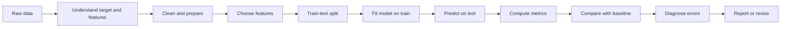
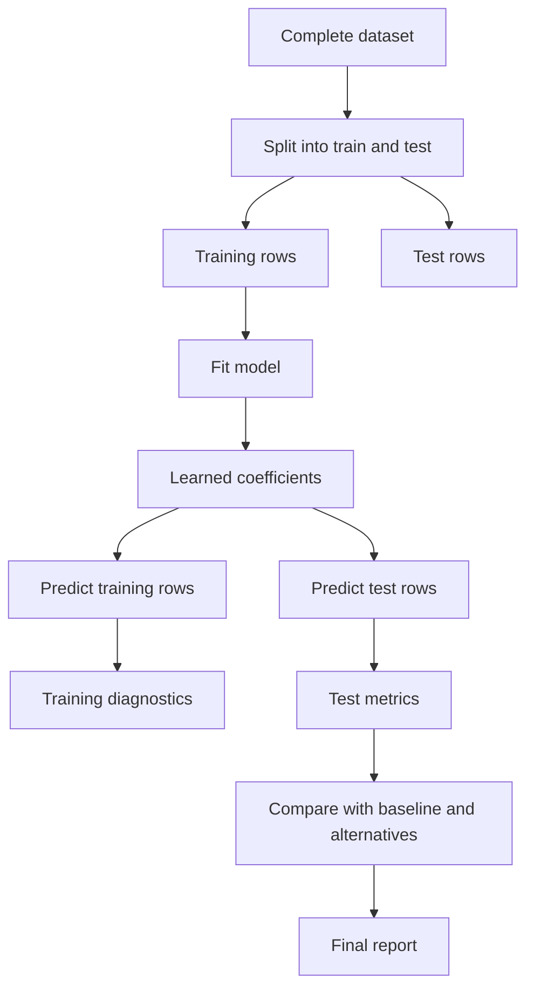
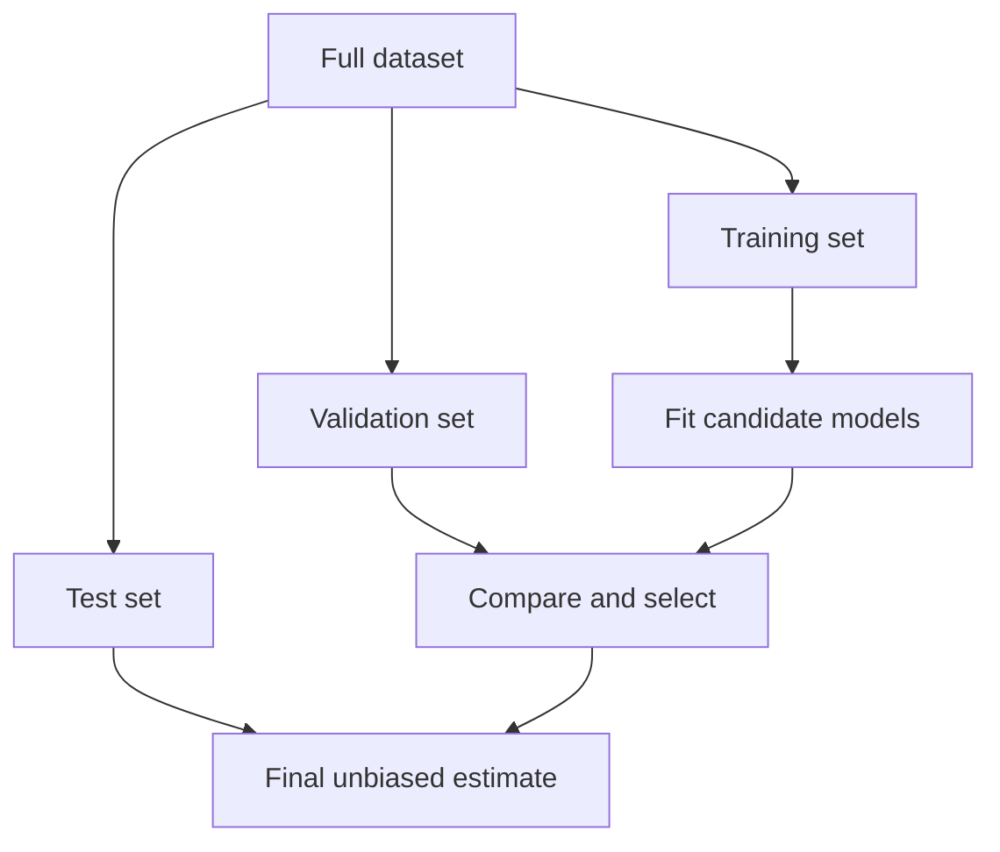
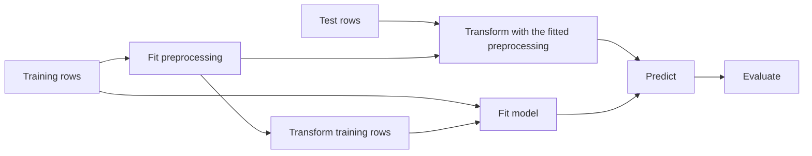
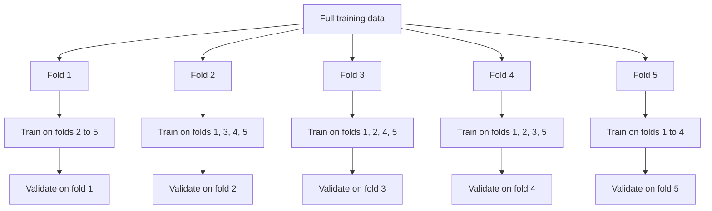
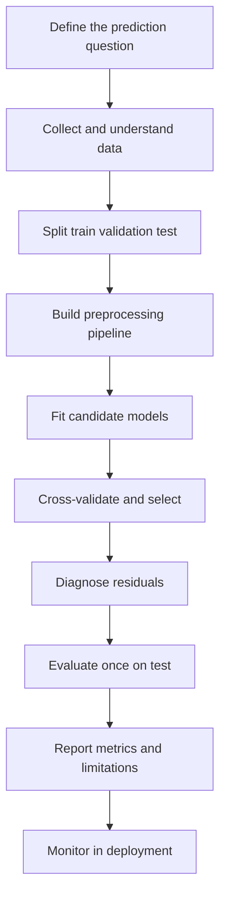

# Day 49 — Regression Metrics

> **Course:** CampusX — 100 Days of Machine Learning, Day 49
> **Official notebook:** `reference_notebooks/Untitled.ipynb` (39 cells; byte-identical copy of `vendor/100-days-of-machine-learning/day49-regression-metrics/Untitled.ipynb`)
> **Dataset:** `datasets/placement.csv` (200 rows, 2 columns; byte-identical copy of the vendor dataset)
> **Official video:** https://youtu.be/Ti7c-Hz7GSM
> **Transcript:** none exists for Day 49 in this workspace; nothing below is presented as a transcript quotation
> **Central question:** After fitting a regression line, how do we measure whether its predictions are good, how do we compare models fairly, and how do we avoid fooling ourselves with a single attractive number?

The notebook is small, but the topic is not. It builds one simple linear regression, evaluates it with MAE, MSE, RMSE, and $R^2$, then adds two features: a random feature and a feature constructed from the target. The random feature demonstrates the difference between an in-sample fit and a useful feature; the target-derived feature demonstrates target leakage. Those two experiments are the real lesson of the day. The formulas are easy; the evaluation discipline is what separates a reliable model report from a misleading one.

**Source labels used in this chapter**

- **Official** — the saved output in `reference_notebooks/Untitled.ipynb`. The notebook metadata says Python 3.8.3, and its execution counts are not monotonic, so some outputs were produced in a different execution order from the visible cell order.
- **Rerun** — a result reproduced in this workspace with Python 3.14.2, pandas 3.0.5, NumPy 2.5.3, scikit-learn 1.9.1, and matplotlib 3.11.2. Deterministic results match the official output exactly; unseeded random results do not.
- **Supplementary** — an explanation, experiment, or diagnostic added in this chapter. It is not presented as original course output.

---

# 1. Topic audit: the expected topic and the actual topic

## 1.1 What the notebook actually contains

The first request for this day expected a PCA implementation with standardization, covariance or eigen decomposition, explained variance, a two-dimensional projection, reconstruction, and sign ambiguity. The actual notebook does not contain any of those things. It imports `matplotlib`, `pandas`, `numpy`, `LinearRegression`, `train_test_split`, and four regression metrics. It fits a line to `cgpa` and `package`, evaluates it on a test split, and then adds a random feature and a target-derived feature.

The evidence is direct:

| Check | Result |
|---|---|
| Imports | `matplotlib.pyplot`, `pandas`, `numpy`, `LinearRegression`, `train_test_split`, `mean_absolute_error`, `mean_squared_error`, `r2_score` |
| Model | `LinearRegression` |
| Target | `package` (continuous, LPA) |
| Metrics | MAE, MSE, RMSE, $R^2$, adjusted $R^2$ |
| PCA imports | none |
| `StandardScaler` | none |
| covariance or eigen decomposition | none |
| explained-variance ratio | none |
| `PCA`, `fit_transform`, `inverse_transform` | none |
| projections, loadings, sign ambiguity | none |

## 1.2 Why the course sequence settles the question

The vendor repository names the day `day49-regression-metrics`. The neighbouring days are:

| Day | Vendor folder | Topic |
|---|---|---|
| 47 | `day47-pca` | PCA |
| 48 | `day48-simple-linear-regression` | Simple linear regression |
| 49 | `day49-regression-metrics` | Regression metrics |
| 50 | `day50-multiple-linear-regression` | Multiple linear regression |

PCA belongs to Day 47. Day 49 follows the simple linear regression of Day 48 and precedes multiple linear regression on Day 50. Writing a PCA chapter here would be a fabrication, not a correction. This chapter therefore teaches the actual Day 49 topic and records the mismatch explicitly.

## 1.3 The expected PCA items and their status here

| Expected PCA item | Status in this notebook | Where it belongs |
|---|---|---|
| PCA pipeline on real data | Not present | Day 47 |
| Standardization before PCA | Not present | Day 47 |
| Covariance matrix and eigen decomposition | Not present | Day 47 |
| Explained variance and choosing $k$ | Not present | Day 47 |
| Two-dimensional PCA visualization | Not present; the only 2D plots are scatter plots of raw variables | Day 47 |
| Reconstruction and `inverse_transform` | Not present | Day 47 |
| `PCA` API and attributes such as `components_`, `explained_variance_ratio_` | Not present | Day 47 |
| Relationship to SVD and sign ambiguity | Not present as a PCA topic; OLS itself can be solved with SVD, discussed supplementarily in Section 14 | Day 47 for PCA |
| Leakage and cross-validation | Relevant and covered here through train/test evaluation and target leakage | Both days, different forms |
| Limitations | Covered here for regression metrics | Both days |
| Comparison with raw features and feature selection | Covered here through the random-feature and adjusted-$R^2$ experiments | Day 49 |
| Class separation versus unsupervised variance | Not applicable: the target is continuous and no class labels exist | Day 47 for PCA, Day 59 for classification |
| Worked numerical examples on `placement.csv` | Covered extensively | Day 49 |
| Graph interpretation | Covered for the three scatter plots and the regression line | Day 49 |

## 1.4 What the notebook file contains, precisely

- It has 39 cells.
- All 39 are code cells; there are no Markdown cells.
- 38 cells are non-empty; cell 38 is empty.
- 22 cells have saved outputs: cells 2, 3, 5, 9, 10, 13, 14, 15, 16, 17, 18, 19, 20, 21, 25, 27, 28, 30, 31, 32, 36, and 37.
- The saved outputs include four figures: cells 3, 10, 21, and 31.
- The execution counts are not increasing: for example, cell 2 has execution count 37, cell 5 has 6, and cell 20 has 157. The notebook was edited and rerun in pieces.
- The reference copy has SHA-256 `04279f36217e6e50df4494baf32bb084988feca574a9ff1615838d00529b3503`, identical to the vendor file.
- The dataset copy has SHA-256 `513eafba3ba990c148b82802f3b82c0c67bb9a7689d30af54b3931a9a771b783`, identical to the vendor file.

The practical consequence of the non-monotonic execution counts is important: the two random experiments were generated from an unknown random-number-generator state. A fresh top-to-bottom run cannot reproduce their exact saved numbers, even though the deterministic cgpa-only model reproduces exactly. Section 10 and Section 11 treat this carefully.

---

# 2. Learning objectives

After studying this chapter I should be able to:

1. **Explain the prediction problem.** Describe why `package` is a continuous target, why `cgpa` is a feature, and why a regression model is appropriate rather than a classifier.
2. **Derive the ordinary least-squares line.** Write the model, the squared-error loss, the normal equations, and the slope and intercept formulas; compute them from the placement data.
3. **Define and compute residuals.** Compute a residual, the sum of squared errors, the total sum of squares, and the regression sum of squares, and explain the decomposition on training data.
4. **Compute MAE, MSE, and RMSE.** Calculate each by hand from a small table and from the actual test predictions, state their units, and explain what each penalises.
5. **Interpret $R^2$.** Explain the mean baseline, the ratio of squared errors, the meaning of zero and negative values, and why $R^2$ is not "percentage accuracy".
6. **Derive and use adjusted $R^2$.** Explain the degrees-of-freedom penalty, compute it for one and two predictors, and explain why it can fall when a useless feature is added.
7. **Read the notebook cell by cell.** Explain what every one of the 39 cells does, what its output means, and which cells contain errors, hard-coded values, or non-reproducible randomness.
8. **Diagnose the two feature experiments.** Explain why a random feature can make test $R^2$ rise by chance and why the `iq` feature is target leakage rather than evidence of a good predictor.
9. **Evaluate correctly.** Distinguish training, validation, and test evaluation; explain data leakage; use a pipeline and cross-validation; and avoid selecting a model on a repeatedly reused test set.
10. **Choose a metric.** Match MAE, MSE, RMSE, $R^2$, or a robust alternative to the real cost of error and the structure of the target.
11. **Answer interview and examination questions.** Give explanatory answers, derive formulas, and perform numerical calculations without hiding assumptions.
12. **Recognise the boundaries of the topic.** State clearly what this notebook does not do: no PCA, no classification, no causal inference, no residual diagnostics, and no uncertainty intervals.

---

# 3. Where this day sits in the machine-learning workflow

Regression metrics belong to the **evaluation** stage, but they depend on decisions made earlier:



The key ordering rule is:



Anything learned from data — a mean, a standard deviation, a coefficient, a feature-selection decision, or a random feature's distribution — must be learned from the training portion if it is going to influence the model. The test set is supposed to simulate unseen data. The notebook follows the split for the model itself, but it later uses the test set repeatedly to compare three models. That turns the test set into a validation set. Section 15 explains the consequence.

**Connection to previous and later days.**

- **Day 48 (simple linear regression)** introduced the line that is evaluated here. Day 49 asks how good that line is.
- **Day 47 (PCA)** is an unsupervised dimensionality-reduction topic. It is not the topic of this notebook. PCA would transform `X` without using `y`; Day 49 evaluates predictions of `y`.
- **Day 50 (multiple linear regression)** extends the same metrics to several predictors. The adjusted-$R^2$ formula already appears here with two predictors, which prepares for Day 50.
- **Day 51 and Day 52 (gradient descent)** will fit the same kind of model iteratively. The loss being minimised there is closely related to MSE.
- **Day 55 to Day 57 (regularisation)** add penalties to the coefficients. Metrics alone do not choose the penalty strength; cross-validation does.
- **Day 59 (classification metrics)** replaces residuals with confusion-matrix counts. Accuracy, precision, recall, and F1 are not interchangeable with regression metrics.

---

# 4. The dataset and the prediction problem

## 4.1 The raw table

`placement.csv` has two columns and 200 rows:

| Column | Meaning in this lesson | Type | Unit |
|---|---|---|---|
| `cgpa` | Cumulative grade point average | continuous feature | grade points |
| `package` | Placement package | continuous target | LPA (lakhs per annum) |

The first five rows are:

| Row | `cgpa` | `package` |
|---:|---:|---:|
| 0 | 6.89 | 3.26 |
| 1 | 5.12 | 1.98 |
| 2 | 7.82 | 3.25 |
| 3 | 7.42 | 3.67 |
| 4 | 6.94 | 3.57 |

There are no missing values and no duplicate rows in the file. The data is a teaching dataset supplied with the course; the file itself does not document how the values were generated, so this chapter does not invent a real-world source or claim that the relationship is causal.

## 4.2 Descriptive statistics

The full-data summaries are:

| Statistic | `cgpa` | `package` |
|---|---:|---:|
| count | 200 | 200 |
| mean | 6.9905 | 2.99605 |
| standard deviation (sample, ddof 1) | 1.069409 | 0.691644 |
| minimum | 4.26 | 1.37 |
| 25th percentile | 6.19 | 2.4875 |
| median | 6.965 | 2.995 |
| 75th percentile | 7.7375 | 3.4925 |
| maximum | 9.58 | 4.62 |

The sample covariance is

$$
s_{xy}=\frac{1}{n-1}\sum_{i=1}^{n}(x_i-\bar x)(y_i-\bar y)=0.6514044975,
$$

and the sample correlation is

$$
r_{xy}=\frac{s_{xy}}{s_x s_y}=0.8806924694.
$$

There are 163 distinct `cgpa` values and 138 distinct `package` values. Twenty-six `cgpa` values occur more than once, so the data is not a set of 200 completely unique feature values. That matters slightly for interpretation: the same CGPA can be associated with different packages, which is exactly why a regression line has residuals.

## 4.3 Why this is a regression problem

The target `package` is a numerical quantity with meaningful order and meaningful differences. A prediction of 3.4 LPA is between 3.2 and 3.6 LPA in a way that a class label is not. The natural loss is therefore a function of the numerical error $y-\hat y$, not a count of correct class labels.

This is not a classification problem even if someone discretises `package` into "high" and "low". Discretising would discard the magnitude of the error and change the question. Day 59 covers classification metrics; this day stays with continuous prediction.

## 4.4 What the model is asked to do

The model receives one feature, `cgpa`, and predicts the conditional mean of `package` under a linear functional form:

$$
\mathbb{E}[\,\text{package}\mid\text{cgpa}\,]\approx \beta_0+\beta_1\,\text{cgpa}.
$$

The word **linear** refers to linearity in the parameters $\beta_0$ and $\beta_1$, not to the feature being linear in time or in any other sense. A model with a transformed feature such as $\text{cgpa}^2$ can still be a linear regression model in the parameters, although the fitted curve in the original feature is nonlinear.

The word **conditional mean** matters. The line does not promise that every student with CGPA 7.0 earns exactly the predicted package. It estimates the centre of the package distribution at that CGPA. The spread around the line is the residual variation.

---

# 5. Simple linear regression from the beginning

## 5.1 The model equation

For observations $i=1,\dots,n$, the simple linear regression model is

$$
y_i=\beta_0+\beta_1 x_i+\varepsilon_i,
$$

where

- $y_i$ is the observed target for observation $i$;
- $x_i$ is the observed feature;
- $\beta_0$ is the population intercept;
- $\beta_1$ is the population slope;
- $\varepsilon_i$ is the error term, the part of $y_i$ not explained by the linear relationship.

The fitted model replaces the unknown population parameters with estimates:

$$
\hat y_i=\hat\beta_0+\hat\beta_1 x_i.
$$

The **residual** is the difference between the observed and fitted values:

$$
e_i=y_i-\hat y_i.
$$

A positive residual means the model under-predicted; a negative residual means it over-predicted. The residual is not the same as the population error $\varepsilon_i$, because the fitted line is estimated from the same data. Residuals are observable; errors are not.

## 5.2 The ordinary least-squares criterion

Ordinary least squares (OLS) chooses the intercept and slope that minimise the residual sum of squares:

$$
Q(\beta_0,\beta_1)=\sum_{i=1}^{n}\left(y_i-\beta_0-\beta_1x_i\right)^2.
$$

Why square the residuals?

- Positive and negative residuals should not cancel, so we need a nonnegative penalty.
- Squaring penalises large errors more strongly than small ones.
- The resulting objective is differentiable and has a closed-form solution.
- Under the Gauss–Markov assumptions, OLS is the best linear unbiased estimator (BLUE).

Squaring is a choice, not a law of nature. Minimising the sum of absolute residuals gives least-absolute-deviations regression and a different fitted line. Section 7 compares the two.

## 5.3 Deriving the slope and intercept

Take partial derivatives and set them to zero:

$$
\frac{\partial Q}{\partial \beta_0}
=-2\sum_{i=1}^{n}\left(y_i-\beta_0-\beta_1x_i\right)=0,
$$

$$
\frac{\partial Q}{\partial \beta_1}
=-2\sum_{i=1}^{n}x_i\left(y_i-\beta_0-\beta_1x_i\right)=0.
$$

The first equation gives

$$
\sum_{i=1}^{n}y_i=n\beta_0+\beta_1\sum_{i=1}^{n}x_i,
$$

so

$$
\bar y=\beta_0+\beta_1\bar x.
$$

Substituting $\beta_0=\bar y-\beta_1\bar x$ into the second equation and simplifying gives

$$
\hat\beta_1
=
\frac{\sum_{i=1}^{n}(x_i-\bar x)(y_i-\bar y)}
{\sum_{i=1}^{n}(x_i-\bar x)^2}
=
\frac{S_{xy}}{S_{xx}},
$$

and then

$$
\hat\beta_0=\bar y-\hat\beta_1\bar x.
$$

The notation $S_{xx}$ is the sum of squared deviations of $x$, not the sample variance; $S_{xx}/(n-1)=s_x^2$. Similarly $S_{xy}/(n-1)=s_{xy}$.

## 5.4 Why the formulas make sense

The slope is the covariance between $x$ and $y$ divided by the variance of $x$. In words:

- If $x$ and $y$ move together, $S_{xy}$ is positive and the slope is positive.
- If they move in opposite directions, $S_{xy}$ is negative and the slope is negative.
- If $x$ has a large spread, a given covariance produces a smaller slope, because a one-unit change in $x$ is a smaller fraction of the observed range.
- If $x$ has no variation, $S_{xx}=0$ and the slope is undefined. The design matrix is rank-deficient.

The intercept is chosen so that the line passes through the point of means $(\bar x,\bar y)$. This is a useful check: after fitting, the prediction at $x=\bar x$ should equal $\bar y$ (up to floating-point error).

## 5.5 Full-data fit on `placement.csv`

Using all 200 rows:

$$
\bar x=6.9905,\qquad \bar y=2.99605,
$$

$$
S_{xx}=227.58335,\qquad S_{xy}=129.629495.
$$

Therefore

$$
\hat\beta_1=\frac{129.629495}{227.58335}=0.5695912948,
$$

$$
\hat\beta_0=2.99605-0.5695912948(6.9905)=-0.9856779463.
$$

The full-data line is

$$
\widehat{\text{package}}=-0.9856779463+0.5695912948\,\text{cgpa}.
$$

The slope says that one additional CGPA point is associated with about 0.570 LPA higher predicted package in this dataset. The intercept says that a CGPA of zero would predict a package of about $-0.986$ LPA, which is outside the observed CGPA range and meaningless in context. Do not interpret the intercept as a real salary.

The full-data $R^2$ is

$$
R^2=0.7756192256,
$$

which equals $r_{xy}^2=(0.8806924694)^2$ for this simple linear regression fitted on the same data. Section 7.4 explains why that equality is special to the training fit and does not automatically hold on a test set.

## 5.6 Training-split fit used by the notebook

The notebook does not fit on all 200 rows. It uses an 80/20 split with `random_state=2`:

- training rows: 160;
- test rows: 40.

The training fit is

$$
\hat\beta_1=0.5579519734,\qquad
\hat\beta_0=-0.8961119222.
$$

The training line is therefore

$$
\widehat{\text{package}}=-0.8961119222+0.5579519734\,\text{cgpa}.
$$

The training means and sums are:

| Quantity | Value |
|---|---:|
| training mean `cgpa` | 6.9899375 |
| training mean `package` | 3.0039375 |
| $S_{xx}$ | 181.3844994 |
| $S_{xy}$ | 101.2038394 |
| slope | 0.5579519734 |
| intercept | -0.8961119222 |

The slope differs from the full-data slope because the training split is a different sample. This is ordinary sampling variation, not an error.

## 5.7 Prediction examples

Using the training fit:

$$
\hat y(6.0)=-0.8961119222+0.5579519734(6.0)=2.4515999,
$$

$$
\hat y(8.0)=-0.8961119222+0.5579519734(8.0)=3.5675039.
$$

The difference is

$$
\hat y(8.0)-\hat y(6.0)=0.5579519734(2)=1.1159039,
$$

which is exactly two times the slope. A one-unit increase in CGPA changes the prediction by 0.5579519734 LPA, regardless of the starting CGPA. That constant marginal effect is the defining feature of a linear model.

## 5.8 The OLS assumptions, stated precisely

OLS is a computational procedure; it always produces coefficients when the design matrix has full column rank. The statistical interpretation of those coefficients and their standard errors relies on assumptions:

1. **Linearity in parameters:** the conditional mean is $\beta_0+\beta_1x$. The functional form is correct.
2. **Random sampling or a valid design:** the observations are representative of the population or the design is fixed and appropriate.
3. **No perfect collinearity:** in simple regression, $x$ is not constant. With several predictors, no predictor is an exact linear combination of the others.
4. **Zero conditional mean of errors:** $\mathbb{E}[\varepsilon\mid x]=0$. Omitted variables, measurement error, or simultaneity can violate this.
5. **Homoscedasticity:** $\operatorname{Var}(\varepsilon\mid x)=\sigma^2$, constant across $x$. If the spread changes, OLS is still unbiased under the other assumptions but is no longer efficient, and ordinary standard errors are wrong.
6. **Independence:** the errors are not correlated across observations. Time series, clustered students, or repeated measurements can violate this.
7. **Normality of errors (for exact finite-sample inference):** $\varepsilon\mid x\sim\mathcal{N}(0,\sigma^2)$. Normality is not required for unbiasedness or for the Gauss–Markov theorem, but it is used for exact $t$- and $F$-tests and for normal prediction intervals.

The notebook does not check these assumptions. It computes point metrics. Section 16 lists what a serious analysis would add.

## 5.9 Standard errors and inference (supplementary)

Although the notebook does not report inference, the training fit allows a compact illustration. The residual standard error is

$$
\hat\sigma=\sqrt{\frac{SSE}{n-2}}.
$$

With $SSE=16.5527375$ and $n=160$,

$$
\hat\sigma=\sqrt{\frac{16.5527375}{158}}=0.3236729.
$$

The standard error of the slope is

$$
SE(\hat\beta_1)=\sqrt{\frac{\hat\sigma^2}{S_{xx}}}
=\sqrt{\frac{0.1047642}{181.3844994}}
=0.0240329.
$$

The ratio is

$$
t=\frac{0.5579519734}{0.0240329}=23.216,
$$

which is very large. Under the usual assumptions, this is strong evidence that the training slope is not zero. This calculation is supplementary: the notebook never computes it, and the test-set metrics are not a substitute for it.

**Important distinction.** A small $p$-value for the slope does not mean the model predicts well. With a large enough sample, a tiny and practically irrelevant slope can be statistically significant. Conversely, a large $R^2$ on one test split does not prove that the population slope is nonzero. Statistical significance, effect size, and predictive accuracy are different questions.

---

# 6. Residuals and the decomposition of error

## 6.1 The three sums of squares

For a fitted model with an intercept, define:

$$
SSE=\sum_{i=1}^{n}(y_i-\hat y_i)^2
=\sum_{i=1}^{n}e_i^2,
$$

$$
SST=\sum_{i=1}^{n}(y_i-\bar y)^2,
$$

$$
SSR=\sum_{i=1}^{n}(\hat y_i-\bar y)^2.
$$

The names are not standardised across software: SSE is sometimes called SSR (sum of squared residuals), and SSR is sometimes called the regression sum of squares or explained sum of squares. This chapter uses:

- **SSE** = error sum of squares;
- **SST** = total sum of squares;
- **SSR** = regression (explained) sum of squares.

On the **training data**, when the model includes an intercept,

$$
SST=SSE+SSR.
$$

This is an algebraic identity, not an approximation. It holds because the residuals are orthogonal to the fitted values and to the intercept:

$$
\sum_{i=1}^{n}e_i=0,
\qquad
\sum_{i=1}^{n}\hat y_i e_i=0.
$$

The first property says the residuals sum to zero on the training data. The second says the fitted values are uncorrelated with the residuals.

## 6.2 Why the identity fails on a test set

The test residuals do not generally sum to zero, because the test mean is not the mean of the training fitted values. In the placement test split:

$$
\sum_{i=1}^{40}e_i=-1.6402696,
\qquad
\bar e=-0.0410067.
$$

The model's average prediction on the test set is 3.0055067, while the test target mean is 2.9645. The model is slightly high on average. Consequently,

$$
SST=22.12659,
$$

$$
SSE=4.8516941,
$$

$$
SSR=\sum(\hat y_i-\bar y_{\text{test}})^2=14.4493662,
$$

and

$$
SSE+SSR=19.3010603\ne SST.
$$

The gap is not a bug. The decomposition $SST=SSE+SSR$ is a training-sample identity. On a test set, $R^2=1-SSE/SST$ is still a valid descriptive ratio, but $SSR/SST$ is not generally the same number, and calling $R^2$ "the proportion of variance explained" requires care. Section 7.4 discusses the precise interpretation.

## 6.3 A residual table from the actual test set

The first ten test observations, using the training fit, are:

| Test row | `cgpa` | Actual `package` | Prediction | Residual $e$ | $|e|$ | $e^2$ |
|---:|---:|---:|---:|---:|---:|---:|
| 0 | 8.58 | 4.10 | 3.891116 | 0.208884 | 0.208884 | 0.043633 |
| 1 | 7.15 | 3.49 | 3.093245 | 0.396755 | 0.396755 | 0.157415 |
| 2 | 5.88 | 2.08 | 2.384646 | -0.304646 | 0.304646 | 0.092809 |
| 3 | 6.22 | 2.33 | 2.574349 | -0.244349 | 0.244349 | 0.059707 |
| 4 | 4.57 | 1.94 | 1.653729 | 0.286271 | 0.286271 | 0.081951 |
| 5 | 4.79 | 1.48 | 1.776478 | -0.296478 | 0.296478 | 0.087899 |
| 6 | 5.32 | 1.86 | 2.072193 | -0.212193 | 0.212193 | 0.045026 |
| 7 | 6.86 | 3.09 | 2.931439 | 0.158561 | 0.158561 | 0.025142 |
| 8 | 8.35 | 4.21 | 3.762787 | 0.447213 | 0.447213 | 0.199999 |
| 9 | 6.87 | 2.87 | 2.937018 | -0.067018 | 0.067018 | 0.004491 |

The signs alternate. There is no obvious pattern in this short block, but ten rows are not enough to diagnose the model. A proper residual plot uses all 40 test rows, or all 160 training rows, and plots residuals against fitted values or against the feature.

## 6.4 Residual diagnostics the notebook does not perform

A complete regression evaluation would check:

1. **Residual versus fitted values.** A curved pattern suggests a missing nonlinear term. A funnel shape suggests heteroscedasticity. A few isolated points suggest outliers or high leverage.
2. **Residual versus each feature.** A pattern suggests that the feature enters nonlinearly or interacts with another variable.
3. **Normal Q–Q plot or histogram of residuals.** Strong skewness or heavy tails affects intervals and tests, although not the OLS point estimates.
4. **Scale–location plot.** Checks whether the residual spread changes with the fitted value.
5. **Leverage and Cook's distance.** Identifies observations that have unusual feature values or a large influence on the coefficients.
6. **Autocorrelation plot.** Relevant when the rows have an order, such as time.
7. **Out-of-sample residual plot.** Checks whether the error pattern persists on test data, not only in-sample.

The absence of these diagnostics is a limitation of the notebook, not evidence that the assumptions hold.

## 6.5 Training versus test error

The training metrics are:

| Metric | Training (160 rows) | Test (40 rows) |
|---|---:|---:|
| MAE | 0.252968 | 0.288471 |
| MSE | 0.103455 | 0.121292 |
| RMSE | 0.321644 | 0.348271 |
| $R^2$ | 0.773311 | 0.780730 |

The test $R^2$ is slightly higher than the training $R^2$, and the test errors are slightly larger. This is a small, ordinary split-to-split difference. It does not mean the model is "better on test"; it means the particular 40 test rows happen to be fitted slightly better relative to their own variance than the 160 training rows. With only 40 test observations, such fluctuations are expected. Section 15 shows cross-validation folds ranging from $R^2=0.674$ to $0.834$.

---

# 7. The regression metrics in depth

## 7.1 Mean absolute error (MAE)

### Definition

$$
\operatorname{MAE}
=\frac{1}{n}\sum_{i=1}^{n}|y_i-\hat y_i|
=\frac{1}{n}\sum_{i=1}^{n}|e_i|.
$$

### Units and interpretation

MAE is in the same unit as the target. In this notebook, the target is in LPA, so MAE is in LPA. The official test MAE is 0.288471 LPA. A compact interpretation is:

> On this test set, the model's predictions differ from the actual package by about 0.29 LPA on average, ignoring the direction of the error.

This is not "the model is 0.29 LPA accurate" in a formal sense. It is the average absolute residual on these 40 rows. A different test sample would produce a different value.

### What MAE optimises

If a model were allowed to predict a single constant $c$ for all observations, the value that minimises the expected absolute error is the **median** of the target distribution:

$$
\arg\min_c \mathbb{E}[|Y-c|]
=\operatorname{median}(Y).
$$

For a finite sample, the sample median minimises $\sum_i|y_i-c|$. This is why MAE is associated with median regression and is more robust to extreme target values than MSE.

### Worked calculation from the test set

Using all 40 test rows:

$$
\sum_{i=1}^{40}|e_i|=11.5388437,
$$

so

$$
\operatorname{MAE}=\frac{11.5388437}{40}=0.2884711.
$$

The first five rows alone give

$$
\frac{0.208884+0.396755+0.304646+0.244349+0.286271}{5}
=\frac{1.440905}{5}=0.288181.
$$

That is close to the full-test MAE, but it is not the same number. A subset is not a substitute for the full evaluation.

### Strengths

- Same unit as the target, so it is easy to explain to a non-specialist.
- Less sensitive to a single large error than MSE or RMSE.
- Corresponds to a clear central tendency (the median).
- Works when the target has outliers that should not dominate the loss.

### Limitations

- Not differentiable at zero, which complicates some optimisation algorithms, although subgradient methods and linear programming can handle it.
- Treats all absolute errors linearly: an error of 1.0 costs ten times an error of 0.1, but an error of 10.0 costs only ten times an error of 1.0, not one hundred times.
- Can be dominated by many small errors even when a few large errors are practically unacceptable.
- Scale-dependent: an MAE of 0.29 is good for packages in LPA but meaningless without the target's scale.
- It does not penalise bias separately. A model that over-predicts half the rows and under-predicts the other half can have a low MAE while being systematically wrong in a subgroup.

### When to prefer MAE

Prefer MAE when:

- the cost of an error is roughly proportional to its absolute size;
- the target has heavy tails or outliers that are genuine and should not dominate;
- the median is a more meaningful centre than the mean for the business problem;
- you need a metric that is easy to communicate in the target's units.

## 7.2 Mean squared error (MSE)

### Definition

$$
\operatorname{MSE}
=\frac{1}{n}\sum_{i=1}^{n}(y_i-\hat y_i)^2
=\frac{1}{n}\sum_{i=1}^{n}e_i^2.
$$

### Units and interpretation

MSE is in the **square** of the target unit. Here it is in LPA squared, which is not directly interpretable as a salary. The official test MSE is 0.121292 LPA$^2$. Its main uses are:

- as the objective that OLS minimises;
- as a mathematically convenient loss for optimisation and statistical theory;
- as the basis for RMSE, which returns to the original unit.

### What MSE optimises

If a model predicts a single constant $c$, the value that minimises the expected squared error is the **mean**:

$$
\arg\min_c \mathbb{E}[(Y-c)^2]
=\mathbb{E}[Y].
$$

For a finite sample, the sample mean minimises $\sum_i(y_i-c)^2$. This is why MSE is associated with mean prediction and is more sensitive to extreme values than MAE.

### Worked calculation from the test set

The sum of squared residuals is

$$
SSE=4.8516941,
$$

so

$$
\operatorname{MSE}=\frac{4.8516941}{40}=0.1212924.
$$

The first five squared residuals sum to 0.435514, giving a subset MSE of 0.087103. Again, the subset differs from the full-test value.

### Why squaring matters

Compare two error vectors:

$$
e_A=(0,0,0,10),
\qquad
e_B=(2.5,2.5,2.5,2.5).
$$

Both have the same mean absolute error:

$$
\operatorname{MAE}(e_A)=\frac{10}{4}=2.5,
\qquad
\operatorname{MAE}(e_B)=2.5.
$$

But the MSEs are very different:

$$
\operatorname{MSE}(e_A)=\frac{100}{4}=25,
\qquad
\operatorname{MSE}(e_B)=\frac{4(6.25)}{4}=6.25.
$$

MSE penalises the single large error much more strongly. RMSE makes the comparison visible in the original unit:

$$
\operatorname{RMSE}(e_A)=5,
\qquad
\operatorname{RMSE}(e_B)=2.5.
$$

This is the central trade-off: if one large error is catastrophic, MSE or RMSE is appropriate; if many small errors matter more than one large one, MAE may be appropriate.

### The bias–variance decomposition (supplementary)

For an estimator $\hat y$ of a target $y$ with independent noise $\varepsilon$,

$$
\mathbb{E}[(y-\hat y)^2]
=
\left(\mathbb{E}[\hat y]-y\right)^2
+
\operatorname{Var}(\hat y)
+
\operatorname{Var}(\varepsilon).
$$

The three terms are squared bias, variance, and irreducible noise. This decomposition is about expected prediction error over repeated samples; the MSE computed on one test set is a single noisy estimate of that quantity. It helps explain why a more complex model can reduce bias but increase variance. It does not mean that every observed MSE can be split into these three parts without knowing the true model.

### Strengths

- Differentiable and convex in the model parameters for linear regression.
- Leads to closed-form OLS solutions.
- Penalises large errors strongly, which is appropriate when large errors are disproportionately costly.
- Has a clean relationship to variance and to the $R^2$ decomposition.

### Limitations

- Not in the target unit, so it is hard to communicate.
- Sensitive to outliers and heavy tails.
- A single extreme error can dominate the entire metric.
- The squared scale can make comparisons across different target transformations misleading.
- Like all point metrics, it does not reveal where or why the errors occur.

## 7.3 Root mean squared error (RMSE)

### Definition

$$
\operatorname{RMSE}
=\sqrt{\operatorname{MSE}}
=\sqrt{\frac{1}{n}\sum_{i=1}^{n}(y_i-\hat y_i)^2}.
$$

### Units and interpretation

RMSE returns to the target unit. The official test RMSE is 0.348271 LPA. A compact interpretation is:

> The model's typical squared-error magnitude, expressed back in LPA, is about 0.35 LPA.

This is not the same as "the average error is 0.35 LPA"; the average absolute error is 0.288 LPA. RMSE is larger because squaring gives more weight to the larger residuals before the square root is taken.

### Worked calculation

$$
\operatorname{RMSE}
=\sqrt{0.1212924}
=0.3482705.
$$

### RMSE versus MAE

Both are in the target unit, but they answer different questions:

- MAE asks: what is the average absolute size of the errors?
- RMSE asks: what is the square root of the average squared error?

For any finite error vector, RMSE is at least as large as MAE:

$$
\frac{1}{n}\sum_{i=1}^{n}e_i^2
\ge
\left(\frac{1}{n}\sum_{i=1}^{n}|e_i|\right)^2
\quad\Longrightarrow\quad
\operatorname{RMSE}\ge\operatorname{MAE}.
$$

Equality holds only when all absolute errors are equal. In this notebook,

$$
\frac{\operatorname{RMSE}}{\operatorname{MAE}}
=\frac{0.3482705}{0.2884711}
=1.2073,
$$

so the errors are not all equal; there is some concentration of larger errors.

### What RMSE does not tell you

RMSE does not tell you the direction of the errors, the number of large errors, or whether the model is biased. A model with RMSE 0.35 could have many small errors and one large error, or a moderate error on every row. Always inspect the residual distribution.

### When to prefer RMSE

Prefer RMSE when:

- large errors are disproportionately costly;
- you want a metric in the target unit that still penalises large errors;
- the squared-error loss matches the model's training objective;
- the target distribution is not dominated by extreme outliers that should be ignored.

## 7.4 The coefficient of determination $R^2$

### Definition

$$
R^2
=1-\frac{SSE}{SST}
=1-\frac{\sum_{i=1}^{n}(y_i-\hat y_i)^2}
{\sum_{i=1}^{n}(y_i-\bar y)^2}.
$$

The denominator is the squared error of the **mean baseline**: a model that always predicts the mean of the evaluation target. The numerator is the squared error of the fitted model. Therefore:

- $R^2=1$: the model's squared error is zero on this evaluation set;
- $R^2=0$: the model's squared error equals the mean baseline's squared error;
- $R^2<0$: the model is worse than the mean baseline on this evaluation set;
- $R^2$ can be negative even though it is called "R squared".

### The official value

For the placement test split:

$$
SSE=4.8516941,
\qquad
SST=22.12659,
$$

so

$$
R^2=1-\frac{4.8516941}{22.12659}
=0.7807301.
$$

A compact interpretation is:

> On this test set, the model removes about 78.07 percent of the squared error that the mean baseline would make.

Equivalently, the model's squared error is about 21.93 percent of the baseline's squared error:

$$
1-R^2=0.2192699.
$$

### What $R^2$ is not

$R^2$ is not:

- the percentage of rows predicted correctly;
- the percentage of variance "caused" by the feature;
- a measure of whether the model is scientifically valid;
- a guarantee that predictions are accurate in the target unit;
- comparable across different datasets, different targets, or different transformations of the target;
- necessarily positive on a test set.

A model with $R^2=0.78$ can still have errors that are unacceptable in a business context. A model with $R^2=0.20$ can be useful if the target is inherently noisy and the baseline is weak.

### $R^2$ and correlation

For a simple linear regression with an intercept, fitted and evaluated on the **same** data,

$$
R^2=r_{xy}^2.
$$

This holds because

$$
SSR=\hat\beta_1^2 S_{xx}
=\frac{S_{xy}^2}{S_{xx}},
\qquad
SST=S_{yy},
$$

and therefore

$$
\frac{SSR}{SST}
=\frac{S_{xy}^2}{S_{xx}S_{yy}}
=r_{xy}^2.
$$

On the full placement data:

$$
r_{xy}=0.8806924694,
\qquad
r_{xy}^2=0.7756192256,
$$

which matches the full-data $R^2$. On the training split, $R^2=0.7733111$, which also matches the squared training correlation.

On the **test** set, the equality does not generally hold. The test correlation between predictions and actual values is

$$
r(\hat y_{\text{test}},y_{\text{test}})=0.8891869397,
$$

whose square is

$$
r^2=0.7906534137,
$$

but the test $R^2$ is

$$
R^2=0.7807301475.
$$

The difference is about 0.009923. Why? The test predictions were fitted on the training data, not on the test data. The derivation of $R^2=r^2$ assumes that the predictions are the OLS fit for the same observations used in the correlation. When the model is external to the evaluation set, the identity fails.

### A negative $R^2$ example

Suppose the true values are $y=(1,2,3)$ and a model predicts $(10,10,10)$. The mean is 2, so

$$
SST=(1-2)^2+(2-2)^2+(3-2)^2=2.
$$

The squared error is

$$
SSE=(1-10)^2+(2-10)^2+(3-10)^2=81+64+49=194.
$$

Therefore

$$
R^2=1-\frac{194}{2}=1-97=-96.
$$

The model is far worse than predicting the mean. Negative $R^2$ is a warning, not an impossibility.

### $R^2$ and MSE

$R^2$ is a normalised version of MSE:

$$
R^2=1-\frac{n\cdot\operatorname{MSE}}{SST}.
$$

For a fixed evaluation set, lower MSE means higher $R^2$. But across datasets, the same MSE can correspond to different $R^2$ values because $SST$ differs. This is why $R^2$ cannot be compared across datasets with different target variance.

### $R^2$ and explained variance score

`sklearn.metrics.explained_variance_score` uses

$$
1-\frac{\operatorname{Var}(y-\hat y)}{\operatorname{Var}(y)}.
$$

It differs from $R^2$ when the residuals have a nonzero mean. On the placement test set:

$$
R^2=0.7807301,
\qquad
\text{explained variance}=0.7837700.
$$

The difference is small here, but it is conceptually important. $R^2$ uses the raw squared error around zero residual; explained variance centers the residuals first. Do not use the two names interchangeably.

### Strengths of $R^2$

- Scale-free, so it is easy to compare models on the same target and split.
- Has a clear baseline interpretation.
- Connects naturally to the ANOVA decomposition on training data.
- Is the default `score` of scikit-learn regressors.

### Limitations of $R^2$

- Can be negative on test data.
- Depends on the variance of the evaluation target.
- Increases mechanically when features are added in-sample.
- Does not reveal error magnitude in the target unit.
- Is sensitive to outliers because it uses squared errors.
- Does not establish causality.
- Can be high even when residual diagnostics show a badly misspecified model.
- Is a point estimate with sampling uncertainty, especially on small test sets.

## 7.5 Adjusted $R^2$

### The problem adjusted $R^2$ addresses

In-sample $R^2$ never decreases when a new feature is added to a model with an intercept. Even a random feature can reduce $SSE$ slightly by chance. Therefore in-sample $R^2$ cannot be used to decide whether a feature is useful: it rewards complexity automatically.

Adjusted $R^2$ imposes a degrees-of-freedom penalty. Let:

- $n$ be the number of observations used in the evaluation;
- $p$ be the number of predictors, excluding the intercept;
- $SSE$ be the error sum of squares;
- $SST$ be the total sum of squares.

The adjusted $R^2$ is

$$
R^2_{\text{adj}}
=1-\frac{SSE/(n-p-1)}{SST/(n-1)}
=1-(1-R^2)\frac{n-1}{n-p-1}.
$$

The numerator $SSE/(n-p-1)$ is an estimate of the error variance; the denominator $SST/(n-1)$ is an estimate of the target variance. The ratio compares the model's residual variance with the total variance, after accounting for the number of parameters estimated.

### Worked calculation for one predictor

The notebook's first model has $n=40$ test rows and $p=1$ predictor. The test $R^2$ is 0.7807301475. Therefore

$$
R^2_{\text{adj}}
=1-(1-0.7807301475)\frac{40-1}{40-1-1}
=1-(0.2192698525)\frac{39}{38}
=0.7749598882.
$$

This is the value in cell 19. It is lower than $R^2$ because the penalty factor $39/38>1$.

### Worked calculation for two predictors

For the random-feature model, $p=2$. The test $R^2$ is 0.7811338512. Therefore

$$
R^2_{\text{adj}}
=1-(1-0.7811338512)\frac{39}{37}
=0.7693032486.
$$

For the `iq` model, $p=2$ and the test $R^2$ is 0.8000928966. Therefore

$$
R^2_{\text{adj}}
=1-(1-0.8000928966)\frac{39}{37}
=0.7892871072.
$$

These are the values in cells 28 and 37.

### Why adjusted $R^2$ can fall when $R^2$ rises

Compare the cgpa-only and random-feature models:

| Model | $p$ | Test $R^2$ | Test adjusted $R^2$ |
|---|---:|---:|---:|
| `cgpa` only | 1 | 0.780730 | 0.774960 |
| `cgpa` + random feature | 2 | 0.781134 | 0.769303 |
| `cgpa` + `iq` (leaky) | 2 | 0.800093 | 0.789287 |

The random feature raises test $R^2$ by 0.000404, but adjusted $R^2$ falls by 0.005657. The penalty for the extra parameter is larger than the tiny apparent gain. This is exactly the behaviour adjusted $R^2$ is designed to expose.

### The degrees-of-freedom trap

The formula uses $p$, the number of predictors excluding the intercept. If you pass the wrong $p$, the result is wrong. For the random-feature model:

- correct $p=2$: adjusted $R^2=0.769303$;
- incorrect $p=1$: adjusted $R^2=0.775374$.

The incorrect value is higher and makes the random feature look almost harmless. Always count the predictors actually used by the model.

The formula also requires $n>p+1$. If $n=p+1$, the denominator is zero. If $n<p+1$, the adjusted $R^2$ is not defined in the usual sense.

### Is adjusted $R^2$ appropriate on a test set?

The formula is usually presented for a model fitted and evaluated on the same sample. The notebook applies it to test $R^2$, using $n=40$ and $p$ from the model. This is a teaching demonstration of the penalty, not a standard inferential procedure. On a test set, the model's coefficients were estimated from 160 training rows, not 40 test rows, so the degrees-of-freedom accounting does not match the actual estimation. Treat the notebook's adjusted $R^2$ as a descriptive complexity penalty, and prefer cross-validation for real model selection.

## 7.6 Other regression metrics (supplementary)

### Median absolute error

$$
\operatorname{MedAE}=\operatorname{median}(|y_i-\hat y_i|).
$$

The official test MedAE is 0.2516271 LPA. It is robust to a few large errors and is useful when the median error is more representative than the mean. It is not differentiable and is less commonly used as a training loss.

### Maximum error

$$
\operatorname{MaxError}=\max_i|y_i-\hat y_i|.
$$

The official test maximum absolute error is 0.8463711 LPA, at test row 33 (`cgpa` 6.60, actual 1.94, prediction 2.786371). Maximum error is useful for worst-case guarantees but is extremely sensitive to a single observation.

### Mean absolute percentage error

$$
\operatorname{MAPE}
=\frac{100}{n}\sum_{i=1}^{n}\left|\frac{y_i-\hat y_i}{y_i}\right|.
$$

On the placement test set, MAPE is 10.6234 percent. MAPE is scale-free and easy to explain, but it has serious problems:

- it is undefined when $y_i=0$;
- it explodes when $y_i$ is near zero;
- it is asymmetric: over-prediction and under-prediction of the same absolute size receive different percentage penalties;
- it is not a proper scoring rule for all distributions.

### Symmetric mean absolute percentage error

$$
\operatorname{sMAPE}
=\frac{100}{n}\sum_{i=1}^{n}
\frac{2|y_i-\hat y_i|}{|y_i|+|\hat y_i|}.
$$

On the placement test set, sMAPE is 10.1968 percent. It avoids division by $y_i$ alone, but it still has limitations, including asymmetry in some formulations and instability near zero.

### Explained variance score

As noted above, explained variance is 0.7837700 on the test set. It is useful when the mean residual is not zero and you want a variance-normalised measure, but it is not a substitute for $R^2$.

### $R^2$ versus adjusted $R^2$ versus cross-validation

| Tool | What it measures | Main weakness |
|---|---|---|
| Training $R^2$ | Fit on the data used to estimate coefficients | Rewards complexity; can be optimistic |
| Test $R^2$ | Fit on a held-out sample | One split; noisy; can be reused improperly |
| Adjusted $R^2$ | In-sample fit with a complexity penalty | Assumes a linear model and correct $p$; not a substitute for out-of-sample validation |
| Cross-validation | Out-of-sample performance averaged over folds | More computation; folds are not independent for grouped or time-series data |
| Information criteria (AIC, BIC) | Model fit with a complexity penalty | Likelihood-based; not directly a predictive accuracy measure |

## 7.7 Choosing a metric

There is no universally best regression metric. The choice should follow the cost of error:

| Situation | Reasonable primary metric | Why |
|---|---|---|
| Large errors are disproportionately costly | MSE or RMSE | Squaring penalises large errors |
| All errors cost roughly linearly | MAE | Directly matches absolute cost |
| Need a target-unit summary | MAE or RMSE | Both are in the target unit |
| Need a scale-free comparison on one dataset | $R^2$ | Normalised by target variance |
| Need to compare models with different numbers of features in-sample | Adjusted $R^2$ | Penalises complexity, with caveats |
| Target has genuine outliers that should not dominate | MAE or MedAE | Robust to extremes |
| Percentage error matters and target is strictly positive | MAPE or sMAPE, with caution | Scale-free but unstable near zero |
| Worst-case error matters | Maximum error | Direct worst-case bound |
| Final model selection | Cross-validated metric plus a held-out test | Reduces selection bias |

A practical report should include at least:

1. the mean baseline;
2. MAE and RMSE in target units;
3. $R^2$ with its evaluation sample size;
4. a residual plot or residual summary;
5. cross-validation results or a clear statement that only one split was used;
6. the exact data split and random state;
7. a statement of what the metric does not establish.

---
# 8. The notebook cell by cell

This section walks through all 39 cells in the order they appear. The notebook has no Markdown cells, so the only explanations inside it are short code comments. The purpose here is to supply the missing narration: what each cell does, why it is there, what the output means, and what a learner should notice.

## 8.1 Setup and first look (cells 0–5)

### Cell 0 — imports

```python
import matplotlib.pyplot as plt
import pandas as pd
import numpy as np
```

- `matplotlib.pyplot` is imported as `plt` for the four scatter plots.
- `pandas` is imported as `pd` for the DataFrame and CSV reader.
- `numpy` is imported as `np` for square roots and random-number generation.
- scikit-learn is imported later, one class or function at a time. That style makes it clear which object is being introduced.

There is no output. The execution count is 12, which is already evidence that the notebook was not run top-to-bottom in one clean session.

### Cell 1 — read the CSV

```python
df = pd.read_csv('placement.csv')
```

- `read_csv` parses the file into a DataFrame.
- The path is relative. The official notebook was evidently run in a directory where `placement.csv` was present. In this workspace, the dataset is stored under `datasets/placement.csv`, so running the read-only reference notebook from `reference_notebooks/` will not find the file unless the working directory is changed or the path is adjusted in a scratch copy.
- `df` has 200 rows and 2 columns.
- There is no output because the cell only assigns a variable.

The relative path is a practical reproducibility issue, not a modelling issue. A notebook should either use a path relative to a known project root or document the working directory.

### Cell 2 — inspect the beginning and the shape

```python
df.head()
df.shape
```

- `df.head()` returns the first five rows, but Jupyter displays only the value of the **last expression** in a cell. The `head` output is therefore discarded from the saved display.
- `df.shape` returns the tuple `(200, 2)`.
- The saved output is exactly `(200, 2)`.
- The execution count is 37, much later than the surrounding cells, so this cell was rerun after other work.

What a learner should notice: the notebook never prints the column names in a saved output. The names `cgpa` and `package` are visible only from the code and the CSV. When reading a notebook, do not assume that a missing display means the object was empty; here it means the earlier expression was overwritten by the later one.

### Cell 3 — scatter plot of the raw data

```python
plt.scatter(df['cgpa'],df['package'])
plt.xlabel('CGPA')
plt.ylabel('Package(in lpa)')
```

- `plt.scatter` draws one point per row: x is CGPA, y is package.
- `plt.xlabel` and `plt.ylabel` label the axes.
- The cell's last expression is the `plt.ylabel` call, which returns a `Text` object. The saved output includes `Text(0, 0.5, 'Package(in lpa)')` and a PNG figure.
- The figure is 432 by 288 pixels in the saved output, the default Matplotlib size of that era.

What the graph shows:

- The points form a clear positive association: higher CGPA tends to coincide with a higher package.
- The relationship looks approximately linear over the observed range; there is no obvious strong curve.
- The vertical spread around the apparent trend is not constant in an obvious way, but a scatter plot alone is not a formal test of homoscedasticity.
- The x-range is roughly 4.26 to 9.58; the y-range is roughly 1.37 to 4.62.
- The plot uses all 200 rows, before the train/test split. It is an exploratory plot, not a test-set plot.

What the graph cannot show:

- It cannot prove that the relationship is linear; a different functional form could fit equally well.
- It cannot prove that CGPA causes the package; a third variable could drive both.
- It cannot show whether the errors are normal or independent.
- It cannot tell us how well a model will generalise, because no model has been fitted yet.

### Cell 4 — separate features and target

```python
X = df.iloc[:,0:1]
y = df.iloc[:,-1]
```

- `df.iloc[:,0:1]` selects all rows and the first column, but keeps a **two-dimensional** DataFrame of shape `(200, 1)`. The slice `0:1` is important: `df.iloc[:,0]` would return a one-dimensional Series.
- `df.iloc[:,-1]` selects all rows and the last column as a Series of shape `(200,)`.
- `X` is the feature matrix; `y` is the target vector.
- scikit-learn estimators expect `X` to be two-dimensional. Keeping `X` as a DataFrame avoids the common `Expected 2D array, got 1D array instead` error.
- There is no output.

Why keep `X` as a DataFrame instead of a NumPy array? It preserves the column name `cgpa`, which makes plots and debugging easier, and scikit-learn records it in `feature_names_in_` after fitting. The numerical result is the same.

### Cell 5 — display the target

```python
y
```

- The output is a pandas Series named `package`, with 200 entries and dtype `float64`.
- Jupyter truncates the display with `...`, showing the first five and last five values.
- The first values are 3.26, 1.98, 3.25, 3.67, 3.57.
- The last values are 2.46, 2.57, 3.24, 3.96, 2.33.
- The target is continuous, not a class label.

What a learner should notice: the Series index is 0 through 199. Later, when rows are split, the indices are not reset; the test set contains a subset of the original index labels. This is why a `.sample(5)` output in cell 30 shows index labels such as 42 and 180 rather than 0 through 4.

## 8.2 The first model (cells 6–10)

### Cell 6 — train/test split

```python
from sklearn.model_selection import train_test_split
X_train,X_test,y_train,y_test = train_test_split(X,y,test_size=0.2,random_state=2)
```

- `train_test_split` shuffles the rows and divides them into training and test subsets.
- `test_size=0.2` means 20 percent of 200 rows, i.e. 40 test rows and 160 training rows.
- `random_state=2` fixes the shuffle. The same input, the same size, and the same random state produce the same split.
- The function returns four objects: training features, test features, training target, test target.
- There is no output because the cell only assigns variables.

Why this order? The split happens before fitting the model, which is correct. It also happens before the later feature experiments, although those experiments construct features on the full DataFrame before splitting. For the random feature, that is harmless because the feature is independent of the target. For the `iq` feature, it is not harmless, because the feature is constructed from the target (Section 11).

What `random_state` does and does not guarantee:

- It guarantees reproducibility of the row assignment for the same scikit-learn version and the same input order.
- It does not guarantee that the split is representative. A different random state can produce a noticeably different test $R^2$, especially with only 40 test rows.
- It does not make the test set large enough for precise conclusions.

### Cell 7 — import the model

```python
from sklearn.linear_model import LinearRegression
```

- `LinearRegression` is an estimator class, not a function.
- Importing it creates no model and learns nothing.
- The class implements ordinary least squares for one or more predictors.

### Cell 8 — instantiate the model

```python
lr = LinearRegression()
```

- This creates an **unfitted** estimator object.
- At this point, `lr` has no learned coefficients. Accessing `lr.coef_` before fitting would raise `NotFittedError` (or an attribute error, depending on the access pattern).
- The default `fit_intercept=True` means the model will estimate an intercept.
- No output is displayed.

The distinction between **creating** an object and **fitting** it is fundamental:

```text
LinearRegression()          -> creates an unfitted object
lr.fit(X_train, y_train)    -> learns coefficients and stores them in lr
lr.predict(X_test)          -> uses the learned coefficients
```

### Cell 9 — fit the model

```python
lr.fit(X_train,y_train)
```

- `fit` estimates the intercept and slope by minimising the training sum of squared residuals.
- It stores the learned values in attributes: `lr.intercept_` and `lr.coef_`.
- It returns `self`, the same estimator object. Jupyter displays the repr `LinearRegression()`, which is why the saved output looks like a constructor call rather than a fitted object.
- The execution count is 20.

What was learned:

$$
\hat\beta_0=-0.8961119222,
\qquad
\hat\beta_1=0.5579519734.
$$

The training $R^2$ of this fitted object is 0.7733111, but the notebook does not print it at this point.

### Cell 10 — plot the fitted line

```python
plt.scatter(df['cgpa'],df['package'])
plt.plot(X_train,lr.predict(X_train),color='red')
plt.xlabel('CGPA')
plt.ylabel('Package(in lpa)')
```

- The scatter uses all 200 rows.
- The red line uses the 160 training rows and their predictions.
- The line is red because `color='red'`.
- The last expression again returns a `Text` object, so the saved output includes the axis-label text and a figure.

Three details deserve attention:

1. **The line is fitted on training data but plotted over the full scatter.** This is a common and useful visual: it shows how the training fit relates to all observations. It does not show which points were in the test set.
2. **`X_train` is not sorted before `plt.plot`.** Matplotlib connects the points in the order they appear in the Series. Because all predictions lie exactly on a straight line, connecting them in any order still traces the same line. If the model were nonlinear, or if the predictions were not collinear, an unsorted `plot` could produce a zig-zag. A safer pattern is to sort the x-values or to plot over a grid.
3. **The plot does not include a legend or a train/test distinction.** A reader cannot tell from the figure alone that the line was fitted on 160 rows and evaluated on 40. The notebook's prose would need to supply that context.

What the graph shows: the red line has a positive slope and passes through the centre of the point cloud. It appears to track the trend well. What it does not show: the test error, the residual distribution, or whether the line is overfitting. Those require the metrics and diagnostics that follow.

## 8.3 The first evaluation (cells 11–19)

### Cell 11 — import the metrics

```python
from sklearn.metrics import mean_absolute_error,mean_squared_error,r2_score
```

- `mean_absolute_error` computes MAE.
- `mean_squared_error` computes MSE.
- `r2_score` computes $R^2$.
- These are functions, not methods of the fitted model. They take `y_true` and `y_pred` as arguments.
- RMSE is not imported because the notebook computes it as the square root of MSE.
- There is no output.

### Cell 12 — predict the test set

```python
y_pred = lr.predict(X_test)
```

- `predict` applies the learned intercept and slope to the 40 test feature rows.
- It returns a one-dimensional NumPy array of 40 predictions.
- It does not use `y_test`; the target is not needed to make a prediction.
- There is no output because the result is assigned.

The first few predictions are:

| Test row | `cgpa` | Prediction |
|---:|---:|---:|
| 0 | 8.58 | 3.891116 |
| 1 | 7.15 | 3.093245 |
| 2 | 5.88 | 2.384646 |
| 3 | 6.22 | 2.574349 |
| 4 | 4.57 | 1.653729 |

### Cell 13 — display the true test values

```python
y_test.values
```

- `.values` converts the pandas Series to a NumPy array.
- The output is a 40-element array.
- The first values are 4.10, 3.49, 2.08, 2.33, 1.94, 1.48, 1.86, 3.09, 4.21, 2.87.
- The output is truncated in the notebook display, but all 40 values are present in the saved output.
- This cell does not compute anything. It exists so the reader can compare true and predicted values manually.

Why show `y_test.values` and not `y_test`? In this environment, the `.values` output is a compact NumPy array. A pandas Series would include index labels and a `Name` line. Either is acceptable; the important point is that the order of `y_test` matches the order of `y_pred`.

### Cell 14 — MAE

```python
print("MAE",mean_absolute_error(y_test,y_pred))
```

- `mean_absolute_error` computes the average absolute difference.
- The printed output is `MAE 0.2884710931878175`.
- This is a test-set metric, not a training metric.
- The label is correct.

Interpretation: the average absolute error on these 40 test rows is about 0.288 LPA. The model is not off by 0.288 LPA on every row; some errors are smaller and some are larger. The largest absolute error is 0.846 LPA.

### Cell 15 — MSE

```python
print("MSE",mean_squared_error(y_test,y_pred))
```

- `mean_squared_error` computes the average squared difference.
- The printed output is `MSE 0.12129235313495527`.
- The unit is LPA squared.
- The label is correct.

Interpretation: the average squared error is about 0.1213 LPA$^2$. This number is useful for optimisation and for computing RMSE, but it is not directly meaningful as a salary error.

### Cell 16 — RMSE

```python
print("RMSE",np.sqrt(mean_squared_error(y_test,y_pred)))
```

- `np.sqrt` takes the square root of the MSE.
- The printed output is `RMSE 0.34827051717731616`.
- The unit is LPA again.
- The label is correct.

Interpretation: the root mean squared error is about 0.348 LPA. It is larger than the MAE because squaring gives extra weight to the larger residuals.

A note on modern scikit-learn: older versions of `mean_squared_error` accepted a `squared=False` argument to return RMSE directly. That argument was deprecated and removed in newer versions. The notebook's `np.sqrt(mean_squared_error(...))` is portable across versions. Newer scikit-learn also provides `root_mean_squared_error`, but the manual square root is still correct.

### Cell 17 — $R^2$, mislabelled as MSE

```python
print("MSE",r2_score(y_test,y_pred))
r2 = r2_score(y_test,y_pred)
```

- The function is `r2_score`, so the computed quantity is $R^2$, not MSE.
- The printed label says `MSE`, which is wrong. The saved output is `MSE 0.780730147510384`.
- The variable `r2` is assigned the same value, so later cells use the correct number even though the printed label is misleading.
- This is a source-fidelity issue: a reader who trusts the label would think the MSE is 0.7807, which contradicts cell 15's MSE of 0.1213.

Correct interpretation: the test $R^2$ is 0.7807301475. The model removes about 78.07 percent of the mean baseline's squared error on this test set.

Why the bug matters: metric labels are part of the result. A mislabelled number can propagate into a report, a slide, or a model comparison. Always check the function name, not only the printed string.

### Cell 18 — inspect the test shape

```python
# Adjusted R2 score
X_test.shape
```

- The comment announces the next topic: adjusted $R^2$.
- `X_test.shape` returns `(40, 1)`.
- The output confirms 40 test rows and one feature.
- The cell does not assign the shape to a variable. It is a manual check before the hard-coded formula in cell 19.

Why this matters: the adjusted-$R^2$ formula needs $n$ and $p$. The notebook reads $n=40$ from this output and $p=1$ from the single feature, then writes those numbers directly into cell 19. If the split were changed, the formula would silently use stale values.

A more robust pattern would be:

```python
n = len(y_test)
p = X_test.shape[1]
adjusted_r2 = 1 - (1 - r2) * (n - 1) / (n - p - 1)
```

That code is not in the notebook; it is a recommended improvement for future work.

### Cell 19 — adjusted $R^2$ for one predictor

```python
1 - ((1-r2)*(40-1)/(40-1-1))
```

- `r2` is 0.780730147510384.
- `40` is the number of test rows.
- `1` in the denominator is the number of predictors.
- The expression evaluates to `0.7749598882343415`.
- The unitless result is the adjusted $R^2$.

The arithmetic:

$$
1-(1-0.7807301475)\frac{39}{38}
=1-0.2192698525(1.026315789)
=0.7749598882.
$$

Interpretation: after penalising the one predictor, the adjusted $R^2$ is 0.7750, slightly below the ordinary $R^2$. The penalty is small because $n=40$ is much larger than $p=1$, but it is not zero.

The hard-coded `40` and `1` are fragile. They are correct for this notebook, but they are not derived from the data. Section 17 lists this as a common mistake.

## 8.4 The random-feature experiment (cells 20–28)

### Cell 20 — add a random feature

```python
new_df1 = df.copy()
new_df1['random_feature'] = np.random.random(200)

new_df1 = new_df1[['cgpa','random_feature','package']]
new_df1.head()
```

- `df.copy()` creates a separate DataFrame. Adding a column to `new_df1` does not modify the original `df`.
- `np.random.random(200)` draws 200 independent values from the uniform distribution on $[0,1)$.
- There is no `random_state` or seed. The values depend on the global NumPy random state at the moment the cell is executed.
- The new column is aligned by position/index with the 200 rows.
- The reordering `[['cgpa','random_feature','package']]` puts the feature columns first and the target last, which makes the later `iloc[:,0:2]` and `iloc[:,-1]` slicing easy to read.
- `head()` displays the first five rows.

The saved output is:

| Row | `cgpa` | `random_feature` | `package` |
|---:|---:|---:|---:|
| 0 | 6.89 | 0.309720 | 3.26 |
| 1 | 5.12 | 0.302370 | 1.98 |
| 2 | 7.82 | 0.171968 | 3.25 |
| 3 | 7.42 | 0.585555 | 3.67 |
| 4 | 6.94 | 0.171229 | 3.57 |

The execution count is 157. The values cannot be reproduced from a fresh kernel because the RNG state is unknown.

What the random feature is supposed to represent: a variable that carries no information about the target. In the population, its correlation with `package` is zero. In a finite sample, the sample correlation is not exactly zero, so a model can fit a small spurious relationship.

### Cell 21 — scatter the random feature against the target

```python
plt.scatter(new_df1['random_feature'],new_df1['package'])
plt.xlabel('random_feature')
plt.ylabel('Package(in lpa)')
```

- The plot shows a cloud of points with no systematic upward or downward trend.
- The random feature ranges from about 0 to 1; the target ranges from about 1.37 to 4.62.
- The absence of a visible pattern is consistent with independence, but a single scatter plot is not a formal independence test. A sample correlation and a hypothesis test would be needed.
- The saved output includes the `Text` object and a figure.

What a learner should notice: the plot is not evidence that the feature is useless in every possible nonlinear sense. A random feature could still have a chance nonlinear association in a finite sample. The correct conclusion is weaker: there is no visible linear or monotone pattern, and the feature was generated independently of the target.

### Cell 22 — feature matrix with two columns

```python
X = new_df1.iloc[:,0:2]
y = new_df1.iloc[:,-1]
```

- `X` now has two columns: `cgpa` and `random_feature`.
- `X` has shape `(200, 2)`.
- `y` is again the `package` Series.
- The original `X` and `y` variables are overwritten. This is fine for the notebook's sequence, but it means the first model's data is no longer available under the same names. If you wanted to compare models later, you would need to keep separate variables or refit from `df`.

### Cell 23 — split again

```python
X_train,X_test,y_train,y_test = train_test_split(X,y,test_size=0.2,random_state=2)
```

- The same `test_size` and `random_state` produce the same 40 row positions as the first split, because the row order and sample count are unchanged.
- The test rows are therefore directly comparable across the three models. This is useful for the demonstration, but it also means the same test set is reused three times.
- There is no output.

Why the same split matters: if the split changed, differences in $R^2$ would mix model effects with split effects. Holding the split fixed isolates the effect of adding a feature. Holding it fixed does not remove the problem of reusing the test set for model comparison; it only makes the comparison internally consistent.

### Cell 24 — new unfitted model

```python
lr = LinearRegression()
```

- A new `LinearRegression` object replaces the old one.
- The old fitted coefficients are lost from the variable `lr`, although the first model's predictions and metrics remain in `y_pred`, `r2`, and the printed outputs.
- The new model has not seen any data yet.

### Cell 25 — fit the two-feature model

```python
lr.fit(X_train,y_train)
```

- The model now estimates an intercept and two slopes.
- The fitted object is displayed as `LinearRegression()`.
- The coefficients are not printed, but they could be accessed as `lr.coef_` and `lr.intercept_`.
- In a supplementary seeded run, the coefficients are approximately 0.5559 for `cgpa` and 0.0750 for the random feature (seed 42). The exact official coefficients are not recoverable because the random feature is unseeded.

What the fit does with a random feature: it estimates a slope for the random column just as it does for `cgpa`. If the sample correlation is small, the slope will be small, but it will not be exactly zero. The model has no way to know that the column is conceptually meaningless.

### Cell 26 — predict

```python
y_pred = lr.predict(X_test)
```

- The predictions now use both features.
- The output is a 40-element array, assigned to `y_pred`.
- There is no output display.

### Cell 27 — test $R^2$ with the random feature

```python
print("R2 score",r2_score(y_test,y_pred))
r2 = r2_score(y_test,y_pred)
```

- The saved output is `R2 score 0.781133851209665`.
- The label is correct this time.
- The value is slightly higher than the cgpa-only test $R^2$ of 0.7807301475.
- The difference is 0.0004037037, which is tiny.

What this does **not** mean: the random feature is useful. A random feature can improve a particular test split by chance. The in-sample $R^2$ is guaranteed not to decrease when a feature is added (with an intercept), but the test $R^2$ can move in either direction. Here it moved up slightly; in a supplementary seeded run with seed 42, it moved down from 0.780730 to 0.776516. The direction is not stable.

### Cell 28 — adjusted $R^2$ for two predictors

```python
1 - ((1-r2)*(40-1)/(40-1-2))
```

- `r2` is 0.781133851209665.
- `40` is the test size.
- `2` is the number of predictors.
- The denominator is $40-2-1=37$.
- The result is `0.7693032485723497`.

The arithmetic:

$$
1-(1-0.7811338512)\frac{39}{37}
=0.7693032486.
$$

Interpretation: adjusted $R^2$ fell from 0.7749599 to 0.7693032. The random feature's tiny apparent gain is smaller than the complexity penalty. This is the intended lesson of the experiment: ordinary $R^2$ alone would not reject the noise variable; adjusted $R^2$ does.

A caution: the notebook applies the adjusted formula to a test $R^2$, with $p=2$, even though the coefficients were estimated on 160 training rows. The penalty is illustrative, not a formal test-set inferential quantity. Cross-validation is the stronger tool (Section 15).

## 8.5 The target-derived feature experiment (cells 29–37)

### Cell 29 — construct `iq` from `package`

```python
new_df2 = df.copy()

new_df2['iq'] = new_df2['package'] + (np.random.randint(-12,12,200)/10)

new_df2 = new_df2[['cgpa','iq','package']]
```

- `new_df2` is a copy of the original DataFrame.
- `np.random.randint(-12,12,200)` draws 200 integers from $-12$ to $11$ inclusive. The high endpoint 12 is exclusive in NumPy's `randint`.
- Dividing by 10 gives noise in the set $\{-1.2,-1.1,\dots,1.0,1.1\}$.
- `new_df2['package'] + noise` creates `iq` as the target plus noise.
- The column order is rearranged to `cgpa`, `iq`, `package`.
- There is no output.

This is the most important cell in the notebook for evaluation ethics. The feature `iq` is not an independent measurement. It is a noisy copy of the target. A model that uses `iq` to predict `package` is being given the answer, slightly corrupted. The resulting $R^2$ is not evidence that IQ predicts placement; it is evidence that a target-derived feature can inflate a metric.

The noise range is small relative to the target: packages range from 1.37 to 4.62, and the noise is at most 1.2 in absolute value. The correlation between `iq` and `package` is therefore substantial. In supplementary seeded runs, it is about 0.69, but the official value is not recoverable because the RNG is unseeded.

### Cell 30 — sample five rows

```python
new_df2.sample(5)
```

- `.sample(5)` returns five rows in random order.
- There is no `random_state`, so the sample changes on every execution.
- The saved output shows index labels 42, 180, 38, 23, and 98.
- The displayed values are:

| Index | `cgpa` | `iq` | `package` |
|---:|---:|---:|---:|
| 42 | 5.95 | 2.44 | 2.54 |
| 180 | 6.19 | 1.52 | 2.72 |
| 38 | 8.62 | 5.06 | 4.36 |
| 23 | 6.19 | 2.38 | 2.48 |
| 98 | 7.69 | 3.83 | 3.83 |

The `iq` values are close to the corresponding `package` values, but not identical. For index 42, the noise is $-0.10$; for 180, it is $-1.20$; for 38, it is $+0.70$; for 23, it is $-0.10$; for 98, it is $0.00$. This is exactly what the construction implies.

Why the sample order is not 0–4: `sample` selects rows randomly and preserves their original index labels. The row order in the output is the sampled order, not the original order.

### Cell 31 — scatter `iq` against `package`

```python
plt.scatter(new_df2['iq'],new_df2['package'])
plt.xlabel('iq')
plt.ylabel('Package(in lpa)')
```

- The plot shows a strong positive relationship.
- This is not a discovery about IQ. The x-variable was constructed as `package` plus small noise, so a positive relationship is built into the definition.
- The plot is a visual demonstration of target leakage: the feature carries the target's value.
- The saved output includes the `Text` object and a figure.

A reader who did not inspect cell 29 could easily misinterpret this plot as evidence that IQ is a powerful predictor. Always trace a feature back to its construction before interpreting its relationship with the target.

### Cell 32 — an unrelated random integer

```python
np.random.randint(-100,100)
```

- This draws a single random integer from $-100$ to $99$.
- The saved output is `44`.
- It is not used in any model.
- It does not set the seed for later cells.
- It is an exploratory leftover. It shows that the notebook author was experimenting with the random-number generator, but the value 44 has no role in the analysis.

Why mention it? Because a cell-by-cell reading should not invent meaning for every output. Some outputs are incidental. The number 44 is not a coefficient, a metric, or a data value.

### Cell 33 — feature matrix with `cgpa` and `iq`

```python
X = new_df2.iloc[:,0:2]
y = new_df2.iloc[:,-1]
```

- `X` has two columns: `cgpa` and `iq`.
- `y` is `package`.
- The original `X` and `y` are overwritten again.
- There is no output.

### Cell 34 — split again

```python
X_train,X_test,y_train,y_test = train_test_split(X,y,test_size=0.2,random_state=2)
```

- The same 40 test row positions are used, because the row order and sample size are unchanged.
- The test set is again the same set of students, now with a different feature matrix.
- There is no output.

### Cell 35 — fit and predict in one cell

```python
lr = LinearRegression()
lr.fit(X_train,y_train)
y_pred = lr.predict(X_test)
```

- A new unfitted model is created.
- It is fitted on the two-feature training data.
- Predictions are made on the test data.
- The cell has no displayed output because the last expression is an assignment.
- The fitted coefficients are not printed.

The compact style is convenient, but it hides the intermediate fitted object. For learning, separate cells make it easier to inspect `lr.coef_`, `lr.intercept_`, and training predictions. For a final notebook, compact code is acceptable if the surrounding Markdown explains the steps.

### Cell 36 — test $R^2$ with the leaky feature

```python
print("R2 score",r2_score(y_test,y_pred))
r2 = r2_score(y_test,y_pred)
```

- The saved output is `R2 score 0.8000928965773431`.
- The test $R^2$ is higher than both the cgpa-only model and the random-feature model.
- The increase over cgpa-only is 0.0193627491.

Interpretation: the model appears to predict better because `iq` contains the target. This is not a legitimate improvement. The feature is not available at prediction time in any realistic scenario; it is constructed from the outcome after the fact.

If `iq` were a genuine pre-placement measurement, the experiment would be different: the IQ values would need to be collected independently, before the package is known, and the feature would need to be available for new students at prediction time. The notebook does not establish that.

### Cell 37 — adjusted $R^2$ for the leaky model

```python
1 - ((1-r2)*(40-1)/(40-1-2))
```

- `r2` is 0.8000928965773431.
- $p=2$, $n=40$.
- The result is `0.7892871072031453`.
- The adjusted $R^2$ is higher than the cgpa-only adjusted value, because the leaky feature provides a large gain that outweighs the penalty.
- A high adjusted $R^2$ does not make the feature legitimate. Adjusted $R^2$ penalises complexity; it does not detect leakage.

This is a crucial distinction: **statistical improvement is not the same as valid feature availability.** A model can look better and still be unusable.

### Cell 38 — empty cell

```python
# (empty)
```

- The final cell has no source and no output.
- It is a leftover empty cell, not a result.
- The notebook therefore has 38 non-empty code cells and one empty cell.

## 8.6 What the notebook does not do

The notebook does not:

- print `lr.coef_` or `lr.intercept_`;
- compute training metrics for the two-feature models;
- compute MAE or RMSE for the random-feature or `iq` models;
- plot residuals;
- use cross-validation;
- use a pipeline;
- check linearity, homoscedasticity, independence, or normality;
- report confidence intervals;
- explain the mislabelled `MSE` in cell 17;
- explain that `iq` is constructed from the target;
- set a random seed for the feature experiments;
- separate a validation set from the test set.

These omissions are the gap between a classroom demonstration and a defensible model evaluation. The rest of this chapter fills that gap.

---
# 9. The first model in detail

## 9.1 What was estimated and what was not

The first model estimates two parameters:

$$
\hat\beta_0=-0.8961119222,
\qquad
\hat\beta_1=0.5579519734.
$$

It does **not** estimate:

- a causal effect of CGPA on package;
- the package of a student outside the observed CGPA range;
- the uncertainty of a new prediction;
- the probability that a student is placed;
- the effect of any variable omitted from the model.

The coefficients are descriptive summaries of this training sample under a linear functional form. They are not structural parameters.

## 9.2 The fitted line and the point of means

The training means are

$$
\bar x=6.9899375,
\qquad
\bar y=3.0039375.
$$

The prediction at the training mean is

$$
\hat y(\bar x)
=-0.8961119222+0.5579519734(6.9899375)
=3.0039375.
$$

This confirms that the OLS line passes through the point of means. The result is exact up to floating-point rounding.

## 9.3 Prediction is interpolation inside the observed range

The training CGPA range is 4.26 to 9.58. The test CGPA range is 4.57 to 8.94. All test predictions are therefore interpolations within the training range. The model is not extrapolating in this split.

If a new student had CGPA 12.0, the model would predict

$$
\hat y(12.0)
=-0.8961119222+0.5579519734(12.0)
=5.7993.
$$

That number is a mechanical extrapolation. It is not supported by data at CGPA 12, and it may be nonsense if the relationship flattens or reverses at high CGPA. Linear models extrapolate indefinitely; that is a property of the functional form, not evidence about the world.

## 9.4 The test predictions

The 40 test predictions are:

| Row | Prediction | Row | Prediction | Row | Prediction | Row | Prediction |
|---:|---:|---:|---:|---:|---:|---:|---:|
| 0 | 3.891116 | 10 | 4.091979 | 20 | 2.557611 | 30 | 3.651197 |
| 1 | 3.093245 | 11 | 3.511709 | 21 | 3.165778 | 31 | 3.210415 |
| 2 | 2.384646 | 12 | 2.970495 | 22 | 2.858905 | 32 | 3.740469 |
| 3 | 2.574349 | 13 | 2.401384 | 23 | 3.121142 | 33 | 2.786371 |
| 4 | 1.653729 | 14 | 3.188097 | 24 | 3.684674 | 34 | 2.780792 |
| 5 | 1.776478 | 15 | 3.467073 | 25 | 2.870064 | 35 | 3.271789 |
| 6 | 2.072193 | 16 | 1.943864 | 26 | 3.494970 | 36 | 3.528447 |
| 7 | 2.931439 | 17 | 3.243892 | 27 | 3.344323 | 37 | 2.613406 |
| 8 | 3.762787 | 18 | 2.976075 | 28 | 3.919014 | 38 | 2.658042 |
| 9 | 2.937018 | 19 | 3.416857 | 29 | 1.960602 | 39 | 2.713837 |

The prediction range is 1.653729 to 4.091979, while the actual test range is 1.48 to 4.21. The model's predictions are smoother than the actual values because a line cannot follow every observation.

## 9.5 The error distribution

The test residuals have these properties:

| Property | Value |
|---|---:|
| mean residual | -0.0410067 |
| sum of residuals | -1.6402696 |
| MAE | 0.2884711 |
| MSE | 0.1212924 |
| RMSE | 0.3482705 |
| median absolute error | 0.2516271 |
| maximum absolute error | 0.8463711 |
| number of $|e|>0.5$ | 5 |
| number of $|e|>0.25$ | 20 |
| number of $|e|>1.0$ | 0 |

The model is slightly high on average: the mean residual is negative, meaning the predictions are, on average, 0.041 LPA above the actual values. This bias is small relative to the error scale, but it is not zero. The test residual sum is not zero, unlike the training residual sum. That is expected: the intercept was chosen to make the **training** residuals sum to zero, not the test residuals.

Half of the test errors are above 0.25 LPA in absolute value, and five are above 0.5 LPA. The largest error is 0.846 LPA at row 33:

- CGPA 6.60;
- actual package 1.94;
- predicted package 2.786371;
- residual $-0.846371$.

This is a student whose package is much lower than the line predicts. A single such row contributes 0.716344 to the SSE, which is about 14.8 percent of the total SSE of 4.851694. That is why MSE and RMSE are sensitive to a few large errors.

## 9.6 Training versus test: is the model overfitting?

The training and test metrics are close:

| Metric | Train | Test | Test minus train |
|---|---:|---:|---:|
| MAE | 0.252968 | 0.288471 | +0.035503 |
| MSE | 0.103455 | 0.121292 | +0.017838 |
| RMSE | 0.321644 | 0.348271 | +0.026627 |
| $R^2$ | 0.773311 | 0.780730 | +0.007419 |

There is no sign of severe overfitting. A one-feature linear model has very little capacity to memorise 160 training rows. The test $R^2$ is slightly higher than the training $R^2$, which can happen by chance with a small test set. It would be a mistake to conclude that the model is "better on unseen data" in general; it is better on this particular 40-row sample.

Overfitting becomes a more serious concern when:

- the model has many features relative to the number of rows;
- the features are selected using the target;
- the test set is reused for many decisions;
- the model is highly flexible, such as a deep tree or a high-degree polynomial;
- the data has leakage.

The random-feature experiment is a small illustration of the last two issues: a useless feature and a reused test set.

## 9.7 Why the test $R^2$ can exceed the training $R^2$

The training $R^2$ is computed on the same rows used to estimate the coefficients. The test $R^2$ is computed on different rows. There is no mathematical guarantee that training $R^2$ is higher. The training $R^2$ is optimistically biased for the **training sample**, but the test sample has its own variance. With $n=40$, the test $R^2$ has a large standard error. A difference of 0.007 is negligible.

A rough way to see the uncertainty: the supplementary 5-fold cross-validation $R^2$ values range from 0.674 to 0.834, with a mean of 0.758 and a standard deviation of 0.062. The single test value 0.781 is well inside that range. Do not overinterpret the third decimal place.

## 9.8 What the model assumes about the errors

The fitted line is the OLS estimate. The metrics MAE, MSE, RMSE, and $R^2$ are descriptive; they do not require normality. But if you want confidence intervals or hypothesis tests, the usual assumptions matter:

- **Linearity:** the conditional mean is a straight line. If the true relationship is curved, the residuals will show a pattern, and the line will be biased at the ends of the range.
- **Homoscedasticity:** the variance of the errors is constant. If high-CGPA students have much more variable packages, the line's predictions are less precise there, and ordinary standard errors are misleading.
- **Independence:** one student's error is not correlated with another's. This can fail if students are grouped by college, year, or recruiter.
- **Normality:** useful for exact small-sample tests and intervals. It is not needed for the point estimates.
- **No measurement error in $x$:** if CGPA is measured with error, the estimated slope is attenuated toward zero (regression dilution).
- **No omitted confounders:** if a third variable affects both CGPA and package, the slope is not causal.

The notebook checks none of these. The metrics are still valid as descriptions of this split, but they are not a complete statistical analysis.

---

# 10. The random-feature experiment in detail

## 10.1 The design

The experiment adds a column of 200 independent uniform random values to the original data:

$$
R_i\sim\text{Uniform}(0,1),
\qquad i=1,\dots,200.
$$

The new model is

$$
\widehat{\text{package}}
=\beta_0+\beta_1\,\text{cgpa}+\beta_2\,\text{random\_feature}.
$$

The feature is independent of `package` by construction (apart from finite-sample chance correlation). A well-behaved evaluation procedure should conclude that it adds no reliable predictive value.

## 10.2 What happened in the official run

The official test $R^2$ rose slightly:

| Model | Test $R^2$ | Adjusted $R^2$ |
|---|---:|---:|
| `cgpa` only | 0.780730 | 0.774960 |
| `cgpa` + random | 0.781134 | 0.769303 |

The ordinary $R^2$ increase is 0.000404. The adjusted $R^2$ decrease is 0.005657. The test $R^2$ went up, but the complexity-penalised measure went down.

Why can a random feature increase test $R^2$? The random feature has a nonzero sample correlation with the target on the training rows, and a nonzero sample correlation on the test rows. The fitted slope is not exactly zero. On this particular test split, the small spurious relationship happened to reduce the squared error slightly. On another split, it could increase the error. The direction is not predictable.

## 10.3 Supplementary seeded reruns

Because the official random feature is unseeded, the exact official values cannot be reproduced. To show the variability, three supplementary runs use `np.random.default_rng(seed)` with seeds 0, 1, and 42, and the same `train_test_split(random_state=2)`:

| Seed | Test $R^2$ | Adjusted $R^2$, $p=2$ | Test $R^2$ minus cgpa-only |
|---:|---:|---:|---:|
| 0 | 0.770985 | 0.764959 | -0.009745 |
| 1 | 0.768462 | 0.762369 | -0.012268 |
| 42 | 0.776516 | 0.770635 | -0.004214 |

These are **supplementary**, not official. In all three seeded runs, the random feature lowers test $R^2$ relative to the cgpa-only 0.780730. In the official run, it raised it slightly. The lesson is not "the random feature helps" or "the random feature hurts"; the lesson is that a single test split cannot reliably distinguish a tiny effect from noise.

## 10.4 In-sample versus out-of-sample behaviour

For the seed-42 supplementary run:

| Model | Training $R^2$ | Test $R^2$ |
|---|---:|---:|
| `cgpa` only | 0.773311 | 0.780730 |
| `cgpa` + random | 0.774315 | 0.776516 |

The random feature **raises** training $R^2$ (0.773311 to 0.774315), as expected: adding a parameter cannot reduce the in-sample fit. It **lowers** test $R^2$ (0.780730 to 0.776516), because the small training improvement does not generalise. This is the classic overfitting signature, even though the model is still simple.

The official run's test $R^2$ also rose slightly, but that is a split-specific accident. The in-sample guarantee is one-sided; the out-of-sample result is not.

## 10.5 Cross-validation evidence

A supplementary 5-fold cross-validation with `KFold(n_splits=5, shuffle=True, random_state=42)` gives:

| Model | Mean CV $R^2$ | Standard deviation |
|---|---:|---:|
| `cgpa` only | 0.758259 | 0.062453 |
| `cgpa` + random (seed 42) | 0.757330 | 0.062865 |
| `cgpa` + leaky `iq` (seed 42) | 0.801095 | 0.044794 |

The random feature does not improve the mean cross-validated $R^2$. The difference is tiny and within fold noise. This is stronger evidence than a single test split, although five folds on 200 rows is still a small study.

The leaky `iq` model has a higher CV $R^2$, but that is not a valid comparison because the feature uses the target. Cross-validation cannot fix leakage that is built into the feature definition.

## 10.6 What the random-feature experiment teaches

1. **In-sample $R^2$ always rewards extra features.** It cannot be used to decide whether a feature is useful.
2. **Test $R^2$ is noisy.** A tiny increase is not proof of value.
3. **Adjusted $R^2$ penalises complexity,** but it is not a substitute for out-of-sample validation.
4. **Cross-validation gives a distribution, not a single number.** The fold-to-fold spread is large here.
5. **A feature must be justified by availability and domain meaning, not only by a metric.**
6. **Reproducibility matters.** An unseeded random feature cannot be audited exactly.

## 10.7 A better experiment design

A cleaner version of the experiment would:

1. Generate the random feature with a fixed seed and save the seed.
2. Split the data once into train, validation, and test, or use nested cross-validation.
3. Fit the model on the training folds.
4. Select the model using validation or cross-validation, not the final test.
5. Report the mean and standard deviation of the metric across folds.
6. Use the test set once, at the end, for the chosen model.
7. Report both MAE/RMSE in target units and $R^2$.

The notebook's version is a demonstration, not a model-selection protocol.

---

# 11. The `iq` experiment and target leakage

## 11.1 What the feature is

Cell 29 constructs

$$
\text{iq}_i=\text{package}_i+U_i,
\qquad
U_i\in\{-1.2,-1.1,\dots,1.0,1.1\}.
$$

The feature is the target plus bounded noise. It is not an IQ measurement. It is a transformation of the outcome.

## 11.2 Why the $R^2$ rises

Because `iq` contains `package`, a linear model can use `iq` to recover much of the target. The fitted model is approximately

$$
\widehat{\text{package}}
=\beta_0+\beta_1\,\text{cgpa}+\beta_2\,\text{iq}.
$$

Since `iq` is close to `package`, $\beta_2$ is positive and the predictions track the target more closely than a CGPA-only model. The official test $R^2$ is 0.800093, higher than 0.780730. The adjusted $R^2$ is 0.789287, also higher. But the model is not usable for new students, because at prediction time the package is unknown.

## 11.3 The availability rule

A feature is legitimate only if its value is available **before** the target is known and **at the same time** for new observations. This is sometimes called the **prediction-time availability** rule.

Questions to ask about every feature:

1. When is this value recorded?
2. Is it recorded before the outcome?
3. Would it be available for a new student at the moment of prediction?
4. Is it derived from the target, directly or indirectly?
5. Is it derived from a post-outcome process?
6. Could it change as a consequence of the outcome?

For `iq` as constructed:

- It is recorded after the package, because it is computed from the package.
- It would not be available for a new student before placement.
- It is derived directly from the target.
- It could change if the package changes.
- It is therefore target leakage.

## 11.4 Types of leakage

| Type | Example | Why it is leakage |
|---|---|---|
| Target leakage | `iq = package + noise` | Feature contains the outcome |
| Train-test contamination | Fitting a scaler on train plus test | Test information enters preprocessing |
| Temporal leakage | Using next month's sales to predict this month | Future information is unavailable at prediction time |
| Group leakage | Same student in train and test | The model can memorise group-specific patterns |
| Duplicate leakage | Near-duplicate rows across splits | Test rows are not truly unseen |
| Feature-selection leakage | Choosing features using the full dataset before CV | Selection uses test information |
| Label leakage through IDs | A customer ID correlates with the target by construction | The ID encodes outcome-related history |

The `iq` feature is the first type, in its clearest form.

## 11.5 What a legitimate IQ experiment would look like

A legitimate experiment would:

1. Measure IQ independently, before the placement outcome.
2. Ensure the measurement is available for new students at prediction time.
3. Split the data after the feature is defined, or define the feature using only training information.
4. Check that IQ is not derived from package, CGPA at graduation, or any post-outcome variable.
5. Evaluate on a held-out set or with cross-validation.
6. Report whether the feature improves out-of-sample performance beyond CGPA.

Even then, a correlation between IQ and package would not prove causation. It could be confounded by socioeconomic background, school quality, or interview performance.

## 11.6 Why cross-validation does not fix leakage

Cross-validation protects against overfitting the training folds, but it cannot detect a feature that is defined using the target. If `iq` is computed from `package` for every row before the CV split, then every fold's "training" and "validation" features contain the target. The model looks excellent in every fold. The leakage is in the data-generating process, not in the fold assignment.

This is why the CV result for the leaky model (0.801095) is not evidence of a good model. It is evidence that the metric is measuring the wrong thing.

## 11.7 How to detect target leakage in practice

- Read the data dictionary and ask when each feature is recorded.
- Look for features whose names suggest outcomes: `package`, `salary`, `result`, `approved`, `churn`, `converted`.
- Check correlations that seem too good to be true.
- Trace derived features back to their formulas.
- Ask whether the feature would be known at the moment of prediction.
- Use a temporal split if the data has a time order.
- Compare performance with and without the suspicious feature.
- Inspect feature importance: a single feature dominating the model is a warning sign, not proof.
- Talk to the domain expert who collected the data.

## 11.8 What the notebook's `iq` result should be used for

It should be used as a **negative example**: a demonstration of how a feature can inflate a metric while being invalid. It should not be used as evidence that IQ predicts placement, and it should not be cited as a model improvement. The correct conclusion is:

> Adding a feature that is constructed from the target increases $R^2$, even when the feature would not be available at prediction time. Metric improvement alone is not sufficient evidence of a useful model.

## 11.9 A legitimate alternative feature

If the goal is to show that a relevant feature can improve prediction, construct a feature that is independent of the target but plausibly related to it. For example:

- a student's internship count, measured before placement;
- a mock-interview score, measured before placement;
- a communication-skills rating, measured before placement;
- a prior-year average package for the same college, measured before the current year.

Then evaluate with a proper split and cross-validation. If the feature improves out-of-sample performance, that is evidence of predictive value, not proof of causation.

---

# 12. Reading the notebook's graphs

## 12.1 Graph 1: CGPA versus package (cell 3)

**Axes.** The x-axis is CGPA, ranging from about 4.26 to 9.58. The y-axis is package in LPA, ranging from about 1.37 to 4.62.

**Pattern.** The points form a positive, roughly linear cloud. Higher CGPA is associated with higher package. There is visible vertical spread at any given CGPA, so CGPA does not determine package exactly.

**What can be concluded.** There is a strong positive association in this sample. A linear model is a reasonable first approximation, subject to residual diagnostics.

**What cannot be concluded.** The plot does not prove causality, linearity, homoscedasticity, or normality. It does not show the test error. It does not show whether a nonlinear model would fit better. It does not show whether the relationship holds outside the observed range.

**What would improve the plot.** Add a lowess or spline smoother to check curvature; color training and test points differently; add a marginal histogram; plot residuals against fitted values.

## 12.2 Graph 2: fitted line on the scatter (cell 10)

**Axes.** Same as Graph 1.

**Pattern.** The red line has a positive slope and passes through the centre of the cloud. It is the training OLS fit, plotted over all 200 points.

**What can be concluded.** The fitted line captures the main trend. The training fit is not wildly inconsistent with the full data.

**What cannot be concluded.** A visually good line does not guarantee good test performance. The plot does not show the residuals, the test points, or the uncertainty of the line. It also does not show whether a few high-leverage points are pulling the line.

**Technical note.** The line is drawn with `plt.plot(X_train, lr.predict(X_train))` without sorting `X_train`. Because the predictions are exactly collinear, the unsorted path still looks like a straight line. For a nonlinear model, always sort the x-values before plotting a line.

## 12.3 Graph 3: random feature versus package (cell 21)

**Axes.** The x-axis is the random feature on $[0,1]$; the y-axis is package.

**Pattern.** A shapeless cloud. There is no visible upward or downward trend.

**What can be concluded.** The random feature has no visible linear or monotone relationship with package in this sample. This is consistent with its construction as independent noise.

**What cannot be concluded.** A scatter plot cannot prove independence. A sample correlation could be nonzero by chance. A nonlinear association could be hidden. The plot also does not show the fitted slope or its uncertainty.

**Why the plot matters.** It provides visual context for the metric result: a feature with no visible relationship should not be expected to improve out-of-sample prediction reliably.

## 12.4 Graph 4: `iq` versus package (cell 31)

**Axes.** The x-axis is `iq`; the y-axis is package.

**Pattern.** A strong positive relationship.

**What can be concluded.** The constructed `iq` is closely related to package. This is a mathematical consequence of the construction, not an empirical discovery.

**What cannot be concluded.** It cannot be concluded that IQ predicts placement, that IQ is a useful feature, or that the relationship would hold for real IQ measurements. The feature is target leakage.

**Why the plot is dangerous.** A reader who skips cell 29 sees an impressive relationship and may infer a substantive finding. The plot must be interpreted together with the feature's definition.

## 12.5 Plots the notebook should have

A complete regression report would include:

1. **Residual versus fitted values.** Checks linearity and homoscedasticity.
2. **Residual versus CGPA.** Checks whether the error pattern depends on the feature.
3. **Normal Q–Q plot.** Checks the tail behaviour of residuals.
4. **Actual versus predicted.** Shows calibration and the range of errors.
5. **Train and test points in different colors.** Shows the split.
6. **Prediction interval bands.** Shows uncertainty, if the assumptions support them.
7. **Leverage or Cook's distance.** Identifies influential rows.

None of these is present. Their absence is a limitation, not a reason to distrust the arithmetic. The arithmetic is correct; the interpretation is incomplete.

## 12.6 A note on visual judgment

Humans are good at seeing patterns in random clouds and at missing curvature in dense scatter plots. A graph is evidence, not proof. Use graphs to generate hypotheses and metrics to quantify them; use residual diagnostics to check the model's assumptions. Do not choose a model because its line "looks better" without an out-of-sample evaluation.

---
# 13. The scikit-learn API and the objects behind the notebook

## 13.1 `LinearRegression`: construction, fitting, prediction

```python
from sklearn.linear_model import LinearRegression

lr = LinearRegression()
lr.fit(X_train, y_train)
y_pred = lr.predict(X_test)
```

The three steps are distinct:

| Step | Code | What happens |
|---|---|---|
| Construct | `lr = LinearRegression()` | Creates an unfitted estimator with hyperparameters |
| Fit | `lr.fit(X_train, y_train)` | Estimates coefficients by OLS; returns `self` |
| Predict | `lr.predict(X_test)` | Applies the learned coefficients to new rows |

Important constructor arguments:

| Argument | Default | Meaning |
|---|---|---|
| `fit_intercept` | `True` | Estimate an intercept. If `False`, the line is forced through the origin. |
| `copy_X` | `True` | Copy the design matrix before fitting; avoids modifying the caller's array. |
| `n_jobs` | `None` | Parallelism for large problems; irrelevant for this tiny dataset. |
| `positive` | `False` | Force coefficients to be nonnegative. This changes the estimator; it is not plain OLS. |

The notebook uses all defaults. In particular, `fit_intercept=True`, so the intercept is estimated.

## 13.2 Fitted attributes

After `fit`, the useful public attributes are:

| Attribute | Shape | Meaning in this notebook |
|---|---|---|
| `coef_` | `(1,)` for one feature; `(2,)` for two | Estimated slopes |
| `intercept_` | scalar | Estimated intercept |
| `n_features_in_` | scalar | Number of features seen during fit |
| `feature_names_in_` | array of strings | Present when `X` is a DataFrame with string column names |
| `rank_` | scalar | Rank of the design matrix, from the internal SVD |
| `singular_` | array | Singular values of the centered design matrix |

Examples from the training fit:

```python
lr.coef_          # array([0.55795197])
lr.intercept_     # -0.8961119222429144
lr.n_features_in_ # 1
lr.feature_names_in_ # array(['cgpa'], dtype=object)
```

The exact repr of `feature_names_in_` depends on the pandas and scikit-learn versions. The important point is that the DataFrame column name is recorded.

For the two-feature models, `coef_` has two entries. The first corresponds to the first column (`cgpa`), the second to the second column. The order is the column order of `X`, not alphabetical order.

## 13.3 Methods

| Method | Purpose |
|---|---|
| `fit(X, y)` | Estimate coefficients |
| `predict(X)` | Predict target values |
| `score(X, y)` | Return the default score, which is $R^2$ for `LinearRegression` |
| `get_params()` | Return constructor parameters |
| `set_params(**params)` | Set constructor parameters |
| `fit_intercept` | Attribute or parameter controlling the intercept |

`score` is convenient but easy to misread. For a regressor, `lr.score(X_test, y_test)` returns $R^2$, not accuracy and not MSE. The notebook uses the standalone `r2_score` function instead, which is equivalent but explicit.

## 13.4 The metrics functions

The notebook imports three functions:

| Function | Formula | Unit |
|---|---|---|
| `mean_absolute_error(y_true, y_pred)` | $\frac{1}{n}\sum|y_i-\hat y_i|$ | target unit |
| `mean_squared_error(y_true, y_pred)` | $\frac{1}{n}\sum(y_i-\hat y_i)^2$ | target unit squared |
| `r2_score(y_true, y_pred)` | $1-SSE/SST$ | unitless |

Newer scikit-learn also provides:

| Function | Formula | Note |
|---|---|---|
| `root_mean_squared_error` | $\sqrt{MSE}$ | Added in recent versions; use `np.sqrt(mean_squared_error(...))` for portability |
| `median_absolute_error` | $\operatorname{median}(|e_i|)$ | Robust to outliers |
| `max_error` | $\max|e_i|$ | Worst-case error |
| `mean_absolute_percentage_error` | mean of $|e_i/y_i|$ | Undefined at zero target |
| `explained_variance_score` | $1-\operatorname{Var}(e)/\operatorname{Var}(y)$ | Differs from $R^2$ when mean residual is nonzero |

All these functions expect `y_true` and `y_pred` to have the same length. For multi-output regression, they accept a `multioutput` argument; for a single target, the default is fine.

## 13.5 `train_test_split` mechanics

```python
X_train, X_test, y_train, y_test = train_test_split(
    X, y, test_size=0.2, random_state=2
)
```

Key arguments:

| Argument | Meaning |
|---|---|
| `test_size` | Fraction or absolute number of test rows |
| `train_size` | Complementary size; usually left as `None` |
| `random_state` | Seed for the shuffle; an integer for reproducibility |
| `shuffle` | Whether to shuffle before splitting; default `True` |
| `stratify` | Preserve class proportions; not used for continuous regression |
| `groups` | Group labels for grouped splitting; not used here |

For regression, `stratify=y` is generally not appropriate because the target is continuous. If stratification is needed, the target can be binned first, but that changes the split design and should be documented.

## 13.6 Cross-validation API

```python
from sklearn.model_selection import cross_val_score, KFold
from sklearn.linear_model import LinearRegression

cv = KFold(n_splits=5, shuffle=True, random_state=42)
scores = cross_val_score(LinearRegression(), X, y, cv=cv, scoring='r2')
```

- `cross_val_score` fits the estimator once per fold and returns one score per fold.
- The estimator passed in is cloned for each fold; the original object is not fitted.
- `scoring='r2'` returns $R^2$.
- `scoring='neg_mean_absolute_error'` returns the negative MAE, because scikit-learn's convention is that greater is better. To recover MAE, take the negative.
- `scoring='neg_mean_squared_error'` returns the negative MSE. To recover RMSE, take the square root of the negative value.
- `cross_validate` returns a dictionary with fit time, score time, and multiple metrics; use it when you need more than one metric.

Example with multiple metrics:

```python
from sklearn.model_selection import cross_validate

results = cross_validate(
    LinearRegression(), X, y, cv=cv,
    scoring=['r2', 'neg_mean_absolute_error', 'neg_mean_squared_error'],
    return_train_score=True
)
```

The test scores are in `results['test_r2']`, `results['test_neg_mean_absolute_error']`, and so on. The negative signs are a common source of confusion.

## 13.7 Pipelines

A pipeline combines preprocessing and a model:

```python
from sklearn.pipeline import make_pipeline
from sklearn.preprocessing import StandardScaler
from sklearn.linear_model import LinearRegression

model = make_pipeline(StandardScaler(), LinearRegression())
scores = cross_val_score(model, X, y, cv=cv, scoring='r2')
```

For plain OLS, the scaler does not change predictions or $R^2$ when an intercept is included. It changes the coefficients' scale, not the fitted values. Pipelines matter more when preprocessing learns parameters (imputation, encoding, scaling for regularised models) because they ensure those parameters are fitted inside each fold.

The notebook has no pipeline because it has no learned preprocessing. That is acceptable for this simple case, but it is not a template for a real project with missing values or categorical encoding.

## 13.8 `DummyRegressor`: the baseline in code

A mean baseline can be built explicitly:

```python
from sklearn.dummy import DummyRegressor

baseline = DummyRegressor(strategy='mean')
baseline.fit(X_train, y_train)
baseline_pred = baseline.predict(X_test)
```

`DummyRegressor(strategy='mean')` predicts the training mean for every row. `strategy='median'` predicts the median, which is the baseline for MAE. Comparing a model with a dummy baseline is a good habit; $R^2$ already does this implicitly for the mean baseline, but the explicit comparison makes the improvement visible.

## 13.9 Version-dependent behaviour

The notebook was saved with Python 3.8.3 and an older scikit-learn. In the current workspace:

- Python 3.14.2;
- pandas 3.0.5;
- NumPy 2.5.3;
- scikit-learn 1.9.1;
- matplotlib 3.11.2.

The deterministic cgpa-only results reproduce exactly. The random-feature and `iq` results do not, because they were unseeded. The `mean_squared_error(squared=False)` argument is no longer available; use `np.sqrt(mean_squared_error(...))` or `root_mean_squared_error`. The repr of estimators and the exact array formatting can differ across versions.

## 13.10 Shape rules and common API errors

| Error | Cause | Fix |
|---|---|---|
| `Expected 2D array, got 1D array instead` | `X = df['cgpa']` instead of `df[['cgpa']]` | Keep a 2D DataFrame or reshape with `.reshape(-1, 1)` |
| `Found input variables with inconsistent numbers of samples` | `X` and `y` have different lengths | Check the split and the row alignment |
| `Input contains NaN` | Missing values in `X` | Impute or drop before fitting |
| `truth value of a Series is ambiguous` | Using a Series in an `if` | Use `.any()`, `.all()`, or a scalar comparison |
| `NotFittedError` | Calling `predict` before `fit` | Fit the estimator first |
| `AttributeError: 'LinearRegression' object has no attribute 'coef_'` | Accessing coefficients before fitting | Fit first |

These errors are not specific to Day 49, but they are common when moving from pandas to scikit-learn.

---

# 14. The linear algebra behind OLS, and the SVD connection

## 14.1 The design matrix

For $n$ observations and $p$ predictors, including an intercept column of ones, write

$$
X=
\begin{bmatrix}
1 & x_{11} & \cdots & x_{1p}\\
1 & x_{21} & \cdots & x_{2p}\\
\vdots & \vdots & \ddots & \vdots\\
1 & x_{n1} & \cdots & x_{np}
\end{bmatrix},
\qquad
y=
\begin{bmatrix}
y_1\\
y_2\\
\vdots\\
y_n
\end{bmatrix}.
$$

For the first notebook model, $p=1$ and the second column is `cgpa`. The parameter vector is $\beta=(\beta_0,\beta_1)^\top$.

## 14.2 The normal equations

The OLS objective is

$$
Q(\beta)=\|y-X\beta\|_2^2.
$$

Setting the gradient to zero gives the normal equations:

$$
X^\top X\hat\beta=X^\top y.
$$

If $X^\top X$ is invertible,

$$
\hat\beta=(X^\top X)^{-1}X^\top y.
$$

This is the matrix form of the slope and intercept formulas. For one predictor, the inverse of the $2\times2$ matrix produces the same expressions derived in Section 5.

## 14.3 The SVD solution

Let the (thin) singular value decomposition of $X$ be

$$
X=U\Sigma V^\top,
$$

where $U$ is $n\times r$, $\Sigma$ is $r\times r$, $V$ is $(p+1)\times r$, and $r$ is the rank. Then

$$
\hat\beta=V\Sigma^{-1}U^\top y,
$$

and the fitted values are

$$
\hat y=X\hat\beta=UU^\top y.
$$

The matrix $UU^\top$ is the orthogonal projection onto the column space of $X$. This is the geometric meaning of OLS: project $y$ onto the space spanned by the features, and the residual is orthogonal to that space.

## 14.4 Rank, conditioning, and collinearity

- If $X$ has full column rank, the projection is unique and the coefficients are unique.
- If $X$ is rank-deficient, infinitely many coefficient vectors give the same fitted values. `LinearRegression` returns one of them, chosen by the SVD-based least-squares solver.
- The condition number $\sigma_{\max}/\sigma_{\min}$ measures how sensitive the solution is to small changes in the data. Large condition numbers indicate multicollinearity.
- For the simple regression with one feature, the design matrix has two columns (intercept and `cgpa`). It is rank 2 as long as `cgpa` is not constant.

The fitted attributes `rank_` and `singular_` expose the SVD information. They are not printed in the notebook, but they are available.

## 14.5 Why scaling does not change OLS predictions

If you replace $x$ by $z=(x-\mu)/s$, the fitted line in the new coordinate system is

$$
\hat y=\tilde\beta_0+\tilde\beta_1 z.
$$

Substituting $z=(x-\mu)/s$ gives an equivalent line in the original coordinate system. The fitted values, residuals, SSE, and $R^2$ are unchanged. Only the coefficient scale and the intercept change.

This is why the notebook does not need `StandardScaler` for plain OLS. Scaling is essential for:

- regularised regression (Ridge, Lasso, ElasticNet), because the penalty is not scale-invariant;
- distance-based methods (k-NN, k-means, SVM with an RBF kernel);
- PCA, because PCA maximises variance and a feature with a large numerical scale would dominate;
- neural networks, for optimisation stability.

The fact that scaling is unnecessary here is not a general rule. It is specific to unregularised OLS with an intercept.

## 14.6 What this has to do with PCA, and what it does not

PCA also uses an SVD, but of a different matrix:

- PCA centers $X$ (and often scales it), then computes the SVD of the centered matrix.
- The principal directions are the right singular vectors.
- The explained variance of each component is proportional to the square of its singular value.
- The signs of the singular vectors are arbitrary: if $v$ is a principal direction, so is $-v$. This is the **sign ambiguity** of PCA.

None of that is in the Day 49 notebook. The Day 49 SVD is used to solve a supervised regression problem: $X$ and $y$ are both involved, and the goal is prediction. PCA is unsupervised: $y$ is ignored, and the goal is a low-dimensional representation. The two topics share linear algebra, not purpose.

## 14.7 Sign ambiguity, briefly

If a PCA loading vector $v$ is replaced by $-v$, the projected coordinate changes sign, but the subspace and the reconstruction are unchanged. Different software or different runs can therefore report loadings with opposite signs. This is not an error and not a difference in fit. It is a property of eigenvectors and singular vectors.

This concept is mentioned here only to correct the expectation: it is not part of the Day 49 output. Day 47 covers PCA properly.

---

# 15. Leakage, validation, and cross-validation

## 15.1 The three-set view

A clean evaluation uses three roles:



- **Training set:** used to estimate coefficients.
- **Validation set:** used to compare models and tune hyperparameters.
- **Test set:** used once, at the end, for the chosen model.

The notebook uses only training and test. It then compares three models on the test set. That makes the test set function as a validation set. The final reported $R^2$ of the selected model is therefore optimistically biased, because the selection used the same 40 rows.

## 15.2 The leakage-safe pipeline



In code:

```python
from sklearn.pipeline import Pipeline
from sklearn.impute import SimpleImputer
from sklearn.preprocessing import StandardScaler
from sklearn.linear_model import LinearRegression

pipe = Pipeline([
    ('impute', SimpleImputer(strategy='median')),
    ('scale', StandardScaler()),
    ('model', LinearRegression())
])

pipe.fit(X_train, y_train)
y_pred = pipe.predict(X_test)
```

The pipeline fits the imputer and scaler on `X_train` only. When `pipe.predict(X_test)` is called, it applies the already-fitted transformations to the test rows. The test data never influences the learned means, medians, or scales.

For the Day 49 data, there are no missing values and no scaling is needed, so a pipeline is not required. But the pattern is the correct template for a real project.

## 15.3 Cross-validation mechanics



Each row is used for validation exactly once. The reported score is usually the mean across folds, with the standard deviation as a measure of variability.

For the placement data, a supplementary 5-fold CV gives:

| Fold | $R^2$ | MAE | RMSE |
|---:|---:|---:|---:|
| 1 | 0.773098 | 0.231510 | 0.290131 |
| 2 | 0.673880 | 0.342346 | 0.390785 |
| 3 | 0.833935 | 0.269724 | 0.325927 |
| 4 | 0.698549 | 0.255504 | 0.336559 |
| 5 | 0.811831 | 0.219813 | 0.308441 |
| Mean | 0.758259 | 0.263779 | 0.330374 |

The fold-to-fold spread is large: $R^2$ ranges from 0.674 to 0.834. This is a more honest picture of the model's uncertainty than a single test split. The single test $R^2$ of 0.780730 is inside this range but above the CV mean.

## 15.4 Why the test set must not be reused

Every time you evaluate a model on the test set and use that result to choose a model, a feature, or a hyperparameter, information from the test set leaks into your decisions. After enough comparisons, the test set is no longer a fair estimate of unseen performance. This is sometimes called **test-set overfitting** or **selection bias**.

The notebook compares three models on the same 40 test rows:

1. cgpa only;
2. cgpa plus random;
3. cgpa plus leaky iq.

If the author chose the "best" model based on these test $R^2$ values, the chosen model's test score would be optimistically biased. The correct protocol is to use cross-validation or a separate validation set for the choice, and reserve the test set for the final report.

## 15.5 Nested cross-validation

When both model selection and performance estimation are needed, nested cross-validation separates the two:

- **Inner loop:** selects hyperparameters or features within each training fold.
- **Outer loop:** estimates the performance of the entire selection procedure on held-out folds.

This is more expensive but less biased. For a one-feature linear model, it is overkill; for a feature-selection pipeline with many candidates, it is essential.

## 15.6 Grouped and temporal data

Standard `KFold` assumes that rows are exchangeable. That assumption fails when:

- **Groups:** multiple rows belong to the same student, college, or company. Use `GroupKFold` or `StratifiedGroupKFold` so that a group is entirely in one fold.
- **Time:** rows are ordered in time. Use `TimeSeriesSplit` so that training always precedes validation.
- **Duplicates:** near-duplicate rows can appear in both train and validation. Deduplicate before splitting or use group-aware splitting.

The placement data has no group or time column, so standard `KFold` is acceptable for the supplementary analysis. In a real placement dataset, students from the same college or graduating class could be correlated, and group splitting would be safer.

## 15.7 Leakage through feature construction

The `iq` example is the clearest form. Other forms:

- **Target encoding:** replacing a category with the mean target in that category. If the mean is computed on the full dataset before the split, each row's encoding contains its own target. Fit the encoder inside each fold.
- **Feature selection:** choosing the top-$k$ features using all data, then cross-validating. The selection has already seen the validation folds. Put the selector inside the pipeline.
- **Imputation:** using the full-data mean or median. The test data influences the training preprocessing. Fit the imputer on training data only.
- **Scaling:** using the full-data mean and standard deviation. Same problem. Fit the scaler on training data only.
- **Oversampling:** duplicating minority rows before the split can put identical rows in train and test. Resample inside the training fold only.
- **PCA:** fitting PCA on the full dataset before the split. The principal directions are learned from test data. Fit PCA on training data only.

Day 49 has no preprocessing, but the `iq` construction is a leakage example that no pipeline can fix, because the feature itself is invalid.

## 15.8 A leakage checklist

Before trusting a score, ask:

1. Was the split made before any target-dependent transformation?
2. Was every learned preprocessing step fitted on training data only?
3. Is every feature available at prediction time?
4. Is any feature derived from the target, directly or indirectly?
5. Are groups or time order respected in the split?
6. Was the test set used more than once for selection?
7. Are duplicates or near-duplicates present across splits?
8. Is the metric computed on the same rows that were used to choose the model?
9. Is the reported score accompanied by a baseline and a measure of variability?
10. Can the experiment be reproduced from a fixed seed and a documented data version?

If any answer is unsatisfactory, the score is not yet trustworthy.

## 15.9 A recommended evaluation protocol for this dataset

1. Hold out a final test set of 20 percent, stratified only if a categorical subgroup matters.
2. Use 5-fold cross-validation on the remaining 80 percent for model comparison.
3. Put all preprocessing inside a pipeline.
4. Compare at least: mean baseline, cgpa-only linear model, and any legitimate additional feature.
5. Report mean and standard deviation of MAE, RMSE, and $R^2$.
6. Check residual plots for the chosen model.
7. Evaluate the chosen model once on the final test set.
8. Report the metric with its sample size and the exact split seed.
9. State the limitations: one dataset, no causal claim, no external validation.

This protocol is more work than the notebook's three cells, but it is the difference between a demonstration and an evaluation.

---

# 16. Limitations of the notebook and the analysis

## 16.1 Data limitations

- The dataset has 200 rows and two columns. It is a teaching dataset, not a representative sample of a population.
- There is no data dictionary explaining how CGPA and package were measured.
- There is no time information, so temporal leakage and drift cannot be assessed.
- There is no college, city, branch, or recruiter information, so omitted-variable bias is likely.
- The target range is limited: 1.37 to 4.62 LPA. The model should not be used outside this range.
- There are duplicate CGPA values with different packages, which is realistic but means the feature does not uniquely determine the target.

## 16.2 Modelling limitations

- A straight line may be an oversimplification. The scatter plot looks roughly linear, but no curvature test or residual plot is provided.
- No interaction terms or nonlinear transformations are considered.
- No robust regression is considered, despite the sensitivity of MSE to large errors.
- No regularisation is used; with one or two features, that is reasonable, but it is not a general template.
- No uncertainty intervals are reported for the coefficients or predictions.
- No residuals diagnostics are performed.
- No cross-validation is used in the official notebook.
- The test set is reused for model comparison.
- The random feature and `iq` experiments are unseeded and not exactly reproducible.
- The `iq` experiment is invalid as a predictor because of target leakage.
- The adjusted $R^2$ is applied to test data, which is not the standard in-sample use of the formula.

## 16.3 Metric limitations

- MAE, MSE, RMSE, and $R^2$ are point estimates on one split. They do not come with confidence intervals in the notebook.
- $R^2$ can be negative and is not comparable across datasets.
- MSE is not in the target unit.
- RMSE is dominated by the largest errors.
- MAE is not differentiable at zero and is less sensitive to large errors.
- None of the metrics identifies which rows are badly predicted or why.
- A single metric cannot capture asymmetric costs, subgroup fairness, or worst-case behaviour.

## 16.4 Interpretation limitations

- The slope is an association, not a causal effect.
- The intercept is outside the data range and has no practical meaning.
- A high $R^2$ does not mean the model is scientifically correct.
- A low $R^2$ does not necessarily mean the model is useless; it depends on the noise level and the baseline.
- The `iq` improvement is not evidence that IQ matters.
- The random-feature improvement is not evidence that randomness helps.
- The test-set comparison does not establish which model will perform best in deployment.

## 16.5 What would make the analysis stronger

- A larger, representative dataset with a data dictionary.
- A clear temporal or group structure and an appropriate split.
- Residual diagnostics and influence analysis.
- Cross-validation with a documented seed.
- A proper validation/test separation.
- A pre-specified metric tied to the business cost.
- Confidence intervals via bootstrap or a correctly specified model.
- External validation on a different cohort.
- A causal design if the question is causal, not just predictive.

---

# 17. Common mistakes, debugging, and corrected patterns

## 17.1 Mistake: reading the printed label instead of the function

**Symptom:** Cell 17 prints `MSE 0.780730...`, but cell 15 prints `MSE 0.121292...`.

**Diagnosis:** Cell 17 calls `r2_score`, not `mean_squared_error`. The label is wrong.

**Fix:** Change the label to `R2`, or remove the print and use a clear variable name. Do not change the number; the number is correct for $R^2$.

```python
r2 = r2_score(y_test, y_pred)
print("R2", r2)
```

## 17.2 Mistake: hard-coding the sample size and predictor count

**Symptom:** The adjusted $R^2$ is correct for the current split but wrong if `test_size` or the feature count changes.

**Diagnosis:** Cell 19 uses the literal `40` and `1`; cells 28 and 37 use `40` and `2`.

**Fix:** Derive the values from the data.

```python
n = len(y_test)
p = X_test.shape[1]
adjusted_r2 = 1 - (1 - r2) * (n - 1) / (n - p - 1)
```

## 17.3 Mistake: using the wrong $p$

**Symptom:** The adjusted $R^2$ for the random-feature model is 0.775374 instead of 0.769303.

**Diagnosis:** The formula used $p=1$ even though the model has two predictors. The intercept is not counted in $p$.

**Fix:** Count the feature columns, not the intercept, and not the target.

## 17.4 Mistake: evaluating on training data and calling it test performance

**Symptom:** The reported $R^2$ is unusually high and the residuals are small.

**Diagnosis:** `predict` was called on `X_train`, or the metrics were computed with `y_train`.

**Fix:** Use `X_test` and `y_test` for the final metrics. Use training metrics only for diagnostics, and label them clearly.

## 17.5 Mistake: leaking the target into a feature

**Symptom:** A feature has an implausibly strong relationship with the target, and the model's $R^2$ jumps.

**Diagnosis:** The feature is derived from the target, directly or through a post-outcome process. In this notebook, `iq = package + noise`.

**Fix:** Remove the feature or reconstruct it from pre-outcome information. Do not use cross-validation as a fix; the feature is invalid at prediction time.

## 17.6 Mistake: using an unseeded random feature and reporting a precise metric

**Symptom:** A rerun gives a different $R^2$ from the saved output.

**Diagnosis:** `np.random.random(200)` and `np.random.randint(...)` were called without a seed.

**Fix:** Use a local generator with a documented seed.

```python
rng = np.random.default_rng(42)
new_df1['random_feature'] = rng.random(200)
```

Then report the seed and the exact library versions.

## 17.7 Mistake: plotting an unsorted line

**Symptom:** A line plot zig-zags even though the model seems reasonable.

**Diagnosis:** `plt.plot(x, y_pred)` connects points in row order, and the x-values are not sorted.

**Fix:** Sort by x before plotting, or plot over a grid.

```python
order = np.argsort(X_train['cgpa'].to_numpy())
plt.plot(X_train['cgpa'].to_numpy()[order],
         lr.predict(X_train)[order], color='red')
```

In this notebook the predictions are exactly collinear, so the unsorted plot still looks straight. The bug would appear with a nonlinear model.

## 17.8 Mistake: comparing $R^2$ across different datasets

**Symptom:** "Model A has $R^2=0.8$ and model B has $R^2=0.7$, so A is better" across two different targets.

**Diagnosis:** $R^2$ is normalised by the target variance of each dataset. A lower $R^2$ on a noisier dataset can correspond to a lower RMSE in the target unit.

**Fix:** Compare models on the same target and split, or report MAE/RMSE in the target unit.

## 17.9 Mistake: treating $R^2$ as accuracy

**Symptom:** "The model is 78 percent accurate."

**Diagnosis:** $R^2$ is not a percentage of correct predictions. It is a ratio of squared errors relative to the mean baseline.

**Fix:** Say "the model removes about 78 percent of the mean baseline's squared error on this test set" and report MAE/RMSE for the error scale.

## 17.10 Mistake: ignoring the baseline

**Symptom:** A model with MAE 0.29 is called good without checking what a mean or median predictor would achieve.

**Diagnosis:** No baseline was computed.

**Fix:** Compare with `DummyRegressor(strategy='mean')` for $R^2$/MSE and `DummyRegressor(strategy='median')` for MAE. On this test set, the mean baseline MAE is 0.642 and the model MAE is 0.288; the improvement is real but should be stated relative to the baseline.

## 17.11 Mistake: using MSE when the target unit matters

**Symptom:** A stakeholder cannot interpret an MSE of 0.1213.

**Diagnosis:** MSE is in squared LPA.

**Fix:** Report RMSE or MAE alongside MSE. Keep MSE for optimisation and internal comparison.

## 17.12 Mistake: assuming a high $R^2$ means the residuals are well behaved

**Symptom:** $R^2=0.78$, but the residuals show a curve or a funnel.

**Diagnosis:** $R^2$ measures squared error reduction, not the validity of the functional form or the constant-variance assumption.

**Fix:** Plot residuals against fitted values and against each feature. Check Q–Q plots and scale–location plots.

## 17.13 Mistake: using the test set repeatedly

**Symptom:** The "best" model among many has a slightly higher test score, but the improvement does not replicate.

**Diagnosis:** The test set was used for model selection.

**Fix:** Use cross-validation or a validation set for selection; touch the test set once.

## 17.14 Mistake: ignoring uncertainty with a small test set

**Symptom:** A difference of 0.001 in $R^2$ is treated as meaningful with 40 test rows.

**Diagnosis:** The sampling variability is much larger than 0.001.

**Fix:** Report cross-validation mean and standard deviation, or a bootstrap interval. Do not overinterpret the third decimal.

## 17.15 Mistake: using `mean_squared_error(squared=False)` on a new scikit-learn

**Symptom:** `TypeError: mean_squared_error() got an unexpected keyword argument 'squared'`.

**Diagnosis:** The `squared` argument was removed in newer versions.

**Fix:** Use `np.sqrt(mean_squared_error(y_true, y_pred))` or `root_mean_squared_error`.

## 17.16 Mistake: passing a 1D feature array

**Symptom:** `ValueError: Expected 2D array, got 1D array instead`.

**Diagnosis:** `X = df['cgpa']` selects a Series, not a DataFrame.

**Fix:** Use `X = df[['cgpa']]` or `X = df['cgpa'].to_numpy().reshape(-1, 1)`.

## 17.17 Mistake: mismatched prediction and truth order

**Symptom:** Metrics look terrible even though the model seems fine.

**Diagnosis:** `y_true` and `y_pred` are in different row orders, often because one was sorted or sampled separately.

**Fix:** Keep the split outputs together; do not reorder one side independently. If you sort for plotting, sort both consistently or keep the original order for metrics.

## 17.18 Mistake: treating correlation as causation

**Symptom:** "A one-point CGPA increase causes a 0.558 LPA increase in package."

**Diagnosis:** The model is observational and the coefficient is an association.

**Fix:** Say "is associated with" unless a causal design supports more. Consider confounders, measurement error, and reverse causality.

## 17.19 Mistake: ignoring outliers

**Symptom:** MSE and RMSE are much larger than MAE, and one row dominates the SSE.

**Diagnosis:** A few large residuals, possibly high-leverage rows.

**Fix:** Inspect the largest residuals, check whether they are data errors, and consider robust regression or a sensitivity analysis. Do not delete rows merely to improve the metric.

## 17.20 A debugging checklist

1. Check the shapes of `X_train`, `X_test`, `y_train`, `y_test`, `y_pred`.
2. Check that `y_pred` and `y_test` are aligned.
3. Print the first few predictions and actual values.
4. Compute the mean residual; it should be near zero on training data.
5. Plot residuals versus fitted values.
6. Compare with a baseline.
7. Recompute the metric manually for a small subset.
8. Check the function name and the printed label.
9. Check the random seeds and library versions.
10. Trace every feature back to its source and ask whether it is available at prediction time.

---
# 18. Interview preparation — Levels 1 to 7

The questions below are ordered by increasing depth. The answers are written to be spoken in an interview: first the direct answer, then the reason, then a qualification. The follow-ups are the questions an interviewer is likely to ask next.

## Level 1 — Definitions and vocabulary

### Q1. What is a residual?

A residual is the difference between an observed target and the model's prediction for that observation:

$$
e_i=y_i-\hat y_i.
$$

A positive residual means the model under-predicted; a negative residual means it over-predicted. Residuals are computed on data; the population error $\varepsilon_i$ is unobservable. On training data with an intercept, the residuals sum to zero. On test data, they generally do not: in the placement test split, the residual sum is $-1.6402696$.

**Follow-up:** What is the difference between a residual and an error? The error is the true deviation from the population conditional mean; the residual is the observed deviation from the fitted line. The residual is a sample estimate of the error, but it also reflects estimation error in the coefficients.

### Q2. Define MAE, MSE, RMSE, and $R^2$.

For $n$ observations with target $y_i$ and prediction $\hat y_i$:

$$
\operatorname{MAE}=\frac{1}{n}\sum_{i=1}^{n}|y_i-\hat y_i|,
$$

$$
\operatorname{MSE}=\frac{1}{n}\sum_{i=1}^{n}(y_i-\hat y_i)^2,
$$

$$
\operatorname{RMSE}=\sqrt{\operatorname{MSE}},
$$

$$
R^2=1-\frac{\sum_i(y_i-\hat y_i)^2}{\sum_i(y_i-\bar y)^2}.
$$

MAE and RMSE are in the target unit; MSE is in the target unit squared; $R^2$ is unitless and compares the model's squared error with the mean baseline.

**Follow-up:** Which one is the training objective of OLS? MSE, or equivalently SSE, because minimising SSE and minimising MSE give the same coefficients.

### Q3. What is adjusted $R^2$?

Adjusted $R^2$ is a version of $R^2$ that penalises the number of predictors:

$$
R^2_{\text{adj}}
=1-(1-R^2)\frac{n-1}{n-p-1},
$$

where $n$ is the number of observations and $p$ is the number of predictors, excluding the intercept. It can decrease when a useless predictor is added, whereas in-sample $R^2$ cannot.

**Follow-up:** Why not always use adjusted $R^2$? It assumes a linear model and a correct $p$; it is not a substitute for out-of-sample validation; and it is often applied in-sample, not on a test set.

### Q4. What is a train/test split?

A train/test split divides the data into a subset used to estimate the model and a subset used to estimate generalisation performance. In the notebook, 160 rows are used for training and 40 for testing, with `random_state=2`.

**Follow-up:** Why not evaluate on the training data? Training error is optimistically biased, especially for flexible models. A held-out set simulates unseen data.

### Q5. What is data leakage?

Data leakage is the use of information during training that would not be available at prediction time, or the contamination of evaluation by information from the test set. Examples include target-derived features, fitting a scaler on train plus test, selecting features using the full dataset, and temporal or group leakage.

**Follow-up:** Give an example from Day 49. The `iq` feature is `package` plus noise, so it contains the target. A model using it has an unusable advantage.

### Q6. What is a baseline?

A baseline is a simple reference model that a more complex model must beat. For regression, the mean predictor is the natural baseline for MSE and $R^2$; the median predictor is the natural baseline for MAE. In the placement test set, the mean baseline MAE is 0.642 and the model MAE is 0.288.

**Follow-up:** Why is $R^2=0$ meaningful? It means the model is exactly as good as the mean baseline on that evaluation set, in squared-error terms.

## Level 2 — Interpretation

### Q7. The test MAE is 0.288 LPA. Interpret it.

On the 40 test rows, the average absolute difference between the predicted and actual package is 0.288 LPA. This is not the error on every row; it is the mean of the absolute errors. The largest absolute error is 0.846 LPA, and five of the 40 errors exceed 0.5 LPA. The target mean is 2.9645 LPA, so the MAE is about 9.7 percent of the mean target.

**Follow-up:** Is that good? It depends on the cost of error and the baseline. The mean baseline MAE is 0.642, so the model reduces MAE by about 55 percent on this test set. Whether that is sufficient is a business question.

### Q8. The test $R^2$ is 0.7807. Interpret it.

The model's squared error is 21.93 percent of the squared error of always predicting the test mean. Equivalently, the model removes 78.07 percent of the mean baseline's squared error on this test set. It does **not** mean that 78.07 percent of predictions are correct, and it does not prove that CGPA causes package.

**Follow-up:** Why is the test $R^2$ not exactly the square of the test correlation? Because the model was fitted on the training rows, not on the test rows. The identity $R^2=r^2$ holds for a simple linear regression fitted and evaluated on the same data.

### Q9. What is the difference between RMSE and MAE?

Both are in the target unit. MAE averages absolute errors; RMSE takes the square root of the average squared error. RMSE penalises large errors more heavily. For any error vector, $\operatorname{RMSE}\ge\operatorname{MAE}$, with equality only when all absolute errors are equal. In the notebook, RMSE is 0.3483 and MAE is 0.2885, a ratio of 1.2073, which indicates some concentration of larger errors.

**Follow-up:** When would you prefer MAE? When the cost of error is roughly linear in the absolute error, or when the target has genuine outliers that should not dominate the metric.

### Q10. Can $R^2$ be negative? When?

Yes. $R^2=1-SSE/SST$. If the model's squared error on the evaluation set is larger than the squared error of the mean baseline, then $SSE>SST$ and $R^2<0$. This can happen on a test set when the model is badly misspecified, when the test distribution differs from training, or when a small test sample produces an unlucky fit. A model predicting 10 for targets 1, 2, and 3 has $R^2=-96$.

**Follow-up:** Does negative $R^2$ mean the model is useless? It means the model is worse than the mean baseline on that evaluation set. It may still be useful for a different subgroup or a different loss, but the evidence on that set is negative.

### Q11. Why is adjusted $R^2$ lower than $R^2$?

Because the penalty factor $(n-1)/(n-p-1)$ is greater than 1 when $p>0$. The adjusted value discounts the fit for the number of estimated predictors. In the cgpa-only model, $R^2=0.780730$ and adjusted $R^2=0.774960$. The gap is small because $n=40$ is much larger than $p=1$, but it is not zero.

**Follow-up:** Can adjusted $R^2$ be higher than $R^2$? Not with the standard formula for $p>0$ and $n>p+1$; the penalty factor is greater than 1. If you see the opposite, check the formula, the sign, or the definition being used.

## Level 3 — Mechanics and mathematics

### Q12. Derive the OLS slope and intercept for simple linear regression.

Minimise

$$
Q(\beta_0,\beta_1)=\sum_{i=1}^{n}(y_i-\beta_0-\beta_1x_i)^2.
$$

The first-order conditions are

$$
\sum_i(y_i-\beta_0-\beta_1x_i)=0,
\qquad
\sum_i x_i(y_i-\beta_0-\beta_1x_i)=0.
$$

The first gives $\beta_0=\bar y-\beta_1\bar x$. Substituting into the second and simplifying gives

$$
\hat\beta_1=\frac{\sum_i(x_i-\bar x)(y_i-\bar y)}{\sum_i(x_i-\bar x)^2}
=\frac{S_{xy}}{S_{xx}},
\qquad
\hat\beta_0=\bar y-\hat\beta_1\bar x.
$$

**Follow-up:** What happens if $S_{xx}=0$? The slope is undefined because the feature is constant. The design matrix is rank-deficient, and the model cannot separate the intercept from the constant feature.

### Q13. Prove that $R^2=r_{xy}^2$ for a simple linear regression fitted and evaluated on the same data.

For an intercept model, the training decomposition is $SST=SSE+SSR$. The explained sum of squares is

$$
SSR=\sum_i(\hat y_i-\bar y)^2
=\hat\beta_1^2\sum_i(x_i-\bar x)^2
=\frac{S_{xy}^2}{S_{xx}}.
$$

Since $SST=S_{yy}$,

$$
R^2=\frac{SSR}{SST}
=\frac{S_{xy}^2}{S_{xx}S_{yy}}
=\left(\frac{S_{xy}}{\sqrt{S_{xx}S_{yy}}}\right)^2
=r_{xy}^2.
$$

**Follow-up:** Does this hold on a test set? No. The test predictions are not the OLS fit for the test sample, so the training decomposition and the identity do not apply. In the notebook, test $R^2=0.780730$ but the squared test correlation is 0.790653.

### Q14. Prove that RMSE is at least MAE.

Let $a_i=|e_i|\ge0$. The variance of the $a_i$ is nonnegative:

$$
\frac{1}{n}\sum_i a_i^2-\left(\frac{1}{n}\sum_i a_i\right)^2\ge0.
$$

Therefore

$$
\frac{1}{n}\sum_i a_i^2\ge\left(\frac{1}{n}\sum_i a_i\right)^2,
$$

and taking square roots gives

$$
\operatorname{RMSE}\ge\operatorname{MAE}.
$$

Equality holds when all $a_i$ are equal.

**Follow-up:** What does a large RMSE/MAE ratio indicate? It indicates that the errors are uneven: a few large errors contribute disproportionately to the squared loss. In the notebook the ratio is 1.2073.

### Q15. Why does MAE correspond to the median and MSE to the mean?

For a constant predictor $c$, the expected absolute loss is $\mathbb{E}[|Y-c|]$. Its derivative with respect to $c$ is $P(Y>c)-P(Y<c)$. Setting this to zero gives $P(Y>c)=P(Y<c)=0.5$, which is the median. For squared loss, the derivative of $\mathbb{E}[(Y-c)^2]$ is $-2(\mathbb{E}[Y]-c)$; setting it to zero gives $c=\mathbb{E}[Y]$, the mean.

**Follow-up:** What does this imply about outliers? The mean is pulled by outliers; the median is not. MSE is therefore more sensitive to extreme target values than MAE.

### Q16. Derive adjusted $R^2$.

The ordinary $R^2$ is $1-SSE/SST$. An unbiased estimate of the error variance is $SSE/(n-p-1)$; an unbiased estimate of the target variance is $SST/(n-1)$. Replacing the sums of squares by these variance estimates gives

$$
R^2_{\text{adj}}
=1-\frac{SSE/(n-p-1)}{SST/(n-1)}
=1-(1-R^2)\frac{n-1}{n-p-1}.
$$

**Follow-up:** Is adjusted $R^2$ an unbiased estimate of the population $R^2$? No. It is a bias-corrected goodness-of-fit measure, not an unbiased estimator of a population quantity. It is also model-dependent and assumes the linear specification is correct.

## Level 4 — Implementation and scikit-learn

### Q17. Why does `X` need to be two-dimensional?

scikit-learn estimators expect a feature matrix with shape `(n_samples, n_features)`. A pandas Series `df['cgpa']` has shape `(n_samples,)`, which is one-dimensional. `df[['cgpa']]` has shape `(n_samples, 1)`, which is two-dimensional. The extra dimension is not a trivial formality: it tells the estimator which axis is samples and which is features.

**Follow-up:** How would you fix a 1D NumPy array? Use `x.reshape(-1, 1)` or `x[:, None]`.

### Q18. What is the difference between `fit`, `predict`, and `score`?

- `fit(X, y)` estimates the model parameters and stores them on the estimator.
- `predict(X)` applies the fitted parameters to new rows and returns predictions.
- `score(X, y)` returns the estimator's default evaluation score; for `LinearRegression`, this is $R^2$.

`fit` is the only one that learns from `y`. `predict` does not need `y`. `score` needs both `X` and `y` because it computes a metric.

**Follow-up:** What does `fit` return? `self`, the fitted estimator. That is why `lr.fit(X, y)` displays `LinearRegression()` in Jupyter.

### Q19. How do you compute RMSE in scikit-learn?

The portable way is

```python
rmse = np.sqrt(mean_squared_error(y_true, y_pred))
```

Newer versions also provide

```python
from sklearn.metrics import root_mean_squared_error
rmse = root_mean_squared_error(y_true, y_pred)
```

Older code sometimes uses `mean_squared_error(y_true, y_pred, squared=False)`, but that argument was removed in recent versions. The notebook uses the square-root approach, which is version-robust.

**Follow-up:** Why not just use `mean_squared_error`? Because its unit is the target squared, which is hard to interpret. RMSE returns to the target unit.

### Q20. How do you use `cross_val_score` with MSE?

Use the negative MSE scoring string:

```python
scores = cross_val_score(model, X, y, cv=5,
                         scoring='neg_mean_squared_error')
mse_scores = -scores
rmse_scores = np.sqrt(mse_scores)
```

scikit-learn follows the convention that greater is better, so error metrics are negated. Forgetting the sign is a common bug: the "best" score would then be the most negative, which is the worst model.

**Follow-up:** How do you get MAE? Use `scoring='neg_mean_absolute_error'` and negate the result.

### Q21. Does standardising features change OLS $R^2$?

For plain OLS with an intercept, no. Standardisation is an invertible affine transformation of the feature space. The fitted values, residuals, SSE, and $R^2$ are unchanged; only the coefficient scale and the intercept change. In the placement data, the raw slope is 0.5696, while the standardised slope is 0.8807 in correlation units when the same scaling convention is used; the predictions are identical.

**Follow-up:** When does scaling matter? For regularised regression, distance-based methods, PCA, and neural networks. The penalty or the distance is not scale-invariant, so an unscaled feature with a large numerical range can dominate.

## Level 5 — Scenario and diagnosis

### Q22. A random feature increases test $R^2$ slightly. What do you conclude?

Not that the feature is useful. A random feature can improve a particular test split by chance. The correct response is:

1. Check the size of the gain relative to the uncertainty.
2. Use cross-validation or a fresh validation set.
3. Compare adjusted $R^2$ or a complexity-penalised criterion.
4. Repeat with multiple seeds and splits.
5. Ask whether the feature has a plausible mechanism.

In the notebook, the gain is 0.000404 and adjusted $R^2$ falls by 0.005657. In supplementary seeded runs, the same kind of random feature lowers test $R^2$. The evidence does not support keeping it.

**Follow-up:** What if the gain were 0.05? A larger gain is more interesting, but it still needs out-of-sample replication and a plausible mechanism. A single split is not enough.

### Q23. A feature called `iq` is defined as `package + noise`. What is wrong?

It is target leakage. The feature contains the target, so the model is not predicting from pre-outcome information. The high $R^2$ is circular. At prediction time, `package` is unknown, so `iq` as constructed would be unavailable. The correct fix is to remove the feature or to use an independently measured pre-placement IQ variable. Cross-validation does not fix this because the leakage is in the feature definition, not in the fold assignment.

**Follow-up:** How would you prove the leakage to a stakeholder? Show the construction code, the timing of measurement, and a comparison with a legitimate feature. Explain that the model's input would not exist for a new student.

### Q24. A model has $R^2=0.85$, but the residual plot shows a U-shape. What does that mean?

It means the linear functional form is misspecified. The model explains a lot of variance, but it systematically under-predicts at the ends and over-predicts in the middle, or vice versa. $R^2$ does not detect this because it only measures squared error relative to the mean, not the pattern of the errors. The fix is to add a nonlinear term, a spline, or a different model, and to re-evaluate out-of-sample.

**Follow-up:** Would a higher-degree polynomial always help? No. It can reduce training error while increasing variance. Use cross-validation and residual diagnostics, and prefer the simplest model that captures the pattern.

### Q25. Your test $R^2$ is negative. What happened?

The model's squared error is larger than the mean baseline's squared error on the test set. Possible causes:

- the model is badly misspecified;
- the test distribution differs from training (covariate shift);
- the test set is very small and the estimate is noisy;
- the model was fitted with the wrong sign or a data-processing bug;
- the target was transformed or scaled inconsistently between train and test.

Check the data pipeline, the prediction alignment, and the baseline. A negative $R^2$ is a signal to investigate, not a number to hide.

**Follow-up:** Could a negative $R^2$ model still be useful? Possibly for a subgroup or a different loss, but on that evaluation set it is worse than the mean. It should not be reported as a success.

### Q26. Model A has $R^2=0.80$ on dataset A; model B has $R^2=0.70$ on dataset B. Is A better?

Not necessarily. $R^2$ is normalised by the variance of each dataset's target. Dataset B may be inherently noisier. A lower $R^2$ on B could correspond to a lower RMSE in the target unit, or to a harder problem. Compare models on the same dataset and split, or report target-unit errors and domain context.

**Follow-up:** What if the datasets are the same but the splits differ? Still not directly comparable, because the test rows differ. Use the same split or cross-validation.

## Level 6 — Advanced

### Q27. What is the difference between $R^2$ and explained variance score?

$R^2=1-SSE/SST$ uses the raw residuals. Explained variance score is

$$
1-\frac{\operatorname{Var}(y-\hat y)}{\operatorname{Var}(y)}.
$$

It centers the residuals before taking the variance. The two are equal when the mean residual is zero. On the placement test set, $R^2=0.780730$ and explained variance is 0.783770, because the mean test residual is $-0.0410067$, not zero.

**Follow-up:** Which should you report? $R^2$ is the standard and is what `LinearRegression.score` returns. Explained variance can be useful when you care about variance rather than raw squared error, but label it correctly.

### Q28. Adjusted $R^2$, cross-validation, and AIC/BIC: how do they differ?

- **Adjusted $R^2$** is an in-sample goodness-of-fit measure with a degrees-of-freedom penalty. It is cheap and interpretable, but it assumes a linear model and a correct $p$, and it does not directly estimate out-of-sample performance.
- **Cross-validation** estimates out-of-sample performance by fitting and evaluating on different folds. It is more computationally expensive and can be noisy with small data, but it directly targets generalisation.
- **AIC/BIC** are likelihood-based model-selection criteria with complexity penalties. They are useful for comparing nested or non-nested models under a specified likelihood, but they are not predictive error measures in the same sense as CV.

For a predictive question, cross-validation is usually the most defensible. For a quick in-sample check, adjusted $R^2$ is informative but not decisive.

**Follow-up:** Can adjusted $R^2$ and CV disagree? Yes. A feature can improve in-sample adjusted $R^2$ but fail to generalise. That is exactly what the random-feature experiment illustrates.

### Q29. How do regression metrics handle multi-output targets?

For a target matrix with several columns, scikit-learn's metrics accept a `multioutput` argument:

- `'raw_values'` returns one score per output;
- `'uniform_average'` averages the scores with equal weights;
- `'variance_weighted'` weights each output by its variance.

For $R^2$, averaging per-output $R^2$ values is not the same as computing a single $R^2$ on the flattened matrix. Choose the definition that matches the decision. The notebook has a single output, so this does not arise.

**Follow-up:** What if the outputs have different units? Do not average raw MSE across outputs; normalise or report each output separately.

### Q30. Why is a single test $R^2$ on 40 rows uncertain?

Because it is a statistic computed from a finite sample. Different random splits produce different test rows and different fitted coefficients. The supplementary 5-fold CV $R^2$ values range from 0.674 to 0.834, with a standard deviation of 0.062. A single value of 0.781 is compatible with a wide range of true performance. Reporting only the point estimate hides this uncertainty.

**Follow-up:** How would you quantify it? Use cross-validation, bootstrap resampling, or a properly specified model-based interval. Report the mean and standard deviation, or a confidence interval.

### Q31. When would you use robust regression or robust metrics?

Use robust methods when a few observations can dominate the fit or the metric and those observations are not the main target of interest. Examples:

- median regression (least absolute deviations) for a conditional median;
- Huber loss for a compromise between squared and absolute loss;
- MAE or median absolute error for evaluation;
- trimming or winsorising, with a sensitivity analysis.

Robustness is not automatically better. If large errors are genuinely more costly, MSE/RMSE is appropriate. The choice should follow the decision, not a preference for robustness.

**Follow-up:** What is the danger of removing outliers? You may remove genuine rare events that matter for deployment, and you may bias the estimated relationship. Investigate before deleting.

## Level 7 — Design, research, and communication

### Q32. Design an evaluation protocol for a placement-package model.

A defensible protocol:

1. Define the prediction time and the available features at that time.
2. Split the data into training, validation, and test, respecting groups or time.
3. Establish a mean and median baseline.
4. Pre-specify the primary metric based on the cost of error; report MAE, RMSE, and $R^2$ as secondary.
5. Put all preprocessing inside a pipeline.
6. Use cross-validation on the training set for model selection.
7. Check residual diagnostics and subgroup performance.
8. Evaluate the chosen model once on the test set.
9. Report uncertainty and limitations.
10. Document the data version, split seed, and library versions.

**Follow-up:** What if the deployment population differs from the training population? Report subgroup performance and consider reweighting or external validation. A single overall $R^2$ can hide poor performance for a subgroup.

### Q33. Can a high $R^2$ establish that CGPA causes package?

No. $R^2$ is a predictive association measure. Causality requires a design that identifies the effect: randomisation, a natural experiment, or a defensible instrument, plus assumptions about confounding and interference. A regression coefficient can be biased by omitted variables, measurement error, or simultaneity. The notebook's slope of 0.558 is an association, not a causal effect.

**Follow-up:** What would a causal analysis require? A clear treatment, a counterfactual, identification assumptions, and a method such as randomisation, difference-in-differences, instrumental variables, or regression discontinuity, depending on the context.

### Q34. How do you choose a metric when false optimism and false pessimism have different costs?

Start from the decision. If over-predicting a package leads to costly offers and under-predicting leads to missed candidates, the costs are asymmetric. A symmetric metric such as MAE or MSE treats both directions equally. Options:

- weight positive and negative errors differently;
- use quantile loss to target a conservative or optimistic quantile;
- report separate over- and under-prediction errors;
- use a cost matrix and compute expected cost;
- evaluate subgroup-specific costs.

No single scalar metric captures every cost. The metric should be a deliberate simplification of the decision, documented and sensitivity-tested.

**Follow-up:** Why not always minimise MSE? Because squared error is a convenient default, not a universal utility function. If a 1 LPA over-prediction is much worse than a 1 LPA under-prediction, MSE is the wrong objective.

### Q35. How do you detect leakage in a modelling pipeline?

Use a combination of code review and experiments:

- trace every feature to its source and timestamp;
- ask whether it is available at prediction time;
- fit preprocessing inside cross-validation folds;
- compare performance with and without suspicious features;
- check for near-perfect correlations and single-feature dominance;
- use temporal or group splits;
- inspect duplicates across train and test;
- test whether shuffling a feature destroys performance more than expected;
- review the data collection process with a domain expert.

No single automated check is sufficient. Leakage is a property of the data-generating and measurement process, not just the code.

**Follow-up:** Can leakage be beneficial? Leakage can make a model look good in development and fail in deployment. It is not a legitimate performance gain. The only exception is when the "leaked" information really is available at prediction time, in which case it is not leakage but a valid feature.

### Q36. How would you report uncertainty for $R^2$?

Options:

- **Cross-validation:** report the mean and standard deviation across folds. This captures variability due to the split and the model fit.
- **Bootstrap:** resample rows with replacement, refit the model, and compute $R^2$ on the out-of-bag or a fixed test set. Report a percentile interval. The bootstrap must respect the data structure (groups, time).
- **Analytic approximation:** possible for some models, but the sampling distribution of $R^2$ is not simple in general.
- **Repeated holdout:** repeat the split with different seeds and report the distribution.

For the placement data, a bootstrap or repeated CV would be more informative than the single 0.780730. The point estimate should never be reported without its sample size and some measure of variability.

**Follow-up:** What does a 95 percent interval mean? Under the repeated-sampling interpretation, it is an interval constructed by a procedure that captures the true value in 95 percent of repeated samples. It is not a 95 percent probability that the true value lies in this particular interval, unless you adopt a Bayesian interpretation.

---

# 19. University examination practice

## 19.1 Short-answer questions

### Q1. Define a residual and state its unit.

A residual is $e_i=y_i-\hat y_i$. It has the same unit as the target. In the placement data, residuals are in LPA.

### Q2. Why is MSE not expressed in the target unit?

Because each residual is squared, so the unit is the target unit squared. In the placement data, MSE is in LPA$^2$. RMSE takes the square root and returns to LPA.

### Q3. State one advantage of MAE over MSE.

MAE is less sensitive to large outliers because it does not square the errors. It is also directly interpretable in the target unit.

### Q4. State one advantage of MSE over MAE.

MSE is differentiable everywhere and penalises large errors more strongly. It leads to the closed-form OLS solution and is mathematically convenient.

### Q5. What does $R^2=0$ mean?

The model's squared error equals the squared error of always predicting the evaluation target's mean. The model is no better than the mean baseline in squared-error terms.

### Q6. Can $R^2$ be negative?

Yes, on an evaluation set where the model's squared error exceeds the mean baseline's squared error. It is not restricted to $[0,1]$ on test data.

### Q7. What is the mean baseline for $R^2$?

The predictor $\hat y_i=\bar y$, where $\bar y$ is the mean of the evaluation target. $SST=\sum_i(y_i-\bar y)^2$ is the baseline's squared error.

### Q8. What is the difference between $R^2$ and adjusted $R^2$?

Adjusted $R^2$ multiplies the unexplained fraction by $(n-1)/(n-p-1)$, penalising the number of predictors. It can decrease when a useless predictor is added; in-sample $R^2$ cannot.

### Q9. Why does adding a feature increase in-sample $R^2$?

Because OLS can always set the new coefficient to zero, so the minimum SSE cannot increase. A nonzero estimated coefficient can only reduce SSE or leave it unchanged. Therefore $1-SSE/SST$ cannot decrease.

### Q10. What is data leakage? Give one example.

Data leakage is the use of information that would not be available at prediction time, or contamination of the test set. Example: defining `iq = package + noise` and using `iq` to predict `package`.

## 19.2 Long-answer questions

### Q11. Compare MAE, MSE, RMSE, and $R^2$ as regression metrics.

A full answer should cover:

- **Definitions and units:** MAE and RMSE in target units; MSE in squared units; $R^2$ unitless.
- **Optimisation behaviour:** MAE corresponds to the conditional median; MSE to the conditional mean. MSE is differentiable; MAE is not differentiable at zero.
- **Sensitivity:** MSE and RMSE penalise large errors more; MAE is more robust.
- **Baseline:** $R^2$ compares with the mean baseline; MAE and RMSE are absolute.
- **Interpretation:** $R^2$ is scale-free but dataset-dependent; MAE/RMSE are scale-dependent but directly interpretable.
- **Use cases:** MSE/RMSE when large errors are costly; MAE when errors cost linearly or outliers should not dominate; $R^2$ for a quick relative summary; always report a target-unit metric alongside $R^2$.
- **Limitations:** none of them diagnoses the error pattern or establishes causality.

Use the placement numbers: MAE 0.2885, MSE 0.1213, RMSE 0.3483, $R^2$ 0.7807 on 40 test rows. The mean baseline MAE is 0.642, so the model reduces MAE by about 55 percent.

### Q12. Explain the bias–variance trade-off using the random-feature experiment.

The random feature adds a parameter without adding real information. In-sample, the model can reduce SSE slightly by fitting noise, so training $R^2$ does not decrease. Out-of-sample, the extra variance can hurt. In the supplementary seed-42 run, training $R^2$ rose from 0.773311 to 0.774315, while test $R^2$ fell from 0.780730 to 0.776516. This is the bias–variance trade-off in miniature: the extra flexibility reduces training bias but increases estimation variance, and the net effect on test error is negative.

The official run happened to show a tiny test increase, which illustrates that a single split is noisy. Adjusted $R^2$ and cross-validation are attempts to account for the complexity penalty; neither is perfect.

### Q13. Explain target leakage and how it differs from overfitting.

Overfitting is fitting the training sample too closely, so that noise is learned and generalisation suffers. Target leakage is using information that is unavailable at prediction time, often because a feature is derived from the target or from a post-outcome process. Leakage can produce excellent training and test performance simultaneously, because the feature contains the answer. Overfitting usually shows a train-test gap; leakage may not.

The `iq` feature is leakage: it is `package + noise`. A model using it has a high $R^2$ on both training and test, but it is unusable for new students. Cross-validation cannot fix it, because the feature is invalid in every fold.

### Q14. Explain the role of the train/test split and cross-validation.

A train/test split provides an initial held-out estimate. Cross-validation uses multiple train/validation splits to estimate variability and to select models. A three-way split (train/validation/test) separates model selection from final evaluation. The test set should be touched once. Reusing it for many comparisons turns it into a validation set and biases the final estimate.

In the notebook, the 80/20 split gives 160 training and 40 test rows. The same 40 rows are reused for three models, so the test set is functioning as a validation set. A better protocol would use cross-validation on the training data for model comparison and reserve the 40 rows for a single final evaluation.

### Q15. Discuss the assumptions of ordinary least squares and the consequences of violating them.

The assumptions are linearity in parameters, zero conditional mean of errors, no perfect collinearity, homoscedasticity, independence, and — for exact inference — normality.

Consequences:

- **Nonlinearity:** biased predictions, patterned residuals.
- **Omitted variables / nonzero conditional mean:** biased and inconsistent coefficients.
- **Collinearity:** large coefficient variance, unstable estimates, but predictions may still be fine.
- **Heteroscedasticity:** OLS still unbiased under the other assumptions, but inefficient; ordinary standard errors are wrong.
- **Non-independence:** underestimated standard errors, invalid tests.
- **Non-normality:** exact small-sample tests and intervals are affected; large-sample inference may still be approximately valid.

The notebook computes only point metrics and checks none of these assumptions. A complete analysis would use residual plots, influence measures, and robust or clustered standard errors where appropriate.

## 19.3 Derivations

### Q16. Derive the normal equations for multiple linear regression.

The objective is

$$
Q(\beta)=\|y-X\beta\|^2=(y-X\beta)^\top(y-X\beta).
$$

Expanding,

$$
Q(\beta)=y^\top y-2\beta^\top X^\top y+\beta^\top X^\top X\beta.
$$

The gradient is

$$
\nabla_\beta Q=-2X^\top y+2X^\top X\beta.
$$

Setting it to zero gives

$$
X^\top X\hat\beta=X^\top y.
$$

If $X^\top X$ is invertible, $\hat\beta=(X^\top X)^{-1}X^\top y$.

### Q17. Show that the OLS residuals are orthogonal to the fitted values.

The fitted values are $\hat y=X\hat\beta$. The residuals are $e=y-\hat y$. From the normal equations,

$$
X^\top e=X^\top(y-X\hat\beta)=X^\top y-X^\top X\hat\beta=0.
$$

Therefore $X^\top e=0$, and since $\hat y$ is a linear combination of the columns of $X$, $\hat y^\top e=0$. If the model includes an intercept, the first column of $X$ is a column of ones, so $\sum_i e_i=0$.

### Q18. Derive the relation between the slope and the correlation in simple linear regression.

The slope is

$$
\hat\beta_1=\frac{S_{xy}}{S_{xx}}.
$$

The correlation is

$$
r=\frac{S_{xy}}{\sqrt{S_{xx}S_{yy}}}.
$$

Therefore

$$
\hat\beta_1=r\frac{\sqrt{S_{yy}}}{\sqrt{S_{xx}}}
=r\frac{s_y}{s_x},
$$

where $s_x$ and $s_y$ are the sample standard deviations with the same denominator convention. This shows that the slope is the correlation scaled by the ratio of standard deviations.

### Q19. Derive the bias–variance decomposition for squared prediction error.

Let $y=f(x)+\varepsilon$, with $\mathbb{E}[\varepsilon]=0$ and $\operatorname{Var}(\varepsilon)=\sigma^2$, and let $\hat f(x)$ be an estimator with expectation $\bar f(x)=\mathbb{E}[\hat f(x)]$. Then

$$
\mathbb{E}[(y-\hat f(x))^2]
=\mathbb{E}[(f(x)+\varepsilon-\hat f(x))^2].
$$

Expanding and using independence of $\varepsilon$ and $\hat f$,

$$
=\left(f(x)-\bar f(x)\right)^2
+\operatorname{Var}(\hat f(x))
+\sigma^2.
$$

The first term is squared bias, the second is variance, and the third is irreducible noise.

## 19.4 Numerical questions

### Q20. For $x=(1,2,3,4,5)$ and $y=(2,4,5,4,5)$, compute the OLS line, predictions, residuals, MAE, MSE, RMSE, and $R^2$.

Means:

$$
\bar x=3,\qquad \bar y=4.
$$

Sums:

$$
S_{xx}=10,\qquad S_{xy}=6.
$$

Slope and intercept:

$$
\hat\beta_1=\frac{6}{10}=0.6,\qquad
\hat\beta_0=4-0.6(3)=2.2.
$$

Predictions:

$$
(2.8,3.4,4.0,4.6,5.2).
$$

Residuals:

$$
(-0.8,0.6,1.0,-0.6,-0.2).
$$

Errors:

$$
SSE=0.64+0.36+1.0+0.36+0.04=2.4,
$$

$$
SST=(2-4)^2+(4-4)^2+(5-4)^2+(4-4)^2+(5-4)^2=6.
$$

Metrics:

$$
\operatorname{MAE}=\frac{0.8+0.6+1.0+0.6+0.2}{5}=0.64,
$$

$$
\operatorname{MSE}=\frac{2.4}{5}=0.48,
\qquad
\operatorname{RMSE}=\sqrt{0.48}=0.6928,
$$

$$
R^2=1-\frac{2.4}{6}=0.6.
$$

Adjusted $R^2$ with $n=5$, $p=1$:

$$
R^2_{\text{adj}}=1-(1-0.6)\frac{4}{3}=0.4667.
$$

### Q21. Using the placement test results, verify MAE and MSE from the residual summaries.

The test set has 40 rows. The sum of absolute residuals is 11.5388437, so

$$
\operatorname{MAE}=\frac{11.5388437}{40}=0.2884711.
$$

The sum of squared residuals is 4.8516941, so

$$
\operatorname{MSE}=\frac{4.8516941}{40}=0.1212924,
$$

$$
\operatorname{RMSE}=\sqrt{0.1212924}=0.3482705.
$$

The test $SST$ is 22.12659, so

$$
R^2=1-\frac{4.8516941}{22.12659}=0.7807301.
$$

### Q22. Compute the adjusted $R^2$ for the three notebook models.

For the cgpa-only model, $n=40$, $p=1$, $R^2=0.7807301$:

$$
R^2_{\text{adj}}=1-(1-0.7807301)\frac{39}{38}=0.7749599.
$$

For the random-feature model, $p=2$, $R^2=0.7811339$:

$$
R^2_{\text{adj}}=1-(1-0.7811339)\frac{39}{37}=0.7693032.
$$

For the `iq` model, $p=2$, $R^2=0.8000929$:

$$
R^2_{\text{adj}}=1-(1-0.8000929)\frac{39}{37}=0.7892871.
$$

### Q23. What is the mean-baseline MAE and RMSE on the placement test set, and how much does the model improve?

The test target mean is 2.9645. The baseline MAE is

$$
\frac{1}{40}\sum_i|y_i-2.9645|=0.642.
$$

The baseline MSE is the variance of the test target (with denominator $n$):

$$
\frac{1}{40}\sum_i(y_i-2.9645)^2=0.55316475,
$$

so the baseline RMSE is

$$
\sqrt{0.55316475}=0.7437505.
$$

The model's improvements are:

$$
\text{MAE reduction}=1-\frac{0.2884711}{0.642}=0.5507,
$$

$$
\text{MSE reduction}=1-\frac{0.1212924}{0.55316475}=0.7807,
$$

$$
\text{RMSE reduction}=1-\frac{0.3482705}{0.7437505}=0.5317.
$$

The MSE reduction equals $R^2$ because the mean baseline's MSE is $SST/n$.

### Q24. A model has errors $(0,0,0,10)$. Compute MAE, MSE, and RMSE. What do the results show?

$$
\operatorname{MAE}=\frac{10}{4}=2.5,
$$

$$
\operatorname{MSE}=\frac{100}{4}=25,
$$

$$
\operatorname{RMSE}=5.
$$

The RMSE is twice the MAE. The single large error dominates the squared loss. If large errors are much more costly than small ones, this is desirable; if not, MAE may be more appropriate.

### Q25. A model has $R^2=0.8$ on a test set with $n=20$ and $p=3$. Compute adjusted $R^2$.

$$
R^2_{\text{adj}}
=1-(1-0.8)\frac{20-1}{20-3-1}
=1-0.2\frac{19}{16}
=1-0.2375
=0.7625.
$$

The penalty is substantial because $n$ is small relative to $p$.

### Q26. A model predicts the mean for every test row. What are its MAE, MSE, and $R^2$?

If $\hat y_i=\bar y_{\text{test}}$, then:

- $R^2=0$, because $SSE=SST$;
- MSE is the variance of the test target (denominator $n$);
- MAE is the mean absolute deviation from the test mean.

For the placement test set, MSE is 0.55316475, RMSE is 0.7437505, and MAE is 0.642. The model's $R^2$ is exactly zero by construction.

---
# 20. Connections to the rest of the course

## 20.1 Day 47: PCA is a different question

Day 47's PCA notebook is unsupervised. It asks how to represent the feature matrix with a smaller number of directions that capture variance. It does not use a target. Day 49 is supervised. It asks how well a model predicts a continuous target. The two topics share linear algebra, but they answer different questions:

| Question | PCA (Day 47) | Regression metrics (Day 49) |
|---|---|---|
| Is there a target? | No | Yes |
| What is optimised? | Variance captured | Prediction error |
| What is the output? | Components, scores, loadings | Predictions, residuals, metrics |
| How is quality measured? | Explained variance ratio, reconstruction error | MAE, MSE, RMSE, $R^2$ |
| Is scaling required? | Usually yes | Not for plain OLS |
| Is sign ambiguity relevant? | Yes | No |
| Is reconstruction used? | Yes, `inverse_transform` | No |

If you need the PCA pipeline, standardization, covariance or eigen decomposition, explained variance, choosing $k$, 2D projection, reconstruction, and sign ambiguity, study Day 47. This chapter does not pretend to cover them.

## 20.2 Day 48: the model being evaluated

Day 48 introduces the simple linear regression that Day 49 evaluates. The line, the slope, the intercept, and the residuals are the same objects. Day 49 adds the evaluation vocabulary and the discipline of train/test comparison.

## 20.3 Day 50: multiple linear regression

Day 50 extends the model to several predictors. The same metrics apply, but new issues appear:

- multicollinearity;
- adjusted $R^2$ with a larger $p$;
- feature selection;
- interpretation of partial coefficients;
- the difference between overall fit and individual coefficient significance.

The random-feature and `iq` experiments are a preview of the feature-selection problem: adding a column is easy, but deciding whether it belongs is not.

## 20.4 Day 51 and Day 52: gradient descent

Day 51 and Day 52 fit linear models iteratively. The loss being minimised is closely related to MSE:

$$
J(\theta)=\frac{1}{2m}\sum_{i=1}^{m}(h_\theta(x^{(i)})-y^{(i)})^2.
$$

The factor $1/2$ makes the derivative cleaner; it does not change the minimiser. The evaluation metrics from Day 49 are still used after training, but the training loss and the evaluation metric need not be the same. A model can be trained on MSE and evaluated with MAE if the decision cost is absolute error.

## 20.5 Day 55 to Day 57: regularisation

Ridge, Lasso, and ElasticNet add a penalty to the coefficients. The penalty changes the bias–variance trade-off. The metrics from Day 49 are used to choose the penalty strength, but the choice must be made by cross-validation, not by training $R^2$. Standardisation becomes important because the penalty is not scale-invariant.

## 20.6 Day 59: classification metrics

Day 59 replaces continuous residuals with class labels. The vocabulary changes:

| Regression | Classification |
|---|---|
| MAE, MSE, RMSE | Accuracy, precision, recall, F1 |
| $R^2$ | ROC AUC, log loss |
| Residual | Misclassification indicator |
| Mean baseline | Majority-class baseline |

A regression metric cannot be used to evaluate a classifier, and a classification metric cannot be used to evaluate a continuous prediction. The choice of metric follows the target type and the decision.

## 20.7 The workflow connection

The full workflow for a regression project is:



Day 49 sits at step H, but it depends on every earlier step. A metric computed on a leaky feature, a contaminated split, or a misspecified model is not a valid evaluation, no matter how precise the arithmetic.

---

# 21. Revision sheet and checklist

## 21.1 Formula sheet

| Quantity | Formula | Unit |
|---|---|---|
| Residual | $e_i=y_i-\hat y_i$ | target |
| SSE | $\sum_i e_i^2$ | target squared |
| SST | $\sum_i(y_i-\bar y)^2$ | target squared |
| SSR | $\sum_i(\hat y_i-\bar y)^2$ | target squared |
| MAE | $\frac{1}{n}\sum_i|e_i|$ | target |
| MSE | $\frac{1}{n}\sum_i e_i^2$ | target squared |
| RMSE | $\sqrt{\operatorname{MSE}}$ | target |
| $R^2$ | $1-\frac{SSE}{SST}$ | unitless |
| Adjusted $R^2$ | $1-(1-R^2)\frac{n-1}{n-p-1}$ | unitless |
| OLS slope | $\frac{S_{xy}}{S_{xx}}$ | target per feature |
| OLS intercept | $\bar y-\hat\beta_1\bar x$ | target |
| Correlation | $\frac{S_{xy}}{\sqrt{S_{xx}S_{yy}}}$ | unitless |
| Slope–correlation | $\hat\beta_1=r\frac{s_y}{s_x}$ | target per feature |

## 21.2 Interpretation cheat sheet

| Value | Interpretation |
|---|---|
| MAE = 0.288 LPA | Average absolute error is 0.288 LPA |
| MSE = 0.121 LPA$^2$ | Average squared error; not directly interpretable |
| RMSE = 0.348 LPA | Root average squared error; large errors weighted more |
| $R^2=0.781$ | Removes 78.1 percent of mean-baseline squared error on this test set |
| $R^2=0$ | Same squared error as the mean baseline |
| $R^2<0$ | Worse than the mean baseline on this evaluation set |
| Adjusted $R^2<R^2$ | Complexity penalty is active |
| RMSE > MAE | Errors are uneven; some large errors |
| RMSE = MAE | All absolute errors are equal |
| Test $R^2$ > train $R^2$ | Possible by chance; not proof of good generalisation |

## 21.3 Metric selection cheat sheet

| If the cost is... | Use... | Avoid... |
|---|---|---|
| Proportional to absolute error | MAE | MSE alone |
| Dominated by large errors | MSE or RMSE | MAE alone |
| Best expressed in target units | MAE or RMSE | MSE alone |
| A relative comparison on one dataset | $R^2$ | Comparing across datasets |
| Model complexity in-sample | Adjusted $R^2$ | Treating it as out-of-sample |
| Robust to outliers | MAE or MedAE | MSE/RMSE |
| Percentage error on positive targets | MAPE or sMAPE | Using them near zero |
| Worst-case error | Maximum error | Average metrics alone |
| Final model choice | Cross-validated metric + test | A single reused test split |

## 21.4 Notebook facts to remember

- 200 rows, 2 columns, 160 training rows, 40 test rows.
- Training slope 0.5579519734, intercept -0.8961119222.
- Test MAE 0.2884711, MSE 0.1212924, RMSE 0.3482705, $R^2$ 0.7807301.
- Adjusted $R^2$ for one predictor: 0.7749599.
- Random feature: test $R^2$ 0.7811339, adjusted 0.7693032.
- `iq` feature: test $R^2$ 0.8000929, adjusted 0.7892871, but it is target leakage.
- Cell 17 mislabels $R^2$ as MSE.
- Cells 19, 28, and 37 hard-code the sample size and predictor count.
- Cells 20 and 29 use unseeded randomness.
- Cell 38 is empty.

## 21.5 Final checklist before reporting a regression model

- [ ] I defined the prediction time and the available features.
- [ ] I split before fitting any target-dependent transformation.
- [ ] I fitted all preprocessing on training data only.
- [ ] I checked that no feature is derived from the target.
- [ ] I computed a mean and median baseline.
- [ ] I reported MAE or RMSE in the target unit.
- [ ] I reported $R^2$ with the evaluation sample size.
- [ ] I reported adjusted $R^2$ only with the correct $p$, or used cross-validation instead.
- [ ] I used cross-validation or a validation set for model selection.
- [ ] I touched the test set once for the final model.
- [ ] I plotted residuals and checked for curvature, heteroscedasticity, and outliers.
- [ ] I considered groups, time order, and duplicates in the split.
- [ ] I reported uncertainty or fold-to-fold variability.
- [ ] I stated that association is not causation.
- [ ] I documented the random seeds, library versions, and data version.
- [ ] I did not report a metric from a leaky feature as a success.

## 21.6 One-paragraph summary

Day 49 fits a simple linear regression of package on CGPA and evaluates it on a 40-row test split. The model has MAE 0.288 LPA, RMSE 0.348 LPA, and $R^2$ 0.781, compared with a mean-baseline MAE of 0.642. A random feature raises test $R^2$ by a negligible 0.0004 but lowers adjusted $R^2$, showing why in-sample fit and complexity penalties are not enough. A feature constructed as `package + noise` raises $R^2$ to 0.800 but is target leakage, not evidence of predictive value. The formulas are simple; the discipline is in the split, the baseline, the residual diagnostics, the availability of features, and the refusal to treat a single test number as a final answer.

---

# 22. Coverage matrix for all 39 notebook cells

| Cell | Type | Content | Output | Covered in |
|---:|---|---|---|---|
| 0 | code | Import `matplotlib`, `pandas`, `numpy` | none | §8.1, §13 |
| 1 | code | `pd.read_csv('placement.csv')` | none | §8.1, §4 |
| 2 | code | `df.head()` then `df.shape` | `(200, 2)` | §8.1 |
| 3 | code | Scatter `cgpa` versus `package` | figure + `Text` | §8.1, §12.1 |
| 4 | code | `X = df.iloc[:,0:1]`, `y = df.iloc[:,-1]` | none | §8.1, §13.10 |
| 5 | code | Display `y` | Series head/tail | §8.1 |
| 6 | code | `train_test_split`, `test_size=0.2`, `random_state=2` | none | §8.2, §13.5 |
| 7 | code | Import `LinearRegression` | none | §8.2, §13.1 |
| 8 | code | Instantiate `LinearRegression()` | none | §8.2, §13.1 |
| 9 | code | `lr.fit(X_train, y_train)` | `LinearRegression()` | §8.2, §9 |
| 10 | code | Scatter all data + red training fit | figure + `Text` | §8.2, §12.2 |
| 11 | code | Import MAE, MSE, `r2_score` | none | §8.3, §7, §13.4 |
| 12 | code | `y_pred = lr.predict(X_test)` | none | §8.3, §9.4 |
| 13 | code | `y_test.values` | 40-element array | §8.3 |
| 14 | code | Print MAE | `0.2884710931878175` | §8.3, §7.1 |
| 15 | code | Print MSE | `0.12129235313495527` | §8.3, §7.2 |
| 16 | code | Print RMSE via square root | `0.34827051717731616` | §8.3, §7.3 |
| 17 | code | Print `r2_score` mislabelled as MSE | `0.780730147510384` | §8.3, §7.4, §17.1 |
| 18 | code | Comment + `X_test.shape` | `(40, 1)` | §8.3 |
| 19 | code | Adjusted $R^2$, hard-coded $n=40,p=1$ | `0.7749598882343415` | §8.3, §7.5 |
| 20 | code | Add unseeded `np.random.random(200)` feature | first five rows | §8.4, §10 |
| 21 | code | Scatter random feature versus package | figure + `Text` | §8.4, §12.3 |
| 22 | code | `X` = first two columns, `y` = last | none | §8.4 |
| 23 | code | Re-split with same `random_state=2` | none | §8.4 |
| 24 | code | New `LinearRegression()` | none | §8.4 |
| 25 | code | Fit two-feature model | `LinearRegression()` | §8.4 |
| 26 | code | Predict test | none | §8.4 |
| 27 | code | Print random-feature $R^2$ | `0.781133851209665` | §8.4, §10.2 |
| 28 | code | Adjusted $R^2$, $p=2$ | `0.7693032485723497` | §8.4, §7.5 |
| 29 | code | `iq = package + randint(-12,12,200)/10` | none | §8.5, §11 |
| 30 | code | `new_df2.sample(5)` | five sampled rows | §8.5 |
| 31 | code | Scatter `iq` versus package | figure + `Text` | §8.5, §12.4 |
| 32 | code | `np.random.randint(-100,100)` | `44` | §8.5 |
| 33 | code | `X` = `cgpa`, `iq`; `y` = package | none | §8.5 |
| 34 | code | Re-split with same `random_state=2` | none | §8.5 |
| 35 | code | Fit and predict two-feature `iq` model | none | §8.5 |
| 36 | code | Print `iq` model $R^2$ | `0.8000928965773431` | §8.5, §11.2 |
| 37 | code | Adjusted $R^2$, $p=2$ | `0.7892871072031453` | §8.5, §7.5 |
| 38 | code | Empty cell | none | §8.5 |

The matrix covers every cell. The notebook has no Markdown cells, so no Markdown row is needed.

---

# 23. References

## 23.1 Primary course material

1. CampusX, *100 Days of Machine Learning*, Day 49: Regression Metrics. Video: https://youtu.be/Ti7c-Hz7GSM
2. Official notebook: `vendor/100-days-of-machine-learning/day49-regression-metrics/Untitled.ipynb`.
3. Official dataset: `vendor/100-days-of-machine-learning/day49-regression-metrics/placement.csv`.
4. Local reference copy: `reference_notebooks/Untitled.ipynb` (byte-identical to the vendor notebook).
5. Local dataset copy: `datasets/placement.csv` (byte-identical to the vendor dataset).

No Day 49 transcript exists in this workspace. The chapter does not quote or paraphrase a transcript.

## 23.2 scikit-learn documentation

6. `LinearRegression`: https://scikit-learn.org/stable/modules/generated/sklearn.linear_model.LinearRegression.html
7. Regression metrics: https://scikit-learn.org/stable/modules/model_evaluation.html#regression-metrics
8. `train_test_split`: https://scikit-learn.org/stable/modules/generated/sklearn.model_selection.train_test_split.html
9. Cross-validation: https://scikit-learn.org/stable/modules/cross_validation.html
10. `cross_val_score`: https://scikit-learn.org/stable/modules/generated/sklearn.model_selection.cross_val_score.html
11. `DummyRegressor`: https://scikit-learn.org/stable/modules/generated/sklearn.dummy.DummyRegressor.html
12. Pipeline: https://scikit-learn.org/stable/modules/compose.html

## 23.3 pandas and NumPy documentation

13. `pandas.read_csv`: https://pandas.pydata.org/docs/reference/api/pandas.read_csv.html
14. pandas `DataFrame.iloc`: https://pandas.pydata.org/docs/reference/api/pandas.DataFrame.iloc.html
15. NumPy random generator: https://numpy.org/doc/stable/reference/random/generator.html

## 23.4 Textbooks

16. G. James, D. Witten, T. Hastie, and R. Tibshirani, *An Introduction to Statistical Learning*, 2nd edition, Springer, 2021. Chapters on linear regression and model assessment.
17. T. Hastie, R. Tibshirani, and J. Friedman, *The Elements of Statistical Learning*, 2nd edition, Springer, 2009. Chapters 3 and 7.
18. D. C. Montgomery, E. A. Peck, and G. G. Vining, *Introduction to Linear Regression Analysis*, 5th edition, Wiley, 2012.
19. G. Casella and R. L. Berger, *Statistical Inference*, 2nd edition, Duxbury, 2002. For estimation, bias, variance, and the delta method.

## 23.5 Topic distinction

20. CampusX Day 47 PCA readme: `vendor/100-days-of-machine-learning/day47-pca/readme.md`. This is the source for the statement that PCA is a separate day.

---

# 24. Appendix

## 24.1 Exact deterministic rerun

The cgpa-only model is deterministic given `random_state=2`. The rerun in this workspace reproduces the official values exactly:

| Quantity | Official | Rerun |
|---|---:|---:|
| Training rows | 160 | 160 |
| Test rows | 40 | 40 |
| Slope | 0.5579519734 | 0.5579519734 |
| Intercept | -0.8961119222 | -0.8961119222 |
| MAE | 0.2884710931878175 | 0.2884710931878175 |
| MSE | 0.12129235313495527 | 0.12129235313495527 |
| RMSE | 0.34827051717731616 | 0.34827051717731616 |
| $R^2$ | 0.780730147510384 | 0.780730147510384 |
| Adjusted $R^2$ | 0.7749598882343415 | 0.7749598882343415 |

The random-feature and `iq` results are **not** reproduced exactly because their generators were unseeded. The official saved values are reported as official; the seeded reruns are labelled supplementary.

## 24.2 Full test-set table

The 40 test rows, with `cgpa`, actual package, prediction, residual, absolute residual, and squared residual:

| Row | `cgpa` | Actual | Prediction | Residual | $|e|$ | $e^2$ |
|---:|---:|---:|---:|---:|---:|---:|
| 0 | 8.58 | 4.10 | 3.891116 | 0.208884 | 0.208884 | 0.043633 |
| 1 | 7.15 | 3.49 | 3.093245 | 0.396755 | 0.396755 | 0.157415 |
| 2 | 5.88 | 2.08 | 2.384646 | -0.304646 | 0.304646 | 0.092809 |
| 3 | 6.22 | 2.33 | 2.574349 | -0.244349 | 0.244349 | 0.059707 |
| 4 | 4.57 | 1.94 | 1.653729 | 0.286271 | 0.286271 | 0.081951 |
| 5 | 4.79 | 1.48 | 1.776478 | -0.296478 | 0.296478 | 0.087899 |
| 6 | 5.32 | 1.86 | 2.072193 | -0.212193 | 0.212193 | 0.045026 |
| 7 | 6.86 | 3.09 | 2.931439 | 0.158561 | 0.158561 | 0.025142 |
| 8 | 8.35 | 4.21 | 3.762787 | 0.447213 | 0.447213 | 0.199999 |
| 9 | 6.87 | 2.87 | 2.937018 | -0.067018 | 0.067018 | 0.004491 |
| 10 | 8.94 | 3.65 | 4.091979 | -0.441979 | 0.441979 | 0.195345 |
| 11 | 7.90 | 4.00 | 3.511709 | 0.488291 | 0.488291 | 0.238428 |
| 12 | 6.93 | 2.89 | 2.970495 | -0.080495 | 0.080495 | 0.006479 |
| 13 | 5.91 | 2.60 | 2.401384 | 0.198616 | 0.198616 | 0.039448 |
| 14 | 7.32 | 2.99 | 3.188097 | -0.198097 | 0.198097 | 0.039242 |
| 15 | 7.82 | 3.25 | 3.467073 | -0.217073 | 0.217073 | 0.047120 |
| 16 | 5.09 | 1.86 | 1.943864 | -0.083864 | 0.083864 | 0.007033 |
| 17 | 7.42 | 3.67 | 3.243892 | 0.426108 | 0.426108 | 0.181568 |
| 18 | 6.94 | 2.37 | 2.976075 | -0.606075 | 0.606075 | 0.367327 |
| 19 | 7.73 | 3.42 | 3.416857 | 0.003143 | 0.003143 | 0.000010 |
| 20 | 6.19 | 2.48 | 2.557611 | -0.077611 | 0.077611 | 0.006023 |
| 21 | 7.28 | 3.65 | 3.165778 | 0.484222 | 0.484222 | 0.234471 |
| 22 | 6.73 | 2.60 | 2.858905 | -0.258905 | 0.258905 | 0.067032 |
| 23 | 7.20 | 2.83 | 3.121142 | -0.291142 | 0.291142 | 0.084764 |
| 24 | 8.21 | 4.08 | 3.684674 | 0.395326 | 0.395326 | 0.156283 |
| 25 | 6.75 | 2.56 | 2.870064 | -0.310064 | 0.310064 | 0.096140 |
| 26 | 7.87 | 3.58 | 3.494970 | 0.085030 | 0.085030 | 0.007230 |
| 27 | 7.60 | 3.81 | 3.344323 | 0.465677 | 0.465677 | 0.216855 |
| 28 | 8.63 | 4.09 | 3.919014 | 0.170986 | 0.170986 | 0.029236 |
| 29 | 5.12 | 2.01 | 1.960602 | 0.049398 | 0.049398 | 0.002440 |
| 30 | 8.15 | 3.63 | 3.651197 | -0.021197 | 0.021197 | 0.000449 |
| 31 | 7.36 | 2.92 | 3.210415 | -0.290415 | 0.290415 | 0.084341 |
| 32 | 8.31 | 3.51 | 3.740469 | -0.230469 | 0.230469 | 0.053116 |
| 33 | 6.60 | 1.94 | 2.786371 | -0.846371 | 0.846371 | 0.716344 |
| 34 | 6.59 | 2.21 | 2.780792 | -0.570792 | 0.570792 | 0.325803 |
| 35 | 7.47 | 3.34 | 3.271789 | 0.068211 | 0.068211 | 0.004653 |
| 36 | 7.93 | 3.34 | 3.528447 | -0.188447 | 0.188447 | 0.035512 |
| 37 | 6.29 | 3.23 | 2.613406 | 0.616594 | 0.616594 | 0.380188 |
| 38 | 6.37 | 2.01 | 2.658042 | -0.648042 | 0.648042 | 0.419959 |
| 39 | 6.47 | 2.61 | 2.713837 | -0.103837 | 0.103837 | 0.010782 |

The sums of the last two columns are 11.5388437 and 4.8516941, which produce the reported MAE and MSE.

## 24.3 Supplementary cross-validation table

5-fold `KFold(shuffle=True, random_state=42)` on the full 200 rows:

| Fold | Training rows | Validation rows | Validation $R^2$ | Validation MAE | Validation RMSE |
|---:|---:|---:|---:|---:|---:|
| 1 | 160 | 40 | 0.773098 | 0.231510 | 0.290131 |
| 2 | 160 | 40 | 0.673880 | 0.342346 | 0.390785 |
| 3 | 160 | 40 | 0.833935 | 0.269724 | 0.325927 |
| 4 | 160 | 40 | 0.698549 | 0.255504 | 0.336559 |
| 5 | 160 | 40 | 0.811831 | 0.219813 | 0.308441 |
| Mean | 160 | 40 | 0.758259 | 0.263779 | 0.330374 |

The fold-to-fold standard deviation of $R^2$ is 0.062453. These numbers are supplementary, not official notebook output.

## 24.4 Glossary

| Term | Meaning |
|---|---|
| **Baseline** | A simple reference predictor, usually the mean or median |
| **Bias** | Systematic deviation of predictions from the target |
| **Coefficient of determination** | $R^2$, the squared-error improvement over the mean baseline |
| **Cross-validation** | Repeated train/validation splits for out-of-sample estimation |
| **Data leakage** | Use of information unavailable at prediction time |
| **Design matrix** | The matrix of feature values, often including an intercept column |
| **Explained variance** | A variance-normalised measure related to, but not identical to, $R^2$ |
| **Feature** | An input variable used for prediction |
| **Heteroscedasticity** | Non-constant error variance |
| **Homoscedasticity** | Constant error variance |
| **Leverage** | How unusual a row's feature values are relative to the others |
| **MAE** | Mean absolute error |
| **MSE** | Mean squared error |
| **Multicollinearity** | High linear dependence among predictors |
| **Normal equations** | $X^\top X\hat\beta=X^\top y$ |
| **OLS** | Ordinary least squares |
| **Overfitting** | Learning training-specific noise, harming generalisation |
| **Residual** | Observed minus predicted value |
| **RMSE** | Root mean squared error |
| **SSE** | Sum of squared errors |
| **SSR** | Regression (explained) sum of squares |
| **SST** | Total sum of squares |
| **Target leakage** | A feature derived from the target |
| **Test set** | Held-out rows used for final evaluation |
| **Training set** | Rows used to estimate model parameters |
| **Validation set** | Rows used to compare models or tune hyperparameters |

## 24.5 Environment

The rerun values in this chapter were produced with:

```text
Python 3.14.2
pandas 3.0.5
NumPy 2.5.3
scikit-learn 1.9.1
matplotlib 3.11.2
```

The official notebook metadata says Python 3.8.3. The deterministic cgpa-only output matches; the unseeded random outputs do not. This is expected and is documented rather than hidden.

---

*End of Day 49 notes.*

