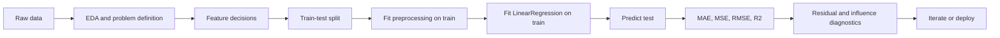
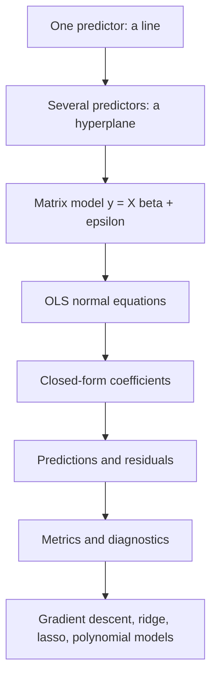
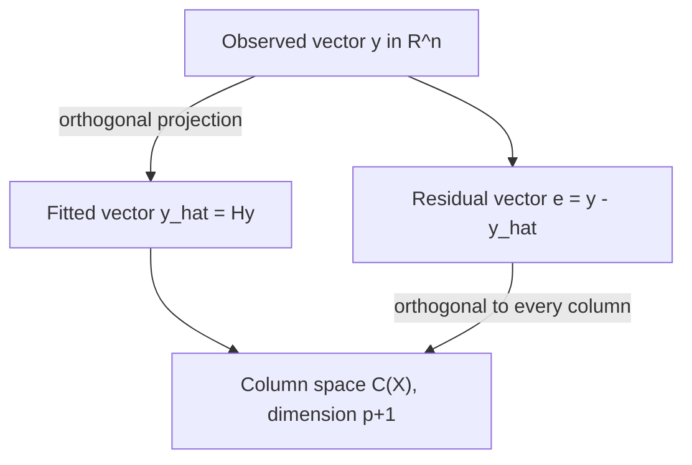
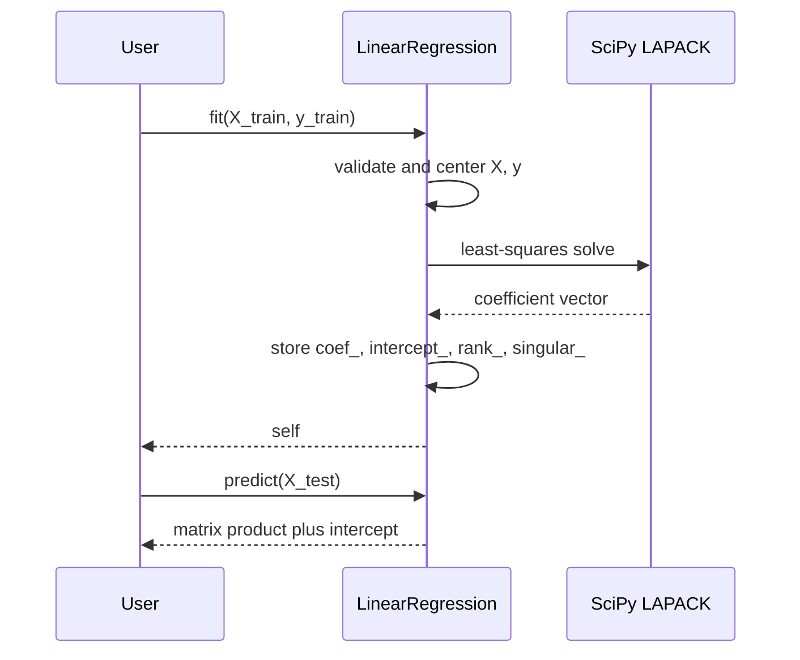

# Day 50 — Multiple Linear Regression

> **Course:** CampusX — 100 Days of Machine Learning, Day 50
> **Official notebooks (two, kept separate):**
> - `reference_notebooks/multiple_linear_regression.ipynb` — 17 cells; synthetic two-feature regression with scikit-learn, Plotly, and regression metrics.
> - `reference_notebooks/code-from-scratch.ipynb` — 29 cells; the diabetes dataset, scikit-learn `LinearRegression`, and a hand-written `MeraLR` class.
> **Datasets:** none on disk. The first notebook uses `sklearn.datasets.make_regression`; the second uses the built-in `sklearn.datasets.load_diabetes`.
> **No personal notebook is created or modified for this day.**
> **Central question:** How does ordinary least squares choose one coefficient per feature when several features act together, and how do we know that the chosen coefficients are numerically and statistically trustworthy?

### How this chapter is organised

This is one unified study document for both official notebooks. The notebooks are not merged: each keeps its own identity, its own data, and its own cell map. The chapter begins with the problem and notation, builds the matrix formulation and the normal-equation derivation, interprets the fit geometrically, then walks through scikit-learn and the from-scratch implementation. After that come the two notebook walkthroughs, numerical work that matches the saved outputs, regression metrics, leakage and scaling, assumptions, comparisons, debugging, interview preparation (Levels 1–7), university-examination practice, revision material, a cell-by-cell coverage matrix, and references.

**Source labels used throughout.** *Official* means the saved output in the CampusX notebook. *Rerun* means a value reproduced in this environment with scikit-learn 1.9.1, NumPy 2.5.3, pandas 3.0.5, and Python 3.13-era tooling. *Supplementary* means a calculation or experiment added for teaching and not printed by the course notebook. Official and rerun numbers are never silently mixed. When they differ, both are shown.

**Notation.** Matrices are bold uppercase, vectors are bold lowercase, and scalars are italic. The number of observations is $n$, the number of predictors is $p$, and the number of estimated coefficients including the intercept is $p+1$. A superscript $\top$ means transpose. A hat means an estimate or a fitted value.

---

# 1. Learning objectives

After studying this chapter, I should be able to:

1. **Explain the problem.** Say why one predictor is often insufficient, what a multiple regression coefficient means, and why "holding the other predictors fixed" is both the power and the limitation of the interpretation.
2. **Write the model in matrix form.** Define $\mathbf{X}$, $\boldsymbol{\beta}$, $\mathbf{y}$, and $\boldsymbol{\varepsilon}$, state every dimension, and explain why the design matrix contains a leading column of ones.
3. **Derive ordinary least squares.** Expand the squared-error objective, differentiate it with respect to the coefficient vector, obtain the normal equations, solve them, and state the full-rank condition for a unique solution.
4. **Interpret the fit geometrically.** Describe the column space of $\mathbf{X}$, the orthogonal projection of $\mathbf{y}$, the hat matrix, the residual maker, and the meaning of leverage.
5. **Use scikit-learn correctly.** Create a `LinearRegression` object, call `fit`, `predict`, and `score`, and read `coef_`, `intercept_`, `rank_`, `singular_`, `n_features_in_`, and `feature_names_in_`.
6. **Implement the same estimator from scratch.** Explain every line of the `MeraLR` class, including `np.insert`, the normal-equation product, the split between intercept and coefficients, and the prediction formula.
7. **Recognise numerical danger.** Explain why explicitly inverting $\mathbf{X}^{\top}\mathbf{X}$ is a poor production choice, how the condition number behaves, why multicollinearity makes individual coefficients unstable, and what `lstsq`, QR, SVD, pivoting, ridge, and centering do about it.
8. **Evaluate a regression.** Compute and interpret $R^2$, adjusted $R^2$, MAE, MSE, and RMSE; explain why $R^2$ can be negative on a test set; and separate training performance from generalisation.
9. **Protect the evaluation.** Split before fitting any learned preprocessing, use pipelines inside cross-validation, and identify the leakage paths that a multiple-regression workflow can create.
10. **Compare model families.** Explain when multiple regression is preferable to simple regression, when feature scaling matters, and how the closed-form solution relates to gradient descent, ridge, lasso, and polynomial regression.
11. **Answer interview and examination questions.** Give reasoned answers, derive the key results, and carry out numerical calculations without a computer.

---

# 2. Big picture: where multiple regression sits

Multiple linear regression is the first model in the course that uses several predictors at once. It sits after simple linear regression and regression metrics, and before gradient descent, regularisation, and polynomial regression.



The order matters. A split that happens after a learned transformation has already seen the test data is not a clean split. A metric computed on the same rows used to choose the model is not a generalisation estimate. The diagram is a default, not a law: in a purely explanatory study one may fit on all data and report inferential statistics, but then one must not pretend that the resulting $R^2$ is an out-of-sample performance estimate.



**Connection to earlier days.**

- **Day 48 (simple linear regression)** is the special case $p=1$. Everything in this chapter reduces to the familiar line when there is one predictor, but the matrix notation makes the general case readable.
- **Day 49 (regression metrics)** introduced MAE, MSE, RMSE, and $R^2$. Here those metrics are applied to a model with several coefficients, and the decomposition behind $R^2$ is derived.
- **Days 24–25 (scaling)** explain why feature scales affect numerical conditioning and why regularised models require standardisation.
- **Day 29 (pipelines)** provides the mechanism for fitting preprocessing inside each cross-validation fold.
- **Day 51 (gradient descent)** will solve the same least-squares problem iteratively. The closed-form solution is the benchmark against which gradient descent is checked.
- **Days 55–57 (ridge, lasso, elastic net)** add penalties to the same objective. The normal equation becomes $(\mathbf{X}^{\top}\mathbf{X}+\lambda\mathbf{I})^{-1}\mathbf{X}^{\top}\mathbf{y}$ for ridge, which is one way to repair a nearly singular $\mathbf{X}^{\top}\mathbf{X}$.
- **Day 53 (polynomial regression)** keeps the model linear in the coefficients but adds powers and interactions as new columns. Multiple linear regression is therefore the engine underneath polynomial regression.

The important conceptual jump is this: **linear regression is linear in the coefficients, not necessarily linear in the original features.** A model such as

$$
y=\beta_0+\beta_1x+\beta_2x^2+\beta_3xz+\varepsilon
$$

is a multiple linear regression model with three constructed predictors $x$, $x^2$, and $xz$. The geometry and the normal equations are unchanged; only the design matrix changes.

---

# 3. The problem: why one predictor is not enough

## 3.1 A motivating table

Suppose we want to predict a student's exam score from hours studied and hours slept. A simple regression on hours studied alone can look strong, but it ignores sleep. If students who study more also sleep less, the study-time coefficient absorbs part of the sleep effect. The coefficient is then not the effect of studying while sleep is held fixed; it is a mixture of both associations.

A tiny table makes the issue visible:

| Student | Hours studied $x_1$ | Hours slept $x_2$ | Score $y$ |
|---|---:|---:|---:|
| A | 1 | 8 | 52 |
| B | 2 | 7 | 60 |
| C | 4 | 6 | 74 |
| D | 6 | 5 | 86 |
| E | 8 | 4 | 98 |

A simple regression of $y$ on $x_1$ alone would show a large positive slope. But $x_1$ and $x_2$ move in opposite directions in this table, so the simple slope blends the positive effect of study with the negative association of less sleep. A multiple regression separates the two associations, at least within the linear model.

## 3.2 What "multiple" changes

With one predictor, the model is a line in two dimensions. With two predictors, it is a plane in three dimensions. With $p$ predictors, it is a **hyperplane** in $p+1$ dimensions: one dimension for the target and $p$ dimensions for the predictors. The fitted surface is flat because the model is linear in the coefficients.

The word "linear" refers to the coefficients $\beta_j$, not to the shape of the relationship in the original feature space. If we construct a feature $x^2$, the fitted surface can curve in the original $x$-direction while remaining a flat hyperplane in the constructed feature space.

## 3.3 Notation table

| Symbol | Meaning | Typical dimension |
|---|---|---|
| $n$ | number of observations (rows) | scalar |
| $p$ | number of predictors (features, excluding the intercept) | scalar |
| $y_i$ | target for observation $i$ | scalar |
| $x_{ij}$ | value of predictor $j$ for observation $i$ | scalar |
| $\mathbf{y}$ | vector of all targets | $n\times 1$ |
| $\mathbf{X}$ | design matrix, including the intercept column | $n\times(p+1)$ |
| $\boldsymbol{\beta}$ | coefficient vector, including the intercept | $(p+1)\times 1$ |
| $\boldsymbol{\varepsilon}$ | error vector | $n\times 1$ |
| $\hat{\boldsymbol{\beta}}$ | estimated coefficient vector | $(p+1)\times 1$ |
| $\hat{\mathbf{y}}$ | fitted (predicted) vector | $n\times 1$ |
| $\mathbf{e}$ | residual vector, $\mathbf{y}-\hat{\mathbf{y}}$ | $n\times 1$ |
| $\mathbf{H}$ | hat matrix | $n\times n$ |
| $\mathbf{I}$ | identity matrix | $n\times n$ or $(p+1)\times(p+1)$ |

The row index $i$ runs from $1$ to $n$; the predictor index $j$ runs from $1$ to $p$. The intercept is indexed $0$ by convention: $\beta_0$ is the intercept and $\beta_1,\dots,\beta_p$ are the slopes.

## 3.4 The model equation

For observation $i$,

$$
y_i=\beta_0+\beta_1x_{i1}+\beta_2x_{i2}+\cdots+\beta_px_{ip}+\varepsilon_i.
$$

The term $\varepsilon_i$ is the **error**, not the **residual**. The error is the unobserved difference between the true conditional mean and the observed target. The residual is the observed difference between the fitted value and the target:

$$
e_i=y_i-\hat{y}_i.
$$

We never observe $\varepsilon_i$; we observe $e_i$. This distinction matters for assumptions and inference. OLS can always compute residuals, but it cannot check whether the unobserved errors satisfy an assumption without additional structure or diagnostics.

In matrix form, stacking the $n$ equations gives

$$
\mathbf{y}=\mathbf{X}\boldsymbol{\beta}+\boldsymbol{\varepsilon}.
$$

The dimensions must match:

- $\mathbf{X}$ is $n\times(p+1)$.
- $\boldsymbol{\beta}$ is $(p+1)\times 1$.
- $\mathbf{X}\boldsymbol{\beta}$ is $n\times 1$.
- $\mathbf{y}$ and $\boldsymbol{\varepsilon}$ are $n\times 1$.

A common beginner error is to write $\mathbf{X}\boldsymbol{\beta}$ when $\mathbf{X}$ has $p$ columns but the model has $p+1$ coefficients. The missing column is the intercept column. Section 5 makes this explicit.

## 3.5 Coefficient interpretation

For the model above, $\beta_j$ is the change in the expected target associated with a one-unit increase in $x_j$, **holding all other predictors fixed**. In symbols,

$$
\beta_j=\frac{\partial\,\mathbb{E}[y\mid \mathbf{x}]}{\partial x_j}.
$$

This is a partial derivative. It is not the same as the slope from a simple regression of $y$ on $x_j$ alone. The simple slope also includes the indirect path through the other predictors whenever those predictors are correlated with $x_j$.

Two cautions:

1. **"Holding fixed" may be impossible in the real world.** If two predictors always move together, a one-unit change in one while the other is fixed may lie outside the observed data. The coefficient is still a mathematical partial derivative of the fitted surface, but it may not correspond to an achievable intervention.
2. **Association is not causation.** A regression coefficient describes the fitted conditional association. Calling it a causal effect requires assumptions about confounding, measurement, and model correctness that OLS itself does not supply.

## 3.6 The two goals of a regression

Multiple regression is used for two different goals:

| Goal | Main question | What matters |
|---|---|---|
| Prediction | What target should I expect for a new observation? | Out-of-sample error, stability, coverage of the feature space |
| Explanation / inference | How is the target associated with each predictor, holding others fixed? | Unbiasedness, standard errors, confidence intervals, correct specification |

A model that is excellent for prediction can have coefficients that are unstable and hard to interpret. A model with interpretable coefficients can have poor out-of-sample accuracy. The workflow, the diagnostics, and the reporting should match the goal. This chapter teaches both, but it keeps the distinction visible.

---

# 4. Mathematical foundations

This section builds the minimum linear algebra needed to read the rest of the chapter. Every object is introduced with its dimension because dimension errors are the most common source of confusion in multiple regression code.

## 4.1 Vectors and matrices

A **vector** is an ordered list of numbers. A column vector with $n$ entries is written

$$
\mathbf{v}=
\begin{pmatrix}
v_1\\
v_2\\
\vdots\\
v_n
\end{pmatrix}
\in\mathbb{R}^{n\times 1}.
$$

A **matrix** is a rectangular array. An $m\times k$ matrix has $m$ rows and $k$ columns:

$$
\mathbf{A}=
\begin{pmatrix}
a_{11} & a_{12} & \cdots & a_{1k}\\
a_{21} & a_{22} & \cdots & a_{2k}\\
\vdots & \vdots & \ddots & \vdots\\
a_{m1} & a_{m2} & \cdots & a_{mk}
\end{pmatrix}
\in\mathbb{R}^{m\times k}.
$$

The entry $a_{ij}$ is in row $i$, column $j$. In the design matrix, rows are observations and columns are features. That convention is not universal in mathematics, but it is the convention used by scikit-learn, NumPy, pandas, and almost every machine-learning library.

## 4.2 Matrix multiplication as a combination of columns

If $\mathbf{A}$ is $m\times k$ and $\mathbf{B}$ is $k\times q$, then $\mathbf{A}\mathbf{B}$ is $m\times q$. The inner dimensions must agree: the number of columns of $\mathbf{A}$ equals the number of rows of $\mathbf{B}$.

There are two useful ways to read the product:

1. **Row-by-column dot products.** Entry $(i,j)$ of $\mathbf{A}\mathbf{B}$ is the dot product of row $i$ of $\mathbf{A}$ with column $j$ of $\mathbf{B}$.
2. **Linear combination of columns.** The product $\mathbf{A}\mathbf{b}$ for a vector $\mathbf{b}\in\mathbb{R}^{k}$ is

$$
\mathbf{A}\mathbf{b}=b_1\mathbf{a}_1+b_2\mathbf{a}_2+\cdots+b_k\mathbf{a}_k,
$$

where $\mathbf{a}_j$ is the $j$-th column of $\mathbf{A}$. The product is a weighted sum of the columns of $\mathbf{A}$, with weights given by the entries of $\mathbf{b}$.

The second reading is the key to regression. The fitted vector

$$
\hat{\mathbf{y}}=\mathbf{X}\hat{\boldsymbol{\beta}}
=\hat{\beta}_0\mathbf{1}+\hat{\beta}_1\mathbf{x}_1+\cdots+\hat{\beta}_p\mathbf{x}_p
$$

is a linear combination of the columns of the design matrix. The column of ones contributes the intercept; each feature column contributes its slope times its values. Least squares chooses the weights that make this combination as close as possible to $\mathbf{y}$.

## 4.3 Transpose, identity, and inverse

The **transpose** $\mathbf{A}^{\top}$ swaps rows and columns. If $\mathbf{A}$ is $m\times k$, then $\mathbf{A}^{\top}$ is $k\times m$, and $(\mathbf{A}^{\top})_{ij}=a_{ji}$.

The **identity matrix** $\mathbf{I}_m$ is the $m\times m$ matrix with ones on the diagonal and zeros elsewhere. It satisfies $\mathbf{I}_m\mathbf{A}=\mathbf{A}$ and $\mathbf{A}\mathbf{I}_k=\mathbf{A}$ whenever the dimensions are compatible.

The **inverse** $\mathbf{A}^{-1}$ of a square matrix $\mathbf{A}$ satisfies

$$
\mathbf{A}^{-1}\mathbf{A}=\mathbf{A}\mathbf{A}^{-1}=\mathbf{I}.
$$

Only square matrices can have an inverse, and not every square matrix does. A matrix with no inverse is **singular**. For a $2\times 2$ matrix,

$$
\begin{pmatrix}a & b\\ c & d\end{pmatrix}^{-1}
=\frac{1}{ad-bc}
\begin{pmatrix}d & -b\\ -c & a\end{pmatrix},
$$

provided $ad-bc\neq 0$. The quantity $ad-bc$ is the determinant. For larger matrices, software computes an inverse through LU decomposition or another factorisation, not by a simple formula.

In regression, the matrix that we would like to invert is $\mathbf{X}^{\top}\mathbf{X}$, which is $(p+1)\times(p+1)$. It is invertible exactly when the columns of $\mathbf{X}$ are linearly independent. Section 6.6 explains why.

## 4.4 Rank, null space, and linear independence

The **rank** of a matrix is the number of linearly independent columns (equivalently, the number of linearly independent rows). For $\mathbf{X}\in\mathbb{R}^{n\times(p+1)}$:

- $\operatorname{rank}(\mathbf{X})\le \min(n,p+1)$.
- A unique OLS solution requires $\operatorname{rank}(\mathbf{X})=p+1$.
- If $\operatorname{rank}(\mathbf{X})<p+1$, at least one column is a linear combination of the others. This is **perfect multicollinearity**.
- If $n<p+1$, then the rank cannot exceed $n$, so a unique solution is impossible. There are more parameters than observations.

The **null space** of $\mathbf{X}$ is the set of vectors $\mathbf{v}$ such that $\mathbf{X}\mathbf{v}=\mathbf{0}$. If the null space contains a nonzero vector, then adding that vector to $\boldsymbol{\beta}$ does not change $\mathbf{X}\boldsymbol{\beta}$, so the fitted values and residuals stay the same while the coefficients change. This is why a rank-deficient model has infinitely many coefficient vectors but possibly a unique fitted vector.

## 4.5 Positive semidefiniteness

A symmetric matrix $\mathbf{A}$ is **positive semidefinite** if

$$
\mathbf{z}^{\top}\mathbf{A}\mathbf{z}\ge 0
$$

for every vector $\mathbf{z}$ of compatible dimension. It is **positive definite** if the inequality is strict for every nonzero $\mathbf{z}$.

For any real matrix $\mathbf{X}$, the matrix $\mathbf{X}^{\top}\mathbf{X}$ is symmetric and positive semidefinite:

$$
\mathbf{z}^{\top}\mathbf{X}^{\top}\mathbf{X}\mathbf{z}
=(\mathbf{X}\mathbf{z})^{\top}(\mathbf{X}\mathbf{z})
=\lVert \mathbf{X}\mathbf{z}\rVert_2^2\ge 0.
$$

It is positive definite exactly when $\mathbf{X}\mathbf{z}=\mathbf{0}$ implies $\mathbf{z}=\mathbf{0}$, which is exactly the full-column-rank condition. This fact gives the second-order condition for the OLS minimum and explains why the normal equations have a unique solution only under full rank.

## 4.6 Calculus of a quadratic form

The objective will contain terms such as $\boldsymbol{\beta}^{\top}\mathbf{X}^{\top}\mathbf{X}\boldsymbol{\beta}$ and $\boldsymbol{\beta}^{\top}\mathbf{X}^{\top}\mathbf{y}$. Two derivative rules are enough:

$$
\frac{\partial}{\partial\boldsymbol{\beta}}(\mathbf{a}^{\top}\boldsymbol{\beta})=\mathbf{a},
\qquad
\frac{\partial}{\partial\boldsymbol{\beta}}(\boldsymbol{\beta}^{\top}\mathbf{A}\boldsymbol{\beta})
=(\mathbf{A}+\mathbf{A}^{\top})\boldsymbol{\beta}.
$$

When $\mathbf{A}$ is symmetric, the second rule becomes $2\mathbf{A}\boldsymbol{\beta}$. These are matrix-calculus versions of the scalar rules $\frac{d}{dx}(ax)=a$ and $\frac{d}{dx}(ax^2)=2ax$. The next section uses them to derive the normal equations.

## 4.7 A note on dimensions in code

In NumPy:

- A 1-D array has shape `(n,)`, not `(n, 1)`.
- `X.T @ X` works for a 2-D array; for a 1-D array, the result may be a scalar rather than a matrix.
- `np.dot` and the `@` operator agree for 2-D arrays, but their behaviour on 1-D arrays can surprise a beginner.
- Always check `.shape` before a matrix product. A dimension mismatch is a programming error, not a modelling insight.

---

# 5. The model and the design matrix

## 5.1 The model for one observation

For observation $i$ with $p$ predictors:

$$
y_i=\beta_0+\beta_1x_{i1}+\beta_2x_{i2}+\cdots+\beta_px_{ip}+\varepsilon_i.
$$

The intercept $\beta_0$ is the expected target when every predictor is zero. This interpretation is sometimes useful and sometimes meaningless: zero may be far outside the observed range, or a predictor may not be able to take the value zero. The intercept is still needed to avoid forcing the fitted surface through the origin.

## 5.2 Stacking observations

Stack the $n$ equations:

$$
\begin{aligned}
y_1&=\beta_0+\beta_1x_{11}+\cdots+\beta_px_{1p}+\varepsilon_1,\\
y_2&=\beta_0+\beta_1x_{21}+\cdots+\beta_px_{2p}+\varepsilon_2,\\
&\;\;\vdots\\
y_n&=\beta_0+\beta_1x_{n1}+\cdots+\beta_px_{np}+\varepsilon_n.
\end{aligned}
$$

Define the design matrix

$$
\mathbf{X}=
\begin{pmatrix}
1 & x_{11} & x_{12} & \cdots & x_{1p}\\
1 & x_{21} & x_{22} & \cdots & x_{2p}\\
\vdots & \vdots & \vdots & \ddots & \vdots\\
1 & x_{n1} & x_{n2} & \cdots & x_{np}
\end{pmatrix}
\in\mathbb{R}^{n\times(p+1)}.
$$

The first column is entirely ones. It multiplies $\beta_0$, so every row contributes an intercept. The remaining columns are the observed predictors. Row $i$ is

$$
\mathbf{x}_i^{\top}=
\begin{pmatrix}1 & x_{i1} & \cdots & x_{ip}\end{pmatrix}
\in\mathbb{R}^{1\times(p+1)}.
$$

If we want to refer to a single observation as a column vector, we write $\mathbf{x}_i\in\mathbb{R}^{p+1}$ for the transpose of that row. The convention must be stated because both forms appear in textbooks.

## 5.3 The coefficient vector and the matrix equation

Define

$$
\boldsymbol{\beta}=
\begin{pmatrix}
\beta_0\\
\beta_1\\
\vdots\\
\beta_p
\end{pmatrix}
\in\mathbb{R}^{(p+1)\times 1},
\qquad
\boldsymbol{\varepsilon}=
\begin{pmatrix}
\varepsilon_1\\
\varepsilon_2\\
\vdots\\
\varepsilon_n
\end{pmatrix}
\in\mathbb{R}^{n\times 1}.
$$

Then the stacked equations are exactly

$$
\mathbf{y}=\mathbf{X}\boldsymbol{\beta}+\boldsymbol{\varepsilon}.
$$

The dimensions are:

| Product | Left factor | Right factor | Result |
|---|---|---|---|
| $\mathbf{X}\boldsymbol{\beta}$ | $n\times(p+1)$ | $(p+1)\times 1$ | $n\times 1$ |
| $\mathbf{X}^{\top}\mathbf{X}$ | $(p+1)\times n$ | $n\times(p+1)$ | $(p+1)\times(p+1)$ |
| $\mathbf{X}^{\top}\mathbf{y}$ | $(p+1)\times n$ | $n\times 1$ | $(p+1)\times 1$ |
| $\mathbf{X}^{\top}\mathbf{X}\boldsymbol{\beta}$ | $(p+1)\times(p+1)$ | $(p+1)\times 1$ | $(p+1)\times 1$ |

The normal equations in Section 6 will equate the last two $(p+1)\times 1$ vectors.

## 5.4 A concrete design matrix

Take $n=5$ observations and $p=2$ predictors:

| $i$ | $x_{i1}$ | $x_{i2}$ | $y_i$ |
|---|---:|---:|---:|
| 1 | 1 | 2 | 8 |
| 2 | 2 | 1 | 10 |
| 3 | 3 | 4 | 18 |
| 4 | 4 | 3 | 21 |
| 5 | 5 | 5 | 27 |

The design matrix and target vector are

$$
\mathbf{X}=
\begin{pmatrix}
1 & 1 & 2\\
1 & 2 & 1\\
1 & 3 & 4\\
1 & 4 & 3\\
1 & 5 & 5
\end{pmatrix}
\in\mathbb{R}^{5\times 3},
\qquad
\mathbf{y}=
\begin{pmatrix}
8\\
10\\
18\\
21\\
27
\end{pmatrix}
\in\mathbb{R}^{5\times 1}.
$$

There are $n=5$ rows and $p+1=3$ columns. The first column is the intercept. The second column is $x_1$, the third is $x_2$. This example is used again in Sections 6 and 12.

## 5.5 Why the column of ones works

Without the ones column, the model would be

$$
\mathbf{y}=\mathbf{X}_{p}\boldsymbol{\beta}_{p}+\boldsymbol{\varepsilon},
$$

where $\mathbf{X}_p$ is $n\times p$ and contains only the predictors. That model forces the fitted hyperplane through the origin. If the true relationship has a nonzero intercept, the slopes must compensate, and the fit is biased.

With the ones column, the first column of $\mathbf{X}$ is $\mathbf{1}_n$, the $n\times 1$ vector of ones. The model can represent any constant shift. In the fitted model, the intercept is

$$
\hat{\beta}_0=\bar{y}-\hat{\beta}_1\bar{x}_1-\cdots-\hat{\beta}_p\bar{x}_p,
$$

where $\bar{y}$ and $\bar{x}_j$ are sample means. This formula follows from the first normal equation and is derived in Section 6.7. It shows that the fitted hyperplane passes through the point of means $(\bar{x}_1,\dots,\bar{x}_p,\bar{y})$.

## 5.6 Fitted values and residuals

Given an estimate $\hat{\boldsymbol{\beta}}$, the fitted vector is

$$
\hat{\mathbf{y}}=\mathbf{X}\hat{\boldsymbol{\beta}}\in\mathbb{R}^{n\times 1}.
$$

The residual vector is

$$
\mathbf{e}=\mathbf{y}-\hat{\mathbf{y}}
=\mathbf{y}-\mathbf{X}\hat{\boldsymbol{\beta}}
\in\mathbb{R}^{n\times 1}.
$$

For a new observation with predictor row $\mathbf{x}_{\text{new}}^{\top}\in\mathbb{R}^{1\times(p+1)}$, the prediction is

$$
\hat{y}_{\text{new}}=\mathbf{x}_{\text{new}}^{\top}\hat{\boldsymbol{\beta}}
=\hat{\beta}_0+\hat{\beta}_1x_{\text{new},1}+\cdots+\hat{\beta}_px_{\text{new},p}.
$$

The new row must include the leading $1$ if the model was fitted with an intercept. In code, scikit-learn stores the intercept separately, so `predict` receives only the $p$ feature columns and adds `intercept_` internally. The from-scratch class does the same in its `predict` method.

## 5.7 The model is linear in the coefficients

It is worth repeating: the "linear" in multiple linear regression means linear in $\boldsymbol{\beta}$. The predictors can be transformed. For example,

$$
y=\beta_0+\beta_1\log x_1+\beta_2x_2^2+\beta_3x_1x_2+\varepsilon
$$

is still a multiple linear regression model if the columns $\log x_1$, $x_2^2$, and $x_1x_2$ are placed in the design matrix. The fitted surface is a hyperplane in the transformed feature space, but it can curve in the original feature space. This is the bridge to polynomial regression (Day 53) and to feature engineering (Days 30–45).

---

# 6. The OLS objective and the normal equation

## 6.1 The objective

Ordinary least squares chooses the coefficient vector that minimises the sum of squared residuals:

$$
S(\boldsymbol{\beta})
=\sum_{i=1}^{n}\left(y_i-\mathbf{x}_i^{\top}\boldsymbol{\beta}\right)^2
=\lVert\mathbf{y}-\mathbf{X}\boldsymbol{\beta}\rVert_2^2.
$$

In matrix notation,

$$
S(\boldsymbol{\beta})
=(\mathbf{y}-\mathbf{X}\boldsymbol{\beta})^{\top}
(\mathbf{y}-\mathbf{X}\boldsymbol{\beta}).
$$

The residual for observation $i$ is $e_i(\boldsymbol{\beta})=y_i-\mathbf{x}_i^{\top}\boldsymbol{\beta}$. Squaring makes positive and negative errors contribute equally. Summing gives every observation the same weight. This is the basic OLS loss; later days add penalties or change the loss.

## 6.2 Expanding the quadratic

Expand the product:

$$
\begin{aligned}
S(\boldsymbol{\beta})
&=(\mathbf{y}-\mathbf{X}\boldsymbol{\beta})^{\top}
(\mathbf{y}-\mathbf{X}\boldsymbol{\beta})\\
&=\mathbf{y}^{\top}\mathbf{y}
-\mathbf{y}^{\top}\mathbf{X}\boldsymbol{\beta}
-\boldsymbol{\beta}^{\top}\mathbf{X}^{\top}\mathbf{y}
+\boldsymbol{\beta}^{\top}\mathbf{X}^{\top}\mathbf{X}\boldsymbol{\beta}.
\end{aligned}
$$

The two middle terms are scalars, and a scalar equals its transpose:

$$
\mathbf{y}^{\top}\mathbf{X}\boldsymbol{\beta}
=(\mathbf{y}^{\top}\mathbf{X}\boldsymbol{\beta})^{\top}
=\boldsymbol{\beta}^{\top}\mathbf{X}^{\top}\mathbf{y}.
$$

Therefore

$$
S(\boldsymbol{\beta})
=\mathbf{y}^{\top}\mathbf{y}
-2\boldsymbol{\beta}^{\top}\mathbf{X}^{\top}\mathbf{y}
+\boldsymbol{\beta}^{\top}\mathbf{X}^{\top}\mathbf{X}\boldsymbol{\beta}.
$$

This is a quadratic function of $\boldsymbol{\beta}$. The matrix $\mathbf{X}^{\top}\mathbf{X}$ is symmetric and positive semidefinite, so the quadratic term curves upward. The minimum, if it exists, is found by setting the gradient to zero.

## 6.3 Differentiating

Using the rules from Section 4.6:

$$
\frac{\partial S}{\partial\boldsymbol{\beta}}
=-2\mathbf{X}^{\top}\mathbf{y}
+2\mathbf{X}^{\top}\mathbf{X}\boldsymbol{\beta}.
$$

Set the gradient equal to the zero vector:

$$
-2\mathbf{X}^{\top}\mathbf{y}+2\mathbf{X}^{\top}\mathbf{X}\boldsymbol{\beta}=\mathbf{0}.
$$

Divide by $2$ and rearrange:

$$
\mathbf{X}^{\top}\mathbf{X}\boldsymbol{\beta}
=\mathbf{X}^{\top}\mathbf{y}.
$$

These are the **normal equations**. They are a system of $p+1$ linear equations in $p+1$ unknowns. If $\mathbf{X}^{\top}\mathbf{X}$ is invertible, the unique solution is

$$
\hat{\boldsymbol{\beta}}
=(\mathbf{X}^{\top}\mathbf{X})^{-1}\mathbf{X}^{\top}\mathbf{y}.
$$

The vector $\hat{\boldsymbol{\beta}}$ is the OLS estimator. The corresponding fitted values are

$$
\hat{\mathbf{y}}
=\mathbf{X}\hat{\boldsymbol{\beta}}
=\mathbf{X}(\mathbf{X}^{\top}\mathbf{X})^{-1}\mathbf{X}^{\top}\mathbf{y}.
$$

## 6.4 The same derivation, one coefficient at a time

Some learners find the matrix derivative abstract. The scalar route gives the same answer and shows where the cross-products come from.

Write the objective as

$$
S(\beta_0,\dots,\beta_p)
=\sum_{i=1}^{n}\left(y_i-\beta_0-\sum_{j=1}^{p}\beta_jx_{ij}\right)^2.
$$

Differentiate with respect to the intercept:

$$
\frac{\partial S}{\partial\beta_0}
=-2\sum_{i=1}^{n}\left(y_i-\beta_0-\sum_{j=1}^{p}\beta_jx_{ij}\right)
=-2\sum_{i=1}^{n}e_i.
$$

Setting this to zero gives

$$
\sum_{i=1}^{n}e_i=0.
$$

With an intercept, the residuals sum to zero. Differentiate with respect to a slope $\beta_k$:

$$
\frac{\partial S}{\partial\beta_k}
=-2\sum_{i=1}^{n}x_{ik}
\left(y_i-\beta_0-\sum_{j=1}^{p}\beta_jx_{ij}\right)
=-2\sum_{i=1}^{n}x_{ik}e_i.
$$

Setting this to zero gives

$$
\sum_{i=1}^{n}x_{ik}e_i=0
\qquad\text{for }k=1,\dots,p.
$$

Together with $\sum_i e_i=0$, these are exactly the $p+1$ equations

$$
\mathbf{X}^{\top}\mathbf{e}=\mathbf{0}.
$$

Since $\mathbf{e}=\mathbf{y}-\mathbf{X}\boldsymbol{\beta}$, this is

$$
\mathbf{X}^{\top}(\mathbf{y}-\mathbf{X}\boldsymbol{\beta})=\mathbf{0}
\quad\Longleftrightarrow\quad
\mathbf{X}^{\top}\mathbf{X}\boldsymbol{\beta}=\mathbf{X}^{\top}\mathbf{y}.
$$

The scalar route also gives a useful interpretation: **each column of the design matrix is orthogonal to the residual vector.** The ones column gives the sum-zero property; each feature column gives a zero sample covariance between that feature and the residuals (when the feature is centered).

## 6.5 The second-order condition

Setting the gradient to zero finds a stationary point. To confirm a minimum, look at the Hessian:

$$
\frac{\partial^2 S}{\partial\boldsymbol{\beta}\partial\boldsymbol{\beta}^{\top}}
=2\mathbf{X}^{\top}\mathbf{X}.
$$

Because $\mathbf{X}^{\top}\mathbf{X}$ is positive semidefinite, the Hessian is positive semidefinite, so the stationary point is a global minimum (the objective is convex). If $\mathbf{X}^{\top}\mathbf{X}$ is positive definite, the minimum is unique. If it is only semidefinite, the objective is flat along some directions and the minimiser is not unique.

## 6.6 When is the solution unique?

The matrix $\mathbf{X}^{\top}\mathbf{X}$ is invertible if and only if

$$
\operatorname{rank}(\mathbf{X})=p+1.
$$

This requires:

1. $n\ge p+1$: at least as many observations as parameters.
2. No column of $\mathbf{X}$ is a linear combination of the other columns: no perfect multicollinearity.
3. In particular, no feature is constant when an intercept is included. A constant feature duplicates the ones column, so the design matrix is rank-deficient.

If the rank condition fails, the normal equations still have solutions (because $\mathbf{X}^{\top}\mathbf{y}$ lies in the column space of $\mathbf{X}^{\top}\mathbf{X}$), but there are infinitely many of them. Software may return a minimum-norm solution, or it may raise an error if it tries to invert a singular matrix.

## 6.7 The intercept formula from the first normal equation

The first normal equation is

$$
\sum_{i=1}^{n}\left(y_i-\beta_0-\sum_{j=1}^{p}\beta_jx_{ij}\right)=0.
$$

Divide by $n$:

$$
\bar{y}-\beta_0-\sum_{j=1}^{p}\beta_j\bar{x}_j=0.
$$

Therefore

$$
\beta_0=\bar{y}-\sum_{j=1}^{p}\beta_j\bar{x}_j.
$$

At the OLS solution, the fitted hyperplane passes through the sample means. This is why centering the predictors (subtracting their means) makes the intercept equal to $\bar{y}$ and decouples the intercept from the slopes. It also improves numerical conditioning.

## 6.8 Why the normal equations can be dangerous

The formula $\hat{\boldsymbol{\beta}}=(\mathbf{X}^{\top}\mathbf{X})^{-1}\mathbf{X}^{\top}\mathbf{y}$ is mathematically correct but computationally fragile when $\mathbf{X}$ is nearly rank-deficient. Forming $\mathbf{X}^{\top}\mathbf{X}$ squares the condition number:

$$
\operatorname{cond}(\mathbf{X}^{\top}\mathbf{X})
=\operatorname{cond}(\mathbf{X})^2.
$$

If $\mathbf{X}$ has a condition number of $10^8$, then $\mathbf{X}^{\top}\mathbf{X}$ has a condition number of $10^{16}$, which is at the edge of double-precision arithmetic. The explicit inverse can then produce coefficients with large errors even though the predictions are still reasonable.

A safer approach is to solve the least-squares problem directly with a QR decomposition or a singular value decomposition (SVD). In NumPy, `np.linalg.lstsq` uses an SVD-based method; scikit-learn uses a LAPACK least-squares routine. These methods avoid forming the inverse and can handle rank deficiency by returning a minimum-norm solution or by truncating tiny singular values.

## 6.9 A compact summary of the algebra

| Quantity | Formula | Dimension |
|---|---|---|
| Model | $\mathbf{y}=\mathbf{X}\boldsymbol{\beta}+\boldsymbol{\varepsilon}$ | $n\times 1$ |
| Objective | $S(\boldsymbol{\beta})=\lVert\mathbf{y}-\mathbf{X}\boldsymbol{\beta}\rVert_2^2$ | scalar |
| Gradient | $\nabla S=-2\mathbf{X}^{\top}(\mathbf{y}-\mathbf{X}\boldsymbol{\beta})$ | $(p+1)\times 1$ |
| Normal equations | $\mathbf{X}^{\top}\mathbf{X}\hat{\boldsymbol{\beta}}=\mathbf{X}^{\top}\mathbf{y}$ | $(p+1)\times 1$ |
| Solution | $\hat{\boldsymbol{\beta}}=(\mathbf{X}^{\top}\mathbf{X})^{-1}\mathbf{X}^{\top}\mathbf{y}$ | $(p+1)\times 1$ |
| Fitted values | $\hat{\mathbf{y}}=\mathbf{X}\hat{\boldsymbol{\beta}}$ | $n\times 1$ |
| Residuals | $\mathbf{e}=\mathbf{y}-\hat{\mathbf{y}}$ | $n\times 1$ |
| Orthogonality | $\mathbf{X}^{\top}\mathbf{e}=\mathbf{0}$ | $(p+1)\times 1$ |
| Hat matrix | $\mathbf{H}=\mathbf{X}(\mathbf{X}^{\top}\mathbf{X})^{-1}\mathbf{X}^{\top}$ | $n\times n$ |

---

# 7. The geometry of least squares

## 7.1 The column space

The columns of $\mathbf{X}$ are $p+1$ vectors in $\mathbb{R}^{n}$:

$$
\mathbf{X}=
\begin{pmatrix}
\mathbf{c}_0 & \mathbf{c}_1 & \cdots & \mathbf{c}_p
\end{pmatrix},
\qquad
\mathbf{c}_j\in\mathbb{R}^{n}.
$$

The **column space** of $\mathbf{X}$, written $\mathcal{C}(\mathbf{X})$, is the set of all linear combinations of these columns:

$$
\mathcal{C}(\mathbf{X})
=\{ \mathbf{X}\boldsymbol{\beta} : \boldsymbol{\beta}\in\mathbb{R}^{p+1}\}.
$$

If the columns are linearly independent, $\mathcal{C}(\mathbf{X})$ is a $(p+1)$-dimensional subspace of $\mathbb{R}^{n}$. Every possible fitted vector $\hat{\mathbf{y}}=\mathbf{X}\hat{\boldsymbol{\beta}}$ lies in this subspace. The observed vector $\mathbf{y}$ usually does not lie in it, because the model cannot reproduce every observation exactly.

## 7.2 Orthogonal projection

OLS chooses the point in $\mathcal{C}(\mathbf{X})$ that is closest to $\mathbf{y}$ in Euclidean distance. The closest point is the **orthogonal projection** of $\mathbf{y}$ onto the column space:

$$
\hat{\mathbf{y}}=\operatorname{proj}_{\mathcal{C}(\mathbf{X})}(\mathbf{y}).
$$

The residual vector $\mathbf{e}=\mathbf{y}-\hat{\mathbf{y}}$ is perpendicular to every vector in the column space. In particular, it is perpendicular to every column of $\mathbf{X}$:

$$
\mathbf{X}^{\top}\mathbf{e}=\mathbf{0}.
$$

This is the geometric content of the normal equations. The algebra says "set the gradient to zero"; the geometry says "make the residual orthogonal to the space of possible fitted values".

## 7.3 The hat matrix

Define

$$
\mathbf{H}=\mathbf{X}(\mathbf{X}^{\top}\mathbf{X})^{-1}\mathbf{X}^{\top}
\in\mathbb{R}^{n\times n}.
$$

Then

$$
\hat{\mathbf{y}}=\mathbf{H}\mathbf{y}.
$$

The matrix $\mathbf{H}$ "puts a hat on $\mathbf{y}$": it maps the observed vector to the fitted vector. It has four important properties:

1. **Symmetry:** $\mathbf{H}^{\top}=\mathbf{H}$.
2. **Idempotence:** $\mathbf{H}^2=\mathbf{H}$. Projecting twice is the same as projecting once.
3. **Rank:** $\operatorname{rank}(\mathbf{H})=p+1$ when $\mathbf{X}$ has full column rank.
4. **Trace:** $\operatorname{tr}(\mathbf{H})=p+1$.

Proof of symmetry:

$$
\mathbf{H}^{\top}
=\left(\mathbf{X}(\mathbf{X}^{\top}\mathbf{X})^{-1}\mathbf{X}^{\top}\right)^{\top}
=\mathbf{X}\left((\mathbf{X}^{\top}\mathbf{X})^{-1}\right)^{\top}\mathbf{X}^{\top}
=\mathbf{X}(\mathbf{X}^{\top}\mathbf{X})^{-1}\mathbf{X}^{\top}
=\mathbf{H}.
$$

The inverse of a symmetric matrix is symmetric, which gives the middle step. Proof of idempotence:

$$
\mathbf{H}^2
=\mathbf{X}(\mathbf{X}^{\top}\mathbf{X})^{-1}\mathbf{X}^{\top}
\mathbf{X}(\mathbf{X}^{\top}\mathbf{X})^{-1}\mathbf{X}^{\top}
=\mathbf{X}(\mathbf{X}^{\top}\mathbf{X})^{-1}\mathbf{X}^{\top}
=\mathbf{H}.
$$

The product $\mathbf{X}^{\top}\mathbf{X}(\mathbf{X}^{\top}\mathbf{X})^{-1}$ cancels to $\mathbf{I}$. The trace result follows from the cyclic property of trace and the dimensions:

$$
\operatorname{tr}(\mathbf{H})
=\operatorname{tr}\left(\mathbf{X}(\mathbf{X}^{\top}\mathbf{X})^{-1}\mathbf{X}^{\top}\right)
=\operatorname{tr}\left((\mathbf{X}^{\top}\mathbf{X})^{-1}\mathbf{X}^{\top}\mathbf{X}\right)
=\operatorname{tr}(\mathbf{I}_{p+1})
=p+1.
$$

## 7.4 The residual maker

Define

$$
\mathbf{M}=\mathbf{I}_n-\mathbf{H}.
$$

Then

$$
\mathbf{e}=\mathbf{y}-\hat{\mathbf{y}}
=\mathbf{y}-\mathbf{H}\mathbf{y}
=(\mathbf{I}_n-\mathbf{H})\mathbf{y}
=\mathbf{M}\mathbf{y}.
$$

The matrix $\mathbf{M}$ is also symmetric and idempotent. It projects onto the orthogonal complement of the column space. Two consequences are immediate:

$$
\mathbf{M}\mathbf{X}=\mathbf{0},
\qquad
\mathbf{X}^{\top}\mathbf{M}=\mathbf{0}.
$$

The first says that any vector already in the column space is annihilated by the residual maker. The second is the orthogonality condition again.

## 7.5 The Pythagorean decomposition

Because $\hat{\mathbf{y}}$ and $\mathbf{e}$ are orthogonal,

$$
\mathbf{y}^{\top}\mathbf{y}
=\lVert\mathbf{y}\rVert_2^2
=\lVert\hat{\mathbf{y}}\rVert_2^2+\lVert\mathbf{e}\rVert_2^2.
$$

This is Pythagoras' theorem in $\mathbb{R}^{n}$. When the model includes an intercept, the decomposition can be centered around the mean, giving the familiar ANOVA identity:

$$
\underbrace{\sum_{i=1}^{n}(y_i-\bar{y})^2}_{\text{TSS}}
=
\underbrace{\sum_{i=1}^{n}(\hat{y}_i-\bar{y})^2}_{\text{ESS}}
+
\underbrace{\sum_{i=1}^{n}(y_i-\hat{y}_i)^2}_{\text{RSS}}.
$$

Here TSS is the total sum of squares, ESS is the explained sum of squares, and RSS is the residual sum of squares. The identity requires the intercept, because it uses $\bar{y}=\bar{\hat{y}}$, which follows from the residuals summing to zero. Without an intercept, the uncentered decomposition $\mathbf{y}^{\top}\mathbf{y}=\hat{\mathbf{y}}^{\top}\hat{\mathbf{y}}+\mathbf{e}^{\top}\mathbf{e}$ still holds, but the centered TSS decomposition generally does not.

## 7.6 Leverage

The diagonal entries of the hat matrix are called **leverages**:

$$
h_{ii}=(\mathbf{H})_{ii}.
$$

Because $\hat{y}_i=\sum_{j=1}^{n}h_{ij}y_j$, the leverage $h_{ii}$ measures how much observation $i$'s own target contributes to its fitted value:

$$
h_{ii}=\frac{\partial\hat{y}_i}{\partial y_i}.
$$

Properties:

- $0\le h_{ii}\le 1$.
- $\sum_{i=1}^{n}h_{ii}=\operatorname{tr}(\mathbf{H})=p+1$.
- The average leverage is $(p+1)/n$.
- A leverage close to $1$ means the observation is pulling its own fitted value toward itself.
- High leverage is a property of the **predictor values**, not of the target. An outlier in $y$ with low leverage may still have a large residual but less influence on the fitted line.

A common rule of thumb flags observations with

$$
h_{ii}>\frac{2(p+1)}{n}
$$

for inspection. This is a screening heuristic, not a deletion rule. An observation should not be removed merely because it has high leverage; it may be a legitimate and important point.

**Worked leverage example.** For simple regression with $n=5$ and predictor values $x=(1,2,3,4,10)$,

$$
h_{ii}=\frac{1}{n}+\frac{(x_i-\bar{x})^2}{\sum_{j=1}^{n}(x_j-\bar{x})^2}.
$$

Here $\bar{x}=4$ and $\sum_j(x_j-\bar{x})^2=9+4+1+0+36=50$. Therefore

$$
h_{55}=\frac{1}{5}+\frac{(10-4)^2}{50}
=0.2+\frac{36}{50}
=0.92.
$$

The fifth observation has leverage $0.92$: it almost determines its own fitted value. The other leverages are $h_{11}=0.38$, $h_{22}=0.28$, $h_{33}=0.22$, and $h_{44}=0.20$. Their sum is $2=p+1$, as required. A point with $x=10$ is far from the others, so it has high leverage even before we look at its $y$ value.

## 7.7 Influence is not the same as leverage

Leverage measures potential influence. **Influence** combines leverage with the size of the residual. An observation with high leverage and a small residual may change the fitted line very little. An observation with modest leverage but a huge residual can change it a lot. Cook's distance is a standard combined measure:

$$
D_i=\frac{e_i^2}{(p+1)\hat{\sigma}^2}
\frac{h_{ii}}{(1-h_{ii})^2},
$$

where $\hat{\sigma}^2$ is the estimated error variance. Large $D_i$ values flag observations whose removal would change the coefficient vector substantially. Again, this is a diagnostic for investigation, not an automatic deletion rule.

## 7.8 A geometric picture



The picture is exact in $\mathbb{R}^{n}$: $\mathbf{y}$ is a point, $\mathcal{C}(\mathbf{X})$ is a plane (or higher-dimensional flat), $\hat{\mathbf{y}}$ is the foot of the perpendicular, and $\mathbf{e}$ is the perpendicular segment. In two or three dimensions we can draw it; in $n$ dimensions we reason by analogy.

## 7.9 Why the geometry matters in practice

The geometric view explains several practical facts at once:

- **Adding a column enlarges the column space.** The projection can only get closer to $\mathbf{y}$ or stay the same, so training RSS cannot increase when a feature is added. This is why training $R^2$ is nondecreasing.
- **A nearly collinear column adds very little new direction.** The column space barely changes, so the fit may improve only slightly while the individual coefficients become unstable.
- **The residual is orthogonal to the features.** If a residual plot still shows a pattern against a feature, the fitted surface is not the orthogonal projection onto a space that includes that pattern; the model is missing a direction.
- **Leverage is about the geometry of the rows.** Points far from the centre of the predictor space have more ability to tilt the projection.

---

# 8. scikit-learn `LinearRegression`: syntax and internals

## 8.1 Creating the estimator

The standard import and construction are

```python
from sklearn.linear_model import LinearRegression

reg = LinearRegression()
```

`LinearRegression()` creates an **estimator object**. At this point no coefficients have been learned. The object stores its hyperparameters (configuration choices), not its fitted parameters. In scikit-learn convention:

- Hyperparameters are set in `__init__` and do not end with an underscore.
- Learned attributes are created by `fit` and end with an underscore, such as `coef_` and `intercept_`.

The default configuration is `fit_intercept=True`, `copy_X=True`, `n_jobs=None`, and `positive=False`. The exact repr differs across versions; the official Day 50 notebook shows an older repr that includes `normalize=False`.

## 8.2 `fit`: learning the coefficients

```python
reg.fit(X_train, y_train)
```

`fit` does the following conceptually:

1. Validate `X_train` and `y_train` (shape, dtype, missing values, consistent sample count).
2. If `fit_intercept=True`, compute the column means of `X_train` and the mean of `y_train`.
3. Center the data: subtract the means.
4. Solve the least-squares problem for the centered data.
5. Convert the centered solution back to an intercept on the original scale.
6. Store `coef_`, `intercept_`, `rank_`, `singular_`, `n_features_in_`, and possibly `feature_names_in_`.
7. Return `self`.

A simplified view of the centering step is

$$
\tilde{\mathbf{X}}=\mathbf{X}-\mathbf{1}_n\bar{\mathbf{x}}^{\top},
\qquad
\tilde{\mathbf{y}}=\mathbf{y}-\bar{y}\mathbf{1}_n.
$$

The slopes are estimated from the centered data, and the intercept is recovered as

$$
\hat{\beta}_0=\bar{y}-\bar{\mathbf{x}}^{\top}\hat{\boldsymbol{\beta}}_{1:p}.
$$

Centering is not cosmetic. It removes the correlation between the intercept column and the feature columns, which improves conditioning. It is also why scikit-learn can handle predictors with large offsets more gracefully than a naive implementation that forms $\mathbf{X}^{\top}\mathbf{X}$ with an uncentered ones column.

## 8.3 `predict`: applying the model

```python
y_pred = reg.predict(X_test)
```

For a single-target model,

$$
\hat{\mathbf{y}}_{\text{test}}
=\mathbf{X}_{\text{test}}\hat{\boldsymbol{\beta}}_{1:p}
+\hat{\beta}_0\mathbf{1}.
$$

The feature matrix passed to `predict` should contain the same $p$ columns, in the same order, with the same meanings as the training matrix. Scikit-learn checks the number of features. If the training data had named columns and the prediction data is a DataFrame, it also checks the feature names in recent versions. A NumPy array carries no names, so a silent column reordering is possible if the caller is careless.

## 8.4 `score`: the default $R^2$

```python
reg.score(X_test, y_test)
```

For a regressor, `score` returns the coefficient of determination:

$$
R^2=1-\frac{\sum_{i=1}^{n_{\text{eval}}}(y_i-\hat{y}_i)^2}
{\sum_{i=1}^{n_{\text{eval}}}(y_i-\bar{y}_{\text{eval}})^2}.
$$

It is computed on whatever data are passed. Passing the training data gives the training $R^2$; passing the test data gives the test $R^2$. The method does not know or care which set is which. That is the caller's responsibility.

`score` is not accuracy. Accuracy is a classification metric. For regression, a score of $0.44$ means the model reduces the evaluation-set squared error by $44\%$ relative to always predicting the evaluation-set mean. It does not mean "44% of predictions are correct".

## 8.5 Learned attributes

| Attribute | Shape | Meaning |
|---|---|---|
| `coef_` | `(p,)` for one target | Estimated slopes, one per feature |
| `intercept_` | scalar for one target | Estimated intercept |
| `rank_` | scalar | Rank of the (centered) training feature matrix |
| `singular_` | `(min(n,p),)` | Singular values of the (centered) training matrix |
| `n_features_in_` | scalar | Number of features seen during `fit` |
| `feature_names_in_` | `(p,)` | Feature names, if `fit` received a DataFrame with string column names |

For multi-output regression, `coef_` has shape `(n_targets, p)` and `intercept_` has shape `(n_targets,)`. This chapter uses a single target, so the simpler shapes apply.

`rank_` and `singular_` are diagnostic. A small `singular_` value, or a `rank_` smaller than `p`, signals collinearity or rank deficiency. `rank_` is computed from the centered feature matrix when an intercept is fitted, so it can be smaller than the rank of the augmented design matrix by one; both facts point to the same practical issue when features are redundant.

## 8.6 Important parameters

| Parameter | Default | Effect |
|---|---|---|
| `fit_intercept` | `True` | Whether to estimate an intercept |
| `copy_X` | `True` | Copy `X` before centering; `False` may overwrite it |
| `n_jobs` | `None` | Mostly irrelevant for dense OLS; retained for API compatibility |
| `positive` | `False` | If `True`, constrain coefficients to be nonnegative (NNLS) |

`positive=True` changes the estimator from ordinary least squares to nonnegative least squares. The solution is constrained, so it is not the OLS solution and the normal equations no longer apply directly. Use it only when domain knowledge says the slopes cannot be negative.

`normalize` is not a current parameter. The official notebook's repr shows `normalize=False` because it was saved with an older scikit-learn version. In current versions, scaling must be done explicitly, preferably inside a `Pipeline`:

```python
from sklearn.pipeline import make_pipeline
from sklearn.preprocessing import StandardScaler
from sklearn.linear_model import LinearRegression

model = make_pipeline(StandardScaler(), LinearRegression())
```

## 8.7 What scikit-learn actually solves

For dense data, `LinearRegression` does not literally compute `inv(X.T @ X) @ X.T @ y`. It calls a least-squares routine from SciPy/LAPACK. That routine uses a stable factorisation (typically SVD-based `gelsd`) and returns the solution that minimises the residual sum of squares. It can also handle rank deficiency by truncating small singular values, which is why a fit may succeed even when a naive inverse would fail.

The important consequences are:

- The fitted coefficients are the OLS coefficients when the problem is full rank.
- The numerical route is more stable than an explicit inverse.
- The exact last digits can differ across scikit-learn, SciPy, LAPACK, and BLAS versions.
- A model can fit successfully on collinear data while still producing unstable, hard-to-interpret coefficients.

## 8.8 Version differences seen in the official notebook

The saved output of `lr.fit(X_train, y_train)` in `multiple_linear_regression.ipynb` is

```text
LinearRegression(copy_X=True, fit_intercept=True, n_jobs=None, normalize=False)
```

That repr belongs to an older scikit-learn release. In the environment used for this rerun (scikit-learn 1.9.1), the repr is simply

```text
LinearRegression()
```

and the `normalize` argument is no longer accepted. The fitted coefficients in `code-from-scratch.ipynb` also differ from the rerun in the third decimal because of solver and version changes. The official values and the rerun values are reported separately in Section 9.9. This is a reproducibility lesson, not a mathematical contradiction.

## 8.9 A data-flow diagram



## 8.10 A minimal complete example

The following example follows the structure of the official `code-from-scratch.ipynb`, but it is written as a compact script for study:

```python
import numpy as np
from sklearn.datasets import load_diabetes
from sklearn.model_selection import train_test_split
from sklearn.linear_model import LinearRegression
from sklearn.metrics import r2_score

X, y = load_diabetes(return_X_y=True)
X_train, X_test, y_train, y_test = train_test_split(
    X, y, test_size=0.2, random_state=2
)

reg = LinearRegression()
reg.fit(X_train, y_train)
y_pred = reg.predict(X_test)

print("train shape:", X_train.shape)
print("test shape:", X_test.shape)
print("test R2:", r2_score(y_test, y_pred))
print("coef:", reg.coef_)
print("intercept:", reg.intercept_)
```

The script prints the same structural facts as the notebook. The exact numeric values depend on the library version, which is why the next section records both the official and rerun outputs.

---

# 9. Notebook A: `code-from-scratch.ipynb` walkthrough

## 9.1 What the notebook is doing

This notebook has two halves:

1. Use scikit-learn's `LinearRegression` on the diabetes data.
2. Implement the same estimator by hand with NumPy and verify that the results agree.

The pedagogical point is not that the from-scratch class is better. The point is that the scikit-learn call is not magic: it solves the normal equations (or a numerically stable equivalent), and a short class can reproduce the same coefficients.

## 9.2 Cells 0–5: imports and data

```python
import numpy as np
from sklearn.datasets import load_diabetes

X, y = load_diabetes(return_X_y=True)
```

`load_diabetes` returns a dictionary-like object by default. With `return_X_y=True`, it returns a tuple of NumPy arrays:

- `X` has shape `(442, 10)`.
- `y` has shape `(442,)`.

The notebook then displays `X`, `y`, `X.shape`, and `y.shape`. The printed `X` values are small, mostly between $-0.14$ and $0.20$. That is not because the original measurements are small; it is because scikit-learn stores a standardized version.

The diabetes features are:

| Index | Feature | Meaning |
|---:|---|---|
| 0 | `age` | Age |
| 1 | `sex` | Sex |
| 2 | `bmi` | Body mass index |
| 3 | `bp` | Average blood pressure |
| 4 | `s1` | Total serum cholesterol |
| 5 | `s2` | Low-density lipoproteins |
| 6 | `s3` | High-density lipoproteins |
| 7 | `s4` | Total cholesterol / HDL ratio |
| 8 | `s5` | Log of serum triglycerides level |
| 9 | `s6` | Blood sugar level |

The target is a quantitative measure of disease progression one year after baseline. The exact clinical units are not part of the modelling interface; what matters is that a difference of one target unit is a difference on the progression scale.

**The scaling used by `load_diabetes`.** Each feature column has mean zero and sum of squares one:

$$
\sum_{i=1}^{442}x_{ij}=0,
\qquad
\sum_{i=1}^{442}x_{ij}^2=1.
$$

Consequently, the sample standard deviation of each column is

$$
s_j=\sqrt{\frac{1}{442-1}\sum_{i=1}^{442}x_{ij}^2}
\approx\frac{1}{\sqrt{442}}
\approx0.047565.
$$

A change of $1$ in a stored feature is therefore about $1/0.047565\approx21.02$ sample standard deviations. This is why the fitted coefficients are large numbers such as $516.69$: they are per stored unit, not per original clinical unit. A one-standard-deviation change in BMI changes the prediction by $516.69\times0.047565\approx24.58$ target units, holding the other features fixed.

## 9.3 Cells 6–9: the split

```python
from sklearn.model_selection import train_test_split

X_train, X_test, y_train, y_test = train_test_split(
    X, y, test_size=0.2, random_state=2
)
```

With $n=442$ and `test_size=0.2`, scikit-learn produces:

- `X_train.shape == (353, 10)`
- `X_test.shape == (89, 10)`
- `y_train.shape == (353,)`
- `y_test.shape == (89,)`

The notebook prints the two feature shapes. The split is random but reproducible because `random_state=2` is fixed. The split is not stratified; stratification is a classification tool. For regression, a random split is the default, and one should check that the target distribution is not badly distorted, especially with small samples.

## 9.4 Cells 10–13: fitting and predicting

```python
from sklearn.linear_model import LinearRegression

reg = LinearRegression()
reg.fit(X_train, y_train)
y_pred = reg.predict(X_test)
```

`reg` is the estimator object. `fit` learns the coefficients from the 353 training rows. `predict` applies the learned coefficients to the 89 test rows. No test target is used in `fit`, so the holdout is clean with respect to model fitting.

## 9.5 Cells 14–15: the test $R^2$

```python
from sklearn.metrics import r2_score

r2_score(y_test, y_pred)
```

The official saved output is

```text
0.4399387660024645
```

The rerun in this environment gives

```text
0.4399338661568968
```

The difference is about $4.9\times10^{-6}$. It comes from numerical differences in the least-squares solver across library versions, not from a different dataset or a different formula. The substantive conclusion is the same: the model explains about $44\%$ of the variance in the 89 held-out observations.

## 9.6 Cells 16–17: coefficients and intercept

The official saved output for `reg.coef_` is

```text
array([  -9.16088483, -205.46225988,  516.68462383,  340.62734108,
        -895.54360867,  561.21453306,  153.88478595,  126.73431596,
         861.12139955,   52.41982836])
```

and for `reg.intercept_`:

```text
151.88334520854633
```

The rerun gives

```text
array([  -9.15865318, -205.45432163,  516.69374454,  340.61999905,
        -895.55200190,  561.22067904,  153.89310954,  126.73139688,
         861.12700152,   52.42112238])
```

with intercept

```text
151.88331005254167
```

The largest coefficient difference is about $0.0091$, and the intercept differs by about $3.5\times10^{-5}$. These are tiny relative to the coefficient magnitudes, but they illustrate why exact last-digit reproduction across environments is not guaranteed.

## 9.7 Reading the coefficients

Each coefficient is the estimated change in the disease-progression score for a one-unit change in the stored feature, holding the other nine features fixed.

| Feature | Official coefficient | Approximate per-SD effect |
|---|---:|---:|
| `age` | $-9.1609$ | $-0.436$ |
| `sex` | $-205.4623$ | $-9.772$ |
| `bmi` | $516.6846$ | $24.577$ |
| `bp` | $340.6273$ | $16.202$ |
| `s1` | $-895.5436$ | $-42.597$ |
| `s2` | $561.2145$ | $26.695$ |
| `s3` | $153.8848$ | $7.320$ |
| `s4` | $126.7343$ | $6.028$ |
| `s5` | $861.1214$ | $40.960$ |
| `s6` | $52.4198$ | $2.493$ |

The per-SD column is the coefficient multiplied by $0.047565$. It is a more interpretable scale because the stored features are all on the same norm. Even so, the individual coefficients must be read with caution: several serum features are strongly correlated, so their signs and magnitudes are unstable. The model's predictions can be useful while the individual coefficients are not reliable causal effects.

The intercept $151.883$ is the predicted progression when every stored feature is zero. Because the stored features are centered, this is the predicted value at the average feature vector. It is not a meaningful "patient with zero age, zero BMI, and zero blood pressure"; it is the value at the centre of the standardized data.

## 9.8 What the notebook does not do

The official `code-from-scratch.ipynb` does not:

- compute MAE, MSE, or RMSE;
- use cross-validation;
- check residual plots or influence;
- scale the features (they are already scaled);
- provide standard errors, confidence intervals, or p-values;
- compare a simple regression with the multiple regression.

Those omissions are fine for a lecture whose focus is the matrix formula, but they matter in a real analysis. Sections 10–16 fill them in.

## 9.9 Official versus rerun summary

| Quantity | Official (saved) | Rerun (scikit-learn 1.9.1) |
|---|---:|---:|
| Test $R^2$ | $0.4399387660$ | $0.4399338662$ |
| Intercept | $151.8833452085$ | $151.8833100525$ |
| `bmi` coefficient | $516.68462383$ | $516.69374454$ |
| `bp` coefficient | $340.62734108$ | $340.61999905$ |
| `s1` coefficient | $-895.54360867$ | $-895.55200190$ |
| `s5` coefficient | $861.12139955$ | $861.12700152$ |

The table is deliberately explicit: a learner who reruns the notebook and sees a different seventh decimal should not conclude that the notebook is wrong. The notebook's data and formulas are correct; the numerical solver and library version differ.

## 9.10 A prediction worked from the saved coefficients

Take the first row of the full diabetes data:

$$
\mathbf{x}_1=
\begin{pmatrix}
0.03807591\\
0.05068012\\
0.06169621\\
0.02187239\\
-0.04422350\\
-0.03482076\\
-0.04340085\\
-0.00259226\\
0.01990749\\
-0.01764613
\end{pmatrix}.
$$

Using the official coefficients, the linear predictor is

$$
\begin{aligned}
\hat{y}_1={}&151.8833452\\
&+(-9.16088483)(0.03807591)\\
&+(-205.46225988)(0.05068012)\\
&+(516.68462383)(0.06169621)\\
&+(340.62734108)(0.02187239)\\
&+(-895.54360867)(-0.04422350)\\
&+(561.21453306)(-0.03482076)\\
&+(153.88478595)(-0.04340085)\\
&+(126.73431596)(-0.00259226)\\
&+(861.12139955)(0.01990749)\\
&+(52.41982836)(-0.01764613)\\
={}&209.7221486.
\end{aligned}
$$

The observed target is $y_1=151$, so the residual is

$$
e_1=151-209.7221486=-58.7221486.
$$

This row is in the training set for `random_state=2`, so it contributes to the training fit. It is shown to demonstrate the arithmetic, not to claim a test error. A test-row example is given in Section 12.7.

## 9.11 Why the coefficients are large and why that is not a bug

A coefficient of $516.68$ for BMI looks enormous compared with a coefficient of $52.42$ for `s6`. The features are not on the same original scale, even though they are all standardized to unit norm in the stored data. A one-unit change in stored BMI is a much smaller physical change than a one-unit change in a raw measurement would be. Multiplying by the common standard deviation $0.047565$ puts the effects on a comparable per-SD scale, as in the table above.

The lesson is general: **never compare raw coefficients across features without checking the units and scales.** Standardizing features makes the coefficients comparable per standard deviation, but it changes their values and the intercept. The predictions and $R^2$ remain invariant under an invertible linear rescaling of the features when the intercept is included.

## 9.12 The notebook's place in the workflow

This notebook is a **fitting demonstration**, not a complete modelling study. It establishes:

- the data shape and the meaning of the ten features;
- a reproducible train/test split;
- a scikit-learn fit and a test $R^2$;
- the coefficient vector and intercept;
- a hand-written implementation that agrees with scikit-learn.

The next notebook changes the data and adds visual and metric material. The two notebooks are separate lessons and are not merged.

---

# 10. From-scratch implementation: the `MeraLR` class

## 10.1 The complete class

Cell 19 of `code-from-scratch.ipynb` defines:

```python
class MeraLR:

    def __init__(self):
        self.coef_ = None
        self.intercept_ = None

    def fit(self, X_train, y_train):
        X_train = np.insert(X_train, 0, 1, axis=1)

        # calculate the coefficients
        betas = np.linalg.inv(np.dot(X_train.T, X_train)).dot(X_train.T).dot(y_train)
        self.intercept_ = betas[0]
        self.coef_ = betas[1:]

    def predict(self, X_test):
        y_pred = np.dot(X_test, self.coef_) + self.intercept_
        return y_pred
```

The class is intentionally short. It contains the three ideas that define the OLS estimator: augment the feature matrix with a ones column, solve the normal equations, and apply the resulting coefficients.

## 10.2 `__init__`: the object before fitting

```python
def __init__(self):
    self.coef_ = None
    self.intercept_ = None
```

`__init__` runs when the object is created:

```python
lr = MeraLR()
```

At this moment the object has two attributes, both `None`. No data have been seen. This mirrors the scikit-learn convention that learned parameters appear only after `fit`. The trailing underscores signal "learned from data", although this class does not enforce that convention elsewhere.

Why set them to `None` rather than leaving them undefined? It makes the object's state explicit. A user can inspect `lr.coef_` before fitting and get `None` instead of an `AttributeError`. It also documents the two quantities that `fit` will produce.

## 10.3 `fit`: adding the intercept column

```python
X_train = np.insert(X_train, 0, 1, axis=1)
```

`np.insert(arr, obj, values, axis)` inserts `values` before index `obj` along the given axis.

- `arr` is the original `X_train`, shape `(353, 10)`.
- `obj=0` means insert before the first column.
- `values=1` is broadcast to a column of ones.
- `axis=1` means insert along the column axis.

The result is a new array of shape `(353, 11)`:

$$
\mathbf{X}_{\text{aug}}=
\begin{pmatrix}
1 & x_{1,1} & \cdots & x_{1,10}\\
1 & x_{2,1} & \cdots & x_{2,10}\\
\vdots & \vdots & \ddots & \vdots\\
1 & x_{353,1} & \cdots & x_{353,10}
\end{pmatrix}.
$$

The original `X_train` in the caller's namespace is not modified, because `np.insert` returns a new array and the assignment is to the local name inside `fit`. This is different from an in-place operation such as `X_train[:, 0] = 1`, which would mutate the caller's array.

The notebook verifies the shape change in cells 22 and 23:

```python
X_train.shape                 # (353, 10)
np.insert(X_train, 0, 1, axis=1).shape   # (353, 11)
```

The second line constructs a new augmented matrix just for the shape check; it does not alter `X_train`.

## 10.4 `fit`: solving the normal equations

```python
betas = np.linalg.inv(np.dot(X_train.T, X_train)).dot(X_train.T).dot(y_train)
```

Read the expression from the inside out:

1. `X_train.T` has shape `(11, 353)`.
2. `np.dot(X_train.T, X_train)` has shape `(11, 11)`. This is $\mathbf{X}^{\top}\mathbf{X}$.
3. `np.linalg.inv(...)` has shape `(11, 11)`. This is $(\mathbf{X}^{\top}\mathbf{X})^{-1}$.
4. `np.dot(X_train.T, y_train)` has shape `(11,)`. This is $\mathbf{X}^{\top}\mathbf{y}$.
5. The final `.dot(y_train)` multiplies the `(11, 11)` inverse by the `(11,)` vector and returns a `(11,)` vector.

In matrix notation, the line computes

$$
\hat{\boldsymbol{\beta}}
=(\mathbf{X}_{\text{aug}}^{\top}\mathbf{X}_{\text{aug}})^{-1}
\mathbf{X}_{\text{aug}}^{\top}\mathbf{y}_{\text{train}}.
$$

The result is a vector of length $11$: one intercept and ten slopes.

## 10.5 Splitting the intercept from the slopes

```python
self.intercept_ = betas[0]
self.coef_ = betas[1:]
```

Because the ones column was inserted at position $0$, the first entry of `betas` multiplies that column and is therefore the intercept. The remaining ten entries multiply the ten features and are the slopes. This is a convention, not a mathematical necessity. If the ones column were inserted last, the intercept would be `betas[-1]` and the slopes would be `betas[:-1]`. The important thing is that the position of the ones column and the extraction of the intercept agree.

The shapes are:

- `betas`: `(11,)`
- `self.intercept_`: scalar (a NumPy scalar)
- `self.coef_`: `(10,)`

## 10.6 `predict`: applying the model

```python
def predict(self, X_test):
    y_pred = np.dot(X_test, self.coef_) + self.intercept_
    return y_pred
```

For `X_test` of shape `(89, 10)`, `np.dot(X_test, self.coef_)` has shape `(89,)`. Adding the scalar intercept broadcasts to `(89,)`. The result is the predicted target for each test row.

This is exactly

$$
\hat{\mathbf{y}}_{\text{test}}
=\mathbf{X}_{\text{test}}\hat{\boldsymbol{\beta}}_{1:p}
+\hat{\beta}_0\mathbf{1}_{89}.
$$

The class does not augment `X_test` with a ones column in `predict`; it stores the intercept separately and adds it. Both approaches are equivalent. The `fit` method needs the augmented matrix because it solves for the intercept together with the slopes; `predict` can use the already-separated intercept.

## 10.7 Verifying the equivalence

Cells 20–27 fit the class and compare it with scikit-learn:

```python
lr = MeraLR()
lr.fit(X_train, y_train)
y_pred = lr.predict(X_test)
r2_score(y_test, y_pred)
lr.coef_
lr.intercept_
```

The official outputs are:

| Quantity | scikit-learn | `MeraLR` |
|---|---:|---:|
| Test $R^2$ | $0.4399387660024645$ | $0.43993876600246407$ |
| Intercept | $151.88334520854633$ | $151.8833452085463$ |
| First coefficient | $-9.16088483$ | $-9.16088483$ |
| Last coefficient | $52.41982836$ | $52.41982836$ |

The $R^2$ values differ by about $4\times10^{-16}$, which is floating-point noise at double precision. The coefficients agree to the displayed eight decimals. The two implementations are solving the same normal equations; the only differences are the numerical route and the order of operations.

## 10.8 Why the class is not production code

The class is an excellent teaching device, but it has several limitations:

1. **Explicit inverse.** `np.linalg.inv` is slower and less stable than solving the system directly. It also fails on singular matrices.
2. **No rank check.** If two features are perfectly collinear, `inv` raises `LinAlgError`. A production estimator should detect the rank deficiency and either use a pseudoinverse or report a clear error.
3. **No centering.** The class forms $\mathbf{X}^{\top}\mathbf{X}$ with a raw ones column. If a feature has a large mean, the intercept and slope columns are highly correlated, and the condition number can be enormous.
4. **No validation.** It does not check for NaNs, infinite values, mismatched sample counts, or 1-D input.
5. **No scikit-learn API.** It lacks `score`, `get_params`, `set_params`, and the `BaseEstimator`/`RegressorMixin` inheritance, so it cannot be used directly in `Pipeline`, `GridSearchCV`, or `cross_val_score`.
6. **No multi-output support.** `coef_` is one-dimensional; a multi-target target matrix would need a different shape and solve.
7. **No regularization.** It always solves unpenalized OLS; it cannot handle $p>n$ gracefully.
8. **No feature names.** A DataFrame input is converted by `np.dot` to an array, and column order is the caller's responsibility.

A safer from-scratch fit is:

```python
def fit(self, X_train, y_train):
    X_aug = np.insert(np.asarray(X_train, dtype=float), 0, 1, axis=1)
    betas, residuals, rank, singular = np.linalg.lstsq(
        X_aug, np.asarray(y_train, dtype=float), rcond=None
    )
    self.intercept_ = betas[0]
    self.coef_ = betas[1:]
    self.rank_ = rank
    self.singular_ = singular
    return self
```

`np.linalg.lstsq` uses an SVD-based solver, returns the minimum-norm solution when the system is rank-deficient, and exposes the rank and singular values for diagnostics. It is still not a full scikit-learn estimator, but it is numerically much safer than `inv`.

## 10.9 Numerical stability: why `inv` is the wrong default

The normal equations are mathematically elegant but numerically delicate. The key quantity is the **condition number**:

$$
\kappa(\mathbf{X})=\frac{\sigma_{\max}(\mathbf{X})}{\sigma_{\min}(\mathbf{X})},
$$

where $\sigma_{\max}$ and $\sigma_{\min}$ are the largest and smallest singular values of $\mathbf{X}$. The condition number measures how much a relative error in the input can be amplified in the solution. A large condition number means the problem is ill-conditioned.

For the normal equations,

$$
\kappa(\mathbf{X}^{\top}\mathbf{X})
=\kappa(\mathbf{X})^2.
$$

Squaring the condition number can turn a moderately ill-conditioned problem into a numerically hopeless one. Forming the inverse additionally introduces rounding errors. A QR or SVD solver works with $\mathbf{X}$ directly and avoids this squaring.

**A concrete demonstration.** Consider a simple regression with predictor values

$$
x=(1000,1001,1002,1003,1004).
$$

The augmented design matrix has a ones column and the $x$ column. The condition number is about $7.1\times10^{5}$. If we center $x$ first, the augmented matrix has a ones column and the centered $x$ column, and the condition number drops to about $1.414$. The fitted line is the same in exact arithmetic, but the centered computation is far more stable. Scikit-learn centers internally for exactly this reason; the `MeraLR` class does not.

For the diabetes training design matrix, the rerun gives

$$
\kappa(\mathbf{X}_{\text{aug}})\approx222.5,
\qquad
\kappa(\mathbf{X}_{\text{aug}}^{\top}\mathbf{X}_{\text{aug}})\approx4.95\times10^{4}.
$$

This is not catastrophic in double precision, but it is a warning that the serum features are correlated. The smallest singular value of the training design is about $0.0844$, while the largest is about $18.79$, giving the ratio above. The coefficient standard errors for `s1` and `s2` are large, which is the statistical face of the same numerical issue.

## 10.10 Centering and the intercept

Suppose we center every feature:

$$
\tilde{x}_{ij}=x_{ij}-\bar{x}_j.
$$

Then $\bar{\tilde{x}}_j=0$ for every $j$. The first normal equation gives

$$
\hat{\beta}_0=\bar{y},
$$

because all the centered means are zero. The slopes are unchanged by centering. This is a useful algebraic identity: centering the predictors shifts the intercept to $\bar{y}$ and leaves the slopes alone. It also reduces the correlation between the intercept column and the feature columns, improving the condition number.

If we also scale each centered feature by its standard deviation, the coefficients become per-standard-deviation effects. This is standardization:

$$
z_{ij}=\frac{x_{ij}-\bar{x}_j}{s_j}.
$$

Standardization changes the coefficient values and the intercept, but not the fitted values or $R^2$, provided the transformation is invertible and applied consistently to training and test data.

## 10.11 Implementing the augmented matrix safely

The `np.insert` idiom is fine for teaching. In production code, an explicit column stack is clearer:

```python
X_aug = np.column_stack([np.ones(X.shape[0]), X])
```

For a pandas DataFrame, preserving names is useful:

```python
import pandas as pd

X_aug = pd.DataFrame({"intercept": 1.0, **X})
```

But scikit-learn's `LinearRegression` does not expect a ones column; it adds the intercept internally. If you use the from-scratch class, you must add the column yourself. If you use scikit-learn, you must not. Adding a ones column to scikit-learn's input creates perfect collinearity with the internally added intercept, and the solver will produce an arbitrary split of the intercept between the explicit column and `intercept_`.

## 10.12 A complete from-scratch check

The following script reproduces the logic of the notebook and prints the maximum absolute difference between the two coefficient vectors:

```python
import numpy as np
from sklearn.datasets import load_diabetes
from sklearn.model_selection import train_test_split
from sklearn.linear_model import LinearRegression
from sklearn.metrics import r2_score

X, y = load_diabetes(return_X_y=True)
X_train, X_test, y_train, y_test = train_test_split(
    X, y, test_size=0.2, random_state=2
)

reg = LinearRegression().fit(X_train, y_train)

X_aug = np.insert(X_train, 0, 1, axis=1)
beta = np.linalg.inv(X_aug.T @ X_aug) @ X_aug.T @ y_train
manual_pred = X_test @ beta[1:] + beta[0]

print("max coef diff:", np.max(np.abs(beta[1:] - reg.coef_)))
print("intercept diff:", abs(beta[0] - reg.intercept_))
print("max pred diff:", np.max(np.abs(manual_pred - reg.predict(X_test))))
print("R2 manual:", r2_score(y_test, manual_pred))
print("R2 sklearn:", reg.score(X_test, y_test))
```

In the rerun used for this chapter, the maximum coefficient difference is about $3\times10^{-11}$, the intercept difference is about $9\times10^{-14}$, and the prediction difference is about $1.3\times10^{-12}$. These are consistent with two stable solvers applied to the same full-rank problem.

---

# 11. Notebook B: `multiple_linear_regression.ipynb` walkthrough

## 11.1 What the notebook is doing

The second official notebook is a compact demonstration of multiple regression with two synthetic features:

1. Generate a random regression problem with `make_regression`.
2. Put the data into a pandas DataFrame and inspect it.
3. Draw a 3-D scatter plot.
4. Split the data and fit `LinearRegression`.
5. Compute MAE, MSE, and $R^2$.
6. Draw the fitted plane over the scatter plot.
7. Display the coefficients and intercept.

It is a visual and metric-oriented counterpart to the diabetes notebook. The diabetes notebook emphasizes the matrix algebra and the from-scratch implementation; this notebook emphasizes what a two-feature regression looks like in three dimensions and how the common regression metrics are computed.

## 11.2 Cell 0: imports

```python
from sklearn.datasets import make_regression
import pandas as pd
import numpy as np

import plotly.express as px
import plotly.graph_objects as go

from sklearn.metrics import mean_absolute_error, mean_squared_error, r2_score
```

`make_regression` is a synthetic data generator, not a loader of a real dataset. `plotly.express` provides the high-level 3-D scatter, and `plotly.graph_objects` provides the lower-level surface trace. The metrics module supplies MAE, MSE, and $R^2$.

## 11.3 Cell 1: generating the data

```python
X, y = make_regression(
    n_samples=100,
    n_features=2,
    n_informative=2,
    n_targets=1,
    noise=50
)
```

The arguments mean:

| Argument | Value | Meaning |
|---|---:|---|
| `n_samples` | 100 | Number of observations |
| `n_features` | 2 | Number of predictor columns |
| `n_informative` | 2 | Both predictors carry signal |
| `n_targets` | 1 | One target column |
| `noise` | 50 | Standard deviation of the Gaussian noise added to the target |

The generator creates a random coefficient vector and a random design matrix, then computes

$$
y=\mathbf{X}\boldsymbol{\beta}_{\text{true}}+b+\varepsilon,
\qquad
\varepsilon_i\sim\mathcal{N}(0,50^2).
$$

Because `random_state` is not specified, the data are different on every run. This is the most important reproducibility issue in the notebook. The saved outputs correspond to one particular draw, and a fresh execution will not reproduce them exactly.

If `coef=True` were passed, `make_regression` would also return the true coefficient vector. The notebook does not do that, so the true coefficients are unknown to the reader. The fitted coefficients can be compared with each other, but not with a known ground truth unless the generator is rerun with a seed and `coef=True`.

## 11.4 Cells 2–4: the DataFrame

```python
df = pd.DataFrame({
    'feature1': X[:, 0],
    'feature2': X[:, 1],
    'target': y
})
```

The DataFrame has 100 rows and 3 columns. The saved `df.head()` output is:

|   | feature1 | feature2 | target |
|---:|---:|---:|---:|
| 0 | 0.672568 | 1.138324 | 21.350534 |
| 1 | 2.195184 | -0.246392 | 93.498735 |
| 2 | 0.469296 | -0.328449 | 11.947523 |
| 3 | 0.103226 | 0.767110 | 5.244163 |
| 4 | 0.430672 | -0.065819 | 9.694020 |

The features are drawn from a standard normal distribution by default, so values near zero are common and values beyond $\pm3$ are rare. The target is on a different scale because the true coefficients and the noise are on the target scale.

## 11.5 Cell 5: the 3-D scatter

```python
fig = px.scatter_3d(df, x='feature1', y='feature2', z='target')
fig.show()
```

The plot has three axes:

- $x$: `feature1`
- $y$: `feature2`
- $z$: `target`

Each point is one observation. In a simple regression, the points would lie around a line in two dimensions; here they lie around a plane in three dimensions. The vertical scatter around the plane is the noise. The plot is interactive in Plotly: it can be rotated, zoomed, and hovered.

What the plot can show:

- the overall direction of the relationship in each feature;
- whether the cloud looks roughly planar;
- whether there are gross outliers or a curved pattern.

What the plot cannot show reliably:

- the precise coefficient values;
- whether the model satisfies homoscedasticity;
- whether the features are collinear (with only two features, correlation is a single number, but the 3-D view can hide it);
- whether the test set is representative.

## 11.6 Cells 6–10: split, fit, predict

```python
from sklearn.model_selection import train_test_split

X_train, X_test, y_train, y_test = train_test_split(
    X, y, test_size=0.2, random_state=3
)
```

With 100 observations and `test_size=0.2`, the split is 80 training rows and 20 test rows. The split is reproducible because `random_state=3` is fixed, but the data themselves are not reproducible because the generator was unseeded. Setting the split seed does not repair the unseeded data generation.

```python
from sklearn.linear_model import LinearRegression

lr = LinearRegression()
lr.fit(X_train, y_train)
y_pred = lr.predict(X_test)
```

The model is a plane:

$$
\hat{y}=\hat{\beta}_0+\hat{\beta}_1\,\text{feature1}
+\hat{\beta}_2\,\text{feature2}.
$$

With two features, the fitted surface can be drawn as a surface in three dimensions. With more features, it becomes a hyperplane that cannot be visualized directly.

## 11.7 Cell 11: the metrics

```python
print("MAE", mean_absolute_error(y_test, y_pred))
print("MSE", mean_squared_error(y_test, y_pred))
print("R2 score", r2_score(y_test, y_pred))
```

The official saved output is:

```text
MAE 33.086705281653586
MSE 1659.9139868998495
R2 score 0.7192978757875936
```

Interpretation:

- **MAE = 33.087.** On average, the model's prediction is about 33.09 target units away from the observed target, in absolute value. The unit is the target unit.
- **MSE = 1659.914.** The average squared error is 1659.914 squared target units. Because it squares, large errors dominate.
- **RMSE = 40.742.** The square root of MSE, in target units. It is larger than MAE because the errors are not all equal; squaring emphasizes the larger ones.
- **$R^2$ = 0.7193.** The model explains about $71.93\%$ of the variance of the 20 test targets relative to always predicting the test mean.

A useful consistency check: if MSE is the mean over 20 test rows, then

$$
\text{SSE}=\text{MSE}\times20=1659.9139868998495\times20
=33198.2797380.
$$

From $R^2=1-\text{SSE}/\text{SST}$,

$$
\text{SST}=\frac{\text{SSE}}{1-R^2}
=\frac{33198.2797380}{1-0.7192978758}
\approx118268.7157468.
$$

The implied test-set variance of the target is

$$
\frac{\text{SST}}{20}\approx5913.4357873.
$$

This is consistent with a target generated with coefficients on the order of tens and noise standard deviation $50$: the noise variance alone is $2500$, and the signal variance adds more. The check does not prove the numbers are correct, but it shows that they are mutually coherent.

## 11.8 Cells 12–13: the fitted plane

The notebook builds a grid and predicts on it:

```python
x = np.linspace(-5, 5, 10)
y = np.linspace(-5, 5, 10)
xGrid, yGrid = np.meshgrid(y, x)

z_final = lr.predict(final).reshape(10, 10)

z = z_final

final = np.vstack((
    xGrid.ravel().reshape(1, 100),
    yGrid.ravel().reshape(1, 100)
)).T
```

There are two problems with this cell as written:

1. **`final` is used before it is defined.** The line `z_final = lr.predict(final)` executes before the line that creates `final`. If the cell is run from top to bottom in a fresh kernel, it raises `NameError: name 'final' is not defined`. The saved notebook has no output for this cell, yet the following cell has a surface output, which means the notebook was executed out of order (or the cell was edited after execution). The code should define `final` first.
2. **The meshgrid arguments are swapped.** `np.meshgrid(y, x)` returns a grid whose first output varies along the second input. With `x` and `y` both equal to the same `linspace`, the visual result is a symmetric plane, so the swap is invisible here. In general, it would put `feature1` and `feature2` on the wrong axes.

A corrected version is:

```python
x = np.linspace(-5, 5, 10)
y = np.linspace(-5, 5, 10)
xGrid, yGrid = np.meshgrid(x, y)

final = np.column_stack([xGrid.ravel(), yGrid.ravel()])
z_final = lr.predict(final).reshape(xGrid.shape)

fig = px.scatter_3d(df, x='feature1', y='feature2', z='target')
fig.add_trace(go.Surface(x=xGrid, y=yGrid, z=z_final))
fig.show()
```

The surface is flat because the model is linear in the two features. Its height at any point is the predicted target. The scatter points lie above and below the surface because of the noise.

## 11.9 Cells 14–15: coefficients and intercept

The official saved output is:

```text
array([59.64518074, 13.20409431])
```

and

```text
-7.55491251398082
```

The fitted plane is therefore

$$
\hat{y}=-7.5549125+59.6451807\,\text{feature1}
+13.2040943\,\text{feature2}.
$$

On this particular unseeded draw, a one-unit increase in `feature1` is associated with an increase of about $59.65$ in the predicted target, holding `feature2` fixed. A one-unit increase in `feature2` is associated with an increase of about $13.20$, holding `feature1` fixed. Because the features are standard normal, one unit is approximately one standard deviation, so these are also approximate per-SD effects for this sample.

The intercept $-7.555$ is the predicted target when both features are zero. Since the features are centered near zero, this is a plausible value in the middle of the data, not an extrapolation to an impossible point.

## 11.10 Source-fidelity issues in this notebook

| Issue | What happens | Correct approach |
|---|---|---|
| No `random_state` in `make_regression` | Data change every run; saved outputs cannot be reproduced | Add `random_state=...` |
| `final` used before definition | `NameError` on a clean top-to-bottom run | Define the grid before predicting |
| `np.meshgrid(y, x)` | Axes may be swapped in general | Use `np.meshgrid(x, y)` |
| Old `LinearRegression` repr | `normalize=False` no longer exists | Update the environment or ignore the repr |
| Cell 16 empty | No content | Harmless; keep or remove |
| No train/test metric beyond the holdout | Single 20-row estimate | Add cross-validation for stability |

These are teaching notes, not edits. The official notebooks are read-only and are not modified for this chapter. The coverage matrix in Section 24 records every cell and the section where it is discussed.

## 11.11 A reproducible rerun of the synthetic experiment

To show what a reproducible version looks like, the same generator can be called with a seed:

```python
X, y, true_coef = make_regression(
    n_samples=100,
    n_features=2,
    n_informative=2,
    n_targets=1,
    noise=50,
    random_state=42,
    coef=True
)
```

With `random_state=42` and the same split seed `random_state=3`, a supplementary rerun gives:

| Quantity | Supplementary seeded rerun |
|---|---:|
| True coefficients | $[87.7373,\ 74.0769]$ |
| Estimated coefficients | $[81.0568,\ 72.3944]$ |
| Intercept | $5.3638$ |
| Test MAE | $47.0877$ |
| Test MSE | $3639.6081$ |
| Test RMSE | $60.3292$ |
| Test $R^2$ | $0.6551$ |
| Training $R^2$ | $0.7965$ |

These numbers are **not** the official notebook values. They are a different random draw and are included only to demonstrate reproducibility. The official values in Section 11.7 remain the reference for the course notebook.

## 11.12 Why the two notebooks are not one experiment

The two official notebooks differ in:

- **Data:** diabetes (real, 442 rows, 10 features, pre-scaled) versus synthetic (100 rows, 2 features, standard normal, unseeded).
- **Purpose:** matrix algebra and from-scratch implementation versus visualisation and metrics.
- **Outputs:** coefficients, intercept, and $R^2$ versus 3-D plots, MAE, MSE, and $R^2$.
- **Reproducibility:** diabetes is built-in and stable; the synthetic generator is unseeded.

They are kept as two separate notebooks and are covered separately in this chapter. Combining their results into a single table would be misleading because the datasets, splits, and targets are different.

---

# 12. Worked numerical examples

The examples in this section are small enough to check by hand. Examples 1–5 use the five-row dataset introduced in Section 5.4. Examples 6–8 use the official notebook values.

## Example 1 — A complete OLS fit by hand

The data are:

| $i$ | $x_{i1}$ | $x_{i2}$ | $y_i$ |
|---|---:|---:|---:|
| 1 | 1 | 2 | 8 |
| 2 | 2 | 1 | 10 |
| 3 | 3 | 4 | 18 |
| 4 | 4 | 3 | 21 |
| 5 | 5 | 5 | 27 |

The augmented design matrix is

$$
\mathbf{X}=
\begin{pmatrix}
1 & 1 & 2\\
1 & 2 & 1\\
1 & 3 & 4\\
1 & 4 & 3\\
1 & 5 & 5
\end{pmatrix}.
$$

### Step 1: compute $\mathbf{X}^{\top}\mathbf{X}$

The first column is ones, so the top-left entry is $n=5$. The top row and left column contain column sums. The lower-right $2\times2$ block contains sums of products:

$$
\mathbf{X}^{\top}\mathbf{X}=
\begin{pmatrix}
5 & 15 & 15\\
15 & 55 & 53\\
15 & 53 & 55
\end{pmatrix}.
$$

Check the entries:

- $\sum_i x_{i1}=1+2+3+4+5=15$.
- $\sum_i x_{i2}=2+1+4+3+5=15$.
- $\sum_i x_{i1}^2=1+4+9+16+25=55$.
- $\sum_i x_{i2}^2=4+1+16+9+25=55$.
- $\sum_i x_{i1}x_{i2}=2+2+12+12+25=53$.

### Step 2: compute $\mathbf{X}^{\top}\mathbf{y}$

$$
\mathbf{X}^{\top}\mathbf{y}=
\begin{pmatrix}
\sum_i y_i\\
\sum_i x_{i1}y_i\\
\sum_i x_{i2}y_i
\end{pmatrix}
=
\begin{pmatrix}
8+10+18+21+27\\
1\cdot8+2\cdot10+3\cdot18+4\cdot21+5\cdot27\\
2\cdot8+1\cdot10+4\cdot18+3\cdot21+5\cdot27
\end{pmatrix}
=
\begin{pmatrix}
84\\
301\\
296
\end{pmatrix}.
$$

Check: $\sum_i y_i=84$; the first weighted sum is $8+20+54+84+135=301$; the second is $16+10+72+63+135=296$.

### Step 3: invert $\mathbf{X}^{\top}\mathbf{X}$

The inverse is

$$
(\mathbf{X}^{\top}\mathbf{X})^{-1}=
\begin{pmatrix}
\frac{6}{5} & -\frac{1}{6} & -\frac{1}{6}\\
-\frac{1}{6} & \frac{5}{18} & -\frac{2}{9}\\
-\frac{1}{6} & -\frac{2}{9} & \frac{5}{18}
\end{pmatrix}
\approx
\begin{pmatrix}
1.2 & -0.1666667 & -0.1666667\\
-0.1666667 & 0.2777778 & -0.2222222\\
-0.1666667 & -0.2222222 & 0.2777778
\end{pmatrix}.
$$

A quick check: multiply the first row by the first column of $\mathbf{X}^{\top}\mathbf{X}$:

$$
\frac{6}{5}(5)+\left(-\frac{1}{6}\right)(15)+\left(-\frac{1}{6}\right)(15)
=6-2.5-2.5=1.
$$

The off-diagonal checks similarly give zero.

### Step 4: multiply to get $\hat{\boldsymbol{\beta}}$

$$
\hat{\boldsymbol{\beta}}
=(\mathbf{X}^{\top}\mathbf{X})^{-1}\mathbf{X}^{\top}\mathbf{y}
=
\begin{pmatrix}
1.2 & -0.1666667 & -0.1666667\\
-0.1666667 & 0.2777778 & -0.2222222\\
-0.1666667 & -0.2222222 & 0.2777778
\end{pmatrix}
\begin{pmatrix}
84\\
301\\
296
\end{pmatrix}.
$$

First component:

$$
1.2(84)-0.1666667(301)-0.1666667(296)
=100.8-50.1667-49.3333=1.3.
$$

Second component:

$$
-0.1666667(84)+0.2777778(301)-0.2222222(296)
=-14+83.6111-65.7778=3.8333.
$$

Third component:

$$
-0.1666667(84)-0.2222222(301)+0.2777778(296)
=-14-66.8889+82.2222=1.3333.
$$

Therefore

$$
\hat{\beta}_0=1.3,
\qquad
\hat{\beta}_1=3.8333,
\qquad
\hat{\beta}_2=1.3333.
$$

The fitted model is

$$
\hat{y}=1.3+3.8333x_1+1.3333x_2.
$$

### Step 5: predictions and residuals

| $i$ | $y_i$ | $\hat{y}_i$ | $e_i=y_i-\hat{y}_i$ | $e_i^2$ |
|---|---:|---:|---:|---:|
| 1 | 8 | 7.8000 | 0.2000 | 0.0400 |
| 2 | 10 | 10.3000 | $-0.3000$ | 0.0900 |
| 3 | 18 | 18.1333 | $-0.1333$ | 0.0178 |
| 4 | 21 | 20.6333 | 0.3667 | 0.1344 |
| 5 | 27 | 27.1333 | $-0.1333$ | 0.0178 |

The residuals sum to

$$
0.2-0.3-0.1333+0.3667-0.1333=0.0001\approx0,
$$

which is the intercept normal equation. The residual sum of squares is

$$
\text{SSE}=0.04+0.09+0.0178+0.1344+0.0178=0.3.
$$

### Step 6: $R^2$ and metrics

The target mean is

$$
\bar{y}=\frac{8+10+18+21+27}{5}=\frac{84}{5}=16.8.
$$

The total sum of squares is

$$
\text{TSS}=\sum_i(y_i-16.8)^2
=(-8.8)^2+(-6.8)^2+(1.2)^2+(4.2)^2+(10.2)^2
=246.8.
$$

The explained sum of squares is

$$
\text{ESS}=\text{TSS}-\text{SSE}=246.8-0.3=246.5.
$$

Therefore

$$
R^2=1-\frac{0.3}{246.8}=0.9987844408,
$$

or about $99.88\%$. The mean absolute error is

$$
\text{MAE}=\frac{0.2+0.3+0.1333+0.3667+0.1333}{5}
=\frac{1.1333}{5}=0.2267.
$$

The mean squared error is

$$
\text{MSE}=\frac{0.3}{5}=0.06,
$$

and the root mean squared error is

$$
\text{RMSE}=\sqrt{0.06}=0.2449.
$$

The adjusted $R^2$ with $n=5$ and $p=2$ is

$$
R^2_{\text{adj}}
=1-(1-R^2)\frac{n-1}{n-p-1}
=1-(0.0012155592)\frac{4}{2}
=0.9975688817.
$$

The fit is almost exact because the data were constructed to lie close to a plane. A high $R^2$ on five hand-picked points is not evidence of generalisation; it is a numerical check.

## Example 2 — A prediction for one row

For the first row, $x_1=1$, $x_2=2$. The prediction is

$$
\hat{y}_1=1.3+3.8333(1)+1.3333(2)
=1.3+3.8333+2.6667=7.8.
$$

The observed value is $8$, so $e_1=0.2$. If $x_1$ increases by $1$ while $x_2$ stays at $2$, the prediction increases by $\hat{\beta}_1=3.8333$. If $x_2$ increases by $1$ while $x_1$ stays at $1$, the prediction increases by $\hat{\beta}_2=1.3333$.

The phrase "holding the other predictor fixed" is doing real work. The data table has only five rows; there may be no row with $x_1=1$ and $x_2=3$. The coefficient still describes the slope of the fitted plane in that direction. Whether that direction is scientifically meaningful depends on the problem and on the observed range of the predictors.

## Example 3 — Simple versus multiple regression, and omitted-variable bias

Fit a simple regression of $y$ on $x_1$ only. The normal equations are

$$
\begin{pmatrix}5 & 15\\ 15 & 55\end{pmatrix}
\begin{pmatrix}\beta_0\\ \beta_1\end{pmatrix}
=
\begin{pmatrix}84\\ 301\end{pmatrix}.
$$

The inverse is

$$
\frac{1}{5(55)-15^2}
\begin{pmatrix}55 & -15\\ -15 & 5\end{pmatrix}
=
\frac{1}{50}
\begin{pmatrix}55 & -15\\ -15 & 5\end{pmatrix}
=
\begin{pmatrix}1.1 & -0.3\\ -0.3 & 0.1\end{pmatrix}.
$$

Therefore

$$
\beta_0=1.1(84)-0.3(301)=92.4-90.3=2.1,
\qquad
\beta_1=-0.3(84)+0.1(301)=-25.2+30.1=4.9.
$$

The simple slope is $4.9$, while the multiple slope is $3.8333$. The difference is

$$
4.9-3.8333=1.0667.
$$

The omitted-variable-bias formula for two predictors is

$$
\beta_1^{\text{simple}}
=\beta_1^{\text{multiple}}
+\beta_2^{\text{multiple}}\,\delta,
$$

where $\delta$ is the slope from regressing $x_2$ on $x_1$ (with an intercept):

$$
\delta=\frac{\operatorname{Cov}(x_1,x_2)}{\operatorname{Var}(x_1)}.
$$

For this sample, $\operatorname{Cov}(x_1,x_2)=1.6$ and $\operatorname{Var}(x_1)=2$, so $\delta=0.8$. Then

$$
3.8333+1.3333(0.8)=3.8333+1.0667=4.9.
$$

The simple regression overstates the association between $x_1$ and $y$ because $x_1$ and $x_2$ move together and $x_2$ also affects $y$. This is the algebraic core of confounding. It does not prove causation in either direction; it shows why a coefficient changes when the model changes.

## Example 4 — Scaling a feature

Suppose we replace $x_1$ by $x_1'=2x_1$. The fitted model in the new coordinates is

$$
\hat{y}=1.3+1.9167x_1'+1.3333x_2.
$$

The coefficient of $x_1$ is halved because a one-unit increase in $x_1'$ is a half-unit increase in the original $x_1$. The intercept and the $x_2$ coefficient are unchanged. The predictions are identical:

$$
1.3+1.9167(2x_1)+1.3333x_2
=1.3+3.8333x_1+1.3333x_2.
$$

If we center as well as scale, the intercept changes to $\bar{y}=16.8$ (when both features are centered and the model is refit), while the slopes remain the same. The invariant quantities are the fitted values, the residuals, and $R^2$. The coefficients and intercept are representation-dependent.

## Example 5 — A rank-deficient design

Add a third predictor $x_3=x_1$ to the five-row data. The augmented design becomes $5\times4$, but its columns are linearly dependent:

$$
\mathbf{x}_3=\mathbf{x}_1.
$$

The matrix $\mathbf{X}^{\top}\mathbf{X}$ is $4\times4$ but has rank at most $3$ (the ones column, $x_1$, and $x_2$; the duplicate adds no new direction). It is singular, so `np.linalg.inv` raises `LinAlgError: Singular matrix`.

There are infinitely many coefficient vectors that produce the same fitted values. If the true coefficient sum $\beta_1+\beta_3$ is fixed, any split between $\beta_1$ and $\beta_3$ gives the same predictions. A least-squares solver such as `np.linalg.lstsq` returns the minimum-norm solution, which typically splits the effect equally between the duplicate columns. Scikit-learn's `LinearRegression` also succeeds and reports a reduced `rank_`.

This is why one should not interpret individual coefficients in a perfectly collinear model. The model's predictions may be well defined, but the coefficients are not identified. The remedy is to remove or combine redundant features, or to use a penalised method such as ridge regression.

## Example 6 — A test-row prediction from the diabetes model

The first test row under `random_state=2` is index $212$. Its stored feature vector is

$$
\mathbf{x}_{212}=
\begin{pmatrix}
0.067136\\
-0.044642\\
0.003494\\
0.035644\\
0.049341\\
0.031254\\
0.070730\\
-0.039493\\
-0.000612\\
0.019633
\end{pmatrix}.
$$

Using the official coefficients,

$$
\begin{aligned}
\hat{y}_{212}={}&151.8833452\\
&+(-9.16088483)(0.067136)\\
&+(-205.46225988)(-0.044642)\\
&+(516.68462383)(0.003494)\\
&+(340.62734108)(0.035644)\\
&+(-895.54360867)(0.049341)\\
&+(561.21453306)(0.031254)\\
&+(153.88478595)(0.070730)\\
&+(126.73431596)(-0.039493)\\
&+(861.12139955)(-0.000612)\\
&+(52.41982836)(0.019633)\\
={}&154.121354.
\end{aligned}
$$

The observed target is $y_{212}=73$, so the residual is

$$
e_{212}=73-154.121354=-81.121354.
$$

This is a large negative residual: the model over-predicts this patient by about $81$ progression units. A single residual does not invalidate the model; it is one of 89 test points. But it shows why MAE and RMSE matter alongside $R^2$. The model's average absolute test error is about $45.21$, and its RMSE is about $55.63$ (supplementary rerun), so a residual of $81$ is large but not impossible.

## Example 7 — Synthetic head-row predictions from the saved coefficients

Using the official coefficients $\hat{\beta}_0=-7.5549125$, $\hat{\beta}_1=59.6451807$, $\hat{\beta}_2=13.2040943$, the first five saved rows give:

| Row | `feature1` | `feature2` | Observed target | Predicted | Residual |
|---:|---:|---:|---:|---:|---:|
| 0 | 0.672568 | 1.138324 | 21.350534 | 47.591065 | $-26.240531$ |
| 1 | 2.195184 | $-0.246392$ | 93.498735 | 120.123851 | $-26.625116$ |
| 2 | 0.469296 | $-0.328449$ | 11.947523 | 16.099461 | $-4.151938$ |
| 3 | 0.103226 | 0.767110 | 5.244163 | 8.731014 | $-3.486851$ |
| 4 | 0.430672 | $-0.065819$ | 9.694020 | 17.263516 | $-7.569496$ |

These are **not** the test residuals used in the official metrics. The five rows are simply the first rows of the full DataFrame; their split membership is not printed. The table demonstrates the prediction arithmetic, not the test error. The first row's prediction is

$$
-7.5549125+59.6451807(0.672568)+13.2040943(1.138324)
=47.591065.
$$

The observed target is $21.350534$, so the residual is $-26.240531$. If one wanted the test residuals, one would need to reproduce the exact unseeded data and split, which is impossible without the original random state. This is a concrete cost of not seeding the generator.

## Example 8 — Leverage for a simple regression

For the predictor values $x=(1,2,3,4,10)$ and a simple regression with intercept, the leverages are

$$
h_{ii}=\frac{1}{5}+\frac{(x_i-4)^2}{50}.
$$

| $i$ | $x_i$ | $(x_i-4)^2$ | $h_{ii}$ |
|---:|---:|---:|---:|
| 1 | 1 | 9 | 0.38 |
| 2 | 2 | 4 | 0.28 |
| 3 | 3 | 1 | 0.22 |
| 4 | 4 | 0 | 0.20 |
| 5 | 10 | 36 | 0.92 |

The sum is $0.38+0.28+0.22+0.20+0.92=2.00=p+1$. The fifth point has high leverage because it is far from the mean of the predictor. If its target were also unusual, it could strongly influence the fitted line. Leverage alone does not tell us the direction or size of that influence; the residual is needed as well.

---

# 13. $R^2$ and regression metrics

## 13.1 The three sums of squares

For an evaluation set of size $n_{\text{eval}}$ with observed targets $y_i$ and predictions $\hat{y}_i$:

$$
\text{TSS}=\sum_{i=1}^{n_{\text{eval}}}(y_i-\bar{y})^2,
\qquad
\text{RSS}=\sum_{i=1}^{n_{\text{eval}}}(y_i-\hat{y}_i)^2,
\qquad
\text{ESS}=\sum_{i=1}^{n_{\text{eval}}}(\hat{y}_i-\bar{y})^2.
$$

TSS is the total variation of the target around its mean. RSS is the variation left unexplained by the model. ESS is the variation explained by the model. When the model includes an intercept and is fitted by OLS on the same evaluation set,

$$
\text{TSS}=\text{ESS}+\text{RSS}.
$$

On a test set, the identity still holds algebraically if $\bar{y}$ is the test-set mean, because it is just the Pythagorean decomposition of $\mathbf{y}-\bar{y}\mathbf{1}$ into its projection and residual. But the test-set ESS is not the result of fitting on the test set; it is the result of applying a model fitted elsewhere. The decomposition is still valid arithmetic, but the interpretation must be careful.

## 13.2 The coefficient of determination

$$
R^2=1-\frac{\text{RSS}}{\text{TSS}}
=\frac{\text{ESS}}{\text{TSS}}.
$$

Interpretation:

- $R^2=1$: perfect prediction on the evaluation set.
- $R^2=0$: the model is exactly as good as predicting the evaluation-set mean.
- $R^2<0$: the model is worse than the mean baseline on the evaluation set.

The last case is possible on a test set because the model's predictions are not optimized for that set. For example, if the training mean is very different from the test mean, a model that predicts near the training mean can have RSS larger than the test TSS.

$R^2$ is **not**:

- the percentage of correct predictions;
- a measure of causal validity;
- a guarantee of good predictions outside the observed feature range;
- comparable across different target transformations without care. A model for $\log y$ and a model for $y$ have different TSS scales, so their $R^2$ values are not directly comparable in a naive way.

## 13.3 Properties of $R^2$

1. **Upper bound.** $R^2\le1$ because RSS $\ge0$.
2. **No universal lower bound.** On a test set, $R^2$ can be arbitrarily negative.
3. **Training monotonicity.** For nested models fitted by OLS on the same training data, adding a feature cannot decrease the training $R^2$. The new model can always set the new coefficient to zero, so its minimum RSS is no larger than the old one.
4. **Squared correlation.** With an intercept and an OLS fit on the same data, $R^2$ equals the squared sample correlation between $y$ and $\hat{y}$. This is not generally true without an intercept.
5. **Scale-free.** Multiplying $y$ by a positive constant does not change $R^2$. Shifting $y$ by a constant also does not change $R^2$ when the model has an intercept.
6. **Not a model-selection criterion by itself.** A model with more features can have a higher training $R^2$ while generalising worse.

## 13.4 Adjusted $R^2$

Adding a useless feature can increase training $R^2$ by a tiny amount, even though the model has not improved. Adjusted $R^2$ penalises the number of predictors:

$$
R^2_{\text{adj}}
=1-\frac{\text{RSS}/(n-p-1)}{\text{TSS}/(n-1)}
=1-(1-R^2)\frac{n-1}{n-p-1}.
$$

Here $p$ is the number of predictors excluding the intercept, and $n$ is the number of observations used to compute the fit. The denominator $n-p-1$ is the residual degrees of freedom.

Properties:

- $R^2_{\text{adj}}\le R^2$ for $p\ge1$.
- It can decrease when a new predictor is added, unlike training $R^2$.
- It can be negative.
- It is useful for comparing models with different numbers of predictors on the same response and the same data.
- It is not a substitute for out-of-sample validation, and its test-set version is not a standard inferential quantity.

For the five-row example, $R^2=0.9987844408$ and

$$
R^2_{\text{adj}}
=1-(1-0.9987844408)\frac{4}{2}
=0.9975688817.
$$

For the diabetes test set, $n=89$, $p=10$, and $R^2=0.4399338662$, so

$$
R^2_{\text{adj}}
=1-(1-0.4399338662)\frac{88}{78}
=0.3681305157.
$$

The drop from $0.4399$ to $0.3681$ reflects the cost of ten predictors on only 89 test observations. On the training set, $n=353$ and $R^2=0.5323672233$, giving

$$
R^2_{\text{adj, train}}
=1-(1-0.5323672233)\frac{352}{342}
=0.5186937503.
$$

## 13.5 MAE, MSE, and RMSE

$$
\text{MAE}=\frac{1}{n}\sum_{i=1}^{n}|y_i-\hat{y}_i|,
$$

$$
\text{MSE}=\frac{1}{n}\sum_{i=1}^{n}(y_i-\hat{y}_i)^2,
\qquad
\text{RMSE}=\sqrt{\text{MSE}}.
$$

| Metric | Units | Sensitivity to large errors | Interpretation |
|---|---|---|---|
| MAE | target units | linear | average absolute error |
| MSE | squared target units | quadratic | average squared error; OLS minimises it |
| RMSE | target units | quadratic | square root of MSE; same units as target |
| $R^2$ | none | relative to TSS | fraction of variance explained |

MAE is the empirical risk for the absolute loss. Its minimiser is the conditional median, which makes it more robust to outliers than MSE. MSE is the empirical risk for the squared loss. Its minimiser is the conditional mean, which is what OLS estimates under the linear model. RMSE is often preferred for reporting because it is on the target scale, but it is still dominated by large errors.

For the synthetic notebook:

$$
\text{MAE}=33.0867053,
\qquad
\text{MSE}=1659.9139869,
\qquad
\text{RMSE}=\sqrt{1659.9139869}=40.7420420.
$$

The RMSE is about $23\%$ larger than the MAE, which indicates that the error distribution has a heavy right tail or at least some large errors. For a perfectly Gaussian error distribution, RMSE and MAE are related by

$$
\text{RMSE}\approx\sqrt{\frac{\pi}{2}}\,\text{MAE}
\approx1.2533\,\text{MAE}.
$$

Here $40.742/33.087\approx1.231$, close to but not equal to the Gaussian factor. The approximation is a rough diagnostic, not a test.

## 13.6 Other metrics

- **Median absolute error:** $\operatorname{median}(|y_i-\hat{y}_i|)$; robust to outliers.
- **MAPE:** $\frac{100\%}{n}\sum_i |y_i-\hat{y}_i|/|y_i|$; scale-free but undefined or explosive when $y_i$ is near zero, and asymmetric (it penalises over-prediction and under-prediction differently).
- **Explained variance score:** $1-\operatorname{Var}(y-\hat{y})/\operatorname{Var}(y)$; differs from $R^2$ when the residuals have a nonzero mean.
- **Mean squared logarithmic error:** useful for positive targets with multiplicative noise; not appropriate for targets that can be zero or negative.
- **Quantile loss:** for predicting a conditional quantile rather than the mean.

No single metric is universally best. The choice depends on the cost of errors. If large errors are much more costly than small ones, MSE or RMSE is appropriate. If occasional large errors are acceptable but typical errors matter, MAE may be better.

## 13.7 Training versus test metrics

A model's training metrics are optimistic because the coefficients were chosen to minimise the training squared error. The test metrics estimate performance on unseen data, but a single holdout is itself a random variable. The diabetes test set has only 89 observations, so its $R^2$ has substantial sampling uncertainty.

A supplementary 5-fold cross-validation on the full diabetes data, with shuffling and `random_state=2`, gives fold scores

$$
0.4399,\quad0.4827,\quad0.4974,\quad0.4537,\quad0.4938,
$$

with mean $0.4735$ and standard deviation $0.0227$. These are **supplementary** values, not official notebook output. They show that the holdout $R^2$ of about $0.440$ is within the range of fold-to-fold variation. Reporting a single holdout without uncertainty can overstate precision.

## 13.8 A metric table for the two notebooks

| Quantity | Diabetes notebook | Synthetic notebook |
|---|---:|---:|
| Evaluation set | 89 test rows | 20 test rows |
| MAE | $45.2130$ (rerun; not official) | $33.0867$ (official) |
| MSE | $3094.4567$ (rerun; not official) | $1659.9140$ (official) |
| RMSE | $55.6278$ (rerun; not official) | $40.7420$ (derived from official MSE) |
| $R^2$ | $0.4399388$ (official) | $0.7192979$ (official) |
| Adjusted $R^2$ | $0.3681305$ (derived) | not printed |

The diabetes notebook only prints $R^2$. The other diabetes metrics come from the rerun and are labelled accordingly. The synthetic notebook prints all three metrics; RMSE is derived by taking the square root of the printed MSE.

## 13.9 Common metric mistakes

1. **Calling $R^2$ "accuracy".** It is a ratio of sums of squares, not a classification rate.
2. **Reporting training $R^2$ as generalisation.** Training $R^2$ is optimistically biased.
3. **Comparing $R^2$ across different target transformations.** A model of $\log y$ and a model of $y$ answer different questions.
4. **Using MAPE with zero or near-zero targets.** The percentage error is undefined or enormous.
5. **Choosing a model by the lowest training MSE.** Training MSE always favours more complex models.
6. **Ignoring the baseline.** A model with $R^2=0.2$ may still be useful if the baseline is much worse, or useless if a simple mean model is nearly as good.
7. **Reporting a single holdout without uncertainty.** Use cross-validation or repeated holdouts when the sample is small.
8. **Optimising a metric that does not match the business cost.** A low MAE may be irrelevant if large errors are catastrophic.

---

# 14. Train/test split, leakage, and evaluation protocol

## 14.1 Why split?

The test set simulates data the model has not seen. If the model is evaluated on the same rows used to fit it, the evaluation is optimistic. The coefficients were chosen to fit those rows, including their noise. A separate holdout gives a more honest estimate of generalisation, provided the holdout is representative and is not used repeatedly to tune the model.

For regression, a common split is 80/20 or 70/30. With small datasets, cross-validation is often preferable because a single holdout is noisy. With very large datasets, a single holdout may be sufficient.

## 14.2 `train_test_split` mechanics

```python
X_train, X_test, y_train, y_test = train_test_split(
    X, y, test_size=0.2, random_state=2
)
```

- `test_size=0.2` requests 20% of the rows for testing. For 442 rows, the test size is 89 and the training size is 353.
- `random_state=2` fixes the permutation, so the split is reproducible.
- `shuffle=True` is the default. For time-series data, shuffling would leak future information into the past; use a chronological split instead.
- `stratify=y` is for classification. For regression, stratification on a discretized target is possible but not the default and must be justified.
- The function returns four objects in the order `X_train, X_test, y_train, y_test`. Assigning them in the wrong order is a common bug; the shapes may not catch it if $X$ and $y$ happen to have compatible dimensions.

## 14.3 The leakage principle

**Any quantity learned from data must be learned from the training portion only.** This includes:

- means and standard deviations used for scaling;
- medians or modes used for imputation;
- category vocabularies used for encoding;
- power-transformation parameters;
- feature-selection decisions based on target correlation;
- target-encoding statistics;
- PCA components;
- hyperparameters chosen by comparing test scores.

The test set must not influence any of these. If it does, the evaluation is contaminated, and the reported score is too optimistic.

## 14.4 Leakage examples in a regression workflow

**Scaling before the split.**

```python
# Wrong
scaler = StandardScaler().fit(X)
X_scaled = scaler.transform(X)
X_train, X_test, y_train, y_test = train_test_split(X_scaled, y, ...)
```

The scaler has seen the test rows, so the test set's mean and variance have influenced the training representation. The correct order is split first, fit the scaler on `X_train`, and transform both sets with that fitted scaler.

**Feature selection before the split.**

```python
# Wrong
correlations = X.corrwith(y)
selected = correlations.abs().nlargest(5).index
X_selected = X[selected]
X_train, X_test, ... = train_test_split(X_selected, y, ...)
```

The target values of the test rows have influenced which features are selected. The selection must be inside a pipeline or performed only on the training data.

**Imputation before the split.** The imputation values are learned statistics. Fitting them on the full data leaks test information.

**Target encoding before the split.** Replacing a category by the mean target in that category uses the target. If the encoding is computed on the full data, each row's encoding includes its own target, which is a severe leak.

**Duplicate rows across train and test.** If the same observation appears in both sets, the test score is optimistic. Deduplicate before splitting, or group by entity.

**Time-series leakage.** Randomly splitting time-ordered data lets the model learn from the future. Use a time-based split and, for cross-validation, use expanding or rolling windows.

**Using the test set repeatedly.** Every time a modelling decision is made by looking at the test score, the test set becomes part of the training process. Use a validation set or cross-validation for decisions, and reserve the test set for a final check.

## 14.5 Cross-validation

$k$-fold cross-validation divides the training data into $k$ folds. For each fold, fit on the other $k-1$ folds and evaluate on the held-out fold. The average of the $k$ scores is an estimate of generalisation performance, and the spread gives a sense of uncertainty.

```python
from sklearn.model_selection import cross_val_score, KFold
from sklearn.pipeline import make_pipeline
from sklearn.preprocessing import StandardScaler
from sklearn.linear_model import LinearRegression

pipe = make_pipeline(StandardScaler(), LinearRegression())
cv = KFold(n_splits=5, shuffle=True, random_state=2)
scores = cross_val_score(pipe, X, y, cv=cv, scoring="r2")
print(scores.mean(), scores.std())
```

The pipeline is essential when preprocessing is learned. The scaler is fitted inside each training fold and applied to the corresponding validation fold. If the scaler were fitted on all of `X` before the loop, the validation folds would be contaminated.

For regression, `KFold` is common. `ShuffleSplit` and `RepeatedKFold` can reduce the dependence on a particular partition. For time series, use `TimeSeriesSplit`.

## 14.6 The diabetes protocol in the official notebook

The official notebook:

1. Loads the full diabetes data.
2. Splits into 353 training rows and 89 test rows with `random_state=2`.
3. Fits `LinearRegression` on the training rows.
4. Predicts the test rows.
5. Computes the test $R^2$.

This is a clean holdout with respect to model fitting: no test target is used in `fit`. The features are already standardized by the dataset loader. There is no separate validation set and no cross-validation. The reported $R^2$ is a single holdout estimate with $n=89$.

What the protocol does not establish:

- that the model is well specified;
- that the errors satisfy the classical assumptions;
- that the coefficients are stable;
- that the test set is representative of future patients;
- that a different random split would give the same conclusion.

The supplementary 5-fold cross-validation in Section 13.7 addresses the last point partially: the mean is about $0.4735$, with fold scores ranging from $0.4399$ to $0.4974$. The official holdout is at the low end of that range but not outside it.

## 14.7 The synthetic protocol in the official notebook

The synthetic notebook:

1. Generates 100 rows with `make_regression` and no seed.
2. Splits 80/20 with `random_state=3`.
3. Fits on the 80 training rows.
4. Predicts the 20 test rows.
5. Computes MAE, MSE, and $R^2$.

The split is reproducible, but the data are not. A fresh run produces different coefficients and different metrics. The notebook is therefore a demonstration, not a reproducible experiment. Adding `random_state` to `make_regression` would make the whole pipeline reproducible.

## 14.8 A leakage-safe regression template

```python
from sklearn.model_selection import train_test_split
from sklearn.pipeline import make_pipeline
from sklearn.preprocessing import StandardScaler
from sklearn.linear_model import LinearRegression
from sklearn.metrics import mean_absolute_error, mean_squared_error, r2_score
import numpy as np

X_train, X_test, y_train, y_test = train_test_split(
    X, y, test_size=0.2, random_state=42
)

pipe = make_pipeline(StandardScaler(), LinearRegression())
pipe.fit(X_train, y_train)
y_pred = pipe.predict(X_test)

print("MAE:", mean_absolute_error(y_test, y_pred))
print("RMSE:", np.sqrt(mean_squared_error(y_test, y_pred)))
print("R2:", r2_score(y_test, y_pred))
```

If the features are already on a meaningful common scale and the model is unregularised OLS, the scaler is optional for prediction. It is still useful for coefficient comparability and for numerical conditioning. If the model is ridge, lasso, or a neural network, scaling is essential.

## 14.9 Evaluation checklist

- [ ] Split before fitting any learned transformation.
- [ ] Fix random seeds for data generation, splitting, and any stochastic model.
- [ ] Check that the test set is large enough to give a useful estimate.
- [ ] Report more than one metric when the cost of errors is asymmetric.
- [ ] Compare against a mean baseline.
- [ ] Use cross-validation for model selection, and keep the test set for the final check.
- [ ] Check for duplicate or grouped observations across the split.
- [ ] For time series, split chronologically and avoid future leakage.
- [ ] Record the exact split, preprocessing, and library versions.
- [ ] Do not tune on the test set and then report the tuned score as unbiased.

---

# 15. Feature scaling, centering, and multicollinearity

## 15.1 What scaling does to the coefficients

Suppose a feature is multiplied by a positive constant:

$$
x_j'=a x_j.
$$

To keep the same predictions, the coefficient must be divided by $a$:

$$
\beta_j'=\frac{\beta_j}{a}.
$$

The intercept and the other coefficients are unchanged. If the feature is shifted,

$$
x_j'=x_j+b,
$$

then the coefficient is unchanged but the intercept absorbs $-b\beta_j$:

$$
\beta_0'=\beta_0-b\beta_j.
$$

If the feature is centered and scaled,

$$
z_j=\frac{x_j-\bar{x}_j}{s_j},
$$

the new coefficient is $\beta_j s_j$, and the new intercept is adjusted so that the fitted values are unchanged. In all cases:

- predictions are unchanged;
- residuals are unchanged;
- $R^2$ is unchanged;
- coefficient values and the intercept change.

## 15.2 Why scale matters for interpretation

A coefficient of $0.001$ for a feature measured in milliseconds may be larger in practical effect than a coefficient of $10$ for a feature measured in years. Raw coefficients are not comparable across features with different units. Standardizing puts each feature on a one-standard-deviation scale, so the coefficients become per-SD effects and are roughly comparable.

For the diabetes data, all stored features have the same norm, so the coefficients are already on a common scale. The per-SD table in Section 9.7 makes the effects easier to compare. For raw data with mixed units, standardization is necessary before comparing coefficients.

## 15.3 Why scale matters numerically

The condition number of the design matrix depends on the column scales. A feature with values in the millions and another with values between $0$ and $1$ can produce a design matrix whose columns have vastly different norms. The normal equations then become ill-conditioned, and the coefficients can lose precision.

Centering is particularly important when a feature has a large mean. For $x=(1000,1001,1002,1003,1004)$, the uncentered design has condition number about $7.1\times10^{5}$; after centering, the condition number is about $1.414$. The fitted line is the same in exact arithmetic, but the centered computation is far more stable.

## 15.4 Why scale matters for regularisation and gradient descent

For unregularised OLS in exact arithmetic, scaling does not change the fitted values. For ridge and lasso, it does:

$$
\hat{\boldsymbol{\beta}}_{\text{ridge}}
=(\mathbf{X}^{\top}\mathbf{X}+\lambda\mathbf{I})^{-1}\mathbf{X}^{\top}\mathbf{y}.
$$

The penalty treats all coefficients equally. If one feature is on a much larger scale, its coefficient is on a smaller scale, and the penalty affects it differently. Standardizing the features makes the penalty fair and the chosen $\lambda$ meaningful. For gradient descent, features on different scales produce an elongated loss surface, which slows convergence and makes the learning rate hard to choose.

## 15.5 When scaling is optional

For plain OLS with an intercept, scaling is optional for prediction. It is still recommended when:

- coefficients will be compared;
- the design matrix is ill-conditioned;
- the model will be regularised;
- the model will be trained with gradient descent;
- the features have wildly different units;
- the model will be deployed and monitored, and a common scale simplifies diagnostics.

Scaling is not a substitute for checking the model. A scaled model can still be misspecified, biased, or overfit.

## 15.6 Multicollinearity

**Multicollinearity** means that one predictor is approximately a linear combination of the others. Perfect multicollinearity means the relationship is exact; near multicollinearity means it is strong.

Consequences:

1. **Unstable coefficients.** Small changes in the data can produce large changes in the individual coefficients.
2. **Large standard errors.** The variance of $\hat{\beta}_j$ is proportional to $1/(1-R_j^2)$, where $R_j^2$ is the $R^2$ from regressing $x_j$ on the other predictors.
3. **Sign flips.** A coefficient can have the opposite sign from the simple correlation between $x_j$ and $y$, because the multiple coefficient measures a partial effect after controlling for the other predictors.
4. **Predictions may still be stable.** If the collinear relationship persists in new data, the fitted values can be reliable even though the individual coefficients are not.
5. **Interpretation becomes hazardous.** "Holding the others fixed" may involve changes that are not observed or not physically possible.

## 15.7 Variance inflation factor

The variance inflation factor for predictor $j$ is

$$
\operatorname{VIF}_j=\frac{1}{1-R_j^2},
$$

where $R_j^2$ is the coefficient of determination from regressing $x_j$ on all the other predictors (with an intercept). Equivalently,

$$
\operatorname{Var}(\hat{\beta}_j)
=\sigma^2(\mathbf{X}^{\top}\mathbf{X})^{-1}_{jj}
=\frac{\sigma^2}{(n-1)s_j^2}\operatorname{VIF}_j.
$$

A VIF of $1$ means no linear association with the other predictors. A VIF of $10$ means the variance is inflated tenfold relative to an orthogonal design. Common thresholds are $5$ or $10$, but they are conventions, not laws. A high VIF does not by itself mean the model is bad for prediction; it means the individual coefficient is imprecisely estimated.

For the diabetes data, a supplementary full-data calculation gives:

| Feature | VIF |
|---|---:|
| `age` | $1.22$ |
| `sex` | $1.28$ |
| `bmi` | $1.51$ |
| `bp` | $1.46$ |
| `s1` | $59.20$ |
| `s2` | $39.19$ |
| `s3` | $15.40$ |
| `s4` | $8.89$ |
| `s5` | $10.08$ |
| `s6` | $1.48$ |

The serum features `s1`, `s2`, `s3`, and `s5` are strongly associated with the other predictors. The correlation between `s1` and `s2` is about $0.897$, and `s3` and `s4` have a correlation of about $-0.739$. This explains why the coefficients for `s1` and `s2` have large standard errors and why their signs should not be interpreted in isolation.

## 15.8 Detecting multicollinearity

Use several diagnostics together:

- **Correlation matrix:** pairwise correlations are easy to inspect but miss relationships involving three or more features.
- **VIF:** quantifies how much a coefficient's variance is inflated by the other predictors.
- **Condition number:** measures the sensitivity of the whole design matrix; values above about $30$ are worth investigating, and values above $1000$ are severe.
- **Singular values:** a tiny smallest singular value relative to the largest indicates a nearly dependent column.
- **Coefficient stability:** refit on bootstrap samples or subsets and see whether the coefficients change dramatically.
- **Domain knowledge:** two features may be mathematically distinct but measure the same underlying quantity.

## 15.9 Remedies

| Remedy | What it does | Caveat |
|---|---|---|
| Remove one of the collinear features | Eliminates the redundancy | May discard unique information |
| Combine features | Creates a stable composite | Requires domain justification |
| PCA | Replaces correlated features with orthogonal components | Components are less interpretable |
| Ridge regression | Adds a penalty that stabilises the solution | Coefficients are biased; needs scaling |
| Collect more data | Reduces variance if the collinearity is not perfect | May be expensive or impossible |
| Domain constraints | Restricts coefficients or combines them | Requires knowledge |
| Do nothing | Predictions may be fine | Do not over-interpret individual coefficients |

For pure prediction, a collinear model may be perfectly adequate. For inference, collinearity is a serious problem because it inflates standard errors and makes individual effects hard to identify.

## 15.10 A numerical illustration

Suppose the true model is

$$
y=2+3x_1+4x_2+\varepsilon,
$$

but $x_2=x_1+\text{small noise}$. Then the design matrix is nearly rank-deficient. The sum $3x_1+4x_2$ is well determined, but the individual values $3$ and $4$ are not. A small change in the noise can produce a large change in $(\hat{\beta}_1,\hat{\beta}_2)$ while leaving the fitted values almost unchanged. This is the essence of multicollinearity: the data identify a direction in coefficient space, not the individual coordinates.

## 15.11 Scaling and the diabetes coefficients

The diabetes features are already standardized to unit norm, but they are not standardized to unit variance. The distinction matters:

- Unit norm means $\sum_i x_{ij}^2=1$, so the standard deviation is $1/\sqrt{n-1}\approx0.0476$.
- Unit variance would mean $s_j=1$.

Because all columns share the same norm, the coefficients are comparable up to a common factor. Multiplying each coefficient by $0.047565$ gives the per-SD effect. If the columns had different norms, the raw coefficients would not be comparable without rescaling.

## 15.12 Feature scaling checklist

- [ ] Split before fitting the scaler.
- [ ] Fit the scaler on `X_train` only.
- [ ] Transform `X_train` and `X_test` with the same fitted scaler.
- [ ] Use a pipeline inside cross-validation.
- [ ] Remember that scaling changes coefficients and intercept, not predictions or $R^2$.
- [ ] Standardize before ridge, lasso, elastic net, PCA, KNN, or gradient descent.
- [ ] Do not scale the target unless the model or the loss requires it.
- [ ] Save the scaler with the model for deployment.

---

# 16. Assumptions and statistical inference

## 16.1 The classical assumptions

The OLS estimator has desirable properties under a set of assumptions. Different textbooks number them differently; the content is what matters.

**A1. Linearity in parameters.**

$$
\mathbf{y}=\mathbf{X}\boldsymbol{\beta}+\boldsymbol{\varepsilon}.
$$

The model is linear in $\boldsymbol{\beta}$. The features may be transformed, but the coefficients enter linearly.

**A2. Full rank.**

$$
\operatorname{rank}(\mathbf{X})=p+1.
$$

There is no perfect multicollinearity, and $n\ge p+1$. This gives a unique OLS solution.

**A3. Exogeneity / zero conditional mean.**

$$
\mathbb{E}[\boldsymbol{\varepsilon}\mid\mathbf{X}]=\mathbf{0}.
$$

The errors are mean-independent of the predictors. This is the key assumption for unbiasedness:

$$
\mathbb{E}[\hat{\boldsymbol{\beta}}\mid\mathbf{X}]
=\boldsymbol{\beta}.
$$

It fails if an important variable is omitted and correlated with the included predictors, if the predictors are measured with error, or if the target and predictors are jointly determined.

**A4. Homoscedasticity.**

$$
\operatorname{Var}(\boldsymbol{\varepsilon}\mid\mathbf{X})=\sigma^2\mathbf{I}_n.
$$

The errors have constant variance and are uncorrelated. This gives the simple variance formula

$$
\operatorname{Var}(\hat{\boldsymbol{\beta}}\mid\mathbf{X})
=\sigma^2(\mathbf{X}^{\top}\mathbf{X})^{-1}.
$$

**A5. No autocorrelation.**

$$
\operatorname{Cov}(\varepsilon_i,\varepsilon_j\mid\mathbf{X})=0
\quad\text{for }i\neq j.
$$

This is part of A4 in the matrix form above, but it is worth stating separately because time-series and grouped data often violate it.

**A6. Normality (for exact inference).**

$$
\boldsymbol{\varepsilon}\mid\mathbf{X}\sim\mathcal{N}(\mathbf{0},\sigma^2\mathbf{I}_n).
$$

Normality is not needed for OLS to be unbiased or for the Gauss-Markov theorem. It is needed for exact $t$-tests, $F$-tests, and confidence intervals in small samples. In large samples, the central limit theorem provides approximate inference even without normality.

**A7. No measurement error in the predictors.** Classical measurement error in $x$ attenuates the estimated slope toward zero. This is errors-in-variables bias.

**A8. Correct specification.** The functional form, the included variables, and the error structure are adequate. Omitted variables, ignored interactions, and wrong transformations can bias the coefficients.

## 16.2 Gauss-Markov theorem

Under A1–A5 (linearity, full rank, exogeneity, homoscedasticity, no autocorrelation), the OLS estimator is the **Best Linear Unbiased Estimator (BLUE)**:

- **Linear:** it is a linear function of $\mathbf{y}$.
- **Unbiased:** $\mathbb{E}[\hat{\boldsymbol{\beta}}]=\boldsymbol{\beta}$.
- **Best:** among all linear unbiased estimators, it has the smallest covariance matrix in the positive-semidefinite sense.

The theorem does not say that OLS is the best of all possible estimators. A biased estimator can have lower mean squared error, especially under multicollinearity or when $p$ is large. Ridge regression is an example. The theorem also does not say that OLS is robust to outliers or misspecification.

## 16.3 Variance of the OLS estimator

Under A4,

$$
\operatorname{Var}(\hat{\boldsymbol{\beta}}\mid\mathbf{X})
=\sigma^2(\mathbf{X}^{\top}\mathbf{X})^{-1}.
$$

The diagonal entry for coefficient $j$ is

$$
\operatorname{Var}(\hat{\beta}_j\mid\mathbf{X})
=\sigma^2\left[(\mathbf{X}^{\top}\mathbf{X})^{-1}\right]_{jj}.
$$

The standard error is the square root of this variance. The error variance $\sigma^2$ is estimated by

$$
\hat{\sigma}^2=\frac{\text{RSS}}{n-p-1}.
$$

The denominator is the residual degrees of freedom: $n$ observations minus $p+1$ estimated parameters.

For the diabetes training fit, the rerun gives $\hat{\sigma}^2\approx2904.73$ and $\hat{\sigma}\approx53.90$. The standard errors for the coefficients are shown in the table below. These are supplementary classical calculations, not scikit-learn output.

| Term | Estimate | Standard error | $t$ ratio |
|---|---:|---:|---:|
| Intercept | $151.8833$ | $2.8775$ | $52.78$ |
| `age` | $-9.1587$ | $67.3708$ | $-0.136$ |
| `sex` | $-205.4543$ | $69.1287$ | $-2.972$ |
| `bmi` | $516.6937$ | $76.3173$ | $6.770$ |
| `bp` | $340.6200$ | $72.6374$ | $4.689$ |
| `s1` | $-895.5520$ | $454.6445$ | $-1.970$ |
| `s2` | $561.2207$ | $371.2914$ | $1.512$ |
| `s3` | $153.8931$ | $232.4562$ | $0.662$ |
| `s4` | $126.7314$ | $191.7155$ | $0.661$ |
| `s5` | $861.1270$ | $188.7795$ | $4.562$ |
| `s6` | $52.4211$ | $74.5728$ | $0.703$ |

The large standard errors for `s1` and `s2` are the collinearity penalty. The $t$ ratios are descriptive; formal tests require the normality assumption and a correction for multiple comparisons if many coefficients are tested.

## 16.4 Confidence intervals and hypothesis tests

A $(1-\alpha)$ confidence interval for $\beta_j$ is

$$
\hat{\beta}_j\pm t_{1-\alpha/2,\,n-p-1}\;\operatorname{se}(\hat{\beta}_j),
$$

where $t$ is the Student-$t$ quantile with $n-p-1$ degrees of freedom. A test of $H_0:\beta_j=0$ uses

$$
t_j=\frac{\hat{\beta}_j}{\operatorname{se}(\hat{\beta}_j)}.
$$

Under the null and the classical assumptions, $t_j$ follows a $t$ distribution with $n-p-1$ degrees of freedom. A large absolute $t$ value is evidence against the null.

The overall significance test compares the full model with the intercept-only model:

$$
F=\frac{(\text{TSS}-\text{RSS})/p}{\text{RSS}/(n-p-1)}.
$$

Under the null that all slopes are zero, $F$ follows an $F$ distribution with $p$ and $n-p-1$ degrees of freedom.

These are inferential tools. They answer questions about the population under the model assumptions. They do not establish causation, and they are not available directly from scikit-learn's `LinearRegression`.

## 16.5 What scikit-learn does not provide

`LinearRegression` provides point estimates and $R^2$. It does not provide:

- standard errors;
- $t$ statistics;
- p-values;
- confidence intervals;
- $F$ tests;
- residual standard error;
- influence diagnostics;
- robust standard errors.

For inference, use `statsmodels`:

```python
import statsmodels.api as sm

X_const = sm.add_constant(X_train)
model = sm.OLS(y_train, X_const).fit()
print(model.summary())
```

`statsmodels` reports coefficients, standard errors, $t$ values, p-values, confidence intervals, $R^2$, adjusted $R^2$, $F$, AIC, BIC, and diagnostics. The numerical coefficients should agree with scikit-learn up to solver differences. The standard errors assume the classical model unless a robust covariance is requested.

## 16.6 Residual diagnostics

A well-specified linear model should leave residuals that look like random noise. Useful plots:

1. **Residuals versus fitted values.** Look for curvature, funnelling (heteroscedasticity), or clusters.
2. **Normal Q–Q plot.** Check whether the residual quantiles follow a normal line.
3. **Scale–location plot.** Plot $\sqrt{|e_i|}$ versus fitted values to check constant variance.
4. **Residuals versus each predictor.** Look for patterns the model missed.
5. **Leverage versus standardized residuals.** Identify influential points.
6. **Cook's distance.** Quantify influence.
7. **Autocorrelation plot / Durbin–Watson.** Check independence for time-ordered data.

For the diabetes training fit, the residuals sum to zero and are orthogonal to the fitted values by construction. The maximum leverage is about $0.1405$, above the $2(p+1)/n=0.0623$ screening threshold, and 23 of 353 training points exceed that threshold. The maximum Cook's distance is about $0.032$, far below the conventional flag of $1$, so there is no single catastrophic influential point. These are supplementary diagnostics, not official notebook output.

## 16.7 What happens when assumptions fail

| Failure | Consequence | Possible remedy |
|---|---|---|
| Omitted variable correlated with included predictors | Biased coefficients | Include the variable or use a design that identifies the effect |
| Measurement error in $X$ | Attenuation bias | Instrumental variables, error-in-variables models |
| Heteroscedasticity | OLS still unbiased; standard errors wrong | Robust standard errors, weighted least squares |
| Autocorrelation | Standard errors wrong; inefficient | Newey–West standard errors, time-series models |
| Non-normality | Exact tests invalid in small samples | Bootstrap, large-sample approximations |
| Outliers / high influence | Coefficients can be pulled | Robust regression, investigate the point |
| Nonlinearity | Biased predictions | Add transformations, interactions, splines |
| Perfect collinearity | No unique coefficients | Remove/combine features, ridge, pseudoinverse |

## 16.8 Prediction intervals versus confidence intervals

A **confidence interval** for the mean response at a given $\mathbf{x}_0$ estimates $\mathbb{E}[y\mid\mathbf{x}_0]$. A **prediction interval** for a new observation estimates the range of a future $y$ at that $\mathbf{x}_0$. The prediction interval is wider because it includes both the uncertainty in the estimated mean and the irreducible error variance $\sigma^2$.

For OLS,

$$
\operatorname{Var}(\hat{y}_0\mid\mathbf{x}_0)
=\sigma^2\mathbf{x}_0^{\top}(\mathbf{X}^{\top}\mathbf{X})^{-1}\mathbf{x}_0,
$$

and the prediction variance is

$$
\operatorname{Var}(y_0-\hat{y}_0\mid\mathbf{x}_0)
=\sigma^2\left(1+\mathbf{x}_0^{\top}(\mathbf{X}^{\top}\mathbf{X})^{-1}\mathbf{x}_0\right).
$$

The extra $1$ is the new observation's own noise. Scikit-learn's `predict` returns only the point prediction; it does not return intervals.

## 16.9 Causality warning

A regression coefficient is a partial association. To interpret it as a causal effect, one needs a causal model and assumptions such as:

- no unmeasured confounding;
- correct functional form;
- no reverse causality;
- no measurement error;
- consistency and positivity;
- no interference.

These are strong assumptions, and they are not tested by $R^2$ or by a low p-value. A high $R^2$ can coexist with severe confounding. A low p-value can reflect a large sample rather than a large effect. Report effect sizes, uncertainty, and the assumptions behind the interpretation.

---

# 17. Simple versus multiple linear regression

## 17.1 The special case

Simple linear regression is multiple linear regression with $p=1$:

$$
y_i=\beta_0+\beta_1x_i+\varepsilon_i.
$$

The design matrix is $n\times2$, with a ones column and the feature column. The normal equations reduce to

$$
\begin{pmatrix}n & \sum_i x_i\\ \sum_i x_i & \sum_i x_i^2\end{pmatrix}
\begin{pmatrix}\hat{\beta}_0\\ \hat{\beta}_1\end{pmatrix}
=
\begin{pmatrix}\sum_i y_i\\ \sum_i x_i y_i\end{pmatrix}.
$$

The familiar slope formula follows:

$$
\hat{\beta}_1
=\frac{\sum_i(x_i-\bar{x})(y_i-\bar{y})}{\sum_i(x_i-\bar{x})^2}
=\frac{\operatorname{Cov}(x,y)}{\operatorname{Var}(x)},
\qquad
\hat{\beta}_0=\bar{y}-\hat{\beta}_1\bar{x}.
$$

## 17.2 What changes when predictors are added

| Aspect | Simple regression | Multiple regression |
|---|---|---|
| Model | Line | Hyperplane |
| Coefficient meaning | Total association with $y$ | Partial association, holding others fixed |
| Design matrix | $n\times2$ | $n\times(p+1)$ |
| Normal equations | $2\times2$ system | $(p+1)\times(p+1)$ system |
| Confounding | Cannot control | Can adjust for measured confounders |
| Multicollinearity | Not applicable with one predictor | Possible and important |
| Interpretation | Easier | Harder; requires care |
| Overfitting risk | Low | Higher when $p$ is large relative to $n$ |
| $R^2$ | One predictor | Nondecreasing as predictors are added |
| Degrees of freedom | $n-2$ | $n-p-1$ |

## 17.3 Why coefficients change

In the five-row example, the simple slope of $y$ on $x_1$ is $4.9$, while the multiple slope is $3.8333$. The difference is explained by the correlation between $x_1$ and $x_2$ and the effect of $x_2$ on $y$.

The general formula for two predictors is

$$
\hat{\beta}_1
=\frac{\operatorname{Cov}(x_1,y)\operatorname{Var}(x_2)
-\operatorname{Cov}(x_2,y)\operatorname{Cov}(x_1,x_2)}
{\operatorname{Var}(x_1)\operatorname{Var}(x_2)
-\operatorname{Cov}(x_1,x_2)^2}.
$$

The denominator is positive unless $x_1$ and $x_2$ are perfectly collinear. The numerator adjusts the simple covariance for the indirect path through $x_2$. If $\operatorname{Cov}(x_1,x_2)=0$, the formula reduces to the simple slope $\operatorname{Cov}(x_1,y)/\operatorname{Var}(x_1)$.

## 17.4 Omitted-variable bias

Suppose the true model is

$$
y=\beta_0+\beta_1x_1+\beta_2x_2+\varepsilon,
$$

but we fit

$$
y=\gamma_0+\gamma_1x_1+u.
$$

Then, in the population,

$$
\gamma_1=\beta_1+\beta_2\delta,
\qquad
\delta=\frac{\operatorname{Cov}(x_1,x_2)}{\operatorname{Var}(x_1)}.
$$

The term $\beta_2\delta$ is the **omitted-variable bias**. Its direction depends on:

- the sign of $\beta_2$ (the effect of the omitted variable on $y$);
- the sign of $\delta$ (the association between the included and omitted variables).

If both are positive, the simple coefficient is biased upward. If they have opposite signs, it is biased downward. If either is zero, there is no bias from this particular omission.

The formula generalises: with several omitted variables, the bias is the sum of the omitted effects times the coefficients from regressing each omitted variable on the included predictors.

## 17.5 $R^2$ comparison

For nested models fitted by OLS on the same training data,

$$
R^2_{\text{multiple}}\ge R^2_{\text{simple}}.
$$

The multiple model contains the simple model as a special case (set the extra coefficients to zero), so its minimum training RSS cannot be larger. This is a mathematical fact about training $R^2$, not evidence that the multiple model generalises better.

Adjusted $R^2$ can decrease when a useless predictor is added. On a test set, $R^2$ can decrease for either model; there is no monotonicity guarantee out of sample.

## 17.6 Interpretive trade-off

Multiple regression can reduce omitted-variable bias, but it introduces new risks:

- **Multicollinearity** can make individual coefficients unstable.
- **Overfitting** can occur when $p$ is large relative to $n$.
- **Interpretation** becomes harder because each coefficient is conditional on the other predictors.
- **Model selection** becomes a source of leakage if it uses the test set.

Simple regression is easier to explain and less prone to collinearity, but it cannot adjust for confounders. The choice depends on the goal:

- For **prediction**, include features that improve out-of-sample performance, and validate.
- For **explanation**, include the confounders required by the causal question, and be explicit about assumptions.
- For **screening**, a simple regression may be a useful first look, but it should not be presented as a controlled effect.

## 17.7 A comparison table for the two notebooks

| Feature | `code-from-scratch.ipynb` | `multiple_linear_regression.ipynb` |
|---|---|---|
| Predictors | 10 | 2 |
| Observations | 442 | 100 |
| Data source | Built-in diabetes | Synthetic `make_regression` |
| Split | 353/89, seed 2 | 80/20, seed 3 |
| Model | `LinearRegression` + `MeraLR` | `LinearRegression` |
| Visualisation | None | 3-D scatter and plane |
| Metrics | $R^2$ only | MAE, MSE, $R^2$ |
| Reproducibility | Built-in data; stable | Generator unseeded |
| Main lesson | Matrix algebra and from-scratch fit | Geometry and metrics |

The comparison is structural, not numerical. The two models are not competing on the same data; they teach different aspects of the same estimator.

---

# 18. Interview preparation

The questions below are grouped by level. The answers are written to be spoken aloud, not merely recognised. Each answer starts with the direct point and then explains the reasoning. Follow-up prompts are included where an interviewer would naturally probe deeper.

## Level 1 — Fundamentals

### Q1. What is multiple linear regression, and how does it differ from simple linear regression?

Multiple linear regression models a continuous target as a linear combination of several predictors plus an intercept and an error term:

$$
y_i=\beta_0+\beta_1x_{i1}+\cdots+\beta_px_{ip}+\varepsilon_i.
$$

Simple linear regression is the special case $p=1$. The model is still a line; multiple regression is a hyperplane in the predictor space. The important difference is interpretive: a multiple-regression coefficient is a **partial** association, holding the other predictors fixed, whereas a simple-regression coefficient is a **total** association that can absorb the effects of omitted correlated variables.

**Follow-up:** Is multiple regression linear in the features? No. It is linear in the coefficients. Features can be logged, squared, or interacted, and the model remains a multiple linear regression model as long as the coefficients enter linearly.

### Q2. How do you interpret a coefficient in multiple regression?

$\beta_j$ is the change in the expected target for a one-unit increase in $x_j$, holding all other predictors fixed. In calculus, it is the partial derivative of the conditional mean with respect to $x_j$. In a fitted model, $\hat{\beta}_j$ is the corresponding estimated partial association.

The interpretation is conditional on the other predictors in the model. If a relevant confounder is omitted, the coefficient can absorb part of its effect. If two predictors are nearly collinear, the coefficient can be unstable and its sign can be misleading. And a coefficient is not automatically a causal effect; that requires a causal design and assumptions.

**Follow-up:** What does "holding fixed" mean if two predictors always move together? It means a mathematical direction in the fitted surface. It may not correspond to an achievable intervention, so the coefficient should not be over-interpreted.

### Q3. Why do we include an intercept?

The intercept lets the fitted hyperplane shift vertically. Without it, the model is forced through the origin, which is usually wrong and biases the slopes. With an intercept, the residuals sum to zero, the fitted values have the same mean as the observed target, and the centered decomposition $\text{TSS}=\text{ESS}+\text{RSS}$ holds.

The intercept is also the predicted target when all predictors are zero. That may or may not be meaningful. If zero is outside the observed range, the intercept is an extrapolation and should not be interpreted substantively, but it is still needed for a well-specified model.

**Follow-up:** When would you set `fit_intercept=False`? Only when the target must be zero when all features are zero, for example in some physical or accounting models. Even then, verify that the constraint is justified; otherwise the fit will be biased.

### Q4. What is the OLS objective?

OLS chooses the coefficient vector that minimises the sum of squared residuals:

$$
S(\boldsymbol{\beta})
=\lVert\mathbf{y}-\mathbf{X}\boldsymbol{\beta}\rVert_2^2
=\sum_{i=1}^{n}(y_i-\hat{y}_i)^2.
$$

Squaring makes the objective differentiable, gives a closed-form solution, and corresponds to maximum likelihood under Gaussian errors. It also penalises large errors heavily, which is desirable when large errors are especially costly and undesirable when outliers should not dominate.

**Follow-up:** Why not minimise the sum of absolute residuals? That gives median regression, which is more robust to outliers, but it is not differentiable at zero and generally has no closed-form solution.

### Q5. What is the design matrix, and why does it have a column of ones?

The design matrix $\mathbf{X}$ is the $n\times(p+1)$ matrix whose rows are observations and whose columns are the predictors, with a leading column of ones. The ones column multiplies the intercept, so every row includes $\beta_0$. Without it, the model would have no intercept and would be forced through the origin.

The matrix form is

$$
\mathbf{y}=\mathbf{X}\boldsymbol{\beta}+\boldsymbol{\varepsilon},
$$

with $\mathbf{X}\in\mathbb{R}^{n\times(p+1)}$, $\boldsymbol{\beta}\in\mathbb{R}^{(p+1)\times1}$, and $\mathbf{y},\boldsymbol{\varepsilon}\in\mathbb{R}^{n\times1}$.

**Follow-up:** Does scikit-learn expect a ones column? No. `LinearRegression(fit_intercept=True)` adds the intercept internally. Adding your own ones column creates perfect collinearity with the internal intercept.

### Q6. What are `coef_` and `intercept_`?

`coef_` is the estimated slope vector, one entry per feature. For a single target it has shape `(p,)`. `intercept_` is the estimated intercept, a scalar for a single target. They are learned by `fit` and are undefined before fitting.

In matrix terms, `coef_` is $\hat{\boldsymbol{\beta}}_{1:p}$ and `intercept_` is $\hat{\beta}_0$. The prediction is

$$
\hat{y}=\mathbf{x}^{\top}\texttt{coef\_}+\texttt{intercept\_}.
$$

**Follow-up:** Why the trailing underscore? Scikit-learn uses the convention that learned attributes end with an underscore, while constructor hyperparameters do not. It helps distinguish configuration from fitted state.

### Q7. What does $R^2$ mean?

$$
R^2=1-\frac{\text{RSS}}{\text{TSS}},
$$

where RSS is the residual sum of squares and TSS is the total sum of squares around the mean. It is the fraction of the evaluation-set variation explained by the model relative to always predicting the mean. $R^2=1$ is perfect, $R^2=0$ is no better than the mean, and $R^2<0$ is worse than the mean on that evaluation set.

It is not accuracy, not a causal measure, and not a guarantee of good predictions outside the observed range. On a test set it can be negative because the model was not fitted to that set.

**Follow-up:** Why can $R^2$ be negative if it is a squared quantity? It is not a square. It is one minus a ratio of sums of squares. The ratio can exceed one when the model's squared error is larger than the variance around the evaluation mean.

### Q8. Why do we split the data into training and test sets?

The test set simulates unseen data. Training metrics are optimistic because the coefficients were chosen to fit the training rows, including their noise. A separate test set gives a more honest estimate of generalisation, provided it is representative and is not used repeatedly for tuning.

For small datasets, a single holdout is noisy, so cross-validation is often preferable. For time series, the split must respect time order. For grouped data, groups must not be split across train and test.

**Follow-up:** What if the test set is used to choose among many models? Then it has become a validation set, and the reported score is optimistically biased. Use a validation set or cross-validation for selection and reserve the test set for a final check.

## Level 2 — Conceptual reasoning

### Q9. Why does a coefficient change when another correlated predictor is added?

Because the original coefficient was a total association, while the new coefficient is a partial association. If the added predictor is correlated with the original one and also affects the target, the original coefficient absorbs part of the added predictor's effect. Once the added predictor is in the model, that part is removed from the original coefficient.

In the two-predictor case,

$$
\beta_1^{\text{simple}}
=\beta_1^{\text{multiple}}+\beta_2^{\text{multiple}}
\frac{\operatorname{Cov}(x_1,x_2)}{\operatorname{Var}(x_1)}.
$$

The second term is the omitted-variable bias. If the added variable is uncorrelated with the original one, the coefficient does not change (in the population; in a finite sample it changes slightly).

**Follow-up:** Does a change in sign prove that the new model is better? No. It proves that the predictors are correlated and that the coefficient is sensitive to the model specification. Investigate collinearity, domain meaning, and out-of-sample performance before deciding.

### Q10. State the omitted-variable-bias formula and explain its direction.

If the true model contains $x_1$ and $x_2$ but the fitted model contains only $x_1$, then

$$
\gamma_1=\beta_1+\beta_2\delta,
\qquad
\delta=\frac{\operatorname{Cov}(x_1,x_2)}{\operatorname{Var}(x_1)}.
$$

The bias is $\beta_2\delta$. If $\beta_2$ and $\delta$ have the same sign, the simple coefficient is biased away from zero in that direction. If they have opposite signs, it is biased toward zero or in the opposite direction. If either is zero, this particular omission causes no bias.

With several omitted variables, the bias is the sum of each omitted effect times the coefficient from regressing that omitted variable on the included predictors.

**Follow-up:** Does adding more variables always reduce bias? No. Adding a variable that is a consequence of the treatment or the outcome can introduce new bias, and adding irrelevant variables increases variance. The choice must be justified by the causal or predictive question.

### Q11. Why does training $R^2$ never decrease when a feature is added, and why is adjusted $R^2$ different?

The larger model contains the smaller model as a special case: set the new coefficients to zero. OLS minimises training RSS over the larger parameter space, so its minimum RSS cannot be larger than the smaller model's minimum. Therefore training $R^2$ cannot decrease.

Adjusted $R^2$ penalises the number of parameters:

$$
R^2_{\text{adj}}
=1-(1-R^2)\frac{n-1}{n-p-1}.
$$

Adding a useless feature increases $p$ and reduces the residual degrees of freedom. The penalty can outweigh the tiny increase in $R^2$, so adjusted $R^2$ can decrease.

**Follow-up:** Is adjusted $R^2$ a reliable model-selection criterion? It is better than training $R^2$, but it is not a substitute for out-of-sample validation, and it assumes the models are fitted to the same data with the same target.

### Q12. Can $R^2$ be negative? Give an example.

Yes, on an evaluation set that was not used to fit the model. Suppose the test targets are all around $100$, but the model predicts values around $0$ because the training data had a different mean. Then the model's squared error can exceed the test total sum of squares around the test mean, so $R^2<0$.

A trivial example: $y_{\text{test}}=(10,12)$, predictions $(0,0)$. The test mean is $11$, TSS is $1+1=2$, and RSS is $100+144=244$. Then $R^2=1-244/2=-121$.

**Follow-up:** Does a negative test $R^2$ mean the code is broken? Not necessarily. It can mean the model generalises poorly, the test set is small or shifted, or the model is badly specified. Check the split, the baseline, and the data distribution before assuming a bug.

### Q13. Why can't we compare raw coefficients across features?

Because the features have different units and scales. A coefficient of $0.001$ per millisecond and a coefficient of $10$ per year are not comparable without converting to a common scale. Multiplying a feature by a constant divides its coefficient by that constant while leaving predictions unchanged.

To compare effects, standardize the features and interpret the coefficients per standard deviation, or report predicted changes over a meaningful range of each feature. Even then, a per-SD comparison is a statement about the sample's variation, not a universal effect size.

**Follow-up:** Does standardization change $R^2$? No, for OLS with an intercept. It changes the coefficients and intercept but not the fitted values, residuals, or $R^2$.

### Q14. What is multicollinearity, and what are its consequences?

Multicollinearity is a strong linear association among predictors. Perfect multicollinearity means one column is an exact linear combination of others; near multicollinearity means the association is strong but not exact.

Consequences:

- individual coefficients become unstable;
- standard errors become large;
- signs can flip when the model changes;
- interpretation of "holding others fixed" becomes fragile;
- predictions may still be stable if the collinear pattern persists.

It does not necessarily reduce predictive accuracy, and it does not bias OLS under the classical assumptions. It mainly destroys the precision of individual coefficient estimates.

**Follow-up:** How do you detect it? Use a correlation matrix, VIF, condition number, singular values, and coefficient stability across resamples. VIF above $5$ or $10$ is a common screening threshold, not a proof of a problem.

### Q15. A model has $R^2=0.95$ but produces poor decisions. How is that possible?

Several possibilities:

- The $R^2$ is computed on the training data and the model overfits.
- The evaluation set is not representative of the deployment population.
- The model is used outside the range of the training features.
- The decision depends on a subgroup or a tail where errors are large, even though the overall average fit is good.
- The target is easy to predict on average, but the errors are systematically biased for the cases that matter.
- There is leakage, so the $R^2$ is inflated.
- The cost of errors is asymmetric, and $R^2$ does not reflect that cost.

$R^2$ is an average, scale-free summary. It cannot encode the decision context. Always inspect residuals, subgroup performance, and the cost matrix.

**Follow-up:** What would you report instead? Report out-of-sample MAE/RMSE, residual diagnostics, calibration of predictions, subgroup errors, and the business cost of the errors.

### Q16. What is the difference between prediction and explanation in regression?

Prediction asks for the best guess of a new target, usually judged by out-of-sample error. Explanation asks how the target is associated with each predictor, usually judged by unbiasedness, standard errors, and correct specification.

A prediction model may include many correlated features and complex transformations, and its individual coefficients may be uninterpretable. An explanatory model may be simpler and include confounders required by a causal question, even if those features do not improve prediction much. The validation criteria and the reporting are different.

**Follow-up:** Can one model serve both goals? Sometimes, but not automatically. A model selected for predictive accuracy can have biased coefficients, and a model selected for interpretability can predict worse. State the goal before choosing the model.

## Level 3 — Mathematical reasoning

### Q17. Derive the normal equations.

Start with

$$
S(\boldsymbol{\beta})
=(\mathbf{y}-\mathbf{X}\boldsymbol{\beta})^{\top}
(\mathbf{y}-\mathbf{X}\boldsymbol{\beta}).
$$

Expand:

$$
S=\mathbf{y}^{\top}\mathbf{y}
-2\boldsymbol{\beta}^{\top}\mathbf{X}^{\top}\mathbf{y}
+\boldsymbol{\beta}^{\top}\mathbf{X}^{\top}\mathbf{X}\boldsymbol{\beta}.
$$

Differentiate with respect to $\boldsymbol{\beta}$:

$$
\nabla S=-2\mathbf{X}^{\top}\mathbf{y}
+2\mathbf{X}^{\top}\mathbf{X}\boldsymbol{\beta}.
$$

Set the gradient to zero:

$$
\mathbf{X}^{\top}\mathbf{X}\boldsymbol{\beta}
=\mathbf{X}^{\top}\mathbf{y}.
$$

If $\mathbf{X}^{\top}\mathbf{X}$ is invertible,

$$
\hat{\boldsymbol{\beta}}
=(\mathbf{X}^{\top}\mathbf{X})^{-1}\mathbf{X}^{\top}\mathbf{y}.
$$

The Hessian is $2\mathbf{X}^{\top}\mathbf{X}$, which is positive semidefinite, so the stationary point is a global minimum. It is unique when $\mathbf{X}$ has full column rank.

**Follow-up:** Derive the same result one coefficient at a time. Setting $\partial S/\partial\beta_0=0$ gives $\sum_i e_i=0$; setting $\partial S/\partial\beta_k=0$ gives $\sum_i x_{ik}e_i=0$. Stacking these gives $\mathbf{X}^{\top}\mathbf{e}=\mathbf{0}$.

### Q18. Show that $\mathbf{X}^{\top}\mathbf{X}$ is positive semidefinite. When is it positive definite?

For any vector $\mathbf{z}$,

$$
\mathbf{z}^{\top}\mathbf{X}^{\top}\mathbf{X}\mathbf{z}
=(\mathbf{X}\mathbf{z})^{\top}(\mathbf{X}\mathbf{z})
=\lVert\mathbf{X}\mathbf{z}\rVert_2^2\ge0.
$$

So it is positive semidefinite. It is positive definite if and only if $\mathbf{X}\mathbf{z}=\mathbf{0}$ implies $\mathbf{z}=\mathbf{0}$, which is exactly the condition that the columns of $\mathbf{X}$ are linearly independent. In that case $\operatorname{rank}(\mathbf{X})=p+1$ and the inverse exists.

**Follow-up:** What if $n<p+1$? Then the columns cannot be linearly independent, so the matrix is singular. There are more parameters than observations, and OLS has infinitely many solutions. Use a pseudoinverse, ridge, or a different model.

### Q19. Derive the hat matrix and its properties.

The fitted vector is

$$
\hat{\mathbf{y}}
=\mathbf{X}\hat{\boldsymbol{\beta}}
=\mathbf{X}(\mathbf{X}^{\top}\mathbf{X})^{-1}\mathbf{X}^{\top}\mathbf{y}
=\mathbf{H}\mathbf{y},
$$

where

$$
\mathbf{H}=\mathbf{X}(\mathbf{X}^{\top}\mathbf{X})^{-1}\mathbf{X}^{\top}.
$$

Properties:

- Symmetry: $\mathbf{H}^{\top}=\mathbf{H}$.
- Idempotence: $\mathbf{H}^2=\mathbf{H}$.
- Rank: $\operatorname{rank}(\mathbf{H})=p+1$ when $\mathbf{X}$ has full column rank.
- Trace: $\operatorname{tr}(\mathbf{H})=p+1$.

Idempotence follows from cancelling $\mathbf{X}^{\top}\mathbf{X}$ with its inverse. The trace follows from the cyclic property:

$$
\operatorname{tr}(\mathbf{H})
=\operatorname{tr}((\mathbf{X}^{\top}\mathbf{X})^{-1}\mathbf{X}^{\top}\mathbf{X})
=\operatorname{tr}(\mathbf{I}_{p+1})=p+1.
$$

**Follow-up:** What is the diagonal of $\mathbf{H}$? It is the leverage $h_{ii}$. The average leverage is $(p+1)/n$, and $\sum_i h_{ii}=p+1$.

### Q20. Show that the residuals are orthogonal to the columns of $\mathbf{X}$, and that they sum to zero when an intercept is included.

The normal equations are

$$
\mathbf{X}^{\top}\mathbf{X}\hat{\boldsymbol{\beta}}
=\mathbf{X}^{\top}\mathbf{y}.
$$

Rearrange:

$$
\mathbf{X}^{\top}(\mathbf{y}-\mathbf{X}\hat{\boldsymbol{\beta}})
=\mathbf{X}^{\top}\mathbf{e}
=\mathbf{0}.
$$

The first column of $\mathbf{X}$ is the ones vector, so

$$
\mathbf{1}_n^{\top}\mathbf{e}=\sum_{i=1}^{n}e_i=0.
$$

The other columns give

$$
\sum_{i=1}^{n}x_{ik}e_i=0
\qquad\text{for }k=1,\dots,p.
$$

With an intercept, the residuals have zero mean and zero sample covariance with each feature.

**Follow-up:** Why does this matter geometrically? It says the residual is orthogonal to the column space of $\mathbf{X}$, which is exactly the projection condition.

### Q21. Derive $\text{TSS}=\text{ESS}+\text{RSS}$ when an intercept is included.

Let $\bar{y}$ be the sample mean and $\hat{y}_i$ the fitted value. Write

$$
y_i-\bar{y}
=(y_i-\hat{y}_i)+(\hat{y}_i-\bar{y}).
$$

Square and sum:

$$
\sum_i(y_i-\bar{y})^2
=\sum_i(y_i-\hat{y}_i)^2
+\sum_i(\hat{y}_i-\bar{y})^2
+2\sum_i(y_i-\hat{y}_i)(\hat{y}_i-\bar{y}).
$$

The cross term is

$$
2\sum_i e_i(\hat{y}_i-\bar{y})
=2\sum_i e_i\hat{y}_i-2\bar{y}\sum_i e_i.
$$

The first term is zero because $\hat{\mathbf{y}}$ is in the column space and $\mathbf{e}$ is orthogonal to it: $\hat{\mathbf{y}}^{\top}\mathbf{e}=0$. The second term is zero because $\sum_i e_i=0$ when an intercept is included. Therefore

$$
\text{TSS}=\text{RSS}+\text{ESS}.
$$

**Follow-up:** What happens without an intercept? The residuals need not sum to zero, and the centered decomposition fails in general. The uncentered decomposition $\mathbf{y}^{\top}\mathbf{y}=\hat{\mathbf{y}}^{\top}\hat{\mathbf{y}}+\mathbf{e}^{\top}\mathbf{e}$ still holds because $\hat{\mathbf{y}}$ and $\mathbf{e}$ are orthogonal.

### Q22. Derive the two-predictor coefficient formula and explain the Frisch–Waugh–Lovell theorem.

For two centered predictors, the normal equations are

$$
\begin{pmatrix}
\operatorname{Var}(x_1) & \operatorname{Cov}(x_1,x_2)\\
\operatorname{Cov}(x_1,x_2) & \operatorname{Var}(x_2)
\end{pmatrix}
\begin{pmatrix}\hat{\beta}_1\\ \hat{\beta}_2\end{pmatrix}
=
\begin{pmatrix}
\operatorname{Cov}(x_1,y)\\
\operatorname{Cov}(x_2,y)
\end{pmatrix}.
$$

Solving the $2\times2$ system gives

$$
\hat{\beta}_1
=\frac{\operatorname{Cov}(x_1,y)\operatorname{Var}(x_2)
-\operatorname{Cov}(x_2,y)\operatorname{Cov}(x_1,x_2)}
{\operatorname{Var}(x_1)\operatorname{Var}(x_2)
-\operatorname{Cov}(x_1,x_2)^2}.
$$

The denominator is positive unless the predictors are perfectly collinear.

The Frisch–Waugh–Lovell theorem gives a deeper interpretation. To obtain $\hat{\beta}_1$ from the multiple regression:

1. Regress $y$ on all predictors except $x_1$, and keep the residual $\tilde{y}$.
2. Regress $x_1$ on all other predictors, and keep the residual $\tilde{x}_1$.
3. Regress $\tilde{y}$ on $\tilde{x}_1$ without an intercept (or with an intercept, depending on the centering convention).

The resulting slope equals the multiple-regression coefficient $\hat{\beta}_1$. In words, the multiple coefficient measures the relationship between the part of $y$ not explained by the other predictors and the part of $x_1$ not explained by them. This is the precise meaning of "holding the others fixed".

**Follow-up:** Why is FWL useful? It turns a partial-effect question into a sequence of simple regressions, and it explains why collinearity destabilizes coefficients: if $x_1$ is almost explained by the other predictors, $\tilde{x}_1$ has very little variation, so its slope is imprecise.

### Q23. What is leverage, and what are its range and sum?

Leverage is the diagonal entry $h_{ii}$ of the hat matrix. It measures how much observation $i$'s own target contributes to its fitted value:

$$
h_{ii}=\frac{\partial\hat{y}_i}{\partial y_i}.
$$

For a simple regression with intercept,

$$
h_{ii}=\frac{1}{n}+\frac{(x_i-\bar{x})^2}{\sum_j(x_j-\bar{x})^2}.
$$

Properties:

- $0\le h_{ii}\le1$.
- $\sum_i h_{ii}=p+1$.
- The average is $(p+1)/n$.
- High leverage means the row is far from the centre of the predictor space.

For $x=(1,2,3,4,10)$, the leverages are $0.38,0.28,0.22,0.20,0.92$, summing to $2$.

**Follow-up:** Does high leverage mean the observation is bad? No. It means the observation has the potential to influence the fit. Whether it actually does depends on its residual as well. Cook's distance combines both.

### Q24. What is the condition number, and why do the normal equations square it?

The condition number of a matrix $\mathbf{X}$ is

$$
\kappa(\mathbf{X})=\frac{\sigma_{\max}(\mathbf{X})}{\sigma_{\min}(\mathbf{X})},
$$

the ratio of the largest to the smallest singular value. It measures how much relative error in the input can be amplified in the solution.

For the normal equations,

$$
\kappa(\mathbf{X}^{\top}\mathbf{X})
=\frac{\sigma_{\max}^2}{\sigma_{\min}^2}
=\kappa(\mathbf{X})^2.
$$

Forming $\mathbf{X}^{\top}\mathbf{X}$ squares the condition number. If $\kappa(\mathbf{X})=10^8$, then $\kappa(\mathbf{X}^{\top}\mathbf{X})=10^{16}$, which is at the limit of double precision. The explicit inverse can then be inaccurate.

**Follow-up:** What do you use instead? QR or SVD-based least squares (`np.linalg.lstsq`, `scipy.linalg.lstsq`), which work with $\mathbf{X}$ directly. Ridge regression also stabilizes the problem by adding $\lambda\mathbf{I}$.

## Level 4 — Internal working and API

### Q25. What does `LinearRegression.fit` do internally?

It validates the input, centers `X` and `y` if `fit_intercept=True`, solves the least-squares problem on the centered data using a LAPACK routine, recovers the intercept on the original scale, and stores the learned attributes. For dense data it does not use gradient descent; it uses a direct least-squares solver.

The centering step is important for numerical stability and for decoupling the intercept from the slopes. The solver is typically SVD-based, which is more stable than forming and inverting $\mathbf{X}^{\top}\mathbf{X}$.

**Follow-up:** Does it always use SVD? The exact LAPACK driver can depend on the SciPy version and the matrix properties. The key point is that it uses a stable least-squares decomposition, not an explicit normal-equation inverse.

### Q26. Why do learned attributes end with an underscore?

Scikit-learn's convention distinguishes constructor parameters from fitted attributes. `fit_intercept` is a hyperparameter chosen by the user; `coef_` and `intercept_` are learned from data. The trailing underscore signals that the attribute exists only after `fit` and should not be set manually.

This convention makes pipelines and cloning safer: `get_params` returns the constructor parameters, while the fitted state is separate. It also helps users avoid the mistake of treating a learned coefficient as a configuration option.

**Follow-up:** What happens if you access `coef_` before `fit`? You get an `AttributeError` in scikit-learn. The from-scratch `MeraLR` class sets it to `None`, which is a friendlier but less strict choice.

### Q27. What are `rank_` and `singular_`?

`rank_` is the rank of the (centered) training feature matrix, and `singular_` contains its singular values. They are diagnostics for collinearity and numerical conditioning. A `rank_` smaller than the number of features indicates rank deficiency. A very small smallest singular value relative to the largest indicates near collinearity.

For the duplicated-feature example in Section 12, the augmented design has rank $2$ instead of $3$, and scikit-learn reports `rank_ = 1` when an intercept is fitted because it computes the rank of the centered feature matrix. Either way, the coefficient vector is not uniquely identified.

**Follow-up:** Can `rank_` be smaller than the number of columns even when `fit` succeeds? Yes. The solver can return a minimum-norm solution on a rank-deficient problem. Success of `fit` does not guarantee that every coefficient is identified.

### Q28. What does `copy_X=False` do?

`copy_X=True` (the default) copies the input before centering, so the caller's array is not modified. `copy_X=False` may allow the centering step to overwrite the input array, depending on the implementation and the data layout. It can save memory but is dangerous if the caller still needs the original `X`.

In production code, keep the default unless memory is a proven constraint. If you disable copying, document it and make sure no later step depends on the original values.

**Follow-up:** Does `copy_X` affect the fitted coefficients? No, in exact arithmetic. It affects memory use and whether the input is mutated.

### Q29. Why does the official notebook show `normalize=False`, and why does that fail now?

The official notebook was saved with an older scikit-learn version in which `LinearRegression` had a `normalize` parameter. The parameter controlled whether the regressors were normalized before fitting. It was deprecated because implicit normalization inside an estimator is confusing and easy to misuse; users should scale explicitly, preferably inside a pipeline.

In current scikit-learn, `normalize` is removed. Passing it raises a `TypeError`. The correct modern pattern is:

```python
make_pipeline(StandardScaler(), LinearRegression())
```

The saved repr is therefore a version artifact, not a claim about the current API.

**Follow-up:** Does removing `normalize` change the OLS solution? For plain OLS with an intercept, scaling does not change predictions in exact arithmetic, so the fitted model is equivalent. The difference is numerical conditioning and the explicitness of the preprocessing.

### Q30. Walk through the from-scratch `MeraLR` implementation.

The class has three parts:

1. `__init__` sets `coef_` and `intercept_` to `None`.
2. `fit` inserts a ones column at position $0$, computes

$$
\hat{\boldsymbol{\beta}}
=(\mathbf{X}^{\top}\mathbf{X})^{-1}\mathbf{X}^{\top}\mathbf{y},
$$

stores `betas[0]` as the intercept and `betas[1:]` as the slopes.
3. `predict` computes `X_test @ coef_ + intercept_`.

The shape flow is `(353,10) -> (353,11) -> (11,11) -> (11,) -> (10,)` plus a scalar intercept. The class reproduces scikit-learn's coefficients because it solves the same normal equations.

**Follow-up:** What is the biggest weakness of this implementation? The explicit inverse. It is less stable and fails on singular matrices. Replace it with `np.linalg.lstsq` for a safer teaching implementation.

### Q31. Why does the from-scratch class match scikit-learn, and when would it not?

It matches because both estimate the same OLS coefficients on the same full-rank data. The official notebook shows agreement to about $10^{-15}$ in $R^2$ and to the displayed decimals in the coefficients.

It would not match, or would fail, when:

- the design is rank-deficient (the inverse raises an error; scikit-learn returns a minimum-norm solution);
- the data are extremely ill-conditioned (the explicit inverse loses precision);
- the model is fitted with regularization or constraints (the class implements plain OLS only);
- multi-output targets are used (the class handles one target);
- the input contains NaNs or non-numeric values (no validation).

**Follow-up:** Is matching scikit-learn a proof of correctness? It is evidence that both solve the same optimization problem on the same data. It does not prove that the model is well specified or that the coefficients are statistically valid.

### Q32. Does scikit-learn's `LinearRegression` use gradient descent?

No. For dense data it uses a direct least-squares solver based on a matrix decomposition. Gradient descent is an iterative alternative that is useful when the number of features is very large, when the data are too large to fit in memory, or when the model is extended with a loss that has no closed form.

For ordinary least squares with a moderate number of features, the direct solver is exact (up to floating point) and does not require a learning rate. Gradient descent becomes attractive when $p$ is in the millions or when the design is sparse and iterative methods are more memory-efficient.

**Follow-up:** Why does gradient descent need feature scaling? The loss surface is a quadratic with curvature determined by $\mathbf{X}^{\top}\mathbf{X}$. If the features have very different scales, the curvature differs enormously across directions, and a single learning rate converges slowly or diverges.

## Level 5 — Programming and syntax

### Q33. Explain `np.insert(X_train, 0, 1, axis=1)`.

`np.insert` returns a new array with values inserted before the given index along the given axis. Here:

- `X_train` is the original array, shape `(n, p)`.
- `0` is the insertion index: before the first column.
- `1` is the value to insert, broadcast to a column of ones.
- `axis=1` means insert along columns.

The result has shape `(n, p+1)`. The original array is not modified because the result is assigned to a new local variable. This is the augmented design matrix used by the normal equations.

**Follow-up:** What if `axis=0`? The ones would be inserted as a new row, not a column, which would change the observation dimension and break the regression.

### Q34. Explain the dimensions in `np.linalg.inv(X.T @ X) @ X.T @ y`.

For `X` of shape `(353, 11)` and `y` of shape `(353,)`:

- `X.T` is `(11, 353)`.
- `X.T @ X` is `(11, 11)`.
- `inv(X.T @ X)` is `(11, 11)`.
- `X.T @ y` is `(11,)`.
- The final product is `(11,)`.

The result is the coefficient vector, with the intercept first because the ones column was inserted first. In matrix notation it is

$$
(\mathbf{X}^{\top}\mathbf{X})^{-1}\mathbf{X}^{\top}\mathbf{y}.
$$

**Follow-up:** Why does `X.T @ y` have shape `(11,)` rather than `(11,1)`? Because `y` is a 1-D NumPy array. The mathematics is a matrix-vector product; NumPy drops the singleton dimension for 1-D inputs.

### Q35. What is the difference between `@` and `np.dot`?

For 2-D arrays, `@` and `np.dot` both perform matrix multiplication. `@` is the Python matrix-multiplication operator introduced in PEP 465; `np.dot` is the NumPy function. For 1-D arrays, both compute an inner product, but their behaviour on higher-dimensional arrays differs: `np.dot` contracts the last axis of the first array with the second-to-last axis of the second, while `@` follows the matrix-multiplication rules.

In regression code, either is fine for 2-D arrays. Prefer `@` for readability. Always check shapes when mixing 1-D and 2-D arrays.

**Follow-up:** What does `*` do? It performs element-wise multiplication, not matrix multiplication. Using `*` instead of `@` in a normal equation is a common bug.

### Q36. What happens if `X` is a pandas DataFrame?

Scikit-learn accepts a DataFrame and converts it to a NumPy array internally. If the columns have string names, it stores `feature_names_in_` and checks feature names at prediction time. A NumPy array has no names, so a column reordering can silently produce wrong predictions.

If you use a DataFrame, keep the column order consistent between training and prediction, and prefer named access over positional slicing. If you use a NumPy array, document the column order and validate it.

**Follow-up:** Does `coef_` have feature names? No. It is a NumPy array. Pair it with `feature_names_in_` manually for reporting.

### Q37. How do you add a constant for statsmodels, and why not for scikit-learn?

For statsmodels:

```python
import statsmodels.api as sm
X_const = sm.add_constant(X_train)
```

For scikit-learn:

```python
reg = LinearRegression(fit_intercept=True)
reg.fit(X_train, y_train)
```

Scikit-learn adds the intercept internally. Adding a ones column yourself creates perfect collinearity with the internal intercept, so the solver must choose an arbitrary split between the explicit column and `intercept_`. The predictions may still be correct, but the coefficients are not identified.

**Follow-up:** What if `fit_intercept=False`? Then you may add a ones column yourself if you want an intercept, but it is simpler to leave `fit_intercept=True` and not add the column.

### Q38. How do you combine scaling, regression, and cross-validation without leakage?

Use a pipeline:

```python
from sklearn.pipeline import make_pipeline
from sklearn.preprocessing import StandardScaler
from sklearn.linear_model import LinearRegression
from sklearn.model_selection import cross_val_score, KFold

pipe = make_pipeline(StandardScaler(), LinearRegression())
cv = KFold(n_splits=5, shuffle=True, random_state=42)
scores = cross_val_score(pipe, X, y, cv=cv, scoring="r2")
```

The pipeline fits the scaler on each training fold and applies it to the validation fold. The scaler never sees the validation data during fitting. If you scale `X` before passing it to `cross_val_score`, the validation folds leak into the scaler.

**Follow-up:** Does the pipeline refit the scaler on the full data after cross-validation? `cross_val_score` does not refit on the full data; it only returns the fold scores. If you want a final model, call `pipe.fit(X, y)` after selecting the pipeline and hyperparameters.

## Level 6 — Practical scenarios

### Q39. You have 10,000 rows and 500 features. Would you use the normal equation or gradient descent?

With $n=10{,}000$ and $p=500$, the design matrix has about five million entries, which is small by modern standards. The normal-equation inverse is $501\times501$, and the product $\mathbf{X}^{\top}\mathbf{X}$ costs roughly $np^2\approx2.5\times10^9$ operations, which is feasible. A direct solver is likely fine.

Gradient descent becomes attractive when $p$ is much larger, when the data are sparse, when memory is constrained, or when the model is extended with a loss that has no closed form. For 500 dense features, a direct least-squares solver is simpler and exact. Use cross-validation to compare, and consider ridge if the features are collinear.

**Follow-up:** What is the complexity of forming $\mathbf{X}^{\top}\mathbf{X}$? It is $O(np^2)$ multiplications. Inverting it is $O(p^3)$. For very large $p$, both become expensive, and iterative methods or stochastic optimization are preferred.

### Q40. A coefficient flips sign after adding a feature. What happened?

The predictors are correlated. The original coefficient was a total association; the new coefficient is a partial association. Adding the new feature removes its effect from the original coefficient, and if the correlation is strong, the partial coefficient can cross zero and change sign.

This is not necessarily a bug. It can reveal suppression or confounding. But it also signals that the individual coefficients are unstable and should not be interpreted without checking collinearity (VIF, correlation, condition number) and out-of-sample performance.

**Follow-up:** Should you drop the new feature to keep the sign? Not automatically. The sign change may be the correct adjustment for a confounder. Decide based on the causal question, domain knowledge, and predictive validation, not on the sign alone.

### Q41. Test $R^2$ is much lower than training $R^2$. How do you diagnose it?

Check, in order:

1. **Overfitting:** Is $p$ large relative to $n$? Compare training and test error, and try a simpler model or regularization.
2. **Leakage in training:** Is the training score inflated by preprocessing, feature selection, or duplicate rows?
3. **Distribution shift:** Is the test set drawn from a different population or time period?
4. **Small test set:** With few test rows, the estimate is noisy. Compute a confidence interval or use cross-validation.
5. **Outliers:** A few large test errors can dominate $R^2$. Inspect residuals.
6. **Wrong metric:** $R^2$ is sensitive to the test-set variance; compare MAE and RMSE as well.

**Follow-up:** What if both training and test $R^2$ are low? The model is underfitting. Add relevant features, interactions, or nonlinear transformations, and check that the relationship is actually linear.

### Q42. You need p-values and confidence intervals. What do you do?

Use `statsmodels`:

```python
import statsmodels.api as sm
X_const = sm.add_constant(X_train)
model = sm.OLS(y_train, X_const).fit()
print(model.summary())
```

The summary reports coefficients, standard errors, $t$ values, p-values, confidence intervals, $R^2$, adjusted $R^2$, and $F$. The classical standard errors assume homoscedastic, uncorrelated, normally distributed errors. If those assumptions fail, request robust standard errors (HC0/HC1/HC3) or use a bootstrap.

Scikit-learn deliberately focuses on prediction and does not provide inferential statistics. For a causal or explanatory analysis, use a tool designed for inference and state the assumptions.

**Follow-up:** Does a small p-value prove an effect is important? No. It indicates that the estimate is large relative to its standard error. Report the effect size and confidence interval as well.

### Q43. How do you include categorical predictors?

Use dummy variables (one-hot encoding). With an intercept, drop one category to avoid perfect collinearity (the dummy trap). For example, for a categorical variable with levels A, B, C, include dummies for B and C and let A be the reference.

Use `OneHotEncoder(drop='first')` inside a pipeline, or `pd.get_dummies(..., drop_first=True)`. For ordinal categories, an ordinal encoding may be appropriate if the ordering is meaningful and the spacing is defensible. For high-cardinality categories, consider target encoding with proper cross-fitting, hashing, or grouping.

**Follow-up:** Why does dropping one category matter? The full set of dummies sums to the ones column, so the design matrix is rank-deficient. Dropping one category gives a unique intercept and interpretable reference comparisons.

### Q44. Describe a leakage scenario involving scaling or feature selection.

A common scenario:

```python
scaler = StandardScaler().fit(X)          # sees all rows
X_scaled = scaler.transform(X)
X_train, X_test, ... = train_test_split(X_scaled, y, ...)
```

The scaler's mean and variance include the test rows, so the training representation has been influenced by the test data. The leakage is usually small for scaling, but it is still a violation, and it can be large when the test set is small or shifted.

Feature selection is worse:

```python
corr = X.corrwith(y).abs()
selected = corr.nlargest(10).index
X_selected = X[selected]
```

The target values of the test rows influenced which features were selected. The selected features may look predictive on the test set because the test set helped choose them. Put selection inside a pipeline or perform it only on the training data.

**Follow-up:** Does leakage always inflate the score? Usually, but not always. It makes the evaluation unreliable; the direction depends on the specific leak. Treat any leakage as a validity problem, not just a performance problem.

### Q45. A feature has values in the millions while another is between 0 and 1. Will OLS fail?

In exact arithmetic, no. OLS is invariant to invertible linear rescaling of the features when an intercept is included; the predictions and $R^2$ are unchanged, and the coefficients adjust. In floating-point arithmetic, the design matrix can become ill-conditioned, especially if the large feature also has a large mean. The explicit normal-equation inverse can lose precision.

Center and scale the features, or rely on a stable least-squares solver. For regularized models and gradient descent, scaling is essential, not optional.

**Follow-up:** Does scaling change the intercept? If you center, yes: the intercept becomes the predicted value at the mean feature vector. If you only divide by a positive constant without centering, the intercept is unchanged.

### Q46. What happens when $n<p$?

The design matrix has more columns than rows, so its rank is at most $n<p+1$. The OLS objective has infinitely many minimisers: any coefficient vector in the affine solution set gives the same fitted values. The normal equations are singular, and an explicit inverse fails.

Options:

- Use the pseudoinverse or `np.linalg.lstsq` to get the minimum-norm solution.
- Use ridge regression, which adds a penalty and makes the solution unique.
- Reduce dimensionality with PCA or feature selection.
- Collect more observations.

For prediction, a minimum-norm or ridge solution can work, but individual coefficients are not identified and should not be interpreted.

**Follow-up:** Why does ridge regression produce a unique solution when $n<p$? Because $\mathbf{X}^{\top}\mathbf{X}+\lambda\mathbf{I}$ is positive definite for $\lambda>0$, even when $\mathbf{X}^{\top}\mathbf{X}$ is singular.

## Level 7 — Advanced follow-ups

### Q47. Sketch the Gauss–Markov theorem.

Consider any linear estimator of $\boldsymbol{\beta}$ of the form $\tilde{\boldsymbol{\beta}}=\mathbf{A}^{\top}\mathbf{y}$. Unbiasedness requires $\mathbf{A}^{\top}\mathbf{X}=\mathbf{I}$. The covariance is

$$
\operatorname{Var}(\tilde{\boldsymbol{\beta}}\mid\mathbf{X})
=\sigma^2\mathbf{A}^{\top}\mathbf{A}.
$$

Write

$$
\mathbf{A}^{\top}=\mathbf{X}(\mathbf{X}^{\top}\mathbf{X})^{-1}+\mathbf{C}^{\top}.
$$

The unbiasedness condition implies $\mathbf{C}^{\top}\mathbf{X}=\mathbf{0}$. Then

$$
\mathbf{A}^{\top}\mathbf{A}
=(\mathbf{X}^{\top}\mathbf{X})^{-1}
+\mathbf{C}^{\top}\mathbf{C},
$$

because the cross terms vanish. Therefore

$$
\operatorname{Var}(\tilde{\boldsymbol{\beta}}\mid\mathbf{X})
=\sigma^2(\mathbf{X}^{\top}\mathbf{X})^{-1}
+\sigma^2\mathbf{C}^{\top}\mathbf{C}
\succeq
\operatorname{Var}(\hat{\boldsymbol{\beta}}\mid\mathbf{X}).
$$

The OLS covariance is the smallest in the positive-semidefinite order. Under the stated assumptions, OLS is BLUE. Normality is not required for this result.

**Follow-up:** What if the errors are heteroscedastic? The Gauss–Markov theorem no longer applies. OLS remains unbiased under exogeneity, but it is no longer efficient. Weighted least squares or heteroscedasticity-robust standard errors are appropriate.

### Q48. What do you do under heteroscedasticity?

Heteroscedasticity means $\operatorname{Var}(\varepsilon_i\mid\mathbf{X})$ is not constant. OLS remains unbiased under exogeneity, but the usual standard errors are wrong, and OLS is inefficient.

Options:

- Use heteroscedasticity-robust standard errors (HC0, HC1, HC3) for inference.
- Use weighted least squares if the variance structure is known or can be estimated.
- Transform the target (for example, $\log y$) if it stabilizes the variance and the model remains interpretable.
- Use a model that explicitly allows the variance to depend on the predictors.

**Follow-up:** Does heteroscedasticity bias the coefficients? Not under exogeneity. It affects the standard errors and efficiency. A residual plot of $|e_i|$ versus $\hat{y}_i$ is a simple diagnostic.

### Q49. What is attenuation bias from measurement error?

Suppose the true predictor is $x$, but we observe $w=x+u$, where $u$ is classical measurement error independent of $x$ and the model error. In a simple regression, the probability limit of the OLS slope is

$$
\operatorname{plim}\hat{\beta}
=\beta\frac{\operatorname{Var}(x)}{\operatorname{Var}(x)+\operatorname{Var}(u)}
=\beta\lambda,
$$

where $0<\lambda<1$ is the reliability ratio. The slope is attenuated toward zero. With multiple predictors, the bias can be more complicated and can affect other coefficients as well.

**Follow-up:** How do you fix it? Use instrumental variables, a validation subsample, or a model that accounts for the measurement error. Simply adding more observations does not remove the bias.

### Q50. How does ridge regression stabilize OLS, and what does it do in terms of SVD?

Ridge minimises

$$
\lVert\mathbf{y}-\mathbf{X}\boldsymbol{\beta}\rVert_2^2+\lambda\lVert\boldsymbol{\beta}\rVert_2^2,
$$

with the intercept usually unpenalized and the features centered. The solution is

$$
\hat{\boldsymbol{\beta}}_{\text{ridge}}
=(\mathbf{X}^{\top}\mathbf{X}+\lambda\mathbf{I})^{-1}\mathbf{X}^{\top}\mathbf{y}.
$$

If $\mathbf{X}=\mathbf{U}\boldsymbol{\Sigma}\mathbf{V}^{\top}$ is the SVD, then

$$
\hat{\boldsymbol{\beta}}_{\text{ridge}}
=\mathbf{V}\operatorname{diag}\left(
\frac{\sigma_j}{\sigma_j^2+\lambda}
\right)\mathbf{U}^{\top}\mathbf{y}.
$$

OLS uses $\sigma_j/\sigma_j^2=1/\sigma_j$. Ridge shrinks the directions with small singular values much more strongly, which stabilizes the solution when $\mathbf{X}^{\top}\mathbf{X}$ is nearly singular. The penalty introduces bias but can reduce variance and mean squared error.

**Follow-up:** Why must features be standardized before ridge? The penalty treats all coefficients equally. If features have different scales, the same coefficient value corresponds to different effect sizes, and the penalty is applied unfairly. Standardization puts the coefficients on a comparable scale.

### Q51. State and explain the Frisch–Waugh–Lovell theorem.

The FWL theorem says that the coefficient on $x_1$ in the multiple regression of $y$ on $x_1$ and other predictors $\mathbf{Z}$ is the same as the coefficient from the simple regression of $\tilde{y}$ on $\tilde{x}_1$, where:

- $\tilde{y}$ is the residual from regressing $y$ on $\mathbf{Z}$;
- $\tilde{x}_1$ is the residual from regressing $x_1$ on $\mathbf{Z}$.

In matrix form, if $\mathbf{M}_Z=\mathbf{I}-\mathbf{Z}(\mathbf{Z}^{\top}\mathbf{Z})^{-1}\mathbf{Z}^{\top}$,

$$
\hat{\beta}_1
=\frac{\tilde{\mathbf{x}}_1^{\top}\tilde{\mathbf{y}}}
{\tilde{\mathbf{x}}_1^{\top}\tilde{\mathbf{x}}_1}
=\frac{\mathbf{x}_1^{\top}\mathbf{M}_Z\mathbf{y}}
{\mathbf{x}_1^{\top}\mathbf{M}_Z\mathbf{x}_1}.
$$

The theorem makes "holding the others fixed" precise: the multiple coefficient uses only the variation in $x_1$ that is orthogonal to the other predictors. If $x_1$ is almost fully explained by $\mathbf{Z}$, then $\tilde{x}_1$ is nearly zero, and the coefficient is imprecise. This is the algebraic root of multicollinearity.

**Follow-up:** Does FWL require an intercept? The residualization should include an intercept in the auxiliary regressions if the original model has one. The theorem holds with or without an intercept as long as the projections are defined consistently.

### Q52. What is the difference between leverage and influence?

Leverage $h_{ii}$ measures how far observation $i$ is from the centre of the predictor space and how much potential it has to affect its own fitted value. It depends only on $\mathbf{X}$.

Influence measures how much the fitted model or a coefficient changes when observation $i$ is removed. It depends on both leverage and the residual. Cook's distance combines them:

$$
D_i=\frac{e_i^2}{(p+1)\hat{\sigma}^2}
\frac{h_{ii}}{(1-h_{ii})^2}.
$$

An observation can have high leverage but little influence if it lies close to the fitted surface. An observation with modest leverage can have high influence if its residual is large.

**Follow-up:** Should you delete high-influence points? Not automatically. Investigate whether they are data errors, legitimate rare cases, or evidence of model misspecification. Report the sensitivity of the conclusions.

### Q53. How do you model a nonlinear relationship with linear regression?

Add transformed features:

- polynomial terms $x,x^2,x^3$;
- interactions $x_1x_2$;
- logarithms or square roots for positive skewed features;
- splines or piecewise linear terms;
- indicator variables for regime changes.

The model remains linear in the coefficients, so the normal equations and the closed-form solution still apply. The design matrix changes. Watch for multicollinearity among polynomial terms, and standardize or center before creating powers. Validate out of sample to avoid overfitting the added complexity.

**Follow-up:** Is polynomial regression still "linear regression"? Yes, in the sense that it is linear in the coefficients. It is nonlinear in the original feature, which is why it can fit curved relationships.

### Q54. When is ordinary least squares inappropriate?

OLS is a poor default when:

- the relationship is strongly nonlinear and no transformation is used;
- the errors are heteroscedastic and inference is the goal;
- the errors are correlated (time series, clustered data);
- predictors are measured with error;
- there are severe outliers or influential points;
- $p$ is large relative to $n$ and prediction is the goal (use regularization);
- the target is bounded, binary, or a count (use a generalized linear model);
- the goal is causal and the design does not support a causal interpretation;
- the data contain missing values that are not handled properly;
- there is leakage or distribution shift.

OLS can still be a useful baseline in many of these situations, but it should not be the final model without diagnostics and justification.

**Follow-up:** What is the first thing you check before trusting an OLS fit? The specification and the data protocol: Is the model linear in the right terms? Was the split clean? Are the predictors measured correctly? Then check residuals and influence.

## Rapid follow-up bank

These are short prompts that an interviewer may use to test depth. The expected answer is one or two sentences.

1. **Why does OLS minimise squared error rather than absolute error?** Differentiability, closed form, Gaussian likelihood; absolute error gives median regression and is robust but harder to solve.
2. **What is the difference between an error and a residual?** The error is the unobserved true deviation; the residual is the observed deviation from the fitted model.
3. **Why does the hat matrix have trace $p+1$?** Its rank is the dimension of the column space, and trace equals rank for an idempotent matrix.
4. **What is the average leverage?** $(p+1)/n$.
5. **What does a VIF of 10 mean?** The coefficient variance is inflated tenfold relative to an orthogonal design.
6. **Why is adjusted $R^2$ lower than $R^2$?** It penalises the residual degrees of freedom for the number of predictors.
7. **Can a model with $R^2=1$ be useless?** Yes, if it overfits, leaks, or models a deterministic but irrelevant relationship; it may not generalise.
8. **What is the difference between $R^2$ and RMSE?** $R^2$ is scale-free and relative to the mean baseline; RMSE is on the target scale and reflects absolute error magnitude.
9. **Why does centering improve conditioning?** It removes the correlation between the intercept column and the feature columns.
10. **Why not use `inv(X.T @ X)` in production?** It squares the condition number, is slower, and fails on singular matrices.
11. **What does `lstsq` return when the system is rank-deficient?** A minimum-norm least-squares solution, along with rank and singular values.
12. **Why does adding a feature never reduce training RSS?** The larger model contains the smaller one as a special case.
13. **What is the dummy trap?** Including a full set of dummies with an intercept creates perfect collinearity; drop one category.
14. **What is the difference between a confidence interval and a prediction interval?** The prediction interval includes the new observation's irreducible noise.
15. **Why is a high p-value not proof of no effect?** It may reflect low power, a small sample, or a noisy estimate; absence of evidence is not evidence of absence.

---

# 19. University-examination preparation

## 19.1 Short-answer questions with model answers

### Question 1. Define multiple linear regression and state its matrix form.

For $n$ observations and $p$ predictors,

$$
y_i=\beta_0+\beta_1x_{i1}+\cdots+\beta_px_{ip}+\varepsilon_i.
$$

In matrix form,

$$
\mathbf{y}=\mathbf{X}\boldsymbol{\beta}+\boldsymbol{\varepsilon},
$$

where $\mathbf{y}\in\mathbb{R}^{n\times1}$, $\mathbf{X}\in\mathbb{R}^{n\times(p+1)}$ includes a leading ones column, $\boldsymbol{\beta}\in\mathbb{R}^{(p+1)\times1}$, and $\boldsymbol{\varepsilon}\in\mathbb{R}^{n\times1}$.

### Question 2. State the OLS objective and the normal equations.

OLS minimises

$$
S(\boldsymbol{\beta})
=\lVert\mathbf{y}-\mathbf{X}\boldsymbol{\beta}\rVert_2^2.
$$

The first-order condition is

$$
\mathbf{X}^{\top}\mathbf{X}\boldsymbol{\beta}
=\mathbf{X}^{\top}\mathbf{y}.
$$

If $\mathbf{X}^{\top}\mathbf{X}$ is invertible,

$$
\hat{\boldsymbol{\beta}}
=(\mathbf{X}^{\top}\mathbf{X})^{-1}\mathbf{X}^{\top}\mathbf{y}.
$$

### Question 3. Interpret $\beta_j$ in a multiple regression.

$\beta_j$ is the change in the expected target for a one-unit increase in $x_j$, holding all other predictors fixed. It is a partial derivative of the conditional mean, not a simple correlation and not automatically a causal effect.

### Question 4. Why is a column of ones included in the design matrix?

The ones column multiplies the intercept $\beta_0$, allowing the fitted hyperplane to shift vertically. Without it, the model is forced through the origin and the slopes are generally biased.

### Question 5. Define $R^2$ and adjusted $R^2$.

$$
R^2=1-\frac{\text{RSS}}{\text{TSS}},
\qquad
R^2_{\text{adj}}
=1-(1-R^2)\frac{n-1}{n-p-1}.
$$

$R^2$ is the fraction of variation explained relative to the mean baseline. Adjusted $R^2$ penalises the number of predictors and can decrease when a useless predictor is added.

### Question 6. What is multicollinearity? State two consequences.

Multicollinearity is a strong linear association among predictors. Consequences include unstable individual coefficients and inflated standard errors; predictions may still be stable if the collinear pattern persists.

### Question 7. What is leverage? State its range and sum.

Leverage is $h_{ii}$, the diagonal entry of the hat matrix $\mathbf{H}=\mathbf{X}(\mathbf{X}^{\top}\mathbf{X})^{-1}\mathbf{X}^{\top}$. It satisfies $0\le h_{ii}\le1$ and $\sum_i h_{ii}=p+1$.

### Question 8. State the Gauss–Markov assumptions.

Linearity in parameters, full column rank, zero conditional mean of the errors, homoscedasticity, and no autocorrelation. Under these assumptions, OLS is the best linear unbiased estimator. Normality is additional and is needed for exact finite-sample inference.

### Question 9. What is the difference between an error and a residual?

The error $\varepsilon_i$ is the unobserved deviation of $y_i$ from the true conditional mean. The residual $e_i=y_i-\hat{y}_i$ is the observed deviation from the fitted model. Residuals are computable; errors are not.

### Question 10. Why split data into training and test sets?

The test set estimates performance on unseen data. Training metrics are optimistic because the model was fitted to those rows. A clean split, with all learned preprocessing fitted on the training portion only, gives a more honest generalisation estimate.

## 19.2 Long-answer questions with model answers

### Question 11. Derive the OLS estimator from the squared-error objective, using both matrix calculus and the scalar normal equations.

Start with

$$
S(\boldsymbol{\beta})
=(\mathbf{y}-\mathbf{X}\boldsymbol{\beta})^{\top}
(\mathbf{y}-\mathbf{X}\boldsymbol{\beta}).
$$

Expand:

$$
S=\mathbf{y}^{\top}\mathbf{y}
-2\boldsymbol{\beta}^{\top}\mathbf{X}^{\top}\mathbf{y}
+\boldsymbol{\beta}^{\top}\mathbf{X}^{\top}\mathbf{X}\boldsymbol{\beta}.
$$

Differentiate:

$$
\nabla S=-2\mathbf{X}^{\top}\mathbf{y}
+2\mathbf{X}^{\top}\mathbf{X}\boldsymbol{\beta}.
$$

Set to zero:

$$
\mathbf{X}^{\top}\mathbf{X}\boldsymbol{\beta}
=\mathbf{X}^{\top}\mathbf{y}.
$$

If $\mathbf{X}^{\top}\mathbf{X}$ is invertible,

$$
\hat{\boldsymbol{\beta}}
=(\mathbf{X}^{\top}\mathbf{X})^{-1}\mathbf{X}^{\top}\mathbf{y}.
$$

The Hessian $2\mathbf{X}^{\top}\mathbf{X}$ is positive semidefinite, so the solution is a global minimum; it is unique when $\mathbf{X}$ has full column rank.

For the scalar route, write

$$
S=\sum_i\left(y_i-\beta_0-\sum_j\beta_jx_{ij}\right)^2.
$$

Then

$$
\frac{\partial S}{\partial\beta_0}=-2\sum_i e_i=0,
\qquad
\frac{\partial S}{\partial\beta_k}=-2\sum_i x_{ik}e_i=0.
$$

Stacking gives $\mathbf{X}^{\top}\mathbf{e}=\mathbf{0}$, which is the same as the normal equations. The scalar route shows that the residuals sum to zero and are orthogonal to every feature column.

### Question 12. Derive the hat matrix, prove its symmetry and idempotence, and explain its geometric meaning.

The fitted vector is

$$
\hat{\mathbf{y}}
=\mathbf{X}\hat{\boldsymbol{\beta}}
=\mathbf{X}(\mathbf{X}^{\top}\mathbf{X})^{-1}\mathbf{X}^{\top}\mathbf{y}.
$$

Define

$$
\mathbf{H}=\mathbf{X}(\mathbf{X}^{\top}\mathbf{X})^{-1}\mathbf{X}^{\top}.
$$

Symmetry:

$$
\mathbf{H}^{\top}
=\mathbf{X}\left((\mathbf{X}^{\top}\mathbf{X})^{-1}\right)^{\top}\mathbf{X}^{\top}
=\mathbf{X}(\mathbf{X}^{\top}\mathbf{X})^{-1}\mathbf{X}^{\top}
=\mathbf{H}.
$$

Idempotence:

$$
\mathbf{H}^2
=\mathbf{X}(\mathbf{X}^{\top}\mathbf{X})^{-1}\mathbf{X}^{\top}
\mathbf{X}(\mathbf{X}^{\top}\mathbf{X})^{-1}\mathbf{X}^{\top}
=\mathbf{H}.
$$

Geometrically, $\mathbf{H}$ projects any vector onto the column space of $\mathbf{X}$. The fitted vector is the orthogonal projection of $\mathbf{y}$ onto that space, and the residual $\mathbf{e}=(\mathbf{I}-\mathbf{H})\mathbf{y}$ is orthogonal to it. The trace of $\mathbf{H}$ is $p+1$, the dimension of the column space.

### Question 13. Prove $\text{TSS}=\text{ESS}+\text{RSS}$ when the model includes an intercept.

Write

$$
y_i-\bar{y}
=(y_i-\hat{y}_i)+(\hat{y}_i-\bar{y}).
$$

Squaring and summing:

$$
\text{TSS}
=\text{RSS}+\text{ESS}
+2\sum_i e_i(\hat{y}_i-\bar{y}).
$$

The cross term is

$$
2\left(\sum_i e_i\hat{y}_i-\bar{y}\sum_i e_i\right).
$$

Since $\hat{\mathbf{y}}$ lies in the column space of $\mathbf{X}$ and $\mathbf{e}$ is orthogonal to that space, $\sum_i e_i\hat{y}_i=0$. Since the model includes an intercept, the first normal equation gives $\sum_i e_i=0$. Therefore the cross term is zero and the decomposition holds.

Without an intercept, $\sum_i e_i$ need not be zero, and the centered decomposition fails in general.

### Question 14. Compare simple and multiple linear regression. Derive the omitted-variable-bias formula.

Simple regression uses one predictor; multiple regression uses several. A simple coefficient measures a total association, while a multiple coefficient measures a partial association holding the other predictors fixed.

Suppose the true model is

$$
y=\beta_0+\beta_1x_1+\beta_2x_2+\varepsilon,
$$

but the fitted model is

$$
y=\gamma_0+\gamma_1x_1+u.
$$

The OLS slope for the misspecified model converges to

$$
\gamma_1=\beta_1+\beta_2
\frac{\operatorname{Cov}(x_1,x_2)}{\operatorname{Var}(x_1)}.
$$

The second term is the omitted-variable bias. Its sign is the product of the omitted variable's effect $\beta_2$ and the association between the included and omitted predictors. If either is zero, there is no bias from this omission. Multiple regression can reduce this bias by including the confounder, but it introduces multicollinearity and overfitting risks.

### Question 15. Discuss multicollinearity: causes, consequences, detection, and remedies.

Causes include redundant features, derived features, small samples, and features that measure the same underlying quantity. Consequences include unstable coefficients, inflated standard errors, sign flips, and fragile interpretation. Predictions may remain stable if the collinear pattern persists in new data.

Detection:

- correlation matrix for pairwise associations;
- VIF for each predictor;
- condition number and singular values of the design matrix;
- coefficient stability across bootstrap samples or subsets.

Remedies:

- remove or combine redundant features;
- use PCA or another dimensionality reduction;
- use ridge regression;
- collect more data;
- impose domain constraints;
- for prediction only, accept the collinearity and avoid interpreting individual coefficients.

### Question 16. Explain the numerical stability of the normal equations and describe safer alternatives.

The normal equations require inverting $\mathbf{X}^{\top}\mathbf{X}$, whose condition number is the square of the condition number of $\mathbf{X}$. For nearly collinear predictors, this can lead to severe loss of precision. The explicit inverse is also slower than solving the system directly and fails on singular matrices.

Safer alternatives:

- QR decomposition: solve $\mathbf{R}\boldsymbol{\beta}=\mathbf{Q}^{\top}\mathbf{y}$.
- SVD: $\mathbf{X}=\mathbf{U}\boldsymbol{\Sigma}\mathbf{V}^{\top}$, then $\hat{\boldsymbol{\beta}}=\mathbf{V}\boldsymbol{\Sigma}^{-1}\mathbf{U}^{\top}\mathbf{y}$, truncating tiny singular values.
- `np.linalg.lstsq` or `scipy.linalg.lstsq`, which implement stable least-squares solvers.
- Ridge regression for near-singular designs.
- Centering and scaling to improve conditioning.

### Question 17. Describe a leakage-safe evaluation protocol for a multiple-regression project.

1. Define the prediction target and the feature set using domain knowledge, before looking at the test performance.
2. Split into training and test sets, respecting time order or group structure if present.
3. Fit all learned preprocessing (imputation, scaling, encoding, feature selection, PCA) on the training set only, ideally inside a pipeline.
4. Use cross-validation on the training set for model selection and hyperparameter tuning.
5. Refit the chosen pipeline on the full training set.
6. Evaluate once on the test set, and report multiple metrics with uncertainty.
7. Check residual diagnostics, influence, and subgroup performance.
8. Record the split, seeds, library versions, and preprocessing steps.

Leakage occurs when any learned quantity is fitted on data that includes the test rows, or when the test score influences model selection.

## 19.3 Derivation questions with worked answers

### Question 18. Derive the variance of the OLS estimator under homoscedasticity.

$$
\hat{\boldsymbol{\beta}}
=(\mathbf{X}^{\top}\mathbf{X})^{-1}\mathbf{X}^{\top}\mathbf{y}.
$$

Substitute $\mathbf{y}=\mathbf{X}\boldsymbol{\beta}+\boldsymbol{\varepsilon}$:

$$
\hat{\boldsymbol{\beta}}
=\boldsymbol{\beta}
+(\mathbf{X}^{\top}\mathbf{X})^{-1}\mathbf{X}^{\top}\boldsymbol{\varepsilon}.
$$

Under $\mathbb{E}[\boldsymbol{\varepsilon}\mid\mathbf{X}]=\mathbf{0}$, the estimator is unbiased. Its covariance is

$$
\operatorname{Var}(\hat{\boldsymbol{\beta}}\mid\mathbf{X})
=(\mathbf{X}^{\top}\mathbf{X})^{-1}\mathbf{X}^{\top}
\operatorname{Var}(\boldsymbol{\varepsilon}\mid\mathbf{X})
\mathbf{X}(\mathbf{X}^{\top}\mathbf{X})^{-1}.
$$

Under $\operatorname{Var}(\boldsymbol{\varepsilon}\mid\mathbf{X})=\sigma^2\mathbf{I}$,

$$
\operatorname{Var}(\hat{\boldsymbol{\beta}}\mid\mathbf{X})
=\sigma^2(\mathbf{X}^{\top}\mathbf{X})^{-1}.
$$

The standard error of $\hat{\beta}_j$ is the square root of the $j$-th diagonal entry, with $\sigma^2$ estimated by $\text{RSS}/(n-p-1)$.

### Question 19. Derive the simple-regression leverage formula.

For simple regression with intercept, the hat matrix is

$$
\mathbf{H}=\mathbf{X}(\mathbf{X}^{\top}\mathbf{X})^{-1}\mathbf{X}^{\top}.
$$

The $i$-th diagonal entry is

$$
h_{ii}=\mathbf{x}_i^{\top}(\mathbf{X}^{\top}\mathbf{X})^{-1}\mathbf{x}_i,
$$

where $\mathbf{x}_i^{\top}=(1,x_i)$. A direct calculation gives

$$
h_{ii}=\frac{1}{n}+\frac{(x_i-\bar{x})^2}{\sum_{j=1}^{n}(x_j-\bar{x})^2}.
$$

The first term is the baseline leverage from the intercept; the second measures how far $x_i$ is from the mean relative to the total spread. Summing over $i$ gives $1+1=2=p+1$.

### Question 20. Derive the condition-number relation for the normal equations.

Let $\mathbf{X}=\mathbf{U}\boldsymbol{\Sigma}\mathbf{V}^{\top}$ be the thin SVD, with singular values $\sigma_1\ge\cdots\ge\sigma_{p+1}>0$. Then

$$
\mathbf{X}^{\top}\mathbf{X}
=\mathbf{V}\boldsymbol{\Sigma}^2\mathbf{V}^{\top}.
$$

The eigenvalues of $\mathbf{X}^{\top}\mathbf{X}$ are $\sigma_j^2$, so its condition number is

$$
\kappa(\mathbf{X}^{\top}\mathbf{X})
=\frac{\sigma_{\max}^2}{\sigma_{\min}^2}
=\kappa(\mathbf{X})^2.
$$

Forming the normal equations squares the condition number. A stable solver works with $\mathbf{X}$ directly to avoid this squaring.

### Question 21. Derive the ridge solution and interpret its SVD form.

Ridge minimises

$$
S_{\lambda}(\boldsymbol{\beta})
=\lVert\mathbf{y}-\mathbf{X}\boldsymbol{\beta}\rVert_2^2
+\lambda\lVert\boldsymbol{\beta}\rVert_2^2.
$$

Differentiate:

$$
-2\mathbf{X}^{\top}(\mathbf{y}-\mathbf{X}\boldsymbol{\beta})
+2\lambda\boldsymbol{\beta}=0.
$$

Rearrange:

$$
(\mathbf{X}^{\top}\mathbf{X}+\lambda\mathbf{I})\boldsymbol{\beta}
=\mathbf{X}^{\top}\mathbf{y}.
$$

Therefore

$$
\hat{\boldsymbol{\beta}}_{\text{ridge}}
=(\mathbf{X}^{\top}\mathbf{X}+\lambda\mathbf{I})^{-1}
\mathbf{X}^{\top}\mathbf{y}.
$$

With $\mathbf{X}=\mathbf{U}\boldsymbol{\Sigma}\mathbf{V}^{\top}$,

$$
\hat{\boldsymbol{\beta}}_{\text{ridge}}
=\mathbf{V}\operatorname{diag}\left(
\frac{\sigma_j}{\sigma_j^2+\lambda}
\right)\mathbf{U}^{\top}\mathbf{y}.
$$

The factor $\sigma_j/(\sigma_j^2+\lambda)$ shrinks small singular directions more than large ones. As $\lambda\to0$, it approaches OLS; as $\lambda\to\infty$, it approaches zero.

### Question 22. Derive the two-predictor coefficient formula by solving the normal equations.

For centered predictors, the normal equations are

$$
\begin{pmatrix}
s_{11} & s_{12}\\
s_{12} & s_{22}
\end{pmatrix}
\begin{pmatrix}\hat{\beta}_1\\ \hat{\beta}_2\end{pmatrix}
=
\begin{pmatrix}s_{1y}\\ s_{2y}\end{pmatrix},
$$

where $s_{jk}=\sum_i(x_{ij}-\bar{x}_j)(x_{ik}-\bar{x}_k)$ and $s_{jy}=\sum_i(x_{ij}-\bar{x}_j)(y_i-\bar{y})$. The determinant is $s_{11}s_{22}-s_{12}^2$. By Cramer's rule,

$$
\hat{\beta}_1
=\frac{s_{1y}s_{22}-s_{2y}s_{12}}{s_{11}s_{22}-s_{12}^2}.
$$

Dividing numerator and denominator by $n$ (or $n-1$) gives the covariance form in Section 17.3. The denominator is positive unless the predictors are perfectly collinear.

## 19.4 Numerical questions with full solutions

### Question 23. Fit the five-row data by OLS and compute $R^2$, MAE, MSE, and RMSE.

Use the data from Section 12:

$$
\mathbf{X}=
\begin{pmatrix}
1 & 1 & 2\\
1 & 2 & 1\\
1 & 3 & 4\\
1 & 4 & 3\\
1 & 5 & 5
\end{pmatrix},
\qquad
\mathbf{y}=
\begin{pmatrix}8\\10\\18\\21\\27\end{pmatrix}.
$$

We have

$$
\mathbf{X}^{\top}\mathbf{X}=
\begin{pmatrix}
5 & 15 & 15\\
15 & 55 & 53\\
15 & 53 & 55
\end{pmatrix},
\qquad
\mathbf{X}^{\top}\mathbf{y}=
\begin{pmatrix}84\\301\\296\end{pmatrix}.
$$

The inverse is

$$
(\mathbf{X}^{\top}\mathbf{X})^{-1}=
\begin{pmatrix}
1.2 & -0.1666667 & -0.1666667\\
-0.1666667 & 0.2777778 & -0.2222222\\
-0.1666667 & -0.2222222 & 0.2777778
\end{pmatrix}.
$$

Therefore

$$
\hat{\boldsymbol{\beta}}
=
\begin{pmatrix}1.3\\3.8333333\\1.3333333\end{pmatrix}.
$$

The fitted values are $7.8,10.3,18.1333,20.6333,27.1333$, and the residuals are $0.2,-0.3,-0.1333,0.3667,-0.1333$. Then

$$
\text{SSE}=0.3,
\qquad
\text{TSS}=246.8,
\qquad
R^2=1-\frac{0.3}{246.8}=0.9987844.
$$

$$
\text{MAE}=\frac{1.1333}{5}=0.2267,
\qquad
\text{MSE}=0.06,
\qquad
\text{RMSE}=0.2449.
$$

The adjusted $R^2$ is

$$
1-(1-0.9987844)\frac{4}{2}=0.9975689.
$$

### Question 24. A model has test MAE $=20$, MSE $=900$, and $R^2=0.75$ on 25 test rows. Find RMSE, SSE, SST, and the test-set target variance.

$$
\text{RMSE}=\sqrt{900}=30.
$$

$$
\text{SSE}=\text{MSE}\times n=900\times25=22500.
$$

From $R^2=1-\text{SSE}/\text{SST}$,

$$
\text{SST}=\frac{22500}{1-0.75}=90000.
$$

The test-set target variance (dividing by $n$) is

$$
\frac{\text{SST}}{25}=3600.
$$

The standard deviation of the test targets is $\sqrt{3600}=60$. The RMSE of $30$ is half the target standard deviation, which is consistent with a moderate fit.

### Question 25. A feature is multiplied by $4$. What happens to its coefficient, the intercept, predictions, and $R^2$?

Let the original coefficient be $\beta_j$. After $x_j'=4x_j$, the new coefficient is $\beta_j'=\beta_j/4$. The intercept and the other coefficients are unchanged, predictions are unchanged, and $R^2$ is unchanged. A one-unit change in the new feature is a quarter-unit change in the original feature, so the coefficient must be four times smaller.

### Question 26. A design has duplicate columns. What is its rank? What happens with `inv` and with `lstsq`?

For the five-row data with $x_3=x_1$, the augmented design has four columns but rank $3$ (ones, $x_1$, $x_2$). $\mathbf{X}^{\top}\mathbf{X}$ is $4\times4$ singular, so `np.linalg.inv` raises `LinAlgError`. `np.linalg.lstsq` returns a minimum-norm solution; the fitted values are unchanged, but the split between the duplicate coefficients is arbitrary (often equal).

### Question 27. Compute the leverage of $x=10$ in the sample $x=(1,2,3,4,10)$ for a simple regression with intercept.

$$
\bar{x}=4,
\qquad
\sum_j(x_j-\bar{x})^2=9+4+1+0+36=50.
$$

$$
h_{55}=\frac{1}{5}+\frac{(10-4)^2}{50}
=0.2+\frac{36}{50}=0.92.
$$

The point has high leverage. Its influence also depends on its residual.

### Question 28. If $R_j^2=0.98$ for a predictor regressed on the others, what is its VIF? Interpret.

$$
\operatorname{VIF}_j=\frac{1}{1-0.98}=50.
$$

The variance of that coefficient is inflated about 50-fold relative to an orthogonal design. The coefficient is poorly identified; predictions may still be stable if the collinearity persists.

### Question 29. The diabetes model has test $R^2=0.4399338662$ on $n=89$ with $p=10$. Compute adjusted $R^2$.

$$
R^2_{\text{adj}}
=1-(1-0.4399338662)\frac{89-1}{89-10-1}
=1-(0.5600661338)\frac{88}{78}
=0.3681305157.
$$

The adjustment lowers the score because ten predictors are estimated from only 89 test observations.

### Question 30. The synthetic notebook reports MSE $=1659.9139869$ and $R^2=0.7192978758$ on 20 test rows. Find SSE, SST, and the implied target variance.

$$
\text{SSE}=1659.9139869\times20=33198.279738.
$$

$$
\text{SST}=\frac{33198.279738}{1-0.7192978758}
=118268.715747.
$$

$$
\text{Variance}=\frac{\text{SST}}{20}=5913.435787.
$$

These are derived from the printed values; they are not additional notebook outputs.

### Question 31. A model predicts $[3,5,7]$ for targets $[4,6,10]$. Compute MAE, MSE, RMSE, and $R^2$.

Residuals: $1,1,3$. Absolute errors: $1,1,3$.

$$
\text{MAE}=\frac{5}{3}=1.6667,
\qquad
\text{MSE}=\frac{1+1+9}{3}=3.6667,
\qquad
\text{RMSE}=\sqrt{3.6667}=1.9149.
$$

The target mean is $20/3=6.6667$. The total sum of squares is

$$
(4-6.6667)^2+(6-6.6667)^2+(10-6.6667)^2
=7.1111+0.4444+11.1111=18.6667.
$$

The residual sum of squares is $11$. Therefore

$$
R^2=1-\frac{11}{18.6667}=-0.5893.
$$

The model is worse than predicting the mean on this evaluation set. This is a deliberate example of a negative $R^2$.

### Question 32. A coefficient changes from $2.0$ to $1.2$ when a new predictor is added. The new predictor's coefficient is $0.8$, and the regression of the new predictor on the old one has slope $1.0$. Verify the omitted-variable-bias formula.

The formula says

$$
\beta_{\text{old}}^{\text{simple}}
=\beta_{\text{old}}^{\text{multiple}}
+\beta_{\text{new}}^{\text{multiple}}\delta.
$$

Here $2.0=1.2+0.8(1.0)=2.0$. The change is exactly the omitted-variable bias. If $\delta$ were $-1$, the simple coefficient would be $1.2-0.8=0.4$.

---

# 20. Common mistakes and debugging

## 20.1 Mistake catalogue

| Mistake | Why it happens | Consequence | Fix |
|---|---|---|---|
| Forgetting the intercept | Writing the model as $\mathbf{y}=\mathbf{X}_p\boldsymbol{\beta}_p+\boldsymbol{\varepsilon}$ | Biased slopes; wrong $R^2$ | Add a ones column or `fit_intercept=True` |
| Adding a ones column to scikit-learn input | Confusing the matrix formula with the API | Perfect collinearity with the internal intercept | Let `LinearRegression` add the intercept |
| Using `inv(X.T @ X)` on collinear data | Following the formula literally | `LinAlgError` or unstable coefficients | Use `lstsq`, `pinv`, or ridge |
| Not centering large-offset features | Ignoring numerical conditioning | Loss of precision | Center/scale, or use a stable solver |
| Comparing raw coefficients across features | Ignoring units and scales | Wrong effect-size conclusions | Standardize or report per-SD effects |
| Reporting training $R^2$ as generalisation | Evaluating on the fitting data | Optimistic score | Use a test set or cross-validation |
| Scaling before the split | Treating preprocessing as stateless | Test leakage | Fit the scaler on training only |
| Selecting features before the split | Using target correlations on all data | Target leakage | Select inside a pipeline |
| Using the test set for tuning | Repeatedly checking the test score | Optimistic final estimate | Use validation/CV for tuning |
| Calling $R^2$ "accuracy" | Borrowing classification language | Misleading reporting | Say "variance explained" |
| Using MAPE with near-zero targets | Ignoring the denominator | Explosive or undefined metric | Use MAE/RMSE or a different relative metric |
| Interpreting coefficients causally | Treating association as effect | Invalid causal claim | State assumptions or use a causal design |
| Dropping high-leverage points automatically | Treating a diagnostic as a rule | Loss of valid data; biased model | Investigate, report sensitivity |
| Dropping features solely because VIF is high | Treating a threshold as a law | Loss of predictive information | Consider the goal and the collinearity pattern |
| Using `normalize=True` in current scikit-learn | Copying old code | `TypeError` | Use `StandardScaler` in a pipeline |
| Unseeded `make_regression` | Forgetting `random_state` | Irreproducible metrics | Set `random_state` |
| Mismatched DataFrame column order | Relying on positional order | Silently wrong predictions | Use named columns and validate |
| 1-D `X` in scikit-learn | Passing a single feature as `(n,)` | `ValueError` or wrong shape | Reshape to `(n, 1)` |
| Using `*` instead of `@` | Confusing element-wise and matrix product | Wrong dimensions or values | Use `@` or `np.dot` |
| Predicting before fitting | Calling `predict` on an unfitted object | `NotFittedError` or `None` error | Call `fit` first |
| Assuming `fit` returns a new object | Ignoring the return value | Using the unfitted original | `reg.fit(...)` mutates and returns `self` |
| Ignoring multi-output shapes | Assuming `coef_` is always `(p,)` | Indexing errors | Check `coef_.shape` |
| Extrapolating far beyond training range | Trusting a linear surface everywhere | Arbitrary predictions | Restrict or flag extrapolation |
| Assuming a high $R^2$ proves a good model | Confusing fit with validity | Overconfidence | Check residuals, leakage, and out-of-sample error |

## 20.2 Wrong and right code

### Mistake: adding a constant twice

```python
# Wrong: scikit-learn already adds the intercept
X_aug = np.insert(X_train, 0, 1, axis=1)
reg = LinearRegression().fit(X_aug, y_train)
```

```python
# Right: let the estimator handle the intercept
reg = LinearRegression().fit(X_train, y_train)
```

If you want to use the normal-equation form directly, then you add the column yourself and do not pass it to `LinearRegression`.

### Mistake: unstable inverse

```python
# Fragile: explicit inverse of a possibly singular matrix
beta = np.linalg.inv(X_aug.T @ X_aug) @ X_aug.T @ y_train
```

```python
# Safer: stable least-squares solve
beta, residuals_rank, rank, singular = np.linalg.lstsq(
    X_aug, y_train, rcond=None
)
```

### Mistake: leakage through scaling

```python
# Wrong: the scaler sees the test rows
scaler = StandardScaler().fit(X)
X_scaled = scaler.transform(X)
X_train, X_test, y_train, y_test = train_test_split(X_scaled, y)
```

```python
# Right: split first, fit the scaler on training only
X_train, X_test, y_train, y_test = train_test_split(X, y, random_state=42)
scaler = StandardScaler().fit(X_train)
X_train_scaled = scaler.transform(X_train)
X_test_scaled = scaler.transform(X_test)
```

### Mistake: evaluating on training data

```python
# Wrong: optimistic
reg.fit(X, y)
print(reg.score(X, y))
```

```python
# Right: honest holdout
reg.fit(X_train, y_train)
print(reg.score(X_test, y_test))
```

### Mistake: wrong matrix product

```python
# Wrong: element-wise multiplication
beta = np.linalg.inv(X_aug.T * X_aug) * X_aug.T * y_train
```

```python
# Right: matrix multiplication
beta = np.linalg.inv(X_aug.T @ X_aug) @ X_aug.T @ y_train
```

### Mistake: mismatched column order

```python
# Wrong: positional reordering can go unnoticed
X_test_reordered = X_test[:, [1, 0, 2, 3, 4, 5, 6, 7, 8, 9]]
pred = reg.predict(X_test_reordered)
```

```python
# Right: keep the training order, or use a DataFrame with named columns
pred = reg.predict(X_test)
```

## 20.3 A debugging procedure

When a multiple-regression result looks wrong, work through the following sequence.

**Step 1: Check shapes and dtypes.**

```python
print(X_train.shape, X_test.shape, y_train.shape, y_test.shape)
print(X_train.dtype, y_train.dtype)
```

The number of rows must match between `X` and `y`; the number of columns must match between training and test.

**Step 2: Check missing and infinite values.**

```python
import numpy as np
print(np.isnan(X_train).sum(), np.isinf(X_train).sum())
print(np.isnan(y_train).sum(), np.isinf(y_train).sum())
```

Scikit-learn's `LinearRegression` does not accept NaNs in `X` or `y` in current versions. Handle them before fitting, inside a pipeline if the imputation is learned.

**Step 3: Check the rank and conditioning.**

```python
print(np.linalg.matrix_rank(X_train))
print(np.linalg.cond(X_train))
print(reg.rank_, reg.singular_)
```

A rank smaller than the number of columns, or a huge condition number, signals collinearity.

**Step 4: Compare with a baseline.**

```python
from sklearn.metrics import r2_score
baseline = np.full_like(y_test, y_train.mean())
print("baseline R2:", r2_score(y_test, baseline))
print("model R2:", reg.score(X_test, y_test))
```

A model that cannot beat the training-mean baseline is not useful. On a test set, the mean baseline uses the training mean, not the test mean.

**Step 5: Compare training and test errors.**

```python
print("train R2:", reg.score(X_train, y_train))
print("test R2:", reg.score(X_test, y_test))
```

A large gap suggests overfitting, leakage, or distribution shift. Both low suggests underfitting.

**Step 6: Inspect residuals.**

```python
import matplotlib.pyplot as plt
pred = reg.predict(X_train)
resid = y_train - pred
plt.scatter(pred, resid, s=10)
plt.axhline(0, color="black", linewidth=1)
plt.xlabel("Fitted value")
plt.ylabel("Residual")
plt.show()
```

Look for curvature (missing nonlinearity), funnelling (heteroscedasticity), and clusters (omitted groups).

**Step 7: Check influence.**

```python
X_aug = np.insert(X_train, 0, 1, axis=1)
H = X_aug @ np.linalg.pinv(X_aug.T @ X_aug) @ X_aug.T
leverage = np.diag(H)
print("max leverage:", leverage.max())
print("threshold 2p/n:", 2 * X_aug.shape[1] / X_aug.shape[0])
```

Investigate high-leverage rows; do not delete them automatically.

**Step 8: Check VIFs.**

```python
from sklearn.linear_model import LinearRegression

def vif_table(X):
    values = []
    for j in range(X.shape[1]):
        others = np.delete(X, j, axis=1)
        r2 = LinearRegression().fit(others, X[:, j]).score(others, X[:, j])
        values.append(1.0 / (1.0 - r2))
    return values

print(vif_table(X_train))
```

High VIFs explain unstable coefficients.

**Step 9: Check the split and the seed.**

Reproduce the split, print the indices, and verify that no test row appears in training. For grouped or time-ordered data, verify that the split respects the group or time structure.

**Step 10: Check the library versions.**

```python
import sklearn, numpy, scipy
print(sklearn.__version__, numpy.__version__, scipy.__version__)
```

If a notebook's saved output differs in the last digits, version differences are a likely explanation. If it differs substantially, check the data and the code, not just the version.

## 20.4 A diagnostic table

| Symptom | Likely cause | First check |
|---|---|---|
| `LinAlgError: Singular matrix` | Perfect collinearity or duplicate column | Rank, duplicate columns, constant feature |
| Huge coefficients with opposite signs | Multicollinearity | VIF, correlation, condition number |
| Training $R^2$ high, test low | Overfitting or leakage | $p/n$ ratio, split protocol, duplicates |
| Both $R^2$ low | Underfitting or wrong functional form | Residual plots, add nonlinear terms |
| Residuals show a curve | Missing nonlinearity or interaction | Add polynomial/interaction terms |
| Residual variance grows with fitted value | Heteroscedasticity | Residual plot, robust SE, WLS |
| Residuals autocorrelated | Time ordering or clustered data | Durbin–Watson, group/time split |
| A few points dominate the fit | High leverage/influence | Leverage, Cook's distance |
| Coefficients change drastically across samples | Collinearity or small $n$ | Bootstrap, VIF, more data |
| Test $R^2$ negative | Model worse than test mean | Baseline, distribution shift, small test set |
| `normalize` unexpected keyword | Old code on new scikit-learn | Remove it; use a scaler pipeline |
| Predictions misaligned with rows | DataFrame column order | Feature names, column order |

## 20.5 Debugging is not model selection

A dangerous pattern is to debug by repeatedly checking the test score and changing the model until the score improves. That turns the test set into a training signal. Debug on the training set and a validation set; keep the test set for the final, pre-registered check. If the test set must be used more than once, report that the final estimate is no longer unbiased.

---

# 21. Revision sheet and mastery checklist

## 21.1 Formula sheet

| Concept | Formula |
|---|---|
| Model | $\mathbf{y}=\mathbf{X}\boldsymbol{\beta}+\boldsymbol{\varepsilon}$ |
| Dimensions | $\mathbf{X}:n\times(p+1)$, $\boldsymbol{\beta}:(p+1)\times1$, $\mathbf{y}:n\times1$ |
| OLS objective | $S(\boldsymbol{\beta})=\lVert\mathbf{y}-\mathbf{X}\boldsymbol{\beta}\rVert_2^2$ |
| Normal equations | $\mathbf{X}^{\top}\mathbf{X}\hat{\boldsymbol{\beta}}=\mathbf{X}^{\top}\mathbf{y}$ |
| OLS solution | $\hat{\boldsymbol{\beta}}=(\mathbf{X}^{\top}\mathbf{X})^{-1}\mathbf{X}^{\top}\mathbf{y}$ |
| Fitted values | $\hat{\mathbf{y}}=\mathbf{X}\hat{\boldsymbol{\beta}}=\mathbf{H}\mathbf{y}$ |
| Hat matrix | $\mathbf{H}=\mathbf{X}(\mathbf{X}^{\top}\mathbf{X})^{-1}\mathbf{X}^{\top}$ |
| Residual maker | $\mathbf{M}=\mathbf{I}-\mathbf{H}$ |
| Residuals | $\mathbf{e}=\mathbf{y}-\hat{\mathbf{y}}=\mathbf{M}\mathbf{y}$ |
| Orthogonality | $\mathbf{X}^{\top}\mathbf{e}=\mathbf{0}$ |
| Leverage | $h_{ii}=(\mathbf{H})_{ii}$, $0\le h_{ii}\le1$, $\sum_i h_{ii}=p+1$ |
| TSS | $\sum_i(y_i-\bar{y})^2$ |
| RSS | $\sum_i(y_i-\hat{y}_i)^2$ |
| ESS | $\sum_i(\hat{y}_i-\bar{y})^2$ |
| Decomposition | $\text{TSS}=\text{ESS}+\text{RSS}$ with intercept |
| $R^2$ | $1-\text{RSS}/\text{TSS}$ |
| Adjusted $R^2$ | $1-(1-R^2)(n-1)/(n-p-1)$ |
| MAE | $\frac{1}{n}\sum_i|y_i-\hat{y}_i|$ |
| MSE | $\frac{1}{n}\sum_i(y_i-\hat{y}_i)^2$ |
| RMSE | $\sqrt{\text{MSE}}$ |
| OLS variance | $\sigma^2(\mathbf{X}^{\top}\mathbf{X})^{-1}$ |
| Error variance estimate | $\hat{\sigma}^2=\text{RSS}/(n-p-1)$ |
| Standard error | $\sqrt{\hat{\sigma}^2[(\mathbf{X}^{\top}\mathbf{X})^{-1}]_{jj}}$ |
| VIF | $1/(1-R_j^2)$ |
| Condition number | $\sigma_{\max}(\mathbf{X})/\sigma_{\min}(\mathbf{X})$ |
| Ridge | $(\mathbf{X}^{\top}\mathbf{X}+\lambda\mathbf{I})^{-1}\mathbf{X}^{\top}\mathbf{y}$ |
| Two-predictor slope | $\dfrac{s_{1y}s_{22}-s_{2y}s_{12}}{s_{11}s_{22}-s_{12}^2}$ |
| Omitted-variable bias | $\beta_2\operatorname{Cov}(x_1,x_2)/\operatorname{Var}(x_1)$ |

## 21.2 The workflow in twelve steps

1. Define the target and the predictors.
2. Inspect the data: shapes, types, missingness, ranges.
3. Decide the functional form: transformations, interactions, categorical encoding.
4. Split into training and test sets, respecting time or groups.
5. Fit all learned preprocessing on the training set only.
6. Fit `LinearRegression` (or a pipeline) on the training set.
7. Predict the test set.
8. Compute MAE, MSE, RMSE, $R^2$, and adjusted $R^2$.
9. Compare with a mean baseline.
10. Check residuals, leverage, influence, and VIF.
11. If inference is needed, use `statsmodels` and check assumptions.
12. Report the protocol, the uncertainty, and the limitations.

## 21.3 Ten facts to remember

1. A multiple-regression coefficient is a partial association, not a total correlation.
2. The design matrix has $p+1$ columns because of the intercept.
3. OLS is the orthogonal projection of $\mathbf{y}$ onto the column space of $\mathbf{X}$.
4. The normal equations are $\mathbf{X}^{\top}\mathbf{X}\hat{\boldsymbol{\beta}}=\mathbf{X}^{\top}\mathbf{y}$.
5. A unique solution requires full column rank.
6. Explicitly inverting $\mathbf{X}^{\top}\mathbf{X}$ squares the condition number.
7. Training $R^2$ cannot decrease when a feature is added; test $R^2$ can.
8. Multicollinearity inflates coefficient variance, not necessarily prediction error.
9. Scaling changes coefficients and intercept, not predictions or $R^2$.
10. A clean split and a pipeline are the minimum defence against leakage.

## 21.4 Mastery checklist

- [ ] I can write the model and every matrix dimension without looking.
- [ ] I can derive the normal equations from the squared-error objective.
- [ ] I can explain why the solution is a projection.
- [ ] I can prove the hat matrix is symmetric and idempotent.
- [ ] I can compute leverage for a simple regression.
- [ ] I can explain the difference between an error and a residual.
- [ ] I can interpret `coef_` and `intercept_` with units.
- [ ] I can fit and evaluate a model with scikit-learn.
- [ ] I can implement the normal-equation solution from scratch.
- [ ] I can explain why `inv` is fragile and what `lstsq` does instead.
- [ ] I can compute $R^2$, adjusted $R^2$, MAE, MSE, and RMSE.
- [ ] I can explain why test $R^2$ can be negative.
- [ ] I can diagnose multicollinearity with VIF and condition number.
- [ ] I can explain omitted-variable bias and its direction.
- [ ] I can state the Gauss–Markov assumptions and what they buy.
- [ ] I can describe a leakage-safe cross-validation pipeline.
- [ ] I can distinguish prediction from explanation.
- [ ] I can answer the Level 1–7 interview questions without notes.
- [ ] I can solve the five-row OLS example by hand.
- [ ] I can explain the source-fidelity issues in both official notebooks.

## 21.5 What not to conclude

- A high $R^2$ does not prove causation.
- A low p-value does not prove a large or important effect.
- A coefficient's sign does not prove the direction of a causal effect.
- A nonsignificant coefficient does not prove the absence of an effect.
- A model that predicts well does not necessarily explain well.
- A model that explains well on the training data does not necessarily generalise.
- A correlation between predictors does not justify dropping one without considering the goal.
- A single holdout score is not a precise estimate of future performance.
- A more complex model is not automatically better.
- A simpler model is not automatically more trustworthy.

## 21.6 One-minute summary

Multiple linear regression estimates a hyperplane by minimising squared error. The coefficients solve $\mathbf{X}^{\top}\mathbf{X}\hat{\boldsymbol{\beta}}=\mathbf{X}^{\top}\mathbf{y}$, which is the algebraic form of orthogonal projection. Scikit-learn solves this stably and stores `coef_` and `intercept_`; the from-scratch class reproduces it with an explicit inverse, which is instructive but fragile. Evaluate on held-out data, report more than $R^2$, check collinearity and influence, and interpret coefficients as conditional associations rather than automatic causal effects.

---

# 22. Coverage matrix for both official notebooks

## 22.1 `code-from-scratch.ipynb` — 29 cells

| Cell | Type | Content | Covered in | Note |
|---:|---|---|---|---|
| 0 | code | Import NumPy and `load_diabetes` | §9.2 | Setup |
| 1 | code | Load `X, y` | §9.2 | 442 rows, 10 features |
| 2 | code | Display `X` | §9.2 | Values are pre-scaled |
| 3 | code | `X.shape` | §9.2 | `(442, 10)` |
| 4 | code | Display `y` | §9.2 | Target range 25–346 |
| 5 | code | `y.shape` | §9.2 | `(442,)` |
| 6 | markdown | "Using Sklearn's Linear Regression" | §9.3–9.5 | Section heading |
| 7 | code | Import `train_test_split` | §9.3 | Split tool |
| 8 | code | Split with `random_state=2` | §9.3 | 353/89 |
| 9 | code | Print shapes | §9.3 | `(353,10)`, `(89,10)` |
| 10 | code | Import `LinearRegression` | §9.4 | Estimator |
| 11 | code | Create `reg` | §9.4 | No fit yet |
| 12 | code | `reg.fit` | §9.4, §8.2 | Learns coefficients |
| 13 | code | `reg.predict` | §9.4, §8.3 | Test predictions |
| 14 | code | Import `r2_score` | §9.5 | Metric |
| 15 | code | Compute $R^2$ | §9.5, §13 | Official 0.4399388 |
| 16 | code | `reg.coef_` | §9.6, §9.7 | Ten slopes |
| 17 | code | `reg.intercept_` | §9.6, §9.7 | 151.8833 |
| 18 | markdown | "Making our own Linear Regression Class" | §10.1 | Section heading |
| 19 | code | Define `MeraLR` | §10.1–10.6 | Class implementation |
| 20 | code | Create `lr = MeraLR()` | §10.2 | Attributes `None` |
| 21 | code | `lr.fit` | §10.4–10.5 | Normal equations |
| 22 | code | `X_train.shape` | §10.3 | `(353,10)` |
| 23 | code | `np.insert` shape | §10.3 | `(353,11)` |
| 24 | code | `lr.predict` | §10.6 | Test predictions |
| 25 | code | $R^2$ of `MeraLR` | §10.7 | Matches sklearn |
| 26 | code | `lr.coef_` | §10.7 | Matches sklearn |
| 27 | code | `lr.intercept_` | §10.7 | Matches sklearn |
| 28 | code | Empty cell | — | No content |

## 22.2 `multiple_linear_regression.ipynb` — 17 cells

| Cell | Type | Content | Covered in | Note |
|---:|---|---|---|---|
| 0 | code | Imports (`make_regression`, pandas, NumPy, Plotly, metrics) | §11.2 | Setup |
| 1 | code | Generate synthetic data | §11.3 | 100 rows, 2 features, noise 50, unseeded |
| 2 | code | Build `df` | §11.4 | Three columns |
| 3 | code | `df.shape` | §11.4 | `(100, 3)` |
| 4 | code | `df.head()` | §11.4 | Saved five rows |
| 5 | code | 3-D scatter | §11.5 | Plotly express |
| 6 | code | Split with `random_state=3` | §11.6 | 80/20 |
| 7 | code | Import `LinearRegression` | §11.6 | Estimator |
| 8 | code | Create `lr` | §11.6 | No fit yet |
| 9 | code | `lr.fit` | §11.6 | Old repr |
| 10 | code | `lr.predict` | §11.6 | Test predictions |
| 11 | code | Print MAE, MSE, $R^2$ | §11.7, §13 | Official metrics |
| 12 | code | Meshgrid and prediction grid | §11.8 | `final` used before definition |
| 13 | code | Scatter plus surface | §11.8 | Plotly surface |
| 14 | code | `lr.coef_` | §11.9 | `[59.6452, 13.2041]` |
| 15 | code | `lr.intercept_` | §11.9 | `-7.5549` |
| 16 | code | Empty cell | — | No content |

## 22.3 Source inventory

| Item | Value |
|---|---|
| Official notebooks | 2 |
| `code-from-scratch.ipynb` cells | 29 |
| `multiple_linear_regression.ipynb` cells | 17 |
| Reference copies | Byte-identical to the vendor originals |
| Personal notebook | None created for this day |
| Local datasets | None |
| Built-in data | Diabetes (`load_diabetes`), synthetic (`make_regression`) |
| Main numerical outputs | Diabetes $R^2=0.4399387660$; synthetic MAE $=33.0867053$, MSE $=1659.9140$, $R^2=0.7192979$ |
| Main source-fidelity issues | Unseeded synthetic data; `final` before definition; old `normalize` repr; empty cells |

## 22.4 Coverage check

The two notebooks have $29+17=46$ cells. Every non-empty cell is mapped above. The empty cells (28 and 16) are recorded as empty. The numerical examples in Sections 9, 11, and 12 use the official saved values, with rerun values labelled separately. No notebook, dataset, `vendor/` file, or `reference_notebooks/` file was modified.

---

# 23. References and further reading

## 23.1 Course sources

1. CampusX, *100 Days of Machine Learning*, Day 50: Multiple Linear Regression. Video: <https://youtu.be/ashGekqstl8>.
2. CampusX official repository, `day50-multiple-linear-regression/multiple_linear_regression.ipynb` and `code-from-scratch.ipynb`.
3. Local read-only copies: `reference_notebooks/multiple_linear_regression.ipynb` (17 cells) and `reference_notebooks/code-from-scratch.ipynb` (29 cells).

## 23.2 scikit-learn documentation

4. `sklearn.linear_model.LinearRegression`: <https://scikit-learn.org/stable/modules/generated/sklearn.linear_model.LinearRegression.html>
5. Linear models user guide, ordinary least squares: <https://scikit-learn.org/stable/modules/linear_model.html#ordinary-least-squares>
6. `sklearn.datasets.load_diabetes`: <https://scikit-learn.org/stable/modules/generated/sklearn.datasets.load_diabetes.html>
7. `sklearn.datasets.make_regression`: <https://scikit-learn.org/stable/modules/generated/sklearn.datasets.make_regression.html>
8. `sklearn.model_selection.train_test_split`: <https://scikit-learn.org/stable/modules/generated/sklearn.model_selection.train_test_split.html>
9. `sklearn.metrics.r2_score`: <https://scikit-learn.org/stable/modules/generated/sklearn.metrics.r2_score.html>
10. `sklearn.metrics.mean_absolute_error`, `mean_squared_error`: <https://scikit-learn.org/stable/modules/classes.html#regression-metrics>
11. `sklearn.pipeline.Pipeline`: <https://scikit-learn.org/stable/modules/generated/sklearn.pipeline.Pipeline.html>
12. `sklearn.preprocessing.StandardScaler`: <https://scikit-learn.org/stable/modules/generated/sklearn.preprocessing.StandardScaler.html>

## 23.3 NumPy, SciPy, pandas, Plotly

13. `numpy.linalg.inv`: <https://numpy.org/doc/stable/reference/generated/numpy.linalg.inv.html>
14. `numpy.linalg.lstsq`: <https://numpy.org/doc/stable/reference/generated/numpy.linalg.lstsq.html>
15. `numpy.linalg.pinv`: <https://numpy.org/doc/stable/reference/generated/numpy.linalg.pinv.html>
16. `numpy.linalg.cond`: <https://numpy.org/doc/stable/reference/generated/numpy.linalg.cond.html>
17. `numpy.insert`: <https://numpy.org/doc/stable/reference/generated/numpy.insert.html>
18. `scipy.linalg.lstsq`: <https://docs.scipy.org/doc/scipy/reference/generated/scipy.linalg.lstsq.html>
19. pandas `DataFrame`, `train_test_split` workflows, and column alignment: <https://pandas.pydata.org/docs/>
20. Plotly `scatter_3d` and `Surface`: <https://plotly.com/python/3d-charts/>

## 23.4 Statistics and regression theory

21. G. James, D. Witten, T. Hastie, and R. Tibshirani, *An Introduction to Statistical Learning*, Chapter 3 (linear regression). Springer.
22. T. Hastie, R. Tibshirani, and J. Friedman, *The Elements of Statistical Learning*, Chapter 3. Springer.
23. D. C. Montgomery, E. A. Peck, and G. G. Vining, *Introduction to Linear Regression Analysis*. Wiley.
24. G. A. F. Seber and A. J. Lee, *Linear Regression Analysis*. Wiley.
25. G. H. Golub and C. F. Van Loan, *Matrix Computations*. Johns Hopkins University Press.
26. B. Efron, T. Hastie, I. Johnstone, and R. Tibshirani, "Least Angle Regression," *Annals of Statistics*, 2004. The diabetes data are associated with this line of work.
27. `statsmodels` ordinary least squares: <https://www.statsmodels.org/stable/examples/notebooks/generated/ols.html>
28. A. C. Rencher and G. B. Schaalje, *Linear Models in Statistics*. Wiley.

## 23.5 Numerical linear algebra and reproducibility

29. L. N. Trefethen and D. Bau III, *Numerical Linear Algebra*. SIAM.
30. N. J. Higham, *Accuracy and Stability of Numerical Algorithms*. SIAM.
31. scikit-learn developers, "Estimator API" and "Pipeline" documentation, for the trailing-underscore convention and leakage-safe composition.
32. The LAPACK Users' Guide, for the least-squares drivers used by SciPy and scikit-learn.

## 23.6 Notation summary

| Symbol | Meaning |
|---|---|
| $n$ | number of observations |
| $p$ | number of predictors, excluding the intercept |
| $\mathbf{X}$ | $n\times(p+1)$ design matrix with a leading ones column |
| $\boldsymbol{\beta}$ | $(p+1)\times1$ coefficient vector |
| $\mathbf{y}$ | $n\times1$ target vector |
| $\boldsymbol{\varepsilon}$ | $n\times1$ error vector |
| $\hat{\boldsymbol{\beta}}$ | OLS estimate |
| $\hat{\mathbf{y}}$ | fitted vector |
| $\mathbf{e}$ | residual vector |
| $\mathbf{H}$ | hat matrix |
| $\mathbf{M}$ | residual maker $\mathbf{I}-\mathbf{H}$ |
| $h_{ii}$ | leverage of observation $i$ |
| $R^2$ | coefficient of determination |
| $R^2_{\text{adj}}$ | adjusted coefficient of determination |
| $\sigma^2$ | error variance |
| $\lambda$ | ridge penalty strength |
| $\kappa(\cdot)$ | condition number |
| $\operatorname{VIF}_j$ | variance inflation factor for predictor $j$ |

---

# 24. Final connection and chapter summary

## 24.1 The chain of ideas

The chapter can be read as one chain:

$$
\text{problem}
\to
\text{model}
\to
\text{design matrix}
\to
\text{OLS objective}
\to
\text{normal equations}
\to
\text{projection}
\to
\text{implementation}
\to
\text{evaluation}
\to
\text{diagnostics}
\to
\text{decisions}.
$$

Each link answers a question:

- **Problem:** Why is one predictor not enough?
- **Model:** What functional form connects the predictors to the target?
- **Design matrix:** How do we write the model for all observations at once?
- **OLS objective:** What loss defines a good fit?
- **Normal equations:** What system determines the coefficients?
- **Projection:** What does the solution mean geometrically?
- **Implementation:** How do scikit-learn and a from-scratch class compute it?
- **Evaluation:** How do we measure generalisation?
- **Diagnostics:** When should we distrust the fit?
- **Decisions:** When is this model appropriate, and what are its limits?

## 24.2 The two notebooks in one sentence each

- **`code-from-scratch.ipynb`:** Fit the diabetes target with ten features using scikit-learn, then reproduce the same coefficients with a hand-written normal-equation class, demonstrating that the library call is a stable implementation of the same linear algebra.
- **`multiple_linear_regression.ipynb`:** Generate a two-feature synthetic regression, visualise the points and the fitted plane in three dimensions, and report MAE, MSE, and $R^2$ on a holdout set.

## 24.3 The five most important cautions

1. **Do not confuse association with causation.** A coefficient is a partial association unless a causal design supports more.
2. **Do not confuse training fit with generalisation.** A high training $R^2$ can be an artifact of overfitting or leakage.
3. **Do not ignore collinearity.** It can make individual coefficients unstable even when predictions are fine.
4. **Do not trust an explicit inverse.** The normal equations are mathematically correct but numerically fragile.
5. **Do not evaluate on contaminated data.** Split first, fit preprocessing on training only, and keep the test set for the final check.

## 24.4 What comes next

- **Day 51 (gradient descent):** the same least-squares objective solved iteratively.
- **Day 52 (types of gradient descent):** batch, stochastic, and mini-batch variants.
- **Day 53 (polynomial regression):** multiple regression with constructed polynomial columns.
- **Days 55–57 (ridge, lasso, elastic net):** penalised versions of the same objective, with scaling and multicollinearity in focus.
- **Day 58 (logistic regression):** a generalized linear model where the mean is transformed by a sigmoid and the closed-form OLS solution no longer applies.
- **Day 47 (PCA):** an alternative way to handle correlated predictors by rotating to orthogonal components.

The through-line is the design matrix. Once a problem can be written as $\mathbf{y}\approx\mathbf{X}\boldsymbol{\beta}$, the same questions return: Is the model linear in the parameters? Is the design full rank? Is the fit stable? Is the evaluation clean? What does a coefficient mean? Those questions are the durable content of this day.


