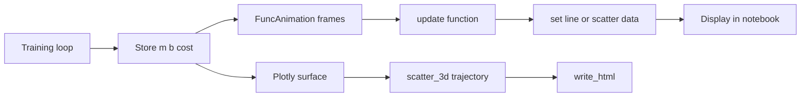
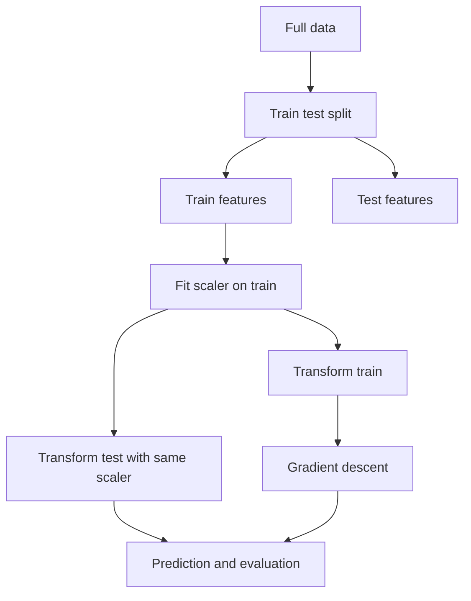
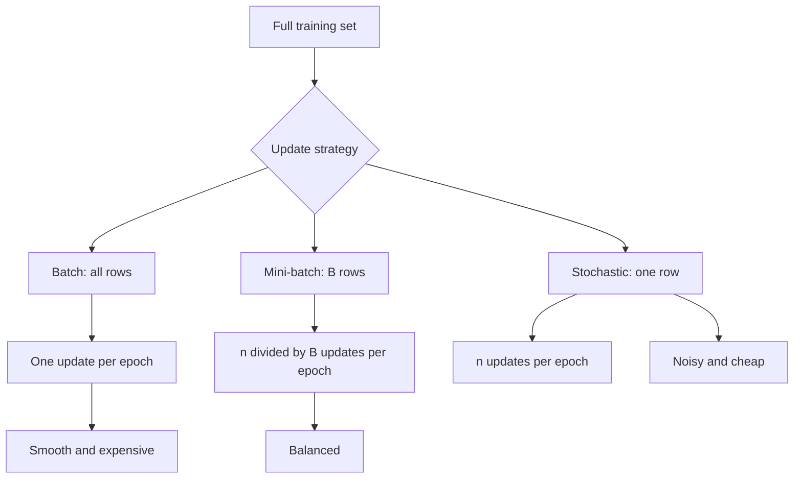
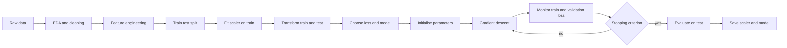

# Day 51 - Gradient Descent for Linear Regression

> **Course:** CampusX - 100 Days of Machine Learning, Day 51
> **Official source folder:** `vendor/100-days-of-machine-learning/day51-gradient-descent/`
> **Five reference notebooks in this folder:** `reference_notebooks/` (byte-identical copies of the official notebooks)
> **Datasets:** none. Every notebook generates its data with `sklearn.datasets.make_regression`.
> **Main question:** Given a loss function that measures how badly a line fits the data, how can we move the line's parameters step by step until the loss becomes small, and what can go wrong along the way?

### How this chapter is organised

This is one unified chapter for all five Day 51 notebooks:

| Notebook | Cells | Role |
|---|---:|---|
| `gradient_descent_step_by_step.ipynb` | 24 | Learns the intercept only, with the slope fixed, and shows every arithmetic step |
| `gradient-descent-code-from-scratch.ipynb` | 13 | Implements batch gradient descent in a Python class and compares it with Scikit-learn |
| `gradient-descent-3d.ipynb` | 13 | Plots the loss as a three-dimensional surface and projects the descent path onto a contour map |
| `gradient-descent-animation(onlyb).ipynb` | 16 | Animates intercept-only descent with Matplotlib and saves GIF files |
| `gradient-descent-animation(both-m-and-b).ipynb` | 10 | Animates joint slope-and-intercept descent and its cost history |

The chapter follows this order: problem, notation, data, loss surface, derivatives, update rule and learning rate, each notebook in detail, comparisons, convergence and numerical issues, worked examples, plots, mistakes, batch versus stochastic preview, interview preparation, examination practice, revision, coverage matrix, and references.

**Source labels used below.**

- **Official** means the CampusX notebook and its saved output.
- **Rerun** means a value I reproduced in this environment from the same generated data. The environment used Scikit-learn 1.9.1, NumPy 2.5.3, and the same random seeds.
- **Supplementary** means an explanation, calculation, or diagnostic added in this chapter and not spoken in the lecture. It is still technical material, but it is not presented as original course output.

All five copied notebooks are byte-identical to the vendor files. Their SHA-256 hashes match exactly. The notebooks were not modified.

---

# 1. Learning objectives

After studying this chapter, I should be able to:

1. **Explain the problem.** Describe why an iterative optimiser is useful even though simple linear regression has a closed-form ordinary least squares solution, and identify the situations where iteration is the natural choice.
2. **Write the model and loss.** Define the prediction $\hat y_i=mx_i+b$, the residual $e_i=y_i-\hat y_i$, the sum of squared errors, and the mean squared error, and explain what each symbol means.
3. **Visualise the loss surface.** Explain why the loss is a convex quadratic bowl over the parameter plane $(m,b)$, why its contours are ellipses, and why a coarse grid can hide the true minimum.
4. **Derive the gradients.** Differentiate the loss with respect to the intercept and the slope, explain the factor $2$, and derive the Hessian.
5. **Apply the update rule.** Update both parameters simultaneously with the correct sign, explain why the negative gradient is used, and distinguish an epoch from an iteration.
6. **Choose a learning rate.** Explain slow convergence, stable convergence, oscillation, and divergence; derive the stability condition for intercept-only descent; and relate the condition to the Hessian eigenvalues for joint descent.
7. **Analyse convergence.** Use the geometric error factor for intercept-only descent, the eigenvalue recurrence for joint descent, and the condition number to explain why some directions converge much more slowly than others.
8. **Read every notebook.** Trace the exact numbers in the step-by-step notebook, the fixed-slope animation notebook, the joint animation notebook, the three-dimensional notebook, and the from-scratch class.
9. **Compare with Scikit-learn.** Explain why `LinearRegression` is not gradient descent, why its coefficients differ slightly from a finite number of gradient steps, and when `SGDRegressor` is the appropriate tool.
10. **Handle feature scaling.** Explain why gradient descent is sensitive to feature scale, derive the effect on the Hessian and the learning-rate limit, and map standardised coefficients back to the original units.
11. **Diagnose failures.** Recognise divergence, slow convergence, clipping, off-by-one histories, non-identifiable parameters, and version-dependent API output.
12. **Answer interview and examination questions.** Explain the reasoning, perform the calculations, and discuss assumptions, limitations, and trade-offs.

---

# 2. Big picture: where gradient descent sits in the ML workflow

Gradient descent is an **optimisation algorithm**, not a model. It is the engine that trains a model by reducing a loss function. In this day it trains the parameters of simple linear regression.

```mermaid
flowchart LR
    A[Raw data] --> B[Data understanding]
    B --> C[Cleaning]
    C --> D[Feature engineering]
    D --> E[Train test split]
    E --> F[Fit scaler on train]
    F --> G[Transform train and test]
    G --> H[Choose model and loss]
    H --> I[Initialise parameters]
    I --> J[Compute gradient]
    J --> K[Update parameters]
    K --> L{Converged}
    L -- no --> J
    L -- yes --> M[Evaluate on test]
    M --> N[Deploy scaler and model]
```



Two different kinds of decisions appear in that diagram:

- **Decisions that do not learn from data** can be made before the split: the model family, the loss function, the optimisation algorithm, a maximum number of epochs, and a candidate learning rate.
- **Anything estimated from data** must be fitted on the training portion only: a scaler's mean and standard deviation, the coefficients, and any early-stopping decision based on validation data.

For gradient descent, the preprocessing details matter more than they do for ordinary least squares. The reason is that gradient descent follows the local slope of the loss; if one feature has a much larger numerical scale than another, the loss surface becomes a long, narrow valley and the algorithm needs a very small step to avoid overshooting the steep direction. Standardisation is therefore part of the training contract, not an optional cosmetic step.

**Connections to previous days.**

- **Day 48 (simple linear regression)** introduced the model $\hat y=mx+b$ and the least-squares objective. Day 51 asks how to minimise that objective iteratively.
- **Day 49 (regression metrics)** defined $R^2$, MSE, RMSE, and MAE. Those metrics evaluate a fitted model; gradient descent uses a loss during training. The training loss and the evaluation metric need not be the same function.
- **Day 50 (multiple linear regression)** extended the model to several coefficients. The same gradient idea applies, but the parameter vector is longer and the Hessian becomes a matrix.
- **Days 24-25 (scaling)** become essential here because the learning-rate limit depends on the feature scale and the Hessian eigenvalues.
- **Day 52 (types of gradient descent)** will compare batch, stochastic, and mini-batch updates. Day 51 uses **batch** gradient descent, because every update sums over all training rows.

**What gradient descent does not solve.**

- It does not choose the model. A linear model can still be the wrong functional form.
- It does not guarantee a better test score. A lower training loss can coexist with overfitting.
- It does not remove the need for a train/test split or cross-validation.
- It does not make a non-convex problem convex. It only follows local information.
- It does not make an ill-conditioned problem well-conditioned unless the features are rescaled or the algorithm is changed.

---

# 3. Notation and foundations

## 3.1 The data

For $n$ observations, the inputs are $x_1,\dots,x_n$ and the targets are $y_1,\dots,y_n$. In this day every notebook has one input feature, so $x_i$ is a scalar. The notebooks store the inputs in an array `X` with shape $(n,1)$ and the targets in `y` with shape $(n,)$. The extra dimension in `X` is why several cells call `.ravel()` before doing scalar arithmetic.

The model is

$$
\hat y_i = m x_i + b,
$$

where:

- $\hat y_i$ is the predicted value for observation $i$;
- $m$ is the slope, also called the coefficient or weight;
- $b$ is the intercept, also called the bias;
- $x_i$ is the input;
- $y_i$ is the observed target.

The residual is

$$
e_i = y_i - \hat y_i = y_i - m x_i - b.
$$

A positive residual means the model predicted too low; a negative residual means it predicted too high. The residual is not the same as the error in the population; it is the visible error on the training sample.

## 3.2 Sum of squared errors

The course notebooks minimise

$$
L(m,b)=\sum_{i=1}^{n}\left(y_i-mx_i-b\right)^2.
$$

This is the **sum of squared errors**, abbreviated SSE. Each residual is squared before addition, so positive and negative residuals cannot cancel. Squaring also punishes large residuals more than small ones.

Some textbooks use the mean squared error instead:

$$
L_{\mathrm{MSE}}(m,b)=\frac{1}{n}\sum_{i=1}^{n}\left(y_i-mx_i-b\right)^2.
$$

The two objectives have the same minimiser, because multiplying a function by the positive constant $1/n$ does not move its minimum. They do **not** have the same gradient magnitude. The SSE gradient is $n$ times the MSE gradient. Therefore a learning rate that works for SSE is not automatically the right learning rate for MSE. This is one of the most common sources of confusion when comparing code from different tutorials.

Some derivations use one half of the SSE:

$$
\frac{1}{2}\sum_{i=1}^{n}\left(y_i-mx_i-b\right)^2.
$$

The factor $1/2$ cancels the $2$ produced by differentiation, giving cleaner formulas. The course notebooks do not use the $1/2$; they keep the factor $2$ in the gradient. The minimiser is unchanged, but the numerical gradient is scaled by $1/2$. Again, the learning rate absorbs the difference if it is tuned consistently.

## 3.3 Why the loss is a surface

For fixed data, $L(m,b)$ is a function of two numbers. We can plot it as a surface above the $(m,b)$ plane:

- the horizontal axes are candidate values of the slope and intercept;
- the vertical axis is the loss at that pair;
- every point on the surface represents one possible line;
- the lowest point represents the best-fitting line under squared error.

This surface is the central object of the day. Gradient descent does not "know" the whole surface. It stands at one point, measures the local slope, and takes a step downhill. Repeating this process produces a path across the surface.

## 3.4 Why an iterative method at all?

Simple linear regression has a closed-form solution. The normal equations are

$$
n b + m\sum_{i=1}^{n}x_i=\sum_{i=1}^{n}y_i,
$$

$$
b\sum_{i=1}^{n}x_i + m\sum_{i=1}^{n}x_i^2=\sum_{i=1}^{n}x_i y_i.
$$

Solving them gives

$$
m=\frac{\sum_i (x_i-\bar x)(y_i-\bar y)}{\sum_i (x_i-\bar x)^2},
\qquad
b=\bar y-m\bar x.
$$

So why use gradient descent?

1. **Generality.** The same update rule works for models whose loss has no closed-form solution: logistic regression, neural networks, matrix factorisation, and many others.
2. **Scale.** For very large data or many features, forming and solving the normal equations can be expensive or memory-intensive. Iterative methods can process batches and never form a giant matrix inverse.
3. **Online and streaming settings.** If data arrive continuously, an iterative update can adapt without re-solving the entire problem.
4. **Regularisation and constraints.** Many penalised objectives are still easy to optimise iteratively, and some constraints have no simple closed form.
5. **Pedagogy.** The simple linear case lets us see the geometry, the calculus, and the failure modes without hiding them behind a library call.

For a small, well-conditioned simple regression, the closed-form solution is usually preferable: it is exact, deterministic, and fast. Gradient descent is the general-purpose alternative, not a replacement for every least-squares problem.

## 3.5 Convexity in one sentence

A function is **convex** if the straight line segment between any two points on its graph lies on or above the graph. For a twice-differentiable function of one variable, convexity means the second derivative is non-negative everywhere. For several variables, the Hessian matrix must be positive semidefinite.

The squared-error loss is convex because it is a sum of squares of affine functions. We will prove this with the Hessian in Section 6. Convexity matters because it rules out bad local minima: every local minimum is a global minimum. It does not rule out slow convergence, and it does not make an arbitrarily large learning rate safe.

## 3.6 Epoch, iteration, and step

- An **iteration** is one parameter update.
- An **epoch** is one complete pass over the training data.
- In **batch** gradient descent, one epoch contains exactly one iteration, because the gradient is computed from all $n$ rows before the update.
- In **stochastic** gradient descent, one epoch contains $n$ iterations, one per randomly ordered row.
- In **mini-batch** gradient descent, one epoch contains approximately $n/B$ iterations for batch size $B$.

The Day 51 notebooks use batch gradient descent. Their loops therefore run `epochs` times, and each loop body performs one update. The variable name `epochs` is accurate in the batch setting.

---

# 4. The data used by the notebooks

## 4.1 No external dataset

There is no CSV, no `datasets/` directory, and no external download in this day. Every notebook calls

```python
from sklearn.datasets import make_regression
```

and generates a synthetic regression problem. This is useful because the data are reproducible and the true generating process is linear plus noise, so the least-squares solution is meaningful.

The two calls are:

```python
# Four observations, used for hand calculations
X, y = make_regression(
    n_samples=4,
    n_features=1,
    n_informative=1,
    n_targets=1,
    noise=80,
    random_state=13
)

# One hundred observations, used for the animations, 3D plot, and from-scratch model
X, y = make_regression(
    n_samples=100,
    n_features=1,
    n_informative=1,
    n_targets=1,
    noise=20,
    random_state=13
)
```

The arguments mean:

- `n_samples`: number of rows;
- `n_features`: number of input columns;
- `n_informative`: how many of those columns actually influence the target;
- `n_targets`: number of output columns;
- `noise`: standard deviation of the Gaussian noise added to the linear signal;
- `random_state`: seed for reproducibility.

The generator creates a random coefficient internally, forms a linear combination of the informative features, and adds noise. The notebooks do not inspect that internal coefficient; they estimate the relationship from the sampled data. The estimated slope is therefore an estimate, not the generator's hidden coefficient.

## 4.2 The four-observation data

The step-by-step notebook uses four rows. The exact generated values are:

| $i$ | $x_i$ | $y_i$ |
|---:|---:|---:|
| 1 | -0.7123906621 | 7.2178655163 |
| 2 | 0.4518123387 | 16.0460992464 |
| 3 | -0.0445030783 | -27.8375616635 |
| 4 | 0.7537663787 | 144.3668818911 |

Summary statistics:

$$
\sum_i x_i=0.4486849770,\qquad \bar x=0.1121712443,
$$

$$
\sum_i x_i^2=1.2817791224,\qquad \sum_i (x_i-\bar x)^2=1.2314495702,
$$

$$
\sum_i y_i=139.7932849903,\qquad \bar y=34.9483212476,
$$

$$
\sum_i x_i y_i=112.1656445834,\qquad \sum_i (x_i-\bar x)(y_i-\bar y)=96.4848578677.
$$

The ordinary least squares solution is

$$
m_{\mathrm{OLS}}=\frac{96.4848578677}{1.2314495702}=78.3506366795,
$$

$$
b_{\mathrm{OLS}}=34.9483212476-78.3506366795(0.1121712443)=26.1596328431.
$$

The residual sum of squares at the OLS solution is

$$
SSE_{\mathrm{OLS}}=9481.1106340150.
$$

The mean squared error is $9481.1106340150/4=2370.2776585037$, and the root mean squared error is $48.6854974146$. The target values have a wide range, from $-27.84$ to $144.37$, so an RMSE of about $48.69$ is substantial. With only four points, the estimate is fragile: one point can move the line a lot.

The four observations are deliberately few. They make it possible to compute every gradient by hand and to see the effect of one update without a computer.

## 4.3 The one-hundred-observation data

The animations, the 3D surface, and the from-scratch notebook use one hundred rows. The exact summary statistics are:

$$
\sum_i x_i=5.8407391147,\qquad \bar x=0.0584073911,
$$

$$
\sum_i x_i^2=87.1862318240,\qquad \sum_i (x_i-\bar x)^2=86.8450894900,
$$

$$
\sum_i y_i=-66.9378360870,\qquad \bar y=-0.6693783609,
$$

$$
\sum_i x_i y_i=2412.8233916795,\qquad \sum_i (x_i-\bar x)(y_i-\bar y)=2416.7330560543.
$$

The OLS solution is

$$
m_{\mathrm{OLS}}=\frac{2416.7330560543}{86.8450894900}=27.8280910325,
$$

$$
b_{\mathrm{OLS}}=-0.6693783609-27.8280910325(0.0584073911)=-2.2947445587.
$$

The residual sum of squares is

$$
SSE_{\mathrm{OLS}}=28342.2756015878.
$$

The mean squared error is $283.4227560159$, and the root mean squared error is $16.8351642705$. The sample correlation between $x$ and $y$ is $0.8387599416$, which is strong but not perfect; the noise is visible in the scatter plot.

The input range is approximately $[-2.1871, 2.1504]$, and the target range is approximately $[-75.7291, 64.1795]$. The feature is roughly centred near zero with a standard deviation close to one. This is a relatively well-conditioned problem for gradient descent. It is not a coincidence that the course uses this scale for the animation: the learning rate $0.001$ is small enough to be stable and large enough to make visible progress in thirty epochs.

## 4.4 The train/test split in the from-scratch notebook

The from-scratch notebook splits the one-hundred-row data:

```python
from sklearn.model_selection import train_test_split

X_train, X_test, y_train, y_test = train_test_split(
    X, y,
    test_size=0.2,
    random_state=2
)
```

This produces $80$ training rows and $20$ test rows. The split is important for honest evaluation: the gradient descent model is fitted on `X_train` and `y_train`, and $R^2$ is computed on `X_test` and `y_test`.

The OLS model fitted on the training rows has

$$
m_{\mathrm{OLS,train}}=28.12597332,
\qquad
b_{\mathrm{OLS,train}}=-2.2710144262.
$$

On the test rows it achieves

$$
R^2_{\mathrm{OLS,test}}=0.6345158783.
$$

These numbers differ from the full-data OLS values because the training subset is different from the full sample. This is normal sampling variation, not an error.

## 4.5 Why the same seed does not mean the same rows everywhere

The four-row call and the one-hundred-row call both use `random_state=13`, but they are different calls with different `n_samples` and different `noise`. There is no reason for the four-row dataset to be a subset of the one-hundred-row dataset. The notebooks use them for different purposes:

- the four-row data make hand arithmetic readable;
- the one-hundred-row data make plots, animations, and convergence curves meaningful.

When reproducing a notebook, reproduce the exact call. Do not assume that changing `n_samples` while keeping the seed preserves the earlier rows.

---

# 5. The model and the loss surface

## 5.1 The prediction line

For a candidate slope $m$ and intercept $b$, the model predicts

$$
\hat y_i=m x_i+b.
$$

Geometrically, this is a straight line in the $(x,y)$ plane. Changing $b$ shifts the line up or down. Changing $m$ rotates it around the point $(0,b)$ in the plotted coordinates. The goal is to choose the line that makes the vertical distances to the observations as small as possible in the squared sense.

The vertical distance is used rather than the perpendicular distance because the model treats $x$ as input and $y$ as output. A residual is a difference in the output direction. Perpendicular distance would correspond to a different model, such as total least squares, where both variables are treated as noisy.

## 5.2 Expanding the loss

Starting from

$$
L(m,b)=\sum_{i=1}^{n}(y_i-mx_i-b)^2,
$$

expand the square:

$$
L(m,b)=\sum_i y_i^2
+m^2\sum_i x_i^2
+n b^2
-2m\sum_i x_i y_i
-2b\sum_i y_i
+2mb\sum_i x_i.
$$

Every term is either constant, linear in one parameter, quadratic in one parameter, or a cross term $2mb\sum x_i$. There are no cubes, no fourth powers, and no trigonometric or exponential terms. This is why the surface is a quadratic bowl.

The constant term $\sum y_i^2$ does not affect the location of the minimum. The quadratic terms $m^2\sum x_i^2$ and $n b^2$ curve upward because $\sum x_i^2>0$ and $n>0$. The cross term tilts the bowl when $\sum x_i\neq0$. The tilt is the reason the contour ellipses are rotated relative to the coordinate axes.

## 5.3 The loss is convex

A quadratic function with a positive semidefinite Hessian is convex. We will compute the Hessian in Section 6. For now, the intuitive picture is enough:

- if we stand anywhere on the surface and look in any direction, the surface eventually curves upward;
- there is no separate valley that is lower than the global bottom;
- the bottom may be a single point, a line, or a flat plane if the problem is rank-deficient.

For the one-hundred-row data, the Hessian is positive definite, so the bowl has a unique bottom at the OLS solution. For the four-row data, the Hessian is also positive definite because the four $x$ values are not all equal.

## 5.4 Contours

A **contour** is a curve along which the loss is constant. If we slice the surface with horizontal planes at different heights and project the slices onto the $(m,b)$ plane, we get contour lines.

For a convex quadratic, the contours are ellipses centred at the OLS solution. The innermost ellipse surrounds the minimum. Moving outward, the loss increases. The gradient at a point is perpendicular to the contour through that point and points in the direction of steepest increase. The negative gradient points in the direction of steepest decrease.

The shape of the ellipses tells us how hard the problem is for gradient descent:

- nearly circular ellipses mean the loss increases at similar rates in all directions; gradient descent converges quickly and isotropically;
- long, thin ellipses mean one direction is much steeper than another; gradient descent zig-zags and converges slowly along the shallow direction;
- a perfectly flat direction means the Hessian is singular and the parameters are not separately identifiable.

The ratio of the largest to the smallest Hessian eigenvalue is the **condition number**. A large condition number is the mathematical explanation of a long, thin valley.

## 5.5 The surface in the 3D notebook

The 3D notebook builds a grid of candidate slopes and intercepts:

```python
m_arr = np.linspace(-150, 150, 10)
b_arr = np.linspace(-150, 150, 10)
mGrid, bGrid = np.meshgrid(m_arr, b_arr)
```

Each array has ten values. The meshgrid produces two $10\times10$ arrays. The code then flattens them into a list of $100$ parameter pairs and computes the sum of squared errors for each pair:

```python
final = np.vstack((
    mGrid.ravel().reshape(1, 100),
    bGrid.ravel().reshape(1, 100)
)).T

z_arr = []
for i in range(final.shape[0]):
    z_arr.append(np.sum((y - final[i, 0] * X.reshape(100) - final[i, 1]) ** 2))
z_arr = np.array(z_arr).reshape(10, 10)
```

The resulting `z_arr` has one loss value for each grid point. Plotly draws it as a surface.

The grid is coarse: the spacing is $(150-(-150))/9=33.3333$. The true OLS solution is $(m,b)=(27.8281,-2.2947)$, which does not lie on the grid. The smallest grid loss is therefore not the true minimum. The grid minimum is at $m=16.6667$, $b=-16.6667$, with loss $61732.7627$, while the true minimum is $28342.2756$. A finer grid would get closer, but the analytic solution is exact. This is a useful lesson: a surface plot is a visual aid, not a precise optimiser.

Selected grid values:

| $m$ | $b$ | $L(m,b)$ |
|---:|---:|---:|
| -150.0000 | -150.0000 | 5,273,929.2927 |
| -16.6667 | -16.6667 | 61,732.7627 |
| 16.6667 | 16.6667 | 72,684.9952 |
| 150.0000 | 150.0000 | 3,866,397.9593 |

The table shows that the loss changes enormously across the grid. The shallow region near the minimum is small compared with the full plotting range, which is why a surface plot can look almost flat near the bottom and why contour plots are often more informative near the optimum.

## 5.6 What the surface does not show

The surface plots the training loss only. It does not show:

- test error;
- the uncertainty of the coefficients;
- whether the linear model is correctly specified;
- whether the data contain outliers that dominate the fit;
- whether the feature scale makes the problem ill-conditioned;
- whether a different loss would be more appropriate.

A low point on the surface means "this line fits the training sample well under squared error." It does not mean "this line will generalise well." That distinction belongs to model evaluation, not to the optimiser.

---

# 6. Derivatives, gradient, and Hessian

## 6.1 Why derivatives

A derivative measures how a function changes when its input changes by a tiny amount. For a one-variable function $f(x)$, the derivative $f'(x)$ is the slope of the tangent line at $x$. If $f'(x)>0$, increasing $x$ increases $f$; if $f'(x)<0$, increasing $x$ decreases $f$.

For a function of two variables, there are two partial derivatives:

- $\partial L/\partial b$ measures the change in loss when $b$ changes while $m$ is held fixed;
- $\partial L/\partial m$ measures the change in loss when $m$ changes while $b$ is held fixed.

The **gradient** stacks these partial derivatives into a vector:

$$
\nabla L(m,b)=
\begin{bmatrix}
\dfrac{\partial L}{\partial b}\\
\dfrac{\partial L}{\partial m}
\end{bmatrix}.
$$

The gradient points in the direction of steepest increase. The negative gradient points in the direction of steepest decrease. This is the geometric reason for the minus sign in the update rule.

## 6.2 Derivative with respect to the intercept

Start with

$$
L(m,b)=\sum_{i=1}^{n}(y_i-mx_i-b)^2.
$$

Differentiate term by term. For each $i$, let $r_i=y_i-mx_i-b$. The derivative of $r_i^2$ with respect to $b$ is

$$
\frac{\partial}{\partial b}r_i^2
=2r_i\frac{\partial r_i}{\partial b}
=2r_i(-1)
=-2r_i.
$$

Therefore

$$
\frac{\partial L}{\partial b}
=-2\sum_{i=1}^{n}(y_i-mx_i-b).
$$

This derivative depends only on the sum of the residuals. If the residuals sum to zero, the intercept is at a stationary point for the current slope. In OLS, the residuals always sum to zero when an intercept is included, which is why the fitted line passes through $(\bar x,\bar y)$.

## 6.3 Derivative with respect to the slope

For each $i$,

$$
\frac{\partial}{\partial m}r_i^2
=2r_i\frac{\partial r_i}{\partial m}
=2r_i(-x_i)
=-2x_i r_i.
$$

Therefore

$$
\frac{\partial L}{\partial m}
=-2\sum_{i=1}^{n}x_i(y_i-mx_i-b).
$$

This derivative weights each residual by its input value. A residual at a large $|x_i|$ has more influence on the slope than the same residual near $x=0$. This is the calculus version of leverage.

## 6.4 Gradient at the OLS solution

At the OLS solution, both partial derivatives are zero:

$$
\sum_i (y_i-m_{\mathrm{OLS}}x_i-b_{\mathrm{OLS}})=0,
$$

$$
\sum_i x_i(y_i-m_{\mathrm{OLS}}x_i-b_{\mathrm{OLS}})=0.
$$

These are exactly the normal equations. For the one-hundred-row data, a numerical check gives

$$
\frac{\partial L}{\partial b}\approx 1.21\times10^{-13},
\qquad
\frac{\partial L}{\partial m}\approx -1.84\times10^{-12},
$$

which is zero up to floating-point rounding. This confirms that OLS is a stationary point of the loss. Convexity then makes it the global minimum.

## 6.5 The Hessian

The Hessian is the matrix of second derivatives:

$$
H(m,b)=
\begin{bmatrix}
\dfrac{\partial^2 L}{\partial b^2} &
\dfrac{\partial^2 L}{\partial b\,\partial m}\\
\dfrac{\partial^2 L}{\partial m\,\partial b} &
\dfrac{\partial^2 L}{\partial m^2}
\end{bmatrix}.
$$

Compute each entry.

For the intercept:

$$
\frac{\partial^2 L}{\partial b^2}
=\frac{\partial}{\partial b}\left[-2\sum_i(y_i-mx_i-b)\right]
=2n.
$$

For the slope:

$$
\frac{\partial^2 L}{\partial m^2}
=\frac{\partial}{\partial m}\left[-2\sum_i x_i(y_i-mx_i-b)\right]
=2\sum_i x_i^2.
$$

For the cross term:

$$
\frac{\partial^2 L}{\partial b\,\partial m}
=\frac{\partial}{\partial m}\left[-2\sum_i(y_i-mx_i-b)\right]
=2\sum_i x_i.
$$

The Hessian is symmetric because the mixed partial derivatives are equal. Therefore

$$
H=2
\begin{bmatrix}
n & \sum_i x_i\\
\sum_i x_i & \sum_i x_i^2
\end{bmatrix}.
$$

For the one-hundred-row data,

$$
H=
\begin{bmatrix}
200 & 11.68147823\\
11.68147823 & 174.37246365
\end{bmatrix}.
$$

Its eigenvalues are $169.84698188$ and $204.52548176$, and its condition number is

$$
\kappa=\frac{204.52548176}{169.84698188}=1.204174955.
$$

A condition number close to one means the bowl is nearly circular in the two parameter directions; gradient descent is not badly handicapped by the geometry.

For the four-row data,

$$
H=
\begin{bmatrix}
8 & 0.89736995\\
0.89736995 & 2.56355824
\end{bmatrix},
$$

with eigenvalues $2.41926317$ and $8.14429507$, and condition number $3.36643618$. The four-point problem is more elongated than the one-hundred-point problem, but the step-by-step notebook avoids joint descent by fixing the slope, so this condition number does not directly control its intercept updates.

## 6.6 Positive definiteness and identifiability

A symmetric $2\times2$ matrix

$$
\begin{bmatrix}a & c\\ c & d\end{bmatrix}
$$

is positive definite if $a>0$ and $ad-c^2>0$. Here $a=2n>0$, and

$$
ad-c^2
=(2n)\left(2\sum_i x_i^2\right)-\left(2\sum_i x_i\right)^2
=4\left(n\sum_i x_i^2-\left(\sum_i x_i\right)^2\right).
$$

The term in parentheses is $n^2$ times the population variance of $x$:

$$
n\sum_i x_i^2-\left(\sum_i x_i\right)^2
=n^2\left(\frac{1}{n}\sum_i x_i^2-\bar x^2\right)
=n^2\operatorname{Var}_{\mathrm{pop}}(x).
$$

Therefore the Hessian is positive definite exactly when the $x$ values are not all equal. If all $x_i=c$, then every prediction is $mc+b$, and only the combination $mc+b$ is identified. The slope and intercept cannot be separated; infinitely many pairs give the same fitted line and the same loss. The Hessian is singular, and the contour plot has a flat valley rather than an isolated minimum.

## 6.7 Gradient and Hessian with mean squared error

If the loss is the mean squared error, every derivative is divided by $n$:

$$
\nabla L_{\mathrm{MSE}}=\frac{1}{n}\nabla L_{\mathrm{SSE}},
\qquad
H_{\mathrm{MSE}}=\frac{1}{n}H_{\mathrm{SSE}}.
$$

The eigenvalues are also divided by $n$. For the one-hundred-row data, the MSE Hessian eigenvalues are $1.69846982$ and $2.04525482$. The learning-rate limit for the MSE loss is therefore about $2/2.04525482=0.97787$, not $0.00978$. This is why comparing learning rates across tutorials without checking the loss definition is meaningless.

## 6.8 What the gradient does not tell us

The gradient is a local quantity. It tells us the steepest direction at the current point and the local steepness. It does not tell us:

- how far to step;
- whether the surface is convex globally;
- how the step interacts with the curvature in other directions;
- whether the data are scaled well;
- whether the current point is near the minimum.

The learning rate and the Hessian answer the "how far" and "how curved" questions. The gradient alone answers only "which way is downhill right now."

---

# 7. The update rule and the learning rate

## 7.1 The update rule

Gradient descent starts from an initial guess $(m_0,b_0)$ and repeatedly applies

$$
b_{t+1}=b_t-\alpha\frac{\partial L}{\partial b}\bigg|_{(m_t,b_t)},
$$

$$
m_{t+1}=m_t-\alpha\frac{\partial L}{\partial m}\bigg|_{(m_t,b_t)},
$$

where:

- $t$ is the iteration index;
- $\alpha>0$ is the learning rate;
- the derivatives are evaluated at the **old** parameters $(m_t,b_t)$;
- both updates use the same old parameters.

The minus sign is essential: the gradient points uphill, so subtracting it moves downhill. If the loss is convex and $\alpha$ is small enough, the sequence of losses decreases toward the global minimum.

In code, the pattern is:

```python
# Compute both gradients at the current parameters
grad_b = -2 * np.sum(y - m * X.ravel() - b)
grad_m = -2 * np.sum((y - m * X.ravel() - b) * X.ravel())

# Update both parameters
b = b - learning_rate * grad_b
m = m - learning_rate * grad_m
```

The order of the two assignment statements does not matter for the mathematics **as long as both gradients were computed before either update**. If the code updates $b$ first and then recomputes the slope gradient using the new $b$, it is performing a different algorithm (a Gauss-Seidel-style update), not standard batch gradient descent. The course notebooks compute both gradients first, so they implement the standard simultaneous update.

## 7.2 Why simultaneous matters

Suppose we update $b$ first:

$$
b_{t+1}=b_t-\alpha\frac{\partial L}{\partial b}(m_t,b_t).
$$

If we then compute the slope gradient at $(m_t,b_{t+1})$ and update $m$, the slope step uses information from the new intercept. That is not necessarily wrong, but it is not the gradient of the original point. It changes the trajectory and the stability analysis. For clean theory and reproducible comparisons, compute both gradients at the same point and then update both.

## 7.3 The learning rate as a step size

The learning rate $\alpha$ multiplies the negative gradient. It controls how far we move in the downhill direction:

- **too small:** the steps are tiny; the loss decreases very slowly; many epochs are needed;
- **well chosen:** the loss decreases steadily and reaches a small value in a reasonable number of epochs;
- **too large:** the steps overshoot the minimum; the loss may oscillate, grow, or become not-a-number;
- **exactly at a special value:** for intercept-only descent, a particular learning rate can land on the minimum in one step.

The learning rate is not dimensionless in the same way for every loss. Its meaning depends on:

- the scale of the loss (SSE versus MSE versus half-SSE);
- the scale of the features;
- the number of observations;
- the curvature of the loss.

This is why "use $\alpha=0.01$" is not a universal rule. It is a starting point that must be checked against the specific loss and data.

## 7.4 Intercept-only convergence, exactly

Fix the slope at some value $m$. Define

$$
z_i=y_i-mx_i.
$$

Then the loss as a function of the intercept is

$$
L(b)=\sum_{i=1}^{n}(z_i-b)^2.
$$

This is a one-dimensional quadratic. Its derivative is

$$
L'(b)=-2\sum_{i=1}^{n}(z_i-b)
=-2\left(\sum_i z_i-nb\right).
$$

The stationary point is

$$
b^*=\frac{1}{n}\sum_{i=1}^{n}z_i
=\bar z
=\bar y-m\bar x.
$$

The gradient descent update is

$$
b_{t+1}=b_t-\alpha L'(b_t)
=b_t+2\alpha\left(\sum_i z_i-nb_t\right).
$$

Subtract $b^*$ from both sides:

$$
b_{t+1}-b^*
=b_t-b^*+2\alpha\left(nb^*-nb_t\right)
=(1-2n\alpha)(b_t-b^*).
$$

Therefore the error shrinks geometrically:

$$
b_t-b^*=(1-2n\alpha)^t(b_0-b^*).
$$

This is an exact formula, not an approximation. It holds for any starting value and any fixed slope, as long as the arithmetic is exact.

The factor

$$
r=1-2n\alpha
$$

determines the behaviour:

- if $0<r<1$, the error shrinks monotonically;
- if $r=0$, the error becomes zero after one step;
- if $-1<r<0$, the error shrinks but alternates sign (oscillation around the minimum);
- if $r=-1$, the error has constant magnitude and alternates sign forever;
- if $|r|>1$, the error grows and the method diverges.

The stable range is therefore

$$
|1-2n\alpha|<1
\iff
0<\alpha<\frac{1}{n}.
$$

The one-step value is

$$
\alpha=\frac{1}{2n}.
$$

For the four-point notebook, $n=4$ and $\alpha=0.1$, so

$$
r=1-2(4)(0.1)=0.2.
$$

For the one-hundred-point notebook, $n=100$ and $\alpha=0.001$, so

$$
r=1-2(100)(0.001)=0.8.
$$

These two factors explain the speeds observed in the notebooks: the four-point example converges much faster per epoch than the one-hundred-point example, even though both use "small" learning rates.

## 7.5 Numerical illustration of the learning-rate range

Using the one-hundred-point data with the slope fixed at $m=27.82$, the conditional optimum is

$$
b^*=\bar y-27.82\bar x=-2.2942719826.
$$

Starting from $b_0=-150$, the table below shows the effect of different learning rates after thirty epochs.

| $\alpha$ | $r=1-200\alpha$ | $b_1$ | $b_2$ | $b_3$ | $b_{30}$ | Behaviour |
|---:|---:|---:|---:|---:|---:|---|
| 0.0001 | 0.98 | -147.0459 | -144.1509 | -141.3137 | -82.8700 | very slow |
| 0.0010 | 0.80 | -120.4589 | -96.8259 | -77.9196 | -2.4771 | steady |
| 0.0050 | 0.00 | -2.2943 | -2.2943 | -2.2943 | -2.2943 | one-step |
| 0.0090 | -0.80 | 115.8703 | -96.8259 | 73.3311 | -2.4771 | oscillates, then settles |
| 0.0099 | -0.98 | 142.4573 | -144.1509 | 136.7252 | -82.8700 | oscillates slowly |
| 0.0100 | -1.00 | 145.4115 | -150.0000 | 145.4115 | -150.0000 | never converges |
| 0.0101 | -1.02 | 148.3656 | -155.9673 | 154.4522 | -269.8000 | diverges slowly |
| 0.0200 | -3.00 | 440.8229 | -1331.6458 | 3985.7604 | $-3.04\times10^{16}$ | diverges fast |

The table is a compact diagnostic tool. It shows that "the loss went down" is not enough to conclude that the learning rate is good. A rate just below the stability limit can oscillate wildly while still shrinking slowly, and a rate at the limit can cycle forever without converging.

## 7.6 Joint descent and the Hessian eigenvalue condition

For two parameters, the error vector is

$$
e_t=
\begin{bmatrix}
b_t-b^*\\
m_t-m^*
\end{bmatrix}.
$$

Because the loss is quadratic, its gradient is exactly

$$
\nabla L(\theta)=H(\theta-\theta^*),
$$

where $\theta=(b,m)$ and $H$ is the Hessian. The gradient descent recurrence becomes

$$
e_{t+1}=(I-\alpha H)e_t.
$$

If $H$ has eigenvalues $\lambda_1,\lambda_2$ with orthonormal eigenvectors $v_1,v_2$, write the error in that eigenbasis:

$$
e_t=c_1(t)v_1+c_2(t)v_2.
$$

Then each coefficient evolves independently:

$$
c_j(t+1)=(1-\alpha\lambda_j)c_j(t).
$$

Convergence requires

$$
|1-\alpha\lambda_j|<1
\quad\text{for every }j,
$$

which is equivalent to

$$
0<\alpha<\frac{2}{\lambda_{\max}}.
$$

The slowest direction is the one with the largest factor $|1-\alpha\lambda_j|$. For a positive definite Hessian and a stable $\alpha$, the asymptotic rate is governed by the eigenvalue that makes this factor largest. The ratio

$$
\kappa=\frac{\lambda_{\max}}{\lambda_{\min}}
$$

is the condition number. A large condition number means the factors for the two directions are very different; one direction converges quickly while the other crawls. The optimal constant learning rate for a quadratic is

$$
\alpha_{\mathrm{opt}}=\frac{2}{\lambda_{\max}+\lambda_{\min}},
$$

with asymptotic factor

$$
\frac{\kappa-1}{\kappa+1}.
$$

This formula explains why feature scaling matters: scaling changes the Hessian eigenvalues and therefore the condition number.

For the one-hundred-point data, the sum-of-squares Hessian eigenvalues are $169.84698188$ and $204.52548176$. The stability limit is

$$
\alpha<\frac{2}{204.52548176}=0.0097787326.
$$

The course uses $\alpha=0.001$, which is about one tenth of the limit. The corresponding factors are

$$
1-0.001(169.84698188)=0.8301530181,
$$

$$
1-0.001(204.52548176)=0.7954745182.
$$

The slower factor is $0.8302$, so after thirty epochs the slowest error component is multiplied by $0.8302^{30}\approx0.0038$. That is small but not zero, which is why the joint trajectory is close to the OLS point but not exactly on it after thirty epochs.

For the four-point data, the Hessian eigenvalues are $2.41926317$ and $8.14429507$. The stability limit is $2/8.14429507=0.24557$. The step-by-step notebook does not update the slope, so its one-dimensional analysis with $\alpha=0.1$ is the relevant one.

## 7.7 Learning rate and loss scaling

The stability limits above are for the sum-of-squares loss. If the code uses the mean squared error, the Hessian is divided by $n$, so the limit becomes

$$
\alpha<\frac{2}{\lambda_{\max}/n}=\frac{2n}{\lambda_{\max}}.
$$

For the one-hundred-point data, this is about $0.97787$ instead of $0.00978$. A learning rate of $0.001$ is then extremely conservative: the effective step is one hundred times smaller than the same numerical learning rate applied to the SSE. This is not a bug; it is a consequence of the loss definition. Always state the loss when stating a learning rate.

## 7.8 Choosing a learning rate in practice

A practical procedure:

1. Standardise the features so the Hessian is well-conditioned.
2. Start with a small rate, for example $10^{-3}$ or $10^{-2}$ for a mean-squared loss on standardised features.
3. Run a short training job and plot the loss.
4. If the loss decreases too slowly, increase the rate by a factor of about $3$ or $10$.
5. If the loss oscillates or grows, decrease the rate.
6. Once the rate is in a stable range, tune it with validation data, not the test set.
7. Consider a learning-rate schedule or an adaptive optimiser for difficult problems.

For the course's SSE loss on the one-hundred-point data, $0.001$ is a safe, deliberately conservative choice. It produces visible progress in thirty epochs without instability. For the four-point data, $0.1$ is safe because $n$ is small; the stability limit is $0.25$.

# 8. Notebook 1: `gradient_descent_step_by_step.ipynb`

## 8.1 What the notebook is trying to show

This notebook isolates the intercept. It fixes the slope at a value close to the OLS slope and then updates only the intercept, one hand-checkable step at a time. The purpose is not to build a production model. The purpose is to make the update rule concrete:

- what the gradient is for the current line;
- how the learning rate turns the gradient into a step size;
- how the new intercept is computed;
- how the loss falls after each step;
- why the steps become smaller as the line approaches the best intercept.

The notebook uses four observations and $24$ cells. It performs three explicit iterations, then runs a one-hundred-epoch loop for comparison.

## 8.2 The cells in order

| Cell | Content |
|---:|---|
| 0 | Import `make_regression` and NumPy |
| 1 | Generate four observations with `noise=80`, `random_state=13` |
| 2 | Scatter plot of the four points |
| 3 | Import `LinearRegression` |
| 4 | Fit OLS and display the estimator |
| 5 | Display `reg.coef_` |
| 6 | Display `reg.intercept_` |
| 7 | Plot the data and the OLS line |
| 8 | Build predictions with slope $78.35$ and intercept $100$ |
| 9 | Plot OLS, the initial line, and the data |
| 10 | Compute the first intercept gradient |
| 11 | Multiply by the learning rate to get the step |
| 12 | Subtract the step from the intercept |
| 13 | Plot the OLS line and the updated line |
| 14-16 | Compute the second gradient, step, and intercept |
| 17 | Plot the second updated line |
| 18-20 | Compute the third gradient, step, and intercept |
| 21 | Plot the third updated line |
| 22 | Run a one-hundred-epoch loop from $b=-100$ |
| 23 | Empty cell |

The notebook has no Markdown explanation cells. The comments in the code carry the narrative. That is one reason the chapter must supply the conceptual explanation separately.

## 8.3 The OLS reference

The fit produces

$$
m_{\mathrm{OLS}}=78.35063668,
\qquad
b_{\mathrm{OLS}}=26.1596328431.
$$

The OLS line is the target that the intercept updates are approaching. The notebook then fixes the slope at $m=78.35$, a rounded version of the OLS slope. Because the slope is slightly rounded, the best intercept for this fixed slope is not exactly the OLS intercept. For fixed $m=78.35$,

$$
b^*=\bar y-78.35\bar x
=34.9483212476-78.35(0.1121712443)
=26.1597042603.
$$

The difference from the OLS intercept is

$$
26.1597042603-26.1596328431=0.0000714172,
$$

which is negligible for the demonstration. The distinction is worth remembering: a conditional optimum for one parameter is not the same as the joint optimum for both.

## 8.4 The starting line

The code sets

```python
m = 78.35
b = 100
```

and builds

```python
y_pred = ((78.35 * X) + 100).reshape(4)
```

The comment above the cell says "let's assume the starting value for intercept $b=0$", and the plot label in the next cell says `b = 0`. Both are inconsistent with the code, which uses $b=100$. The actual initial intercept is $100$. This is a source-fidelity issue in the notebook, not a mathematical subtlety. The plot shows a line shifted far above the data, which is consistent with $b=100$, not $b=0$.

For the four observations, the initial predictions and residuals are:

| $i$ | $x_i$ | $y_i$ | $\hat y_i$ at $b=100$ | $e_i$ |
|---:|---:|---:|---:|---:|
| 1 | -0.7123906621 | 7.2178655163 | 44.1841916283 | -36.9663261120 |
| 2 | 0.4518123387 | 16.0460992464 | 135.3994967407 | -119.3533974943 |
| 3 | -0.0445030783 | -27.8375616635 | 96.5131838122 | -124.3507454757 |
| 4 | 0.7537663787 | 144.3668818911 | 159.0575957680 | -14.6907138769 |

The residuals sum to $-295.3611829590$. The initial sum of squared errors is

$$
L_0=31290.6677342423.
$$

The line is too high almost everywhere, so the residuals are mostly negative. The gradient with respect to the intercept is

$$
\frac{\partial L}{\partial b}
=-2\sum_i e_i
=-2(-295.3611829590)
=590.7223659179.
$$

The positive derivative means that increasing $b$ would increase the loss. To decrease the loss, we must decrease $b$. The update does exactly that:

$$
b_1=b_0-\alpha\frac{\partial L}{\partial b}
=100-0.1(590.7223659179)
=40.9277634082.
$$

The step is $59.0722365918$. The new line is lower, and the loss falls to $10353.4929185033$. One update removed about two thirds of the initial loss.

## 8.5 The three explicit iterations

The notebook repeats the same three-line pattern: compute the gradient, multiply by the learning rate, subtract from the intercept. The results are:

| Iteration | Starting $b$ | $\sum_i e_i$ | $\partial L/\partial b$ | Step $\alpha\partial L/\partial b$ | New $b$ | SSE before | SSE after |
|---:|---:|---:|---:|---:|---:|---:|---:|
| 1 | 100.0000000000 | -295.3611829590 | 590.7223659179 | 59.0722365918 | 40.9277634082 | 31,290.667734 | 10,353.492919 |
| 2 | 40.9277634082 | -59.0722365918 | 118.1444731836 | 11.8144473184 | 29.1133160899 | 10,353.492919 | 9,516.005926 |
| 3 | 29.1133160899 | -11.8144473184 | 23.6288946367 | 2.3628894637 | 26.7504266262 | 9,516.005926 | 9,482.506446 |

The pattern is visible in the residual sums:

$$
-295.3611829590
\;\to\;
-59.0722365918
\;\to\;
-11.8144473184
\;\to\;
-2.3628894637.
$$

Each sum is exactly one tenth of the previous sum, because the learning rate is $0.1$ and the gradient is $-2$ times the residual sum. The intercept error obeys the geometric rule from Section 7.4 with $r=0.2$:

$$
b_t-b^*=(0.2)^t(b_0-b^*).
$$

Check the third step:

$$
b_0-b^*=100-26.1597042603=73.8402957397,
$$

$$
b_3-b^*=73.8402957397(0.2)^3
=73.8402957397(0.008)
=0.5907223659,
$$

$$
b_3=26.1597042603+0.5907223659=26.7504266262.
$$

This matches the notebook exactly. The fourth step would be $0.1181444732$, the fifth $0.0236288946$, and so on. After three steps the intercept is already within $0.59$ of the conditional optimum, and the remaining loss is only

$$
9482.5064461685-9481.1106340150=1.3958121535
$$

above the OLS loss. The model looks almost perfect on this tiny dataset because the slope was already fixed near its optimum.

## 8.6 Why the loss barely changes after the third step

The loss is quadratic in the intercept. Near its minimum, a quadratic is flat to first order: the derivative is proportional to the distance from the minimum. The gradient at $b=26.7504$ is $4.7258$, which is small compared with the initial $590.72$. The step is therefore $0.4726$ in the next iteration, then $0.0945$, then $0.0189$. The loss changes by smaller and smaller amounts even though the parameter is still moving. This is normal for gradient descent: the last part of the approach is slow in parameter space but tiny in loss space.

It is also why "the loss stopped changing" can be a poor stopping criterion if the tolerance is too loose. A loss change of $1.4$ on a loss of $9482$ is a relative change of about $0.015\%$, but the parameter is still $0.59$ away from the optimum. Whether that matters depends on the application. For prediction, a small loss difference may be irrelevant; for interpreting a coefficient, it may matter.

## 8.7 The one-hundred-epoch loop

Cell 22 resets the problem:

```python
b = -100
m = 78.35
lr = 0.01

epochs = 100

for i in range(epochs):
    loss_slope = -2 * np.sum(y - m * X.ravel() - b)
    b = b - (lr * loss_slope)
    y_pred = m * X + b
    plt.plot(X, y_pred)

plt.scatter(X, y)
```

This loop starts below the optimum and uses a larger learning rate, $0.01$. For $n=4$,

$$
r=1-2(4)(0.01)=0.92.
$$

The error shrinks by a factor of $0.92$ per epoch. After one hundred epochs,

$$
(0.92)^{100}\approx2.39\times10^{-4}.
$$

The starting error is

$$
-100-26.1597042603=-126.1597042603,
$$

so the final error is about $-0.03017$, giving

$$
b_{100}\approx26.1295253609.
$$

The exact rerun gives $b_{100}=26.1295253609$ and

$$
SSE_{100}=9481.1142775780,
$$

compared with the OLS $9481.1106340150$. The line is visually indistinguishable from the OLS line. The loop plots all one hundred lines on the same axes, so the saved figure shows a bundle of lines converging toward the OLS line rather than a single final line. That is a deliberate visual effect, but it can be confusing if read as one hundred separate models.

The loop does not store the loss history. It only plots the lines. To study convergence, the loss should be recorded before or after each update. The notebook instead relies on the step-by-step cells for the arithmetic and on the final plot for the visual result.

## 8.8 What this notebook teaches and what it hides

**What it teaches well:**

- the sign of the gradient and the meaning of the update;
- the effect of the learning rate as a multiplier;
- the geometric decrease of the intercept error;
- the fact that a quadratic loss becomes flat near its minimum;
- the difference between the conditional optimum for $b$ and the joint OLS optimum.

**What it hides:**

- the slope is fixed, so the interaction between slope and intercept is absent;
- the data are tiny, so the result is not evidence about a real dataset;
- the loss history is not stored, so convergence is inferred from lines rather than a curve;
- the label `b = 0` is wrong;
- the OLS estimator is displayed with an old Scikit-learn representation that includes `normalize=False` and `n_jobs=None`; current versions do not show those fields.

The next notebook removes the slope-fixing restriction, which makes the problem two-dimensional and introduces the interaction that the one-dimensional analysis cannot show.

---

# 9. Notebook 2: `gradient-descent-animation(onlyb).ipynb`

## 9.1 What the notebook is trying to show

This notebook uses one hundred observations, fixes the slope at $m=27.82$, and animates the intercept moving from $-150$ toward its best value. It also animates the cost history, the intercept history, and the relationship between intercept and cost. It is the visual counterpart of the step-by-step notebook: the arithmetic is the same, but the data are larger and the result is presented as motion.

The notebook has $16$ cells. It uses Matplotlib's `FuncAnimation`, saves GIF files with `PillowWriter`, and includes a static plot of the loss curve.

## 9.2 The cells in order

| Cell | Content |
|---:|---|
| 0 | Imports and `%matplotlib notebook` |
| 1 | Generate one hundred observations |
| 2 | Scatter plot |
| 3 | Fit OLS and print its coefficient and intercept |
| 4 | Run thirty intercept updates and overlay the predicted lines |
| 5 | Convert `all_b` to a flat NumPy array |
| 6 | Display `all_b` |
| 7 | Display `all_cost` |
| 8 | Markdown cell containing code for `num_epochs` |
| 9 | Animate the fitted line |
| 10 | Animate the cost history |
| 11 | Animate the intercept history |
| 12 | Animate the intercept-cost relationship |
| 13 | Create a grid of intercept values |
| 14 | Print the cost for each grid value |
| 15 | Empty cell |

## 9.3 The fixed slope and the conditional optimum

The OLS fit on the one-hundred-row data gives

$$
m_{\mathrm{OLS}}=27.82809103,
\qquad
b_{\mathrm{OLS}}=-2.2947445587.
$$

The notebook then uses

```python
b = -150
m = 27.82
lr = 0.001
epochs = 30
```

The slope is truncated to $27.82$, not the full OLS value $27.82809103$. This is a deliberate simplification or a rounding choice, but it means the fixed-slope optimum is slightly different from the OLS intercept. For fixed $m=27.82$,

$$
b^*=\bar y-27.82\bar x
=-0.6693783609-27.82(0.0584073911)
=-2.2942719826.
$$

The difference from the OLS intercept is only $0.0004725761$, so the visual conclusion is unaffected. The exact arithmetic, however, should use the stated slope.

The update is the one-dimensional rule from Section 7.4:

$$
b_{t+1}=b_t+2(0.001)\sum_i\left(y_i-27.82x_i-b_t\right).
$$

With $n=100$,

$$
r=1-2(100)(0.001)=0.8.
$$

The error from the conditional optimum therefore shrinks by a factor of $0.8$ per epoch:

$$
b_t-b^*=(0.8)^t(-150+2.2942719826)
=(0.8)^t(-147.7057280174).
$$

This is an exact prediction of every value in `all_b`. The first value is

$$
b_1=-2.2942719826+0.8(-147.7057280174)
=-120.4588543965,
$$

which matches the saved output $-120.4588544$.

## 9.4 The full thirty-epoch trajectory

The notebook stores the intercept after each update and the cost at the beginning of each epoch. The following table reproduces both. The column "SSE at start" is the value stored in `all_cost[i]`; the column "SSE after" is the loss at the new intercept.

| Epoch | $b$ after update | SSE at start (stored) | SSE after update |
|---:|---:|---:|---:|
| 1 | -120.458854397 | 2,210,040.490203 | 1,424,629.134993 |
| 2 | -96.825937914 | 1,424,629.134993 | 921,965.867659 |
| 3 | -77.919604727 | 921,965.867659 | 600,261.376565 |
| 4 | -62.794538179 | 600,261.376565 | 394,370.502265 |
| 5 | -50.694484939 | 394,370.502265 | 262,600.342713 |
| 6 | -41.014442348 | 262,600.342713 | 178,267.440599 |
| 7 | -33.270408275 | 178,267.440599 | 124,294.383247 |
| 8 | -27.075181016 | 124,294.383247 | 89,751.626541 |
| 9 | -22.118999210 | 89,751.626541 | 67,644.262250 |
| 10 | -18.154053764 | 67,644.262250 | 53,495.549103 |
| 11 | -14.982097408 | 53,495.549103 | 44,440.372689 |
| 12 | -12.444532323 | 44,440.372689 | 38,645.059784 |
| 13 | -10.414480255 | 38,645.059784 | 34,936.059525 |
| 14 | -8.790438600 | 34,936.059525 | 32,562.299359 |
| 15 | -7.491205277 | 32,562.299359 | 31,043.092853 |
| 16 | -6.451818618 | 31,043.092853 | 30,070.800689 |
| 17 | -5.620309291 | 30,070.800689 | 29,448.533705 |
| 18 | -4.955101829 | 29,448.533705 | 29,050.282834 |
| 19 | -4.422935860 | 29,050.282834 | 28,795.402277 |
| 20 | -3.997203084 | 28,795.402277 | 28,632.278721 |
| 21 | -3.656616864 | 28,632.278721 | 28,527.879644 |
| 22 | -3.384147888 | 28,527.879644 | 28,461.064236 |
| 23 | -3.166172707 | 28,461.064236 | 28,418.302374 |
| 24 | -2.991792562 | 28,418.302374 | 28,390.934783 |
| 25 | -2.852288446 | 28,390.934783 | 28,373.419524 |
| 26 | -2.740685153 | 28,373.419524 | 28,362.209759 |
| 27 | -2.651402519 | 28,362.209759 | 28,355.035509 |
| 28 | -2.579976412 | 28,355.035509 | 28,350.443989 |
| 29 | -2.522835526 | 28,350.443989 | 28,347.505416 |
| 30 | -2.477122817 | 28,347.505416 | 28,345.624730 |

The final intercept is $2.477122817$, only $0.1828508347$ from the conditional optimum. The final loss is $28,345.624730$, only $3.349128$ above the full OLS loss $28,342.275602$. After thirty epochs the model is visually indistinguishable from the best fixed-slope line.

The table also shows the off-by-one issue in the notebook's stored history. `all_b[i]` is the intercept **after** the update, while `all_cost[i]` is the loss **before** the update. Therefore `all_b[i]` belongs with the next cost, not the cost in the same index. The plot in cell 12, which pairs `all_b` with `all_cost`, is shifted by one epoch. The numerical difference is small at the end, but the conceptual pairing is wrong. A correct history would compute the cost after the update, or append the parameters before the update.

## 9.5 Cell 4: thirty lines on one plot

The loop in cell 4 is:

```python
for i in range(epochs):
    slope = 0
    cost = 0
    for j in range(X.shape[0]):
        slope = slope - 2 * (y[j] - (m * X[j]) - b)
        cost = cost + (y[j] - m * X[j] - b) ** 2

    b = b - (lr * slope)
    all_b.append(b)
    all_cost.append(cost)

    y_pred = m * X + b
    plt.plot(X, y_pred)

plt.scatter(X, y)
```

The two inner accumulations are deliberately written as loops rather than `np.sum`. This makes the operation explicit:

- `slope` accumulates the negative gradient for the intercept;
- `cost` accumulates the squared residuals;
- `b` is updated only after the inner loop finishes;
- `y_pred` is the line at the new intercept;
- `plt.plot` is called inside the outer loop, so every intermediate line is drawn.

The use of `X[j]` (shape $(1,)$) rather than `X[j, 0]` (a scalar) causes `slope`, `b`, and `cost` to become one-element arrays rather than scalars after the first iteration. NumPy broadcasting makes the arithmetic work, and `np.array(all_b).ravel()` in the next cell flattens the stored arrays. This is not a bug, but it is a shape subtlety worth noticing. If the code were extended to multiple features, the same pattern would break.

## 9.6 The undefined `num_epochs`

Cell 8 is a **Markdown** cell containing:

```text
num_epochs = list(range(1,31))
len(num_epochs)
```

Because it is a Markdown cell, it is not executed. The later animation cells use `num_epochs[i]` as the x-coordinate. If the notebook is run from top to bottom in a fresh kernel, those cells raise `NameError: name 'num_epochs' is not defined`. The saved notebook presumably had the variable defined in the kernel from an earlier code cell, or the cell was converted to Markdown after execution. This is a reproducibility defect.

A repaired version would define the list in a code cell:

```python
num_epochs = list(range(1, 31))
```

or avoid it entirely and use `i` for the x-coordinate:

```python
axis.plot(i, all_cost[i], ...)
```

The second approach is cleaner because it removes a redundant list.

## 9.7 Cell 12: intercept versus cost

Cell 12 draws the static curve `all_b` versus `all_cost` and animates a red plus sign along the curve:

```python
fig, ax = plt.subplots()
ax.plot(all_b, all_cost)
x, y = [], []
sc = ax.scatter(x, y, color='red', marker='+')
plt.xlim(-150, 50)
plt.ylim(0, 2500000)

def animate(i):
    label = 'epoch {0}'.format(i + 1)
    x.append(all_b[i])
    y.append(all_cost[i])
    sc.set_offsets(np.c_[x, y])
    ax.set_xlabel(label)

ani = matplotlib.animation.FuncAnimation(
    fig, animate, frames=30, interval=500, repeat=True
)
```

This is a useful diagnostic: the cost is a convex parabola in the intercept, and the red marker moves down its left side toward the bottom. Because of the off-by-one storage, however, the marker is not exactly on the curve at each frame; it pairs the new intercept with the previous cost. The visual error is tiny near the end but can be seen at the beginning.

The axis limits $[-150,50]$ and $[0,2500000]$ contain the first cost $2,210,040$ and the last cost $28,345$, so the plot is not clipped. The x-axis extends to $50$ even though the intercept never becomes positive; that space is unused but harmless.

## 9.8 Cell 14: printing a cost grid that is never plotted

Cell 13 creates

```python
b_input = np.linspace(-150, 150, 100)
```

and cell 14 prints the cost for each of the one hundred intercept values:

```python
cost_input = []

for i in range(len(b_input)):
    this_cost = 0
    for j in range(X.shape[0]):
        this_cost = this_cost + (y[j] - m * X[j] - b_input[i]) ** 2
    #cost_input.append(this_cost)
    print(this_cost)
```

The append is commented out, so `cost_input` remains empty. The loop prints one hundred values, all around $5.3185\times10^{13}$. The variation across the grid is only about $2.1\times10^{7}$, which is a relative change of about $4\times10^{-7}$. The intercept grid ranges from $-150$ to $150$, while the optimum is near $-2.29$; the squared term $b^2$ dominates the cost so strongly that the interesting region near the minimum is invisible on this scale. The cell is an abandoned experiment, not a useful diagnostic. It also produces a large amount of output for no conclusion.

A better diagnostic would:

1. restrict the grid to a region around the optimum, for example $[-20,20]$;
2. store the costs instead of printing them;
3. plot the stored costs;
4. mark the optimum and the current point.

This is a good example of the difference between generating output and producing understanding.

## 9.9 What this notebook teaches and what it hides

**What it teaches well:**

- the intercept-only update on a realistic sample size;
- the geometric convergence predicted by the factor $0.8$;
- the shape of the cost curve as a function of the intercept;
- the use of animation to make the path visible;
- the difference between the stored cost and the current parameters.

**What it hides:**

- the slope is fixed, so the trajectory is one-dimensional;
- the `num_epochs` markdown bug breaks a fresh top-to-bottom run;
- the cost history is shifted by one epoch;
- the final cell prints a huge, uninformative grid;
- the animation axes and backend assumptions are not explained.

---

# 10. Notebook 3: `gradient-descent-animation(both-m-and-b).ipynb`

## 10.1 What the notebook is trying to show

This notebook removes the fixed-slope restriction. It updates both the slope and the intercept, starting from a deliberately poor line:

```python
b = -520
m = 600
lr = 0.001
epochs = 30
```

The starting line is far above and much steeper than the data. The point is to show that joint gradient descent can recover a good line even from a bad initial guess, and to animate:

- the fitted line;
- the cost history;
- the intercept history;
- the slope history.

The notebook has $10$ cells. It is the joint counterpart of the only-b animation.

## 10.2 The first iteration by hand

At the initial parameters $(m_0,b_0)=(600,-520)$, the residuals are

$$
r_i=y_i-600x_i+520.
$$

The two sums needed for the gradient are

$$
\sum_i r_i=48,428.6186951004,
$$

$$
\sum_i x_i r_i=-46,861.7313631018.
$$

Therefore

$$
\frac{\partial L}{\partial b}=-2(48,428.6186951004)=-96,857.2373902008,
$$

$$
\frac{\partial L}{\partial m}=-2(-46,861.7313631018)=93,723.4627262036.
$$

The updates are

$$
b_1=-520-0.001(-96,857.2373902008)=-423.1427626098,
$$

$$
m_1=600-0.001(93,723.4627262036)=506.2765372738.
$$

Both parameters move toward the data: the intercept rises from $-520$ to $-423.14$, and the slope falls from $600$ to $506.28$. The initial residual sum of squares is

$$
L_0=51,913,058.979366.
$$

After the first update, the loss is

$$
L_1=35,345,588.936134.
$$

The first step removes about $32\%$ of the initial loss. The line is still far from the optimum, but the direction is correct.

## 10.3 The joint trajectory

The following table shows selected epochs. The "cost at start" column is the value stored in `all_cost`; the "cost after" column is the loss at the new parameters. The parameters are the values after the update.

| Epoch | $m$ | $b$ | Cost at start (stored) | Cost after update |
|---:|---:|---:|---:|---:|
| 1 | 506.276537 | -423.142763 | 51,913,058.979 | 35,345,588.936 |
| 2 | 427.764430 | -344.562144 | 35,345,588.936 | 24,089,375.562 |
| 3 | 362.024734 | -280.780512 | 24,089,375.562 | 16,434,194.172 |
| 4 | 307.003168 | -228.987269 | 16,434,194.172 | 11,223,191.382 |
| 5 | 260.970826 | -186.909942 | 11,223,191.382 | 7,672,883.045 |
| 6 | 222.473731 | -152.710354 | 7,672,883.045 | 5,252,038.765 |
| 7 | 190.289968 | -124.900981 | 5,252,038.765 | 3,600,071.033 |
| 8 | 163.393312 | -102.277529 | 3,600,071.033 | 2,471,967.429 |
| 9 | 140.922417 | -83.864574 | 2,471,967.429 | 1,701,083.739 |
| 10 | 122.154737 | -68.871717 | 1,701,083.739 | 1,173,973.032 |
| 11 | 106.484485 | -56.658197 | 1,173,973.032 | 813,336.633 |
| 12 | 93.404021 | -46.704330 | 813,336.633 | 566,463.064 |
| 13 | 82.488154 | -38.588436 | 566,463.064 | 397,379.854 |
| 14 | 73.380908 | -31.968208 | 397,379.854 | 281,520.342 |
| 15 | 65.784381 | -26.565640 | 281,520.342 | 202,096.005 |
| 16 | 59.449369 | -22.154846 | 202,096.005 | 147,626.621 |
| 17 | 54.167485 | -18.552209 | 147,626.621 | 110,257.284 |
| 18 | 49.764531 | -15.608399 | 110,257.284 | 84,610.651 |
| 19 | 46.094943 | -13.201918 | 84,610.651 | 67,003.622 |
| 20 | 43.037119 | -11.233868 | 67,003.622 | 54,912.350 |
| 21 | 40.489505 | -9.623707 | 54,912.350 | 46,606.609 |
| 22 | 38.367317 | -8.305818 | 46,606.609 | 40,899.765 |
| 23 | 36.599784 | -7.226717 | 40,899.765 | 36,977.685 |
| 24 | 35.127855 | -6.342789 | 36,977.685 | 34,281.611 |
| 25 | 33.902264 | -5.618452 | 34,281.611 | 32,427.931 |
| 26 | 32.881922 | -5.024666 | 32,427.931 | 31,153.200 |
| 27 | 32.032562 | -4.537718 | 31,153.200 | 30,276.448 |
| 28 | 31.325619 | -4.138238 | 30,276.448 | 29,673.327 |
| 29 | 30.737282 | -3.810395 | 29,673.327 | 29,258.379 |
| 30 | 30.247704 | -3.541249 | 29,258.379 | 28,972.855 |

After thirty epochs the parameters are

$$
m_{30}=30.2477038771,
\qquad
b_{30}=-3.5412488741.
$$

The OLS solution is

$$
m_{\mathrm{OLS}}=27.8280910325,
\qquad
b_{\mathrm{OLS}}=-2.2947445587.
$$

The slope is still $2.4196$ too high and the intercept is $1.2465$ too low. The loss at the final parameters is $28,972.854977$, which is $630.579375$ above the OLS loss $28,342.275602$. The model is close, but it has not fully converged. Thirty epochs are not enough for this starting point and learning rate.

The notebook's stored final cost is $29,258.379044$, because it is the cost at the beginning of epoch 30, before the last update. The final parameter cost is $28,972.854977$. This is the same off-by-one pattern as the only-b notebook.

## 10.4 Why the trajectory is curved

The path in the $(m,b)$ plane is not a straight line from $(600,-520)$ to the OLS point. It curves because the two parameters are correlated. The Hessian has a nonzero off-diagonal term $2\sum x_i=11.6815$, so the steepest-descent direction changes as the parameters move. The trajectory first reduces the huge slope and intercept errors together, then turns as it approaches the elongated part of the bowl.

The eigenvalues of the Hessian are $169.847$ and $204.525$. The corresponding factors at $\alpha=0.001$ are $0.8302$ and $0.7955$. The slower direction decays by a factor of $0.8302$ per epoch, so after thirty epochs its error is

$$
0.8302^{30}\approx0.0038
$$

of its initial value. The faster direction is almost gone; the remaining error is mostly along the slow direction. This is why the last part of the approach is slow and why the trajectory appears to slide along a valley rather than move directly to the centre.

The condition number is only $1.204$, so the valley is not extremely elongated. The slowness is mostly the result of the conservative learning rate, not a pathological condition number. A larger rate, closer to the stability limit $0.00978$, would converge much faster but would be less robust to the nonlinearities of other models. The course deliberately uses a small rate so the animation has many visible frames.

## 10.5 The first line is a placeholder

Cell 5 sets up the line animation:

```python
fig, ax = plt.subplots(figsize=(9,5))

x_i = np.arange(-3, 3, 0.1)
y_i = x_i*(-27) -150
ax.scatter(X, y)
line, = ax.plot(x_i, x_i*50 - 4, 'r-', linewidth=2)

def update(i):
    label = 'epoch {0}'.format(i + 1)
    line.set_ydata(x_i*all_m[i] + all_b[i])
    ax.set_xlabel(label)

anim = FuncAnimation(fig, update, repeat=True, frames=epochs, interval=500)
```

The initial line `x_i*50 - 4` is not the model at $(m_0,b_0)=(600,-520)$. It is only a placeholder that gives the axes something to draw. `y_i` is computed but never used. The first animation frame replaces the placeholder with the model at epoch 1, which is still far outside the visible y-range. The axes were autoscaled from the placeholder and the scatter, so the early frames may show only a steep line crossing the plot or no visible line at all.

The `update` function does not return the line or the axes. With the default `blit=False`, Matplotlib redraws the whole figure and the animation still works. If `blit=True` were used, the missing return value would break the animation. This is a useful API detail: the return value matters when blitting is enabled.

## 10.6 Axis limits clip the animation

The later cells animate the cost, intercept, and slope separately. Their axis limits are hard-coded:

- cost axis: $[0, 4,500,000]$;
- intercept axis: $[-10, 160]$;
- slope axis: $[-150, 50]$.

These limits do not contain the early trajectory:

- the initial cost is $51,913,059$, far above $4,500,000$;
- the initial intercept is $-520$, far below $-10$;
- the initial slope is $600$, far above $50$.

As a result, the first part of each curve is clipped. The cost curve is invisible until it falls below $4.5$ million, which happens around epoch 12. The intercept curve is invisible until it rises above $-10$, which happens around epoch 21. The slope curve is invisible until it falls below $50$, which happens around epoch 18. A viewer who starts the animation may see a blank plot for many frames and conclude that nothing is happening. The correct fix is to set the limits from the data, for example:

```python
axis.set_ylim(min(all_cost) * 0.95, max(all_cost) * 1.05)
```

or to use a logarithmic scale for the cost. For the parameter histories, compute the minimum and maximum from the stored arrays and add a margin.

## 10.7 What this notebook teaches and what it hides

**What it teaches well:**

- joint updates from a poor initial guess;
- the curvature of the joint trajectory;
- the different time scales of slope and intercept;
- the use of animation for cost and parameter histories;
- the fact that a convex problem can still converge slowly.

**What it hides:**

- the first line is a placeholder, not the initial model;
- the cost and parameter axes clip the early trajectory;
- the cost history is shifted by one epoch;
- the `update` function does not return artists;
- the animation does not show the contour or surface, so the geometry is implicit.

The 3D notebook supplies that geometry.

---

# 11. Notebook 4: `gradient-descent-3d.ipynb`

## 11.1 What the notebook is trying to show

This notebook visualises the loss surface itself. It builds a grid of slope and intercept values, computes the loss at every grid point, and draws:

- a three-dimensional surface with Plotly;
- the gradient-descent trajectory as a scatter in three dimensions;
- a contour plot with the trajectory overlaid;
- a filled contour plot with Matplotlib;
- an animation of the trajectory over the contour.

It is the geometric centrepiece of the day. The other notebooks show the algorithm; this one shows the landscape.

The notebook has $13$ cells, but two of them (cells 4 and 5) are empty and the last cell (12) is empty. The substantive cells are 0-3 and 6-11.

## 11.2 Building the grid

Cells 0-3 generate the one-hundred-row data and build the loss grid:

```python
m_arr = np.linspace(-150, 150, 10)
b_arr = np.linspace(-150, 150, 10)
mGrid, bGrid = np.meshgrid(m_arr, b_arr)

final = np.vstack((
    mGrid.ravel().reshape(1, 100),
    bGrid.ravel().reshape(1, 100)
)).T

z_arr = []
for i in range(final.shape[0]):
    z_arr.append(np.sum((y - final[i, 0] * X.reshape(100) - final[i, 1]) ** 2))
z_arr = np.array(z_arr).reshape(10, 10)
```

The shapes are important:

- `m_arr` and `b_arr` each have shape $(10,)$;
- `mGrid` and `bGrid` each have shape $(10,10)$;
- `mGrid.ravel()` has shape $(100,)$;
- `final` has shape $(100,2)$;
- `z_arr` is reshaped back to $(10,10)$.

The row index of `z_arr` corresponds to `b_arr`, and the column index corresponds to `m_arr`, because `meshgrid` lays out the first input along the columns and the second along the rows. This is why the Plotly surface uses `x=m_arr`, `y=b_arr`, and `z=z_arr`: Plotly expects `z[i][j]` to pair with `y[i]` and `x[j]`.

The hard-coded `100` in `reshape(1, 100)` and `reshape(10, 10)` is fragile. If the grid size changes, these numbers must change. A robust version would use `m_arr.size`, `mGrid.size`, and `mGrid.shape`:

```python
n_grid = m_arr.size
final = np.column_stack((mGrid.ravel(), bGrid.ravel()))
z_arr = np.array([
    np.sum((y - m * X.ravel() - b) ** 2)
    for m, b in final
]).reshape(mGrid.shape)
```

This is also more readable: it avoids the `X.reshape(100)` assumption and the manual vstack.

## 11.3 The surface

Cell 6 draws the surface with Plotly:

```python
import plotly.graph_objects as go

fig = go.Figure(data=[go.Surface(x=m_arr, y=b_arr, z=z_arr)])

fig.update_layout(
    title='Cost Function',
    autosize=False,
    width=500,
    height=500,
    margin=dict(l=65, r=50, b=65, t=90)
)

fig.show()
fig.write_html("cost_function.html")
```

`go.Figure` is the container. `go.Surface` is the trace. The `update_layout` call sets the title, a fixed size, and margins so the labels are not cut off. `fig.show()` displays the interactive figure in the notebook. `fig.write_html` writes a standalone HTML file.

The surface is a convex bowl. Near the bottom it is shallow; far away it rises steeply. The grid is coarse, so the plotted surface is a polygonal approximation, not the exact quadratic. The true minimum lies between grid points. The surface's lowest grid point is not the OLS point.

The saved HTML files in the vendor folder are about $3.49$ MB each. They contain the Plotly JavaScript and the data. This is convenient for sharing, but it is not a small image; a presentation should use a static export or a link instead of embedding many such files.

## 11.4 The gradient-descent trajectory

Cell 7 runs thirty joint updates from

$$
m_0=-127.82,
\qquad
b_0=150,
\qquad
\alpha=0.001.
$$

The starting point is on the edge of the grid. The first iteration uses

$$
\sum_i r_i=-14,320.3745624476,
\qquad
\sum_i x_i r_i=12,680.8566762240,
$$

so

$$
\frac{\partial L}{\partial b}=28,640.7491248952,
\qquad
\frac{\partial L}{\partial m}=-25,361.7133524480.
$$

The updates are

$$
b_1=150-0.001(28,640.7491248952)=121.3592508751,
$$

$$
m_1=-127.82-0.001(-25,361.7133524480)=-102.4582866476.
$$

The first loss is $4,183,011.195885$. The trajectory after selected epochs is:

| Epoch | $m$ | $b$ | Cost at start (stored) | Cost after update |
|---:|---:|---:|---:|---:|
| 1 | -102.458287 | 121.359251 | 4,183,011.196 | 2,849,125.881 |
| 2 | -81.184391 | 98.150389 | 2,849,125.881 | 1,945,452.111 |
| 3 | -63.348964 | 79.334789 | 1,945,452.111 | 1,332,539.555 |
| 4 | -48.403750 | 64.073965 | 1,332,539.555 | 916,386.255 |
| 5 | -35.886301 | 51.690724 | 916,386.255 | 633,539.720 |
| 10 | 1.959893 | 17.059954 | 159,871.302 | 118,295.991 |
| 15 | 17.390953 | 4.721442 | 48,127.119 | 41,907.073 |
| 20 | 23.637213 | 0.275704 | 31,350.713 | 30,408.450 |
| 25 | 26.151604 | -1.343667 | 28,803.125 | 28,659.151 |
| 30 | 27.159411 | -1.939631 | 28,413.223 | 28,391.096 |

After thirty epochs,

$$
m_{30}=27.1594111139,
\qquad
b_{30}=-1.9396306997,
\qquad
L_{30}=28,391.096159.
$$

The OLS loss is $28,342.275602$, so the trajectory is within $48.82$ of the minimum. The slope is slightly low ($27.159$ versus $27.828$) and the intercept is slightly high ($-1.940$ versus $-2.295$). The two errors partly compensate, which is why the loss is closer than the individual parameter errors suggest. This is a common feature of correlated parameters: the loss can be small while the coefficients are still off along a shallow direction.

## 11.5 The three-dimensional trajectory plot

Cell 8 combines a 3D scatter of the trajectory with the surface:

```python
import plotly.express as px

fig = px.scatter_3d(
    x=np.array(all_m).ravel(),
    y=np.array(all_b).ravel(),
    z=np.array(all_cost).ravel() * 100
)

fig.add_trace(go.Surface(x=m_arr, y=b_arr, z=z_arr * 100))
fig.show()
fig.write_html("cost_function2.html")
```

There are two scaling decisions here:

1. The trajectory cost and the surface cost are both multiplied by $100$. This preserves their relative positions but changes the vertical axis units. The notebook does not explain why $100$ was chosen; it may be a visual scaling choice. The contour plots use the unscaled `z_arr`, so the numbers in the two figures are not directly comparable.
2. The trajectory uses `all_cost` at the start of each epoch, while the parameters are after the update. The points therefore do not lie exactly on the surface. The mismatch is small but conceptually real.

`px.scatter_3d` is a convenience wrapper that creates a `go.Scatter3d` trace. `fig.add_trace(go.Surface(...))` adds the surface to the same figure. Plotly renders both traces in one interactive scene, so the trajectory can be rotated and inspected from different angles.

## 11.6 Contours and the Matplotlib projection

Cell 9 draws a Plotly contour with the trajectory:

```python
fig = go.Figure(go.Scatter(
    x=np.array(all_m).ravel(),
    y=np.array(all_b).ravel(),
    name='High 2014',
    line=dict(color='#fff', width=4)
))

fig.add_trace(go.Contour(z=z_arr, x=m_arr, y=b_arr))
fig.show()
```

The trace name `'High 2014'` is a leftover from a different example and has nothing to do with this dataset. The white line is the trajectory; the contour is the loss. The trajectory starts at the upper-left edge and curves toward the centre. The contour lines are ellipses, and the trajectory crosses them roughly perpendicularly at first, then more tangentially as it enters the shallow valley.

Cell 10 repeats the contour with Matplotlib:

```python
fig, ax = plt.subplots(1, 1)
plt.figure(figsize=(18, 4))
cp = ax.contourf(m_arr, b_arr, z_arr)
ax.plot(np.array(all_m).ravel(), np.array(all_b).ravel(), color='white')
fig.colorbar(cp)
ax.set_title('Filled Contours Plot')
ax.set_xlabel('m')
ax.set_ylabel('b')
plt.show()
```

There is a figure-management bug: `plt.subplots(1,1)` creates the first figure and `ax`; `plt.figure(figsize=(18,4))` creates a second, empty figure. The contour is drawn on `ax` in the first figure, while the colorbar is attached to `fig` (the first figure). The second figure is blank. The saved output shows two figures: a $432\times288$ figure with the contour and colorbar, and a $1296\times288$ figure with no axes. The intended wide figure is the blank one.

A corrected version would pass the figure size to `subplots` directly:

```python
fig, ax = plt.subplots(1, 1, figsize=(18, 4))
```

and remove the separate `plt.figure` call. This is a good example of why figure handles matter: `plt.figure` changes the current figure, but the later `ax` calls still refer to the first one.

## 11.7 The contour animation

Cell 11 uses Matplotlib's `FuncAnimation` to animate the trajectory over the filled contour:

```python
%matplotlib notebook
from matplotlib.animation import FuncAnimation
import matplotlib.animation as animation

num_epochs = list(range(0, 30))
fig = plt.figure(figsize=(9, 5))
axis = plt.axes(xlim=(-150, 150), ylim=(-150, 150))

axis.contourf(m_arr, b_arr, z_arr)

line, = axis.plot([], [], lw=2, color='white')

xdata, ydata = [], []

def animate(i):
    label = 'epoch {0}'.format(i + 1)
    xdata.append(all_m[i])
    ydata.append(all_b[i])
    line.set_data(xdata, ydata)
    axis.set_xlabel(label)
    return line,

anim = animation.FuncAnimation(
    fig, animate, frames=30, repeat=False, interval=500
)
```

The animation starts at the first stored point and appends one point per frame. The white line grows along the trajectory. The axes limits $[-150,150]$ contain the whole path. The `num_epochs` list is defined but never used.

The `%matplotlib notebook` magic enables an interactive backend in classic Jupyter Notebook. It is not guaranteed to work in JupyterLab, VS Code, or a plain Python script. In those environments, use `%matplotlib widget` with `ipympl`, or use `%matplotlib inline` and accept that the animation may be displayed as a static JavaScript widget. The animation object `anim` must remain referenced; if it is garbage-collected, the animation may stop.

## 11.8 What the 3D notebook teaches and what it hides

**What it teaches well:**

- the loss is a surface, not just a number;
- the trajectory follows the negative gradient down the surface;
- contours reveal the shape of the valley;
- a coarse grid can miss the true minimum;
- Plotly can display interactive 3D geometry that a static plot cannot.

**What it hides:**

- the grid is coarse and the true minimum is between grid points;
- the trajectory and the surface use different cost alignment (start-of-epoch versus post-update);
- the vertical scale is multiplied by $100$ without explanation;
- the Matplotlib figure bug creates a blank second figure;
- the hard-coded grid sizes and `X.reshape(100)` assumptions;
- the `%matplotlib notebook` backend assumption.

---

# 12. Animation and Plotly mechanics

## 12.1 The animation data flow



The training loop and the animation are separate concerns. The loop produces arrays; the animation consumes them. This separation is good practice: it makes the numerical result reproducible even if the rendering backend changes.

## 12.2 `FuncAnimation` step by step

The signature used in the notebooks is:

```python
FuncAnimation(fig, update, frames=30, interval=500, repeat=True)
```

The arguments:

- `fig` is the figure to animate;
- `update` is a function called once per frame with the frame index;
- `frames` is the number of frames, or an iterable of frame values;
- `interval` is the delay between frames in milliseconds;
- `repeat` controls whether the animation loops after the last frame;
- `blit` (not used here) controls whether only changed artists are redrawn.

The `update` function receives an integer `i` from $0$ to `frames-1`. It must modify the artists that already exist. It cannot create a new figure per frame and expect the animation to show it. The usual pattern is:

```python
line, = ax.plot([], [])
def update(i):
    line.set_ydata(new_y[i])
    return line,
```

The trailing comma is important: `return line,` returns a one-element tuple, which is what Matplotlib expects when blitting. If the function returns nothing, `blit=True` will fail; with `blit=False`, it may still work because the whole figure is redrawn.

## 12.3 Line, scatter, and offsets

- For a line, use `line.set_data(x, y)` or `line.set_ydata(y)`.
- For a scatter, use `scatter.set_offsets(np.c_[x, y])`.
- For a path, `line.set_data(x_list, y_list)` with growing lists.

The only-b notebook uses all three patterns:

- cell 9: `line.set_ydata(x_i*m + all_b[i])`;
- cell 10 and 11: `line.set_data(xdata, ydata)`;
- cell 12: `sc.set_offsets(np.c_[x, y])`.

The cost and intercept animations use growing lists. The line animation recomputes the entire line from the current parameters. The scatter animation appends one point per frame.

## 12.4 Saving GIFs

The notebooks use:

```python
from matplotlib.animation import PillowWriter
writergif = animation.PillowWriter(fps=2)
anim.save("animation.gif", writer=writergif)
```

`PillowWriter` requires the Pillow package. `fps=2` means two frames per second, so a thirty-frame animation lasts about fifteen seconds. The vendor folder contains the saved GIFs (`animation.gif` through `animation9.gif`). Saving is slower than displaying, and the file size grows with the number of frames and the figure size.

The cell may fail if:

- Pillow is not installed;
- the output directory is not writable;
- the animation object is not retained;
- the backend cannot render the artists.

A saved GIF is useful for documentation, but it is not interactive. For a notebook, the live animation is usually enough.

## 12.5 `%matplotlib notebook` and modern backends

`%matplotlib notebook` is an old Jupyter Notebook backend. It provides a JavaScript widget that can animate figures. It is not the same as `%matplotlib inline`, which renders static images. In modern environments:

- JupyterLab often uses `%matplotlib widget` with `ipympl`;
- VS Code uses its own notebook renderer;
- Google Colab may not support the notebook backend;
- a plain `.py` script has no magic commands.

If the animation does not appear, the first diagnostic is the backend. Print `matplotlib.get_backend()` and try `%matplotlib inline` to see whether the static frames render. The numerical arrays are independent of the backend, so the training result can always be checked without animation.

## 12.6 Plotly's object model

Plotly uses a declarative object model:

- `go.Figure` is the container;
- `go.Surface`, `go.Scatter`, `go.Scatter3d`, and `go.Contour` are traces;
- `fig.add_trace` adds a trace;
- `fig.update_layout` sets titles, sizes, margins, and axes;
- `fig.show` renders;
- `fig.write_html` writes a standalone file.

A surface trace needs:

- `x`: a one-dimensional array of x coordinates;
- `y`: a one-dimensional array of y coordinates;
- `z`: a two-dimensional array with shape `(len(y), len(x))`.

If the shape is wrong, Plotly raises an error or draws a misleading surface. In the 3D notebook, `z_arr` has shape $(10,10)$, `m_arr` has length $10$ (x), and `b_arr` has length $10$ (y), so the shapes agree.

`px.scatter_3d` is a higher-level function that infers the trace type from the argument names. It returns a `go.Figure`, so `fig.add_trace` can add a surface afterward. Mixing `plotly.express` and `plotly.graph_objects` is common and supported.

## 12.7 `write_html` and file size

`fig.write_html("cost_function.html")` writes an HTML file containing the figure data and the Plotly JavaScript. Depending on the Plotly version and the `include_plotlyjs` argument, the file may embed the entire library, which makes it large. The vendor files are about $3.49$ MB each. For a report, this is acceptable once; for a web page with many figures, it is wasteful. Alternatives:

- `include_plotlyjs='cdn'` to load the library from a CDN;
- `fig.write_image` with Kaleido for a static PNG or PDF;
- `fig.to_json` for the data only;
- a screenshot for a slide.

The notebook uses the default, which prioritises a self-contained file over size.

## 12.8 What the animation adds to understanding

An animation is not merely decoration. It can show:

- the direction of motion;
- the relative speed of different parameters;
- the effect of curvature;
- the difference between a smooth path and a zig-zag;
- the moment when a line becomes visually indistinguishable from the optimum.

But an animation can also mislead:

- clipped axes hide the early motion;
- a looping animation can make a non-converged method look stable;
- a fast frame rate can hide oscillation;
- a coarse contour can hide the true minimum;
- a shifted cost history can put the marker off the curve.

The numerical tables and the loss history are the ground truth. The animation is a presentation layer.

---

# 13. Notebook 5: `gradient-descent-code-from-scratch.ipynb` and the Scikit-learn comparison

## 13.1 What the notebook is trying to show

This notebook turns the arithmetic into a reusable class. It:

1. generates the one-hundred-row data;
2. splits it into training and test sets;
3. fits a Scikit-learn `LinearRegression` as a reference;
4. defines a `GDRegressor` class with `fit` and `predict`;
5. fits the class with $\alpha=0.001$ for $50$ epochs;
6. compares the test $R^2$ of the two models.

It is the bridge between the hand calculations and a real API. It also shows the limitations of a minimal implementation.

## 13.2 The cells in order

| Cell | Content |
|---:|---|
| 0 | Imports: `make_regression`, `matplotlib`, `numpy`, `cross_val_score` |
| 1 | Generate one hundred observations |
| 2 | Scatter plot |
| 3 | Train/test split, `test_size=0.2`, `random_state=2` |
| 4 | Import `LinearRegression` |
| 5 | Instantiate `lr = LinearRegression()` |
| 6 | Fit and print coefficient and intercept |
| 7 | Predict on test and compute $R^2$ |
| 8 | Define `GDRegressor` |
| 9 | Instantiate `gd = GDRegressor(0.001, 50)` |
| 10 | Fit and print the learned parameters |
| 11 | Predict on test and compute $R^2$ |
| 12 | Empty cell |

`cross_val_score` is imported but never used. There is no cross-validation in this notebook.

## 13.3 The class, line by line

```python
class GDRegressor:

    def __init__(self, learning_rate, epochs):
        self.m = 100
        self.b = -120
        self.lr = learning_rate
        self.epochs = epochs

    def fit(self, X, y):
        for i in range(self.epochs):
            loss_slope_b = -2 * np.sum(y - self.m * X.ravel() - self.b)
            loss_slope_m = -2 * np.sum((y - self.m * X.ravel() - self.b) * X.ravel())

            self.b = self.b - (self.lr * loss_slope_b)
            self.m = self.m - (self.lr * loss_slope_m)
        print(self.m, self.b)

    def predict(self, X):
        return self.m * X + self.b
```

**`class GDRegressor:`** creates a new type. The class is a blueprint; `gd = GDRegressor(0.001, 50)` creates an instance.

**`__init__`** is the constructor. It runs automatically when an instance is created. It receives `self`, `learning_rate`, and `epochs`. It stores:

- `self.m = 100`: the initial slope;
- `self.b = -120`: the initial intercept;
- `self.lr = learning_rate`: the step size;
- `self.epochs = epochs`: the number of updates.

The initial values are hard-coded. They are not arguments. A more flexible class would accept `m_init` and `b_init`.

**`fit(self, X, y)`** performs the training. It loops `self.epochs` times. In each iteration:

- `loss_slope_b` is the gradient with respect to the intercept;
- `loss_slope_m` is the gradient with respect to the slope;
- both gradients use the current `self.m` and `self.b`;
- `self.b` and `self.m` are updated.

The method prints the final parameters. It does not return `self`, so it is not chainable like a Scikit-learn estimator. It does not store a loss history, so there is no `loss_curve_` to plot.

**`predict(self, X)`** returns `self.m * X + self.b`. If `X` has shape $(n,1)$, the result has shape $(n,1)$. Scikit-learn's `r2_score` accepts this shape, but a consistent one-dimensional output is often cleaner.

**`X.ravel()`** is essential. `X` is a two-dimensional array with shape $(n,1)$. `X.ravel()` flattens it to shape $(n,)$, which matches `y`. Without it, broadcasting would produce shape $(n,n)$ and the sums would be wrong.

The class implements **simple** linear regression only. It has one slope and one intercept. A multiple regression class would need a coefficient vector and a matrix product.

## 13.4 The exact training result

The split and the reference model:

$$
m_{\mathrm{OLS,train}}=28.12597332,
\qquad
b_{\mathrm{OLS,train}}=-2.2710144262,
$$

$$
R^2_{\mathrm{OLS,test}}=0.6345158783.
$$

The gradient descent model starts at

$$
m_0=100,
\qquad
b_0=-120,
\qquad
\alpha=0.001,
\qquad
\text{epochs}=50.
$$

At the initial point, the training residuals have

$$
\sum_i r_i=9,127.1038872444,
\qquad
\sum_i x_i r_i=-4,976.8505389406,
$$

$$
L_0=1,456,337.159789.
$$

The first gradients are

$$
\frac{\partial L}{\partial b}=-18,254.2077744888,
\qquad
\frac{\partial L}{\partial m}=9,953.7010778811.
$$

The first update gives

$$
b_1=-120-0.001(-18,254.2077744888)=-101.7457922255,
$$

$$
m_1=100-0.001(9,953.7010778811)=90.0462989221.
$$

The first few epochs are:

| Epoch | $m$ | $b$ | Training SSE |
|---:|---:|---:|---:|
| 0 | 100.000000 | -120.000000 | 1,456,337.160 |
| 1 | 90.046299 | -101.745792 | 1,056,747.781 |
| 2 | 81.455265 | -86.331598 | 768,879.672 |
| 3 | 74.043111 | -73.314058 | 561,426.799 |
| 4 | 67.650349 | -62.319259 | 411,876.142 |
| 5 | 62.138667 | -53.031825 | 304,031.930 |
| 50 | 28.159367 | -2.300457 | 24,106.335 |

After fifty epochs,

$$
m_{50}=28.1593673471,
\qquad
b_{50}=-2.3004574197.
$$

The training SSE is $24,106.335478$, compared with the OLS training SSE $24,106.189475$. The difference is $0.1459$, which is negligible for prediction. The test performance is:

$$
R^2_{\mathrm{GD,test}}=0.6343842836,
\qquad
MSE_{\mathrm{GD,test}}=212.274472,
\qquad
RMSE_{\mathrm{GD,test}}=14.569642.
$$

The OLS test metrics are

$$
R^2_{\mathrm{OLS,test}}=0.6345158783,
\qquad
MSE_{\mathrm{OLS,test}}=212.198069,
\qquad
RMSE_{\mathrm{OLS,test}}=14.567020.
$$

The difference in $R^2$ is $0.0001315946$. The gradient descent model has not fully converged, but it is close enough that the test predictions are almost identical. The mean absolute error is actually slightly lower for the gradient descent model ($12.309058$ versus $12.311149$), which is a reminder that different metrics can rank two nearly identical models differently. This is not evidence that gradient descent is better; it is noise on a twenty-row test set.

## 13.5 Why the coefficients differ from OLS

The gradient descent coefficients differ from OLS for three reasons:

1. **Finite iterations.** Gradient descent approaches the minimum asymptotically. After fifty epochs it is close but not exact. The remaining error is along the slow Hessian direction.
2. **Learning rate.** The step size controls how quickly the error shrinks. A larger rate would get closer in the same number of epochs, but it might overshoot or become unstable.
3. **Numerical precision.** Floating-point arithmetic introduces tiny rounding differences. These are much smaller than the convergence error here.

The difference is not because the class uses a different loss. It uses the same sum of squared errors. It is also not because the data are different; the split is the same. It is simply an approximate optimiser versus an exact linear-algebra solution.

## 13.6 Scikit-learn's `LinearRegression` is not gradient descent

`LinearRegression` solves the least-squares problem using a linear-algebra routine (typically a singular-value decomposition or a QR-based least-squares solver for dense data). It does not iterate over epochs, does not use a learning rate, and does not have a `loss_curve_`. It returns the exact minimiser up to floating-point precision.

The saved output in the notebook is from an older Scikit-learn version:

```text
LinearRegression(copy_X=True, fit_intercept=True, n_jobs=None, normalize=False)
```

Current Scikit-learn versions do not display `normalize` and `n_jobs` in the same way. `normalize` was deprecated and then removed; scaling should be done with a `Pipeline` and `StandardScaler`. If the notebook is rerun in a modern environment, the representation will differ even though the fitted coefficients are the same.

`LinearRegression` is the right default for small and medium-sized linear regression problems. It is deterministic, fast, and exact. Gradient descent is useful when:

- the data are too large for a closed-form solve;
- the model is not linear in the parameters;
- the loss is not squared error;
- online updates are required;
- the optimisation is part of a larger iterative system.

## 13.7 What `SGDRegressor` would do

Scikit-learn provides `SGDRegressor`, which is an iterative linear model. A plain least-squares configuration is approximately:

```python
from sklearn.linear_model import SGDRegressor

sgd = SGDRegressor(
    loss="squared_error",
    penalty=None,
    learning_rate="constant",
    eta0=0.001,
    max_iter=50,
    tol=None,
    random_state=13
)
```

The details of the defaults and the exact update order are library-specific. The important conceptual points:

- `SGDRegressor` processes one sample or a mini-batch at a time by default;
- it requires feature scaling;
- it has a `tol` and `max_iter` stopping mechanism;
- its path is stochastic unless the data order and seed are fixed;
- it is not the same algorithm as the batch class in the notebook.

The from-scratch class is batch gradient descent, not stochastic gradient descent. It uses all $n$ training rows in every update.

## 13.8 Limitations of the from-scratch class

The class is intentionally minimal. It lacks:

- a configurable initialisation;
- a loss history;
- a convergence check;
- a `score` method;
- `get_params` and `set_params`;
- support for multiple features;
- regularisation;
- feature scaling;
- input validation;
- a random state (it is deterministic);
- a `fit_intercept` option.

It also prints inside `fit`, which is undesirable in a library: training should be silent unless the caller asks for logging. A production implementation would return `self` from `fit`, store `coef_` and `intercept_`, and expose `n_iter_` or a loss curve.

These limitations are not defects in a teaching notebook. They are the boundary between a demonstration and a library. Knowing the boundary is part of understanding the API.

---

# 14. Feature scaling and the geometry of the problem

## 14.1 Why scaling matters for gradient descent

Suppose we replace $x$ by $z=100x$. The model becomes

$$
y=m_z z+b.
$$

The OLS fit is unchanged in prediction space, but the coefficient changes: $m_z=m_x/100$. The Hessian entries involving $x$ change dramatically:

$$
\sum_i z_i^2=100^2\sum_i x_i^2=10,000\sum_i x_i^2.
$$

For the one-hundred-row data, the Hessian eigenvalues become approximately $199.2$ and $1,743,725.4$. The condition number becomes about $8,752.9$, and the stability limit is

$$
\alpha<\frac{2}{1,743,725.4}=1.14697\times10^{-6}.
$$

The course's $\alpha=0.001$ is about $872$ times larger than this limit. A supplementary rerun of joint descent with $x$ multiplied by $100$ and $\alpha=0.001$ gives:

| Epoch | $m$ | $b$ | SSE |
|---:|---:|---:|---:|
| 1 | -173,649.721 | -212.949 | $2.63\times10^{16}$ |
| 2 | $3.03\times10^{8}$ | $2.03\times10^{5}$ | $7.98\times10^{22}$ |
| 3 | $-5.27\times10^{11}$ | $-3.53\times10^{8}$ | $2.43\times10^{29}$ |

The loss explodes immediately. This is not a subtle numerical issue; it is the expected consequence of a step size that is too large for the curvature. Scaling the feature without rescaling the learning rate is a common cause of divergence.

## 14.2 Standardisation

Standardisation replaces each feature by

$$
z_i=\frac{x_i-\hat\mu}{\hat\sigma},
$$

where $\hat\mu$ and $\hat\sigma$ are the training mean and standard deviation. The transformed feature has mean zero and standard deviation one on the training set.

For the one-hundred-row data,

$$
\hat\mu=0.0584073911,
\qquad
\hat\sigma=0.9319071278.
$$

Running joint gradient descent on the standardised feature with $\alpha=0.001$ from $m_s=0,b_s=0$ for fifty epochs gives

$$
m_{s,50}=25.9328262562,
\qquad
b_{s,50}=-0.6693688072.
$$

The intercept is already close to $\bar y=-0.6693783609$, and the slope is close to the standardised OLS slope $27.8280910325(0.9319071278)=25.9330$.

To map back to the original units, use

$$
m_x=\frac{m_s}{\hat\sigma},
\qquad
b_x=b_s-\frac{m_s\hat\mu}{\hat\sigma}.
$$

Substituting:

$$
m_x=\frac{25.9328262562}{0.9319071278}=27.8276938567,
$$

$$
b_x=-0.6693688072-\frac{25.9328262562(0.0584073911)}{0.9319071278}
=-2.2947118070.
$$

These are close to the OLS values $27.8280910325$ and $-2.2947445587$. The small difference is the finite-epoch convergence error.

## 14.3 Why standardisation improves the geometry

Standardisation does not change the OLS predictions (when an intercept is included). It changes the parameterisation and the Hessian. For a roughly Gaussian feature, the standardised design has $\sum z_i\approx0$ and $\sum z_i^2\approx n$. The Hessian becomes approximately

$$
H\approx2
\begin{bmatrix}
n & 0\\
0 & n
\end{bmatrix},
$$

which is well-conditioned. The contour ellipses become nearly circular, and gradient descent can use a larger learning rate without zig-zagging. Centering also reduces the correlation between the slope and intercept, which is the source of the off-diagonal term $2\sum x_i$.

Scaling is not a cosmetic step. It is a change of coordinates that makes the optimisation problem easier to solve. The optimum is the same, but the path and the stability limit are different.

## 14.4 The scaling workflow and leakage

The correct workflow is:



The scaler's mean and standard deviation are learned from the training data. Fitting the scaler on the full dataset before the split leaks information about the test set into the training pipeline. The leakage is usually small for a mean and standard deviation, but it is still a violation of the evaluation contract. In cross-validation, the scaler must be refitted inside each fold.

A `Pipeline` makes this automatic:

```python
from sklearn.pipeline import Pipeline
from sklearn.preprocessing import StandardScaler
from sklearn.linear_model import SGDRegressor

model = Pipeline([
    ("scale", StandardScaler()),
    ("reg", SGDRegressor(...))
])
```

The pipeline fits the scaler on the training fold, transforms the validation fold, fits the regressor, and repeats. This is the production-safe pattern.

## 14.5 Scaling the target

Scaling $y$ also changes the loss and the learning rate. If $y$ is divided by a constant $c$, the residuals and the gradient are divided by $c$, and the loss is divided by $c^2$. The optimal parameters scale accordingly. Scaling $y$ can improve numerical range when the target is very large, but it complicates interpretation. For ordinary least squares on moderate data, scaling $X$ is usually enough.

## 14.6 When not to scale

- Tree-based models do not need scaling for split selection.
- Some regularised models are sensitive to scale; scaling is still recommended for those.
- If the features are already on comparable, meaningful scales, scaling may not be necessary, but it is rarely harmful for gradient descent.
- If interpretability in original units is required, fit on the original scale or transform the coefficients back after fitting.

The key question is not "is scaling always required?" but "does the optimiser's step size interact badly with the feature scales?" For gradient descent, the answer is usually yes unless the features are already standardised.

---

# 15. Convexity, local minima, and global minima

## 15.1 The formal statement

The sum-of-squares loss is

$$
L(\theta)=(y-X\theta)^{\top}(y-X\theta),
$$

where $\theta$ contains the intercept and slope and $X$ is the design matrix with a column of ones and a column of feature values. Expanding:

$$
L(\theta)=y^{\top}y-2y^{\top}X\theta+\theta^{\top}X^{\top}X\theta.
$$

The Hessian is

$$
\nabla^2 L(\theta)=2X^{\top}X.
$$

For any vector $v$,

$$
v^{\top}(2X^{\top}X)v=2(Xv)^{\top}(Xv)=2\|Xv\|^2\ge0.
$$

Therefore the Hessian is positive semidefinite everywhere. The loss is convex. If $X$ has full column rank, the Hessian is positive definite, and the loss is strictly convex with a unique global minimum.

## 15.2 What convexity guarantees

For a convex function:

- every local minimum is a global minimum;
- the set of global minima is convex;
- gradient descent with a sufficiently small step does not get trapped in a bad local minimum;
- the negative gradient is a descent direction at every point that is not a minimum.

This is why linear regression is a relatively easy optimisation problem. There is no "bad valley" to escape. The difficulties are numerical and geometric, not topological: slow convergence, ill-conditioning, and divergence from a bad step size.

## 15.3 When the minimum is not unique

If the columns of $X$ are linearly dependent, $X^{\top}X$ is singular, and the loss has a flat direction. In simple linear regression with an intercept, the columns are a constant column and the feature column. They are dependent exactly when the feature is constant:

$$
x_i=c\quad\text{for all }i.
$$

Then every prediction is $mc+b$, and only the combination $mc+b$ is identified. The parameters $(m,b)$ can move along the line $mc+b=\text{constant}$ without changing the loss. There are infinitely many global minima, not multiple isolated local minima.

This is an important distinction:

- **non-convex:** multiple valleys separated by hills; a local method can get trapped;
- **convex but rank-deficient:** one flat valley; every point in the valley is global; the algorithm converges to some point in the set, depending on the initialisation.

In multiple regression, collinearity creates the same kind of flat direction. Regularisation (ridge) adds a penalty that makes the Hessian positive definite and selects a unique solution.

## 15.4 Local minima in non-convex models

The Day 51 notebooks are convex. Many models that use gradient descent are not:

- neural networks have non-convex losses with many local minima and saddle points;
- matrix factorisation is non-convex;
- mixture models have symmetry and local optima;
- some robust losses are non-convex.

In those settings, the initialisation, the learning rate, and the stochasticity of the gradient matter much more. A convex linear regression is a good place to learn the mechanics precisely because the optimisation itself is not the hard part.

## 15.5 Saddle points

A saddle point is a point where the gradient is zero but the point is not a minimum: the function curves upward in some directions and downward in others. In high-dimensional non-convex problems, saddle points are often more common than bad local minima. Gradient descent can slow down near a saddle because the gradient is small, and noise or momentum helps escape. For convex least squares, there are no saddles with negative curvature; the Hessian is positive semidefinite.

## 15.6 What convexity does not guarantee

- It does not guarantee a good model; the linear form may be wrong.
- It does not guarantee numerical stability; a large learning rate can still diverge.
- It does not guarantee fast convergence; the condition number can be terrible.
- It does not guarantee a unique solution if the design is rank-deficient.
- It does not protect against outliers; squared error is sensitive to them.
- It does not make the test error small; overfitting is still possible.

Convexity is a property of the optimisation landscape, not a certificate of model quality.

---

# 16. Convergence, stopping criteria, and numerical issues

## 16.1 What convergence means

A sequence of parameters converges if the distance to the minimiser goes to zero. In practice, we cannot measure the distance to an unknown minimiser, so we monitor proxies:

- the loss value;
- the change in loss between epochs;
- the gradient norm;
- the change in parameters;
- the validation metric;
- a maximum number of epochs.

For a convex quadratic, the loss decreases monotonically if the learning rate is stable. For stochastic gradient descent, the loss can increase on individual steps even when the average trend is downward.

## 16.2 The loss curve

A typical loss curve for batch gradient descent on a convex problem:

- decreases quickly at first, when the gradient is large;
- flattens as it approaches the minimum;
- may show a tiny numerical floor due to floating-point precision;
- may oscillate if the learning rate is too large;
- may increase if the learning rate exceeds the stability limit.

The course notebooks do not plot a loss curve for the from-scratch class because the class does not store one. The only-b and both notebooks store `all_cost`, but with the off-by-one issue. A correct loss curve would store the loss after each update (or the parameters before each update).

## 16.3 Stopping criteria in detail

1. **Fixed epochs.** Stop after a predetermined number of passes. Simple, reproducible, but may stop too early or waste computation.
2. **Absolute loss tolerance.** Stop when $|L_t-L_{t-1}|<\epsilon$. The threshold depends on the loss scale; a value that is tiny for SSE may be huge for MSE.
3. **Relative loss tolerance.** Stop when $|L_t-L_{t-1}|/\max(1,|L_{t-1}|)<\epsilon$. Scale-free, but can stop early on a plateau.
4. **Gradient norm.** Stop when $\|\nabla L(\theta_t)\|<\epsilon$. This directly measures stationarity, but the norm scale depends on the loss and the number of observations.
5. **Parameter change.** Stop when $\|\theta_t-\theta_{t-1}\|<\epsilon$. Useful when parameters are interpretable, but a small change in a flat direction can hide a large loss change.
6. **Validation early stopping.** Stop when the validation metric has not improved for a number of epochs (patience). This protects against overfitting and is standard for iterative models.
7. **Divergence guard.** Stop if the loss becomes non-finite or exceeds a large threshold. This prevents runaway jobs.

In the course:

- step-by-step: three manual iterations, then one hundred epochs with no stopping check;
- only-b: thirty epochs, no check;
- both: thirty epochs, no check;
- 3D: thirty epochs, no check;
- from-scratch: fifty epochs, no check.

The notebooks are demonstrations, not production trainers. A production trainer should combine a maximum epoch count with a convergence check and a validation monitor.

## 16.4 How many epochs are enough?

For intercept-only descent with factor $r$, the error after $t$ epochs is $r^t$ times the initial error. To reduce the error to a fraction $\delta$ of its initial value, solve

$$
r^t=\delta
\quad\Rightarrow\quad
t=\frac{\ln\delta}{\ln r}.
$$

For the one-hundred-point example, $r=0.8$. To reach $\delta=10^{-3}$:

$$
t=\frac{\ln(10^{-3})}{\ln(0.8)}=\frac{-6.9078}{-0.2231}=30.95,
$$

so about $31$ epochs. To reach $\delta=10^{-6}$:

$$
t=\frac{-13.8155}{-0.2231}=61.9,
$$

so about $62$ epochs. The course's thirty epochs reach roughly $0.8^{30}=0.00124$, which is close to $10^{-3}$. The final intercept is indeed about $0.18$ away from a starting error of $147.7$, a ratio of $0.00124$.

For the four-point example, $r=0.2$. To reach $\delta=10^{-3}$:

$$
t=\frac{-6.9078}{-1.6094}=4.29,
$$

so five epochs. To reach $10^{-6}$:

$$
t=\frac{-13.8155}{-1.6094}=8.58,
$$

so nine epochs. This is why the four-point example converges visually after a handful of steps, while the one-hundred-point example needs dozens.

For joint descent, the rate is governed by the slowest eigenvalue factor, not a single $r$. The same logarithmic formula applies with the largest $|1-\alpha\lambda_j|$.

## 16.5 Divergence and oscillation

Divergence occurs when the step is too large for the curvature. In the one-dimensional case, it is exactly $|1-2n\alpha|>1$, or $\alpha>1/n$. In the joint case, it is $\alpha>2/\lambda_{\max}$.

Symptoms:

- the loss increases after an initial decrease;
- the parameters grow without bound;
- the loss becomes `inf` or `nan`;
- the contour trajectory leaves the plotted region;
- the animation shows a line spinning away from the data.

Remedies:

- reduce the learning rate;
- standardise the features;
- use a smaller initialisation;
- check the gradient sign and scaling;
- use a line search or an adaptive optimiser;
- clip gradients if the model is non-convex and the gradients can explode.

Oscillation without divergence occurs when $-1<1-2n\alpha<0$, i.e. $1/(2n)<\alpha<1/n$ for intercept-only descent. The error alternates sign but shrinks. The loss still decreases overall, but the parameter path zig-zags. This can be hard to see in a loss curve because the loss is quadratic and the sign of the error is squared away.

## 16.6 Numerical issues

**Large loss values.** The SSE can be enormous if the targets or residuals are large. In the only-b notebook, the cost grid reaches $5.3\times10^{13}$. Squaring such numbers is still within float64 range, but the relative differences near the minimum can be lost. Centering and scaling the target helps.

**Sum versus mean.** The gradient magnitude scales with $n$. A learning rate tuned for SSE is $n$ times too large for MSE, or vice versa. Always check the loss definition.

**Ill-conditioning.** A large condition number makes the problem slow. Standardise features, remove redundant columns, or use ridge regularisation.

**Rank deficiency.** If a feature is constant or collinear with another, the Hessian is singular. The parameters are not identifiable. Remove the redundant feature or regularise.

**Floating-point cancellation.** Computing $y-mx-b$ when the terms are huge and nearly equal can lose precision. Centering the data reduces this risk.

**Overflow in exponentials or powers.** Not relevant to linear regression's squared loss, but relevant to logistic regression and neural networks. Use stable implementations (for example, log-sum-exp) when the model requires them.

**Randomness.** Stochastic methods need a seed for reproducibility. The batch notebooks are deterministic once the data and initialisation are fixed.

**Version differences.** Scikit-learn's `LinearRegression` representation changed when `normalize` was removed. Plotly's HTML output and default renderer can change between versions. Matplotlib backends differ across environments. Record versions when reproducing outputs.

## 16.7 A diagnostic checklist for a bad loss curve

1. Is the loss defined consistently (SSE versus MSE)?
2. Is the learning rate stable for the Hessian eigenvalues?
3. Are the features scaled?
4. Is the gradient sign correct?
5. Are both parameters updated simultaneously?
6. Is the cost history aligned with the parameters?
7. Is the plot clipped by axis limits?
8. Is the data sorted or duplicated in a way that biases a stochastic method?
9. Is the model actually linear in the parameters?
10. Is the loss decreasing on average but noisy (stochastic), or monotonically increasing (divergence)?
11. Is the learning rate too small, producing a plateau that looks like convergence?
12. Is the parameterisation redundant, creating a flat valley?

# 17. Worked numerical examples

The examples in this section are deliberately repetitive in method and different in purpose. Some reproduce a notebook exactly; some isolate one concept; some are edge cases. The goal is to make the arithmetic automatic so that the conceptual questions in the interview and examination sections can be answered without hesitating over signs.

## Example 1: one intercept step on the four-point data

This is the first update in `gradient_descent_step_by_step.ipynb`.

Given:

$$
m=78.35,\qquad b_0=100,\qquad \alpha=0.1,\qquad n=4.
$$

The four residuals are

$$
r_i=y_i-78.35x_i-100.
$$

Their sum is

$$
\sum_i r_i=-295.3611829590.
$$

The gradient is

$$
\frac{\partial L}{\partial b}=-2(-295.3611829590)=590.7223659179.
$$

The step is

$$
\alpha\frac{\partial L}{\partial b}=0.1(590.7223659179)=59.0722365918.
$$

The new intercept is

$$
b_1=100-59.0722365918=40.9277634082.
$$

The loss before the update is

$$
L_0=\sum_i r_i^2=31290.6677342423.
$$

The loss after the update is

$$
L_1=10353.4929185033.
$$

The update reduces the loss by $20,937.1748157390$, or about $66.9\%$. The intercept moved $59.07$ units. The gradient was positive, so the intercept decreased. Everything is consistent with the rule: positive gradient means increasing the parameter increases the loss, so subtract.

**What to notice.** The step is large because the initial line is far above the data. The loss is dominated by the two middle observations with large negative residuals. The line is not just shifted; it is also too steep or too shallow in a way that the intercept cannot fix. The slope is fixed, so the best possible result is still limited. This is a good reminder that one parameter cannot compensate for a wrong value of another.

## Example 2: three iterations and the geometric factor

Continuing Example 1:

| Step | Starting $b$ | Residual sum | Gradient | Step | New $b$ | Loss after |
|---:|---:|---:|---:|---:|---:|---:|
| 1 | 100.000000 | -295.361183 | 590.722366 | 59.072237 | 40.927763 | 10,353.492919 |
| 2 | 40.927763 | -59.072237 | 118.144473 | 11.814447 | 29.113316 | 9,516.005926 |
| 3 | 29.113316 | -11.814447 | 23.628895 | 2.362889 | 26.750427 | 9,482.506446 |

The conditional optimum for $m=78.35$ is

$$
b^*=26.1597042603.
$$

The errors are

$$
b_0-b^*=73.8402957397,
$$

$$
b_1-b^*=14.7680591479,
$$

$$
b_2-b^*=2.9536118296,
$$

$$
b_3-b^*=0.5907223659.
$$

Each error is exactly $0.2$ times the previous one:

$$
r=1-2n\alpha=1-2(4)(0.1)=0.2.
$$

The fourth step would be

$$
0.5907223659(0.2)=0.1181444732,
$$

the fifth

$$
0.1181444732(0.2)=0.0236288946,
$$

and so on. The errors form a geometric sequence. This is the cleanest possible demonstration of linear convergence.

**What to notice.** The loss values do not shrink by a constant factor. The parameter error does. The loss is quadratic, so it shrinks roughly as the square of the error near the minimum. This is why the last few steps look almost useless in the loss column but are still making a predictable proportional reduction in the parameter error.

## Example 3: intercept-only descent on one hundred points

This reproduces `gradient-descent-animation(onlyb).ipynb`.

Given:

$$
m=27.82,\qquad b_0=-150,\qquad \alpha=0.001,\qquad n=100.
$$

The conditional optimum is

$$
b^*=\bar y-27.82\bar x=-2.2942719826.
$$

The factor is

$$
r=1-2(100)(0.001)=0.8.
$$

The error sequence is

$$
b_t-b^*=(-147.7057280174)(0.8)^t.
$$

The first three values:

$$
b_1=-2.2942719826+0.8(-147.7057280174)=-120.4588543965,
$$

$$
b_2=-2.2942719826+0.64(-147.7057280174)=-96.8259379137,
$$

$$
b_3=-2.2942719826+0.512(-147.7057280174)=-77.9196047266.
$$

After thirty epochs:

$$
(0.8)^{30}=0.0012379409,
$$

$$
b_{30}-b^*=-147.7057280174(0.0012379409)=-0.1828508347,
$$

$$
b_{30}=-2.4771228173.
$$

The loss at $b_{30}$ is $28,345.624730$, compared with the conditional optimum $28,342.281287$. The full OLS loss is $28,342.275602$, slightly lower because the slope also changes in OLS.

**What to notice.** Thirty epochs gets the intercept to within $0.18$ of the best value, but the loss is still about $3.35$ above the optimum. The parameter error and the loss error are different scales. A model can be "almost converged" in parameters and still have a small but nonzero loss gap.

## Example 4: the first joint update in the both-parameters notebook

This reproduces the first iteration of `gradient-descent-animation(both-m-and-b).ipynb`.

Given:

$$
m_0=600,\qquad b_0=-520,\qquad \alpha=0.001,\qquad n=100.
$$

The residual sum and weighted residual sum are

$$
\sum_i r_i=48,428.6186951004,
$$

$$
\sum_i x_i r_i=-46,861.7313631018.
$$

The gradients are

$$
\frac{\partial L}{\partial b}=-96,857.2373902008,
$$

$$
\frac{\partial L}{\partial m}=93,723.4627262036.
$$

The updates are

$$
b_1=-520-0.001(-96,857.2373902008)=-423.1427626098,
$$

$$
m_1=600-0.001(93,723.4627262036)=506.2765372738.
$$

The loss at the start is

$$
L_0=51,913,058.979366.
$$

The loss after the update is

$$
L_1=35,345,588.936134.
$$

The first step reduces the loss by $16,567,470.043232$, or about $31.9\%$.

**What to notice.** The intercept gradient is negative, so the intercept increases. The slope gradient is positive, so the slope decreases. The two parameters move in opposite directions because the initial line is too steep and too high. The gradients are enormous because the residuals are enormous. A learning rate of $0.001$ is small enough to keep the step finite, but the first step still moves the slope by almost $94$ units.

## Example 5: the 3D grid and the true minimum

This reproduces the surface construction in `gradient-descent-3d.ipynb`.

The grid is

$$
m,b\in\{-150,-116.6667,-83.3333,-50,-16.6667,16.6667,50,83.3333,116.6667,150\}.
$$

The smallest grid loss is at

$$
m=16.6667,\qquad b=-16.6667,
$$

with

$$
L=61,732.7626765136.
$$

The true OLS minimum is at

$$
m=27.8280910325,\qquad b=-2.2947445587,
$$

with

$$
L=28,342.2756015878.
$$

The grid is too coarse to contain the true minimum. The nearest grid point is about $11.16$ away in slope and $14.37$ away in intercept, and the loss at that point is more than twice the true minimum.

**What to notice.** A 3D surface is a visualisation, not an optimiser. If someone reads the lowest visible point on a coarse surface and calls it the minimum, the answer can be substantially wrong. The analytic OLS solution or a finer grid is needed for accuracy.

## Example 6: one epoch of the from-scratch class

This reproduces the first training epoch of `gradient-descent-code-from-scratch.ipynb`.

Given:

$$
m_0=100,\qquad b_0=-120,\qquad \alpha=0.001,
$$

and $80$ training rows, the initial sums are

$$
\sum_i r_i=9,127.1038872444,
$$

$$
\sum_i x_i r_i=-4,976.8505389406.
$$

The gradients are

$$
\frac{\partial L}{\partial b}=-18,254.2077744888,
$$

$$
\frac{\partial L}{\partial m}=9,953.7010778811.
$$

The updates are

$$
b_1=-101.7457922255,
$$

$$
m_1=90.0462989221.
$$

The training loss falls from

$$
L_0=1,456,337.159789
$$

to

$$
L_1=1,056,747.781095.
$$

After fifty epochs the class reaches

$$
m=28.1593673471,\qquad b=-2.3004574197,
$$

with training loss $24,106.335478$. The OLS training loss is $24,106.189475$. The test $R^2$ values are $0.6343842836$ for gradient descent and $0.6345158783$ for OLS.

**What to notice.** The first epoch removes about $27.4\%$ of the training loss. The remaining $49$ epochs are needed for the last small part. This is the typical shape of a convex loss curve: fast initial progress, slow final approach. The class's `print` statement reports the final parameters, but it does not report the loss history, so the shape is not visible in the notebook.

## Example 7: the stability threshold in three numbers

For the one-hundred-point data with the slope fixed, $n=100$:

- $\alpha=0.0001$: factor $0.98$, very slow;
- $\alpha=0.001$: factor $0.80$, steady;
- $\alpha=0.005$: factor $0.00$, one-step convergence;
- $\alpha=0.01$: factor $-1.00$, perpetual oscillation;
- $\alpha=0.02$: factor $-3.00$, divergence.

The threshold is

$$
\alpha<\frac{1}{n}=0.01.
$$

For the four-point data, the threshold is

$$
\alpha<\frac{1}{4}=0.25.
$$

The course uses $0.1$, which is $40\%$ of the threshold and gives a factor of $0.2$. The one-hundred-point course uses $0.001$, which is $10\%$ of the threshold and gives a factor of $0.8$.

**What to notice.** The same numerical learning rate can be conservative for one sample size and aggressive for another. The threshold depends on $n$ in the intercept-only case. In the joint case, it depends on the largest Hessian eigenvalue, which depends on both $n$ and the feature scale.

## Example 8: mapping a standardised slope back to the original units

A supplementary standardised run on the one-hundred-point data gives

$$
m_s=25.9328262562,\qquad b_s=-0.6693688072,
$$

with

$$
\hat\mu=0.0584073911,\qquad \hat\sigma=0.9319071278.
$$

The mapping is

$$
m_x=\frac{m_s}{\hat\sigma}
=\frac{25.9328262562}{0.9319071278}
=27.8276938567,
$$

$$
b_x=b_s-\frac{m_s\hat\mu}{\hat\sigma}
=-0.6693688072-1.6253430000
=-2.2947118070.
$$

The OLS values are $27.8280910325$ and $-2.2947445587$. The mapped gradient-descent values are within about $0.0004$ in slope and $0.00003$ in intercept.

**What to notice.** Standardisation is an affine reparameterisation. The fitted line in the original $(x,y)$ space is essentially unchanged. The coefficients change because the input units change. If the model is deployed on raw features, either keep the scaler in the pipeline or transform the coefficients back.

## Example 9: one hundred epochs on the four-point data

The step-by-step notebook's final loop starts at $b=-100$ with $m=78.35$ and $\alpha=0.01$. The factor is

$$
r=1-2(4)(0.01)=0.92.
$$

After one hundred epochs:

$$
r^{100}=0.92^{100}=2.391\times10^{-4}.
$$

The initial error is

$$
-100-26.1597042603=-126.1597042603,
$$

so the final error is

$$
-126.1597042603(2.391\times10^{-4})=-0.03017,
$$

and

$$
b_{100}=26.1295253609.
$$

The final SSE is

$$
9481.1142775780,
$$

which is only $0.003644$ above the OLS SSE $9481.1106340150$.

**What to notice.** A smaller learning rate ($0.01$ versus $0.1$) makes each step smaller, but one hundred epochs still converge because the error factor $0.92$ is stable. The number of epochs and the learning rate trade off. A smaller rate needs more epochs; a larger rate may oscillate or diverge.

## Example 10: a hand gradient check

Suppose a tiny dataset has three points:

$$
(x,y)=(-1,0),\quad(0,1),\quad(1,3).
$$

Let $m=0$, $b=0$. The predictions are all zero, so the residuals are $0,1,3$. The intercept gradient is

$$
-2(0+1+3)=-8.
$$

The slope gradient is

$$
-2\left[(-1)(0)+(0)(1)+(1)(3)\right]=-6.
$$

If $\alpha=0.1$:

$$
b_1=0-0.1(-8)=0.8,
$$

$$
m_1=0-0.1(-6)=0.6.
$$

The new predictions are

$$
\hat y=0.6x+0.8,
$$

which gives $0.2$, $0.8$, and $1.4$. The residuals are $-0.2$, $0.2$, and $1.6$, and the loss falls from $10$ to $2.64$.

**What to notice.** The gradient check is simple enough to do by hand and catches sign errors. A sign error would move the line away from the data and increase the loss. This is the first diagnostic to run when a gradient descent implementation diverges.

---

# 18. Interpreting the plots

## 18.1 The four-point scatter and the OLS line

The scatter plot in the step-by-step notebook has four points:

- one point near $(-0.71, 7.22)$;
- one near $(0.45, 16.05)$;
- one near $(-0.04, -27.84)$;
- one near $(0.75, 144.37)$.

The point at $(0.75,144.37)$ is far above the others and strongly influences the line. The OLS line has a steep positive slope ($78.35$) and a positive intercept ($26.16$). The line does not pass through any point exactly; least squares balances the vertical distances.

**Axes.** The x-axis is the input feature; the y-axis is the target. The units are the units of the synthetic data, not physical units. **Pattern.** The relationship is positive but noisy, and one point is an outlier relative to the others. **Conclusion.** A linear fit is plausible, but the estimate is fragile with four points. **What cannot be concluded.** We cannot claim that the relationship is linear in a population, that the slope is precise, or that the model will generalise. The sample is too small.

## 18.2 The initial line and the successive lines

The initial line at $b=100$ is far above the data. The first update moves it down to $b=40.93$, the second to $b=29.11$, and the third to $b=26.75$. The OLS line is at $b=26.16$. The lines approach the OLS line from above.

**What the plot shows.** The direction of the update is correct, and the steps become smaller. **What it does not show.** The slope is fixed, so the lines are all parallel. The plot cannot show whether the slope is also wrong. **A misleading label.** The legend says `b = 0` for the initial line, but the code uses $b=100$. The visual position of the line confirms that the code is right and the label is wrong.

## 18.3 The one-hundred-point line bundle

The only-b notebook plots thirty lines, one per epoch. The lines start far below the data (intercept $-150$) and move upward toward the OLS line. The bundle converges quickly at first and then slowly. The final lines are visually almost identical.

**Axes.** The x-axis is the feature; the y-axis is the target. **Pattern.** The intercept moves monotonically upward because the starting intercept is below the optimum and the error factor is positive ($0.8$). **Conclusion.** The fixed-slope model converges to a line close to OLS. **What cannot be concluded.** The plot does not show the loss values, the slope error, or the test performance. It also does not show that the slope is fixed; a viewer might assume both parameters are being learned.

## 18.4 The cost curve in the only-b notebook

The cost curve plots cost against intercept. It is a convex parabola with a minimum near $b=-2.29$. The left side is steep, and the right side is also steep; the curve is not symmetric around the plotted range because the grid is not centered on the minimum. The red marker moves down the left side.

**What the plot shows.** The loss is quadratic in the intercept, and the path descends toward the bottom. **What it does not show.** The off-by-one pairing means the marker is not exactly on the curve at each frame. The plot also uses a large y-range, so the final small changes near the minimum are compressed.

## 18.5 The joint line animation

The both-parameters notebook starts with a line that is far too steep and too high. The animation shows the line rotating and shifting toward the data. Early frames may be clipped because the axes were set from a placeholder line, not from the initial model.

**What the plot shows.** Joint descent can recover from a bad initialisation. **What it does not show.** The path in parameter space, the cost history, or the fact that the early trajectory is outside the axis limits. The contour and surface plots are needed to see the geometry.

## 18.6 The cost, intercept, and slope histories

The three separate animations show:

- cost decreasing from about $51.9$ million toward $29$ thousand;
- intercept rising from $-520$ toward $-3.5$;
- slope falling from $600$ toward $30.2$.

The curves are smooth and monotone because the problem is convex and the learning rate is stable. The early parts are clipped by the hard-coded axis limits. The final values are still above/below the OLS values because thirty epochs are not enough.

**What the plots show.** The qualitative behaviour predicted by the theory: monotone decrease, no oscillation, no divergence. **What they do not show.** The exact convergence rate, the Hessian eigenvalues, or the difference between the stored cost and the post-update cost.

## 18.7 The 3D surface

The Plotly surface is a bowl. The highest losses are at the corners of the grid, where both parameters are far from the optimum. The lowest visible region is near the centre, but the exact minimum is between grid points. The surface is steep in the corners and shallow near the bottom.

**Axes.** The x-axis is the slope $m$; the y-axis is the intercept $b$; the z-axis is the loss. **Pattern.** Convex bowl; the loss grows quadratically as either parameter moves away. **Conclusion.** The optimisation problem has a single basin. **What cannot be concluded.** The surface is a coarse approximation; the exact minimum, the uncertainty of the coefficients, and the test performance are not visible.

## 18.8 The contour and trajectory

The contour plot is the top-down view of the surface. The ellipses are level sets of the loss. The trajectory starts at the edge, crosses the contours, and curves toward the centre. The white line is not a gradient vector; it is the sequence of parameter updates.

**What the plot shows.** The direction of steepest descent is perpendicular to the contours, and the path bends as the gradient changes. **What it does not show.** The loss values along the path, the step sizes, or the fact that the stored cost is one epoch behind the parameters. **A misleading detail.** The Plotly trace is named `High 2014`, a leftover label from another example.

## 18.9 The filled contour with the blank second figure

The Matplotlib filled contour shows the same geometry with color. The colorbar maps color to loss. The trajectory is white. The saved output contains an extra blank figure because of the `plt.figure` bug. A reader who sees two figures may think the blank one is a rendering failure; it is a figure-management error.

## 18.10 What plots can and cannot establish

Plots are excellent for:

- seeing the direction of the update;
- spotting divergence or oscillation;
- comparing the speed of different learning rates;
- understanding the shape of the loss;
- communicating the idea of a descent path.

Plots are weak for:

- precise coefficient estimates;
- statistical significance;
- test error;
- causality;
- high-dimensional parameter spaces;
- distinguishing a coarse grid minimum from the true minimum.

A plot should support a numerical claim, not replace it.

---

# 19. Common mistakes and debugging

## 19.1 Mistake catalogue

### Mistake 1: adding the gradient instead of subtracting it

**Wrong:**

```python
b = b + learning_rate * grad_b
m = m + learning_rate * grad_m
```

**Why it is wrong.** The gradient points uphill. Adding it moves toward higher loss. **Fix.** Subtract: `b = b - learning_rate * grad_b`, and similarly for `m`. **Diagnostic.** The loss increases from the first epoch. A one-point gradient check (Example 10) catches it immediately.

### Mistake 2: updating one parameter and using the new value in the other gradient

**Wrong:**

```python
b = b - learning_rate * grad_b
grad_m = -2 * np.sum((y - m * X - b) * X)  # uses new b
m = m - learning_rate * grad_m
```

**Why it is wrong.** The slope gradient is now evaluated at a different point from the intercept gradient. This is a Gauss-Seidel-style update, not standard batch gradient descent. It can still converge in some cases, but it is not the algorithm described by the equations. **Fix.** Compute both gradients before updating either parameter.

### Mistake 3: forgetting the factor 2

**Wrong:** `grad_b = -np.sum(residuals)` when the loss is SSE. **Why it matters.** The gradient is half the correct value, so the effective learning rate is halved. The algorithm still converges, but the step sizes and stability threshold change. **Fix.** Use `-2 * np.sum(...)` for SSE, or use half-SSE and drop the 2. Be consistent.

### Mistake 4: mixing SSE and MSE learning rates

**Wrong:** Tuning $\alpha$ on an SSE implementation and then using the same $\alpha$ with `mean_squared_error`. **Why it is wrong.** The MSE gradient is $1/n$ times the SSE gradient. The step is $n$ times smaller. **Fix.** State the loss and rescale $\alpha$ when changing the loss.

### Mistake 5: a learning rate that is too large

**Symptom:** Loss decreases for one or two epochs, then increases, oscillates, or becomes `inf`/`nan`. **Fix.** Reduce $\alpha$, standardise the features, or both. For intercept-only descent, the threshold is $\alpha<1/n$; for joint descent, $\alpha<2/\lambda_{\max}$.

### Mistake 6: a learning rate that is too small

**Symptom:** Loss decreases very slowly; the parameters barely move; the plot looks flat. **Fix.** Increase $\alpha$ cautiously, or run more epochs. Do not conclude that the model is bad before checking the step size.

### Mistake 7: not scaling the features

**Symptom:** A learning rate that works for one feature diverges for another; the contour is a long, thin ellipse; the trajectory zig-zags. **Fix.** Standardise the features on the training set, then tune $\alpha$.

### Mistake 8: fitting the scaler on all data

**Wrong:** `scaler.fit(X)` before `train_test_split`. **Why it is leakage.** The scaler's mean and standard deviation see the test set. **Fix.** Split first, fit on `X_train`, transform both sets. In cross-validation, use a pipeline.

### Mistake 9: comparing coefficients after too few epochs

**Symptom:** The gradient descent slope is $30.25$ while OLS is $27.83$; the intercept is $-3.54$ while OLS is $-2.29$. **Why.** Thirty epochs are not enough from the chosen initialisation. **Fix.** Run longer, increase the learning rate within the stability range, or scale the features. Compare the loss and the test metric, not only the coefficients.

### Mistake 10: misaligning the cost history and the parameters

**Wrong:** Append `b` after the update and `cost` before the update, then plot them as a pair. **Why.** The point is off the cost curve by one epoch. **Fix.** Compute the cost after the update, or append the parameters before the update. Be explicit about which convention is used.

### Mistake 11: hard-coded axis limits that clip the data

**Symptom:** The animation starts with a blank plot; the cost curve is invisible for the first frames; the slope line appears late. **Why.** The initial values are outside the hard-coded limits. **Fix.** Compute limits from the arrays, or use a log scale for the cost.

### Mistake 12: a placeholder line mistaken for the initial model

**Symptom:** The first frame of the both-parameters animation does not look like the model at $(600,-520)$. **Why.** The initial line is `x_i*50 - 4`, a placeholder. **Fix.** Plot the actual initial model if the first frame is meant to be the initial state.

### Mistake 13: animation object garbage-collected

**Symptom:** The animation does not play, or plays once and stops. **Why.** In a script, `FuncAnimation(...)` without assigning the result to a variable can be garbage-collected. **Fix.** `anim = FuncAnimation(...)` and keep a reference.

### Mistake 14: `blit=True` without returning artists

**Symptom:** The animation is blank or only the first frame appears. **Why.** With blitting, Matplotlib expects the update function to return the artists that changed. **Fix.** Return `line,` (a tuple), or use `blit=False`.

### Mistake 15: `%matplotlib notebook` in the wrong environment

**Symptom:** The animation does not render, or a warning says the backend is unavailable. **Why.** The notebook backend is not supported in every environment. **Fix.** Use `%matplotlib widget` with `ipympl`, or `%matplotlib inline` for static output. Check `matplotlib.get_backend()`.

### Mistake 16: `num_epochs` defined in a Markdown cell

**Symptom:** `NameError: name 'num_epochs' is not defined` when running the only-b notebook from top to bottom. **Why.** Cell 8 is Markdown, not code. **Fix.** Define `num_epochs` in a code cell, or remove it and use the loop index.

### Mistake 17: a hard-coded `reshape(100)` or grid size

**Symptom:** `ValueError: cannot reshape array of size ...` after changing `n_samples` or the grid size. **Why.** The 3D notebook assumes one hundred rows and a ten-by-ten grid. **Fix.** Use `X.size`, `mGrid.size`, and `mGrid.shape`.

### Mistake 18: a new figure created after `subplots`

**Symptom:** A blank second figure appears; the intended figure size is not applied. **Why.** `plt.figure()` creates a new current figure, while `ax` still refers to the first one. **Fix.** Pass `figsize` to `plt.subplots`, and do not create an extra figure.

### Mistake 19: plotting a shifted cost curve

**Symptom:** The marker is visibly off the cost curve, especially at the start. **Why.** The stored cost belongs to the previous parameter value. **Fix.** Align the arrays by storing the cost after the update, or by shifting the index intentionally and documenting it.

### Mistake 20: interpreting a coarse grid minimum as the true minimum

**Symptom:** The surface's lowest grid point is at $(16.67,-16.67)$, while OLS is at $(27.83,-2.29)$. **Why.** The grid spacing is $33.33$, and the true minimum lies between grid points. **Fix.** Use the analytic solution, a finer grid, or a local optimiser.

### Mistake 21: using the test set to tune the learning rate

**Wrong:** Try many learning rates, pick the one with the best test $R^2$, and report that $R^2$ as an unbiased estimate. **Why it is wrong.** The test set has influenced the model selection; the reported score is optimistic. **Fix.** Tune on a validation set or with cross-validation on the training data; touch the test set once at the end.

### Mistake 22: assuming `LinearRegression` uses gradient descent

**Wrong:** "Scikit-learn's `LinearRegression` is gradient descent, so its coefficients should match my 50-epoch model exactly." **Why it is wrong.** `LinearRegression` uses a least-squares solver, not iterative gradient descent. **Fix.** Compare to the analytic OLS solution, and expect a small difference from a finite-epoch GD model.

### Mistake 23: using the removed `normalize` parameter

**Symptom:** `TypeError: LinearRegression() got an unexpected keyword argument 'normalize'` in a modern Scikit-learn version. **Why.** `normalize` was deprecated and removed. **Fix.** Use a `Pipeline` with `StandardScaler`.

### Mistake 24: `X` shape mismatch

**Symptom:** `ValueError: operands could not be broadcast together` or an unexpectedly large sum. **Why.** `X` has shape $(n,1)$ and `y` has shape $(n,)$; without `ravel`, broadcasting can create an $(n,n)$ array. **Fix.** Use `X.ravel()` in the scalar formulas, or use matrix notation consistently.

### Mistake 25: a constant feature

**Symptom:** The Hessian is singular; the slope and intercept are not identifiable; different runs give different pairs with the same predictions. **Why.** If all $x_i=c$, only $mc+b$ is identified. **Fix.** Remove the feature, or regularise. Do not interpret the individual coefficients.

### Mistake 26: printing inside `fit`

**Symptom:** Training a model in a loop produces pages of output. **Why.** The from-scratch class prints the parameters inside `fit`. **Fix.** Return the parameters or store them in attributes; log only when requested.

### Mistake 27: no loss history

**Symptom:** Cannot diagnose convergence or compare learning rates. **Why.** The class does not store the loss per epoch. **Fix.** Append the loss to a list before or after each update and expose it as `loss_curve_`.

### Mistake 28: using a loop where vectorisation is possible

**Symptom:** Training is slow on large data. **Why.** The notebooks use Python loops over rows to make the arithmetic visible. **Fix.** Use `np.sum` over the whole array, or matrix operations. The result is the same; the speed is much better.

### Mistake 29: ignoring the intercept's role in scaling

**Symptom:** After scaling, the intercept is compared directly with the original intercept. **Why.** The intercept is in the original y units but is adjusted by the feature mean. **Fix.** Use the mapping $b_x=b_s-m_s\hat\mu/\hat\sigma$.

### Mistake 30: reporting too many decimal places

**Symptom:** "The model converged to $28.159367347119066$" after fifty epochs, as if every digit were meaningful. **Why.** The value is an approximation with a convergence error much larger than the last digits. **Fix.** Report a sensible precision, and state the number of epochs and the learning rate.

## 19.2 A debugging procedure

When a gradient descent implementation does not behave:

1. **Check the loss on a tiny example by hand.** Use three or four points and one step. Verify the gradient sign and magnitude.
2. **Print the first few iterations.** Print the loss, the parameters, and the gradient norm. Do not print thousands of epochs.
3. **Check the loss definition.** SSE or MSE? Is the factor $1/2$ present? Is the learning rate consistent with the loss?
4. **Check the shapes.** `X` is $(n,1)$ or $(n,)$? `y` is $(n,)$? Are the sums scalars?
5. **Check the scaling.** Are the features standardised? What is the Hessian condition number? What is the stability limit?
6. **Check the update order.** Are both gradients computed before either parameter is updated?
7. **Check the history alignment.** Does the cost at index $i$ correspond to the parameters at index $i$?
8. **Check the plot limits.** Are the early values outside the axes?
9. **Compare with a trusted solver.** Fit `LinearRegression` on the same training data and compare the loss, not just the coefficients.
10. **Run a learning-rate sweep.** Try rates spanning several orders of magnitude and plot the final loss. Look for the stable range and the point of divergence.

## 19.3 What the course notebooks do well and what to fix

**Do well:**

- the arithmetic is explicit;
- the plots are simple and readable;
- the animation makes the path visible;
- the from-scratch class shows the mechanics;
- the OLS comparison gives a reference.

**Fix:**

- label the initial intercept correctly in the step-by-step notebook;
- define `num_epochs` in code in the only-b notebook;
- align the cost and parameter histories;
- set animation axis limits from the data;
- return artists from `update` if blitting is used;
- remove the blank second figure in the 3D notebook;
- replace hard-coded sizes with array shapes;
- do not scale the surface and trajectory inconsistently;
- store a loss history in the from-scratch class;
- use a modern `LinearRegression` representation in the text;
- document the loss definition (SSE) next to the learning rate.

---

# 20. Batch versus stochastic gradient descent: a preview

## 20.1 Batch gradient descent

In batch gradient descent, every update uses all $n$ training rows:

$$
\theta_{t+1}=\theta_t-\alpha\frac{1}{n}\sum_{i=1}^{n}\nabla \ell_i(\theta_t),
$$

where $\ell_i$ is the loss for row $i$. In the Day 51 notebooks, the sum is not divided by $n$; the learning rate absorbs the scale. The important point is that the gradient is computed from the entire training set before any update.

Properties:

- one update per epoch;
- smooth, deterministic path (given a fixed initialisation);
- exact gradient of the training loss;
- expensive per update for large $n$;
- stable and easy to analyse;
- the method used in all five Day 51 notebooks.

## 20.2 Stochastic gradient descent

In stochastic gradient descent, each update uses one training row, usually in a random order:

$$
\theta_{t+1}=\theta_t-\alpha_t\nabla \ell_{i_t}(\theta_t),
$$

where $i_t$ is sampled uniformly from $\{1,\dots,n\}$. The stochastic gradient is an unbiased estimator of the full gradient:

$$
\mathbb{E}_{i_t}\left[\nabla \ell_{i_t}(\theta)\right]
=\frac{1}{n}\sum_{i=1}^{n}\nabla \ell_i(\theta).
$$

Properties:

- $n$ updates per epoch (one per row);
- noisy path;
- much cheaper per update;
- can make progress on huge datasets;
- the loss is not guaranteed to decrease on every step;
- needs a learning-rate schedule or decay for good final accuracy;
- can escape shallow local minima in non-convex problems, but linear regression is convex.

## 20.3 Mini-batch gradient descent

A mini-batch uses $B$ rows per update, with $1<B<n$:

$$
\theta_{t+1}=\theta_t-\alpha_t\frac{1}{B}\sum_{i\in\mathcal{B}_t}\nabla \ell_i(\theta_t).
$$

Properties:

- about $n/B$ updates per epoch;
- vectorised and hardware-friendly;
- gradient variance decreases as $B$ grows;
- a compromise between the stability of batch and the speed of stochastic;
- the usual choice in deep learning.

## 20.4 The update frequency trade-off



The trade-off is not only speed. It is also the variance of the gradient estimate and the shape of the path. Batch descent follows the exact gradient; stochastic descent follows a noisy approximation. In a convex quadratic, both converge to the same minimum with a suitable schedule, but the paths and the computational costs differ.

## 20.5 A stochastic code sketch

For simple linear regression:

```python
for epoch in range(epochs):
    order = np.random.permutation(n)
    for i in order:
        residual = y[i] - m * x[i] - b
        grad_b = -2 * residual
        grad_m = -2 * residual * x[i]
        b = b - learning_rate * grad_b
        m = m - learning_rate * grad_m
```

Compare with the batch update:

```python
for epoch in range(epochs):
    residuals = y - m * x - b
    grad_b = -2 * np.sum(residuals)
    grad_m = -2 * np.sum(residuals * x)
    b = b - learning_rate * grad_b
    m = m - learning_rate * grad_m
```

The stochastic version updates after every row. The batch version updates once after all rows. The stochastic gradient for a single row can point in a very different direction from the full gradient, especially when the row is an outlier.

## 20.6 Epoch accounting

| Method | Updates per epoch | Gradient uses | Path |
|---|---:|---|---|
| Batch | 1 | all $n$ rows | smooth |
| Mini-batch | about $n/B$ | $B$ rows | moderately noisy |
| Stochastic | $n$ | 1 row | noisy |

This is why "ten epochs" means different amounts of computation for batch and stochastic descent. In batch, ten epochs are ten updates. In stochastic, ten epochs are $10n$ updates. Comparing epoch counts across methods without stating the method is misleading.

## 20.7 Learning-rate schedules

Stochastic descent often uses a decaying learning rate:

$$
\alpha_t=\frac{\alpha_0}{1+\gamma t},
$$

or a step decay, or an adaptive method such as Adam. The reason is that a constant rate leaves a noise floor: the iterates bounce around the minimum because each gradient is noisy. Decaying the rate reduces the bounce and allows convergence to a point.

Batch descent on a convex quadratic can also use a schedule, but a constant rate below the stability limit is enough for convergence. The course notebooks use constant rates, which is appropriate for their small, deterministic problems.

## 20.8 What Day 52 will add

Day 52 covers the types of gradient descent in more detail:

- batch gradient descent;
- stochastic gradient descent;
- mini-batch gradient descent;
- animations and from-scratch implementations for each.

This chapter only previews the ideas so that the batch implementation in Day 51 has a clear place in the larger picture. The Day 51 arithmetic is the foundation; the choice of how many rows to use per update is the next design decision.

---

# 21. Connection to the complete machine-learning workflow

## 21.1 Where gradient descent belongs



The order matters:

- The split must happen before fitting the scaler.
- The scaler must be fitted on the training data only.
- The learning rate and the number of epochs are hyperparameters; they should be selected with validation data or cross-validation, not the test set.
- The test set is used once, after the model and the stopping rule are fixed.
- The scaler and the model must be saved together, because inference must apply the same transformation.

## 21.2 Leakage checklist

- Did the scaler see the test set? If yes, leak.
- Did the learning rate get tuned on the test set? If yes, leak.
- Did early stopping use the test set? If yes, leak.
- Did feature selection use the full dataset? If yes, leak.
- Did the model see the test features during training? If yes, leak.
- Is the same random seed used for the split and the stochastic method? If not, reproducibility suffers.

For the Day 51 notebooks, there is no external dataset and no model selection beyond the demonstration. The from-scratch notebook does use a train/test split, and its test $R^2$ is a genuine holdout score for that one configuration. It is not a cross-validated estimate, and it is not used to tune anything.

## 21.3 Reproducibility checklist

- Record the Scikit-learn, NumPy, Matplotlib, and Plotly versions.
- Record the random seeds for `make_regression` and `train_test_split`.
- Record the initial parameters, learning rate, and number of epochs.
- Record the loss definition (SSE, MSE, or half-SSE).
- Record whether the cost history is pre-update or post-update.
- Save the fitted scaler and model if the result is used outside the notebook.
- Do not rely on the order of cells in a notebook; run from top to bottom in a fresh kernel.

## 21.4 Production considerations

A production training job would add:

- input validation;
- feature scaling inside a pipeline;
- a validation split for early stopping;
- a maximum epoch count and a divergence guard;
- logging of the loss and the gradient norm;
- checkpointing of the best parameters;
- a reproducible seed;
- a model registry entry with the preprocessing artifacts;
- monitoring of the input distribution after deployment.

The from-scratch class is a teaching tool. It shows the core loop, but it is not a production estimator. The gap between the two is mostly engineering, not mathematics.

## 21.5 When to use OLS, batch GD, or SGD

| Situation | Recommended approach |
|---|---|
| Small or medium data, one or a few features | `LinearRegression` (closed form) |
| Large data, memory-limited | Batch or mini-batch gradient descent, or `SGDRegressor` |
| Streaming data | Stochastic gradient descent with a schedule |
| Non-linear model | Gradient descent on the model's loss |
| Need exact coefficients and inference | OLS with the usual statistical assumptions |
| Need regularisation | Ridge/Lasso, often with a closed form or coordinate descent |
| Need to teach the mechanics | The Day 51 batch implementation |

The choice is not "gradient descent versus machine learning." It is "which optimiser is appropriate for this model, this data size, and this loss?"

# 22. Interview preparation

## 22.1 How to use this section

The levels are cumulative, not a difficulty game. A strong candidate should be able to answer Level 1 in one or two sentences, Level 3 with a derivation, and Level 5 with a trade-off. Level 6 and Level 7 questions are deliberately open-ended; the interviewer is testing judgement, not memorised facts.

For every answer, aim for this shape:

1. **Direct answer** — one sentence.
2. **Reason** — why it is true.
3. **Consequence** — what changes in practice.
4. **Caveat** — when the answer would be different.

The model answers below model that shape. They are longer than a spoken answer on purpose; compress them when speaking.

---

## Level 1 — Definitions and warm-up

### Q1. What is gradient descent?

Gradient descent is an iterative optimisation algorithm that minimises a differentiable loss by repeatedly moving the parameters in the direction opposite to the gradient. If the loss is $L(\theta)$, the update is

$$
\theta_{t+1}=\theta_t-\alpha\nabla L(\theta_t).
$$

The gradient gives the direction of steepest increase locally, so the negative gradient gives a descent direction. The learning rate $\alpha$ controls how far we move. In Day 51, $\theta=(m,b)$ and $L$ is the sum of squared errors.

### Q2. What is a learning rate?

The learning rate $\alpha$ is a positive scalar that multiplies the gradient before the update. It controls the step size. Too small and convergence is slow; too large and the iterates oscillate or diverge. It is a hyperparameter, not a parameter learned by the model. In the course, values range from $0.001$ to $0.1$ depending on the data and the loss scale.

### Q3. What is an epoch?

An epoch is one complete pass over the training set. In batch gradient descent, one epoch contains one parameter update. In stochastic gradient descent, one epoch contains $n$ updates, one per training row (or $n/B$ updates for mini-batches). Therefore, an epoch is not a universal unit of computation; it must be interpreted together with the update strategy.

### Q4. What is convergence?

Convergence is the process by which the iterates approach a point where the gradient is zero (or a small tolerance) and the loss stops improving meaningfully. In convex problems, convergence is to the global minimum. In non-convex problems, it may be to a local minimum or a saddle point. In practice, we declare convergence using a stopping criterion: a gradient norm threshold, a loss-change threshold, a parameter-change threshold, or a maximum epoch count.

### Q5. What is a residual?

A residual is the difference between an observed target and the model's prediction:

$$
r_i=y_i-\hat y_i=y_i-(mx_i+b).
$$

It is not the same as the error in the statistical model $y_i=f(x_i)+\epsilon_i$; the residual is observable, the error is not. The loss is a function of the residuals. A positive residual means the model under-predicts that point; a negative residual means it over-predicts.

### Q6. What is the sum of squared errors?

For simple linear regression:

$$
SSE=\sum_{i=1}^{n}(y_i-mx_i-b)^2.
$$

It is the loss used in all five Day 51 notebooks. It penalises large residuals more than small ones because of the square. It is differentiable, convex in $(m,b)$, and has a closed-form minimiser. The mean squared error is $SSE/n$; the two have the same minimiser but different gradient scales.

### Q7. What is the difference between a parameter and a hyperparameter?

Parameters are learned from data: $m$ and $b$. Hyperparameters are chosen before or outside the learning procedure: the learning rate, the number of epochs, the stopping tolerance, and the regularisation strength. In gradient descent, the parameters are updated by the algorithm; the hyperparameters control how the algorithm runs.

### Q8. What does `fit` mean in Scikit-learn?

`fit` estimates the model's parameters from training data and stores them as attributes. For `LinearRegression`, it solves the least-squares problem and stores `coef_` and `intercept_`. For the from-scratch `GDRegressor`, `fit` runs the gradient-descent loop and updates `self.m` and `self.b`. `fit` should not be confused with `predict`, which applies the learned parameters to new data.

---

## Level 2 — Conceptual understanding

### Q9. Why do we subtract the gradient instead of adding it?

The gradient points in the direction of steepest increase of the loss. If we add it, the loss increases locally. Subtracting it moves in the direction of steepest decrease. Formally, for a small step $-\alpha\nabla L$,

$$
L(\theta-\alpha\nabla L)\approx L(\theta)-\alpha\|\nabla L\|^2,
$$

which is less than $L(\theta)$ for small enough $\alpha>0$ and nonzero gradient. The subtraction is what makes the algorithm a descent method.

### Q10. If linear regression has a closed-form solution, why learn gradient descent?

Because the same optimisation idea generalises to models without a closed form: logistic regression, neural networks, matrix factorisation, and many others. Gradient descent also scales to large datasets when the normal equations are too expensive, and it supports stochastic and online learning. For small linear regression problems, the closed form is usually preferable; gradient descent is the teaching vehicle for the general method.

### Q11. Why does the loss decrease in the notebooks?

Because the problem is convex, the learning rate is below the stability threshold, and the gradient is computed correctly. For a quadratic loss, the exact decrease for a step $\alpha$ is

$$
L(\theta-\alpha g)=L(\theta)-\alpha(2-\alpha\lambda)g^2
$$

along an eigen-direction with curvature $\lambda$. If $0<\alpha<2/\lambda$, the change is negative. The course's rates satisfy this condition.

### Q12. Why must both gradients be computed before updating either parameter?

Because the gradient is defined at a single point. If we update $b$ first and then compute the gradient for $m$ using the new $b$, we are evaluating different components at different points. That is a different algorithm (a Gauss-Seidel or coordinate-update variant), not the batch gradient descent described by the equations. Computing both gradients first keeps the update a genuine step along the negative gradient.

### Q13. Why does the step-by-step notebook fix the slope?

To isolate one parameter. With the slope fixed, the loss is a one-dimensional parabola in $b$. The arithmetic is easy to follow, the geometry can be plotted, and the convergence factor is a single number $1-2n\alpha$. Once the intercept mechanics are clear, the joint update is the natural extension. The fixed slope is a pedagogical choice, not a modelling requirement.

### Q14. Why is the initial line's intercept sometimes far from the optimum?

Because the initialisation is arbitrary. The course chooses values such as $b=100$, $b=-150$, or $(m,b)=(600,-520)$ precisely to make the descent visible. A bad initialisation produces large residuals, large gradients, and large early steps. The algorithm is not guaranteed to be fast from a bad start, but for a convex quadratic with a stable learning rate it still converges.

### Q15. Why does the animation sometimes start with a line that is not the initial model?

Because the code plots a placeholder line before the animation begins. In the both-parameters notebook, the initial plotted line is `x_i*50 - 4`, while the actual model starts at $m=600$, $b=-520$. The first animation frame replaces the placeholder with the stored first update, which may already be far from the true initial point. This is a visualisation bug, not an optimisation bug.

### Q16. Why does the cost curve sometimes not pass through the moving point?

Because the cost and parameter histories are appended at different moments. In the course loops, `cost` is computed before the parameter update, then `b` and `m` are updated. The stored cost at index $i$ therefore belongs to the parameters before the update, while the stored parameter at index $i$ is after the update. Plotting them as a pair introduces an off-by-one error. The fix is to store both before the update or both after it.

---

## Level 3 — Mathematics

### Q17. Derive the gradient of the sum of squared errors with respect to the intercept.

Let

$$
L(m,b)=\sum_{i=1}^{n}(y_i-mx_i-b)^2.
$$

Define $r_i=y_i-mx_i-b$. By the chain rule,

$$
\frac{\partial L}{\partial b}
=\sum_i 2r_i\frac{\partial r_i}{\partial b}
=\sum_i 2r_i(-1)
=-2\sum_i r_i.
$$

At the optimum, $\sum_i r_i=0$, which implies $\bar y=m\bar x+b$. This is the first normal equation.

### Q18. Derive the gradient with respect to the slope.

Using the same $r_i$,

$$
\frac{\partial L}{\partial m}
=\sum_i 2r_i\frac{\partial r_i}{\partial m}
=\sum_i 2r_i(-x_i)
=-2\sum_i x_i r_i.
$$

At the optimum, $\sum_i x_i r_i=0$, which implies

$$
\sum_i x_i(y_i-mx_i-b)=0.
$$

Together with the intercept equation, this gives the normal equations.

### Q19. Derive the Hessian of the sum of squared errors.

Differentiate the gradients again:

$$
\frac{\partial^2 L}{\partial b^2}=2n,
$$

$$
\frac{\partial^2 L}{\partial b\partial m}
=2\sum_i x_i,
$$

$$
\frac{\partial^2 L}{\partial m^2}
=2\sum_i x_i^2.
$$

So

$$
H=2\begin{bmatrix}
n & \sum_i x_i\\
\sum_i x_i & \sum_i x_i^2
\end{bmatrix}.
$$

The Hessian is constant because the loss is quadratic. Its eigenvalues determine the local curvature and the stability limit for gradient descent.

### Q20. What is the stability condition for gradient descent on a quadratic?

For a quadratic loss with Hessian $H$, the iteration is

$$
\theta_{t+1}=(I-\alpha H)\theta_t+\text{constant}.
$$

The error contracts if and only if

$$
|1-\alpha\lambda_k|<1
$$

for every eigenvalue $\lambda_k$ of $H$. This is equivalent to

$$
0<\alpha<\frac{2}{\lambda_{\max}}.
$$

If $\alpha=2/\lambda_{\max}$, the corresponding error component oscillates with constant magnitude. If $\alpha>2/\lambda_{\max}$, it grows.

### Q21. For intercept-only descent, what is the convergence factor?

The Hessian is $2n$, so the factor is

$$
1-\alpha(2n)=1-2n\alpha.
$$

The stability condition is $0<\alpha<1/n$. If $0<\alpha<1/n$, the factor lies in $(0,1)$ and the error decreases monotonically without oscillation. At $\alpha=1/(2n)$, the factor is zero and the error vanishes in one step. For the one-hundred-point data, $n=100$, so the threshold is $0.01$ and the course's $0.001$ gives a factor of $0.8$.

### Q22. Why does feature scaling change the convergence rate?

Scaling changes the Hessian. For a quadratic, the condition number is

$$
\kappa=\frac{\lambda_{\max}}{\lambda_{\min}}.
$$

Gradient descent's worst-case contraction factor is roughly

$$
1-\alpha\lambda_{\min},
$$

while stability requires $\alpha<2/\lambda_{\max}$. A large condition number forces a small $\alpha$, which makes the slow direction even slower. Standardising the feature reduces the disparity between the eigenvalues, lowers $\kappa$, and allows a larger useful learning rate.

### Q23. Show that the sum of squared errors is convex.

The Hessian is

$$
H=2\begin{bmatrix}
n & \sum x_i\\
\sum x_i & \sum x_i^2
\end{bmatrix}.
$$

For any vector $v=(v_1,v_2)$,

$$
v^\top Hv
=2\left(nv_1^2+2v_1v_2\sum x_i+v_2^2\sum x_i^2\right)
=2\sum_i(v_1+x_iv_2)^2\ge0.
$$

So $H$ is positive semidefinite and $L$ is convex. It is strictly convex when the vectors $(1,x_i)$ are not all collinear, which fails only if all $x_i$ are equal. In that degenerate case, the slope and intercept are not separately identifiable.

### Q24. Derive the closed-form least-squares solution.

In matrix form, $\hat y=X\beta$ with $X$ containing a column of ones and the feature column, and $\beta=(b,m)^\top$. The loss is

$$
L(\beta)=(y-X\beta)^\top(y-X\beta).
$$

Setting the gradient to zero:

$$
\nabla L=-2X^\top(y-X\beta)=0,
$$

so

$$
X^\top X\beta=X^\top y.
$$

If $X^\top X$ is invertible,

$$
\hat\beta=(X^\top X)^{-1}X^\top y.
$$

For simple linear regression, this reduces to

$$
\hat m=\frac{\sum_i(x_i-\bar x)(y_i-\bar y)}{\sum_i(x_i-\bar x)^2},
\qquad
\hat b=\bar y-\hat m\bar x.
$$

---

## Level 4 — Practical coding and debugging

### Q25. Compute the first gradient-descent update by hand for a small dataset.

Take $(x,y)=(1,2),(2,4),(3,5)$, initial $m=0$, $b=0$, and $\alpha=0.01$.

Residuals: $2,4,5$.

$$
\frac{\partial L}{\partial b}=-2(2+4+5)=-22,
$$

$$
\frac{\partial L}{\partial m}=-2(1\cdot2+2\cdot4+3\cdot5)=-2(25)=-50.
$$

Updates:

$$
b_1=0-0.01(-22)=0.22,
$$

$$
m_1=0-0.01(-50)=0.50.
$$

The new predictions are $0.72,1.22,1.72$, and the loss falls from $45$ to $20.1252$. This is a useful hand check for signs and factors of two.

### Q26. How would you choose a learning rate in practice?

Start with a small value relative to the curvature, run a short training job, and inspect the loss curve. If the loss decreases smoothly, try larger values on a logarithmic grid. If it oscillates or diverges, reduce the rate. If it decreases too slowly, increase it or standardise the features. For a quadratic, the stability limit is $2/\lambda_{\max}$; in practice, use a value comfortably below it. Always select the rate on validation data, not the test set.

### Q27. Your loss is increasing. What do you check?

First, check the sign of the update: parameters should move opposite to the gradient. Second, check the learning rate; it may be above the stability limit. Third, check the scale of the features; unscaled features can make the effective curvature enormous. Fourth, check the loss definition and the factor of two; a mismatch with the learning rate can cause overshoot. Fifth, check for `nan`/`inf`, which may come from overflow or division by zero. Finally, verify the gradient on a tiny example.

### Q28. How do you vectorise the gradient computation?

For simple linear regression with `X` of shape $(n,1)$:

```python
residuals = y - X.ravel() * m - b
grad_b = -2 * np.sum(residuals)
grad_m = -2 * np.sum(residuals * X.ravel())
```

This replaces the Python loop over rows. It is mathematically identical, faster, and less error-prone. The loop version is useful for teaching; the vectorised version is useful for real work.

### Q29. Why does the from-scratch model get a slightly different test $R^2$ from `LinearRegression`?

Because it runs a finite number of gradient-descent epochs and stops before the exact minimum. The OLS solver computes the least-squares solution directly. The difference is small when the loss curve is flat near the minimum: $R^2=0.634384$ versus $0.634516$ in the notebook. The gap is a convergence gap, not an algorithmic error. Running more epochs, choosing a better learning rate, or scaling the feature reduces it.

### Q30. Why is the test $R^2$ lower than the training $R^2$?

Because the model is evaluated on data it did not train on. The training $R^2$ can be optimistic, especially with few samples. The test $R^2$ measures generalisation for this particular split. A single split has its own variability; a cross-validated estimate would be more stable. The gap here is not necessarily overfitting; it may simply reflect the difficulty of the held-out points.

### Q31. How do you align the parameter and cost histories?

Decide on a convention and apply it consistently:

- **Pre-update:** store `(m, b, cost)` before updating; index $i$ describes the state at the start of epoch $i$.
- **Post-update:** update first, then store `(m, b, cost)`; index $i$ describes the state after epoch $i$.

For a cost-versus-parameter plot, the two arrays must use the same convention. A simple fix is to compute the cost after the update:

```python
b = b - lr * grad_b
m = m - lr * grad_m
cost = np.sum((y - m * X - b) ** 2)
all_b.append(b)
all_m.append(m)
all_cost.append(cost)
```

### Q32. Why are the animation axes clipped, and how do you fix it?

The axes are set with hard-coded limits that do not contain the initial values. In the both-parameters notebook, the cost axis starts at $4.5$ million while the initial cost is $51.9$ million; the intercept axis starts at $-10$ while the initial intercept is $-520$. The first frames are therefore invisible. Fix by computing limits from the histories with a margin, for example:

```python
ax.set_ylim(0, max(all_cost) * 1.05)
ax.set_xlim(0, len(all_cost) + 1)
```

or by using a logarithmic scale for the cost.

### Q33. How would you make the from-scratch class more usable?

Add:

- a loss history (`self.loss_curve_`);
- a convergence tolerance and a check for divergence;
- a `random_state` for stochastic variants;
- input validation for shapes and finite values;
- `return self` from `fit` for chaining;
- a `score` method;
- no printing inside `fit`;
- support for multiple features through matrix operations;
- a `get_params`/`set_params` interface if it must work with Scikit-learn tools.

### Q34. How do you debug a `nan` loss?

Check for overflow in the residuals or the squared loss; large parameter values can square to exceed floating-point range. Check for division by zero, invalid values in the data, or a learning rate so large that the parameters explode in one step. Use a smaller learning rate, standardise the features, clip gradients if appropriate, and inspect the first few iterations rather than the final result. For a quadratic, a `nan` almost always means the step was too large.

---

## Level 5 — Comparison and scenario questions

### Q35. Compare batch, mini-batch, and stochastic gradient descent.

Batch computes the exact gradient over all $n$ rows and performs one update per epoch. It is stable and easy to analyse but expensive per update. Stochastic computes a one-row gradient and performs $n$ updates per epoch. It is cheap and noisy, and it needs a decaying learning rate to settle. Mini-batch uses $B$ rows, giving a variance-speed compromise and hardware-friendly matrix operations. For convex linear regression, all three converge to the same minimum under suitable rates; the difference is computational and statistical.

### Q36. When would you use OLS instead of gradient descent?

Use OLS for small or medium linear regression problems where the normal equations are affordable and the design matrix is well-conditioned. It gives the exact minimiser without tuning a learning rate or an epoch count. Use gradient descent when the data are too large for the normal equations, when the model has no closed form, or when online/stochastic updates are required. OLS is also the reference against which a gradient-descent implementation should be checked.

### Q37. Why does the course standardise features before gradient descent?

Standardisation puts all features on a comparable scale, which makes the Hessian better conditioned and the contours rounder. A single learning rate can then make reasonable progress in every direction. Without scaling, a feature with a large range dominates the curvature, forcing a small learning rate and slow progress in the other directions. The scaler must be fitted on the training data only to avoid leakage.

### Q38. What is the difference between the only-b and both-parameters notebooks?

The only-b notebook fixes the slope at $27.82$ and learns the intercept. The loss is a one-dimensional parabola, and the convergence factor is $0.8$. The both-parameters notebook learns both and starts from a much worse point, $(600,-520)$. The first joint update reduces the loss by about $31.9\%$, but thirty epochs are not enough to reach OLS. The comparison shows that adding a parameter increases the dimension of the optimisation but does not change the underlying principle.

### Q39. Why does the 3D surface's lowest grid point differ from the OLS solution?

Because the grid is coarse. The grid spacing is $33.33$ in both directions, and the true minimum lies between grid points. The lowest grid point is $(16.67,-16.67)$ with loss $61,732.76$, while OLS is $(27.83,-2.29)$ with loss $28,342.28$. A surface is a visual approximation; the analytic solution is exact. If a grid search is used, refine the grid or use a local optimiser.

### Q40. You have a model that converges on training data but performs poorly on test data. What do you investigate?

Check for overfitting (too many features relative to samples), leakage (the test set influenced preprocessing or model selection), distribution shift, and an unrepresentative split. Compare training and test loss, inspect residuals, and use cross-validation. For linear regression, also check for outliers and multicollinearity. A low training loss is not evidence of generalisation.

### Q41. Why might a tiny learning rate still fail to reach the optimum?

A tiny rate reduces the step size, so a fixed number of epochs may be insufficient. The loss may still be decreasing at the end of training. The parameter error decays geometrically, so reaching a tight tolerance can require many epochs. The fix is to increase the rate within the stability range, standardise the features, or run more epochs. "Converged" must be defined by a tolerance, not by a fixed epoch count.

### Q42. When is the intercept-only model appropriate?

When the slope is known or deliberately fixed, or when the feature is constant and only the level matters. It is also a useful pedagogical step and a baseline. In general regression, fixing the slope without justification can bias the intercept and increase the loss. The only-b notebook fixes the slope at the OLS value to isolate the intercept dynamics; that is a teaching device, not a recommended modelling practice.

---

## Level 6 — Advanced and edge cases

### Q43. Can gradient descent get stuck in a local minimum for linear regression?

No, because the sum of squared errors is convex. Every local minimum is a global minimum. The only degenerate case is a singular Hessian, where the minimum is a flat set rather than a unique point. For non-convex models, local minima and saddle points are possible, and the initialisation and the learning-rate schedule matter.

### Q44. What happens if the Hessian is singular?

The normal equations do not have a unique solution. In simple linear regression, this happens when all $x_i$ are equal: the slope and intercept are not separately identifiable. Gradient descent still converges to some point in the flat minimum set, but the individual coefficients depend on the initialisation. Regularisation (ridge) makes the Hessian positive definite and selects a unique solution.

### Q45. How do outliers affect gradient descent?

Squared-error loss gives outliers a large influence because the residual is squared. A single extreme point can pull the fitted line and slow convergence. Gradient descent may take large steps early because the outlier dominates the gradient. Robust losses (Huber, absolute error) reduce this sensitivity, but they change the optimisation problem. Always inspect residuals and consider whether the outlier is a data error.

### Q46. What is multicollinearity, and how does it affect gradient descent?

Multicollinearity means features are highly correlated, so the Hessian has a large condition number and a nearly flat direction. Gradient descent converges slowly along that direction, and the individual coefficients are unstable even if predictions are reasonable. Standardisation helps numerically but does not remove collinearity. Ridge regularisation or feature selection is the usual remedy.

### Q47. Can stochastic gradient descent converge with a constant learning rate?

It converges to a neighbourhood of the minimum, not necessarily to the exact minimiser, because the gradient noise persists. The iterates bounce around the minimum with a variance proportional to the learning rate. A decaying rate (for example $\alpha_t=\alpha_0/(1+\gamma t)$) reduces the noise and allows convergence to a point under standard conditions. In practice, a constant small rate is often used when approximate convergence is acceptable.

### Q48. Why does gradient descent behave differently on a non-convex loss?

The Hessian can have negative eigenvalues, so some directions curve downward. A step can increase the loss if the learning rate is not small enough, and the negative gradient may point toward a saddle rather than a minimum. Local minima, plateaus, and saddle points complicate convergence. Momentum, adaptive methods, and random initialisation are used to improve the practical behaviour, but no method guarantees a global minimum.

### Q49. What is the difference between a local minimum and a saddle point?

At both, the gradient is zero. A local minimum has nonnegative curvature in every direction (positive semidefinite Hessian). A saddle point has at least one negative curvature direction, so the loss decreases in some directions and increases in others. In high dimensions, saddle points are far more common than local minima in many non-convex problems. Gradient descent can slow down near both because the gradient is small.

### Q50. Why is the condition number relevant to feature scaling?

The condition number $\kappa=\lambda_{\max}/\lambda_{\min}$ measures how elongated the loss contours are. Gradient descent's convergence is governed by the extreme eigenvalues: stability limits the step by $\lambda_{\max}$, while the slow direction improves at a rate set by $\lambda_{\min}$. A large $\kappa$ therefore forces a small step and slow progress. Standardisation reduces $\kappa$ and improves the practical convergence rate.

---

## Level 7 — Design, research, and open-ended questions

### Q51. Design a gradient-descent training pipeline for a large regression problem.

Start with a reproducible train/validation/test split. Fit the scaler on the training data and store it with the model. Choose a loss appropriate to the target and a mini-batch size that fits memory. Initialise the parameters (zeros or small random values), set a learning-rate schedule, and monitor training and validation loss. Add early stopping, gradient clipping if needed, and checkpointing of the best parameters. Evaluate once on the test set, then save the model, scaler, hyperparameters, and data version. Log the learning rate, batch size, epoch count, and random seeds.

### Q52. How would you speed up convergence without changing the model?

Options:

- standardise the features to improve conditioning;
- choose a learning rate near the stable optimum;
- use momentum to damp oscillations;
- use adaptive methods such as Adam;
- use a mini-batch implementation for hardware efficiency;
- use a better initialisation;
- use a second-order method or a preconditioner for ill-conditioned problems;
- reduce redundant or highly correlated features.

Each option changes either the geometry, the step rule, or the computational cost. None changes the global minimum of a convex quadratic.

### Q53. When would you not use gradient descent?

When a closed-form solution is available and affordable, when the problem is small enough for a direct solver, when differentiability is unavailable, or when the data are so noisy that precise optimisation is unnecessary. For linear regression with a few features, `LinearRegression` is simpler and exact. Gradient descent is a general tool, not a universal default.

### Q54. What are the limitations of the Day 51 notebooks as a production implementation?

They use Python loops over rows, print inside `fit`, store no loss history, have no convergence check, support only one feature, assume a particular scale for the learning rate, and use hard-coded array shapes in places. The animations assume a notebook backend and have clipping bugs. The notebooks are teaching material: the mathematics is correct, but the engineering is deliberately minimal.

### Q55. How would you explain gradient descent to a non-technical stakeholder?

"Imagine you are standing on a foggy hill and want to reach the bottom. You cannot see the whole landscape, but you can feel the slope under your feet. You take a step downhill, feel the slope again, and repeat. The step size matters: too small and you take forever, too large and you stumble past the bottom. In machine learning, the hill is the error, and the position is the model's parameters." The analogy is useful for intuition, but the technical answer still requires the gradient, the loss, and the learning rate.

### Q56. What would you investigate if two implementations of the same gradient-descent algorithm gave different coefficients?

Check the loss definition (SSE versus MSE), the factor of two, the initialisation, the learning rate, the number of epochs, the update order, the data split, the scaling, and the random seed. Numerical precision and vectorisation order can also produce tiny differences. Compare the loss values, not only the coefficients. A difference in coefficients with the same loss may simply reflect a flat minimum or a different point on a plateau.

---

# 23. Written examination practice

## 23.1 Short-answer questions

### SA1. Define gradient descent in one sentence.

Gradient descent is an iterative method that updates parameters by subtracting a learning rate times the gradient of the loss.

### SA2. State the update rule for simple linear regression.

$$
b_{t+1}=b_t-\alpha\frac{\partial L}{\partial b},
\qquad
m_{t+1}=m_t-\alpha\frac{\partial L}{\partial m}.
$$

### SA3. What is the difference between the loss and the cost?

The loss usually refers to the error for one observation; the cost is the aggregate over the training set. In these notes, "loss" and "cost" are used interchangeably for the sum of squared errors, but the context should make the meaning clear.

### SA4. Why is the learning rate a hyperparameter?

Because it is chosen before training and is not updated by the gradient-descent rule. It controls the optimisation, not the model's functional form.

### SA5. What is the geometric interpretation of the gradient?

The gradient points in the direction of steepest increase of the loss; its magnitude is the slope in that direction. The negative gradient is the direction of steepest decrease.

### SA6. Why is the SSE convex?

Its Hessian is positive semidefinite: $v^\top Hv=2\sum_i(v_1+x_iv_2)^2\ge0$. Therefore every local minimum is global.

### SA7. What is an epoch?

One complete pass over the training set. In batch gradient descent, it contains one update; in stochastic gradient descent, it contains $n$ updates.

### SA8. What is the stability condition for intercept-only descent?

$0<\alpha<1/n$. The convergence factor is $1-2n\alpha$.

### SA9. What is the stability condition for a general quadratic?

$0<\alpha<2/\lambda_{\max}$, where $\lambda_{\max}$ is the largest eigenvalue of the Hessian.

### SA10. Why does standardisation help?

It reduces the condition number of the Hessian, making the contours rounder and allowing a larger useful learning rate.

### SA11. What is data leakage?

Data leakage occurs when information from the test set influences training or model selection, producing an optimistic performance estimate.

### SA12. Why is `LinearRegression` not gradient descent?

`LinearRegression` uses a least-squares solver (typically a decomposition of the design matrix), not an iterative gradient update. It returns the exact minimiser for the specified problem.

### SA13. What is the difference between a residual and an error?

The residual is the observed difference $y_i-\hat y_i$. The error is the unobserved difference between the target and the true regression function.

### SA14. What does `all_cost[i]` represent in the course notebooks?

It represents the cost computed before the parameter update at epoch $i$, while `all_b[i]` and `all_m[i]` are stored after the update. The arrays are misaligned by one epoch.

### SA15. Why can a coarse 3D grid miss the true minimum?

Because the minimum may lie between grid points. The grid resolution limits the accuracy of the visual estimate.

## 23.2 Long-answer questions

### LA1. Explain gradient descent for simple linear regression, including the loss, the gradients, the update rule, and the role of the learning rate.

**Expected structure:**

1. Model: $\hat y=mx+b$.
2. Loss: $L=\sum_i(y_i-mx_i-b)^2$.
3. Gradients: $\partial L/\partial b=-2\sum_i r_i$, $\partial L/\partial m=-2\sum_i x_ir_i$.
4. Update: subtract $\alpha$ times each gradient.
5. Learning rate: controls step size; stability requires $\alpha<2/\lambda_{\max}$; too small is slow, too large diverges.
6. Convexity: SSE has a unique global minimum (up to degenerate cases), so gradient descent is not trapped.
7. Stopping: gradient norm, loss change, parameter change, or epoch limit.
8. Comparison: OLS gives the exact solution; gradient descent approximates it iteratively.

### LA2. Why does feature scaling improve gradient descent? Include the geometry and the mathematics.

**Expected structure:**

1. The loss contours are ellipses whose axes are the Hessian eigenvectors.
2. The condition number $\kappa=\lambda_{\max}/\lambda_{\min}$ measures elongation.
3. Stability limits $\alpha$ by $\lambda_{\max}$; the slow direction converges at a rate set by $\lambda_{\min}$.
4. A large $\kappa$ therefore forces a small step and slow progress.
5. Standardisation makes the feature variance one and reduces the disparity between eigenvalues.
6. The scaler must be fitted on training data only; otherwise leakage.
7. For simple linear regression, standardising $x$ changes the slope and intercept; the fitted line in the original space is essentially unchanged.

### LA3. Compare the only-b and both-parameters descent experiments.

**Expected structure:**

1. Only-b: slope fixed at $27.82$, intercept learned; one-dimensional quadratic; factor $0.8$; thirty epochs reach $b=-2.477$.
2. Both: slope and intercept learned; start $(600,-520)$; first update reduces loss by about $31.9\%$; thirty epochs reach $(30.25,-3.54)$, still short of OLS $(27.83,-2.29)$.
3. Dimensionality and initialisation explain the difference in difficulty.
4. Both use batch updates and the same loss.
5. The only-b experiment isolates the intercept; the both experiment shows joint adaptation.
6. The cost and parameter histories are misaligned in both notebooks.

### LA4. Discuss the role of visualisation in understanding gradient descent. What can plots show, and what can they mislead about?

**Expected structure:**

1. Line plots show the model moving toward the data.
2. Cost curves show descent and the effect of the learning rate.
3. 3D surfaces and contours show the geometry and the path.
4. Animations show the sequence, not just the endpoint.
5. Limitations: clipping, placeholder lines, off-by-one histories, coarse grids, inconsistent scaling.
6. Plots cannot establish statistical significance, test performance, or causality.
7. Numerical checks and OLS comparisons are needed alongside the visuals.

### LA5. Explain the from-scratch implementation and compare it with Scikit-learn.

**Expected structure:**

1. `GDRegressor` stores the learning rate, epochs, and initial parameters.
2. `fit` computes the batch gradients and updates the parameters for a fixed number of epochs.
3. `predict` applies the learned line.
4. It prints inside `fit`, has no loss history, no convergence check, and supports one feature.
5. `LinearRegression` solves the normal equations and stores `coef_` and `intercept_`.
6. The test $R^2$ values are close: $0.634384$ versus $0.634516$.
7. The difference is a finite-epoch convergence gap, not a different model.

### LA6. What are the main convergence and numerical issues in gradient descent, and how do you address them?

**Expected structure:**

1. Learning rate too large: oscillation/divergence; reduce it.
2. Learning rate too small: slow convergence; increase it or run longer.
3. Poor scaling: ill-conditioned Hessian; standardise features.
4. Fixed epoch count: may stop too early; use a tolerance or validation-based early stopping.
5. Floating-point overflow: large residuals/parameters; stabilise the scale.
6. Singular Hessian: non-unique solution; regularise or remove redundant features.
7. Noisy stochastic gradients: decaying rate or averaging.
8. Misaligned histories and clipping are visualisation issues, not optimisation failures, but they can mislead the diagnosis.

## 23.3 Derivation questions

### D1. Derive the normal equations from the SSE.

Write $X$ with a leading column of ones and $\beta=(b,m)^\top$. Then

$$
L(\beta)=(y-X\beta)^\top(y-X\beta).
$$

Expand:

$$
L=y^\top y-2\beta^\top X^\top y+\beta^\top X^\top X\beta.
$$

Differentiate with respect to $\beta$:

$$
\nabla L=-2X^\top y+2X^\top X\beta.
$$

Set to zero:

$$
X^\top X\beta=X^\top y.
$$

If $X^\top X$ is invertible, $\hat\beta=(X^\top X)^{-1}X^\top y$.

### D2. Derive the Hessian and the stability condition.

From the gradients

$$
\frac{\partial L}{\partial b}=-2\sum_i(y_i-mx_i-b),
\qquad
\frac{\partial L}{\partial m}=-2\sum_i x_i(y_i-mx_i-b),
$$

differentiate again:

$$
\frac{\partial^2 L}{\partial b^2}=2n,
\qquad
\frac{\partial^2 L}{\partial m^2}=2\sum_i x_i^2,
\qquad
\frac{\partial^2 L}{\partial b\partial m}=2\sum_i x_i.
$$

Thus

$$
H=2\begin{bmatrix}n & \sum x_i\\ \sum x_i & \sum x_i^2\end{bmatrix}.
$$

For the iteration $\theta_{t+1}=\theta_t-\alpha\nabla L$, the error obeys $e_{t+1}=(I-\alpha H)e_t$. In the eigenbasis, each component is multiplied by $1-\alpha\lambda_k$. Contraction requires $|1-\alpha\lambda_k|<1$, which gives $0<\alpha<2/\lambda_{\max}$.

### D3. Derive the geometric convergence for intercept-only descent.

With the slope fixed, the loss is

$$
L(b)=\sum_i(y_i-mx_i-b)^2.
$$

The gradient is $\partial L/\partial b=-2\sum_i r_i$. The optimum satisfies $\sum_i(y_i-mx_i-b^*)=0$, so $b^*=\bar y-m\bar x$. Subtract the optimum from the update:

$$
b_{t+1}-b^*=b_t-b^*-\alpha\left[-2\sum_i(y_i-mx_i-b_t)\right].
$$

But $\sum_i(y_i-mx_i-b_t)=n(b^*-b_t)$, so

$$
b_{t+1}-b^*=(1-2n\alpha)(b_t-b^*).
$$

Therefore $b_t-b^*=(1-2n\alpha)^t(b_0-b^*)$.

### D4. Derive the standardisation mapping for the slope and intercept.

Let $x_s=(x-\mu)/\sigma$ and fit $y=m_sx_s+b_s$. Substitute:

$$
y=m_s\frac{x-\mu}{\sigma}+b_s
=\frac{m_s}{\sigma}x+\left(b_s-\frac{m_s\mu}{\sigma}\right).
$$

So

$$
m_x=\frac{m_s}{\sigma},
\qquad
b_x=b_s-\frac{m_s\mu}{\sigma}.
$$

The mapping is affine. If the scaler uses the sample mean and standard deviation, $\mu$ and $\sigma$ are the training estimates.

## 23.4 Numerical questions

### N1. One step with two parameters

Data: $(1,2),(2,4),(3,5)$, $m_0=0$, $b_0=0$, $\alpha=0.01$.

Residuals: $2,4,5$.

$$
\nabla_b=-2(11)=-22,
\qquad
\nabla_m=-2(2+8+15)=-50.
$$

$$
b_1=0.22,
\qquad
m_1=0.50.
$$

New predictions: $0.72,1.22,1.72$. New loss:

$$
(1.28)^2+(2.78)^2+(3.28)^2
=1.6384+7.7284+10.7584
=20.1252.
$$

The loss decreased from $45$ to $20.1252$.

### N2. Intercept-only convergence

For $n=50$, $\alpha=0.001$, the factor is

$$
1-2(50)(0.001)=0.9.
$$

If the initial error is $100$, after ten epochs it is

$$
100(0.9)^{10}=34.867844,
$$

and after fifty epochs it is

$$
100(0.9)^{50}=0.515377.
$$

The stability threshold is $\alpha<1/50=0.02$.

### N3. Learning-rate threshold

For the one-hundred-point data with the slope fixed, the Hessian is $2n=200$. The threshold is

$$
\alpha<\frac{2}{200}=0.01.
$$

At $\alpha=0.002$, the factor is $1-200(0.002)=0.6$. Starting from $b_0=-2$ with $b^*=3$:

$$
b_4-3=(-5)(0.6)^4=-0.648,
$$

so $b_4=2.352$. Wait: the error is $b_0-b^*=-5$, and

$$
(-5)(0.6)^4=-5(0.1296)=-0.648,
$$

so $b_4=3-0.648=2.352$. This is correct.

### N4. Eigenvalue contraction

Suppose $H=\operatorname{diag}(2,8)$ and $\alpha=0.1$. The factors are

$$
1-0.1(2)=0.8,
\qquad
1-0.1(8)=0.2.
$$

The stability limit is $\alpha<2/8=0.25$. The slow component shrinks by $0.8$ per step, the fast component by $0.2$. After ten steps, the errors are multiplied by $0.8^{10}=0.107374$ and $0.2^{10}=1.024\times10^{-7}$.

### N5. Coefficient gap after thirty epochs

The both-parameters notebook reaches $m=30.2477$, $b=-3.5412$. OLS is $m=27.8281$, $b=-2.2947$. The gaps are

$$
\Delta m=2.4196,
\qquad
\Delta b=-1.2465.
$$

The post-update loss is $28,972.8550$, while OLS is $28,342.2756$. The gap is $630.5794$, about $2.22\%$ of the OLS loss. The model is closer in loss than in coefficients; the loss surface is relatively flat near the minimum.

### N6. Standardisation mapping

Given $m_s=10$, $b_s=1$, $\mu=5$, $\sigma=2$:

$$
m_x=\frac{10}{2}=5,
\qquad
b_x=1-\frac{10(5)}{2}=1-25=-24.
$$

So the original-scale line is $y=5x-24$. Check at $x=5$: the standardised input is $0$, the standardised prediction is $1$, and the original prediction is $5(5)-24=1$. The mapping is consistent.

### N7. Loss after a step

Suppose the loss is $L=100$, the gradient norm is $10$, and $\alpha=0.1$. Along the gradient direction, the first-order estimate is

$$
L_{\text{new}}\approx L-\alpha\|\nabla L\|^2
=100-0.1(100)=90.
$$

This is only a local approximation; the actual change depends on the curvature. The formula shows why a large gradient produces a large first step, and why the learning rate must be scaled to the curvature.

### N8. Factor of two

If the gradient is mistakenly computed without the factor of two, the update is half as large. For intercept-only descent, the effective factor becomes

$$
1-n\alpha
$$

instead of $1-2n\alpha$. With $n=100$ and $\alpha=0.001$, the factor is $0.9$ instead of $0.8$. The algorithm still converges, but it needs more epochs. This is why consistency between the loss definition and the gradient is essential.

---

# 24. Revision sheet and checklist

## 24.1 One-page formula sheet

| Quantity | Formula |
|---|---|
| Model | $\hat y=mx+b$ |
| Residual | $r_i=y_i-mx_i-b$ |
| Loss (SSE) | $L=\sum_i r_i^2$ |
| Gradient wrt $b$ | $\partial L/\partial b=-2\sum_i r_i$ |
| Gradient wrt $m$ | $\partial L/\partial m=-2\sum_i x_ir_i$ |
| Update | $\theta_{t+1}=\theta_t-\alpha\nabla L$ |
| Hessian | $H=2\begin{bmatrix}n&\sum x_i\\\sum x_i&\sum x_i^2\end{bmatrix}$ |
| Stability | $0<\alpha<2/\lambda_{\max}$ |
| Intercept-only factor | $1-2n\alpha$ |
| Intercept optimum | $b^*=\bar y-m\bar x$ |
| OLS slope | $\hat m=\frac{\sum(x_i-\bar x)(y_i-\bar y)}{\sum(x_i-\bar x)^2}$ |
| OLS intercept | $\hat b=\bar y-\hat m\bar x$ |
| Standardised slope | $m_x=m_s/\sigma$ |
| Standardised intercept | $b_x=b_s-m_s\mu/\sigma$ |
| Condition number | $\kappa=\lambda_{\max}/\lambda_{\min}$ |
| Batch update | one per epoch, all rows |
| Stochastic update | one per row, $n$ per epoch |
| Mini-batch update | one per $B$ rows, about $n/B$ per epoch |

## 24.2 Key numbers from the notebooks

- Four-point data: OLS $m=78.3506$, $b=26.1596$; first step $b=40.9278$; factor $0.2$.
- One-hundred-point data: OLS $m=27.8281$, $b=-2.2947$; only-b factor $0.8$; both first step $(506.2765,-423.1428)$.
- 3D grid minimum: $(16.67,-16.67)$, loss $61,732.76$; true minimum loss $28,342.28$.
- From-scratch test $R^2$: GD $0.634384$, OLS $0.634516$.
- Hessian eigenvalues: $169.8470$ and $204.5255$; condition number $1.2042$; joint stability limit $0.0097787$.

## 24.3 Ten self-check questions

1. Can I derive both gradients without looking?
2. Can I explain why the update subtracts the gradient?
3. Can I compute the Hessian and its eigenvalues for a small dataset?
4. Can I state and use the stability condition?
5. Can I explain why the intercept-only error decays geometrically?
6. Can I explain why standardisation improves conditioning?
7. Can I compare batch, mini-batch, and stochastic descent?
8. Can I debug a diverging loss in under two minutes?
9. Can I explain the difference between OLS and gradient descent?
10. Can I identify leakage in a preprocessing pipeline?

## 24.4 Practical checklist

- [ ] I can run each notebook from top to bottom in a fresh kernel.
- [ ] I know why the step-by-step legend says `b = 0` but the code uses $100$.
- [ ] I know why the only-b notebook raises `NameError` on a fresh run.
- [ ] I know why the cost and parameter histories are off by one.
- [ ] I know why the animations clip the early frames.
- [ ] I know why the 3D notebook shows a blank second figure.
- [ ] I know why the 3D surface and trajectory are multiplied by $100$.
- [ ] I can reproduce the first update by hand.
- [ ] I can reproduce the OLS solution with `LinearRegression`.
- [ ] I can explain the test $R^2$ gap between GD and OLS.
- [ ] I can state at least three stopping criteria.
- [ ] I can explain why scaling must be fitted on training data only.
- [ ] I can name the assumptions behind OLS.
- [ ] I can explain when gradient descent is preferable to OLS.
- [ ] I can explain when neither is appropriate.

## 24.5 A seven-day revision plan

**Day 1.** Read Sections 1–6; derive the gradients from scratch; run the step-by-step notebook.

**Day 2.** Read Sections 7–10; redo the three iterations by hand; explain the geometric factor.

**Day 3.** Read Sections 11–13; run the only-b and both notebooks; fix the history alignment mentally.

**Day 4.** Read Sections 14–16; derive the Hessian and the stability condition; standardise the data and compare.

**Day 5.** Read Sections 17–19; work through the numerical examples; debug one deliberately broken implementation.

**Day 6.** Read Sections 20–21; compare batch and stochastic descent; write a leakage checklist.

**Day 7.** Answer the Level 1–7 interview questions aloud; take the examination questions under time; review the formula sheet.

---

# 25. Coverage matrix

The matrix records what each reference notebook actually demonstrates. "Direct" means the notebook implements the topic; "supporting" means it uses the idea without focusing on it; "—" means it is not covered.

| Topic | step-by-step | from scratch | only b | both m and b | 3D |
|---|---|---|---|---|---|
| Synthetic data | 4 points | 100 points, split | 100 points | 100 points | 100 points |
| OLS reference | direct | direct | direct | supporting | supporting |
| SSE loss | direct | direct | direct | direct | direct |
| Gradient wrt $b$ | direct | direct | direct | direct | direct |
| Gradient wrt $m$ | — | direct | — | direct | direct |
| Simultaneous update | — | direct | — | direct | direct |
| Learning-rate effect | direct | supporting | direct | direct | direct |
| Step-by-step arithmetic | direct | — | — | — | — |
| 100-epoch loop | direct | 50 epochs | 30 epochs | 30 epochs | 30 epochs |
| Line animation | — | — | direct | direct | — |
| Cost animation | — | — | direct | direct | — |
| Cost-versus-parameter curve | — | — | direct | — | — |
| 3D surface | — | — | — | — | direct |
| Contour plot | — | — | — | — | direct |
| Parameter trajectory | — | — | — | — | direct |
| Train/test split | — | direct | — | — | — |
| Test $R^2$ | — | direct | — | — | — |
| Feature scaling | — | — | — | — | — |
| Convexity discussion | — | — | — | — | supporting |
| Convergence diagnosis | supporting | supporting | supporting | supporting | supporting |
| History alignment issue | — | — | direct | direct | direct |
| Axis clipping issue | — | — | direct | direct | — |
| Fixed slope | direct | — | direct | — | — |
| Batch gradient descent | direct | direct | direct | direct | direct |
| Stochastic descent | — | — | — | — | — |

**Reading the matrix.** The step-by-step notebook is the arithmetic and fixed-slope reference. The from-scratch notebook adds the train/test workflow and a reusable class. The only-b notebook isolates one parameter with animations. The both notebook shows joint adaptation. The 3D notebook shows the loss geometry. Feature scaling is not implemented in any of the five reference notebooks; it is an additional concept required for a complete understanding and is covered in Section 14.

**Coverage gaps that this chapter fills:**

- feature scaling and standardisation;
- convexity and the Hessian;
- stopping criteria;
- batch versus stochastic descent;
- leakage and the full ML workflow;
- source-code bugs and their fixes;
- interview and examination practice.

---

# 26. References and further reading

## 26.1 Course material

- CampusX, *100 Days of Machine Learning*, Day 51 notebooks:
  `gradient_descent_step_by_step.ipynb`,
  `gradient-descent-code-from-scratch.ipynb`,
  `gradient-descent-animation(onlyb).ipynb`,
  `gradient-descent-animation(both-m-and-b).ipynb`,
  `gradient-descent-3d.ipynb`.
- Repository: <https://github.com/campusx-official/100-days-of-machine-learning>

## 26.2 Official documentation

- Scikit-learn, `LinearRegression`:
  <https://scikit-learn.org/stable/modules/generated/sklearn.linear_model.LinearRegression.html>
- Scikit-learn, `SGDRegressor`:
  <https://scikit-learn.org/stable/modules/generated/sklearn.linear_model.SGDRegressor.html>
- Scikit-learn, preprocessing and standardisation:
  <https://scikit-learn.org/stable/modules/preprocessing.html>
- Scikit-learn, common pitfalls and data leakage:
  <https://scikit-learn.org/stable/common_pitfalls.html>
- Matplotlib, animation API:
  <https://matplotlib.org/stable/api/animation_api.html>
- Plotly, 3D surface plots:
  <https://plotly.com/python/3d-surface-plots/>

## 26.3 Foundational texts

- Cauchy, A.-L. (1847). *Méthode générale pour la résolution des systèmes d'équations simultanées.* Comptes Rendus de l'Académie des Sciences, 25, 536–538. The original gradient method.
- Robbins, H., & Monro, S. (1951). A stochastic approximation method. *Annals of Mathematical Statistics*, 22(3), 400–407. The foundation of stochastic gradient descent.
- Bottou, L. (2010). Large-scale machine learning with stochastic gradient descent. In *Proceedings of COMPSTAT'2010*, 177–186. Practical stochastic optimisation.
- Boyd, S., & Vandenberghe, L. (2004). *Convex Optimization.* Cambridge University Press. Convexity, gradients, and optimality conditions.
- Hastie, T., Tibshirani, R., & Friedman, J. (2009). *The Elements of Statistical Learning* (2nd ed.). Springer. Linear regression, least squares, and model assessment.
- Goodfellow, I., Bengio, Y., & Courville, A. (2016). *Deep Learning.* MIT Press. Gradient-based optimisation in high dimensions.
- Nocedal, J., & Wright, S. J. (2006). *Numerical Optimization* (2nd ed.). Springer. Convergence rates, line searches, and numerical issues.
- Kingma, D. P., & Ba, J. (2015). Adam: A method for stochastic optimization. *ICLR*. arXiv:1412.6980.
- LeCun, Y., Bottou, L., Orr, G. B., & Müller, K.-R. (2012). Efficient backprop. In *Neural Networks: Tricks of the Trade*, 9–48. Practical scaling and learning-rate guidance.

## 26.4 How to read further

Start with the official Scikit-learn documentation for the API behaviour, then read the relevant chapters of *The Elements of Statistical Learning* for the statistical view. For the optimisation view, read the first chapters of Boyd and Vandenberghe, then the convergence material in Nocedal and Wright. For stochastic methods, read Bottou's tutorial before the original Robbins–Monro paper; the original is short but assumes more mathematical background. For deep learning, Goodfellow et al. places gradient descent in the broader context of high-dimensional non-convex optimisation.

## 26.5 Verification notes

- All numerical values in this chapter were reproduced with Scikit-learn 1.9.1 and NumPy 2.5.3 on the data generated by `make_regression` with `random_state=13`.
- The five reference notebooks were checked against the vendor copies and were not modified.
- The formulas were checked by hand and with the validation scripts described in the project workflow.
- The URLs above are official project documentation or canonical publication pages; no dataset source is claimed beyond the synthetic data generated in the notebooks.

---

# 27. Closing summary

Gradient descent is a simple loop with deep consequences. The loop is:

$$
\theta_{t+1}=\theta_t-\alpha\nabla L(\theta_t).
$$

Everything else in this chapter explains why that loop works, when it fails, and how to recognise both.

The five Day 51 notebooks tell the same story at different levels:

- the step-by-step notebook makes the arithmetic visible;
- the from-scratch notebook turns the arithmetic into a class and compares it with OLS;
- the only-b notebook isolates one parameter and animates its path;
- the both-parameters notebook shows joint adaptation from a bad initialisation;
- the 3D notebook shows the geometry of the loss surface.

The most important lessons are:

1. The gradient points uphill; subtract it.
2. The learning rate must respect the curvature.
3. Scaling changes the curvature and therefore the convergence rate.
4. SSE is convex, so there are no local minima to fear in linear regression.
5. A finite epoch count is not convergence; define a tolerance.
6. Batch, mini-batch, and stochastic descent trade gradient accuracy for update frequency.
7. A plot can reveal the path, but only numbers can establish the result.
8. The course code is pedagogical; the bugs are part of the lesson, not a reason to distrust the mathematics.

If you can derive the gradients, explain the geometry, debug a diverging run, and compare gradient descent with the closed-form solution, you understand Day 51.


