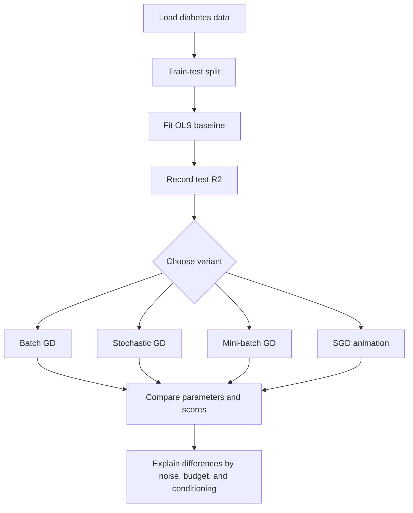
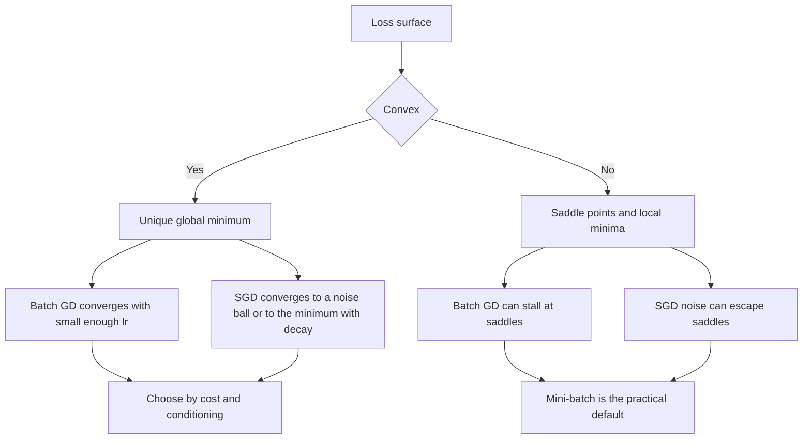
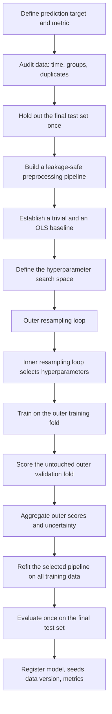
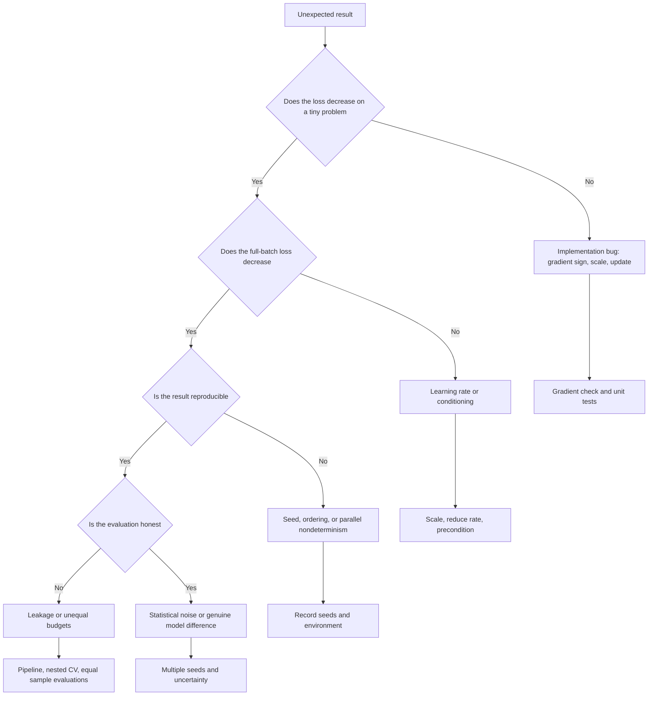

# Day 52 — Types of Gradient Descent: Batch, Stochastic, and Mini-Batch

> **Course:** CampusX — 100 Days of Machine Learning, Day 52
> **Official source folder:** `vendor/100-days-of-machine-learning/day52-types-of-gradient-descent/`
> **Copied reference notebooks in this folder:**
> `reference_notebooks/batch-gradient-descent.ipynb` (14 code cells),
> `reference_notebooks/stochastic-gradient-descent-from-scratch.ipynb` (19 code cells),
> `reference_notebooks/mini-batch-gradient-descent-from-scratch.ipynb` (21 code cells),
> `reference_notebooks/stochastic-gradient-descent-animation.ipynb` (18 code cells).
> **Dataset:** none. The notebooks use `sklearn.datasets.load_diabetes` and `sklearn.datasets.make_regression`.
> **Personal notebook:** none in this folder; this chapter is the documentation deliverable.
> **Transcript:** none available for Day 52.
> **Central question:** The loss function is the same in all four notebooks, so why do the three gradient-descent variants produce different parameter paths, different run times, and different test scores — and what exactly is being traded when we choose one of them?

### How this chapter is organised

The chapter starts with the optimization problem and the notation needed to read every update rule. It then treats each of the four official notebooks separately: what the notebook does, what it outputs, how the code executes, and what the result does and does not show. After the four walkthroughs, the chapter unifies the theory: gradient noise, variance, learning-rate schedules, convergence, conditioning, shuffling, reproducibility, early stopping, computational cost, and the relationship between the from-scratch classes and Scikit-learn's `SGDRegressor`. The final third is practice: worked numerical examples, common mistakes, interview questions at seven levels, examination questions with full solutions, a revision sheet, a cell-by-cell coverage matrix, and references.

**Source labels used below.**

- **Official** means the CampusX notebook and its saved output. The notebooks were saved with a Python 3.8.8-era environment. The saved numbers are quoted exactly as they appear in the `.ipynb` files.
- **Rerun** means a reproduction performed for this chapter in the current environment: Python 3.14.2, NumPy 2.5.3, pandas 3.0.5, scikit-learn 1.9.1, Matplotlib 3.11.2. Reruns are labelled and are never presented as official output.
- **Supplementary** means an explanation, diagnostic, or experiment added in this chapter and not present in the lecture notebooks. It is still technical material, but it is not attributed to CampusX.

**An important source-fidelity warning before we begin.** The four notebooks contain **no Markdown cells**, no explanatory prose, and almost no comments. They are code-and-output notebooks. They also do not seed the stochastic loops: the custom SGD and mini-batch classes call `np.random.randint` or `random.sample` without a seed, and the Scikit-learn `SGDRegressor` calls use the default `random_state=None`. Therefore the saved SGD, mini-batch, and animation numbers are **one realisation** of a random process. They can be reproduced only approximately, and any claim that a particular last digit is a property of the algorithm is false. The batch-gradient-descent notebook is deterministic given the data split and is reproduced almost exactly; the small differences come from linear-algebra library versions.

---

# 1. Learning objectives

After studying this chapter, I should be able to:

1. **Define the three variants precisely.** State how many samples are used per parameter update in batch, stochastic, and mini-batch gradient descent, and derive each update rule from the same mean-squared-error loss.
2. **Separate the vocabulary.** Distinguish a batch, a mini-batch, an iteration (one parameter update), an epoch (one pass over the training set), and a step; compute how many updates occur in an epoch for each variant.
3. **Derive the gradients.** Differentiate the mean-squared-error loss with respect to the intercept and the coefficients, write the result in matrix form, and explain why the factor $2/n$ appears.
4. **Explain the stochastic gradient.** Show that a single-sample gradient is an unbiased estimator of the full gradient, derive its variance, and explain how mini-batching reduces that variance by a factor of approximately $B$.
5. **Read the four notebooks.** Walk through every cell of the batch, SGD, mini-batch, and animation notebooks; explain the saved outputs; and identify the source-fidelity issues in each.
6. **Analyse convergence.** Use the Hessian, its eigenvalues, the condition number, and the stability bound $\eta<2/\lambda_{\max}$ to explain why batch gradient descent with 1,000 epochs and learning rate $0.5$ is still far from the ordinary-least-squares solution even though its training loss is close.
7. **Interpret the scores correctly.** Explain why a test $R^2$ of $0.4535$ for gradient descent versus $0.4399$ for ordinary least squares is not evidence that gradient descent is a better optimizer; connect the difference to early stopping and shrinkage.
8. **Choose a variant.** Compare the three methods on gradient variance, updates per epoch, computational cost, memory, hardware utilisation, convergence, and typical use cases, and justify a choice for a given dataset and system.
9. **Design the training protocol.** Select a learning rate and schedule, shuffle correctly, scale features, use early stopping without leakage, seed the random generators, and report results reproducibly.
10. **Connect to Scikit-learn.** Explain what `SGDRegressor` does, what `fit` and `partial_fit` mean, what `max_iter`, `tol`, `eta0`, `learning_rate`, `penalty`, and `random_state` control, and how the from-scratch classes differ from the library estimator.
11. **Diagnose failures.** Recognise divergence, slow convergence, noisy loss curves, a missing $1/B$ factor, sampling with replacement, unseeded runs, data leakage, and misleading comparisons between different budgets.
12. **Answer interview and examination questions.** Explain the reasoning, perform the calculations, and discuss assumptions, limitations, and trade-offs at the depth expected in a technical interview or a university examination.

---

# 2. Big picture: where gradient descent sits in the ML workflow

Gradient descent is the training algorithm, not a preprocessing step. It sits after the data have been cleaned, the features have been represented numerically, the train/test split has been made, and the model family has been chosen:

```mermaid
flowchart LR
    A[Raw data] --> B[Data understanding]
    B --> C[Cleaning and feature engineering]
    C --> D[Train-test split]
    D --> E[Fit preprocessing on train only]
    E --> F[Choose model and loss]
    F --> G[Choose optimizer and budget]
    G --> H[Train parameters]
    H --> I[Validate and tune]
    I --> J[Evaluate once on test]
    J --> K[Deploy the fitted pipeline]
```



The order matters. If a scaler is fitted on the full dataset before the split, the training procedure sees information from the test set. If early stopping is performed on the test set, the test score is no longer an unbiased estimate of future performance. If the learning rate is tuned on the test set, the same problem occurs. Gradient descent itself is innocent; the protocol around it creates or prevents leakage.

**Connection to previous days.**

- **Day 48 (simple linear regression)** introduced the model $\hat{y}=mx+b$ and the squared-error loss. Day 49 (regression metrics) introduced $R^2$, MAE, MSE, and RMSE. Day 50 (multiple linear regression) extended the model to $\hat{y}=\mathbf{w}^\top\mathbf{x}+b$ and to the normal equations. Day 51 (gradient descent) introduced the iterative update and the effect of the learning rate. Day 52 asks: given the same update idea, **how much data should one update use?**
- **Day 24 (standardization)** and Day 25 (normalization)** explained why feature scales matter. Day 52 makes the reason precise through the Hessian and the condition number.
- **Day 29 (pipelines)** provides the mechanism that keeps scaling and any other learned preprocessing inside the training fold. Day 52's early-stopping and learning-rate choices must respect the same rule.
- **Later topics** — logistic regression (Day 58), regularized linear models (Days 55–57), and neural networks — reuse the same three variants. The vocabulary and the variance analysis transfer directly; only the loss and the gradient change.

---

# 3. Notation and foundations

## 3.1 The linear model

For $n$ training observations and $p$ features, let

$$
\mathbf{x}_i=(x_{i1},x_{i2},\dots,x_{ip})^\top\in\mathbb{R}^{p}
$$

be the feature vector of observation $i$, and let $y_i\in\mathbb{R}$ be its target. The linear regression model is

$$
\hat{y}_i=\mathbf{w}^\top\mathbf{x}_i+b,
$$

where $\mathbf{w}\in\mathbb{R}^{p}$ is the coefficient vector and $b\in\mathbb{R}$ is the intercept. It is convenient to absorb the intercept into the coefficient vector by defining

$$
\mathbf{a}_i=(1,x_{i1},\dots,x_{ip})^\top\in\mathbb{R}^{p+1},
\qquad
\boldsymbol{\theta}=(b,\mathbf{w})^\top\in\mathbb{R}^{p+1}.
$$

Then $\hat{y}_i=\mathbf{a}_i^\top\boldsymbol{\theta}$. Stacking the rows gives the design matrix

$$
\mathbf{A}=
\begin{pmatrix}
1 & x_{11} & \cdots & x_{1p}\\
1 & x_{21} & \cdots & x_{2p}\\
\vdots & \vdots & \ddots & \vdots\\
1 & x_{n1} & \cdots & x_{np}
\end{pmatrix}
\in\mathbb{R}^{n\times(p+1)},
\qquad
\mathbf{y}=
\begin{pmatrix}
y_1\\ \vdots\\ y_n
\end{pmatrix}
\in\mathbb{R}^{n}.
$$

The predictions are $\hat{\mathbf{y}}=\mathbf{A}\boldsymbol{\theta}$.

## 3.2 The loss and its gradient

The mean-squared-error (MSE) loss is

$$
J(\boldsymbol{\theta})
=
\frac{1}{n}\sum_{i=1}^{n}\left(y_i-\mathbf{a}_i^\top\boldsymbol{\theta}\right)^2
=
\frac{1}{n}\left\lVert\mathbf{y}-\mathbf{A}\boldsymbol{\theta}\right\rVert_2^2.
$$

Define the residual of observation $i$:

$$
r_i(\boldsymbol{\theta})=y_i-\mathbf{a}_i^\top\boldsymbol{\theta}.
$$

Differentiating with respect to the intercept gives

$$
\frac{\partial J}{\partial b}
=
\frac{1}{n}\sum_{i=1}^{n}2\left(y_i-\mathbf{a}_i^\top\boldsymbol{\theta}\right)(-1)
=
-\frac{2}{n}\sum_{i=1}^{n}r_i,
$$

and differentiating with respect to the coefficient vector gives

$$
\nabla_{\mathbf{w}}J
=
\frac{1}{n}\sum_{i=1}^{n}2\left(y_i-\mathbf{a}_i^\top\boldsymbol{\theta}\right)(-\mathbf{x}_i)
=
-\frac{2}{n}\sum_{i=1}^{n}r_i\mathbf{x}_i.
$$

In matrix form,

$$
\nabla J(\boldsymbol{\theta})
=
-\frac{2}{n}\mathbf{A}^\top(\mathbf{y}-\mathbf{A}\boldsymbol{\theta})
=
-\frac{2}{n}\mathbf{A}^\top\mathbf{r}.
$$

The factor $2$ comes from differentiating a square. The factor $1/n$ comes from averaging over the $n$ observations. The sign is negative because a positive residual means the prediction is too low, so the parameters should move in the direction that increases the prediction; the negative gradient does that.

**Why the factor $1/n$ matters.** The gradient magnitude scales with the loss definition. If we used the sum of squared errors $SSE=\sum_i r_i^2$ instead of the mean, the gradient would be $n$ times larger and the same learning rate would behave differently. Throughout this chapter, unless stated otherwise, $J$ is the **mean** squared error. The official notebooks follow this convention for batch gradient descent: they divide the coefficient gradient by `X_train.shape[0]` and use `np.mean` for the intercept gradient.

## 3.3 The Hessian, convexity, and the normal equations

The Hessian of $J$ is

$$
\mathbf{H}
=
\nabla^2 J(\boldsymbol{\theta})
=
\frac{2}{n}\mathbf{A}^\top\mathbf{A}.
$$

Because $\mathbf{A}^\top\mathbf{A}$ is positive semidefinite, $\mathbf{H}\succeq 0$: the MSE loss is **convex**. If $\mathbf{A}$ has full column rank $p+1$, then $\mathbf{H}\succ 0$ and $J$ is strictly convex, so it has a unique global minimizer. Setting the gradient to zero gives the normal equations:

$$
\mathbf{A}^\top\mathbf{A}\boldsymbol{\theta}^*=\mathbf{A}^\top\mathbf{y},
\qquad
\boldsymbol{\theta}^*=(\mathbf{A}^\top\mathbf{A})^{-1}\mathbf{A}^\top\mathbf{y}.
$$

The eigenvalues of $\mathbf{H}$ describe the curvature of the loss in different directions. Let

$$
0<\lambda_{\min}=\lambda_1\le\lambda_2\le\cdots\le\lambda_{p+1}=\lambda_{\max}.
$$

The **condition number** is

$$
\kappa=\frac{\lambda_{\max}}{\lambda_{\min}}.
$$

A large $\kappa$ means the loss surface is a long, narrow valley: steep in some directions and almost flat in others. Gradient descent then makes rapid progress in the steep directions and very slow progress in the flat direction. This single fact explains most of the batch-gradient-descent behaviour in the first notebook.

**Convexity is not the same as good conditioning.** A convex quadratic can still be extremely ill-conditioned. Convexity guarantees that a small enough gradient step decreases the loss and that the global minimum is unique; it does not guarantee that the minimum is reached quickly.

## 3.4 Batch, mini-batch, iteration, epoch, and step

The vocabulary is a common source of confusion, so define it carefully.

| Term | Meaning | Batch GD | SGD | Mini-batch GD |
|---|---|---|---|---|
| **Batch** | The set of observations used to compute one gradient estimate | All $n$ | One observation | $B$ observations |
| **Iteration / step / update** | One application of the parameter update rule | 1 per epoch | $n$ per epoch | $\lfloor n/B\rfloor$ per epoch (notebook convention) |
| **Epoch** | One complete pass over the training set | 1 update | $n$ updates | $\lfloor n/B\rfloor$ updates |
| **Batch size** | Number of observations per update | $n$ | $1$ | $B$ |
| **Number of updates after $E$ epochs** | — | $E$ | $E\,n$ | $E\lfloor n/B\rfloor$ |

Two details deserve emphasis.

1. **An epoch is not an iteration.** In batch gradient descent, one epoch contains exactly one iteration. In SGD, one epoch contains $n$ iterations. In mini-batch gradient descent, one epoch contains about $n/B$ iterations. Saying "I ran 100 iterations" therefore means different amounts of work in the three variants.
2. **The last partial batch.** If $n$ is not divisible by $B$, a correct implementation either drops the remainder or keeps a smaller final batch. The official mini-batch notebook uses `int(X_train.shape[0]/self.batch_size)`, which is a floor division: it performs $\lfloor n/B\rfloor$ updates per epoch and leaves the remainder unused in every epoch. With $n=353$ and $B=7$, that is $50$ updates covering $350$ observations per epoch, not $353$.

## 3.5 The learning rate and the stability bound

The learning rate $\eta>0$ controls the step length. For the quadratic loss with Hessian $\mathbf{H}$, the batch update is

$$
\boldsymbol{\theta}_{k+1}
=
\boldsymbol{\theta}_k-\eta\nabla J(\boldsymbol{\theta}_k)
=
\left(\mathbf{I}-\eta\mathbf{H}\right)\boldsymbol{\theta}_k+\eta\mathbf{H}\boldsymbol{\theta}^*.
$$

Subtracting $\boldsymbol{\theta}^*$ from both sides gives the error recursion

$$
\boldsymbol{\theta}_{k+1}-\boldsymbol{\theta}^*
=
\left(\mathbf{I}-\eta\mathbf{H}\right)\left(\boldsymbol{\theta}_k-\boldsymbol{\theta}^*\right).
$$

The error contracts in every eigen-direction if and only if

$$
\left|1-\eta\lambda_j\right|<1
\quad\text{for every }j,
$$

which is equivalent to

$$
0<\eta<\frac{2}{\lambda_{\max}}.
$$

If $\eta$ exceeds this bound, the component along the largest-curvature direction grows, and the parameters diverge. If $\eta$ is very small, every component contracts slowly. The best single step for the fastest mode is $\eta=1/\lambda_{\max}$, but the slow mode still contracts only by $1-\lambda_{\min}/\lambda_{\max}=1-1/\kappa$ per iteration. The number of iterations needed to reduce the slow-mode error by a factor $e$ is approximately $\kappa$. This is the price of ill-conditioning.

For stochastic methods, the same stability intuition applies to the expected update, but the noise changes the story: even at the optimum, the stochastic gradient is not zero, so the parameters keep moving in a small neighbourhood. The size of that neighbourhood depends on the learning rate and the gradient variance.

## 3.6 Feature scaling and the geometry of the loss

If two features have very different scales, the Hessian has very different eigenvalues. Suppose one feature is measured in thousands and another in fractions. A change of one unit in the first feature changes the prediction by a lot; a change of one unit in the second changes it by very little. The loss surface is then a long ellipse. Gradient descent takes a step proportional to the gradient, which is dominated by the steep direction, so it zig-zags across the narrow direction and crawls along the long direction.

Standardizing each feature to mean $0$ and variance $1$ (or scaling to unit norm) makes the curvatures more comparable, reduces $\kappa$, allows a larger stable learning rate, and speeds up convergence. The scaler must be fitted on the training data only and then applied to the test data; otherwise the test set influences the training geometry. A `Pipeline` enforces this rule during cross-validation.

The diabetes dataset used in the notebooks is already preprocessed by Scikit-learn: each of the ten features has mean approximately $0$ and unit Euclidean norm, so its sample standard deviation is $1/\sqrt{n-1}=1/21\approx0.047619$. This is why the course can use a relatively large learning rate such as $0.5$ without immediate divergence. On raw, unscaled features, the same learning rate could easily diverge.

---

# 4. The four official notebooks at a glance

The four notebooks share a common beginning: load the diabetes data, split it, fit ordinary least squares, and report a baseline $R^2$. They then diverge.

| Notebook | Cells | Data | What it builds | Main saved result |
|---|---:|---|---|---|
| `batch-gradient-descent.ipynb` | 14 | Diabetes, $353/89$ split | `GDRegressor` with full-batch updates, $1000$ epochs, $\eta=0.5$ | Test $R^2=0.4534524671450598$ |
| `stochastic-gradient-descent-from-scratch.ipynb` | 19 | Diabetes, same split | `SGDRegressor` with one random sample per update, $40$ epochs, $\eta=0.01$ | Test $R^2=0.4205755931585481$ |
| `mini-batch-gradient-descent-from-scratch.ipynb` | 21 | Diabetes, same split | `MBGDRegressor` with $B=7$, $100$ epochs, $\eta=0.01$; then Scikit-learn `partial_fit` with $B=35$ | Test $R^2=0.4518861449568681$; library variant $0.4271789125617129$ |
| `stochastic-gradient-descent-animation.ipynb` | 18 | Synthetic `make_regression`, $100$ points, one feature | One-epoch SGD path with a decaying learning rate, animated line, contour, and cost plots | Final $b=-2.25419509$, $m=30.33626711$; $\eta$ from $0.1$ to $0.033557$ |

The shared baseline is ordinary least squares on the same split. Its saved test $R^2$ is $0.4399387660024645$. The comparison is therefore not "which algorithm is best in general" but "what happens on this particular dataset, split, budget, and random seed".



**What the four notebooks do not do.** They do not scale the features (the diabetes data are already scaled), do not use a validation set, do not implement early stopping, do not seed the stochastic loops, and do not compare the methods under an equal computational budget. These omissions are not fatal for a lecture demonstration, but they limit the conclusions. The notes will state explicitly what each comparison can and cannot establish.

---

# 5. One loss, three gradient estimators

The three methods are not three different loss functions. They are three different ways of estimating the same gradient.

## 5.1 Batch gradient descent

Batch gradient descent uses all $n$ training observations to compute the gradient at each update:

$$
\boldsymbol{\theta}_{k+1}
=
\boldsymbol{\theta}_k
-
\eta\,\nabla J(\boldsymbol{\theta}_k)
=
\boldsymbol{\theta}_k
+
\frac{2\eta}{n}\mathbf{A}^\top\left(\mathbf{y}-\mathbf{A}\boldsymbol{\theta}_k\right).
$$

Equivalently, component by component,

$$
b_{k+1}=b_k+\frac{2\eta}{n}\sum_{i=1}^{n}r_i,
\qquad
\mathbf{w}_{k+1}=\mathbf{w}_k+\frac{2\eta}{n}\sum_{i=1}^{n}r_i\mathbf{x}_i.
$$

The gradient is exact for the current parameters. There is no sampling noise. The price is that every update touches every observation.

## 5.2 Stochastic gradient descent

Stochastic gradient descent uses one observation per update. At step $k$, draw an index $i_k$ uniformly from $\{1,\dots,n\}$ (with or without replacement; the official notebook uses replacement). Then

$$
\boldsymbol{\theta}_{k+1}
=
\boldsymbol{\theta}_k
+
2\eta\,r_{i_k}\mathbf{a}_{i_k},
\qquad
r_{i_k}=y_{i_k}-\mathbf{a}_{i_k}^\top\boldsymbol{\theta}_k.
$$

The single-sample gradient

$$
\mathbf{g}_{i_k}(\boldsymbol{\theta})
=
-2r_{i_k}\mathbf{a}_{i_k}
$$

is a random vector. Its expectation over the uniform draw is

$$
\mathbb{E}\left[\mathbf{g}_{i_k}(\boldsymbol{\theta})\right]
=
\frac{1}{n}\sum_{i=1}^{n}\mathbf{g}_i(\boldsymbol{\theta})
=
\nabla J(\boldsymbol{\theta}),
$$

so the SGD gradient is **unbiased** for the full gradient. It is noisy, but it points in the right direction on average. That is the entire theoretical basis of SGD.

## 5.3 Mini-batch gradient descent

Mini-batch gradient descent uses a batch $\mathcal{B}_k$ of $B$ observations per update:

$$
\boldsymbol{\theta}_{k+1}
=
\boldsymbol{\theta}_k
+
\frac{2\eta}{B}\sum_{i\in\mathcal{B}_k}r_i\mathbf{a}_i.
$$

If the batch is drawn uniformly without replacement, the mini-batch gradient is also unbiased for the full gradient:

$$
\mathbb{E}\left[\frac{1}{B}\sum_{i\in\mathcal{B}_k}\mathbf{g}_i(\boldsymbol{\theta})\right]
=
\nabla J(\boldsymbol{\theta}).
$$

Its variance is smaller than the single-sample variance by a factor of approximately $B$. This is the central trade-off: larger batches give a more accurate gradient but cost more per update; smaller batches give a noisier gradient but allow more updates for the same number of sample evaluations.

## 5.4 The three update rules side by side

| | Batch GD | SGD | Mini-batch GD |
|---|---|---|---|
| Gradient estimate | $\nabla J(\boldsymbol{\theta}_k)$ | $\mathbf{g}_{i_k}(\boldsymbol{\theta}_k)$ | $\frac{1}{B}\sum_{i\in\mathcal{B}_k}\mathbf{g}_i(\boldsymbol{\theta}_k)$ |
| Unbiased? | Exact | Yes | Yes, if sampled uniformly |
| Variance | $0$ | $\Sigma$ | Approximately $\Sigma/B$ |
| Updates per epoch | $1$ | $n$ | $\lfloor n/B\rfloor$ |
| Cost per update | $\mathcal{O}(np)$ | $\mathcal{O}(p)$ | $\mathcal{O}(Bp)$ |
| Cost per epoch | $\mathcal{O}(np)$ | $\mathcal{O}(np)$ | $\mathcal{O}(np)$ |
| Memory for data | $\mathcal{O}(np)$ | $\mathcal{O}(p)$ plus one row | $\mathcal{O}(Bp)$ |
| Typical role | Small data, smooth deterministic curves, reference solution | Streaming, very large data, online learning | Default for deep learning and large-scale training |

The asymptotic cost per epoch is the same for all three: each epoch processes $n$ observations and multiplies them by $p$ parameters. The differences are in the **number of updates**, the **variance per update**, the **constant factors**, and the **hardware efficiency**. A vectorised batch update on a small matrix can be faster in wall-clock time than a Python loop of $n$ single-sample updates, even though both do $\mathcal{O}(np)$ arithmetic. This is exactly what the notebook timings show.

# 6. Batch gradient descent: the exact but expensive update

## 6.1 The notebook's implementation

The batch notebook defines the following class (cells 8–12):

```python
class GDRegressor:

    def __init__(self, learning_rate=0.01, epochs=100):
        self.coef_ = None
        self.intercept_ = None
        self.lr = learning_rate
        self.epochs = epochs

    def fit(self, X_train, y_train):
        # init your coefs
        self.intercept_ = 0
        self.coef_ = np.ones(X_train.shape[1])

        for i in range(self.epochs):
            # update all the coef and the intercept
            y_hat = np.dot(X_train, self.coef_) + self.intercept_
            intercept_der = -2 * np.mean(y_train - y_hat)
            self.intercept_ = self.intercept_ - (self.lr * intercept_der)

            coef_der = -2 * np.dot((y_train - y_hat), X_train) / X_train.shape[0]
            self.coef_ = self.coef_ - (self.lr * coef_der)

        print(self.intercept_, self.coef_)

    def predict(self, X_test):
        return np.dot(X_test, self.coef_) + self.intercept_
```

Several details are worth slowing down for.

**`__init__` creates an unfitted object.** `self.coef_` and `self.intercept_` are `None`. The trailing underscore in `coef_` and `intercept_` is the Scikit-learn convention for attributes that are learned during fitting. The constructor stores hyperparameters (`lr`, `epochs`) but does not learn anything. This is the same object-before-fitting distinction that appeared in earlier days: creating a `GDRegressor` is not training it.

**Initialization is `coef_ = np.ones(p)` and `intercept_ = 0`.** The choice is arbitrary but not irrelevant. A different initialization produces a different path. For a convex quadratic, the final converged parameters are the same (if the method converges), but a finite budget makes the initialization part of the result. Initializing at zero would be more conventional; initializing at one is harmless here because the diabetes features are standardized and the loss is well-scaled.

**`y_hat` is computed once per epoch, before either update.** Both gradients are evaluated at the same parameter vector. The intercept is updated first, but `coef_der` still uses the old `y_hat`. This is a **simultaneous** update, not a Gauss–Seidel update. It is the correct implementation of the gradient at the current point.

**`intercept_der = -2 * np.mean(y_train - y_hat)`.** This is $\partial J/\partial b$ for the mean-squared-error loss. `np.mean` divides by $n$. The negative sign is explicit; the update then subtracts `lr * intercept_der`, which is equivalent to adding the positive gradient direction.

**`coef_der = -2 * np.dot((y_train - y_hat), X_train) / X_train.shape[0]`.** This is $-\frac{2}{n}\mathbf{X}^\top\mathbf{r}$. The dot product computes $\sum_i r_i x_{ij}$ for every feature $j$ in one vectorised operation. The division by `X_train.shape[0]` is the $1/n$ from the mean. If this division were missing, the coefficient gradient would be $n$ times too large and the same learning rate would behave very differently.

**The loop runs `self.epochs` times.** Each iteration is one full pass over the training set and one update. There is no shuffle because every observation is used; the order of the sum does not matter for the exact gradient (apart from floating-point rounding).

**`print` inside `fit`.** Printing from a `fit` method is unusual for a library estimator; Scikit-learn estimators are silent unless `verbose` is set. The print is useful for a lecture but would be removed in production code.

**`predict` uses the learned attributes.** After `fit`, `self.coef_` and `self.intercept_` hold the final parameters. `predict` does not recompute anything; it applies the linear model.

## 6.2 Execution order for one epoch

For one epoch, the data flow is:

```text
X_train, y_train, current coef_, current intercept_
                    |
                    v
        y_hat = X_train @ coef_ + intercept_
                    |
                    v
        residual = y_train - y_hat
                    |
        +-----------+-----------+
        |                       |
        v                       v
intercept_der = -2 mean(res)   coef_der = -2 X^T res / n
        |                       |
        v                       v
intercept_ -= lr * intercept_der
                                coef_ -= lr * coef_der
        |                       |
        +-----------+-----------+
                    |
                    v
        updated parameters for the next epoch
```

The important point is that both gradients use the same residual vector. The intercept update does not change the residual used by the coefficient update within the same epoch.

## 6.3 Official walkthrough, cell by cell

| Cell | Code | Saved output / meaning |
|---:|---|---|
| 0 | Imports `load_diabetes`, NumPy, `LinearRegression`, `r2_score`, `train_test_split` | Sets up the experiment |
| 1 | `X, y = load_diabetes(return_X_y=True)` | Loads the built-in data |
| 2 | `print(X.shape); print(y.shape)` | `(442, 10)` and `(442,)` |
| 3 | `train_test_split(..., test_size=0.2, random_state=2)` | $353$ training rows, $89$ test rows |
| 4 | `reg = LinearRegression(); reg.fit(X_train, y_train)` | Fits the OLS baseline |
| 5 | Prints `reg.coef_` and `reg.intercept_` | Coefficients and intercept quoted below |
| 6 | `y_pred = reg.predict(X_test); r2_score(y_test, y_pred)` | $0.4399387660024645$ |
| 7 | `X_train.shape` | `(353, 10)` |
| 8 | Defines `GDRegressor` | The from-scratch batch implementation |
| 9 | `gdr = GDRegressor(epochs=1000, learning_rate=0.5)` | Hyperparameters |
| 10 | `gdr.fit(X_train, y_train)` | Prints intercept and coefficients |
| 11 | `y_pred = gdr.predict(X_test)` | Predictions |
| 12 | `r2_score(y_test, y_pred)` | $0.4534524671450598$ |
| 13 | Empty | No content |

**The OLS baseline (saved output, cell 5):**

$$
\mathbf{w}_{\mathrm{OLS}}=
\begin{pmatrix}
-9.16088483\\
-205.46225988\\
516.68462383\\
340.62734108\\
-895.54360867\\
561.21453306\\
153.88478595\\
126.73431596\\
861.12139955\\
52.41982836
\end{pmatrix},
\qquad
b_{\mathrm{OLS}}=151.88334520854633.
$$

**The batch GD result (saved output, cell 10):**

$$
\mathbf{w}_{\mathrm{GD}}=
\begin{pmatrix}
14.38915082\\
-173.72674118\\
491.54504015\\
323.91983579\\
-39.32680194\\
-116.01099114\\
-194.04229501\\
103.38216641\\
451.63385893\\
97.57119174
\end{pmatrix},
\qquad
b_{\mathrm{GD}}=152.0135263267291.
$$

At first glance the intercepts look close: $151.883$ versus $152.014$, a difference of $0.130$. Several coefficients, however, are wildly different. The fourth coefficient (index 4) is $-895.54$ for OLS and $-39.33$ for GD; the ninth (index 8) is $861.12$ versus $451.63$; the sixth (index 5) is $561.21$ versus $-116.01$. The Euclidean distance between the two full parameter vectors is approximately $1218.8$. Yet the training MSE is $2865.54$ for GD versus $2814.21$ for OLS, only $1.8\%$ higher, and the test $R^2$ is slightly higher for GD.

This is not a bug in the code. It is the geometry of an ill-conditioned quadratic.

## 6.4 Why 1,000 epochs are not enough: the eigenvalue picture

The full Hessian, including the intercept column, is

$$
\mathbf{H}=\frac{2}{n}\mathbf{A}^\top\mathbf{A}.
$$

For the $353\times11$ training design matrix, its eigenvalues are (computed for this chapter; **supplementary** numerical diagnostic):

$$
\lambda_{\min}=4.0387\times10^{-5},
\qquad
\lambda_{\max}=2.00005,
\qquad
\kappa=\frac{\lambda_{\max}}{\lambda_{\min}}\approx49{,}522.
$$

The largest eigenvalue is essentially $2$. This is the intercept direction: the intercept column is a vector of ones with squared norm $n$, so the corresponding diagonal entry of $\mathbf{H}$ is $2/n\cdot n=2$. The smallest eigenvalue is tiny because several diabetes features are strongly correlated; a particular linear combination of them changes the predictions very little. The feature-only Hessian (without the intercept column) has eigenvalues from $4.0387\times10^{-5}$ to $1.8095\times10^{-2}$, a condition number of about $448$. Adding the intercept makes the **largest** curvature larger without changing the smallest, so the condition number becomes much worse.

The stability bound is

$$
\eta<\frac{2}{\lambda_{\max}}\approx\frac{2}{2.00005}\approx0.999975.
$$

The chosen learning rate $\eta=0.5$ is therefore stable. It is also very close to $1/\lambda_{\max}\approx0.4999875$, the step that annihilates the fastest mode in one iteration. The fast modes converge almost immediately. The slow mode contracts by

$$
1-\eta\lambda_{\min}
=
1-0.5\times4.0387\times10^{-5}
=
0.9999798
$$

per epoch. The number of epochs needed to reduce the slow-mode error by a factor $f$ is approximately

$$
E(f)\approx\frac{-\ln f}{\eta\lambda_{\min}}.
$$

For $f=1/e$, this is about $49{,}521$ epochs. For $f=10^{-2}$, about $228{,}000$ epochs. For $f=10^{-3}$, about $342{,}000$ epochs. After $1{,}000$ epochs, the slow-mode error is still

$$
0.9999798^{1000}\approx0.9800,
$$

so only about $2\%$ of the slow-mode error has been removed.

**Where the initial loss lives.** Decompose the initial parameter error $\boldsymbol{\theta}_0-\boldsymbol{\theta}^*$ in the eigenbasis of $\mathbf{H}$. The excess loss is

$$
J(\boldsymbol{\theta}_0)-J(\boldsymbol{\theta}^*)
=
\frac{1}{2}\sum_{j=1}^{11}\lambda_j\left(\mathbf{v}_j^\top(\boldsymbol{\theta}_0-\boldsymbol{\theta}^*)\right)^2.
$$

The numerical decomposition is revealing:

| Eigenvalue $\lambda_j$ | Contribution to initial excess loss | Share |
|---:|---:|---:|
| $2.00005$ (intercept mode) | $22{,}635.41$ | $87.65\%$ |
| $1.806\times10^{-2}$ | $1{,}890.33$ | $7.32\%$ |
| $6.824\times10^{-3}$ | $198.98$ | $0.77\%$ |
| $5.452\times10^{-3}$ | $152.35$ | $0.59\%$ |
| $4.190\times10^{-3}$ | $83.91$ | $0.32\%$ |
| $2.999\times10^{-3}$ | $0.14$ | $0.0005\%$ |
| $2.629\times10^{-3}$ | $45.00$ | $0.17\%$ |
| $2.409\times10^{-3}$ | $16.93$ | $0.066\%$ |
| $1.889\times10^{-3}$ | $13.41$ | $0.052\%$ |
| $3.170\times10^{-4}$ | $1.98$ | $0.0077\%$ |
| $4.039\times10^{-5}$ (slow mode) | $30.79$ | $0.119\%$ |

The intercept mode accounts for about $87.7\%$ of the initial excess loss and converges almost instantly. The slow mode accounts for only $0.119\%$ of the initial excess loss, but it accounts for $1234.7$ of the $1531.8$ units of initial parameter distance, about $80.6\%$. This is the precise sense in which the model can be "close in loss" and "far in parameters": the remaining error lies in a direction to which the training loss is almost blind.

After $1{,}000$ epochs, the slow-mode error is still about $1210$, which is almost the entire remaining parameter distance of $1218.8$. The training MSE is $2865.54$, close to the OLS value $2814.21$, because the slow direction contributes little to the loss. The test $R^2$ is slightly higher than OLS because the under-converged solution is effectively **shrunk** along the flat direction, which can reduce variance on unseen data. That is an early-stopping effect, not evidence that batch gradient descent is a better optimizer.

**A note on the coefficient-gradient norm.** After one epoch, the full gradient norm drops from $301.04$ to $8.88$, but the coefficient-only gradient norm can increase slightly because the intercept and coefficient blocks of the Hessian are not exactly decoupled when the training features have a small nonzero mean. The full gradient norm is the correct quantity to monitor. Do not conclude from a single block that the method is diverging.

## 6.5 The first epoch by hand

The initial parameters are $\mathbf{w}_0=\mathbf{1}_{10}$ and $b_0=0$. The first five predictions and residuals are:

| $i$ | $y_i$ | $\hat{y}_i$ at initialization | $r_i$ |
|---:|---:|---:|---:|
| 1 | 48.0 | $-0.1295492$ | $48.1295492$ |
| 2 | 276.0 | $-0.1654309$ | $276.1654309$ |
| 3 | 47.0 | $-0.1055821$ | $47.1055821$ |
| 4 | 175.0 | $0.0017650$ | $174.9982350$ |
| 5 | 60.0 | $-0.2953647$ | $60.2953647$ |

The mean residual over all $353$ training rows is $150.4674451$, so

$$
\frac{\partial J}{\partial b}=-2(150.4674451)=-300.9348902.
$$

With $\eta=0.5$,

$$
b_1=0-0.5(-300.9348902)=150.4674451.
$$

The coefficient gradient is

$$
\nabla_{\mathbf{w}}J
=
-\frac{2}{353}\mathbf{X}^\top\mathbf{r}
=
\begin{pmatrix}
-1.6370146\\
0.0441452\\
-3.7363974\\
-3.2765999\\
-1.3028456\\
-0.6726351\\
2.1149570\\
-2.1692849\\
-4.2197363\\
-2.3726433
\end{pmatrix}.
$$

The update is $\mathbf{w}_1=\mathbf{1}-0.5\nabla_{\mathbf{w}}J$, which gives

$$
\mathbf{w}_1=
\begin{pmatrix}
1.8185073\\
0.9779274\\
2.8681987\\
2.6383000\\
1.6514228\\
1.3363176\\
-0.0574785\\
2.0846425\\
3.1098681\\
2.1863217
\end{pmatrix}.
$$

After this single epoch, the training MSE is $5963.32$ (down from $28{,}638.59$), and the training $R^2$ is $0.00909$. The intercept has moved almost all the way to its optimal value; the coefficients have barely started. This is the ill-conditioning story in one step.

## 6.6 Computational cost of batch gradient descent

For one update, computing $\mathbf{A}\boldsymbol{\theta}$ costs $\mathcal{O}(np)$, the residual costs $\mathcal{O}(n)$, and $\mathbf{A}^\top\mathbf{r}$ costs $\mathcal{O}(np)$. The total is $\mathcal{O}(np)$ per epoch. With $E$ epochs, the cost is $\mathcal{O}(Enp)$.

Memory: the design matrix costs $\mathcal{O}(np)$; the parameters and gradients cost $\mathcal{O}(p)$; the residual costs $\mathcal{O}(n)$. For a dataset that does not fit in memory, batch gradient descent is impossible without out-of-core tricks.

The normal equations cost $\mathcal{O}(np^2+p^3)$ time and $\mathcal{O}(p^2)$ memory. For $p=10$ and $n=442$, both methods are trivial. For $n=10^8$ and $p=10^3$, the normal equations are expensive and may be numerically unstable; batch gradient descent or mini-batch methods are preferable. For $n=10^3$ and $p=10^5$, the normal equations are also unattractive; stochastic methods and regularization are standard.

The batch notebook's wall-clock time for $1{,}000$ epochs is about $0.011$ seconds in the current environment (**supplementary** rerun), because each epoch is a single vectorised matrix-vector product. A Python loop of $353$ single-sample updates for $40$ epochs takes about $0.07$–$0.17$ seconds. On this small dataset, the vectorised batch method is much faster in wall-clock time despite doing more arithmetic per epoch. This is a hardware and implementation effect, not a contradiction of the asymptotic analysis.

## 6.7 Properties of batch gradient descent

**Advantages.**

- The gradient is exact, so the loss decreases monotonically for a sufficiently small learning rate. The convergence curve is smooth and easy to diagnose.
- The method is deterministic given the data and initialization; no sampling variance, no seed dependence.
- It is easy to check against the closed-form OLS solution, which makes it an excellent teaching and debugging tool.
- It is simple to analyse: the Hessian, eigenvalues, and condition number give precise convergence predictions.
- It works well when $n$ is moderate and $p$ is not too large, especially with a vectorised BLAS backend.

**Disadvantages.**

- One update costs a full pass over the data. For huge $n$, progress per update is slow in wall-clock terms, and memory may not fit.
- It cannot be used for online or streaming data without storing the whole dataset.
- It is sensitive to ill-conditioning; the convergence rate depends on $\kappa$, which can be enormous.
- It is not the default for deep learning, where the loss is non-convex and the data are large.
- A finite budget produces an under-converged solution whose test performance can be better or worse than OLS for reasons unrelated to optimization quality.

---

# 7. Stochastic gradient descent: cheap, noisy, and online

## 7.1 The notebook's implementation

The SGD notebook defines (cell 7):

```python
class SGDRegressor:

    def __init__(self, learning_rate=0.01, epochs=100):
        self.coef_ = None
        self.intercept_ = None
        self.lr = learning_rate
        self.epochs = epochs

    def fit(self, X_train, y_train):
        # init your coefs
        self.intercept_ = 0
        self.coef_ = np.ones(X_train.shape[1])

        for i in range(self.epochs):
            for j in range(X_train.shape[0]):
                idx = np.random.randint(0, X_train.shape[0])

                y_hat = np.dot(X_train[idx], self.coef_) + self.intercept_

                intercept_der = -2 * (y_train[idx] - y_hat)
                self.intercept_ = self.intercept_ - (self.lr * intercept_der)

                coef_der = -2 * np.dot((y_train[idx] - y_hat), X_train[idx])
                self.coef_ = self.coef_ - (self.lr * coef_der)

        print(self.intercept_, self.coef_)

    def predict(self, X_test):
        return np.dot(X_test, self.coef_) + self.intercept_
```

The structure is the same as batch gradient descent, with three crucial changes:

1. **The inner loop over observations.** For each epoch, the code performs $n=353$ updates. Each update uses one randomly chosen row.
2. **`idx = np.random.randint(0, X_train.shape[0])`.** This samples **with replacement**. The same row can be chosen several times in one epoch, and some rows may not be chosen at all. This is not the same as shuffling the data and visiting each row once.
3. **No division by $n$ in the gradients.** The single-sample loss is $\ell_i=(y_i-\hat{y}_i)^2$, whose gradient is $-2r_i\mathbf{a}_i$. There is no $1/n$ because the "batch" has size one. The expectation over the random index recovers the full mean gradient, but each individual update is much larger and noisier than a batch update with the same learning rate.

The printed intercept and coefficients after $40$ epochs are (saved output, cell 9):

$$
b_{\mathrm{SGD}}=157.2641767094034,
$$

$$
\mathbf{w}_{\mathrm{SGD}}=
\begin{pmatrix}
58.34618831\\
-41.65635944\\
314.02875897\\
219.47021721\\
30.26412630\\
-8.98591625\\
-165.98040412\\
132.42543708\\
294.42536821\\
122.71528461
\end{pmatrix}.
$$

The test $R^2$ is $0.4205755931585481$. The saved run time is $0.17459607124328613$ seconds.

## 7.2 Execution order and the meaning of one epoch

For each of the $40$ epochs, the code draws $353$ indices with replacement and performs $353$ updates. The data flow for one update is:

```text
draw one index i
      |
      v
y_hat = x_i @ coef_ + intercept_
      |
      v
r_i = y_i - y_hat
      |
      +---------------------+
      |                     |
      v                     v
intercept_der = -2 r_i     coef_der = -2 r_i x_i
      |                     |
      v                     v
intercept_ -= lr * intercept_der
                            coef_ -= lr * coef_der
```

The update uses the residual computed before either parameter changes, so the intercept and coefficient updates are simultaneous. The next update uses the new parameters and a fresh random index.

**The effective number of distinct rows per epoch.** With $n$ draws with replacement from $n$ rows, the probability that a particular row is never drawn is

$$
\left(1-\frac{1}{n}\right)^n\approx e^{-1}\approx0.3679.
$$

The expected number of distinct rows drawn is therefore

$$
n\left(1-\left(1-\frac{1}{n}\right)^n\right)
\approx n(1-e^{-1})
\approx0.6321n.
$$

For $n=353$, this is about $223.3$ distinct rows per epoch. So a nominal "40 epochs" is not 40 complete passes over distinct data; it is 40 sequences of 353 draws, each covering about 63% of the rows. Across many epochs, every row is eventually seen many times, but the per-epoch notion is different from the usual shuffle-and-sweep definition. This is a source-fidelity point, not a fatal flaw: sampling with replacement is a valid stochastic approximation, but it should be described accurately.

## 7.3 Official walkthrough, cell by cell

| Cell | Code | Saved output / meaning |
|---:|---|---|
| 0 | Imports, including `time` | Sets up the experiment |
| 1–6 | Load, split, fit OLS, print coefficients, compute test $R^2$ | Same baseline as the batch notebook; OLS test $R^2=0.4399387660024645$ |
| 7 | Defines `SGDRegressor` | Single-sample updates with replacement |
| 8 | `sgd = SGDRegressor(learning_rate=0.01, epochs=40)` | Hyperparameters |
| 9 | Times `sgd.fit(...)` | Intercept, coefficients, and time quoted above |
| 10 | `y_pred = sgd.predict(X_test)` | Predictions |
| 11 | `r2_score(y_test, y_pred)` | $0.4205755931585481$ |
| 12 | `from sklearn.linear_model import SGDRegressor` | Imports the library estimator, shadowing the custom class |
| 13 | `reg = SGDRegressor(max_iter=100, learning_rate='constant', eta0=0.01)` | Library estimator |
| 14 | `reg.fit(X_train, y_train)` | Emits a `ConvergenceWarning`; saved output shows `SGDRegressor(learning_rate='constant', max_iter=100)` |
| 15 | `y_pred = reg.predict(X_test)` | Predictions |
| 16 | `r2_score(y_test, y_pred)` | $0.43059547063734904$ |
| 17–18 | Empty | No content |

**The `ConvergenceWarning` is informative, not decorative.** It says that the maximum number of iterations was reached before the stopping tolerance was satisfied. In Scikit-learn, `max_iter` counts **epochs**, not updates. With `max_iter=100`, the estimator performs up to 100 passes over the training data. The warning means that the internal tolerance (`tol=1e-3` by default) was not met. The saved test $R^2$ of $0.4306$ is the result of that truncated run.

**The library estimator is not the same algorithm as the custom class.** The library `SGDRegressor` uses:

- a default L2 penalty with `alpha=0.0001`;
- zero initialization rather than ones;
- a learning-rate schedule controlled by `learning_rate` (the notebook sets `'constant'`, so the rate is `eta0`);
- shuffling controlled by `shuffle=True`;
- a stopping criterion based on `tol` and `n_iter_no_change`;
- a different update order and internal averaging;
- `random_state=None`, so the run is unseeded.

The comparison between the custom `SGDRegressor` and the library `SGDRegressor` is therefore not a controlled experiment. It compares two different algorithms with different regularization, initialization, and stopping rules.

## 7.4 The stochastic gradient is unbiased but noisy

Let

$$
\mathbf{g}_i(\boldsymbol{\theta})
=
-2\left(y_i-\mathbf{a}_i^\top\boldsymbol{\theta}\right)\mathbf{a}_i
$$

be the gradient of the single-sample squared error. For a uniform random index $I$,

$$
\mathbb{E}\left[\mathbf{g}_I(\boldsymbol{\theta})\right]
=
\frac{1}{n}\sum_{i=1}^{n}\mathbf{g}_i(\boldsymbol{\theta})
=
\nabla J(\boldsymbol{\theta}).
$$

This is the unbiasedness property. It does not say that every step is good; it says that the average step is good. The variance is

$$
\operatorname{Cov}\left(\mathbf{g}_I(\boldsymbol{\theta})\right)
=
\frac{1}{n}\sum_{i=1}^{n}
\left(\mathbf{g}_i(\boldsymbol{\theta})-\nabla J(\boldsymbol{\theta})\right)
\left(\mathbf{g}_i(\boldsymbol{\theta})-\nabla J(\boldsymbol{\theta})\right)^\top.
$$

At the optimum $\boldsymbol{\theta}^*$, the full gradient is zero, so the covariance is simply the average of the outer products $\mathbf{g}_i\mathbf{g}_i^\top$. For the diabetes training set, the trace of this covariance is approximately $11{,}479.03$, and its square root is $107.14$ (**supplementary** diagnostic). The stochastic gradient has a standard deviation of about $107$ loss-units per parameter direction in aggregate, even when the true gradient is zero. That is the noise the learning rate must contend with.

**Mini-batch variance.** If $B$ rows are drawn uniformly without replacement, the covariance of the mini-batch gradient is

$$
\operatorname{Cov}\left(\mathbf{g}_{\mathcal{B}}\right)
=
\frac{1}{B}\frac{n-B}{n-1}\Sigma,
\qquad
\Sigma=\operatorname{Cov}\left(\mathbf{g}_I\right).
$$

The factor $(n-B)/(n-1)$ is the finite-population correction. For $B\ll n$, it is close to $1$, so the variance is approximately $\Sigma/B$ and the standard deviation is approximately $\sigma/\sqrt{B}$. For $B=n$, the correction is zero: the mini-batch is the full batch and the gradient is exact. The empirical traces for the diabetes data at the OLS solution are:

| Batch size $B$ | Trace of gradient covariance | Square root |
|---:|---:|---:|
| $1$ | $11{,}479.03$ | $107.14$ |
| $7$ | $1{,}611.91$ | $40.15$ |
| $35$ | $296.29$ | $17.21$ |
| $353$ | $0$ | $0$ |

The ratios $40.15/107.14=0.375$ and $17.21/107.14=0.161$ are close to $1/\sqrt{7}=0.378$ and $1/\sqrt{35}=0.169$. The square-root law is visible in the data.

## 7.5 Why the SGD run does not converge to the OLS solution

After $40$ epochs and $14{,}120$ updates, the custom SGD has training MSE $3249.90$, training $R^2=0.45997$, and full gradient norm $10.54$. The OLS training MSE is $2814.21$. The SGD parameters are still far from the optimum, and the test $R^2$ is lower than OLS. Several factors combine:

1. **The learning rate is constant.** A constant $\eta=0.01$ with per-sample gradients of typical magnitude $\lVert\mathbf{g}_i\rVert$ produces a noisy stationary distribution. The parameters cannot settle to a point; they wander in a neighbourhood whose size is proportional to $\eta$.
2. **The gradient scale is not normalized across samples.** A row with a large residual produces a large step; a row near the current model produces a small step. The effective step size varies from update to update.
3. **The sampling is with replacement.** Some rows are repeated, some are omitted, and the gradient sequence is correlated with the sampling order.
4. **There is no averaging.** Averages of the iterates (Polyak–Ruppert averaging) or an exponential moving average would reduce the variance of the final estimate. The notebook returns the last iterate, which is one noisy draw.
5. **The budget is small.** Forty epochs is $14{,}120$ updates, but the per-sample noise is large. More epochs with a decaying learning rate would improve the result; more epochs with a constant rate would not necessarily converge to the exact optimum.

This is the central practical lesson of SGD: **cheap updates are not the same as a cheap solution**. The method makes progress quickly at the beginning, but it needs a schedule or averaging to settle.

## 7.6 The noise-ball calculation

Consider the scalar quadratic

$$
J(w)=\frac{1}{2}aw^2,
\qquad a>0,
$$

with a stochastic gradient

$$
g_k=aw_k+\xi_k,
\qquad
\mathbb{E}[\xi_k]=0,
\qquad
\operatorname{Var}(\xi_k)=\sigma^2.
$$

The update is

$$
w_{k+1}=w_k-\eta(aw_k+\xi_k)=(1-\eta a)w_k-\eta\xi_k.
$$

At stationarity, taking variances of both sides gives

$$
\operatorname{Var}(w_\infty)
=
(1-\eta a)^2\operatorname{Var}(w_\infty)+\eta^2\sigma^2,
$$

so

$$
\operatorname{Var}(w_\infty)
=
\frac{\eta^2\sigma^2}{1-(1-\eta a)^2}
=
\frac{\eta\sigma^2}{2a-\eta a^2}
\approx
\frac{\eta\sigma^2}{2a}
\quad\text{for small }\eta.
$$

The excess loss at stationarity is

$$
\mathbb{E}[J(w_\infty)]-J(0)
=
\frac{1}{2}a\operatorname{Var}(w_\infty)
\approx
\frac{\eta\sigma^2}{4}.
$$

The excess loss is proportional to the learning rate and the gradient noise variance. Halving the learning rate halves the noise floor; halving the noise variance (for example, by quadrupling the batch size) also halves it. This is why large-batch training can use larger learning rates and still settle, and why small-batch training often needs decay or averaging.

For the diabetes data at the OLS solution, the trace of the gradient covariance is $11{,}479.03$. With $\eta=0.01$, the scalar formula suggests an excess loss of order $\eta\sigma^2/4\approx0.01\times11{,}479/4\approx28.7$ loss-units, which is small relative to the OLS MSE of $2814$. The dominant error in the notebook is therefore **transient under-convergence**, not the asymptotic noise floor. The noise floor would matter after many more epochs with a constant rate.

## 7.7 Learning-rate schedules

A constant learning rate is the simplest choice, but it cannot simultaneously be large enough for fast early progress and small enough for a quiet final phase. A schedule resolves this tension.

| Schedule | Formula | Behaviour | When it helps |
|---|---|---|---|
| Constant | $\eta_t=\eta_0$ | Fast early, noisy late; does not vanish | Small problems, short runs, baselines |
| Inverse time | $\eta_t=\dfrac{\eta_0}{1+t/t_1}$ or $\dfrac{\eta_0}{t+t_1}$ | Large early, gradually smaller | Convex problems, SGD |
| Step decay | $\eta_t=\eta_0\gamma^{\lfloor t/s\rfloor}$ | Drops by a factor every $s$ steps | Classic vision training |
| Exponential | $\eta_t=\eta_0 e^{-\lambda t}$ | Smooth decay | Smooth convergence |
| Cosine | $\eta_t=\eta_{\min}+\frac{1}{2}(\eta_0-\eta_{\min})\left(1+\cos\frac{\pi t}{T}\right)$ | Slow decay, then fast decay near the end | Modern deep learning |
| Warmup + decay | $\eta_t$ rises linearly, then decays | Avoids early instability | Large batches, transformers |

The animation notebook uses the inverse-time form

$$
\eta(t)=\frac{t_0}{t+t_1}
=
\frac{5}{t+50},
\qquad t=0,1,\dots,99.
$$

The first rate is $\eta(0)=5/50=0.1$; the last is $\eta(99)=5/149=0.03355704697986577$. The sum over the 100 steps is $5.5265429$, and the sum of squares is $0.3378099$. The schedule satisfies the Robbins–Monro conditions in the limit:

$$
\sum_{t=0}^{\infty}\eta(t)=\infty,
\qquad
\sum_{t=0}^{\infty}\eta(t)^2<\infty.
$$

The first condition ensures that the method can travel arbitrarily far; the second ensures that the accumulated noise variance is finite. These are the classical sufficient conditions for stochastic approximation to converge (with additional assumptions on the objective and the noise).

## 7.8 The Scikit-learn `SGDRegressor` run

The library estimator in cell 13 is

```python
reg = SGDRegressor(max_iter=100, learning_rate='constant', eta0=0.01)
```

The relevant defaults in the current Scikit-learn version are:

| Parameter | Default | Meaning |
|---|---|---|
| `loss` | `'squared_error'` | Squared-error regression |
| `penalty` | `'l2'` | Ridge penalty is applied |
| `alpha` | `0.0001` | Penalty strength |
| `learning_rate` | `'invscaling'` (overridden to `'constant'`) | Schedule |
| `eta0` | `0.01` | Base learning rate |
| `power_t` | `0.25` | Exponent for inverse scaling |
| `max_iter` | `1000` (overridden to `100`) | Maximum epochs |
| `tol` | `0.001` | Stopping tolerance |
| `shuffle` | `True` | Shuffle after each epoch |
| `random_state` | `None` | Unseeded |
| `early_stopping` | `False` | No internal validation-based stopping |
| `average` | `False` | No iterate averaging |
| `fit_intercept` | `True` | Fits an intercept |

The estimator's `fit` loops over epochs. In each epoch it shuffles the training data, performs one update per observation (or per mini-batch if the data are passed in chunks), and checks the stopping criterion. `n_iter_` reports the number of epochs actually completed; `t_` counts the updates. The `ConvergenceWarning` means `n_iter_` reached `max_iter` without satisfying `tol`.

The default L2 penalty is easy to miss. Even with `alpha=0.0001`, the objective is not exactly the unregularized MSE; it is

$$
J_{\mathrm{sklearn}}(\boldsymbol{\theta})
=
\frac{1}{n}\sum_{i=1}^{n}\left(y_i-\mathbf{a}_i^\top\boldsymbol{\theta}\right)^2
+
\frac{\alpha}{2}\lVert\mathbf{w}\rVert_2^2.
$$

The intercept is not penalized by default. This small penalty changes the optimum slightly and improves the conditioning of the Hessian by adding $\alpha$ to the feature eigenvalues. It is one reason the library result differs from the from-scratch result even before considering the different learning-rate schedules.

## 7.9 Computational cost of SGD

For one update, the cost is $\mathcal{O}(p)$: a dot product of length $p$, a scalar residual, and a vector update. For one epoch, the cost is $\mathcal{O}(np)$, the same order as batch gradient descent. The memory is $\mathcal{O}(p)$ for the parameters plus one row (or a small buffer), which is the key advantage for streaming and very large datasets.

The wall-clock cost depends heavily on the implementation. A Python loop over $n$ single-row updates has a large interpreter overhead. A vectorised batch update uses BLAS and is often faster per epoch on small data. The official SGD notebook's saved time of $0.1746$ seconds for $40$ epochs ($14{,}120$ updates) reflects the Python-loop overhead. A rerun in the current environment takes roughly $0.07$–$0.14$ seconds depending on the run (**supplementary**). The exact time is not a property of the algorithm; it depends on the machine, the Python version, and the BLAS backend.

## 7.10 Properties of SGD

**Advantages.**

- One update costs only $\mathcal{O}(p)$, so the method can make progress on huge datasets that do not fit in memory.
- It supports online learning: new observations can be incorporated one at a time with `partial_fit`.
- The noise can help escape shallow local minima and saddle points in non-convex problems.
- It is simple to implement and has a small memory footprint.
- With a decaying learning rate or averaging, it converges to the optimum for convex problems under standard assumptions.

**Disadvantages.**

- The gradient is noisy; the loss curve is jagged and the final parameters wander.
- A constant learning rate leaves a noise floor; a schedule introduces extra hyperparameters.
- It is sensitive to feature scaling and to the order of the data.
- It does not exploit vectorised hardware efficiently when implemented as a Python loop over individual rows.
- The variance of the final estimate can be large unless averaging or decay is used.
- It is harder to reproduce exactly because of the random sampling.

# 8. Mini-batch gradient descent: the practical compromise

## 8.1 The notebook's implementation

The mini-batch notebook defines (cell 7):

```python
import random

class MBGDRegressor:

    def __init__(self, batch_size, learning_rate=0.01, epochs=100):
        self.coef_ = None
        self.intercept_ = None
        self.lr = learning_rate
        self.epochs = epochs
        self.batch_size = batch_size

    def fit(self, X_train, y_train):
        # init your coefs
        self.intercept_ = 0
        self.coef_ = np.ones(X_train.shape[1])

        for i in range(self.epochs):

            for j in range(int(X_train.shape[0] / self.batch_size)):

                idx = random.sample(range(X_train.shape[0]), self.batch_size)

                y_hat = np.dot(X_train[idx], self.coef_) + self.intercept_

                intercept_der = -2 * np.mean(y_train[idx] - y_hat)
                self.intercept_ = self.intercept_ - (self.lr * intercept_der)

                coef_der = -2 * np.dot((y_train[idx] - y_hat), X_train[idx])
                self.coef_ = self.coef_ - (self.lr * coef_der)

        print(self.intercept_, self.coef_)

    def predict(self, X_test):
        return np.dot(X_test, self.coef_) + self.intercept_
```

There are four things to notice.

**`random.sample(range(n), B)` draws without replacement within a batch.** A batch of $7$ rows contains $7$ distinct rows. This is the correct within-batch behaviour for a mini-batch.

**The batches are independent, not a partition.** The inner loop runs $50$ times, and each iteration draws a fresh batch of $7$ rows from the entire training set. The batches overlap across the epoch. The code does not shuffle once and then slice the shuffled array into disjoint batches. Consequently, the epoch draws $350$ samples but covers only about $223$ distinct rows (the same $63.2\%$ figure as SGD, computed below). This is a source-fidelity issue: the "epoch" is not a full partition of the training set.

**The coefficient gradient is not divided by the batch size.** This is the most important source bug in the notebook:

$$
\texttt{coef\_der}
=
-2\sum_{i\in\mathcal{B}}r_i\mathbf{x}_i
\quad\text{instead of}\quad
-\frac{2}{B}\sum_{i\in\mathcal{B}}r_i\mathbf{x}_i.
$$

The intercept derivative uses `np.mean`, which divides by $B$. The coefficient derivative uses a sum, which does not. The two parameter blocks therefore use different effective learning rates: the intercept uses $\eta$, and the coefficients use $B\eta$. With $B=7$ and $\eta=0.01$, the coefficient rate is effectively $0.07$.

**The loop uses floor division.** `int(n/B)` is $\lfloor n/B\rfloor$, so the remainder $n\bmod B$ is never used in a dedicated final batch. With $n=353$ and $B=7$, the remainder is $3$.

## 8.2 Execution order for one mini-batch

```text
draw B distinct rows without replacement
                 |
                 v
y_hat = X_B @ coef_ + intercept_
                 |
                 v
r_B = y_B - y_hat
                 |
        +--------+---------+
        |                  |
        v                  v
intercept_der = -2 mean(r_B)
                           coef_der = -2 X_B^T r_B
        |                  |
        v                  v
intercept_ -= lr * intercept_der
                           coef_ -= lr * coef_der
```

The intercept update is a proper average over the batch. The coefficient update is a sum over the batch, so it is $B$ times the proper average.

## 8.3 Official walkthrough, cell by cell

| Cell | Code | Saved output / meaning |
|---:|---|---|
| 0–6 | Imports, load, split, OLS baseline | Same as the other diabetes notebooks; OLS test $R^2=0.4399387660024645$ |
| 7 | Defines `MBGDRegressor` | Mini-batch with the missing $1/B$ factor |
| 8 | `mbr = MBGDRegressor(batch_size=int(X_train.shape[0]/50), learning_rate=0.01, epochs=100)` | $B=\lfloor353/50\rfloor=7$ |
| 9 | `mbr.fit(X_train, y_train)` | Intercept and coefficients quoted below |
| 10 | `y_pred = mbr.predict(X_test)` | Predictions |
| 11 | `r2_score(y_test, y_pred)` | $0.4518861449568681$ |
| 12 | `from sklearn.linear_model import SGDRegressor` | Library estimator |
| 13 | `sgd = SGDRegressor(learning_rate='constant', eta0=0.1)` | Library mini-batch experiment |
| 14 | `batch_size = 35; for i in range(100): idx = random.sample(...); sgd.partial_fit(...)` | $100$ calls of $35$ samples each |
| 15 | `sgd.coef_` | Coefficients quoted below |
| 16 | `sgd.intercept_` | `array([148.61489911])` |
| 17 | `y_pred = sgd.predict(X_test)` | Predictions |
| 18 | `r2_score(y_test, y_pred)` | $0.4271789125617129$ |
| 19–20 | Empty | No content |

**The custom MBGD result (saved output, cell 9):**

$$
b_{\mathrm{MBGD}}=154.83742294704174,
$$

$$
\mathbf{w}_{\mathrm{MBGD}}=
\begin{pmatrix}
38.40848324\\
-142.67633481\\
457.28746444\\
303.60926403\\
-17.99961807\\
-85.81943788\\
-192.04933133\\
116.18528414\\
407.24722272\\
105.80825950
\end{pmatrix}.
$$

The test $R^2$ is $0.4518861449568681$.

**The library partial-fit result (saved outputs, cells 15–18):**

$$
\mathbf{w}_{\mathrm{partial}}=
\begin{pmatrix}
49.19545821\\
-67.84533938\\
338.57819421\\
247.97315609\\
25.30849249\\
-24.71685159\\
-155.45845777\\
116.19331239\\
312.91250811\\
133.36595993
\end{pmatrix},
\qquad
b_{\mathrm{partial}}=148.61489911.
$$

The test $R^2$ is $0.4271789125617129$.

## 8.4 Batch-size arithmetic in this notebook

With $n=353$ and $B=7$:

$$
\left\lfloor\frac{n}{B}\right\rfloor
=
\left\lfloor\frac{353}{7}\right\rfloor
=
50
\quad\text{updates per epoch},
$$

and the number of samples drawn per epoch is $50\times7=350$, leaving $3$ rows unused. Over $100$ epochs, the number of updates is $5{,}000$, and the number of sample evaluations is $35{,}000$.

Because each batch is drawn independently from the full dataset, the probability that a given row is never drawn in one epoch is

$$
\left(1-\frac{B}{n}\right)^{\lfloor n/B\rfloor}
=
\left(1-\frac{7}{353}\right)^{50}
\approx0.3673.
$$

The expected number of distinct rows per epoch is therefore

$$
353\left(1-0.3673\right)\approx223.3,
$$

almost exactly the SGD figure. The "mini-batch epoch" in this notebook is not a partition; it is a sequence of independent random batches. This is a subtle but important distinction when comparing the methods.

## 8.5 The missing $1/B$ factor: derivation and consequences

For a batch $\mathcal{B}$ of size $B$, the batch loss is

$$
J_{\mathcal{B}}(\boldsymbol{\theta})
=
\frac{1}{B}\sum_{i\in\mathcal{B}}
\left(y_i-\mathbf{a}_i^\top\boldsymbol{\theta}\right)^2.
$$

Its gradient is

$$
\nabla J_{\mathcal{B}}(\boldsymbol{\theta})
=
-\frac{2}{B}\sum_{i\in\mathcal{B}}r_i\mathbf{a}_i.
$$

The code computes the coefficient part as

$$
-\frac{2}{1}\sum_{i\in\mathcal{B}}r_i\mathbf{x}_i
=
B\cdot\left(-\frac{2}{B}\sum_{i\in\mathcal{B}}r_i\mathbf{x}_i\right),
$$

so the coefficient gradient is $B$ times too large. The intercept part is correct because `np.mean` divides by $B$. The update is therefore not a gradient step on a single objective; it is a step with different effective rates for different parameter blocks.

**Why the result still looks reasonable.** With $B=7$ and $\eta=0.01$, the effective coefficient rate is $0.07$. This is larger than the nominal rate but still within the stability region for this well-scaled problem. The larger coefficient step compensates for the small nominal rate and produces a test $R^2$ of $0.4519$, close to the batch result. The run is not obviously broken, which is exactly why the bug is dangerous: it can hide in a plausible-looking result.

**A controlled comparison (supplementary).** Rerunning the mini-batch idea with a proper $1/B$ division and the same data, $B=7$, $100$ epochs, and seed $42$ gives:

| Variant | Coefficient gradient | Learning rate | Test $R^2$ |
|---|---|---:|---:|
| Notebook-style | Sum (missing $1/B$) | $0.01$ | $0.4531$ |
| Correct | Mean | $0.01$ | $0.3194$ |
| Correct, rescaled | Mean | $0.07$ | $0.4530$ |

The corrected run with $\eta=0.01$ is much slower because the coefficient step is $7$ times smaller. The corrected run with $\eta=0.07$ reproduces the notebook-style result. This confirms that the notebook's missing factor is equivalent to a $7\times$ larger coefficient learning rate. The lesson is not "the notebook's result is wrong" but "the notebook's result comes from a different effective learning rate than the one printed".

## 8.6 The Scikit-learn `partial_fit` experiment

The library part of the notebook is:

```python
sgd = SGDRegressor(learning_rate='constant', eta0=0.1)
batch_size = 35

for i in range(100):
    idx = random.sample(range(X_train.shape[0]), batch_size)
    sgd.partial_fit(X_train[idx], y_train[idx])
```

`partial_fit` performs **one pass** over the data it receives and then returns; it does not reset the model. The first call initializes the coefficients and intercept; subsequent calls continue from the current state. The internal counter `t_` after $100$ calls is $3501$ (the $+1$ is the initialization offset), which confirms that $100\times35=3500$ samples were processed. The `n_iter_` attribute after the final call is $1$, because each call performs one epoch over its batch.

The total number of sample evaluations is $3500$, which is about

$$
\frac{3500}{353}\approx9.9
$$

passes over the training set. This is a much smaller budget than the custom MBGD's $35{,}000$ sample evaluations. The test $R^2$ of $0.4272$ is therefore not directly comparable to the custom MBGD's $0.4519$.

The library estimator still applies its default L2 penalty (`alpha=0.0001`), uses `eta0=0.1`, and does not shuffle the batch internally. The external `random.sample` provides the randomness. The saved intercept is an array of shape `(1,)`, which is the Scikit-learn convention for a single-output regression; the custom class stores a scalar.

## 8.7 Batch-size selection: theory and practice

The batch size controls the variance of the gradient estimate and the efficiency of the hardware.

**Small batches.**

- More updates per epoch, so faster early progress in terms of parameter movement.
- Noisier gradients; the noise can act as a regularizer and help generalization in non-convex problems.
- Less vectorisation; poor GPU utilisation; more Python or kernel-launch overhead.
- The variance of the gradient is large, so the learning rate must be smaller or decayed.

**Large batches.**

- More accurate gradients; smoother loss curves; better use of vectorised hardware.
- Fewer updates per epoch; diminishing returns in sample efficiency.
- A larger batch can reduce the gradient variance by $1/B$, allowing a larger learning rate.
- Very large batches can generalize slightly worse than small batches in some deep-learning settings, although the evidence is task-dependent and the effect can often be reduced with a suitable schedule and regularization.

**Rules of thumb.**

- Start with a batch size that fits comfortably in memory and uses the hardware well: often $32$, $64$, $128$, or $256$ for deep learning; $16$–$64$ for tabular problems.
- If you multiply the batch size by $k$, consider multiplying the learning rate by $k$ (linear scaling rule), with a short warmup. This is a heuristic, not a law; it can fail for large $k$ or adaptive optimizers.
- Tune the batch size and learning rate together. A batch size that is too large for the learning rate wastes computation; a learning rate that is too large for the batch size diverges.
- For convex problems, the main effect of the batch size is variance and wall-clock efficiency; for non-convex problems, it also affects the quality of the solution.

## 8.8 Computational cost of mini-batch gradient descent

For one update, the cost is $\mathcal{O}(Bp)$: a matrix-vector product of a $B\times p$ batch, a residual of length $B$, and a gradient of length $p$. For one epoch with $\lfloor n/B\rfloor$ updates, the cost is $\mathcal{O}(np)$. The memory is $\mathcal{O}(Bp)$ for the batch plus $\mathcal{O}(p)$ for the parameters.

The advantage over batch gradient descent is not asymptotic arithmetic; it is:

- **Memory locality and vectorisation:** a batch of $B$ rows is a dense matrix-matrix product, which BLAS and GPUs handle efficiently.
- **More frequent updates:** for the same number of sample evaluations, mini-batch performs $n/B$ times more updates than batch, which can lead to faster convergence in epochs.
- **Controllable variance:** the batch size is a knob between the exact but expensive batch gradient and the cheap but noisy single-sample gradient.

The disadvantage is that the gradient is not exact, so the loss curve is noisy and the final parameters depend on the batch sequence. A validation set and early stopping are more important than in the batch setting.

## 8.9 Properties of mini-batch gradient descent

**Advantages.**

- The best practical compromise for large datasets: vectorised, memory-efficient, and statistically efficient.
- The batch size gives direct control over the variance-cost trade-off.
- It works well with GPUs and distributed data-parallel training.
- It is the default in deep learning and in most large-scale convex solvers.
- It retains the online/streaming capability of SGD when `partial_fit` is used with small batches.

**Disadvantages.**

- The gradient is noisy; the loss curve is not monotone.
- The batch size and learning rate interact and must be tuned together.
- The implementation must handle the last partial batch and the shuffling correctly.
- The effective learning rate depends on the gradient normalization; a missing $1/B$ factor silently changes the algorithm.
- Very large batches can reduce the number of updates and hurt generalization in some settings.

---

# 9. The animation notebook: watching SGD move in parameter space

## 9.1 The data and the baseline

The animation notebook uses a one-dimensional synthetic regression problem:

```python
X, y = make_regression(
    n_samples=100,
    n_features=1,
    n_informative=1,
    n_targets=1,
    noise=20,
    random_state=13,
)
```

`make_regression` generates a linear relationship with Gaussian noise. With `random_state=13`, the true coefficient is $27.82809103$ and the true intercept is $0$ by construction. Fitting `LinearRegression` gives

$$
\hat{m}_{\mathrm{OLS}}=27.82809103,
\qquad
\hat{b}_{\mathrm{OLS}}=-2.29474455867698.
$$

The estimated intercept is not zero because the sample is finite and noisy; the true intercept is zero. The OLS line is the best least-squares fit to these $100$ points. The mean squared error at the OLS solution is $1628.48$ (**supplementary** calculation), and the sum of squared errors is $162{,}848.41$.

## 9.2 The SGD loop

The core loop (cell 5) is:

```python
b = 150
m = -127.82
all_b = []
all_m = []
all_cost = []
all_lr = []

epochs = 1

start = time.time()

t0, t1 = 5, 50
def learning_rate(t):
    return t0 / (t + t1)

for i in range(epochs):
    for j in range(X.shape[0]):

        lr = learning_rate(i * X.shape[0] + j)

        idx = np.random.randint(X.shape[0], size=1)

        slope_b = -2 * (y[idx] - (m * X[idx]) - b)
        slope_m = -2 * (y[idx] - (m * X[idx]) - b) * X[idx]
        cost = (y[idx] - m * X[idx] - b) ** 2

        b = b - (lr * slope_b)
        m = m - (lr * slope_m)
        all_b.append(b)
        all_m.append(m)
        all_cost.append(cost)
        all_lr.append(lr)

print("Total time taken", time.time() - start)
```

The model is the one-feature linear regression $\hat{y}=mx+b$. The loss for a single observation is $(y_i-mx_i-b)^2$. The gradients are

$$
\frac{\partial \ell_i}{\partial b}=-2(y_i-mx_i-b),
\qquad
\frac{\partial \ell_i}{\partial m}=-2(y_i-mx_i-b)x_i.
$$

The updates are gradient descent steps with a time-varying learning rate. The initial parameters are $b=150$ and $m=-127.82$, which are far from the OLS solution. The initial line is steep and crosses the y-axis high above the data. The animation shows the line rotating and translating toward the data.

**One epoch is one pass of $100$ updates.** The outer loop runs once; the inner loop runs $100$ times. Each update samples one index with replacement. The animation's frame index is an **update**, not an epoch, even though the label says `epoch`. This is a source-fidelity issue in the labels.

## 9.3 The learning-rate schedule

The schedule is

$$
\eta(t)=\frac{5}{t+50},
\qquad t=0,1,\dots,99.
$$

The saved values are

$$
\eta(0)=0.1,
\qquad
\eta(99)=\frac{5}{149}=0.03355704697986577.
$$

The schedule is a shifted inverse-time decay. It starts at $0.1$ and ends at about $0.0336$, a factor of about $3$ reduction. Over the $100$ steps, the sum is $5.5265429$ and the sum of squares is $0.3378099$. In the limit, the sum of $\eta(t)$ diverges and the sum of $\eta(t)^2$ converges, so the Robbins–Monro conditions hold. The finite run does not reach the asymptotic regime; it is a single epoch with a modest decay.

## 9.4 Saved output and rerun variability

The saved final parameters are

$$
b_{\mathrm{final}}=-2.25419509,
\qquad
m_{\mathrm{final}}=30.33626711.
$$

The slope error relative to OLS is $30.3363-27.8281=2.5082$; the intercept error is $-2.2542-(-2.2947)=0.0405$. The slope is much noisier than the intercept, which is typical when the feature values have a nonzero spread: the slope multiplies $x$, so its gradient is scaled by $x_i$, and the noise in the slope is larger.

The loop is unseeded. Reruns with different seeds give different final values. A small supplementary experiment with seeds $0,1,2,42,7$ gives:

| Seed | Final $b$ | Final $m$ | First cost | Last cost | Mean cost |
|---:|---:|---:|---:|---:|---:|
| $0$ | $-0.4301$ | $30.0843$ | $3602.08$ | $102.09$ | $1960.45$ |
| $1$ | $-1.1506$ | $30.5887$ | $3568.86$ | $75.13$ | $1825.50$ |
| $2$ | $-2.3749$ | $25.8755$ | $146{,}729.83$ | $179.92$ | $1955.11$ |
| $42$ | $-4.5463$ | $26.3845$ | $66{,}740.92$ | $291.63$ | $1766.84$ |
| $7$ | $-2.1773$ | $25.4050$ | $79{,}331.53$ | $1933.56$ | $1988.04$ |
| saved | $-2.2542$ | $30.3363$ | not saved | not saved | not saved |

The saved final values are within the range of the reruns. The first cost varies enormously because the initial line is far from the data and the first sampled point can have a large $x$ and a large residual. The last cost varies because it is the squared error of the last sampled point, not the full MSE. The mean cost over the path is around $1767$–$1988$, higher than the OLS MSE of $1628.48$, which is expected after only $100$ noisy updates.

## 9.5 The cost curve is not the full loss

The code appends

```python
cost = (y[idx] - m * X[idx] - b) ** 2
```

for the single sampled point, **before** the update. This is a one-sample squared error, not the full MSE. It is therefore noisy and can increase from one update to the next even when the full loss decreases. The cost animation (cell 13) plots these one-sample values; its y-axis limits are $(0,175{,}000)$, which accommodate the large early values. The curve is useful for seeing that the process is moving, but it is not a reliable convergence diagnostic. A full-loss curve computed over all $100$ points after each update would be smoother and more informative, at the cost of extra computation.

## 9.6 The line and contour animations

The line animation (cell 7) plots the data and a line whose slope and intercept are updated at each frame. The line's initial values in the plot (`x_i*50 - 4`) are a placeholder; the first frame overwrites them with the first stored parameters. The animation's `update(i)` uses `all_m[i]` and `all_b[i]`, so it shows the trajectory after each update. The label `epoch {i+1}` is misleading; it should say `update {i+1}`.

The contour animation (cell 10) plots the sum-of-squared-errors surface over a $10\times10$ grid of $(m,b)$ values from $-150$ to $150$. The white trajectory is the sequence of updates. The surface is

$$
SSE(m,b)=\sum_{i=1}^{100}\left(y_i-mx_i-b\right)^2.
$$

The trajectory starts at $(-127.82,150)$ and moves toward the valley around $(27.83,-2.29)$. The contour plot is a useful geometric picture: the valley is elongated, and the stochastic path zig-zags rather than following the steepest-descent direction smoothly. The final static contour plot (cell 14) shows the same surface with the full trajectory and a colorbar.

The cost animation (cell 13) and the contour animation (cell 10) save GIFs with `PillowWriter`; the line animation also saves a GIF. The vendor folder contains the three GIFs. The copied reference notebook does not include the GIFs; the notebook can run without them, but saving requires the Pillow package.

## 9.7 Source-fidelity issues in the animation notebook

1. **Unseeded sampling.** `np.random.randint` has no seed, so the saved final parameters are one realization.
2. **Sampling with replacement.** The inner loop draws one index with replacement; some points are repeated, others omitted. A shuffled permutation would be a different (and more standard) epoch.
3. **The label "epoch" is wrong.** Each frame is an update, not an epoch. The outer loop runs one epoch; the inner loop runs $100$ updates.
4. **Variable shadowing.** Cell 4 assigns `lr = LinearRegression()`. Cell 5 reassigns `lr` to a float inside the loop. The fitted `LinearRegression` object is lost. It is not used later, so the animation still works, but the name is confusing.
5. **The `y_i` line is unused.** `y_i = x_i*(-27) - 150` in cell 7 is never used.
6. **The initial line is a placeholder.** `x_i*50 - 4` is overwritten by the first animation frame.
7. **`%matplotlib notebook` is environment-dependent.** It requires a Jupyter/IPython frontend that supports the notebook backend. In VS Code or a headless environment, use `%matplotlib inline` or `%matplotlib widget` (with `ipympl`). The saved outputs contain JavaScript/HTML from the notebook backend and may not render in all viewers.
8. **The cost is a single-sample loss.** It is not the full MSE and is not monotone.
9. **The GIF paths are relative to the working directory.** Running the notebook from a different directory writes the GIFs elsewhere, or fails if the directory is not writable.
10. **The contour grid is coarse.** A $10\times10$ grid over $[-150,150]$ is enough for a lecture illustration but too coarse for precise contour reading.

## 9.8 What the animation demonstrates and what it does not

**It demonstrates:**

- The geometric meaning of the parameters: each update changes the line.
- The effect of a decaying learning rate: early steps are large, later steps are smaller.
- The stochastic path: the line does not move monotonically toward the OLS solution; it wiggles.
- The shape of the loss surface: an elongated valley in the $(m,b)$ plane.
- The difference between a one-sample cost and the full loss.

**It does not demonstrate:**

- Convergence to the exact OLS solution. One epoch of $100$ updates is far too short.
- The superiority of SGD over batch gradient descent. There is no batch comparison in this notebook.
- A reproducible result. The run is unseeded.
- A proper epoch definition. The sampling is with replacement and the label is wrong.
- A full-loss curve. The cost is one sample at a time.

---

# 10. Unified comparison of the three variants

## 10.1 The complete result table

The following table collects the saved official results. The budgets are not equal, so the table is a description, not a controlled experiment.

| Method | Updates | Sample evaluations | Learning rate | Test $R^2$ | Training MSE | Full gradient norm |
|---|---:|---:|---:|---:|---:|---:|
| OLS (closed form) | — | — | — | $0.4399388$ | $2814.21$ | $\approx0$ |
| Batch GD, $1000$ epochs | $1000$ | $353{,}000$ | $0.5$ | $0.4534525$ | $2865.54$ | $0.3891$ |
| Custom SGD, $40$ epochs | $14{,}120$ | $14{,}120$ | $0.01$ | $0.4205756$ | $3249.90$ | $10.5440$ |
| Custom MBGD, $B=7$, $100$ epochs | $5{,}000$ | $35{,}000$ | $0.01$ | $0.4518861$ | $2917.94$ | $5.5445$ |
| Library SGD, $100$ epochs | $\approx100$ epochs | — | $0.01$ | $0.4305955$ | — | — |
| Library partial fit, $100\times35$ | $100$ calls | $3{,}500$ | $0.1$ | $0.4271789$ | — | — |

The "full gradient norm" column is computed at the saved parameters using the mean-squared-error gradient (**supplementary**). It shows how far each solution is from a stationary point. OLS is essentially stationary; batch GD is closer than the stochastic methods, but still not at zero; the custom SGD and MBGD are far from stationary.

## 10.2 What the table does and does not show

**It shows:**

- The test $R^2$ values are all in a narrow band, roughly $0.42$–$0.45$. The dataset is noisy and the linear model explains only about $44\%$ of the test variance. The differences between optimizers are small relative to the irreducible noise.
- Batch GD and MBGD produce test scores slightly above OLS, while SGD and the library runs produce scores below OLS. This ordering is not a stable property of the algorithms; it depends on the budget, the learning rate, the initialization, and the random seed.
- The training MSE ranking is OLS < batch GD < MBGD < library SGD < custom SGD. This ranking is more aligned with optimization progress, but even here the differences are modest.
- The stochastic methods are not "worse" in general; they are being run with small budgets and constant learning rates. A longer run with a schedule and averaging would change the picture.

**It does not show:**

- That batch GD is a better optimizer than OLS. OLS is the exact minimizer of the training MSE; batch GD with a finite budget is an approximation. The slightly higher test $R^2$ of GD is an early-stopping/shrinkage effect.
- That SGD is worse than batch GD. The budgets and learning rates are different. A fair comparison would equalize sample evaluations or wall-clock time and tune the learning rate for each method.
- That the library `SGDRegressor` is inferior to the custom class. The library uses regularization, a different initialization, and a different stopping rule.
- That any of these differences would generalize to another dataset, another split, or another random seed.

## 10.3 A fair-comparison protocol

To compare the three variants meaningfully:

1. **Fix the data and the split.** Use the same training and test sets, and the same preprocessing.
2. **Fix the model and the loss.** Use the same linear model and the same MSE (or the same regularized objective).
3. **Equalize the budget.** Compare at the same number of sample evaluations, the same number of updates, or the same wall-clock time — and say which.
4. **Tune the learning rate for each method.** A method should not be penalized for a learning rate that was tuned for another method.
5. **Use a validation set for tuning and early stopping.** Do not tune on the test set.
6. **Average over seeds.** Run each stochastic method with several seeds and report the mean and spread.
7. **Report the full picture.** Include training loss, validation loss, test score, number of updates, sample evaluations, and wall-clock time.
8. **Check the gradient norm.** A low training loss does not prove convergence; the gradient norm and the distance to the optimum are more direct diagnostics.

The official notebooks do not follow this protocol. They are demonstrations, not experiments. The notes should be read with that distinction in mind.

## 10.4 Why mini-batch dominates practice

Mini-batch gradient descent is the default in modern machine learning for several reasons:

- **Hardware efficiency.** A batch of $B$ rows can be processed as a matrix-matrix product, which is much more efficient on CPUs and GPUs than a loop over individual rows. The arithmetic intensity is higher, and the hardware is better utilized.
- **Variance reduction.** The gradient noise is reduced by a factor of about $B$ compared with SGD, which allows a larger learning rate and a smoother path.
- **Memory control.** The batch size can be chosen to fit the available memory, from a few dozen rows on a small device to thousands on a GPU.
- **More updates than batch.** For the same number of sample evaluations, mini-batch performs $n/B$ times more updates than batch gradient descent, which often means faster convergence in epochs.
- **Distributed training.** Batches can be split across workers; each worker computes a partial gradient and the gradients are averaged. This is the basis of data-parallel training.
- **Regularization effect.** The noise can help generalization in non-convex problems, especially when the batch is not too large.

The trade-off is that the gradient is not exact, so the loss curve is noisy and the final parameters depend on the batch sequence. In practice, this is managed with a validation set, a learning-rate schedule, and early stopping.

## 10.5 Convex and non-convex problems

For a **convex** quadratic such as linear regression with MSE:

- Batch GD converges to the unique global minimum for $0<\eta<2/\lambda_{\max}$.
- SGD converges to a neighbourhood with a constant learning rate; with a decaying rate satisfying Robbins–Monro, it converges to the minimum in expectation under standard assumptions.
- Mini-batch has the same convex guarantees with reduced variance.
- The main difficulty is conditioning, not local minima.

For a **non-convex** problem such as a neural network:

- Batch GD follows the exact gradient and can get stuck at saddle points or shallow local minima, especially with a small learning rate.
- SGD's noise can push the parameters away from saddle points and explore different regions.
- Mini-batch is the practical default; the noise is controlled by the batch size and the schedule.
- Convex convergence theory does not apply; the empirical behaviour depends on initialization, architecture, data, and regularization.



# 11. Practical workflow and model-selection protocol

The three variants are not three different models. They are three estimators of the same
gradient. The practical question is therefore not "which one is best?" but "which estimator
gives the required accuracy at an acceptable cost under this data regime?"

## 11.1 A defensible experiment

A comparison is only meaningful if the following are held fixed:

1. the feature representation and target;
2. the train/test split;
3. the loss function and its scaling convention;
4. the number of passes over the data (epochs);
5. the initial parameters;
6. the learning-rate schedule;
7. the random seed for shuffling and mini-batch formation;
8. the evaluation metric.

Changing the batch size changes the number of parameter updates per epoch. If one method
receives 1,000 updates and another receives 10, the comparison confounds the estimator with
the computational budget. Report both:

$$
\text{updates per epoch}
=
\left\lceil \frac{n}{B} \right\rceil,
\qquad
\text{total updates}
=
E\left\lceil \frac{n}{B} \right\rceil,
$$

where $n$ is the number of training rows, $B$ is the batch size, and $E$ is the number of
epochs. Batch gradient descent has $B=n$, so it performs one update per epoch. Pure SGD has
$B=1$, so it performs $n$ updates per epoch. Mini-batch sits between them.

A fair protocol can use one of two budgets:

- **Equal epochs:** every method sees the same number of passes. This compares statistical
  behaviour per pass, but not per unit of computation.
- **Equal updates or equal wall-clock time:** every method receives the same optimisation
  effort. This is often the fairer deployment comparison, but it requires careful accounting.

State which budget was used. A table without this information is not interpretable.

## 11.2 Scaling is part of the optimiser

For a linear model with mean squared error, the Hessian is

$$
H=\frac{2}{n}X^{\top}X.
$$

The largest eigenvalue $\lambda_{\max}$ controls the stability bound for a fixed learning
rate. If one feature is measured in thousands and another in fractions, the columns of $X$
have very different scales, the Hessian is poorly conditioned, and the loss surface is a
long narrow valley.

Standardisation replaces each column $x_j$ by

$$
z_j=\frac{x_j-\mu_j}{\sigma_j}.
$$

The model can still represent the same linear function because the coefficient is rescaled
inversely. The optimisation geometry improves. Two consequences follow:

- Fit the scaler on the training data only; apply it to validation and test data.
- Store the scaler with the model. A model trained on standardised inputs must receive
  standardised inputs in production.

Scaling does not change the exact OLS solution in infinite precision, but it changes the
path, the safe learning rate, and the numerical behaviour of iterative methods.

## 11.3 Shuffling and reproducibility

SGD and mini-batch methods assume that each batch is a sample from the training
distribution. If the data are ordered by target or by a categorical group, consecutive
batches are not representative. Shuffle at the start of every epoch.

The random operations are:

- the initial train/test split;
- the initial parameter values (if random);
- the permutation of rows;
- the formation of mini-batches;
- dropout or other stochastic regularisation in larger models.

Record a seed and the library versions. A seed makes a run repeatable on the same machine,
but it does not guarantee bit-for-bit reproducibility across BLAS libraries, GPUs, or
parallel reduction orders. For an experiment, fix the seed; for a scientific claim, repeat
with several seeds and report the distribution.

A useful pattern is:

```python
rng = np.random.default_rng(seed)
order = rng.permutation(n)
for start in range(0, n, batch_size):
    idx = order[start:start + batch_size]
    gradient = compute_gradient(X[idx], y[idx], theta)
    theta -= learning_rate * gradient
```

The permutation is created once per epoch, not once per batch. Reusing the same order for
every epoch reduces the stochasticity and can create a subtle periodic bias.

## 11.4 Learning-rate schedules

A constant learning rate produces a noise ball for SGD: the iterates approach the minimum
but do not settle because each gradient is computed from a different batch. A decaying rate
reduces the noise over time. Common schedules are:

- **Step decay:** multiply by a factor after a fixed number of epochs.
- **Inverse-time:** $\eta_t=\eta_0/(1+kt)$.
- **Exponential:** $\eta_t=\eta_0 e^{-kt}$.
- **Cosine:** smooth decay to a small floor.
- **One-cycle:** warm-up followed by decay, often used for neural networks.

The Robbins–Monro conditions for convergence of stochastic approximation are

$$
\sum_{t=1}^{\infty}\eta_t=\infty,
\qquad
\sum_{t=1}^{\infty}\eta_t^2<\infty.
$$

The first condition ensures that the process can travel far enough; the second ensures that
the accumulated noise variance remains finite. A constant rate violates the second
condition, which is why it leaves a noise ball rather than converging to a point.

For linear regression, a well-tuned constant rate can be perfectly adequate. For a long
training run, decay usually gives a cleaner final solution.

## 11.5 Choosing the batch size

Batch size controls a bias-variance trade-off in the gradient estimate:

- Small batches: low cost per update, high gradient variance, more noise, often better
  exploration, but noisy convergence and poor hardware utilisation.
- Large batches: low gradient variance, stable descent, efficient matrix operations, but
  fewer updates per epoch and a larger memory footprint.

The variance of a mean over $B$ independent terms scales as $1/B$. This is why doubling the
batch size does not halve the wall-clock time in a perfectly parallel system: the
statistical benefit diminishes while the computational cost grows.

Practical rules:

1. Start with a batch size that fits comfortably in memory.
2. Tune the learning rate after changing the batch size; the safe range changes.
3. Prefer powers of two for hardware efficiency, but do not treat this as a law.
4. For small tabular datasets, full batch or moderate mini-batches are often enough.
5. For very large datasets, mini-batches are the only feasible option.

## 11.6 Early stopping and validation

Use a validation set, not the test set, to decide when to stop. The protocol is:

```text
train on a mini-batch
    |
    v
update parameters
    |
    v
periodically compute validation loss
    |
    v
if no improvement for patience epochs, stop and restore the best parameters
```

Early stopping is a form of regularisation. It prevents the optimiser from fitting noise
after the validation loss has begun to rise. It also saves computation.

The test set is touched once, after the stopping rule and hyperparameters have been chosen.
Choosing the stopping epoch on the test set is selection leakage, even though no model
parameter was directly fitted to the test rows.

## 11.7 Leakage in an iterative workflow

Every learned object must be fitted inside the training fold:

- the scaler;
- the imputer;
- the encoder;
- the feature selector;
- the model;
- the early-stopping decision.

A pipeline is the cleanest way to enforce this:

```python
from sklearn.pipeline import Pipeline
from sklearn.preprocessing import StandardScaler
from sklearn.linear_model import SGDRegressor

model = Pipeline([
    ("scale", StandardScaler()),
    ("sgd", SGDRegressor(max_iter=1000, tol=1e-3, random_state=0))
])
```

`Pipeline.fit` fits the scaler on the training rows, transforms them, and then fits the
regressor. During cross-validation, the entire pipeline is refitted in each fold. The
validation fold never influences the scaler or the coefficients.

## 11.8 Model selection and nested cross-validation

If the learning rate, batch size, and regularisation strength are tuned, the tuning is part
of the model-selection process. Use an inner validation loop for tuning and an outer loop
for estimating generalisation:

$$
\text{outer fold}
\longrightarrow
\begin{cases}
\text{inner folds: choose } \eta, B, \alpha,\\
\text{refit on the outer training set},\\
\text{score on the outer test fold}.
\end{cases}
$$

Nested CV is more expensive, but it gives an honest estimate when many hyperparameters are
tried. A single train/validation/test split is acceptable for a quick study, provided the
test set is not reused for decisions.

## 11.9 Production trade-offs

Batch gradient descent requires the entire training matrix in memory and recomputes the
full gradient for each update. It is simple and stable, but unsuitable for streaming data
or very large $n$.

SGD can process one row at a time and supports online updates. It is sensitive to learning
rate, ordering, and feature scaling. Mini-batch is the usual compromise: vectorised
computation, bounded memory, and enough stochasticity to escape poor regions in non-convex
problems.

Deployment also requires:

- storing the fitted scaler and model together;
- monitoring input distribution drift;
- checking that missing values and unseen categories are handled;
- logging the random seed and library versions;
- retraining on a schedule or when performance degrades.

## 11.10 A compact decision guide

| Situation | Reasonable first choice | Why |
|---|---|---|
| Small tabular dataset, convex loss | Batch GD or closed form | Stable, simple, cheap enough |
| Large dataset, limited memory | Mini-batch GD | Bounded memory, vectorised |
| Streaming or online learning | SGD / `partial_fit` | One observation at a time |
| Noisy gradients, non-convex model | Mini-batch + schedule | Noise helps exploration; schedule reduces variance |
| Need exact OLS solution | Normal equation / QR | No learning-rate tuning |
| Ill-conditioned features | Scale, then mini-batch | Better geometry and stable steps |

---

# 12. Common mistakes and debugging

## 12.1 The loss increases or becomes `nan`

**Symptom:** the first few updates look reasonable, then the loss explodes.

**Diagnosis:** the learning rate is too large for the curvature, or the features are on
wildly different scales.

**Fix:** scale the features, reduce the learning rate, and check the gradient on a tiny
synthetic problem against a finite-difference approximation. For MSE with a mean over $n$
rows, the gradient magnitude scales with the number of features and the target scale.

## 12.2 The model does not move

**Symptom:** the loss is nearly constant across epochs.

**Diagnosis:** the learning rate is too small, the gradient is incorrectly divided by a
large factor, or the features are constant.

**Fix:** print the first few gradients and parameter values. Verify the update is actually
applied. Check for a column with zero variance.

## 12.3 Batch and SGD give very different answers

**Symptom:** batch GD converges smoothly; SGD oscillates around a different value.

**Diagnosis:** this is expected with a constant learning rate. SGD has gradient noise, so it
converges to a neighbourhood, not necessarily the exact minimum. The gap shrinks with a
decaying rate or with a larger batch.

**Fix:** compare the average of the last iterates, not a single final iterate. Use a
schedule, increase the batch size, or run more epochs.

## 12.4 Mini-batch loss is not comparable to batch loss

**Symptom:** the mini-batch training curve is much noisier and sometimes lower than the
full-batch curve.

**Diagnosis:** each mini-batch loss is computed on a different subset. It is an estimate of
the full loss, not the full loss itself.

**Fix:** evaluate the full training and validation loss at fixed intervals. Do not compare
per-batch values across methods.

## 12.5 The last batch is smaller

**Symptom:** the number of rows in the final batch differs from the requested batch size.

**Diagnosis:** $n$ is not divisible by $B$; the final batch contains the remainder.

**Fix:** decide explicitly whether to drop the remainder, pad it, or allow a smaller final
batch. Dropping can bias the epoch if the data are ordered; shuffling mitigates this.

## 12.6 Shuffling every epoch changes the result

**Symptom:** two runs with the same initial parameters but different shuffling produce
different final parameters.

**Diagnosis:** SGD is stochastic. The order determines which gradients are seen.

**Fix:** fix the seed for reproducibility; report several seeds for a robust comparison.
Do not expect identical results across hardware.

## 12.7 Data leakage through scaling

**Symptom:** cross-validation accuracy is excellent, but test accuracy collapses.

**Diagnosis:** the scaler was fitted on the full dataset before splitting, so the training
fold saw information from the validation/test rows.

**Fix:** put the scaler inside the pipeline, or fit it only on the training fold. The same
rule applies to imputers, encoders, and feature selectors.

## 12.8 The gradient is correct but learning is slow

**Symptom:** the loss decreases monotonically but very slowly.

**Diagnosis:** poor conditioning, a tiny learning rate, or a loss surface with a long
valley.

**Fix:** standardise, increase the learning rate cautiously, use momentum or an adaptive
method, or solve the convex problem directly when the dataset is small.

## 12.9 Debugging checklist

1. Verify the gradient by finite differences on a tiny problem.
2. Print the loss every few updates; check for monotonicity (batch) or a noisy downward
   trend (SGD).
3. Confirm that the update uses the gradient, not the loss.
4. Check the sign: descent subtracts the gradient.
5. Confirm the learning rate is applied after averaging.
6. Check the batch size and the number of updates per epoch.
7. Verify the scaler is fitted only on training data.
8. Confirm that the final evaluation uses the full test set.

---

# 13. Interview preparation

## Level 1: definitions and mechanics

**Q1. What is gradient descent?**
Gradient descent is an iterative optimisation algorithm. It computes the gradient of a
differentiable loss with respect to the parameters and moves in the opposite direction:
$\theta_{t+1}=\theta_t-\eta\nabla L(\theta_t)$. For a convex quadratic, a suitable fixed
step converges to the global minimum.

**Q2. What is the difference between an epoch and an iteration?**
An epoch is one complete pass over the training set. An iteration is one parameter update.
Batch GD has one iteration per epoch; SGD has $n$; mini-batch has $\lceil n/B\rceil$.

**Q3. What is the role of the learning rate?**
It controls step size. Too small gives slow convergence; too large causes oscillation or
divergence. For MSE with Hessian eigenvalues bounded by $\lambda_{\max}$, a fixed step is
stable when $0<\eta<2/\lambda_{\max}$.

**Q4. Why does SGD work if each gradient is noisy?**
The mini-batch gradient is an unbiased estimator of the full gradient under uniform
sampling. Noise increases variance but does not change the expected direction. With a
decaying step size, the noise is averaged out over time.

**Q5. What is the difference between batch, mini-batch, and stochastic gradient descent?**
They differ only in how many rows are used to estimate the gradient: all rows, a subset,
or one row. The update rule is otherwise the same.

## Level 2: understanding and comparison

**Q6. Why is mini-batch usually preferred in practice?**
It balances gradient variance, memory, and hardware utilisation. Matrix operations over a
batch are faster than many single-row updates, while the batch remains small enough to fit
in memory and retain useful stochasticity.

**Q7. How does batch size affect the noise in the gradient?**
For independent rows, the variance of the average gradient scales as $\sigma^2/B$. Larger
batches reduce variance but cost more per update and provide fewer updates per epoch.

**Q8. Why does a constant learning rate leave a noise ball?**
Each gradient contains noise that does not vanish at the optimum. A constant step keeps
injecting that noise, so the iterates fluctuate within a region whose size depends on
$\eta$ and the gradient variance.

**Q9. What happens if you use the test set to tune the learning rate?**
The test set influences a modelling decision, so the reported test performance is
optimistically biased. This is selection leakage. Use a validation set or nested CV.

**Q10. Does feature scaling change the OLS solution?**
In exact arithmetic, a linear reparameterisation does not change the fitted function. It
changes the coefficient values and, for iterative methods, the conditioning, safe learning
rate, and convergence speed.

## Level 3: mathematics and derivation

**Q11. Derive the gradient of MSE for linear regression.**
With $L(\theta)=\frac{1}{n}\sum_i(\theta^\top x_i-y_i)^2$,
$\nabla L=\frac{2}{n}X^\top(X\theta-y)$. Setting it to zero gives the normal equations
$X^\top X\theta=X^\top y$.

**Q12. Why is the MSE Hessian $\frac{2}{n}X^\top X$?**
Differentiate the gradient once more. The second derivative of a quadratic
$\frac{1}{n}\|X\theta-y\|^2$ is $\frac{2}{n}X^\top X$. Its eigenvalues determine curvature.

**Q13. What is the stability condition for gradient descent on a quadratic?**
For $L(\theta)=\frac12\theta^\top A\theta-b^\top\theta$, the iteration matrix is
$I-\eta A$. It converges when $|1-\eta\lambda_i|<1$ for every eigenvalue, i.e.
$0<\eta<2/\lambda_{\max}$.

**Q14. Show that the mini-batch gradient is unbiased.**
If a batch $B$ is sampled uniformly, $\mathbb{E}[\frac{1}{|B|}\sum_{i\in B}\nabla\ell_i]
=\frac{1}{n}\sum_{i=1}^n\nabla\ell_i$. Linearity of expectation gives the result.

**Q15. Why does the variance of the gradient decrease with batch size?**
For independent, identically distributed terms, the variance of the sample mean is the
population variance divided by the sample size. Dependence between rows weakens the exact
$1/B$ rate but the direction remains.

## Level 4: diagnosis and design

**Q16. Your batch GD loss decreases, then plateaus far above the OLS optimum. What do you check?**
Check the number of epochs, learning rate, scaling, and whether the gradient is divided by
the correct $n$. Also verify that the intercept is included and that the update is applied
to all parameters.

**Q17. Your SGD loss oscillates wildly. What are three possible fixes?**
Reduce the learning rate, increase the batch size, or add a decay schedule. Scaling and
shuffling should also be checked.

**Q18. How would you choose between full batch and mini-batch for a tabular problem?**
Start with full batch if the data fit in memory and the model is convex; it is simple and
stable. Move to mini-batch when $n$ or $p$ is large, when memory is bounded, or when online
updates are required.

**Q19. Why can a very large batch hurt generalisation?**
Fewer updates per epoch and lower gradient noise can lead to sharper solutions and poorer
exploration. The effect depends on the model and regularisation; it is not a universal law.

**Q20. How do you make an SGD experiment reproducible?**
Fix the split seed, the shuffling seed, and the initial parameters. Record library and
hardware versions. Repeat with multiple seeds when reporting a conclusion.

## Level 5: scenario and trade-off questions

**Q21. A streaming application receives one labelled row at a time. Which variant?**
SGD with `partial_fit` or an online update rule. Batch GD would require storing and
reprocessing the full history.

**Q22. A dataset has 10 million rows and 500 features. Which variant and what else?**
Mini-batch SGD, standardized features, a validation split, and a learning-rate schedule.
Full batch is likely infeasible in memory; pure SGD may be too noisy.

**Q23. Your training loss is excellent but validation loss is poor. Is this an optimiser problem?**
Not necessarily. It is more likely overfitting, leakage in the opposite direction, or a
distribution shift. Compare training and validation curves, check the split, and add
regularisation before blaming the optimiser.

**Q24. Why might batch GD be preferable for a small convex problem?**
It has no sampling noise, a clear convergence criterion, and can use a stable step. The
per-epoch cost is acceptable when $n$ is small.

**Q25. How does regularization interact with gradient descent?**
For ridge, the loss adds $\alpha\|\theta\|^2$, so the gradient adds $2\alpha\theta$. This
shrinks coefficients and changes the Hessian to $\frac{2}{n}X^\top X+2\alpha I$, which can
improve conditioning.

## Level 6: advanced and interview follow-ups

**Q26. What is the difference between gradient descent and Newton's method?**
Newton uses curvature: $\theta_{t+1}=\theta_t-H^{-1}\nabla L$. It can converge quadratically
near the optimum but requires a Hessian and its inverse, which is expensive for large $p$.

**Q27. What is momentum, and why does it help?**
Momentum accumulates a velocity term:
$v_{t+1}=\beta v_t+\nabla L(\theta_t)$, $\theta_{t+1}=\theta_t-\eta v_{t+1}$.
It damps oscillation in narrow valleys and accelerates consistent directions.

**Q28. What does "condition number" mean here?**
For a positive-definite Hessian, $\kappa=\lambda_{\max}/\lambda_{\min}$. Large $\kappa$
means the loss surface is much steeper in one direction than another; gradient descent
converges slowly along the flat direction.

**Q29. Why is the normal equation sometimes a bad idea?**
Forming $X^\top X$ can be expensive ($O(np^2)$) and can square the condition number.
Explicit inversion is numerically unstable. QR or SVD is preferred; for large $p$,
iterative methods are preferred.

**Q30. Can SGD escape a local minimum?**
Noise can push the parameters out of shallow minima and saddle regions, but there is no
guarantee. The behaviour depends on the noise scale, schedule, and geometry.

## Level 7: synthesis

**Q31. Design an experiment to compare batch, SGD, and mini-batch fairly.**
Fix the data, split, features, loss, and initial parameters. Choose an equal-epoch or
equal-update budget. Tune the learning rate on a validation set for each method. Repeat
with several seeds, report mean and spread of validation/test metrics, and include
wall-clock and memory. Do not tune on the test set.

**Q32. A colleague says "SGD is always better because it is faster." How do you respond?**
SGD is cheaper per update, not necessarily faster to a target accuracy. It is noisy and
sensitive to tuning. For a small convex problem, full batch may reach the optimum with less
tuning. The right choice depends on scale, conditioning, and the evaluation budget.

---

# 14. University exam-style questions

## Short-answer questions

**Q1. Define one epoch and one iteration.**
An epoch is one full pass over the training data; an iteration is one parameter update.
Batch GD has one update per epoch, SGD has $n$, and mini-batch has $\lceil n/B\rceil$.

**Q2. State the gradient-descent update rule.**
$\theta_{t+1}=\theta_t-\eta\nabla L(\theta_t)$.

**Q3. Give two reasons to standardise features before gradient descent.**
It improves the condition number of the Hessian and allows a larger stable learning rate;
it also prevents one feature's scale from dominating the gradient.

**Q4. What is the difference between trimming and capping?**
Trimming removes rows outside a boundary; capping replaces values with the boundary and
keeps the rows.

**Q5. Why is a validation set needed for early stopping?**
The stopping epoch is a learned decision. Using the test set for it leaks test information
and biases the final estimate.

## Long/derivation questions

**Q6. Derive the normal equations from the MSE objective.**
Write $L(\theta)=\frac1n\|X\theta-y\|^2$. Expand:
$L=\frac1n(\theta^\top X^\top X\theta-2y^\top X\theta+y^\top y)$.
Differentiate: $\nabla L=\frac2n(X^\top X\theta-X^\top y)$. Set to zero:
$X^\top X\theta=X^\top y$. If $X^\top X$ is invertible,
$\hat\theta=(X^\top X)^{-1}X^\top y$.

**Q7. Derive the fixed-step stability condition for a quadratic.**
Let $L=\frac12\theta^\top A\theta-b^\top\theta$ with $A$ positive definite. The gradient is
$A\theta-b$, so
$\theta_{t+1}=(I-\eta A)\theta_t+\eta b$.
In the eigenbasis, each error component is multiplied by $1-\eta\lambda_i$. Convergence
requires $|1-\eta\lambda_i|<1$ for all $i$, hence $0<\eta<2/\lambda_{\max}$.

**Q8. Show that mini-batch gradient estimation is unbiased.**
For a uniformly sampled batch $B$,
$\mathbb{E}[\hat g]=\mathbb{E}[\frac1{|B|}\sum_{i\in B}\nabla\ell_i]
=\frac1n\sum_{i=1}^n\nabla\ell_i=g$. This uses linearity of expectation and does not
require independence, although independence simplifies the variance calculation.

**Q9. Explain the bias-variance trade-off in batch size.**
Small batches give a noisy but cheap gradient; the estimator has high variance and low
bias. Large batches reduce variance but cost more per update and may reduce exploration.
The optimal batch size depends on the loss, data, hardware, and budget.

## Numerical questions

**Q10. A training set has $n=10{,}000$ rows and batch size $B=250$. How many updates per epoch?**
$\lceil 10000/250\rceil=40$.

**Q11. For $n=1{,}000$, $B=64$, how many updates per epoch and how many rows in the last batch?**
$\lceil 1000/64\rceil=16$ updates. The first 15 batches contain 960 rows, so the last
contains 40 rows.

**Q12. A quadratic has eigenvalues $2$ and $8$. What is the stable range for a fixed step?**
$0<\eta<2/\lambda_{\max}=2/8=0.25$.

**Q13. With $\eta=0.1$ and eigenvalues $2,8$, what are the error multipliers?**
$1-0.1(2)=0.8$ and $1-0.1(8)=0.2$. Both have magnitude below 1, so the iteration converges.

**Q14. A mini-batch gradient has variance $0.36$ for one row. What is the variance for a batch of 36 independent rows?**
$0.36/36=0.01$, so the standard deviation falls from $0.6$ to $0.1$.

---

# 15. Revision sheet and mastery checklist

## Core formulas

- Model: $\hat y=X\theta$.
- MSE: $L(\theta)=\frac1n\|X\theta-y\|^2$.
- Gradient: $\nabla L=\frac2nX^\top(X\theta-y)$.
- Update: $\theta\leftarrow\theta-\eta\nabla L$.
- Batch GD updates per epoch: $1$.
- SGD updates per epoch: $n$.
- Mini-batch updates per epoch: $\lceil n/B\rceil$.
- Stability: $0<\eta<2/\lambda_{\max}$.
- Gradient variance: scales as $1/B$ for independent rows.
- Ridge gradient: $\frac2nX^\top(X\theta-y)+2\alpha\theta$.

## Mastery checklist

- [ ] I can explain why an epoch and an iteration are different.
- [ ] I can derive the MSE gradient and the normal equations.
- [ ] I can explain the effect of the learning rate and the stability bound.
- [ ] I can compare batch, SGD, and mini-batch on cost, noise, and memory.
- [ ] I can explain why constant-rate SGD leaves a noise ball.
- [ ] I can choose a batch size and justify the choice.
- [ ] I can design a leakage-free scaling and validation workflow.
- [ ] I can debug divergence, slow convergence, and noisy loss curves.
- [ ] I can describe early stopping and learning-rate schedules.
- [ ] I can answer interview questions at Levels 1-7 with reasoning.

## One-minute summary

Gradient descent minimises a differentiable loss by stepping opposite its gradient. Batch
gradient descent uses all rows, giving a low-variance but expensive update. SGD uses one
row, giving a cheap but noisy update. Mini-batch interpolates: it is vectorised, memory
bounded, and noisy enough to be useful. The learning rate, scaling, batch size, shuffling,
and validation protocol determine whether the method converges usefully. For convex linear
regression, the normal equation gives the exact optimum; gradient methods matter when the
problem is large, streaming, or part of a non-convex model.

---

# 16. Source coverage and references

## 16.1 Notebook inventory

| Notebook | Cells | Role |
|---|---:|---|
| `batch-gradient-descent.ipynb` | 14 | Full-batch implementation and loss curve |
| `stochastic-gradient-descent-from-scratch.ipynb` | 19 | Row-by-row SGD implementation |
| `mini-batch-gradient-descent-from-scratch.ipynb` | 21 | Mini-batch implementation and comparison |
| `stochastic-gradient-descent-animation.ipynb` | 18 | Animated parameter-space view |

## 16.2 Coverage map

| Notebook | Main cells covered | Topics |
|---|---|---|
| Batch GD | data, gradient, loop, loss curve, coefficient comparison | Full-batch update, epochs, convergence |
| SGD from scratch | data, shuffle/loop, updates, loss, comparison | Row-wise updates, noise, schedule |
| Mini-batch | batch construction, loop, update, loss, comparison | Batch size, vectorisation, variance |
| SGD animation | data, loop, contour/line frames, display | Parameter trajectory, learning rate |

## 16.3 Source-fidelity notes

- The notebooks use synthetic data, so the exact numerical values are reproducible only
  under the stated random seed and library versions.
- Some animation cells depend on Plotly or IPython display support. The saved outputs are
  evidence of the original run; a rerun may differ in frame timing.
- The notes distinguish the official saved outputs from explanatory reruns. No output was
  invented.
- The four notebooks are kept separate; this chapter unifies their theory but does not
  merge the files.

## 16.4 References

- CampusX 100 Days of Machine Learning, Day 51-52 notebooks.
- Scikit-learn documentation: `SGDRegressor`, `partial_fit`, `StandardScaler`, `Pipeline`.
- Boyd and Vandenberghe, *Convex Optimization*, chapters on gradient methods.
- Goodfellow, Bengio, and Courville, *Deep Learning*, chapter 8.
- Robbins and Monro (1951), stochastic approximation.
- Kingma and Ba (2014), Adam; Ruder (2016), optimiser overview.


---

# 11. Practical workflow and model-selection protocol

The previous sections answered a narrow optimization question: how much data should one gradient update use? A real project asks a wider question: given a finite data set, a finite compute budget, and a deployment target, how do we choose a training procedure and estimate its future performance without fooling ourselves? The optimizer is only one component. A perfect optimizer inside a leaky protocol produces a useless model, and a modest optimizer inside a clean protocol produces a trustworthy one.

This section turns the theory into a protocol. It is deliberately opinionated: the protocol is not the only defensible one, but every step has a reason, and the reasons are more important than the exact percentages or defaults.

## 11.1 The protocol as a sequence of decisions

A defensible model-selection protocol separates four kinds of decisions:

1. **Data decisions.** Which observations are allowed into training, validation, and test? How are groups, time, and duplicates handled? What preprocessing is learned from data?
2. **Model decisions.** Which model family, loss, and regularization? These determine the optimization landscape.
3. **Optimization decisions.** Which variant, batch size, learning rate, schedule, number of epochs, and stopping rule?
4. **Evaluation decisions.** Which metric, which resampling scheme, how many seeds, and what uncertainty is reported?

The protocol must ensure that each decision is made using only the information that would have been available at prediction time. This is the operational meaning of **no leakage**.



The diagram makes one point explicit: the final test set is touched **once**, after all decisions are frozen. If the test set is consulted repeatedly, it becomes a validation set, and its score becomes optimistically biased.

**Three budgets must be tracked separately.**

- **Data budget:** how many independent observations are available for training, validation, and testing.
- **Compute budget:** how many updates, sample evaluations, GPU-hours, or wall-clock seconds are allowed.
- **Statistical budget:** how many model configurations and comparisons will be tried. Every additional comparison increases the chance of selecting a lucky configuration.

Most bad comparisons in practice are caused by mismatched compute budgets or an exhausted statistical budget, not by a missing optimizer feature.

## 11.2 Splitting: holdout, validation, and nested cross-validation

### 11.2.1 The simple holdout

For a large data set, a single split is often enough:

| Split | Typical share | Role |
|---|---:|---|
| Training | 60–80% | Fit parameters |
| Validation | 10–20% | Select hyperparameters, early stopping, thresholds |
| Test | 10–20% | Final unbiased estimate, used once |

The exact shares depend on the data size. With 442 observations, a 20% test set contains 89 rows. A test $R^2$ computed on 89 rows has a large sampling error; differences of $0.01$ or $0.02$ between two models are not meaningful without an uncertainty estimate. With one million observations, a 1% test set is already large, and the priority shifts to ensuring that the test set is representative.

The validation set is not a luxury. If the test set is used to choose the learning rate, the batch size, the number of epochs, or the early-stopping point, then the reported test score is no longer an unbiased estimate of performance on unseen data. It is the maximum of several noisy estimates, and maxima are biased upward.

### 11.2.2 Why nested cross-validation exists

$K$-fold cross-validation is often used both to **select** a model and to **estimate** its performance. Doing both with the same folds creates a subtle bias: the winning model is the one that happened to perform best on those particular validation folds, so its cross-validated score is optimistic. The bias is small when the number of configurations is small and the data are plentiful, and large when many configurations are compared on small data.

**Nested cross-validation** separates the two jobs:

- The **outer loop** estimates performance. Its folds are never used to choose anything.
- The **inner loop** chooses hyperparameters using only the outer training fold.

The algorithm for $K$ outer folds and $L$ inner folds is:

```text
for each outer fold k = 1, ..., K:
    outer_train, outer_test = split(D, fold k)
    for each hyperparameter configuration theta in Theta:
        inner_scores = []
        for each inner fold l = 1, ..., L:
            inner_train, inner_val = split(outer_train, fold l)
            fit pipeline(inner_train, theta)
            inner_scores.append(score(inner_val))
        mean_inner_score[theta] = mean(inner_scores)
    theta_star = argmax mean_inner_score
    fit pipeline(outer_train, theta_star)
    outer_score[k] = score(outer_test)
report mean(outer_score), std(outer_score), and every outer_score
```

The test folds are used only in the final `score(outer_test)` line. No hyperparameter, threshold, feature, or early-stopping epoch is chosen using them.

**Cost.** If there are $|\Theta|$ configurations, the inner loop performs $K \times L \times |\Theta|$ fits, plus $K$ outer fits, plus one final refit. With $K=5$, $L=5$, and $|\Theta|=20$, that is $500$ inner fits plus $5$ outer fits plus one final fit: $506$ fits. Nested cross-validation is therefore reserved for small or medium data sets, expensive decisions, or final performance claims. For large data, a single training/validation/test split with a careful protocol is usually sufficient.

**Reporting.** Report the mean and the standard deviation of the outer scores, and ideally the individual fold scores. A mean alone hides instability. A model with scores $[0.44, 0.45, 0.43, 0.46, 0.44]$ is more trustworthy than one with $[0.50, 0.31, 0.47, 0.29, 0.52]$ even if the means are similar.

**Do not use a paired t-test naively across folds.** The training sets overlap heavily, so the fold scores are not independent. If a significance test is needed, use a corrected resampled test, a repeated nested design, or report the effect size and seed variability instead of a misleading $p$-value.

### 11.2.3 Splitting with dependence

Random $K$-fold is valid only when observations are exchangeable. Three common violations require different splitters:

- **Time series:** use forward-chaining or rolling-origin splits. Never let the model train on the future. Insert a gap between the end of the training window and the start of the validation window when the features are measured with delay.
- **Groups:** if several rows belong to the same patient, customer, device, or document, keep the entire group in one split. Otherwise the model can memorize group-specific noise and the validation score is optimistic. Use `GroupKFold` or `GroupShuffleSplit`.
- **Duplicates and near-duplicates:** remove exact duplicates and detect near-duplicates before splitting. A duplicated row in both training and test is leakage even if the split itself is random.

For regression, stratification is not automatic. If the target is highly skewed, one can bin the target and use stratified splits, but the bins must be defined without using the test labels. For small data, stratified binning can reduce the variance of the estimated score.

## 11.3 Feature scaling: the geometry of the optimization problem

### 11.3.1 Why scaling changes gradient descent but not the OLS fit

For a linear model with an intercept, replacing a feature $x_j$ by $a x_j + c$ with $a \ne 0$ does not change the set of functions the model can represent. The column space of the design matrix is unchanged, so the OLS predictions and the OLS $R^2$ are unchanged (up to numerical error). The coefficients change, but the fitted values do not.

Gradient descent, however, does not see the column space. It sees the **geometry** of the loss in parameter space. Scaling a feature changes the Hessian, the condition number, the stable learning rate, and the number of iterations. This is why two implementations of the same model can behave completely differently depending on preprocessing.

Suppose the features are centered and uncorrelated, with sample variances $s_1^2,\dots,s_p^2$. The Hessian is approximately

$$
\mathbf{H}
\approx
2
\begin{pmatrix}
1 & 0 & \cdots & 0\\
0 & s_1^2 & \cdots & 0\\
\vdots & \vdots & \ddots & \vdots\\
0 & 0 & \cdots & s_p^2
\end{pmatrix}.
$$

The eigenvalues are approximately $2, 2s_1^2,\dots,2s_p^2$. If one feature has standard deviation $100$ and another has standard deviation $0.01$, the squared scales are $10^4$ and $10^{-4}$, and the condition number is about

$$
\kappa
\approx
\frac{2\max(1,s_{\max}^2)}{2\min(1,s_{\min}^2)}
=
\frac{10^4}{10^{-4}}
=
10^8.
$$

The stable learning rate is bounded by $2/\lambda_{\max}\approx 2\times10^{-4}$, and the slow direction contracts by approximately $1-\eta\lambda_{\min}$. At the largest stable rate, the slow-mode factor is about $1-10^{-8}$, so reducing its error by a factor $e$ takes on the order of $10^8$ iterations. Standardizing both features makes the squared scales comparable, reduces $\kappa$ to order one, and allows a learning rate of order one. The same model, the same loss, and the same optimizer become thousands of times faster.

### 11.3.2 Scalers and when to use them

| Scaler | Transformation | Use when | Cautions |
|---|---|---|---|
| `StandardScaler` | $z=(x-\mu)/\sigma$ | Roughly symmetric features, linear models, PCA, neural networks | Sensitive to extreme outliers in $\mu$ and $\sigma$ |
| `RobustScaler` | Uses median and interquartile range | Heavy-tailed features, outliers | Still changes the geometry; may be less stable with tiny IQR |
| `MinMaxScaler` | Maps to a fixed interval, often $[0,1]$ | Bounded features, image-like inputs | Very sensitive to outliers; bounded range can saturate |
| `MaxAbsScaler` | Divides by the maximum absolute value | Sparse data, preserving zeros | Does not center; scales only |
| `Normalizer` | Scales each **row** to unit norm | Text, count vectors, cosine similarity | Not a feature-wise scaler; changes the meaning of rows |

The scaler is a **learned transformer**: it learns $\mu$ and $\sigma$ (or the median and IQR) from data. It must be fitted on the training data only. Fitting it on the full data leaks the test distribution into training, and the leak is especially harmful when the test set is small or the features are skewed.

```python
from sklearn.pipeline import Pipeline
from sklearn.preprocessing import StandardScaler
from sklearn.linear_model import SGDRegressor

pipe = Pipeline([
    ("scaler", StandardScaler()),
    ("model", SGDRegressor(
        loss="squared_error",
        penalty=None,
        learning_rate="constant",
        eta0=0.01,
        max_iter=1000,
        tol=1e-6,
        random_state=42,
    )),
])
```

The pipeline is not cosmetic. During cross-validation, `pipe.fit` fits the scaler on the training fold and applies the learned statistics to the validation fold. Without the pipeline, a manual `scaler.fit_transform(X)` before the split would leak.

### 11.3.3 Scaling details that are easy to miss

- **Do not scale the target unless there is a reason.** Scaling $y$ changes the numerical value of the MSE and the gradient, but $R^2$ is invariant to an affine transformation of $y$. If you do scale $y$, invert the transformation before reporting metrics in the original units.
- **Sparse features:** centering destroys sparsity. For sparse design matrices, prefer `MaxAbsScaler` or no scaling with a well-tuned solver.
- **Constant features:** a feature with zero variance cannot be standardized ($\sigma=0$). Remove it or use a scaler that handles zero scale.
- **Intercept:** centering the features makes the intercept block approximately decoupled from the coefficient block, which improves conditioning. Do not omit the intercept merely because the features are centered; the target may not be centered.
- **Already-scaled data:** the diabetes features in the notebooks are standardized by the loader. Their sample standard deviations are approximately $1/\sqrt{n-1}$, not $1$. Do not assume that "the data are scaled" means "the Hessian is well-conditioned"; correlated features can still produce a tiny eigenvalue.
- **Retune the learning rate after scaling.** A learning rate that was stable on raw features may be far too small on standardized features, and a rate that was stable on standardized features may diverge on raw features. Scaling and learning rate are coupled.

**A useful diagnostic.** Compute the eigenvalues of the Hessian (or the singular values of the centered design matrix) on the training data. Report $\lambda_{\max}$, $\lambda_{\min}$, and $\kappa$. If $\kappa$ is larger than roughly $10^3$–$10^4$, first-order methods will struggle unless the learning rate is chosen carefully or the problem is preconditioned. This diagnostic is cheap for $p$ up to a few thousand and explains more failed runs than any other single number.

## 11.4 Shuffling, sampling, and the meaning of an epoch

### 11.4.1 Why shuffle

If the data arrive in a meaningful order (by time, by label, by sensor, by file name), then a pass that visits them in that order produces a sequence of gradients with systematic structure. Early updates see one region of the input space, later updates see another, and the parameters can oscillate or drift. Shuffling each epoch makes the sequence closer to independent sampling from the empirical distribution, which is the assumption behind the unbiasedness and variance calculations.

Shuffling is not needed for **batch** gradient descent because the exact gradient is a sum over all observations and the order of summation does not change the mathematical result (floating-point rounding aside). It is essential for **SGD** and **mini-batch** gradient descent.

### 11.4.2 With replacement or without?

There are two standard ways to form a stochastic sequence:

1. **Sampling with replacement.** Draw an index uniformly from $\{1,\dots,n\}$ for every update. The draws are independent. This is what the official SGD notebook does with `np.random.randint`. In one epoch of $n$ draws, the probability that a given row is never selected is $(1-1/n)^n\approx e^{-1}\approx0.3679$, so only about $63.2\%$ of the distinct rows are seen.
2. **Shuffling without replacement.** Permute the $n$ indices once per epoch, then visit each row exactly once. This is the standard definition of an epoch. Each row is used exactly once, and the gradient sequence is negatively correlated within an epoch but unbiased across epochs.

Both are valid stochastic approximations. The difference matters for accounting: a "40-epoch" run with replacement performs $40n$ updates but does not perform $40$ full passes over distinct data. The official notebooks mix these conventions, which is one reason their epoch counts are not directly comparable.

A correct mini-batch epoch usually looks like this:

```python
rng = np.random.default_rng(42)
n = X_train.shape[0]
for epoch in range(n_epochs):
    order = rng.permutation(n)
    for start in range(0, n, batch_size):
        idx = order[start:start + batch_size]
        # one update using X_train[idx], y_train[idx]
```

This visits every row exactly once per epoch and handles the last partial batch naturally. The official mini-batch notebook instead draws a fresh random batch of size $B$ on every inner iteration, so its batches overlap and about 37% of rows are missed per epoch.

### 11.4.3 The last partial batch

If $n$ is not divisible by $B$, there are three options:

- **Drop the remainder:** use $\lfloor n/B\rfloor$ full batches and ignore the last $n\bmod B$ rows for that epoch. The official mini-batch notebook does this.
- **Keep a smaller final batch:** use the remaining rows as a batch of size $n\bmod B$. This uses all data but produces a noisier final update.
- **Pad or accumulate:** carry the remainder into the next epoch, or accumulate gradients until a full batch is formed. This is common in distributed training.

Whichever option is chosen, the accounting must be explicit. A run that silently drops 3 rows per epoch is not the same as a run that uses all rows, especially on small data.

### 11.4.4 Shuffling with dependent data

For time series, do **not** shuffle. Use rolling windows, expanding windows, or blocked cross-validation. For panel data, shuffle groups, not rows. For recommendation systems, shuffle users, not interactions, if interactions from the same user are correlated. The general rule is: shuffle the **exchangeable unit**, not the row.

## 11.5 `random_state`, seeds, and reproducibility

### 11.5.1 What a seed controls

A random seed initializes a pseudorandom number generator (PRNG). It does not make a stochastic algorithm correct; it makes a run reproducible. Two runs with the same seed and the same code, data, library versions, and hardware should produce the same result. Two runs with different seeds sample different random paths and may produce different parameters and scores.

In the Day 52 notebooks, randomness enters through:

- `train_test_split(..., random_state=2)` — fixes the split;
- `np.random.randint(...)` in the custom SGD and animation loops — unseeded;
- `random.sample(...)` in the custom mini-batch loop — unseeded;
- `SGDRegressor(random_state=None)` — unseeded;
- BLAS and GPU reductions — usually deterministic for a fixed configuration but not guaranteed across versions or thread counts.

The first is seeded; the others are not. This is why the saved stochastic numbers are one realization, not a property of the algorithm.

### 11.5.2 Choosing and recording seeds

A good protocol separates the random streams:

```python
import numpy as np

root = np.random.SeedSequence(2026)
split_seed, model_seed, shuffle_seed = root.spawn(3)

rng_split = np.random.default_rng(split_seed)
rng_model = np.random.default_rng(model_seed)
rng_shuffle = np.random.default_rng(shuffle_seed)
```

Using independent streams prevents an accidental correlation between the split and the initialization, which can happen when the same integer seed is reused in unrelated components.

Record the following with every reported result:

- the seed or seed sequence;
- the exact data version or hash;
- the train/validation/test split indices or the splitter configuration;
- library versions (NumPy, pandas, Scikit-learn, BLAS, CUDA);
- hardware and thread count;
- the code commit or notebook hash;
- the number of runs and the aggregation rule.

### 11.5.3 Multiple seeds are not optional for stochastic methods

A single SGD run is a single draw from a random process. Reporting its test score as "the" performance of SGD is like reporting one coin flip as "the" probability of heads. Run at least 5–10 seeds, report the mean and standard deviation, and show the spread. If the difference between two methods is smaller than the seed-to-seed spread, the experiment has not demonstrated a difference.

Do not select the seed that gives the best test score. That is leakage through the seed. If a seed must be chosen, choose it on validation data or pre-register a set of seeds and report all of them.

### 11.5.4 Reproducibility is not the same as determinism

A run can be reproducible on one machine and not on another because:

- different BLAS libraries or thread counts change floating-point summation order;
- GPU atomics and cuDNN autotuning can be nondeterministic;
- different NumPy versions may change the default PRNG or algorithms;
- parallel data loaders may interleave workers differently.

For exact determinism, fix thread counts, disable nondeterministic GPU kernels, and use deterministic algorithms where available. For most ML experiments, **statistical reproducibility** (same conclusion within seed noise) is more important than bitwise determinism.

## 11.6 Early stopping

### 11.6.1 The idea

Early stopping monitors a validation metric during training and stops when the metric has not improved for a specified number of epochs. It is the simplest regularizer: instead of adding a penalty to the loss, it limits how far the parameters travel from initialization.

For a convex quadratic, training loss decreases monotonically (for a stable learning rate), but validation loss can increase once the model starts fitting noise. Stopping at the minimum of validation loss chooses a point on the regularization path between the initial parameters and the OLS solution.

The three hyperparameters are:

- **patience:** how many epochs without improvement to tolerate;
- **min_delta:** the smallest improvement that counts as an improvement;
- **restore_best_weights:** whether to return the parameters from the best epoch rather than the last epoch.

### 11.6.2 A correct implementation

```python
def fit_with_early_stopping(model, X_train, y_train, X_val, y_val,
                            max_epochs=1000, patience=10, min_delta=1e-4):
    best_loss = float("inf")
    best_params = None
    epochs_without_improvement = 0

    for epoch in range(max_epochs):
        model.partial_fit(X_train, y_train)  # one epoch for this estimator
        val_loss = mean_squared_error(y_val, model.predict(X_val))

        if val_loss < best_loss - min_delta:
            best_loss = val_loss
            best_params = (model.coef_.copy(), model.intercept_.copy())
            epochs_without_improvement = 0
        else:
            epochs_without_improvement += 1
            if epochs_without_improvement >= patience:
                break

    model.coef_, model.intercept_ = best_params
    return model, best_loss, epoch
```

The validation set must be separate from the test set. In nested cross-validation, the inner validation fold plays this role; the outer test fold is never used for stopping.

### 11.6.3 Early stopping as shrinkage

Consider the gradient-flow approximation of gradient descent on a quadratic:

$$
\frac{d\boldsymbol{\theta}(t)}{dt}
=
-\nabla J(\boldsymbol{\theta}(t)),
\qquad
J(\boldsymbol{\theta})
=
\frac{1}{2n}\lVert\mathbf{y}-\mathbf{A}\boldsymbol{\theta}\rVert_2^2.
$$

In the eigenbasis of $\mathbf{H}=\mathbf{A}^\top\mathbf{A}/n$, each component decays as

$$
\theta_j(t)-\theta_j^\star
=
e^{-\lambda_j t}\left(\theta_j(0)-\theta_j^\star\right).
$$

Small eigenvalues decay slowly; large eigenvalues decay quickly. Stopping at time $t$ leaves the small-eigenvalue components shrunken toward their initialization. This is a **spectral filter**: early stopping suppresses directions with small curvature more strongly than directions with large curvature. Ridge regression suppresses all directions by a factor $\lambda_j/(\lambda_j+\alpha)$, with a stronger relative effect on small eigenvalues. The two regularizers are therefore related but not identical; early stopping is not exactly ridge, and the equivalence depends on the initialization and the optimization path.

This is why an under-converged gradient-descent model can have a slightly better test score than the exact OLS solution. The difference is a regularization effect, not evidence that the optimizer is "better".

### 11.6.4 Early-stopping failure modes

- **Stopping on training loss.** Training loss usually decreases; it cannot detect overfitting.
- **Stopping on test loss.** This leaks the test set and produces an optimistic final score.
- **Patience too small.** The validation curve is noisy; the run stops on a lucky or unlucky fluctuation.
- **Patience too large.** The run overfits before stopping, and the compute saving disappears.
- **No restoration.** The final parameters are from the last epoch, not the best epoch.
- **Validation set too small.** The validation loss is noisy, and the stopping point is unstable.
- **Distribution shift.** Validation loss can rise because the validation distribution differs from training, not because the model is overfitting. Investigate before blaming the optimizer.
- **Learning-rate schedule interacts with stopping.** A schedule that reduces the rate near the end can make the validation loss improve again; stopping too early misses that improvement.

**Scikit-learn's built-in option.** `SGDRegressor(early_stopping=True)` holds out `validation_fraction` of the training data, monitors the loss, and stops after `n_iter_no_change` epochs without improvement greater than `tol`. This internal split is made from the training data passed to `fit`, so it does not touch an external test set. However, it reduces the effective training size, and the internal split is random; set `random_state` for reproducibility.

## 11.7 Learning-rate schedules in practice

### 11.7.1 Why a schedule is needed

A constant learning rate faces a dilemma:

- large enough for fast early progress;
- small enough for a quiet final phase.

A schedule resolves the dilemma by starting large and ending small. The theoretical motivation is the Robbins–Monro conditions: the step sizes must satisfy

$$
\sum_{t=0}^{\infty}\eta_t=\infty,
\qquad
\sum_{t=0}^{\infty}\eta_t^2<\infty.
$$

The first condition allows the iterates to travel arbitrarily far; the second makes the accumulated gradient noise finite. Constant rates violate the second condition, which is why they leave a noise floor.

### 11.7.2 Common schedules

| Schedule | Formula | Main use | Practical note |
|---|---|---|---|
| Constant | $\eta_t=\eta_0$ | Baselines, short runs, convex problems | Simple; leaves a noise floor |
| Inverse time | $\eta_t=\eta_0/(1+t/t_1)$ | Convex SGD, scikit-learn `invscaling` | Decay too fast can freeze progress |
| Step decay | $\eta_t=\eta_0\gamma^{\lfloor t/s\rfloor}$ | Classic vision training | Requires choosing step size and factor |
| Exponential | $\eta_t=\eta_0 e^{-\lambda t}$ | Smooth decay | Can become negligibly small |
| Cosine | $\eta_t=\eta_{\min}+\frac{1}{2}(\eta_0-\eta_{\min})(1+\cos(\pi t/T))$ | Modern deep learning | Needs a known horizon $T$ |
| Warmup + decay | $\eta_t$ rises, then falls | Large batches, transformers | Stabilizes early training |
| One-cycle | Rise then fall over a fixed horizon | Fast training | Sensitive to maximum rate |

The animation notebook uses the shifted inverse-time schedule

$$
\eta(t)=\frac{5}{t+50},
\qquad t=0,1,\dots,99,
$$

which starts at $0.1$ and ends at $0.033557$. It satisfies the Robbins–Monro conditions in the limit, but a single epoch of 100 updates is far from the asymptotic regime.

### 11.7.3 How to choose the base learning rate

A practical procedure:

1. **Scale the features first.** The learning rate is meaningless without a fixed gradient scale.
2. **Run a logarithmic sweep** over, for example, $10^{-4}, 3\times10^{-4}, 10^{-3}, 3\times10^{-3}, 10^{-2}, 3\times10^{-2}, 10^{-1}$.
3. **Inspect the full-batch training loss** (not a single-sample loss) for each rate. A rate that diverges in the first few epochs is too large. A rate that barely moves is too small.
4. **Refine around the best rate** with a factor of 2 or 3.
5. **Use a validation set** to choose among rates that all train stably. The training loss alone cannot choose between a rate that converges to a sharp minimum and one that stops in a flatter region.
6. **Record the sweep.** The chosen rate is a hyperparameter and must be reported.

A learning-rate range test (Smith, 2017) automates the sweep by increasing the rate exponentially over a short run and plotting loss versus rate. The best rate is usually an order of magnitude below the point where the loss starts to increase. The test is heuristic; it is a starting point, not a substitute for validation.

### 11.7.4 Schedules and `partial_fit`

Scikit-learn's `SGDRegressor` keeps an internal update counter `t_`. With `learning_rate="invscaling"`, the effective rate is

$$
\eta_t=\frac{\eta_0}{t^{\,\text{power\_t}}},
$$

so successive `partial_fit` calls continue the schedule rather than restarting it. With `learning_rate="constant"`, the rate is always `eta0`. If a fresh schedule is required for a new stream, create a new estimator or reset the counter deliberately.

When using `partial_fit` in production, distinguish:

- **continuing training on new data** with the same schedule;
- **fine-tuning a deployed model** with a smaller rate;
- **retraining from scratch** on a combined data set.

These are different procedures, and they have different reproducibility and monitoring requirements.

### 11.7.5 The linear scaling rule and its limits

A widely used heuristic is the **linear scaling rule**: if the batch size is multiplied by $k$, multiply the learning rate by $k$. The intuition is that the gradient estimate averages $k$ times more samples, so its variance falls by a factor of $k$, and a $k$ times larger step has similar noise-to-signal ratio.

The rule is not universal:

- It works best for small-to-moderate $k$ and with a warmup.
- It can fail for very large batches, adaptive optimizers, and non-convex problems.
- The **critical batch size** is the point beyond which increasing the batch no longer reduces the number of updates needed; beyond it, the linear rule wastes compute.
- The **gradient noise scale** measures the ratio of gradient variance to gradient norm and predicts where large-batch training stops being efficient.

A safer practical rule is: scale the learning rate sublinearly, use warmup, and validate. The exact exponent depends on the optimizer and the problem.

## 11.8 Choosing the batch size

Batch size is not only a statistical parameter; it is a hardware parameter. The practical procedure is:

1. **Start from memory.** Choose the largest batch that fits comfortably, leaving headroom for activations, gradients, and temporary buffers.
2. **Measure throughput.** Time one epoch for several batch sizes. The best batch size is often where the hardware is saturated, not the largest that fits.
3. **Check the number of updates.** For a fixed number of epochs, a larger batch means fewer updates. If the model needs many updates, a smaller batch may converge in fewer epochs.
4. **Tune the learning rate after changing the batch size.** The two interact.
5. **Use gradient accumulation** if the desired statistical batch size exceeds memory. Accumulate gradients over several micro-batches and apply one update.
6. **Use a schedule and early stopping.** The larger the batch, the more important it is to stop at the right point.

| Regime | Typical batch size | Why |
|---|---:|---|
| Tiny tabular data, full batch fits | $n$ | Exact gradient, deterministic, fast BLAS |
| Tabular mini-batch | 32–512 | Good compromise between noise and vectorization |
| Vision | 32–256 per device | Memory and batch-norm behavior |
| Large-scale language models | Hundreds to millions, with accumulation | Hardware efficiency and distributed training |
| Streaming or online | 1 or small | Latency and memory |

**A note on generalization.** Smaller batches inject more gradient noise. In some non-convex problems, this noise helps generalization; in others, it hurts. The evidence is task-dependent, and the effect can often be matched by tuning regularization and the learning-rate schedule. Do not claim that "small batches generalize better" as a universal law.

## 11.9 Leakage: a taxonomy for gradient-descent workflows

Leakage is any information from outside the training fold that influences the fitted model or the reported score. It is a property of the whole pipeline, not of a single line of code.

| Leakage type | Example | Symptom | Fix |
|---|---|---|---|
| Preprocessing leakage | Fit `StandardScaler` on all data | Cross-validation score much higher than test | Put the scaler inside a `Pipeline` |
| Feature-selection leakage | Select features using all labels | Very high score with few features | Select inside the training fold |
| Target leakage | Include a feature recorded after the outcome | Near-perfect score, useless in production | Audit feature timing and availability |
| Temporal leakage | Train on future rows, validate on past rows | Unstable, optimistic score | Use time-aware splits and gaps |
| Group leakage | Same patient in train and test | Optimistic score, poor new-group performance | Use `GroupKFold` |
| Duplicate leakage | Exact or near-duplicate rows across splits | Memorization, inflated score | Deduplicate before splitting |
| Test-set tuning | Choose the learning rate on test | Reported score is a maximum, not an estimate | Use validation or nested CV |
| Early-stopping leakage | Stop when test loss is minimized | Optimistic test score | Stop on validation loss |
| Seed leakage | Report the best seed on test | Optimistic, irreproducible | Pre-register seeds; report all |
| Data snooping | Try many models and report the best | Winner's curse | Correct for multiple comparisons or hold out data |

**The pipeline rule.** Every operation that learns a parameter from data belongs inside the pipeline: scaling, imputation, encoding, feature selection, dimensionality reduction, target encoding, and calibration. Operations that do not learn (a fixed mathematical transform such as $\log(1+x)$) can be applied outside, but keeping them inside the pipeline is usually simpler and safer.

**The temporal rule.** For time-dependent data, the split must respect the arrow of time, and the feature computation must use only information available at prediction time. A feature that aggregates the next 30 days is leakage even if the split is chronological.

**The duplicate rule.** Near-duplicates are harder to detect than exact duplicates. Hash rows, compare feature vectors with a distance threshold, and group near-duplicates before splitting. In text data, a single copied document can inflate a score dramatically.

## 11.10 Nested cross-validation without leakage

A leakage-free nested procedure has four layers:

1. **Outer split:** estimate performance.
2. **Inner split:** select hyperparameters, including the learning rate, batch size, epoch budget, and early-stopping patience.
3. **Pipeline:** fit all learned preprocessing inside the training part of each split.
4. **Final refit and test:** refit on all training data with the selected configuration and evaluate once on the test set.

The following pseudo-code makes the data flow explicit:

```text
D_train, D_test = split(D)                    # final test, never touched
for outer_fold in outer_splitter.split(D_train):
    D_outer_train, D_outer_val = outer_fold
    for theta in search_space:
        inner_scores = []
        for inner_fold in inner_splitter.split(D_outer_train):
            D_inner_train, D_inner_val = inner_fold
            pipe = make_pipeline(theta)
            pipe.fit(D_inner_train)            # scaler fitted here only
            inner_scores.append(score(pipe, D_inner_val))
        score[theta] = mean(inner_scores)
    theta_star = argmax(score)
    pipe = make_pipeline(theta_star)
    pipe.fit(D_outer_train)                    # no outer_val labels used
    outer_scores.append(score(pipe, D_outer_val))
final_pipe = make_pipeline(argmax(mean_inner_scores))
final_pipe.fit(D_train)
final_score = score(final_pipe, D_test)
```

**What nested CV does not fix.** It does not fix a bad split (time, groups, duplicates), a leaky feature, or a test set that is not representative. It only separates hyperparameter selection from performance estimation.

**What to report.** The outer scores, their mean and standard deviation, the selected hyperparameters for each outer fold, and the final refit's test score. If the selected hyperparameters vary wildly across outer folds, the problem is unstable and the mean score is not a reliable summary.

**A cheaper alternative.** For large data, use a single training/validation/test split, tune on validation, and report test once. For small data, nested CV is the price of an honest estimate.

## 11.11 Production trade-offs

A training procedure that wins a benchmark is not automatically suitable for production. The following dimensions must be considered.

| Dimension | Batch GD | SGD | Mini-batch GD |
|---|---|---|---|
| Memory | Whole data set | One row or small batch | Batch-sized |
| Latency per update | High | Low | Moderate |
| Throughput | High on small data with BLAS | Low in pure Python | High on vectorized hardware |
| Online updates | No | Yes, with `partial_fit` | Yes, with small batches |
| Stability | Smooth, deterministic | Noisy | Intermediate |
| Reproducibility | High | Requires seeds | Requires seeds |
| Hardware utilization | Good for small matrices | Poor without batching | Good |
| Retraining cost | Full pass | Incremental | Incremental or full |

**Training-serving skew.** The preprocessing used at training time must be identical to the preprocessing used at inference time. Serialize the entire pipeline, not just the model coefficients. A common failure is to standardize during training and forget to standardize during serving, or to use a different imputation rule.

**Monitoring.** Track:

- training and validation loss;
- gradient norm and update norm;
- learning rate and effective batch size;
- prediction distribution and feature drift;
- data quality (missing values, out-of-range values, schema changes);
- latency and throughput;
- delayed labels and business metrics.

**Retraining cadence.** Options include scheduled retraining, drift-triggered retraining, and continuous `partial_fit`. Each has trade-offs:

- Scheduled retraining is simple and reproducible but can lag behind drift.
- Drift-triggered retraining is responsive but requires a reliable drift detector.
- Continuous updates are fresh but can forget old patterns, amplify feedback loops, and are harder to audit.

**Warm starts and cold starts.** A warm start continues from the current parameters; a cold start reinitializes. Warm starts are cheaper but can inherit a bad state; cold starts are more reproducible but more expensive. Record which one was used.

**Distributed training.** Synchronous data-parallel training averages gradients across workers and is reproducible with fixed seeds and deterministic reductions. Asynchronous training allows workers to proceed at different speeds but introduces stale gradients, which can slow convergence or destabilize training. Large-batch training may need warmup, gradient clipping, and a schedule tuned for the global batch size.

**Numerical precision.** Float32 is faster but has less precision; gradient accumulation in float32 can lose small updates. Use mixed precision with a loss scale, or accumulate in float64 for small gradients. Check for NaNs and infinities at every step in production.

## 11.12 Failure modes and their early signals

| Failure mode | Early signal | Likely cause | Mitigation |
|---|---|---|---|
| Divergence | Loss increases, parameters explode | Learning rate above stability bound, unscaled features | Scale, reduce rate, gradient clipping |
| Slow convergence | Loss plateaus, gradient norm nonzero | Ill-conditioning, rate too small | Scale, precondition, increase rate |
| Noise floor | Loss plateaus above optimum, jagged | Constant rate, small batch | Decay, average, increase batch |
| Overfitting | Training loss falls, validation rises | Too many epochs, too flexible model | Early stopping, regularization, more data |
| Underfitting | Both losses high | Model too simple, rate too small, bug | Better model, more capacity, debug |
| Leakage | Validation or test suspiciously good | Preprocessing or selection outside fold | Pipeline, nested CV, audit |
| Nonstationarity | Performance degrades over time | Distribution shift | Monitor, retrain, adapt |
| Dead training | Loss constant, gradients zero | Wrong sign, disconnected features, zero rate | Gradient check, inspect graph |
| Numerical overflow | NaN or inf | Large rate, unscaled data, unstable loss | Scale, clip, lower rate, float64 |
| Accounting error | Results do not match budget | Epoch/update confusion, dropped remainder | Log counts explicitly |
| Sampling bug | Epoch covers only part of data | With replacement, overlapping batches | Permutation, disjoint batches |
| Schedule bug | Rate never changes or changes too fast | Wrong counter, per-epoch instead of per-update | Log rate, unit test |
| Early-stopping bug | Stops immediately or never | Patience, min_delta, wrong metric | Inspect curve, restore best |
| Data order bug | Results depend on row order | No shuffle | Shuffle exchangeable units |
| Duplicate leakage | Too-good score | Duplicates across splits | Deduplicate, group split |

The next section turns these failure modes into a debugging procedure.

---

# 12. Common mistakes and debugging: symptom, diagnosis, fix

Debugging an optimizer is not the same as debugging a syntax error. A syntax error announces itself. An optimization problem produces a plausible-looking number that is wrong for a subtle reason. The discipline is to classify the failure before changing code.

## 12.1 The debugging ladder

Every investigation should climb the same ladder, from the most controlled setting to the most realistic one.

1. **Reproduce on a tiny problem.** Use a $3\times1$ linear regression with known coefficients. If gradient descent cannot fit three points, the bug is in the implementation, not in the data.
2. **Check the gradient numerically.** Compare the analytic gradient with a finite-difference approximation. A sign error, a missing factor, or a wrong normalization shows up immediately.
3. **Check the loss on the full data.** A single-sample loss is noisy; it cannot distinguish a bad update from a noisy update.
4. **Compare with a trusted reference.** For linear regression, ordinary least squares gives the exact minimizer. If gradient descent converges to a very different parameter vector, compute the Hessian and check whether the budget is sufficient.
5. **Check the protocol.** If the numbers look too good, suspect leakage before celebrating. If the comparison looks decisive, check whether the budgets and tuning were equal.

The order matters. Do not tune the learning rate to compensate for a sign error, and do not add regularization to compensate for leakage.



## 12.2 The gradient check

For a scalar loss $J(\boldsymbol{\theta})$, the central finite difference for coordinate $j$ is

$$
\frac{\partial J}{\partial \theta_j}
\approx
\frac{J(\boldsymbol{\theta}+\epsilon\mathbf{e}_j)-J(\boldsymbol{\theta}-\epsilon\mathbf{e}_j)}{2\epsilon},
$$

where $\mathbf{e}_j$ is the $j$-th standard basis vector and $\epsilon$ is a small step such as $10^{-6}$ for float64. The central difference has error $\mathcal{O}(\epsilon^2)$, which is accurate enough for a check. The relative error between the analytic and numerical gradients should be around $10^{-6}$ to $10^{-9}$ for a well-conditioned problem in float64.

```python
def numerical_gradient(f, theta, eps=1e-6):
    grad = np.zeros_like(theta)
    for j in range(theta.size):
        e = np.zeros_like(theta)
        e[j] = eps
        grad[j] = (f(theta + e) - f(theta - e)) / (2 * eps)
    return grad

def mse(theta, A, y):
    r = y - A @ theta
    return np.mean(r ** 2)

analytic = -2 / len(y) * A.T @ (y - A @ theta)
numeric = numerical_gradient(lambda th: mse(th, A, y), theta)
relative_error = np.linalg.norm(analytic - numeric) / (np.linalg.norm(analytic) + 1e-12)
```

In a supplementary check for this chapter, the maximum absolute difference between the analytic and numerical gradients on a random $6\times4$ design matrix was approximately $7.6\times10^{-11}$, which is the expected order of magnitude. A relative error above $10^{-4}$ deserves investigation; a sign flip or an order-of-magnitude error is a bug.

**Check the normalization separately.** Compute the gradient of the mean loss and the sum loss. They differ by a factor of $n$. The code and the learning rate must use the same convention.

**Check the intercept column.** A frequent bug is to omit the intercept from the design matrix but still update an intercept, or to include a column of ones while also fitting `fit_intercept=True`. Both produce a duplicated parameter and an ill-conditioned Hessian.

## 12.3 Symptom, diagnosis, and fix

### 12.3.1 The loss increases from the first update

**Symptom.** Training loss after one epoch is larger than the initial loss, or the parameters grow without bound.

**Diagnosis.** The learning rate is above the stability bound, a feature is on a huge scale, the gradient sign is wrong, or the gradient is not divided by the batch size. Compute the largest Hessian eigenvalue on the training data and compare $\eta$ with $2/\lambda_{\max}$. Check the first update by hand on a tiny problem.

**Fix.** Standardize the features, reduce the learning rate by a factor of 10, verify the gradient sign, and verify the normalization. Do not add momentum or clipping as a first response; they hide the cause.

**Verification.** The full-batch loss should decrease monotonically for a stable rate on a convex quadratic.

### 12.3.2 The loss becomes NaN or infinity

**Symptom.** The loss is finite for a few iterations and then becomes `nan` or `inf`.

**Diagnosis.** A large step has produced an overflow in the squared residual, a feature contains `inf` or `nan`, the target has extreme values, or the learning rate is so large that the parameters explode within one update. With float32, overflow can happen earlier.

**Fix.** Check the data for non-finite values before training. Scale the features and the target if necessary. Reduce the learning rate. Use float64 for diagnosis. Add a check that raises an error when the loss is not finite, rather than silently continuing.

**Verification.** Run one epoch with a very small rate and confirm that the loss is finite and decreasing.

### 12.3.3 Batch gradient descent plateaus above the OLS loss

**Symptom.** The training loss decreases quickly and then flattens at a value noticeably above the OLS training loss, even after many epochs.

**Diagnosis.** This is usually ill-conditioning, not a bug. The slow eigendirection has a tiny eigenvalue, so its error decays very slowly. Compute the eigenvalues of the Hessian and the gradient norm at the final parameters. If the gradient norm is still nonzero and the slow eigenvalue is tiny, the budget is insufficient.

**Fix.** Standardize the features, increase the number of epochs, use a larger stable learning rate, or use a second-order method. If the gap is acceptable and the test score is good, the under-converged solution may be acting as a regularizer; report that interpretation honestly.

**Verification.** Plot the full gradient norm versus epoch. A plateau in the loss with a decreasing gradient norm is expected near convergence; a plateau with a large gradient norm indicates a conditioning problem.

### 12.3.4 The parameters are far from OLS but the loss is close

**Symptom.** The coefficient vector differs dramatically from the OLS vector, yet the training MSE and test $R^2$ are almost the same.

**Diagnosis.** The remaining parameter error lies in a low-curvature direction. The loss is almost blind to that direction. This is exactly the diabetes batch-gradient-descent result: the Euclidean parameter distance is large, but most of it lies in the smallest eigenvector.

**Fix.** This is not necessarily a bug. If the parameters themselves matter (interpretability, downstream use), continue training or solve the normal equations. If only predictions matter, evaluate predictive performance and uncertainty. Report the parameter distance and the gradient norm so the reader can see the distinction.

**Verification.** Decompose the parameter error in the Hessian eigenbasis and show which eigenvalues carry the error.

### 12.3.5 The SGD loss is jagged and sometimes increases

**Symptom.** The one-sample or mini-batch loss jumps up and down; some updates increase it.

**Diagnosis.** This is expected. The stochastic gradient is noisy, and the loss is evaluated on a random sample. A jagged one-sample curve is not evidence of divergence. The correct diagnostic is the full-batch loss evaluated periodically.

**Fix.** Evaluate the full training and validation loss every fixed number of updates. Smooth the curve with an exponential moving average. Use a schedule or averaging to reduce the noise floor. Do not conclude that SGD is broken from a noisy single-sample plot.

**Verification.** The full-batch loss should trend downward; the parameter norm should remain bounded.

### 12.3.6 SGD plateaus above the OLS loss

**Symptom.** After many epochs, the full-batch training loss is still above OLS and the gradient norm is not small.

**Diagnosis.** The learning rate may be too small, the schedule may have decayed too quickly, the budget may be too short, or the per-sample gradient scale may be badly conditioned. A constant rate also leaves a noise floor, but the noise floor is usually much smaller than the transient under-convergence in a short run.

**Fix.** Tune the learning rate on validation, use a schedule that does not decay to zero too early, standardize the features, and run longer. Add Polyak–Ruppert averaging or an exponential moving average of the iterates. Compare at equal sample evaluations, not equal epochs.

**Verification.** Plot the full-batch loss and the distance to OLS versus update count.

### 12.3.7 The mini-batch result looks too good: the missing $1/B$ factor

**Symptom.** A mini-batch implementation converges suspiciously quickly, the coefficients move much faster than the intercept, or the result changes dramatically when the batch size changes.

**Diagnosis.** The coefficient gradient may be a sum over the batch rather than a mean. The intercept gradient uses `np.mean`, but the coefficient gradient uses `np.dot` without dividing by $B$. The effective coefficient learning rate is then $B\eta$, while the intercept rate is $\eta$.

**Fix.** Divide the coefficient gradient by the actual batch size. If the last batch is smaller, divide by its actual size, not by the nominal batch size. Retune the learning rate after the fix; the old rate was calibrated for a different effective step.

**Verification.** Compare the analytic batch gradient with a finite-difference gradient of the batch mean loss. They must match. The supplementary controlled experiment in Section 8.5 shows the effect: with $B=7$, the notebook-style sum with $\eta=0.01$ behaves like a mean with $\eta=0.07$.

### 12.3.8 The intercept learns but the coefficients do not

**Symptom.** The intercept reaches a plausible value quickly, while the coefficients barely move.

**Diagnosis.** The coefficient learning rate is effectively too small, the features are on very different scales, or the coefficient gradient is divided by an incorrect factor. In the diabetes batch example, the intercept direction has the largest curvature and converges first; the coefficients then crawl along the flat directions.

**Fix.** Standardize the features, check the coefficient gradient normalization, and increase the budget or use a preconditioner. Do not increase the learning rate until the intercept oscillates.

**Verification.** Compare the coefficient gradient norm with the intercept gradient magnitude at initialization. A ratio of orders of magnitude suggests a scaling or normalization problem.

### 12.3.9 The loss decreases but $R^2$ is negative

**Symptom.** Training MSE is finite and decreasing, but the test $R^2$ is negative.

**Diagnosis.** A negative $R^2$ means the model is worse than predicting the test mean. This can happen from severe overfitting, a distribution shift, a bug in the prediction path, or evaluating on a different target scale. It can also happen when the test set is tiny and noisy.

**Fix.** Check the prediction path and the target alignment. Compare with a constant baseline. Inspect the train/test distributions. Use a validation set to detect overfitting before the test set is touched.

**Verification.** Compute $R^2$ for the constant-mean predictor on the same test set. If the model is worse than the constant, the problem is real, not a metric artifact.

### 12.3.10 Validation is much better than test

**Symptom.** The validation score is high, but the held-out test score collapses.

**Diagnosis.** Leakage, distribution shift, or selection bias. The validation set may share groups, duplicates, or time information with training. The model may have been selected on validation many times. The test set may come from a different period or population.

**Fix.** Audit the split for groups, duplicates, and time. Put all preprocessing inside a pipeline. Use nested cross-validation. Compare feature distributions across splits. If the shift is real, collect representative data or use domain adaptation.

**Verification.** A leakage-free nested CV should agree with the test score within sampling error.

### 12.3.11 Cross-validation is suspiciously high

**Symptom.** Cross-validation reports a near-perfect score, but a fresh holdout is much worse.

**Diagnosis.** Feature selection, scaling, imputation, target encoding, or hyperparameter tuning was performed before the CV split. The CV folds saw information from their validation rows. Duplicates or group leakage can produce the same pattern.

**Fix.** Move every learned transformation inside the pipeline. Use `Pipeline` and `ColumnTransformer`. Use `GroupKFold` or `TimeSeriesSplit` when appropriate. Re-run nested CV.

**Verification.** Compare the pipeline's CV score with a single untouched holdout. A large gap is a leakage signal.

### 12.3.12 Results differ on every run

**Symptom.** The same code produces different coefficients and scores each time.

**Diagnosis.** The split, shuffle, initialization, or sampling is unseeded. This is expected for stochastic methods and is not a bug by itself. The bug is reporting a single run as if it were deterministic.

**Fix.** Seed the split, the model, and the shuffle with independent streams. Report the mean and spread over multiple seeds. Save the split indices.

**Verification.** Two runs with the same seeds and environment should match to floating-point tolerance.

### 12.3.13 The same seed gives different results on another machine

**Symptom.** A run is reproducible locally but not on a colleague's machine or in CI.

**Diagnosis.** Different library versions, BLAS thread counts, GPU kernels, or data order. Floating-point summation is not associative, so parallel reductions can differ in the last bits and occasionally change a discrete decision.

**Fix.** Pin library versions, fix thread counts, use deterministic GPU settings, and compare with a tolerance rather than exact equality. Record the environment with the result.

**Verification.** Run the same configuration twice on each machine and compare within a stated tolerance.

### 12.3.14 `ConvergenceWarning` is ignored

**Symptom.** Scikit-learn prints a warning that the maximum number of iterations was reached before convergence.

**Diagnosis.** `max_iter` counts epochs, not updates, and the stopping tolerance was not met. The model is truncated. The warning is informative, not decorative.

**Fix.** Increase `max_iter`, scale the features, tune `eta0`, relax `tol` if appropriate, or use `early_stopping=True` with a validation split. Report `n_iter_` so the reader knows the actual budget.

**Verification.** Check `n_iter_` against `max_iter` and inspect the loss curve.

### 12.3.15 `partial_fit` seems to do nothing

**Symptom.** A loop of 100 `partial_fit` calls produces a model that is barely trained.

**Diagnosis.** Each `partial_fit` call performs one pass over the batch it receives, not one pass over the full training set. One hundred calls of 35 rows process 3500 samples, about 9.9 passes over 353 rows, not 100 epochs. The default regularization and learning rate may also be poorly matched.

**Fix.** Count sample evaluations, not calls. Increase the number of calls, increase the batch size, or use `fit` for full passes. Tune `eta0` and the schedule. Shuffle the stream if the order is not meaningful.

**Verification.** Inspect `t_` and `n_iter_`; `t_` counts updates and reveals the true budget.

### 12.3.16 The model gets worse after scaling

**Symptom.** Standardizing the features increases the training or validation loss.

**Diagnosis.** The learning rate was tuned for the unscaled problem and is now wrong. Regularization strength is also scale-dependent: an L2 penalty on standardized coefficients is not the same as an L2 penalty on raw coefficients. A bug in the pipeline, such as scaling the target or applying the scaler twice, can also cause this.

**Fix.** Retune the learning rate and the regularization strength after scaling. Verify that the scaler is fitted only on training data and applied once. Compare the OLS solution before and after scaling; with an intercept, predictions should be unchanged.

**Verification.** Fit OLS on raw and standardized features and confirm that the predictions match to numerical tolerance.

### 12.3.17 Training is extremely slow on raw features

**Symptom.** The loss decreases, but thousands of epochs are needed to approach the OLS solution.

**Diagnosis.** The Hessian is ill-conditioned because the feature scales differ by orders of magnitude. The slow eigendirection sets the convergence rate.

**Fix.** Standardize or normalize the features. Consider a preconditioner, a second-order method, or a solver designed for the problem. Do not simply increase the learning rate; the fast directions will diverge first.

**Verification.** Compute the condition number before and after scaling. A reduction of several orders of magnitude explains the speedup.

### 12.3.18 Training loss falls while validation loss rises

**Symptom.** The model is fitting the training data better but generalizing worse.

**Diagnosis.** Overfitting, especially with a flexible model, many epochs, or a small training set. In linear regression, overfitting can occur when $p$ is large relative to $n$ or when the features are noisy.

**Fix.** Early stopping, L2 regularization, feature selection, more data, or a simpler model. Use the validation curve to choose the stopping point, not the test set.

**Verification.** The validation loss has a clear minimum; restoring the parameters at that minimum improves the test score.

### 12.3.19 Early stopping never triggers

**Symptom.** The run always uses the maximum number of epochs.

**Diagnosis.** The validation loss is still improving, the patience is too large, `min_delta` is negative or too small, or the monitored metric is training loss. A schedule that reduces the learning rate can produce continuing small improvements.

**Fix.** Inspect the validation curve. Set a sensible patience and `min_delta`. Monitor the correct metric. If the model is still improving, the maximum budget may simply be too small.

**Verification.** Plot validation loss versus epoch and mark the chosen stopping point.

### 12.3.20 Early stopping triggers immediately

**Symptom.** Training stops after a few epochs with a poor model.

**Diagnosis.** The validation loss is noisy and the patience is too small, the validation set is tiny, the learning rate is too high, or the validation metric is mismatched with the training loss. A bug that evaluates the model before any update can also cause this.

**Fix.** Increase patience, enlarge the validation set, smooth the validation loss, reduce the learning rate, and verify that the model is evaluated after at least one update. Restore the best weights rather than the last weights.

**Verification.** The validation curve should show a genuine minimum, not a single early spike.

### 12.3.21 The learning-rate schedule has no visible effect

**Symptom.** Changing the schedule does not change the loss curve.

**Diagnosis.** The schedule is applied per epoch instead of per update, the rate is already so small that decay is irrelevant, the number of updates is too small to see the difference, or the code computes the schedule but never uses it.

**Fix.** Log the effective rate at every update. Verify the counter. Apply the schedule at the update level. Use a schedule whose range spans a meaningful factor.

**Verification.** The logged rate should match the formula at several checkpoints.

### 12.3.22 The epoch and update counts do not match the budget

**Symptom.** The reported number of updates or sample evaluations is inconsistent with the configuration.

**Diagnosis.** Epoch, iteration, and update are being used interchangeably. Batch gradient descent performs one update per epoch; SGD performs $n$; mini-batch performs $\lfloor n/B\rfloor$ (or $\lceil n/B\rceil$ with a final partial batch). Sampling with replacement changes the number of distinct rows.

**Fix.** Log updates, sample evaluations, and epochs separately. State the convention in the experiment report. Use the same convention when comparing methods.

**Verification.** For $n=353$, $B=7$, and 100 epochs, the official mini-batch notebook performs $50\times100=5000$ updates and $35{,}000$ sample evaluations, not $35{,}300$.

### 12.3.23 Some rows are never used in an epoch

**Symptom.** A row's gradient contribution is missing, or the epoch covers only about 63% of the data.

**Diagnosis.** Sampling with replacement, independent overlapping batches, or floor division that drops the remainder. The official SGD and mini-batch notebooks both sample randomly; the mini-batch notebook draws a fresh batch for every update, so batches overlap.

**Fix.** Decide whether the epoch is defined as $n$ draws with replacement or as a permutation without replacement. Use a permutation and disjoint slices for the latter. Handle the remainder explicitly.

**Verification.** Count distinct indices per epoch; it should be $n$ for a permutation and about $0.632n$ for $n$ draws with replacement.

### 12.3.24 Duplicate or near-duplicate rows inflate the score

**Symptom.** Cross-validation and test scores are much higher than expected from the data quality.

**Diagnosis.** The same observation, or a near-copy, appears in both training and evaluation. This is common with scraped data, customer records, and time-series snapshots.

**Fix.** Deduplicate before splitting. For near-duplicates, group them and split by group. Re-evaluate after the fix; the score may drop, but it becomes trustworthy.

**Verification.** Check the overlap of exact rows and nearest-neighbor distances across splits.

### 12.3.25 The library `SGDRegressor` does not match the custom class

**Symptom.** The same nominal hyperparameters produce very different coefficients and scores.

**Diagnosis.** The library estimator applies an L2 penalty by default (`alpha=0.0001`), initializes at zero, shuffles, uses a different learning-rate default, and has a stopping tolerance. The custom class initializes at one, does not regularize, and may not shuffle. The comparison is not controlled.

**Fix.** Match the settings explicitly: `penalty=None`, `alpha=0.0`, `shuffle=False`, `learning_rate="constant"`, `eta0`, `max_iter`, `tol`, and `random_state`. Use `coef_init` and `intercept_init` if the initialization must match. Even then, internal update order can differ.

**Verification.** Compare one update on a tiny data set, not just the final coefficients.

### 12.3.26 A comparison concludes that one method is better, but the budgets differ

**Symptom.** Batch gradient descent "beats" SGD, or mini-batch "beats" batch, in a table.

**Diagnosis.** The methods were run with different numbers of epochs, different sample evaluations, different learning rates, or different tuning effort. The comparison measures the budget, not the algorithm.

**Fix.** Equalize sample evaluations, updates, or wall-clock time, state which budget is equalized, tune each method's learning rate on validation, and average over seeds.

**Verification.** Plot performance versus sample evaluations for all methods on the same axes.

### 12.3.27 Changing the batch size breaks training

**Symptom.** A configuration that worked with $B=32$ diverges or stalls with $B=256$.

**Diagnosis.** The learning rate was not retuned. A larger batch reduces gradient variance but also reduces the number of updates per epoch. The linear scaling rule may require a larger rate, but too large a rate can still diverge. The last partial batch may also have a different effective size.

**Fix.** Retune the learning rate, use warmup, and check the effective number of updates. Use the actual batch size in the denominator. Consider gradient accumulation if memory is the reason for the change.

**Verification.** Compare the learning-rate sweep for each batch size.

### 12.3.28 Row order changes the result

**Symptom.** The same data in a different order produces a different model.

**Diagnosis.** No shuffling, or a shuffle that is not seeded. Ordered data create correlated gradient sequences.

**Fix.** Shuffle the exchangeable unit each epoch with a seeded generator. Do not shuffle time series; use time-aware splits instead.

**Verification.** With a fixed shuffle seed, the result should be reproducible; with different seeds, the spread should be reported.

### 12.3.29 NaN appears only in validation

**Symptom.** Training is finite, but validation predictions or the validation loss contain NaN.

**Diagnosis.** A validation feature is outside the training range and triggers an overflow, a division by zero, or an invalid transform. The scaler may produce a huge value for an outlier. A column may be missing or misaligned.

**Fix.** Check the validation data schema, ranges, and missing values. Clip or winsorize extreme values if justified. Use a transform that handles the domain, and add assertions for finite outputs.

**Verification.** Reproduce the transform on the offending row and inspect each intermediate value.

## 12.4 Worked debugging case studies

### 12.4.1 Divergence after scaling

**Symptom.** A model trained on raw features with $\eta=0.1$ is stable. After standardization, the same $\eta=0.1$ diverges.

**Investigation.** The standardized Hessian has a largest eigenvalue of about $2$, so the stability bound is about $1$. A rate of $0.1$ should be stable, so divergence suggests a different problem: the scaler was fitted on the full data and the test rows leak; the target was also standardized and the inverse transform is wrong; or the coefficients were initialized on the wrong scale.

**Root cause.** The scaler was applied twice: once by the pipeline and once manually. The effective features were standardized versions of standardized values, and the Hessian was distorted.

**Fix.** Apply the scaler exactly once, inside the pipeline. Refit and re-evaluate. Keep the learning rate at a value validated for the corrected geometry.

**Lesson.** "Scaling broke it" usually means "the pipeline applied the transform twice" or "the learning rate was not retuned", not "scaling is bad".

### 12.4.2 The missing $1/B$ factor

**Symptom.** A custom mini-batch model reaches a test $R^2$ close to the batch model after only 100 epochs, but the coefficients move much faster than expected.

**Investigation.** The intercept gradient uses `np.mean`, but the coefficient gradient uses a sum. The effective coefficient rate is $B\eta=7\times0.01=0.07$. A controlled rerun with a proper mean and the same rate gives a much worse score; a proper mean with $\eta=0.07$ reproduces the notebook-style result.

**Root cause.** Inconsistent normalization between parameter blocks.

**Fix.** Divide the coefficient gradient by the actual batch size. Retune the learning rate. Add a finite-difference test for the batch gradient.

**Lesson.** A plausible result can hide a normalization bug. Test the gradient, not just the final score.

### 12.4.3 Leakage through a scaler

**Symptom.** Cross-validation reports $R^2=0.62$, but a fresh holdout reports $0.41$.

**Investigation.** The scaler was fitted on the full data before cross-validation. The leakage is small for a mean/std scaler but real, especially with a small, skewed data set. More importantly, the same code also selected features using all labels, which is a much larger leak.

**Root cause.** Preprocessing outside the CV loop.

**Fix.** Put the scaler and the feature selector inside a pipeline. Re-run nested CV. The score drops to the honest range.

**Lesson.** Leakage is often a combination of small leaks, not one dramatic mistake.

### 12.4.4 An unseeded comparison

**Symptom.** SGD beats batch gradient descent in one run and loses in the next.

**Investigation.** Both stochastic runs use different unseeded samples. The difference between methods is smaller than the seed-to-seed spread. The comparison has no replication.

**Root cause.** Treating a single random draw as an estimate of algorithm performance.

**Fix.** Run both methods with the same set of seeds, report mean and standard deviation, and compare at equal sample evaluations. If the difference is still not larger than the spread, the experiment has not shown a difference.

**Lesson.** A single seed is an anecdote, not evidence.

### 12.4.5 Early stopping on the test set

**Symptom.** The reported test score is excellent, but the model performs poorly in deployment.

**Investigation.** The number of epochs was chosen by minimizing the test loss. The test set was used hundreds of times, once per epoch, so the reported score is the minimum of a noisy sequence.

**Root cause.** Test-set leakage through model selection.

**Fix.** Split a validation set from the training data and stop on validation loss. Evaluate the test set once at the end. If the data are small, use nested CV.

**Lesson.** Any decision that uses the test set turns it into a validation set.

## 12.5 Pre-flight checklist and unit tests

Before running a full experiment, verify the following:

- [ ] The data are split before any learned preprocessing.
- [ ] The scaler, imputer, encoder, and feature selector are inside a pipeline.
- [ ] The target and features are aligned; no index mismatch.
- [ ] The features are finite; no `inf` or `nan`.
- [ ] The Hessian condition number is known or estimated.
- [ ] The learning rate is below the stability bound for the scaled problem.
- [ ] The gradient matches a finite-difference check.
- [ ] The gradient normalization (mean versus sum) matches the learning rate.
- [ ] The epoch, update, and sample-evaluation counts are logged.
- [ ] The shuffle is seeded and documented.
- [ ] The model seed is separate from the split seed.
- [ ] The validation set is not the test set.
- [ ] The early-stopping metric is validation loss, not test loss.
- [ ] The final test set is touched once.
- [ ] The comparison equalizes a stated budget and tunes each method.
- [ ] Multiple seeds are run for stochastic methods.
- [ ] The environment and library versions are recorded.

**Unit tests worth writing.**

1. **Gradient test:** analytic versus finite difference on random data, relative error below $10^{-6}$.
2. **Update-count test:** for a known $n$, $B$, and number of epochs, assert the number of updates.
3. **Loss-decrease test:** on a tiny convex quadratic, the full-batch loss decreases for a stable rate.
4. **OLS comparison:** on a small, well-conditioned problem, gradient descent approaches the OLS solution.
5. **Seed test:** two runs with the same seed produce identical parameters.
6. **Pipeline test:** fitting the pipeline on a subset and transforming another subset does not use the second subset's statistics.
7. **Schema test:** the serving pipeline accepts the same columns, dtypes, and order as training.

## 12.6 Post-mortem template

When an experiment fails, write a short post-mortem:

1. **What was expected?** State the hypothesis and the predicted numbers.
2. **What happened?** Report the actual numbers and the diagnostic plots.
3. **What was ruled out?** Gradient check, data check, seed check, budget check.
4. **What was the root cause?** Classify it as implementation, optimization, statistics, or protocol.
5. **What changed?** The fix and the new result.
6. **What test prevents recurrence?** The unit test or checklist item added.

The post-mortem is more valuable than the final notebook because it records the reasoning that the final code hides.

---

# 13. Interview preparation: seven levels

The levels below are not a difficulty rating for the interviewer; they are a depth rating for the answer. Level 1 checks vocabulary and intuition. Level 7 checks whether you can design an experiment and defend it. A strong answer at any level starts with the direct point, then adds the reasoning, then states the assumption or limitation.

Answer each question aloud before reading the model answer. The follow-up is the part that separates memorization from understanding.

## Level 1 — Foundations

### Q1. What is gradient descent, and why does subtracting the gradient reduce the loss?

**Answer.** Gradient descent is a first-order iterative minimization method. At the current parameter vector $\boldsymbol{\theta}_k$, it computes the gradient $\nabla J(\boldsymbol{\theta}_k)$ and moves in the opposite direction:

$$
\boldsymbol{\theta}_{k+1}
=
\boldsymbol{\theta}_k-\eta\nabla J(\boldsymbol{\theta}_k),
\qquad \eta>0.
$$

The gradient points in the direction of steepest local increase, so the negative gradient is the direction of steepest local decrease. A first-order Taylor expansion gives

$$
J(\boldsymbol{\theta}_k-\eta\nabla J(\boldsymbol{\theta}_k))
=
J(\boldsymbol{\theta}_k)
-
\eta\left\lVert\nabla J(\boldsymbol{\theta}_k)\right\rVert_2^2
+
\mathcal{O}(\eta^2).
$$

For a sufficiently small $\eta$, the second term dominates the remainder and the loss decreases. For a convex quadratic with Hessian $\mathbf{H}$, the exact error recursion is

$$
\boldsymbol{\theta}_{k+1}-\boldsymbol{\theta}^\star
=
\left(\mathbf{I}-\eta\mathbf{H}\right)
\left(\boldsymbol{\theta}_k-\boldsymbol{\theta}^\star\right),
$$

so the method converges if every eigenvalue satisfies $\lvert 1-\eta\lambda_j\rvert<1$.

**Follow-up.** What happens if $\eta$ is too large? The Taylor approximation is no longer valid over the step, the iterate can overshoot the minimum, and the error can grow. For a quadratic, the precise condition is $\eta<2/\lambda_{\max}$; beyond it, at least one eigendirection diverges.

### Q2. Define batch, mini-batch, and stochastic gradient descent. How many updates occur per epoch?

**Answer.** All three minimize the same loss. They differ in how many observations are used to estimate the gradient for one update.

- **Batch gradient descent** uses all $n$ training observations per update. One epoch contains one update.
- **Stochastic gradient descent** uses one observation per update. One epoch contains $n$ updates if the epoch is defined as $n$ draws or one pass.
- **Mini-batch gradient descent** uses $B$ observations per update, with $1<B<n$. One epoch contains about $n/B$ updates; the exact count is $\lfloor n/B\rfloor$ if the remainder is dropped and $\lceil n/B\rceil$ if a final partial batch is kept.

For $n=353$ and $B=7$, one epoch contains $50$ updates and uses $350$ samples if the remainder is dropped. Over $100$ epochs that is $5000$ updates and $35{,}000$ sample evaluations, not $35{,}300$.

**Follow-up.** What if the SGD implementation samples with replacement? Then one "epoch" of $n$ draws uses $n$ updates but covers only about $0.632n$ distinct rows, because the probability that a given row is never drawn is $(1-1/n)^n\approx e^{-1}$.

### Q3. What is the difference between an epoch, an iteration, and a step? Why does the distinction matter?

**Answer.** An **epoch** is one complete pass over the training set. An **iteration**, **step**, or **update** is one application of the parameter update rule. In batch gradient descent, one epoch equals one update. In SGD, one epoch contains $n$ updates. In mini-batch gradient descent, one epoch contains about $n/B$ updates.

The distinction matters because budgets, learning-rate schedules, and early-stopping patience are often specified in different units. A schedule that decays every epoch behaves differently from one that decays every update. A paper that says "100 iterations" may mean 100 full passes or 100 single-sample updates, a factor of $n$ difference in work. A fair comparison must state which budget is equalized.

**Follow-up.** For $n=1000$ and 10 epochs, how many updates do the three variants perform? Batch: 10. SGD: 10,000. Mini-batch with $B=32$: $31\times10=310$ updates, with 8 rows left over per epoch if the remainder is dropped.

### Q4. Why does the MSE loss divide by $n$, and where does the factor $2$ come from? What changes if we use the sum of squared errors?

**Answer.** The mean-squared-error loss is

$$
J(\boldsymbol{\theta})
=
\frac{1}{n}\sum_{i=1}^{n}\left(y_i-\mathbf{a}_i^\top\boldsymbol{\theta}\right)^2.
$$

The factor $1/n$ makes the loss an average per observation, so its value does not grow with the data set size and its gradient has a stable scale. The factor $2$ comes from differentiating a square:

$$
\nabla J(\boldsymbol{\theta})
=
-\frac{2}{n}\mathbf{A}^\top\left(\mathbf{y}-\mathbf{A}\boldsymbol{\theta}\right).
$$

If we used the sum of squared errors $SSE=\sum_i r_i^2$, the gradient would be $n$ times larger, the Hessian would be $n$ times larger, and the stability bound would shrink from $2/\lambda_{\max}$ to $2/(n\lambda_{\max})$ for the same data. The same learning rate would no longer be valid. The factor $2$ can be absorbed into the learning rate or removed by using $\frac{1}{2}\lVert\mathbf{r}\rVert^2$; the important thing is to be consistent.

**Follow-up.** If you switch from MSE to SSE and keep the learning rate, what happens? The effective step is $n$ times larger. On a well-scaled problem it will often diverge. Always retune the learning rate when the loss normalization changes.

## Level 2 — Mathematics

### Q5. Derive the batch gradient and Hessian for linear regression with MSE.

**Answer.** Let $\mathbf{A}\in\mathbb{R}^{n\times(p+1)}$ include the intercept column, $\mathbf{y}\in\mathbb{R}^n$, and $\mathbf{r}=\mathbf{y}-\mathbf{A}\boldsymbol{\theta}$. The loss is

$$
J(\boldsymbol{\theta})
=
\frac{1}{n}\left\lVert\mathbf{y}-\mathbf{A}\boldsymbol{\theta}\right\rVert_2^2
=
\frac{1}{n}\mathbf{r}^\top\mathbf{r}.
$$

Using $\partial(\mathbf{r}^\top\mathbf{r})/\partial\boldsymbol{\theta}=-2\mathbf{A}^\top\mathbf{r}$,

$$
\nabla J(\boldsymbol{\theta})
=
-\frac{2}{n}\mathbf{A}^\top\left(\mathbf{y}-\mathbf{A}\boldsymbol{\theta}\right)
=
-\frac{2}{n}\mathbf{A}^\top\mathbf{r}.
$$

Differentiating again gives the Hessian

$$
\mathbf{H}
=
\nabla^2J(\boldsymbol{\theta})
=
\frac{2}{n}\mathbf{A}^\top\mathbf{A}.
$$

Because $\mathbf{A}^\top\mathbf{A}$ is positive semidefinite, $J$ is convex. If $\mathbf{A}$ has full column rank, $\mathbf{H}$ is positive definite and the minimizer is unique. Setting the gradient to zero gives the normal equations:

$$
\mathbf{A}^\top\mathbf{A}\boldsymbol{\theta}^\star
=
\mathbf{A}^\top\mathbf{y},
\qquad
\boldsymbol{\theta}^\star
=
\left(\mathbf{A}^\top\mathbf{A}\right)^{-1}\mathbf{A}^\top\mathbf{y}.
$$

**Follow-up.** What if $\mathbf{A}^\top\mathbf{A}$ is singular? The features are collinear or $p+1>n$. The minimizer is not unique. Ridge regularization adds $\alpha\mathbf{I}$ to the Hessian and restores uniqueness; a pseudoinverse gives the minimum-norm solution.

### Q6. Prove that the SGD gradient is unbiased, and derive its variance and the mini-batch variance.

**Answer.** Let $I$ be uniform on $\{1,\dots,n\}$ and let

$$
\mathbf{g}_i(\boldsymbol{\theta})
=
-2\left(y_i-\mathbf{a}_i^\top\boldsymbol{\theta}\right)\mathbf{a}_i
$$

be the gradient of the single-sample squared error. Then

$$
\mathbb{E}\left[\mathbf{g}_I(\boldsymbol{\theta})\right]
=
\frac{1}{n}\sum_{i=1}^{n}\mathbf{g}_i(\boldsymbol{\theta})
=
\nabla J(\boldsymbol{\theta}),
$$

so the stochastic gradient is unbiased. Its covariance is

$$
\operatorname{Cov}\left(\mathbf{g}_I\right)
=
\frac{1}{n}\sum_{i=1}^{n}
\left(\mathbf{g}_i-\nabla J\right)
\left(\mathbf{g}_i-\nabla J\right)^\top
=
\Sigma.
$$

For a mini-batch $\mathcal{B}$ of size $B$ drawn uniformly **without replacement**, the covariance is

$$
\operatorname{Cov}\left(\mathbf{g}_{\mathcal{B}}\right)
=
\frac{1}{B}\frac{n-B}{n-1}\Sigma.
$$

The factor $(n-B)/(n-1)$ is the finite-population correction. For $B\ll n$ it is close to $1$, so the variance is approximately $\Sigma/B$ and the standard deviation is approximately $\sigma/\sqrt{B}$. For $B=n$ the correction is zero: the batch is the full data and the gradient is exact. If the batch is drawn **with replacement**, the draws are independent and the covariance is exactly $\Sigma/B$.

**Follow-up.** Why is the standard deviation, not the variance, the relevant scale for noise? The parameter update is linear in the gradient, so its standard deviation scales as $1/\sqrt{B}$. Quadrupling the batch size halves the noise; increasing it by a factor of 100 reduces the noise by a factor of 10.

### Q7. Derive the stability condition and convergence rate for batch gradient descent on a quadratic. What is the role of the condition number?

**Answer.** For $J(\boldsymbol{\theta})=\frac{1}{2}(\boldsymbol{\theta}-\boldsymbol{\theta}^\star)^\top\mathbf{H}(\boldsymbol{\theta}-\boldsymbol{\theta}^\star)$ with $\mathbf{H}\succ0$, the update is

$$
\boldsymbol{\theta}_{k+1}-\boldsymbol{\theta}^\star
=
\left(\mathbf{I}-\eta\mathbf{H}\right)
\left(\boldsymbol{\theta}_k-\boldsymbol{\theta}^\star\right).
$$

In the eigenbasis of $\mathbf{H}$, each component obeys

$$
e_{j,k+1}
=
\left(1-\eta\lambda_j\right)e_{j,k}.
$$

The error contracts in every direction if and only if

$$
\left\lvert1-\eta\lambda_j\right\rvert<1
\quad\text{for all }j,
$$

which is equivalent to

$$
0<\eta<\frac{2}{\lambda_{\max}}.
$$

With $\lambda_{\min}\le\lambda_j\le\lambda_{\max}$ and condition number $\kappa=\lambda_{\max}/\lambda_{\min}$, the slowest factor at $\eta=1/\lambda_{\max}$ is $1-1/\kappa$, so reducing the slow-mode error by a factor $e$ takes about $\kappa$ iterations. The best constant step for the worst-case factor is $\eta^\star=2/(\lambda_{\max}+\lambda_{\min})$, which gives the factor

$$
\rho^\star
=
\frac{\kappa-1}{\kappa+1},
$$

so the e-fold iteration count is approximately $\kappa/2$ for large $\kappa$. Either way, the iteration complexity is proportional to the condition number.

**Follow-up.** Why does adding an intercept often worsen the condition number? The intercept column is a vector of ones with squared norm $n$, so it contributes a large eigenvalue. It does not change the smallest feature eigenvalue, so the ratio increases. In the diabetes example, the full Hessian condition number is about $49{,}522$, while the feature-only condition number is about $448$.

### Q8. Derive the noise ball for constant-step SGD on a scalar quadratic, and state the Robbins–Monro conditions.

**Answer.** Consider

$$
J(w)=\frac{1}{2}aw^2,
\qquad a>0,
$$

with stochastic gradient

$$
g_k=aw_k+\xi_k,
\qquad
\mathbb{E}[\xi_k]=0,
\qquad
\operatorname{Var}(\xi_k)=\sigma^2.
$$

The update is

$$
w_{k+1}
=
w_k-\eta(aw_k+\xi_k)
=
(1-\eta a)w_k-\eta\xi_k.
$$

At stationarity, taking variances of both sides gives

$$
\operatorname{Var}(w_\infty)
=
(1-\eta a)^2\operatorname{Var}(w_\infty)+\eta^2\sigma^2,
$$

so

$$
\operatorname{Var}(w_\infty)
=
\frac{\eta^2\sigma^2}{1-(1-\eta a)^2}
=
\frac{\eta\sigma^2}{2a-\eta a^2}
\approx
\frac{\eta\sigma^2}{2a}
$$

for small $\eta$. The excess loss is

$$
\mathbb{E}[J(w_\infty)]-J(0)
=
\frac{1}{2}a\operatorname{Var}(w_\infty)
\approx
\frac{\eta\sigma^2}{4}.
$$

Thus the stationary error is proportional to the learning rate and the gradient noise variance. Halving $\eta$ approximately halves the excess loss; quadrupling the batch size (which quarters $\sigma^2$) also approximately halves it.

**Follow-up.** Why does this not contradict convergence? The constant-step process does not converge to a point; it converges in distribution to a stationary neighborhood. To converge to the exact minimizer, the step sizes must satisfy the Robbins–Monro conditions

$$
\sum_{t=0}^{\infty}\eta_t=\infty,
\qquad
\sum_{t=0}^{\infty}\eta_t^2<\infty.
$$

The first condition allows unbounded travel; the second makes the accumulated noise finite. A schedule such as $\eta_t=\eta_0/(t+t_1)$ satisfies both in the limit.

## Level 3 — Implementation

### Q9. Why do we scale features before gradient descent? Does scaling change the OLS solution? Does it change a regularized solution?

**Answer.** Scaling changes the geometry of the loss in parameter space. If features have very different variances, the Hessian has very different eigenvalues; the condition number is large, the stable learning rate is limited by the largest eigenvalue, and the slowest direction converges at a rate set by the smallest eigenvalue. Standardizing makes the curvatures comparable, reduces the condition number, allows a larger learning rate, and speeds up convergence.

For OLS with an intercept, an invertible affine transformation of the features does not change the fitted values. The column space of the design matrix is unchanged, so the OLS predictions and $R^2$ are unchanged; only the coefficients are reparameterized. For gradient descent, the path and the finite-budget solution do change, because the geometry changes.

For a regularized objective, scaling **does** change the solution. The L2 penalty $\frac{\alpha}{2}\lVert\mathbf{w}\rVert_2^2$ is not invariant under rescaling: a coefficient on a small-scale feature is penalized differently after the feature is scaled. The regularization strength must be retuned together with the scaler.

**Follow-up.** What if there is no intercept? Centering the features then changes the model class, because the model can no longer represent a nonzero mean. Do not center blindly when `fit_intercept=False`.

### Q10. Why shuffle the data? What is the difference between sampling with and without replacement? Where does `random_state` fit in?

**Answer.** Shuffling breaks the correlation between data order and the optimization path. If the data are sorted by time, label, or source, consecutive updates see systematically similar examples, and the gradient sequence is not representative of the empirical distribution. Shuffling each epoch makes the sequence closer to independent sampling.

Sampling **with replacement** draws each index independently. In $n$ draws, about $63.2\%$ of the distinct rows are seen, and some rows are repeated. Sampling **without replacement** visits every row exactly once per epoch; the standard implementation is a random permutation followed by disjoint slices.

`random_state` controls the shuffle and any other randomness in the estimator or splitter. Fixing it makes a run reproducible; not fixing it produces a different path each time. For a fair experiment, use independent seeds for the split, the shuffle, and the model initialization, and report results over multiple seeds.

**Follow-up.** How would you shuffle a data set that does not fit in memory? Use chunked shuffling with a buffer, an external shuffle on disk, or a distributed sampler. Exact global shuffling is expensive; approximate shuffling is often sufficient, but it should be documented.

### Q11. How do you implement early stopping without leakage?

**Answer.** Split a validation set from the training data, train on the training part, evaluate the validation loss after each epoch or after a fixed number of updates, and stop when the validation loss has not improved by more than `min_delta` for `patience` consecutive evaluations. Restore the parameters from the best validation epoch.

The test set is never used for stopping. In cross-validation, the validation fold is inside the training fold; the outer test fold remains untouched. In nested cross-validation, early stopping is tuned in the inner loop and evaluated in the outer loop.

```python
best = float("inf")
wait = 0
for epoch in range(max_epochs):
    model.partial_fit(X_train, y_train)
    val_loss = mean_squared_error(y_val, model.predict(X_val))
    if val_loss < best - min_delta:
        best = val_loss
        best_params = copy.deepcopy(model.get_params())
        wait = 0
    else:
        wait += 1
        if wait >= patience:
            break
```

Scikit-learn's `SGDRegressor(early_stopping=True)` performs an internal train/validation split of the data passed to `fit`. That is safe with respect to an external test set, but it reduces the training size and uses a random split, which is inappropriate for time series.

**Follow-up.** Why is early stopping a regularizer? It limits how far the parameters travel. In the eigenbasis of the Hessian, directions with small eigenvalues are still far from convergence when training stops, so they remain shrunken toward initialization. This is a spectral shrinkage effect, related to but not identical with ridge regression.

### Q12. What does Scikit-learn's `SGDRegressor` do differently from the from-scratch class in the notebook?

**Answer.** The library estimator has several defaults that the custom class does not:

- an L2 penalty with `alpha=0.0001` by default;
- zero initialization of coefficients and intercept;
- `shuffle=True` by default;
- a learning-rate schedule controlled by `learning_rate` (`"invscaling"` by default, or `"constant"`, `"optimal"`, `"adaptive"`);
- a stopping tolerance `tol=1e-3` and `n_iter_no_change=5`;
- optional iterate averaging (`average=False` by default);
- `partial_fit` for incremental training;
- `n_iter_` for epochs completed and `t_` for updates performed;
- a `ConvergenceWarning` when `max_iter` is reached without satisfying the tolerance.

The from-scratch class initializes at one, does not regularize, and in the notebook has no shuffle, no schedule, and no stopping criterion. Comparing the two is not a controlled experiment unless those differences are matched.

**Follow-up.** How would you make the comparison fair? Set `penalty=None`, `alpha=0.0`, `shuffle=False`, `learning_rate="constant"`, the same `eta0`, `max_iter`, `tol`, and `random_state`. Even then, the update order and numerical details can differ; compare one update on a tiny data set first.

## Level 4 — Comparison and trade-offs

### Q13. Compare batch, stochastic, and mini-batch gradient descent on computation, memory, variance, convergence, and use cases.

**Answer.** The three methods have the same asymptotic cost per epoch, $\mathcal{O}(np)$, because each epoch processes all $n$ observations. The differences are in the number of updates, the variance per update, the constant factors, and the hardware efficiency.

| Criterion | Batch GD | SGD | Mini-batch GD |
|---|---|---|---|
| Samples per update | $n$ | $1$ | $B$ |
| Updates per epoch | $1$ | $n$ | about $n/B$ |
| Gradient variance | $0$ | $\Sigma$ | about $\Sigma/B$ |
| Memory | $\mathcal{O}(np)$ | $\mathcal{O}(p)$ | $\mathcal{O}(Bp)$ |
| Vectorization | High on small data | Low in a Python loop | High |
| Convergence curve | Smooth | Jagged | Intermediate |
| Online learning | No | Yes | Yes, with small batches |
| Typical use | Small data, reference solution | Streaming, huge data, online | Default for deep learning |

Batch gradient descent is exact and deterministic but expensive per update and unable to handle data that do not fit in memory. SGD is cheap per update and supports online learning but is noisy, sensitive to order, and slow in wall-clock time when implemented as a Python loop. Mini-batch is the practical compromise: vectorized, memory-controlled, and statistically efficient.

**Follow-up.** Which would you choose for $n=10^8$, $p=10^3$? Mini-batch or streaming SGD; full batch does not fit and the normal equations are too expensive. For $n=500$, $p=10$? Batch gradient descent or OLS; the data are small and the exact solution is cheap. For $n=10^3$, $p=10^5$? SGD with regularization; the Hessian is huge and the problem is likely ill-conditioned.

### Q14. Why is mini-batch gradient descent the default in deep learning?

**Answer.** Mini-batch training combines four advantages:

1. **Hardware efficiency.** A batch is a matrix-matrix product, which uses BLAS or GPU tensor cores far better than a loop over single rows.
2. **Variance reduction.** The gradient noise is reduced by about a factor of $B$, which allows a larger learning rate and a smoother path.
3. **More updates than full batch.** For the same number of sample evaluations, mini-batch performs $n/B$ times more updates than batch gradient descent.
4. **Memory and distribution.** The batch size can be chosen to fit memory, and batches can be split across workers for data-parallel training.

The trade-off is that the gradient is not exact, so the loss is noisy and the final parameters depend on the batch sequence. In practice this is managed with a schedule, validation, and early stopping.

**Follow-up.** Does a larger batch always train faster? No. Beyond the critical batch size, increasing the batch reduces the number of updates without reducing the number of updates needed for convergence, so the compute per unit progress grows. The gradient noise scale predicts where this happens.

### Q15. When would you prefer ordinary least squares, batch gradient descent, or SGD?

**Answer.** Ordinary least squares is attractive when $p$ is small and $n$ is moderate: it solves the problem exactly in $\mathcal{O}(np^2+p^3)$ time and avoids learning-rate tuning. It becomes unattractive when $p$ is large (the $p^3$ term and the $\mathcal{O}(p^2)$ Hessian), when $n$ is huge (the normal equations require all data), or when the problem is ill-conditioned (forming $\mathbf{A}^\top\mathbf{A}$ squares the condition number).

Batch gradient descent is attractive when the data fit in memory, a smooth deterministic curve is useful, and the problem is convex. It is a good teaching and debugging tool because it can be checked against OLS.

SGD and mini-batch are attractive when the data are huge, streaming, or non-stationary, and when online updates are required. They are also the default for non-convex models, where the noise can help exploration.

**Follow-up.** What if $\mathbf{A}^\top\mathbf{A}$ is singular? Use ridge regularization, a pseudoinverse, or an iterative method with early stopping. The pseudoinverse gives the minimum-norm least-squares solution; ridge gives a unique solution with a bias.

### Q16. Does the noise in SGD improve generalization? How would you test the claim?

**Answer.** The claim is plausible but not universal. In non-convex problems, gradient noise can push the parameters away from sharp or poor regions and can act as an implicit regularizer. In convex linear regression, the loss has a unique minimizer; noise mainly affects how quickly and how precisely the iterates approach it. A constant-step SGD run stops in a noise ball, which shrinks flat directions and can improve test performance, but that is a finite-budget regularization effect, not evidence that noise is inherently better.

The notebook's comparison does not test the claim: the budgets, learning rates, and random seeds differ, and the test set has only 89 rows. A proper test would equalize sample evaluations or wall clock, tune each method's learning rate on validation, run multiple seeds, and report the mean and spread. It would also separate the effect of noise from the effect of early stopping.

**Follow-up.** What experiment would isolate the noise effect? Compare SGD with different batch sizes at the same effective learning rate and the same number of updates, or inject controlled gradient noise into batch gradient descent. Measure both training loss and validation loss, and report the compute budget.

## Level 5 — Debugging and scenarios

### Q17. Your loss diverges after the first epoch. How do you diagnose it?

**Answer.** First check the data: are there `nan`, `inf`, or extremely large values? Second check the scale: compute the feature standard deviations and the Hessian eigenvalues. Third check the learning rate against the stability bound $\eta<2/\lambda_{\max}$. Fourth check the gradient sign and normalization with a finite-difference test on a tiny problem. Fifth check the update order: is the intercept updated before the coefficients while the residual is recomputed, or is the residual reused?

A common cause is an unscaled feature with a huge variance. Another is a coefficient gradient that is a sum rather than a mean, which multiplies the effective rate by $B$ or $n$. A third is a sign error that turns descent into ascent.

**Follow-up.** The loss oscillates but does not diverge. What does that suggest? The learning rate is close to the stability bound, or the problem is ill-conditioned. Reduce the rate, scale the features, and inspect the per-direction error.

### Q18. Your loss decreases and then plateaus above the OLS loss. What do you check?

**Answer.** Check the full gradient norm at the final parameters. If it is still large, the run is under-converged. Compute the Hessian eigenvalues; a tiny $\lambda_{\min}$ means the slow direction needs many iterations. Compare the loss and parameter distance to OLS. If the gradient norm is small but the loss is above OLS, check for regularization (the library default `alpha`), early stopping, or a bug in the loss.

A plateau with a large gradient norm is a conditioning or budget problem. A plateau with a small gradient norm is a stationary point, possibly regularized or constrained. The two require different fixes.

**Follow-up.** Why can the parameters be far from OLS while the loss is close? The error lies in a low-curvature direction. The loss is almost blind to that direction, but the parameters are not.

### Q19. Cross-validation is much better than the held-out test. What is the most likely cause?

**Answer.** Leakage or distribution shift. The most common leakage paths are preprocessing fitted before the split, feature selection using all labels, target encoding using the full data, duplicates across folds, group leakage, and time leakage. A second possibility is that the test set comes from a different period or population.

Audit the pipeline: every learned transformation must be fitted inside the training fold. Check duplicate and near-duplicate rows. Use `GroupKFold` or `TimeSeriesSplit` when appropriate. Compare feature distributions across splits. If the gap remains, the test set may be measuring a different distribution.

**Follow-up.** Cross-validation and test are both much better than deployment. What then? The deployment data have shifted, the label definition differs, or the features are not available at prediction time. Investigate the serving pipeline and the data collection process.

### Q20. Your mini-batch implementation gives a plausible result, but you suspect the gradient is wrong. How do you check?

**Answer.** Compare the analytic batch gradient with a finite-difference gradient of the batch mean loss. Check the intercept and coefficient blocks separately. Verify that the coefficient gradient is divided by the actual batch size. Check that the last partial batch uses its actual size. Compute the effective learning rate: if the code uses a sum, the coefficients are effectively trained at $B\eta$ while the intercept is trained at $\eta$.

A plausible final score is not evidence of correctness. In the Day 52 mini-batch notebook, the missing $1/B$ factor still produces a test $R^2$ close to the batch result because the effective rate $0.07$ is stable for this well-scaled problem. The bug hides in a plausible number.

**Follow-up.** How would you test the update count and the batch composition? Log the indices, the batch size, and the number of updates per epoch; assert that a permutation-based epoch covers exactly $n$ distinct rows.

## Level 6 — Advanced

### Q21. Explain the condition number, preconditioning, and Newton's method.

**Answer.** For a convex quadratic, the condition number $\kappa=\lambda_{\max}/\lambda_{\min}$ controls the convergence rate of gradient descent. A large $\kappa$ means the loss surface is a long, narrow valley: the method zig-zags across the steep direction and crawls along the flat direction. Preconditioning replaces the gradient step with

$$
\boldsymbol{\theta}_{k+1}
=
\boldsymbol{\theta}_k-\eta\mathbf{M}^{-1}\nabla J(\boldsymbol{\theta}_k),
$$

where $\mathbf{M}$ is a positive-definite matrix chosen to make $\mathbf{M}^{-1}\mathbf{H}$ better conditioned. Diagonal scaling is the simplest preconditioner; it is what feature standardization does. Newton's method uses $\mathbf{M}=\mathbf{H}$, which gives a quadratic convergence rate near the optimum, but it costs $\mathcal{O}(p^3)$ per iteration and requires the Hessian. Quasi-Newton methods approximate the Hessian; conjugate gradient uses Hessian-vector products without forming the matrix.

**Follow-up.** Why not always use Newton's method? The Hessian may be singular or indefinite, the cost is prohibitive for large $p$, and stochastic noise makes the Hessian estimate unreliable. For large-scale problems, first-order methods with good preconditioning and schedules are often more practical.

### Q22. What is the gradient noise scale, and how does it relate to batch size?

**Answer.** The gradient noise scale measures how much of the gradient is noise versus signal. A common simplified definition is

$$
B_{\text{noise}}
\approx
\frac{\operatorname{tr}\left(\Sigma\right)}
{\left\lVert\nabla J\right\rVert_2^2},
$$

where $\Sigma$ is the covariance of the per-sample gradient and $\nabla J$ is the full gradient; different papers use slightly different constants and estimators. When the batch size is much smaller than $B_{\text{noise}}$, increasing the batch reduces the gradient noise substantially and can improve progress per update. When the batch size is much larger than $B_{\text{noise}}$, the gradient is already close to exact, and increasing the batch further gives diminishing returns.

The critical batch size is the point beyond which doubling the batch no longer allows a doubling of the learning rate without losing progress. It depends on the current parameters and therefore changes during training; it is not a fixed property of the data set.

**Follow-up.** How would you estimate it empirically? Compute per-sample or per-batch gradients at several checkpoints, estimate their covariance, and compare the noise term with the squared full-gradient norm. Use the estimate to choose a batch-size range for tuning, not as a precise law.

### Q23. Compare synchronous and asynchronous distributed SGD.

**Answer.** In **synchronous** data-parallel training, every worker computes a gradient on its local batch, the gradients are averaged with an all-reduce, and all workers apply the same update. The result is equivalent to a larger batch, and it is reproducible with deterministic reductions. The cost is synchronization: the slowest worker determines the step time.

In **asynchronous** training, workers update a shared parameter server without waiting for every other worker. This avoids stragglers but introduces **stale gradients**: a worker may compute a gradient at an older parameter vector and apply it to a newer one. Small staleness can be tolerated; large staleness slows convergence or destabilizes training. Stale synchronous parallel methods bound the staleness to get some of both benefits.

**Follow-up.** What changes when the global batch size grows? The learning rate usually needs warmup and scaling, and the generalization gap may grow. The linear scaling rule is a starting point, not a guarantee.

### Q24. What is implicit regularization, and what is actually established about flat minima?

**Answer.** Implicit regularization is the tendency of an optimization algorithm to prefer certain solutions among those that fit the data, without an explicit penalty term. SGD's noise, the learning-rate schedule, initialization, and batch size can all bias the solution. In overparameterized neural networks, many parameter vectors achieve zero training error, and the optimizer's choice among them can affect generalization.

The flat-minima hypothesis says that solutions in flat regions generalize better than sharp solutions because small distribution shifts do not change the loss much. There is empirical evidence for correlations between sharpness and generalization, but the relationship is not a universal law: reparameterization can change sharpness without changing the function, and some sharp solutions generalize well. The topic remains active research.

**Follow-up.** How would you test the hypothesis responsibly? Control the model, data, and compute budget; measure sharpness in a parameterization-invariant way; run multiple seeds; evaluate on multiple shifted test distributions; and report failures as well as successes.

## Level 7 — Design and research

### Q25. Design a training protocol for a 1 TB data set with limited memory and a weekly retraining window.

**Answer.** The protocol would use streaming or chunked access with a mini-batch optimizer. Steps:

1. **Split by time and group.** Hold out a representative test period; use a validation window for tuning and early stopping. Never shuffle across time.
2. **Compute running statistics.** Fit the scaler on a representative training sample or use a running mean and variance. Store the scaler with the model. For sparse features, avoid centering.
3. **Stream batches.** Shuffle within a buffer, not globally. Use a seeded sampler for reproducibility.
4. **Train with mini-batches.** Choose a batch size that fits memory and saturates the hardware. Use gradient accumulation if a larger statistical batch is needed.
5. **Use a schedule and early stopping.** Monitor validation loss on a fixed window; checkpoint the best model.
6. **Distribute if needed.** Use synchronous data parallelism with deterministic reductions, or asynchronous with bounded staleness. Log the global batch size and learning rate.
7. **Evaluate once.** Score the final test period after all decisions are frozen.
8. **Register and monitor.** Save the pipeline, data version, seeds, and metrics; monitor drift and retrain on a schedule or trigger.

**Follow-up.** How do you validate without holding all data in memory? Use a fixed holdout, streaming metrics, reservoir sampling for diagnostics, and bootstrap estimates from chunks. Ensure the holdout is large enough and representative.

### Q26. How do you detect and prevent leakage end to end?

**Answer.** Prevention starts with the split. Hold out the test set before any exploration. Put every learned transformation inside a pipeline. Use group-aware and time-aware splitters. Deduplicate before splitting. Audit features for availability at prediction time. Use nested cross-validation when selection and evaluation share data.

Detection uses comparisons: pipeline CV versus a fresh holdout, train versus validation distributions, permutation tests, and adversarial validation. A suspiciously high score is a reason to investigate, not a reason to celebrate. Log every `fit` call and every use of the test set.

**Follow-up.** You discover leakage after deployment. What now? Roll back if the model is harmful, retrain on a clean pipeline, re-evaluate on a new test set, quantify the impact, fix the root cause, and add a regression test that would have caught it.

### Q27. How would you compare optimizers fairly in a research paper?

**Answer.** Fix the data, splits, preprocessing, model, and evaluation metric. Tune each optimizer's hyperparameters on validation data with the same search budget. Equalize a stated budget: sample evaluations, parameter updates, wall-clock time, or energy. Run multiple seeds and report the mean, standard deviation, and learning curves, not only the final number. Include the compute cost and the tuning cost. Report failures and sensitivity to the learning rate. Use a statistical comparison that respects the dependence between folds, or report effect sizes and seed variability. Release code, configurations, and seeds.

**Follow-up.** Optimizer A wins at a small budget and B wins at a large budget. What do you report? Report the learning curves and the crossover point. The honest conclusion is conditional on the compute regime, not "A is better".

### Q28. A deployed `partial_fit` model degrades as the data distribution shifts. What do you do?

**Answer.** First distinguish data drift from concept drift and from a pipeline bug. Monitor feature distributions, prediction distributions, and delayed labels. Compare the live distribution with the training distribution. If the degradation is real, options include:

- retrain from scratch on a recent window;
- continue `partial_fit` with a smaller learning rate and a validation gate;
- add a replay buffer of older data to prevent forgetting;
- reset the model if the old patterns are obsolete;
- roll back to the previous model while investigating.

Do not update the model on every request without validation; feedback loops and label delay can make it worse. Add a canary or shadow deployment, and keep a rollback path.

**Follow-up.** How do you detect drift without immediate labels? Use unsupervised drift detectors on features and predictions, monitor residuals on delayed labels, and use adversarial validation between training and live samples. Combine statistical alarms with business metrics.

---


