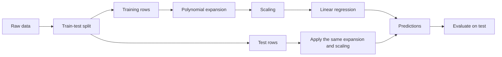
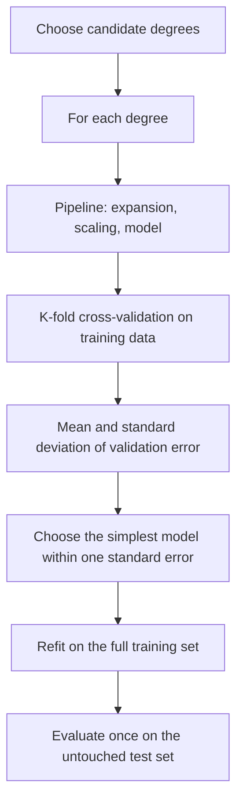
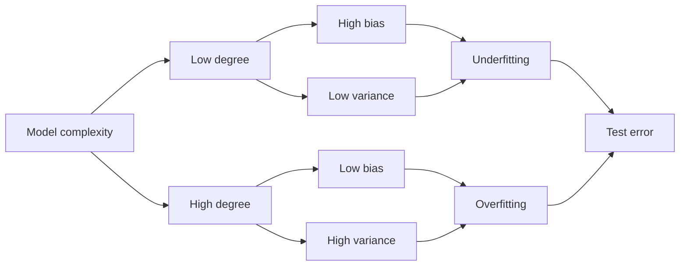

# Day 53 — Polynomial Regression and the Bias–Variance Trade-off

> **Course:** CampusX — 100 Days of Machine Learning, Day 53  
> **Official notebook:** `reference_notebooks/polynomial-regression.ipynb` — 37 cells, copied byte-for-byte from the vendor repository, saved outputs included  
> **Personal notebook:** none; this day is documentation-only, and the reference notebook is not modified  
> **Dataset:** none; the notebook creates synthetic data with NumPy  
> **Central question:** How can a model that is linear in its parameters fit a curved relationship — and when does adding polynomial terms stop helping and start memorising noise?

A linear regression model draws a straight line. A quadratic relationship is not a straight line, yet the notebook fits the curve in cell 9 with `PolynomialFeatures` followed by `LinearRegression`, and the test $R^2$ jumps from $0.1613$ to $0.8332$. Nothing magical happens: the model is still linear in its coefficients, but it is no longer linear in the original feature. The feature is replaced by a small dictionary of powers, and the linear model chooses weights for those powers.

That single idea opens a much larger question. If degree 2 is good, why not degree 20, or degree 350? The notebook answers with a picture: degree 350 produces a wildly oscillating curve and NumPy overflow warnings. The reason is the **bias–variance trade-off**. A flexible polynomial can reduce bias, but its variance grows, and beyond a point the extra flexibility fits the particular training sample rather than the underlying function. This chapter builds that story from the mathematics of the design matrix to the practical syntax of Scikit-learn, and it separates what the notebook actually demonstrates from what it only appears to demonstrate.

**Source labels used in this chapter**

- **Official** — a value or plot saved in the CampusX notebook. The notebook has no random seed for its synthetic data, so these numbers belong to one particular random draw.
- **Rerun** — a value I reproduced in this environment with Python 3.14.2, NumPy 2.5.3, and Scikit-learn 1.9.1, using a stated seed and split.
- **Supplementary** — an explanation, derivation, or experiment added for learning. It is not presented as original course output.
- **Hand calculation** — arithmetic shown step by step in the text.

**A reproducibility warning that matters for this day.** Cell 2 creates the data with `np.random.rand(200, 1)` and `np.random.randn(200, 1)` without calling `np.random.seed`. Cell 22 does the same for the three-dimensional example. Therefore the notebook's saved arrays cannot be regenerated exactly from the code alone. The saved outputs are still authoritative evidence of what the author saw: the linear test $R^2$ is $0.16130669964603517$, the degree-2 test $R^2$ is $0.8332188324158399$, and the fitted degree-2 coefficients are $[0, 0.89296931, 0.78439465]$ with intercept $1.99965238$. For reproducible tables, I generated the *same equations* with a fixed seed and labelled those numbers **Rerun**. The two sets of numbers should never be mixed as if they came from one experiment.

**How this chapter is organised.** Sections 1–4 establish the problem and the linear-model background. Sections 5–8 develop polynomial features, degree selection, overfitting, and the bias–variance decomposition. Sections 9–11 cover regularization, extrapolation, and numerical conditioning. Section 12 explains the Scikit-learn API line by line. Section 13 walks through the official notebook cell by cell, including the defects in its three-dimensional section. Sections 14–18 provide worked numerical examples, graph interpretation, comparisons, workflow connections, and debugging. Sections 19–22 provide interview preparation, examination practice, revision material, and a complete coverage matrix.

---

# 1. Learning objectives

After studying this chapter I should be able to:

1. **Explain the problem.** Describe why a straight line underfits a curved relationship, and diagnose the residual pattern that signals a missing quadratic term.
2. **Distinguish two meanings of "linear".** Explain why polynomial regression is linear in its parameters even though it is nonlinear in the input feature.
3. **Build polynomial features.** Write the univariate and multivariate expansions, construct the design matrix, and interpret the `powers_` matrix.
4. **Count features.** Derive the formula $\binom{n+d}{d}$ for a full polynomial expansion and the corresponding formula for `interaction_only=True`.
5. **Explain interactions.** Distinguish main effects, quadratic terms, and cross-products, and explain the hierarchy principle.
6. **Select a degree.** Explain why training error cannot choose the degree, derive the nested-model argument, and use cross-validation, adjusted $R^2$, AIC, and BIC correctly.
7. **Explain overfitting and underfitting.** Recognise both from train/test behaviour and from learning curves, and explain why a high-degree model can fit the training data yet generalise badly.
8. **Derive the bias–variance decomposition.** State the assumptions, prove the decomposition for squared loss, and interpret each term.
9. **Preview regularization.** Write the ridge objective and closed-form solution, explain how the penalty improves conditioning and shrinks coefficients, and connect it to Lasso and elastic net.
10. **Recognise extrapolation danger.** Explain why global polynomials behave badly outside the training range and compare their behaviour with splines, trees, and kernel methods.
11. **Handle numerical conditioning.** Explain why raw powers are ill-conditioned, why scaling helps the numerical solution, and why scaling does not change the exact OLS fit.
12. **Read and write the Scikit-learn code.** Use `PolynomialFeatures`, `LinearRegression`, `StandardScaler`, `Pipeline`, and `SGDRegressor` correctly, including `degree`, `include_bias`, and `interaction_only`.
13. **Audit the official notebook.** Identify the missing seed, the redundant bias column, the full-data visualization fit, the degree-350 overflow, and the three-dimensional shape and plotting bugs.
14. **Answer interview and examination questions** with reasoning, calculations, and explicit caveats.

---

# 2. Big picture: where polynomial regression sits in the ML workflow

Polynomial regression is a **feature transformation** followed by an ordinary linear model. It belongs to the model-building part of the workflow, not to data cleaning:



The important execution order is:



Two details in those diagrams deserve emphasis.

First, the **expansion is deterministic** once the degree and the number of input columns are fixed. `PolynomialFeatures` does not learn a mean, a standard deviation, or a target-dependent quantity. It stores the number of input features and the exponent matrix. In that narrow sense, expanding before the split is not target leakage. But the **scaler** fitted after the expansion does learn from data, the **model** learns from data, and the **degree** is usually selected by looking at validation data. Those steps must respect the train/test boundary. Using a `Pipeline` keeps the whole sequence honest.

Second, the test set is not a tuning set. If I compare degree 1, 2, 3, and 350 on the same test rows and then report the best test score, I have used the test set for model selection. The reported score is optimistic. The notebook's degree-350 plot is a visual diagnostic, not a model-selection experiment, but the same rule applies to any real project.

**Connection to previous days.**

- **Day 48 (simple linear regression)** introduced the model $\hat y=b_0+b_1x$ and the least-squares fit. Day 53 keeps the same loss and the same solver; only the feature representation changes.
- **Day 49 (regression metrics)** introduced MSE, RMSE, MAE, and $R^2$. This chapter uses $R^2$ and MSE, and it explains why training $R^2$ is not a model-selection criterion.
- **Day 50 (multiple linear regression)** introduced the design matrix, the normal equations, and the interpretation of coefficients in the presence of correlated features. Polynomial regression is multiple linear regression applied to a specially constructed design matrix.
- **Day 51–52 (gradient descent)** showed how the same least-squares objective can be optimized iteratively. Cell 21 uses `SGDRegressor`, which is gradient descent on a linear model; the polynomial expansion is again just a feature map.
- **Day 55–57 (ridge, Lasso, elastic net)** will show how to control the variance of flexible models. Section 9 previews that idea because a high-degree polynomial is the natural motivating example for regularization.

---

# 3. Prerequisites, explained rather than listed

## 3.1 The linear model in matrix form

For $n$ observations and $p$ features, the multiple linear regression model is

$$
y_i=\beta_0+\beta_1x_{i1}+\beta_2x_{i2}+\cdots+\beta_px_{ip}+\varepsilon_i,
\qquad i=1,\ldots,n.
$$

Here:

- $y_i$ is the target for observation $i$;
- $x_{ij}$ is the value of feature $j$ for observation $i$;
- $\beta_0$ is the intercept;
- $\beta_j$ for $j\ge1$ is the coefficient of feature $j$;
- $\varepsilon_i$ is the error term, the part of $y_i$ the model does not explain.

Collect the features into a row vector $\mathbf{x}_i=(1,x_{i1},\ldots,x_{ip})$, the coefficients into $\boldsymbol{\beta}=(\beta_0,\beta_1,\ldots,\beta_p)^\top$, and stack the rows into the **design matrix** $\Phi\in\mathbb{R}^{n\times(p+1)}$. The model becomes

$$
\mathbf{y}=\Phi\boldsymbol{\beta}+\boldsymbol{\varepsilon}.
$$

The ordinary least-squares estimate minimises the residual sum of squares:

$$
\hat{\boldsymbol{\beta}}
=\arg\min_{\boldsymbol{\beta}}\|\mathbf{y}-\Phi\boldsymbol{\beta}\|_2^2.
$$

If $\Phi$ has full column rank, the minimiser satisfies the **normal equations**

$$
\Phi^\top\Phi\hat{\boldsymbol{\beta}}=\Phi^\top\mathbf{y},
$$

so

$$
\hat{\boldsymbol{\beta}}=(\Phi^\top\Phi)^{-1}\Phi^\top\mathbf{y}.
$$

The fitted values are

$$
\hat{\mathbf{y}}=\Phi\hat{\boldsymbol{\beta}}
=\Phi(\Phi^\top\Phi)^{-1}\Phi^\top\mathbf{y}
=H\mathbf{y},
$$

where $H$ is the hat matrix. The residuals are $\mathbf{e}=\mathbf{y}-\hat{\mathbf{y}}=(I-H)\mathbf{y}$.

Why the normal equations look like that: the squared loss is a convex quadratic in $\boldsymbol{\beta}$. Differentiating with respect to $\boldsymbol{\beta}$ gives $-2\Phi^\top(\mathbf{y}-\Phi\boldsymbol{\beta})$. Setting the derivative to zero gives $\Phi^\top\mathbf{y}=\Phi^\top\Phi\boldsymbol{\beta}$. The second derivative $2\Phi^\top\Phi$ is positive semidefinite, so the stationary point is a global minimum. If $\Phi^\top\Phi$ is singular, there are infinitely many minimisers; numerical software returns one of them, usually the minimum-norm solution.

## 3.2 Basis functions and linearity in the parameters

A **basis function** is a fixed transformation of the input. In polynomial regression, the basis functions are

$$
\phi_0(x)=1,\qquad
\phi_1(x)=x,\qquad
\phi_2(x)=x^2,\qquad \ldots,\qquad
\phi_d(x)=x^d.
$$

The model is

$$
y=\beta_0\phi_0(x)+\beta_1\phi_1(x)+\cdots+\beta_d\phi_d(x)+\varepsilon.
$$

This is still a linear model because it is linear in $\boldsymbol{\beta}$. The functions $\phi_j$ can be arbitrarily nonlinear in $x$; the least-squares machinery only requires that the prediction be a linear combination of the columns of the design matrix. That is the precise meaning of the phrase **linear in the parameters**.

A model that is nonlinear in its parameters would look like $y=\beta_0+\beta_1 e^{\beta_2 x}+\varepsilon$ or $y=1/(1+e^{-\beta_0-\beta_1x})+\varepsilon$. Those require different optimisation methods. Polynomial regression does not.

## 3.3 $R^2$, MSE, and the train/test distinction

For a set of observations with targets $y_i$ and predictions $\hat y_i$, define

$$
SSE=\sum_{i=1}^{n}(y_i-\hat y_i)^2,
\qquad
SST=\sum_{i=1}^{n}(y_i-\bar y)^2,
\qquad
R^2=1-\frac{SSE}{SST}.
$$

$SSE$ is the sum of squared errors; $SST$ is the total squared variation around the sample mean $\bar y$. $R^2$ compares the model's squared error with the error of always predicting the mean. On the training data, $R^2=1$ means perfect fit and $R^2=0$ means no better than the mean. On a test set, $R^2$ can be negative: the model can be worse than predicting the test-set mean.

The **mean squared error** is

$$
MSE=\frac{1}{n}\sum_{i=1}^{n}(y_i-\hat y_i)^2.
$$

MSE is in squared target units, so it is sensitive to the scale of $y$. RMSE is $\sqrt{MSE}$ and is in the original units. $R^2$ is unitless but depends on the variance of the evaluation set, so $R^2$ values from different datasets or different test splits are not directly comparable.

Training error and test error answer different questions. Training error asks how well the model fits the rows it has seen. Test error asks how well it predicts rows it has not seen. Polynomial degree is chosen to improve the second, not the first.

## 3.4 Expectation, variance, bias, and noise

Let $\mathcal{D}$ be a random training set. An estimator $\hat f(x_0;\mathcal{D})$ is a random quantity because it depends on $\mathcal{D}$. Its **bias** at a point $x_0$ is

$$
\operatorname{Bias}[\hat f(x_0)]
=\mathbb{E}_{\mathcal{D}}[\hat f(x_0;\mathcal{D})]-f(x_0),
$$

where $f(x_0)$ is the true regression function. Its **variance** is

$$
\operatorname{Var}[\hat f(x_0)]
=\mathbb{E}_{\mathcal{D}}\left[
\left(\hat f(x_0;\mathcal{D})-\mathbb{E}_{\mathcal{D}}[\hat f(x_0;\mathcal{D})]\right)^2
\right].
$$

Bias measures systematic error: on average, does the estimator hit the truth? Variance measures instability: does the estimator change much when the training set changes? A model can be biased and stable (a straight line fitted to a parabola) or nearly unbiased and unstable (a degree-350 polynomial).

The target itself contains **irreducible noise**:

$$
y_0=f(x_0)+\varepsilon_0,
\qquad
\mathbb{E}[\varepsilon_0]=0,
\qquad
\operatorname{Var}(\varepsilon_0)=\sigma^2.
$$

No model can predict $\varepsilon_0$. The best possible expected squared error at $x_0$ is therefore at least $\sigma^2$.

## 3.5 Model complexity

**Complexity** is the effective flexibility of a model class. For polynomial regression, the degree is a convenient complexity index, but it is not the only one: the number of features, the number of non-zero coefficients, and the size of the coefficients also matter. A degree-20 polynomial with a strong ridge penalty can behave like a much simpler model.

The key empirical fact is that increasing complexity usually decreases training error and initially decreases test error, but eventually increases test error. The next sections make that statement precise.

---

# 4. The problem: a straight line cannot follow a parabola

## 4.1 The data-generating process in the notebook

Cell 2 of the official notebook creates $200$ observations:

```python
X = 6 * np.random.rand(200, 1) - 3
y = 0.8 * X**2 + 0.9 * X + 2 + np.random.randn(200, 1)
```

The first line produces $X$ uniformly on the interval $[-3,3]$. The second line produces

$$
y=0.8x^2+0.9x+2+\varepsilon,
\qquad
\varepsilon\sim\mathcal{N}(0,1).
$$

The true regression function is the parabola

$$
f(x)=0.8x^2+0.9x+2.
$$

Its vertex is at

$$
x^\star=-\frac{0.9}{2(0.8)}=-0.5625,
$$

and the value at the vertex is

$$
f(x^\star)=0.8(0.5625)^2+0.9(-0.5625)+2
=0.253125-0.50625+2
=1.746875.
$$

So the cloud should decrease from $x=-3$ to about $x=-0.56$, reach a minimum near $y\approx1.75$, and then increase to $x=3$. The saved scatter plot in cell 3 shows exactly that shape: a U-shaped cloud with vertical noise of roughly one unit.

## 4.2 What the linear fit does

Cell 5 creates `LinearRegression()`, cell 6 fits it on the training split, and cell 7 reports the test $R^2$:

$$
R^2_{\text{linear}}=0.16130669964603517.
$$

Only about $16\%$ of the test-set variation is explained. The fitted line is shown in cell 8. It rises gently from about $2$ at $x=-3$ to about $6.8$ at $x=3$. It cannot bend down on the left and up on the right at the same time.

The residual pattern is diagnostic. At both ends of the range, the points tend to lie above the line, so the residuals $y-\hat y$ are mostly positive. In the middle, the points tend to lie below the line, so the residuals are mostly negative. A U-shaped residual plot against $x$ is the classic signature of a missing quadratic term. The line is not "wrong" in the sense of an arithmetic error; it is the best straight line under squared loss. It is simply the wrong **model class** for this relationship.

This is **underfitting**: the model is too rigid to represent the systematic curvature. Adding more data will not fix it. Changing the features can.

## 4.3 Why a line cannot represent a parabola

A linear model in one feature has the form

$$
\hat y=\beta_0+\beta_1x.
$$

Its second derivative with respect to $x$ is zero:

$$
\frac{d^2\hat y}{dx^2}=0.
$$

The true function has second derivative

$$
\frac{d^2f}{dx^2}=2(0.8)=1.6>0.
$$

A straight line has no curvature. No choice of $\beta_0$ and $\beta_1$ can make its second derivative equal $1.6$ everywhere. The model class is too small. This is a statement about **approximation error**, not about estimation error: even with infinitely many training points and no noise, the best straight line would still miss the parabola.

## 4.4 The two meanings of "linear"

This is the conceptual pivot of the whole day.

**Linear in the parameters** means the prediction is a linear combination of unknown coefficients:

$$
\hat y=\sum_{j=0}^{d}\beta_j\phi_j(x).
$$

The basis functions $\phi_j$ can be nonlinear. Polynomial regression is linear in $\boldsymbol{\beta}$.

**Linear in the input** means the prediction is an affine function of $x$:

$$
\hat y=\beta_0+\beta_1x.
$$

Ordinary linear regression is linear in both senses. Polynomial regression is linear in the parameters but nonlinear in the input. That is why the same `LinearRegression` class, the same squared loss, and the same normal equations can fit a curve.

A useful test question: "Is $y=\beta_0+\beta_1x+\beta_2x^2$ a linear model?" The correct answer is: it is linear in the parameters $(\beta_0,\beta_1,\beta_2)$, so it is a linear model in the sense that OLS applies; it is nonlinear in $x$. Saying "it is nonlinear, so we cannot use linear regression" is a category error.

## 4.5 When a straight line is the right choice

A linear model is not inferior by definition. It is preferable when:

- the relationship is approximately linear over the relevant range;
- the data are scarce, so a flexible model would have high variance;
- interpretability of a constant slope matters;
- extrapolation is required and a linear trend is defensible;
- the signal-to-noise ratio is low, so extra curvature would fit noise.

Polynomial regression is a tool for a specific failure mode: a smooth, systematic curvature that a line cannot capture. It is not a universal upgrade.

## 4.6 Underfitting in one sentence

Underfitting means the model's training error is high **and** its test error is high, because the model class cannot represent the systematic pattern. The remedy is more flexibility, better features, or a different model family — not more regularization.

---

# 5. Polynomial features: turning one column into a basis

## 5.1 The univariate expansion

For one input feature $x$ and degree $d$, the polynomial model is

$$
y=\beta_0+\beta_1x+\beta_2x^2+\cdots+\beta_dx^d+\varepsilon.
$$

The feature vector for one observation is

$$
\boldsymbol{\phi}(x)=
\begin{pmatrix}
1,& x,& x^2,& \ldots,& x^d
\end{pmatrix}.
$$

For $d=2$, the model is

$$
y=\beta_0+\beta_1x+\beta_2x^2+\varepsilon.
$$

The three columns of the design matrix are the constant, the original feature, and its square. The model is still fitted by OLS; the square is treated exactly like any other feature.

A crucial point: the polynomial is **global**. Every observation contributes to every coefficient, and the fitted curve is a single smooth function over the whole range. This is the source of both its strength (it can represent smooth curvature everywhere) and its weakness (a change in one region can affect the fit in another; outside the data range it can explode).

## 5.2 The multivariate expansion

With $n$ input features $x_1,\ldots,x_n$, a monomial is a product

$$
x_1^{k_1}x_2^{k_2}\cdots x_n^{k_n},
$$

where each exponent $k_j$ is a non-negative integer and the **total degree** is

$$
k_1+k_2+\cdots+k_n.
$$

A full polynomial of degree $d$ contains every monomial whose total degree is at most $d$. For two features and degree 2, the monomials are

$$
1,\quad x_1,\quad x_2,\quad x_1^2,\quad x_1x_2,\quad x_2^2.
$$

The model is

$$
y=\beta_0+\beta_1x_1+\beta_2x_2+\beta_3x_1^2+\beta_4x_1x_2+\beta_5x_2^2+\varepsilon.
$$

The term $x_1x_2$ is an **interaction**: the effect of $x_1$ depends on the value of $x_2$. The terms $x_1^2$ and $x_2^2$ are **quadratic main effects**. The terms $x_1$ and $x_2$ are **linear main effects**.

## 5.3 Counting the features

For $n$ input features and maximum total degree $d$, the number of monomials including the constant is

$$
\binom{n+d}{d}.
$$

**Derivation.** Count the non-negative integer solutions of

$$
k_1+k_2+\cdots+k_n\le d.
$$

Introduce a slack variable

$$
k_{n+1}=d-(k_1+\cdots+k_n)\ge0.
$$

Then the inequality becomes the equality

$$
k_1+k_2+\cdots+k_n+k_{n+1}=d.
$$

The number of weak compositions of $d$ into $n+1$ non-negative parts is

$$
\binom{d+(n+1)-1}{(n+1)-1}=\binom{n+d}{d}.
$$

This is the standard stars-and-bars count. If `include_bias=False`, the constant monomial is removed, so the count is

$$
\binom{n+d}{d}-1.
$$

For one feature:

$$
\binom{1+d}{d}=d+1,
$$

which is exactly $1,x,x^2,\ldots,x^d$. For two features and degree 2:

$$
\binom{2+2}{2}=\binom{4}{2}=6,
$$

matching $1,x_1,x_2,x_1^2,x_1x_2,x_2^2$. For two features and degree 30:

$$
\binom{2+30}{30}=\binom{32}{30}=\binom{32}{2}=496,
$$

which is exactly the official `n_output_features_` printed in cell 28. For three features and degree 2:

$$
\binom{3+2}{2}=\binom{5}{2}=10.
$$

## 5.4 Interaction terms and the hierarchy principle

An interaction term is a product of two or more distinct features, such as $x_1x_2$ or $x_1x_2x_3$. It allows the effect of one feature to depend on another. In a model with

$$
y=\beta_0+\beta_1x_1+\beta_2x_2+\beta_3x_1x_2+\varepsilon,
$$

the marginal effect of $x_1$ is

$$
\frac{\partial \hat y}{\partial x_1}=\beta_1+\beta_3x_2.
$$

So the slope with respect to $x_1$ changes with $x_2$. If $\beta_3=0$, the features are additive; if $\beta_3\ne0$, they interact.

The **hierarchy principle** says that if an interaction $x_1x_2$ is included, its lower-order terms $x_1$ and $x_2$ should also be included. Why? Because the meaning of $\beta_1$ depends on the origin of $x_2$. If the model contains only $x_1x_2$ and not $x_2$, then shifting $x_1$ by a constant $c$ changes the model by $c\beta_3x_2$, which is a main effect that the model cannot represent. The model is not invariant to a simple change of units. A full polynomial expansion automatically satisfies the hierarchy principle: every monomial of total degree $k$ brings all of its lower-degree factors. `interaction_only=True` does not include pure powers, so it can violate hierarchy if used without adding the lower-order terms manually.

## 5.5 `interaction_only=True`

`PolynomialFeatures(degree=2, interaction_only=True)` keeps monomials in which each feature appears at most once. For two features, it produces

$$
1,\quad x_1,\quad x_2,\quad x_1x_2.
$$

For three features, it produces

$$
1,\quad x_1,\quad x_2,\quad x_3,\quad x_1x_2,\quad x_1x_3,\quad x_2x_3.
$$

There are no $x_1^2$, $x_2^2$, or $x_3^2$ terms. The general count including the constant is

$$
\sum_{k=0}^{\min(d,n)}\binom{n}{k},
$$

because a monomial with each exponent in $\{0,1\}$ is determined by choosing which $k$ features appear. For $n=2,d=2$: $1+2+1=4$. For $n=3,d=2$: $1+3+3=7$. For $n=2,d=30$: $1+2+1=4$, not $496$, because a monomial cannot use a feature twice.

`interaction_only=True` still includes the main effects of degree 1. It does not mean "only the product term". If I want only $x_1x_2$, I must select that column explicitly or construct it by hand.

## 5.6 The feature explosion

The count grows quickly. The following table lists the number of output columns including the constant:

| Input features $n$ | Degree 1 | Degree 2 | Degree 3 | Degree 5 | Degree 10 |
|---:|---:|---:|---:|---:|---:|
| 1 | 2 | 3 | 4 | 6 | 11 |
| 2 | 3 | 6 | 10 | 21 | 66 |
| 3 | 4 | 10 | 20 | 56 | 286 |
| 5 | 6 | 21 | 56 | 252 | 3,003 |
| 10 | 11 | 66 | 286 | 3,003 | 184,756 |
| 20 | 21 | 231 | 1,771 | 53,130 | 30,045,015 |

Two features and degree 30 give $496$ columns, as in the notebook. Three features and degree 30 give $5,456$ columns. Ten features and degree 10 give $184,756$ columns. A design matrix with $n=1{,}000$ rows and $184{,}756$ columns of 64-bit floats would require about $1.5$ GB just for the matrix, before any copies, solver workspace, or model coefficients. The memory cost is not theoretical.

The number of parameters also affects variance. A model with $p$ parameters estimated from $n$ observations has roughly $p$ degrees of freedom. When $p$ approaches or exceeds $n$, the model can interpolate the training data, and the variance can become enormous.

## 5.7 The design matrix

For $n$ observations and $p$ basis functions, the design matrix is

$$
\Phi=
\begin{pmatrix}
\phi_0(x_1) & \phi_1(x_1) & \cdots & \phi_{p-1}(x_1)\\
\phi_0(x_2) & \phi_1(x_2) & \cdots & \phi_{p-1}(x_2)\\
\vdots & \vdots & \ddots & \vdots\\
\phi_0(x_n) & \phi_1(x_n) & \cdots & \phi_{p-1}(x_n)
\end{pmatrix}.
$$

Each row is one observation; each column is one basis function evaluated at all observations. For a univariate quadratic,

$$
\Phi=
\begin{pmatrix}
1 & x_1 & x_1^2\\
1 & x_2 & x_2^2\\
\vdots & \vdots & \vdots\\
1 & x_n & x_n^2
\end{pmatrix}.
$$

The first column is the intercept. If `include_bias=True`, `PolynomialFeatures` supplies that column. If `include_bias=False`, the column is absent and `LinearRegression(fit_intercept=True)` adds its own intercept internally.

## 5.8 Polynomial regression is still OLS

The polynomial model is

$$
\mathbf{y}=\Phi\boldsymbol{\beta}+\boldsymbol{\varepsilon},
$$

with $\Phi$ built from powers. The least-squares estimate is still

$$
\hat{\boldsymbol{\beta}}=(\Phi^\top\Phi)^{-1}\Phi^\top\mathbf{y}
$$

when $\Phi$ has full column rank. The hat matrix, leverage, residuals, and $R^2$ formulas are unchanged. The only difference is that the columns of $\Phi$ are correlated powers rather than the original features.

That correlation has consequences:

- individual coefficients can be unstable and can have signs that are hard to interpret;
- the condition number of $\Phi^\top\Phi$ can be large;
- predictions can still be accurate even when the coefficients are not individually meaningful.

This is why polynomial regression is often described as a **basis expansion** rather than a new estimation method.

## 5.9 Worked expansion: the notebook's first training row

Cell 10 prints

```text
[-0.88762061]
[ 1.         -0.88762061  0.78787035]
```

The first line is the original training feature. The second line is the degree-2 expansion with `include_bias=True`:

$$
\phi(x)=
\begin{pmatrix}
1,& x,& x^2
\end{pmatrix}
=
\begin{pmatrix}
1,& -0.88762061,& 0.78787035
\end{pmatrix}.
$$

Check the square by hand:

$$
(-0.88762061)^2=0.7878703473\ldots
$$

which rounds to $0.78787035$. The expansion is not doing anything mysterious; it is literally appending the square.

## 5.10 The `powers_` matrix and column order

After fitting `PolynomialFeatures`, the `powers_` attribute is an integer matrix with one row per output feature and one column per input feature. Entry $(j,k)$ is the exponent of input feature $k$ in output feature $j$.

For one input feature and degree 2, `include_bias=True`:

```python
poly = PolynomialFeatures(degree=2, include_bias=True)
poly.fit(X_train)
print(poly.powers_)
```

produces

```text
[[0]
 [1]
 [2]]
```

so the three output columns are $x^0=1$, $x^1=x$, and $x^2$.

For two input features and degree 2, the powers are

```text
[[0 0]
 [1 0]
 [0 1]
 [2 0]
 [1 1]
 [0 2]]
```

corresponding to

$$
1,\quad x_1,\quad x_2,\quad x_1^2,\quad x_1x_2,\quad x_2^2.
$$

The order is deterministic: Scikit-learn generates the monomials in a fixed order, and `get_feature_names_out` reports the same order. The order matters when I inspect `coef_`: the first coefficient belongs to the first row of `powers_`, the second to the second row, and so on. If I reorder the columns without reordering the coefficients, the model is wrong.

A concrete two-row example:

```python
import numpy as np
from sklearn.preprocessing import PolynomialFeatures

X = np.array([[2.0, 3.0],
              [4.0, 5.0]])
poly = PolynomialFeatures(degree=2, include_bias=True)
print(poly.fit_transform(X))
print(poly.powers_)
```

Output:

```text
[[ 1.  2.  3.  4.  6.  9.]
 [ 1.  4.  5. 16. 20. 25.]]
[[0 0]
 [1 0]
 [0 1]
 [2 0]
 [1 1]
 [0 2]]
```

The row $(2,3)$ becomes $(1,2,3,4,6,9)$; the row $(4,5)$ becomes $(1,4,5,16,20,25)$. The interaction column is the product $2\cdot3=6$ in the first row and $4\cdot5=20$ in the second.

With `interaction_only=True`, the same two rows become

```text
[[1. 2. 3. 6.]
 [1. 4. 5. 20.]]
```

because the squares are omitted.

# 6. Degree selection: why training error cannot choose the degree

## 6.1 Nested models and the monotonicity of training error

A polynomial of degree $d$ is a special case of a polynomial of degree $d+1$: set the highest coefficient to zero. In symbols, the model class

$$
\mathcal{M}_d=\left\{\beta_0+\beta_1x+\cdots+\beta_dx^d:\beta_j\in\mathbb{R}\right\}
$$

is a subset of

$$
\mathcal{M}_{d+1}=\left\{\beta_0+\beta_1x+\cdots+\beta_dx^d+\beta_{d+1}x^{d+1}:\beta_j\in\mathbb{R}\right\}.
$$

Because the larger class contains every function in the smaller class, the minimum training error over the larger class cannot be larger:

$$
\min_{\boldsymbol{\beta}\in\mathcal{M}_{d+1}}SSE
\le
\min_{\boldsymbol{\beta}\in\mathcal{M}_{d}}SSE.
$$

Therefore, in exact arithmetic, **training $R^2$ is non-decreasing with degree**, and training MSE is non-increasing. This is not evidence that the higher-degree model is better. It is a mathematical consequence of giving the optimiser a larger parameter space.

In finite precision, the statement can fail. If the design matrix is severely ill-conditioned, the numerical solver may return a solution whose training error is worse than a lower-degree model's. I observed this in a supplementary experiment: with raw powers and no scaling, degree 15 had training $R^2=0.8474$, lower than degree 12's $0.8941$, because the raw design was too ill-conditioned. That is a numerical failure, not a violation of the nested-model theorem. It is also a warning: high-degree polynomials can break the solver before they break the test set.

## 6.2 The test-error curve

Test error behaves differently. As degree increases:

- **Bias falls.** A more flexible polynomial can approximate a wider range of smooth functions.
- **Variance rises.** The fitted curve depends more strongly on the particular training sample.
- **Noise sensitivity rises.** High-degree terms can fit individual noisy observations.

The expected test error is the sum of irreducible noise, squared bias, and variance. At low degree, bias dominates. At high degree, variance dominates. Somewhere in between, the sum is minimised. The resulting curve is often U-shaped:



The U-shape is a property of the **expected** test error over repeated training sets. A single observed test split can be noisy and can favor a more complex model by chance. That is why a single test $R^2$ is not enough to choose a degree.

## 6.3 Criteria for choosing a degree

**Validation or cross-validation (preferred).** Split the training data into folds, fit the entire pipeline on each training fold, and evaluate on the held-out fold. Average the fold errors. Use the same folds for every candidate degree so the comparison is paired. Report the mean and the standard deviation.

**Adjusted $R^2$.** On the training data,

$$
R^2_{\text{adj}}
=1-\frac{SSE/(n-p)}{SST/(n-1)}
=1-(1-R^2)\frac{n-1}{n-p},
$$

where $n$ is the number of observations and $p$ is the number of estimated parameters including the intercept. The adjustment penalises the addition of parameters. It can decrease when a new term does not improve the fit enough, unlike ordinary training $R^2$.

**AIC and BIC.** For a Gaussian model with unknown variance, up to additive constants,

$$
AIC=n\ln\left(\frac{SSE}{n}\right)+2p,
\qquad
BIC=n\ln\left(\frac{SSE}{n}\right)+p\ln n.
$$

Lower values are better. BIC penalises parameters more strongly when $n>e^2\approx7.39$. Both are in-sample criteria with asymptotic justification; they are not a substitute for validation when prediction is the goal.

**Mallows' $C_p$.**

$$
C_p=\frac{SSE_p}{\hat\sigma^2}-n+2p,
$$

where $\hat\sigma^2$ is an estimate of the noise variance, usually from a low-bias model or from replicated observations. A model with $C_p\approx p$ is considered a reasonable fit, but the criterion depends on the variance estimate.

**One-standard-error rule.** Choose the simplest model whose cross-validation error is within one standard error of the best model. The standard error of the mean CV score is approximately $s/\sqrt{K}$, where $s$ is the sample standard deviation of the $K$ fold scores. This rule prefers parsimony and reduces the chance of selecting a model that won by noise.

**Domain knowledge and parsimony.** If degree 2 is physically motivated and degree 7 is not, the simpler model is often preferable even if it has a slightly worse validation score. A model that is easier to explain, monitor, and maintain has value beyond a third decimal place of $R^2$.

## 6.4 A reproducible degree-selection experiment

The official notebook compares only degree 1, degree 2, and degree 350. It does not produce a table of intermediate degrees, and its data have no seed. To study degree selection, I generated the same equations with a fixed seed:

```python
import numpy as np
from sklearn.model_selection import train_test_split

np.random.seed(42)
X = 6 * np.random.rand(200, 1) - 3
y = 0.8 * X**2 + 0.9 * X + 2 + np.random.randn(200, 1)
X_train, X_test, y_train, y_test = train_test_split(
    X, y, test_size=0.2, random_state=2
)
```

This gives $160$ training rows and $40$ test rows. Each model is a pipeline:

```python
from sklearn.pipeline import Pipeline
from sklearn.preprocessing import PolynomialFeatures, StandardScaler
from sklearn.linear_model import LinearRegression

pipe = Pipeline([
    ("poly", PolynomialFeatures(degree=d, include_bias=False)),
    ("scale", StandardScaler()),
    ("model", LinearRegression()),
])
```

The scaling step is important for the higher degrees. The table reports **Rerun** values, not official values:

| Degree $d$ | Polynomial columns | Train $R^2$ | Test $R^2$ | Train MSE | Test MSE | Max $|\hat\beta|$ |
|---:|---:|---:|---:|---:|---:|---:|
| 1 | 1 | 0.2734 | 0.3445 | 5.8196 | 4.6828 | $1.48$ |
| 2 | 2 | 0.8901 | 0.8414 | 0.8801 | 1.1330 | $2.22$ |
| 3 | 3 | 0.8920 | 0.8439 | 0.8653 | 1.1155 | $2.22$ |
| 5 | 5 | 0.8922 | 0.8459 | 0.8634 | 1.1006 | $2.30$ |
| 9 | 9 | 0.8936 | 0.8475 | 0.8524 | 1.0895 | $1.17\times10^{1}$ |
| 12 | 12 | 0.8958 | 0.8531 | 0.8344 | 1.0498 | $2.38\times10^{2}$ |
| 15 | 15 | 0.8973 | 0.8502 | 0.8224 | 1.0699 | $2.20\times10^{3}$ |
| 20 | 20 | 0.9005 | 0.8604 | 0.7969 | 0.9975 | $9.67\times10^{3}$ |
| 30 | 30 | 0.9005 | 0.8572 | 0.7966 | 1.0205 | $1.12\times10^{3}$ |
| 50 | 50 | 0.9041 | 0.8458 | 0.7682 | 1.1014 | $2.62\times10^{3}$ |
| 100 | 100 | 0.9092 | $-5.9762$ | 0.7275 | 49.8403 | $9.57\times10^{2}$ |
| 200 | 200 | 0.9098 | $-470.9896$ | 0.7227 | 3372.0530 | $5.74\times10^{2}$ |
| 350 | 350 | 0.0794 | $-1609.9086$ | 7.3738 | 11508.8736 | $1.24\times10^{-159}$ |

Several things are worth reading carefully.

- Training $R^2$ rises from $0.2734$ at degree 1 to $0.9098$ at degree 200. It is almost flat after degree 20 because the extra terms mostly fit noise.
- Test $R^2$ rises from $0.3445$ to a peak of $0.8604$ at degree 20, then falls. On this single split, degree 20 looks best.
- The coefficient magnitude explodes from about $2$ at degree 5 to $9.67\times10^{3}$ at degree 20. Large coefficients are a symptom of variance and collinearity.
- At degree 100 and above, the model becomes numerically unstable. Training $R^2$ is still high, but test $R^2$ is catastrophically negative. At degree 350, even the training fit collapses, and the largest coefficient is absurdly small; the solver has lost the problem.
- The single-split "best" degree is not the same as the cross-validation choice. That is the next table.

## 6.5 Cross-validation on the training set

I ran five-fold cross-validation on the $160$ training rows, using the same folds for every degree:

| Degree $d$ | CV mean $R^2$ | CV standard deviation | Fold scores |
|---:|---:|---:|---|
| 1 | 0.1975 | 0.1640 | $0.287, 0.273, -0.071, 0.102, 0.396$ |
| 2 | 0.8777 | 0.0215 | $0.909, 0.862, 0.863, 0.857, 0.898$ |
| 3 | 0.8747 | 0.0295 | $0.914, 0.867, 0.831, 0.861, 0.900$ |
| 4 | 0.8733 | 0.0299 | $0.913, 0.867, 0.831, 0.855, 0.900$ |
| 5 | 0.8705 | 0.0307 | $0.911, 0.866, 0.831, 0.845, 0.900$ |
| 6 | 0.8710 | 0.0298 | $0.916, 0.867, 0.834, 0.846, 0.891$ |
| 7 | 0.8672 | 0.0325 | $0.916, 0.860, 0.826, 0.842, 0.891$ |
| 8 | 0.8634 | 0.0325 | $0.914, 0.853, 0.827, 0.836, 0.888$ |
| 9 | 0.8620 | 0.0342 | $0.916, 0.842, 0.829, 0.834, 0.888$ |
| 10 | 0.8505 | 0.0413 | $0.914, 0.814, 0.815, 0.824, 0.885$ |
| 12 | 0.8498 | 0.0342 | $0.898, 0.835, 0.813, 0.820, 0.883$ |
| 15 | 0.8221 | 0.0537 | $0.893, 0.754, 0.811, 0.778, 0.875$ |
| 20 | 0.5007 | 0.4985 | $-0.464, 0.504, 0.806, 0.791, 0.866$ |
| 30 | $-5.7339$ | 12.9440 | $-31.621, 0.555, 0.800, 0.732, 0.865$ |

The best CV mean is degree 2 at $0.8777$. The standard error of that mean is

$$
\frac{0.0215}{\sqrt{5}}\approx0.0096.
$$

One standard error below the best is about $0.8681$. Degrees 2 through 6 are within that band. The one-standard-error rule chooses the simplest, degree 2. This agrees with the fact that the true generating function is quadratic.

The contrast between the CV choice (degree 2) and the single-test choice (degree 20) is a lesson about evaluation noise. The test set has only $40$ rows, so a difference of $0.019$ in $R^2$ between degree 2 and degree 20 is not convincing. Cross-validation uses all $160$ training rows, and it shows that degree 20 is unstable: one fold has $R^2=-0.464$. The high-degree model is not reliably better; it happened to do well on this particular test split.

## 6.6 What the official notebook actually shows

The official notebook compares:

- degree 1: test $R^2=0.16130669964603517$;
- degree 2: test $R^2=0.8332188324158399$;
- degree 350: a plot, with no test score.

The difference is

$$
0.8332188324158399-0.16130669964603517
=0.6719121327698047.
$$

That is a large improvement on the saved split. It is consistent with the true data-generating process being quadratic. But the notebook does not establish that degree 2 is optimal for *other* datasets, and it does not perform a systematic degree search. The degree-350 plot is a warning, not a selection result.

## 6.7 A practical degree-selection recipe

1. Start with degree 1 as the baseline.
2. Fit a degree-2 model and inspect residual plots. If the residuals still show systematic curvature, try degree 3.
3. Use cross-validation on the training set for degrees $1,2,3,\ldots$ up to a modest maximum, with the same folds for every degree.
4. Stop increasing the degree when the CV mean stops improving or the fold-to-fold variance becomes large.
5. Apply the one-standard-error rule.
6. Check the condition number of the design matrix and the size of the coefficients. A sudden explosion is a warning.
7. Evaluate the chosen model once on the test set.
8. If extrapolation is required, do not rely on the polynomial beyond the observed range without a domain argument.

---

# 7. Overfitting and underfitting

## 7.1 Definitions

**Underfitting** occurs when the model class is too restrictive to capture the systematic relationship. Training error is high, test error is high, and the gap between them is small. The model is biased.

**Overfitting** occurs when the model class is flexible enough to fit the training sample's noise. Training error is low, test error is high, and the gap is large. The model has high variance.

A **good fit** has low training error and low test error, with a modest gap. The gap is not required to be zero; some difference is normal because the test rows are unseen.

## 7.2 Symptoms and remedies

| Symptom | Underfitting | Overfitting |
|---|---|---|
| Training error | high | very low |
| Test error | high | high |
| Train–test gap | small | large |
| Bias | high | low |
| Variance | low | high |
| Effect of more data | little improvement | often improves |
| Effect of more features | may help | often hurts |
| Effect of regularization | can hurt further | often helps |
| Typical polynomial degree | too low | too high for the sample size |

The remedies are opposite:

- Underfitting: increase degree, add interactions, add better features, use a more flexible model, reduce excessive regularization.
- Overfitting: reduce degree, remove features, add regularization, collect more data, use cross-validation, simplify the model.

## 7.3 Learning curves

A **learning curve** plots training and validation error against the number of training observations. For a fixed model:

- With very few training rows, the model can fit them almost perfectly, so training error is low; validation error is high because the fit is unstable.
- As the number of rows grows, training error usually rises because the model can no longer fit every point; validation error falls because the estimate becomes more stable.
- The gap between the curves shrinks as $n$ grows.

For a high-variance model, the gap is large at small $n$ and closes slowly. For a high-bias model, both curves are high and close together; adding data does not help much. Learning curves are a practical way to decide whether to collect more data or change the model class.

## 7.4 The degree-350 plot

Cell 19 calls `polynomial_regression(350)`. The function:

```python
def polynomial_regression(degree):
    X_new = np.linspace(-3, 3, 100).reshape(100, 1)
    X_new_poly = poly.transform(X_new)

    polybig_features = PolynomialFeatures(degree=degree, include_bias=False)
    std_scaler = StandardScaler()
    lin_reg = LinearRegression()
    polynomial_regression = Pipeline([
        ("poly_features", polybig_features),
        ("std_scaler", std_scaler),
        ("lin_reg", lin_reg),
    ])
    polynomial_regression.fit(X, y)
    y_newbig = polynomial_regression.predict(X_new)
    ...
```

There are several things to notice before interpreting the picture.

- The pipeline is fitted on the **full** `X, y`, not on `X_train, y_train`. For a visualization this is not a reported performance estimate, but it means the curve is influenced by the test rows.
- `X_new_poly = poly.transform(X_new)` uses the global `poly` from cell 9, which is degree 2, and the result is never used. It is dead code.
- The pipeline uses `include_bias=False` and then `StandardScaler`. That order is deliberate: if `include_bias=True`, the constant column would become an all-zero column after centering, which is rank-deficient.
- Degree 350 with one input feature creates $350$ polynomial columns and $160$ training rows. The model has more parameters than observations.

The saved figure shows a red curve that oscillates violently and produces vertical spikes near $x=-3$ and near $x\approx2.8$. The y-axis is clipped to $[0,10]$ by `plt.axis([-3, 3, 0, 10])`, so the extreme values are hidden. The curve is not a plausible estimate of the smooth parabola. It is a high-variance fit that has used the high-degree terms to chase individual points and numerical noise.

The notebook also prints:

```text
RuntimeWarning: overflow encountered in multiply
  sqr = np.multiply(arr, arr, out=arr)
RuntimeWarning: overflow encountered in reduce
  return ufunc.reduce(obj, axis, dtype, out, **passkwargs)
```

These warnings come from computing variances of enormous powers. With $|x|\le3$, the largest power is about $3^{350}\approx9.8\times10^{166}$. Squaring that value to compute a variance gives about $9.6\times10^{333}$, which exceeds the largest double-precision float (about $1.8\times10^{308}$). The arithmetic overflows. This is not a cosmetic warning; it is evidence that the numerical representation of the problem has broken down.

## 7.5 What overfitting is not

Overfitting is not the same as "the model has many parameters". A model with many parameters and a strong ridge penalty can generalise well. A model with few parameters can overfit if the features are selected using the test set or if the sample is tiny. Overfitting is a property of the **effective flexibility relative to the data and the validation procedure**, not a simple parameter count.

Overfitting is also not the same as "the training error is zero". A model can achieve zero training error by interpolating the data and still generalise well in some overparameterized regimes. The classical bias–variance U-curve is the common case, not a universal law. The practical test is out-of-sample performance.

---

# 8. The bias–variance trade-off

## 8.1 The decomposition

Let the true relationship be

$$
y=f(x)+\varepsilon,
\qquad
\mathbb{E}[\varepsilon]=0,
\qquad
\operatorname{Var}(\varepsilon)=\sigma^2.
$$

Let $\hat f(x_0;\mathcal{D})$ be a model trained on a random dataset $\mathcal{D}$, and let $y_0=f(x_0)+\varepsilon_0$ be a test target at the same point $x_0$, with $\varepsilon_0$ independent of $\mathcal{D}$ and of the training noise. Define

$$
\bar f(x_0)=\mathbb{E}_{\mathcal{D}}[\hat f(x_0;\mathcal{D})].
$$

Then

$$
\mathbb{E}_{\mathcal{D},\varepsilon_0}\left[(y_0-\hat f(x_0;\mathcal{D}))^2\right]
=
\sigma^2
+
\left(\bar f(x_0)-f(x_0)\right)^2
+
\mathbb{E}_{\mathcal{D}}\left[\left(\hat f(x_0;\mathcal{D})-\bar f(x_0)\right)^2\right].
$$

In words:

$$
\text{Expected test error}
=
\text{irreducible noise}
+
\text{bias}^2
+
\text{variance}.
$$

**Derivation.** Write

$$
y_0-\hat f
=
(f-\bar f)+\varepsilon_0-(\hat f-\bar f).
$$

Squaring gives three squared terms and three cross terms. Taking expectations:

- $\mathbb{E}[\varepsilon_0^2]=\sigma^2$.
- $\mathbb{E}[(f-\bar f)^2]=(f-\bar f)^2$, because $f$ and $\bar f$ are deterministic with respect to $\varepsilon_0$.
- $\mathbb{E}[(\hat f-\bar f)^2]=\operatorname{Var}(\hat f)$.
- The cross term $2(f-\bar f)\mathbb{E}[\varepsilon_0]=0$.
- The cross term $-2(f-\bar f)\mathbb{E}[\hat f-\bar f]=0$, because $\mathbb{E}[\hat f]=\bar f$.
- The cross term $-2\mathbb{E}[\varepsilon_0(\hat f-\bar f)]=0$, because $\varepsilon_0$ is independent of $\mathcal{D}$ and has mean zero.

So the three terms remain. This is a pointwise decomposition at $x_0$. Integrating over the distribution of $x_0$ gives the integrated mean squared error.

## 8.2 Interpretation

- **Bias** is systematic error. A degree-1 model fitted to a parabola has a large bias at most $x$: on average, its prediction is not the true curve, no matter how much data it sees.
- **Variance** is sensitivity to the training sample. A degree-350 model has low bias in principle, because a high-degree polynomial can approximate a smooth function closely, but its coefficients change dramatically when the training sample changes.
- **Irreducible noise** is the part of $y$ that no function of $x$ can predict. It sets a floor on the expected test error.
- **Trade-off.** Reducing bias usually requires a more flexible model, which increases variance. Reducing variance usually requires a simpler or more constrained model, which increases bias. The best model balances the two for the available sample size.

The decomposition also explains why more data helps a high-variance model: variance typically decreases as $n$ grows, while bias is unchanged. It does not help a high-bias model much, because the model class still cannot represent the truth.

## 8.3 A controlled Monte Carlo experiment

To make the decomposition concrete, I simulated the notebook's data-generating process many times. For each repetition:

1. Draw $n=200$ values of $X$ uniformly on $[-3,3]$.
2. Draw $y=0.8X^2+0.9X+2+\varepsilon$ with $\varepsilon\sim\mathcal{N}(0,1)$.
3. Fit a polynomial of degree $d$ with scaling.
4. Predict at the fixed point $x_0=2$.

The true value is $f(2)=0.8(4)+0.9(2)+2=7.0$. I used $300$ repetitions. The table reports the squared bias, the variance of the predictions, and the expected test MSE, which is bias$^2$ + variance + $1$ (the noise variance):

| Degree $d$ | Mean prediction | Bias$^2$ | Variance | Bias$^2$ + variance | Expected test MSE |
|---:|---:|---:|---:|---:|---:|
| 1 | 6.182 | 0.6687 | 0.0804 | 0.7491 | 1.7491 |
| 2 | 7.016 | 0.0002 | 0.0136 | 0.0138 | 1.0138 |
| 5 | 7.003 | 0.0000 | 0.0325 | 0.0325 | 1.0325 |
| 15 | 7.019 | 0.0004 | 0.0654 | 0.0657 | 1.0657 |

Because the true function is exactly quadratic, degree 2 has almost zero bias and the smallest variance among the flexible models. Degree 1 has a large bias: a straight line systematically underestimates the curve at $x_0=2$. Degree 15 has low bias but higher variance; its extra terms are fitting noise. This is the trade-off in its cleanest form.

For a different true function, the ranking can change. If the truth were a cubic, degree 2 would have bias, and degree 3 might win. If the truth were a high-frequency oscillation, a polynomial might need a high degree, and the variance would be the limiting factor. The optimal degree is a property of the **function, the noise, and the sample size**, not a universal constant.

## 8.4 The U-curve and the modern caveat

The classical picture is a U-shaped test-error curve. It is the right mental model for the polynomial degrees in this chapter, especially when the number of parameters is small relative to the number of observations.

Modern overparameterized models can show **double descent**: as the number of parameters approaches the number of observations, test error can rise sharply, then fall again in the interpolation regime. The classical U-curve is the left-hand part of that story. A degree-350 polynomial with $160$ training rows is in the interpolation regime, but its numerical conditioning is so poor that the double-descent "second descent" is not reliable. The practical lesson is unchanged: validate on unseen data; do not assume that more parameters always hurt or always help.

## 8.5 What the decomposition does not tell us

- It is pointwise. Different $x_0$ values can have different optimal degrees. A model can be good in the middle of the data and bad at the edges.
- It assumes squared loss. For absolute error, 0–1 loss, or quantile loss, the decomposition has a different form.
- It treats the training-set distribution as fixed. If the test distribution shifts, the decomposition does not capture the shift.
- It is an expectation over repeated training sets. In practice I have one training set, so bias and variance are not directly observable. I can estimate the overall test error with cross-validation, but not the individual components without simulation or repeated resampling.
- It does not include model misspecification of the feature distribution, label noise that depends on $x$, or leakage. Those are separate failure modes.

## 8.6 How to use the idea in practice

1. Establish a simple baseline (degree 1).
2. Fit a moderately flexible model (degree 2 or 3, or a spline).
3. Use cross-validation to compare the candidates on the same folds.
4. Inspect the fold-level variability. A model with a slightly better mean but a much larger standard deviation is not obviously better.
5. If the flexible model's training error is much lower but its validation error is not, the extra flexibility is buying variance, not signal.
6. If both training and validation errors are high, the model is underfitting; add flexibility or better features.
7. If training error is low and validation error is high, the model is overfitting; simplify, regularize, or collect more data.

---

# 9. Regularization preview: controlling variance

## 9.1 Ridge regression

Ridge regression adds a penalty on the squared coefficient vector:

$$
\hat{\boldsymbol{\beta}}_\lambda
=
\arg\min_{\boldsymbol{\beta}}
\left(
\|\mathbf{y}-\Phi\boldsymbol{\beta}\|_2^2
+
\lambda\|\boldsymbol{\beta}\|_2^2
\right),
\qquad \lambda\ge0.
$$

Here $\lambda$ is the regularization strength. When $\lambda=0$, ridge is ordinary least squares. As $\lambda\to\infty$, the coefficients are driven toward zero, and the model approaches the intercept-only model.

If the intercept is handled separately and is not penalized, the solution is

$$
\hat{\boldsymbol{\beta}}_\lambda
=
(\Phi^\top\Phi+\lambda I)^{-1}\Phi^\top\mathbf{y}.
$$

The identity matrix $I$ is the same size as $\Phi^\top\Phi$. The intercept is usually excluded from the penalty; Scikit-learn's `Ridge` does this by default through its `fit_intercept` handling.

Why the solution has that form: differentiate the penalized objective with respect to $\boldsymbol{\beta}$:

$$
-2\Phi^\top(\mathbf{y}-\Phi\boldsymbol{\beta})+2\lambda\boldsymbol{\beta}=0.
$$

Rearranging gives

$$
(\Phi^\top\Phi+\lambda I)\boldsymbol{\beta}=\Phi^\top\mathbf{y}.
$$

The matrix $\Phi^\top\Phi+\lambda I$ is positive definite for $\lambda>0$, even when $\Phi^\top\Phi$ is singular. That is why ridge can fit models with more features than observations.

## 9.2 What the penalty does to conditioning

If the singular values of $\Phi$ are $s_1\ge s_2\ge\cdots\ge s_p\ge0$, the eigenvalues of $\Phi^\top\Phi$ are $s_j^2$. Adding $\lambda I$ shifts them to $s_j^2+\lambda$. The condition number becomes

$$
\kappa_\lambda
=
\frac{s_{\max}^2+\lambda}{s_{\min}^2+\lambda}.
$$

When $s_{\min}$ is tiny, a small $\lambda$ can reduce the condition number substantially. This is a numerical benefit in addition to the statistical shrinkage.

Ridge also shrinks the coefficients. The shrinkage is stronger for directions with small singular values, which are exactly the directions most affected by collinearity. In a polynomial design, the high-degree columns are highly collinear with the lower-degree columns; ridge dampens the unstable high-degree directions.

## 9.3 Lasso and elastic net

Lasso replaces the squared penalty with an absolute-value penalty:

$$
\hat{\boldsymbol{\beta}}_\lambda
=
\arg\min_{\boldsymbol{\beta}}
\left(
\|\mathbf{y}-\Phi\boldsymbol{\beta}\|_2^2
+
\lambda\|\boldsymbol{\beta}\|_1
\right).
$$

The $L_1$ penalty can set some coefficients exactly to zero, so Lasso performs feature selection. For polynomial features, that can remove unimportant powers or interactions, but it can also select one of two highly correlated terms arbitrarily.

Elastic net combines the two:

$$
\hat{\boldsymbol{\beta}}_{\lambda_1,\lambda_2}
=
\arg\min_{\boldsymbol{\beta}}
\left(
\|\mathbf{y}-\Phi\boldsymbol{\beta}\|_2^2
+
\lambda_1\|\boldsymbol{\beta}\|_1
+
\lambda_2\|\boldsymbol{\beta}\|_2^2
\right).
$$

It is useful when features are correlated, which is almost always true for polynomial expansions. The `l1_ratio` parameter controls the mix.

## 9.4 A ridge preview on the degree-15 model

Using the same seeded training/test split, I fitted a degree-15 polynomial with scaling and different ridge strengths:

| $\alpha$ | Train $R^2$ | Test $R^2$ | Max $|\hat\beta|$ |
|---:|---:|---:|---:|
| $0.0001$ | 0.8950 | 0.8513 | $3.70\times10^{1}$ |
| $0.001$ | 0.8942 | 0.8480 | $8.88$ |
| $0.01$ | 0.8935 | 0.8454 | $2.29$ |
| $0.1$ | 0.8932 | 0.8442 | $1.87$ |
| $1$ | 0.8926 | 0.8403 | $1.77$ |
| $10$ | 0.8850 | 0.8294 | $1.39$ |
| $100$ | 0.7988 | 0.7399 | $0.72$ |
| $1000$ | 0.5154 | 0.4186 | $0.21$ |

The unregularized degree-15 test $R^2$ was $0.8502$. A very small penalty ($\alpha=0.0001$) gives $0.8513$, a negligible improvement on this split. Larger penalties reduce the coefficient magnitude but eventually underfit. The table is a single-split illustration, not a tuning result. In practice, $\alpha$ is chosen by cross-validation, and the best value depends on the scale of the features and the sample size.

## 9.5 Practical notes

- **Standardize before regularizing.** The penalty treats all coefficients equally. If one feature has a much larger scale than another, the penalty is unfair. Fit the scaler on the training data only.
- **Do not penalize the intercept** unless there is a reason. Shrinking the intercept toward zero is rarely desirable.
- **Tune $\lambda$ by cross-validation.** `RidgeCV`, `LassoCV`, `ElasticNetCV`, or `GridSearchCV` can do this. Use the same folds for all candidates.
- **Regularization is not a substitute for a sensible degree.** A degree-350 model with a huge penalty may behave like a low-degree model, but it is a computationally expensive way to get there.
- **Regularization changes the bias–variance balance.** Increasing $\lambda$ increases bias and decreases variance. The best value is the one that minimises validation error.

## 9.6 What regularization does not fix

- It does not fix a wrong functional form. If the true relationship is a sinusoid and the model is a quadratic, no ridge penalty will make it a sinusoid.
- It does not make extrapolation safe. It shrinks coefficients, but the polynomial basis still grows outside the training range. Predictions beyond the range can still be unreasonable.
- It does not remove the need for a test set. Regularization is tuned on validation data, and the final model is still evaluated on unseen data.
- It does not make coefficients causal. A regularized coefficient is still an association conditional on the model and the data.

---

# 10. Extrapolation danger

## 10.1 Polynomials grow outside the observed range

For a degree-$d$ polynomial

$$
\hat y=\hat\beta_0+\hat\beta_1x+\cdots+\hat\beta_dx^d,
$$

the highest-degree term dominates as $|x|\to\infty$:

$$
\hat y\sim\hat\beta_d x^d.
$$

If $\hat\beta_d\ne0$, the prediction diverges. Even a degree-2 model grows like a parabola, which may be reasonable if the true relationship is quadratic but wrong if it is not. A high-degree model grows much faster and is much more sensitive to the estimated coefficients.

Inside the training range, the data constrain the fit. Outside the range, nothing constrains it except the functional form. A polynomial has no notion of "returning to a baseline" or "staying flat"; it continues its global shape.

## 10.2 Extrapolation with the notebook's degree-2 coefficients

The official degree-2 fit is

$$
\hat y=1.99965238+0.89296931x+0.78439465x^2.
$$

Inside and slightly outside the training range:

| $x$ | $\hat y$ | True $f(x)=0.8x^2+0.9x+2$ |
|---:|---:|---:|
| $-3$ | 6.3803 | 6.2 |
| $-2$ | 3.3513 | 3.2 |
| $-1$ | 1.8911 | 1.9 |
| $0$ | 1.9997 | 2.0 |
| $1$ | 3.6770 | 3.7 |
| $2$ | 6.9232 | 7.0 |
| $3$ | 11.7381 | 11.6 |
| $4$ | 18.1218 | 18.4 |
| $5$ | 26.0744 | 26.5 |
| $10$ | 89.3688 | 91.0 |

The predictions at $x=4$ and $x=5$ are close to the true quadratic because the model is correctly specified and the coefficients are close to the true values. This is a best-case scenario. If the true relationship flattened out after $x=3$, the parabola would keep rising and would be badly wrong. The fact that extrapolation happens to work here is not a guarantee.

## 10.3 The high-degree catastrophe

The degree-350 model is the opposite extreme. In the official plot, the curve oscillates and produces spikes near the edges. In my seeded scaled experiment, the degree-350 model produced:

| $x$ | Prediction |
|---:|---:|
| $-3$ | $-3.45\times10^{5}$ |
| $-2$ | $4.28$ |
| $-1$ | $4.28$ |
| $0$ | $4.28$ |
| $1$ | $4.28$ |
| $2$ | $4.28$ |
| $3$ | $-6.48\times10^{5}$ |
| $4$ | $-3.46\times10^{50}$ |
| $5$ | $-4.08\times10^{84}$ |

The model is essentially constant in the middle and explodes at the edges. This is not a useful function. It is a numerical artifact of an ill-conditioned high-degree fit. The official plot is clipped to $[0,10]$, so the explosion is partly hidden; the visible vertical spikes at the edges are the part that remains.

## 10.4 Runge's phenomenon

High-degree polynomial interpolation on equally spaced points can oscillate near the boundaries even for a smooth function. A standard example is the Runge function

$$
f(x)=\frac{1}{1+25x^2}
$$

on $[-1,1]$. Interpolating it with a polynomial of increasing degree at equally spaced nodes gives these maximum absolute errors on a fine grid:

| Number of equally spaced nodes | Polynomial degree | Maximum absolute error |
|---:|---:|---:|
| 5 | 4 | 0.4384 |
| 9 | 8 | 1.0452 |
| 11 | 10 | 1.9156 |
| 15 | 14 | 7.1949 |
| 21 | 20 | 59.8223 |

The error grows with the degree, especially near the endpoints. This is **Runge's phenomenon**. It is a warning about global polynomial bases: adding degree does not always improve approximation, and it can make the function wilder. The polynomial is trying to match the function at the nodes, and the oscillations between and beyond the nodes grow.

Orthogonal polynomials (Chebyshev, Legendre) and splines mitigate this problem. Chebyshev nodes cluster near the endpoints and give a much better-conditioned interpolation. Splines use local pieces, so an oscillation in one region does not propagate across the whole domain.

## 10.5 How different model families extrapolate

| Model family | Inside the range | Outside the range | Main risk |
|---|---|---|---|
| Linear regression | Straight line | Straight line | Misses curvature |
| Polynomial regression | Smooth global curve | Diverges according to the highest power | Wild oscillations, variance |
| Natural cubic spline | Smooth piecewise cubic | Linear beyond the boundary knots | Knot choice, local overfitting |
| Regression tree | Piecewise constant | Constant beyond the last split | Cannot extrapolate trends |
| Random forest | Piecewise constant average | Constant beyond the training range | Cannot extrapolate trends |
| Kernel ridge / SVR | Flexible smooth fit | Depends on the kernel; often reverts or flattens | O(n^2) or O(n^3) cost |
| Gaussian process | Smooth posterior mean | Reverts toward the prior mean | O(n^3) cost, kernel choice |
| Neural network | Flexible | Unpredictable | Data hunger, tuning |

The practical conclusion is not "never extrapolate". It is "know what your model does outside the data, and do not present an extrapolated prediction as if it were interpolated evidence". If extrapolation is essential, use a model with a defensible boundary behaviour, such as a natural spline with a linear tail, a domain-specific mechanistic model, or a linear model with a validated trend. Report uncertainty and flag inputs outside the training range.

## 10.6 Production safeguards

1. Store the training range of every feature.
2. At prediction time, check whether the input lies inside that range.
3. If it lies outside, return a warning, a widened interval, or a refusal, depending on the application.
4. Monitor the distribution of production inputs; a shift outside the training range is a model-risk event.
5. Do not use a high-degree polynomial for long-horizon forecasting unless the functional form is justified by domain theory.
6. Prefer splines with natural boundary conditions, or models that flatten outside the range, when extrapolation is unavoidable.

---

# 11. Numerical conditioning and scaling

## 11.1 The condition number

For a matrix $A$, the condition number in the Euclidean norm is

$$
\kappa_2(A)=\frac{\sigma_{\max}(A)}{\sigma_{\min}(A)},
$$

where $\sigma_{\max}$ and $\sigma_{\min}$ are the largest and smallest singular values. If $A$ is square and invertible, this is also the ratio of the largest to the smallest singular value. For a symmetric positive-definite matrix, it is the ratio of the largest to the smallest eigenvalue.

The condition number measures how much a relative error in the input can be amplified in the solution. A large condition number means the solution is sensitive to small changes in the data and to floating-point rounding. Roughly, if $\kappa(A)=10^k$, one may lose about $k$ decimal digits of accuracy. Double precision has about $16$ decimal digits, so a condition number of $10^{16}$ leaves essentially no accuracy.

For the normal equations, the relevant matrix is $\Phi^\top\Phi$, and

$$
\kappa_2(\Phi^\top\Phi)=\kappa_2(\Phi)^2.
$$

Squaring the condition number is why solving the normal equations directly is numerically worse than using a QR or SVD-based least-squares solver. Scikit-learn's `LinearRegression` uses a least-squares solver based on SVD or QR, not an explicit matrix inverse, which is one reason it is more stable than a hand-written normal-equation solution.

## 11.2 Why raw powers are ill-conditioned

Consider $x\in[-3,3]$ and the columns $1,x,x^2,\ldots,x^{15}$. The columns have very different norms: the constant column has norm $\sqrt{n}$, while $x^{15}$ can be as large as $3^{15}\approx1.43\times10^{7}$. The columns are also highly correlated: $x^2$ is roughly a function of $|x|$, $x^4$ is roughly a function of $x^2$, and so on. The matrix $\Phi^\top\Phi$ is nearly singular.

As the degree grows, the smallest singular value shrinks rapidly, and the condition number grows. The coefficients become large and alternate in sign, and small changes in the data can produce large changes in the fitted curve. This is the numerical side of the variance problem.

## 11.3 Raw versus scaled condition numbers

The following table uses the seeded training design (160 rows) and compares the condition number of the raw design matrix with the condition number after standardizing the polynomial columns and adding an intercept column:

| Degree $d$ | Columns | $\kappa(\Phi_{\text{raw}})$ | $\kappa(\Phi_{\text{scaled}})$ |
|---:|---:|---:|---:|
| 1 | 2 | 1.78 | 1.00 |
| 2 | 3 | 6.49 | 1.03 |
| 5 | 6 | $2.00\times10^{2}$ | $2.46\times10^{1}$ |
| 9 | 10 | $3.92\times10^{4}$ | $7.29\times10^{2}$ |
| 15 | 16 | $1.35\times10^{8}$ | $1.26\times10^{5}$ |
| 30 | 31 | $1.57\times10^{17}$ | $7.10\times10^{10}$ |

Scaling reduces the condition number by several orders of magnitude, but it does not eliminate the growth. At degree 30, even the scaled design has a condition number around $7\times10^{10}$, which is large enough to cause numerical trouble. The table explains why the notebook's `polynomial_regression` function uses `StandardScaler` in the pipeline, and why the degree-350 fit still fails despite that scaler.

## 11.4 Scaling does not change the exact OLS fit

Standardizing the polynomial columns is an invertible linear transformation of the columns (assuming the columns are not constant). If the design matrix has full column rank and an intercept is included, the column space is unchanged, so the fitted values and residuals of ordinary least squares are unchanged in exact arithmetic. The coefficients change because they refer to the rescaled columns, but the predictions do not.

This is a subtle but important point:

- Scaling improves **numerical stability**, because the solver sees a better-conditioned matrix.
- Scaling changes **coefficient interpretation**, because a one-unit change in a standardized column is not a one-unit change in the original power.
- Scaling is **essential for regularization** and gradient descent, because those methods penalize or update coefficients on the scale they see.
- Scaling does **not** reduce the variance of an unregularized OLS fit in exact arithmetic, because it does not change the model class. The variance reduction from ridge comes from the penalty, not from scaling alone.

In finite precision, scaling can change the computed fit because it changes the numerical problem. That is a practical benefit, not a change in the underlying statistical model.

## 11.5 `include_bias` plus `StandardScaler`

Suppose `PolynomialFeatures(include_bias=True)` is followed by `StandardScaler`. The bias column is the constant $1$. Its mean is $1$ and its standard deviation is $0$. `StandardScaler` subtracts the mean and divides by the scale (which is set to $1$ for a zero-variance column), producing an all-zero column. The design matrix now has a zero column. If `LinearRegression(fit_intercept=True)` is used, the model still has an intercept, so the predictions can be unchanged, but the design is rank-deficient and the condition number is infinite. If `fit_intercept=False`, the intercept is lost.

This is why the notebook's `polynomial_regression` uses

```python
PolynomialFeatures(degree=degree, include_bias=False)
```

before `StandardScaler`. The scaler handles the centering and scaling, and `LinearRegression` supplies the intercept. If you want an explicit bias column and scaling, scale only the non-bias columns, or use `StandardScaler(with_mean=False)` carefully, or keep the bias column out of the scaler.

## 11.6 The degree-350 overflow

With one input feature on $[-3,3]$, the degree-350 expansion contains $x^{350}$. The largest absolute value is about

$$
3^{350}=10^{350\log_{10}3}\approx10^{166.99}\approx9.8\times10^{166}.
$$

When `StandardScaler` computes the variance of that column, it squares the values. The square is about

$$
(9.8\times10^{166})^2\approx9.6\times10^{333},
$$

which is larger than the maximum double-precision value, approximately $1.8\times10^{308}$. The result is `inf` or a floating-point overflow, and NumPy emits the warnings seen in cell 19. The subsequent mean, variance, and regression solution are no longer trustworthy.

This is not just a "large number" problem. It is a representation problem: the polynomial basis is a bad coordinate system for this degree. A different basis (Chebyshev, Legendre), a lower degree, or a regularized model would avoid the overflow.

## 11.7 Remedies for ill-conditioning

1. **Reduce the degree.** The simplest and most effective remedy.
2. **Center and scale the input before expansion.** Use $z=(x-\mu)/\sigma$ and expand in $z$ rather than $x$. This often reduces correlation between powers.
3. **Use orthogonal polynomials.** Chebyshev or Legendre bases are designed to be well-conditioned on an interval.
4. **Use a stable solver.** Prefer SVD or QR least squares over explicit normal equations.
5. **Regularize.** Ridge adds $\lambda I$ to $\Phi^\top\Phi$, improving the condition number and shrinking unstable directions.
6. **Use splines.** A local basis avoids the global collinearity of high-degree powers.
7. **Check the condition number and coefficient magnitudes.** A sudden jump is a warning sign.

# 12. Scikit-learn syntax and internal working

## 12.1 The imports in the notebook

Cell 1 imports everything used later:

```python
import numpy as np
import matplotlib.pyplot as plt

from sklearn.model_selection import train_test_split

from sklearn.linear_model import LinearRegression, SGDRegressor

from sklearn.preprocessing import PolynomialFeatures, StandardScaler

from sklearn.metrics import r2_score

from sklearn.pipeline import Pipeline
```

Each import has a specific role:

- `numpy` creates the synthetic arrays and performs elementwise arithmetic.
- `matplotlib.pyplot` draws the two-dimensional plots.
- `train_test_split` divides the data into training and test rows.
- `LinearRegression` is the ordinary least-squares estimator.
- `SGDRegressor` is a stochastic gradient-descent linear regressor.
- `PolynomialFeatures` is the feature expander.
- `StandardScaler` centres and scales the expanded columns.
- `r2_score` computes the coefficient of determination.
- `Pipeline` connects the expansion, scaling, and regression into one estimator.

Plotly is imported later, inside the three-dimensional section, because it is only needed there.

## 12.2 `PolynomialFeatures`: parameters

A typical construction is

```python
poly = PolynomialFeatures(
    degree=2,
    interaction_only=False,
    include_bias=True,
    order="C",
    sparse_output=False,
)
```

The parameters mean:

- **`degree`** — the maximum total degree of the monomials. With one input feature and `degree=2`, the outputs are $1,x,x^2$. With two input features and `degree=2`, the outputs include $x_1x_2$ and the squares. A tuple such as `degree=(2, 3)` keeps monomials whose total degree is between 2 and 3; the default integer form keeps all degrees from 0 to `degree`.
- **`interaction_only`** — if `True`, no feature may appear with an exponent greater than one. This removes pure powers such as $x_1^2$ but keeps products such as $x_1x_2$. Main effects of degree one are still included.
- **`include_bias`** — if `True`, the constant monomial $1$ is included. If `False`, the constant is omitted, and a linear model with `fit_intercept=True` supplies its own intercept.
- **`order`** — `"C"` or `"F"`, controlling the memory layout of the output. It does not change which monomials are produced.
- **`sparse_output`** — if `True`, the transformed matrix is sparse. This is useful for very high-dimensional expansions where most entries would be non-zero but memory is dominated by the number of columns. The notebook uses the default dense output.

The object is **configured but not fitted** when it is created. No monomials have been computed yet. The degree and flags are hyperparameters chosen by the user.

## 12.3 `PolynomialFeatures`: fitted attributes

After `poly.fit(X_train)`, the important public attributes are:

- **`poly.n_features_in_`** — the number of input columns. In the 3D example, `poly.n_input_features_` is also printed; `n_input_features_` is an older alias, and the current documented name is `n_features_in_`.
- **`poly.n_output_features_`** — the number of expanded columns, including the bias if `include_bias=True`.
- **`poly.powers_`** — an integer array of shape `(n_output_features_, n_features_in_)`. Row $j$ gives the exponents of the input features in output column $j$.
- **`poly.feature_names_in_`** — the input column names, when `X_train` is a DataFrame with string column names.
- **`poly.get_feature_names_out(input_features=None)`** — human-readable names for the output columns, such as `["1", "x0", "x1", "x0^2", "x0 x1", "x1^2"]`.

The trailing underscore is the Scikit-learn convention for attributes learned or created during fitting. `degree`, `interaction_only`, and `include_bias` do not have trailing underscores because they are user-set hyperparameters, not learned quantities.

`PolynomialFeatures` does not use the target $y$. Its output depends only on the input columns, the degree, and the flags. It is a **deterministic feature map** with a small amount of fitted state (the input feature count and the exponent matrix). It is not a learned model in the sense that `LinearRegression` is.

## 12.4 `fit`, `transform`, and `fit_transform`

The three methods have different contracts:

```python
X_train_poly = poly.fit_transform(X_train)  # learn the expansion from train, apply to train
X_test_poly  = poly.transform(X_test)       # apply the same expansion to test
```

- `fit(X)` validates the input and computes `n_features_in_`, `n_output_features_`, and `powers_`. It returns the estimator.
- `transform(X)` applies the stored expansion and returns the transformed matrix.
- `fit_transform(X)` does both and returns the transformed matrix.

For `PolynomialFeatures`, the expansion is fixed by the degree and the number of columns, so `fit` does not learn anything from the values. The train/test discipline is still important for the rest of the pipeline: the scaler and the regression model must be fitted on the training rows only. Using `poly.fit_transform(X_test)` is not a target-leakage disaster in the same way as fitting a scaler on the test set, because the expansion does not depend on the test values, but it is a bad habit and it becomes wrong as soon as the transformer learns a parameter.

## 12.5 `LinearRegression`: parameters and attributes

The signature used in the notebook is the default:

```python
lr = LinearRegression()
```

The important parameters are:

- **`fit_intercept=True`** — estimate an intercept. If `False`, the model is forced through the origin.
- **`copy_X=True`** — copy the input matrix before fitting; avoids modifying the caller's array.
- **`tol=1e-6`** — a tolerance used by the solver.
- **`n_jobs=None`** — parallelisation for some solvers; `None` means one job.
- **`positive=False`** — if `True`, constrain all coefficients to be non-negative. Not used here.

After fitting, the public attributes are:

- **`lr.coef_`** — the coefficient vector. If `y` is one-dimensional, its shape is `(n_features,)`. If `y` is two-dimensional with one column, as in the notebook, its shape is `(1, n_features)`. That is why cell 15 prints `[[0. 0.89296931 0.78439465]]` with double brackets.
- **`lr.intercept_`** — the intercept. For a two-dimensional `y`, it is an array of shape `(1,)`, printed as `[1.99965238]`.
- **`lr.rank_`** — the rank of the design matrix. If it is smaller than the number of columns, the solution is not unique.
- **`lr.singular_`** — the singular values of the design matrix. A very small smallest singular value signals ill-conditioning.
- **`lr.n_features_in_`** — the number of columns seen during fitting.
- **`lr.feature_names_in_`** — the column names, when the input is a DataFrame with string names.

`LinearRegression` solves the least-squares problem with a stable numerical method (typically SVD or QR), not by explicitly inverting $\Phi^\top\Phi$. This is why it can handle moderately ill-conditioned polynomial designs better than a hand-written normal-equation solution. It does not, however, fix a fundamentally bad basis: degree 350 still fails.

## 12.6 `Pipeline`: execution order

The pipeline in cell 18 is

```python
polynomial_regression = Pipeline([
    ("poly_features", polybig_features),
    ("std_scaler", std_scaler),
    ("lin_reg", lin_reg),
])
```

A `Pipeline` is a list of `(name, estimator)` tuples. The names are strings used to retrieve the steps later. The estimators are objects, not yet fitted.

During `fit(X, y)`, the pipeline executes:

1. `poly_features.fit_transform(X)` — learn the expansion and transform `X`.
2. `std_scaler.fit_transform(step_1_output)` — learn the mean and standard deviation of each expanded column and transform them.
3. `lin_reg.fit(step_2_output, y)` — fit the regression on the scaled expanded features.

During `predict(X)`, it executes:

1. `poly_features.transform(X)` — apply the stored expansion.
2. `std_scaler.transform(step_1_output)` — apply the stored mean and standard deviation.
3. `lin_reg.predict(step_2_output)` — return the prediction.

The **last step** must be an estimator with `fit` and `predict`. The intermediate steps must have `fit` and `transform`. `Pipeline` exposes the last step's `predict`, `score`, and other methods.

The fitted steps are available through `named_steps`:

```python
pipe.named_steps["poly_features"].powers_
pipe.named_steps["std_scaler"].mean_
pipe.named_steps["lin_reg"].coef_
```

`named_steps["poly_features"]` is the same kind of object as the `polybig_features` that was passed in, but now it has fitted attributes.

`Pipeline` is also the mechanism that makes cross-validation leakage-safe. `cross_val_score(pipe, X_train, y_train, cv=5)` clones the entire pipeline for each fold, fits the clone on that fold's training rows, and evaluates on that fold's validation rows. The scaler inside the clone never sees the validation rows. If I instead scale the full dataset before cross-validation, the validation rows influence the mean and standard deviation, and the score is optimistic.

## 12.7 `StandardScaler`

`StandardScaler` transforms each column as

$$
z_{ij}=\frac{\phi_j(x_i)-\mu_j}{\sigma_j},
$$

where $\mu_j$ is the training mean of column $j$, and $\sigma_j$ is the training population standard deviation (`ddof=0`). The scaler stores `mean_`, `var_`, and `scale_`, where `scale_` is $\sigma_j$ (with a safeguard against division by zero). `n_features_in_` records the number of columns.

For a constant column, the variance is zero and `scale_` is set to $1$. Centering turns the column into zeros. This is the behaviour that makes `include_bias=True` plus `StandardScaler` problematic: the bias column becomes a zero column.

`StandardScaler` is stateful: it learns from the training data and must be reused on test and future data. It is not the same as `MinMaxScaler`, which maps to a fixed interval, or `Normalizer`, which scales each row. The choice of scaler depends on the model; for polynomial regression followed by OLS, standardization is mainly a numerical aid. For ridge, Lasso, and gradient descent, it is important for fair penalisation and stable optimisation.

## 12.8 `SGDRegressor`

Cell 21 uses

```python
sgd = SGDRegressor(max_iter=100)
sgd.fit(X_train_trans, y_train)
```

`SGDRegressor` minimises a linear regression loss by stochastic gradient descent. Its important parameters are:

- **`loss="squared_error"`** — the default; ordinary least-squares loss.
- **`penalty="l2"`** — the default; ridge-like regularisation with strength `alpha=0.0001`.
- **`alpha`** — the regularisation strength.
- **`max_iter=100`** — the maximum number of passes over the training data. The default is 1000; the notebook lowers it to 100.
- **`tol=1e-3`** — the stopping tolerance.
- **`random_state=None`** — the shuffle seed. With `None`, results are not reproducible.
- **`learning_rate="invscaling"`** and **`eta0=0.01`** — the learning-rate schedule.

`SGDRegressor` expects a one-dimensional target. Passing a column vector `y_train` of shape `(160, 1)` triggers the `DataConversionWarning` seen in cell 21. The warning is benign in the sense that Scikit-learn reshapes the target, but it is a signal that the shape is not the idiomatic one. Using `y_train.ravel()` avoids it.

`SGDRegressor` is sensitive to feature scaling. The polynomial columns have different scales, and gradient descent can converge slowly or oscillate if the features are not standardized. The notebook does not scale before `SGDRegressor`, and it limits the number of iterations to 100. The resulting curve in cell 21 is close to the quadratic fit, but the setup is fragile. A robust version would use a pipeline with `StandardScaler`, a larger `max_iter`, and a fixed `random_state`.

## 12.9 Coefficient interpretation

For the raw degree-2 model

$$
\hat y=\hat\beta_0+\hat\beta_1x+\hat\beta_2x^2,
$$

the coefficient $\hat\beta_1$ is **not** "the change in $y$ for a one-unit change in $x$" in general, because a one-unit change in $x$ also changes $x^2$. The marginal effect is

$$
\frac{d\hat y}{dx}=\hat\beta_1+2\hat\beta_2x,
$$

which depends on $x$. Using the official coefficients $\hat\beta_1=0.89296931$ and $\hat\beta_2=0.78439465$:

| $x$ | Marginal effect $\hat\beta_1+2\hat\beta_2x$ |
|---:|---:|
| $-2$ | $-2.2446$ |
| $-1$ | $-0.6758$ |
| $-0.5625$ | $0.0105$ |
| $0$ | $0.8930$ |
| $1$ | $2.4618$ |
| $2$ | $4.0305$ |

At the vertex $x=-0.5625$, the slope is almost zero, as expected for a parabola. At $x=2$, the slope is about $4.03$. A single coefficient cannot summarise this.

For a model with an interaction,

$$
\hat y=\hat\beta_0+\hat\beta_1x_1+\hat\beta_2x_2+\hat\beta_3x_1x_2,
$$

the marginal effect of $x_1$ is $\hat\beta_1+\hat\beta_3x_2$, and the cross-partial derivative is

$$
\frac{\partial^2\hat y}{\partial x_1\partial x_2}=\hat\beta_3.
$$

So $\hat\beta_3$ measures how the slope of $x_1$ changes with $x_2$. If the features are centred, $\hat\beta_1$ is the effect of $x_1$ at the mean of $x_2$; if they are not centred, $\hat\beta_1$ is the effect at $x_2=0$, which may be outside the observed range.

With standardized polynomial features, a coefficient refers to a one-standard-deviation change in that power column, not a one-unit change in $x$. The coefficients are therefore not directly comparable to the raw-scale coefficients, and they are not directly interpretable as physical effects.

A further complication is **collinearity**. The columns $x$ and $x^2$ are correlated, and the high-degree columns are strongly correlated with their lower-degree relatives. Individual coefficients can have large standard errors and unstable signs, even when the fitted curve is accurate. This is why polynomial regression is often evaluated by its predictions and by the shape of the fitted curve, not by the sign of each coefficient. If coefficient interpretation is the goal, a spline basis, a centred polynomial, or an orthogonal polynomial basis is often more stable.

## 12.10 A safe pipeline pattern

The following pattern is the one I should reuse:

```python
from sklearn.pipeline import Pipeline
from sklearn.preprocessing import PolynomialFeatures, StandardScaler
from sklearn.linear_model import Ridge
from sklearn.model_selection import GridSearchCV

pipe = Pipeline([
    ("poly", PolynomialFeatures(include_bias=False)),
    ("scale", StandardScaler()),
    ("model", Ridge()),
])

param_grid = {
    "poly__degree": [1, 2, 3, 4, 5],
    "model__alpha": [0.001, 0.01, 0.1, 1.0, 10.0],
}

search = GridSearchCV(
    pipe,
    param_grid,
    cv=5,
    scoring="r2",
    return_train_score=True,
)
search.fit(X_train, y_train)
print(search.best_params_)
print(search.best_score_)
```

Why this is safe:

- `PolynomialFeatures`, `StandardScaler`, and `Ridge` are all inside the pipeline.
- `GridSearchCV` clones the pipeline for every fold and every parameter combination.
- The scaler is fitted only on each fold's training rows.
- The degree and the ridge strength are selected on validation folds, not on the test set.
- The final `search.best_estimator_` can be evaluated once on `X_test`.

The `include_bias=False` is deliberate. The scaler centres the columns, and `Ridge` supplies its own intercept. If `include_bias=True` were used, the bias column would become all zeros after centering.

## 12.11 Mixing polynomial features with categorical features

`PolynomialFeatures` expects numerical input. If a dataset has numeric and categorical columns, the usual pattern is:

```python
from sklearn.compose import ColumnTransformer
from sklearn.preprocessing import OneHotEncoder, PolynomialFeatures, StandardScaler
from sklearn.linear_model import Ridge
from sklearn.pipeline import Pipeline

numeric_pipe = Pipeline([
    ("poly", PolynomialFeatures(degree=2, include_bias=False)),
    ("scale", StandardScaler()),
])

preprocess = ColumnTransformer([
    ("num", numeric_pipe, ["age", "income"]),
    ("cat", OneHotEncoder(handle_unknown="ignore"), ["city", "segment"]),
])

model = Pipeline([
    ("preprocess", preprocess),
    ("reg", Ridge(alpha=1.0)),
])
```

This expands only the numeric columns and one-hot encodes the categorical columns. Interactions between a numeric and a categorical feature can be created by one-hot encoding the categorical feature and then multiplying, or by using a model that learns interactions natively (trees, factorization machines). Expanding the one-hot columns with `PolynomialFeatures` would create many redundant products and is usually not a good first step.

---

# 13. Walking through the official notebook, cell by cell

The notebook has **37 cells**. Cells 1–33 are code cells with content; cells 34–37 are empty. There are no Markdown cells. The first part (cells 1–21) is a univariate polynomial regression; the second part (cells 22–33) is a three-dimensional demonstration.

## 13.1 Cells 1–4: imports, data, and split

**Cell 1** imports the libraries listed in §12.1. Nothing is computed.

**Cell 2** creates the data:

```python
X = 6 * np.random.rand(200, 1) - 3
y = 0.8 * X**2 + 0.9 * X + 2 + np.random.randn(200, 1)
```

`X` is a column vector of 200 uniform values on $[-3,3]$. `y` is a column vector following the quadratic plus Gaussian noise. No seed is set. The saved output is one random realization.

**Cell 3** plots the scatter:

```python
plt.plot(X, y, 'b.')
plt.xlabel("X")
plt.ylabel("y")
plt.show()
```

The plot shows the U-shaped cloud. This is the visual motivation for a nonlinear model.

**Cell 4** splits the data:

```python
X_train, X_test, y_train, y_test = train_test_split(
    X, y, test_size=0.2, random_state=2
)
```

With 200 rows and `test_size=0.2`, the split is 160 training rows and 40 test rows. `random_state=2` makes the split reproducible, but it does not make the synthetic data reproducible, because the data were generated before the split without a seed.

## 13.2 Cells 5–8: the linear baseline

**Cell 5** creates `lr = LinearRegression()`.

**Cell 6** fits it on `X_train, y_train`. The output is the estimator's repr, `LinearRegression()`.

**Cell 7** predicts on the test set and computes

```python
y_pred = lr.predict(X_test)
r2_score(y_test, y_pred)
```

The saved output is `0.16130669964603517`. This is the linear baseline.

**Cell 8** plots the fitted line over the training points:

```python
plt.plot(X_train, lr.predict(X_train), color='r')
plt.plot(X, y, "b.")
```

The red line is the best straight line. It misses the curvature, as expected.

## 13.3 Cells 9–10: degree-2 expansion

**Cell 9** creates the degree-2 expander and transforms the data:

```python
poly = PolynomialFeatures(degree=2, include_bias=True)

X_train_trans = poly.fit_transform(X_train)
X_test_trans = poly.transform(X_test)
```

`fit_transform` learns the expansion from the training rows and applies it. `transform` applies the same expansion to the test rows. Because the expansion is deterministic, the test rows do not influence the powers; they would influence a scaler or a model, which are not present in this cell.

**Cell 10** prints the first training row and its expansion:

```text
[-0.88762061]
[ 1.         -0.88762061  0.78787035]
```

This is the concrete evidence that the second column is $x$ and the third is $x^2$. The bias column is the leading $1$.

## 13.4 Cell 11: a comment, not a demonstration

**Cell 11** contains only the comment:

```python
# include_bias parameter
```

There is no code and no output. The notebook does not actually demonstrate what happens with `include_bias=False`. The notes fill that gap in §12.2, §12.5, and §14.4. This is a coverage gap in the official material, not an error.

## 13.5 Cells 12–15: the degree-2 fit and coefficients

**Cell 12** creates a new `LinearRegression` and fits it on the expanded training matrix:

```python
lr = LinearRegression()
lr.fit(X_train_trans, y_train)
```

**Cell 13** predicts on the expanded test matrix.

**Cell 14** computes the test $R^2$:

```text
0.8332188324158399
```

The improvement over the linear baseline is large. On this split, the quadratic model explains about $83\%$ of the test variation, compared with about $16\%$ for the line.

**Cell 15** prints the coefficients and intercept:

```text
[[0.         0.89296931 0.78439465]]
[1.99965238]
```

The first coefficient, corresponding to the bias column, is $0$. The second is the coefficient of $x$, and the third is the coefficient of $x^2$. The intercept is $1.99965238$.

Why is the bias coefficient zero? Because `PolynomialFeatures(include_bias=True)` added a constant column, and `LinearRegression()` also has `fit_intercept=True`. The model has two ways to represent the intercept: the explicit constant column and the estimator's own intercept. The least-squares solution is not unique in the intercept direction; the solver assigns the intercept to `intercept_` and leaves the redundant bias coefficient at zero. The fitted values are still unique. This is a harmless redundancy in this notebook, but it is confusing when reading `coef_`, and it is a good reason to use `include_bias=False` when the regression model already fits an intercept.

The coefficients are close to the true values:

| Parameter | True value | Fitted value | Difference |
|---|---:|---:|---:|
| Intercept $\beta_0$ | 2.0 | 1.99965238 | $-0.00034762$ |
| Linear $\beta_1$ | 0.9 | 0.89296931 | $-0.00703069$ |
| Quadratic $\beta_2$ | 0.8 | 0.78439465 | $-0.01560535$ |

This is expected: the model is correctly specified, the sample has 160 training rows, and the noise standard deviation is 1. The estimates are close but not exact.

## 13.6 Cells 16–17: the fitted curve

**Cell 16** creates a dense grid and predicts:

```python
X_new = np.linspace(-3, 3, 200).reshape(200, 1)
X_new_poly = poly.transform(X_new)
y_new = lr.predict(X_new_poly)
```

The grid is used only for plotting. It is not training data.

**Cell 17** plots the fitted curve, the training points, and the test points:

```python
plt.plot(X_new, y_new, "r-", linewidth=2, label="Predictions")
plt.plot(X_train, y_train, "b.", label='Training points')
plt.plot(X_test, y_test, "g.", label='Testing points')
```

The red curve follows the U-shape. The training and test points are spread around it with roughly constant noise. This is the picture of a good fit for this data-generating process.

## 13.7 Cell 18: the degree-comparison function

**Cell 18** defines `polynomial_regression(degree)`:

```python
def polynomial_regression(degree):
    X_new = np.linspace(-3, 3, 100).reshape(100, 1)
    X_new_poly = poly.transform(X_new)

    polybig_features = PolynomialFeatures(degree=degree, include_bias=False)
    std_scaler = StandardScaler()
    lin_reg = LinearRegression()
    polynomial_regression = Pipeline([
        ("poly_features", polybig_features),
        ("std_scaler", std_scaler),
        ("lin_reg", lin_reg),
    ])
    polynomial_regression.fit(X, y)
    y_newbig = polynomial_regression.predict(X_new)
    plt.plot(X_new, y_newbig, 'r', label="Degree " + str(degree), linewidth=2)

    plt.plot(X_train, y_train, "b.", linewidth=3)
    plt.plot(X_test, y_test, "g.", linewidth=3)
    plt.legend(loc="upper left")
    plt.xlabel("X")
    plt.ylabel("y")
    plt.axis([-3, 3, 0, 10])
    plt.show()
```

Several details are worth separating:

1. `X_new_poly = poly.transform(X_new)` uses the global `poly` from cell 9, which is degree 2. The variable is never used. It is dead code.
2. The function creates a new pipeline with `include_bias=False` and `StandardScaler`. This is the correct order for scaling: the constant column is omitted, and the regression model supplies the intercept.
3. `polynomial_regression.fit(X, y)` fits on the **full** data, including the test rows. For a visualization, this is not a reported test score, but it is not a train-only fit. If the function were used to evaluate the degree, it would leak test information.
4. The y-axis is fixed to $[0,10]$. This hides predictions above 10 and below 0. For a well-behaved degree-2 fit, the curve stays within the range. For degree 350, the clipping hides the extreme values.
5. The function name `polynomial_regression` shadows the function itself inside the function body; the local variable is a `Pipeline`. This is legal Python but confusing. A name like `pipe` would be clearer.

## 13.8 Cell 19: degree 350

**Cell 19** calls `polynomial_regression(350)`. The saved output includes overflow warnings and a figure. The curve oscillates and spikes at the edges. The warnings and the shape are both consequences of the high degree and the ill-conditioned basis.

This cell is a **visual warning**, not a model-selection experiment. It does not report a test $R^2$, and the curve is fitted on the full data. The correct conclusion is: "A very high-degree polynomial can produce a wild, numerically unstable fit." The incorrect conclusion is: "Degree 350 is bad because it has a lower test score"; the notebook does not compute that score.

## 13.9 Cell 20: the powers matrix

**Cell 20** prints

```python
poly.powers_
```

and the output is

```text
array([[0],
       [1],
       [2]], dtype=int64)
```

This is the degree-2 `poly` from cell 9. The three rows correspond to the three output columns: $x^0$, $x^1$, $x^2$. If `include_bias=False`, the first row would be absent and the output would be `[[1],[2]]`.

## 13.10 Cell 21: stochastic gradient descent

**Cell 21** is a separate experiment:

```python
poly = PolynomialFeatures(degree=2)

X_train_trans = poly.fit_transform(X_train)
X_test_trans = poly.transform(X_test)

sgd = SGDRegressor(max_iter=100)
sgd.fit(X_train_trans, y_train)

X_new = np.linspace(-2.9, 2.8, 200).reshape(200, 1)
X_new_poly = poly.transform(X_new)
y_new = sgd.predict(X_new_poly)

y_pred = sgd.predict(X_test_trans)

plt.plot(X_new, y_new, "r-", linewidth=2,
         label="Predictions " + str(round(r2_score(y_test, y_pred), 2)))
...
```

Notes:

- `PolynomialFeatures(degree=2)` uses the default `include_bias=True`, so the design has a bias column. `SGDRegressor` also has an intercept by default, so there is again a redundant constant.
- `SGDRegressor(max_iter=100)` uses only 100 passes. The default is 1000. The model may not have converged.
- There is no `random_state`, so the stochastic path is not reproducible.
- There is no `StandardScaler`. The polynomial columns have different scales, and gradient descent can be slow or unstable without scaling.
- `y_train` is a column vector, which triggers the `DataConversionWarning`.
- The legend reports `round(r2_score(y_test, y_pred), 2)`, which is `0.83`. This is the test $R^2$, not the training $R^2$.
- The prediction grid is $[-2.9, 2.8]$, slightly narrower than the data range $[-3,3]$. The plot does not show the extreme edges.

The resulting curve is visually similar to the degree-2 OLS curve, with a test $R^2$ of about $0.83$. The pedagogical point is that gradient descent can fit the same polynomial model; the practical caveats are scaling, iteration count, and reproducibility.

## 13.11 Cells 22–23: the three-dimensional data

**Cell 22** creates:

```python
x = 7 * np.random.rand(100, 1) - 2.8
y = 7 * np.random.rand(100, 1) - 2.8

z = x**2 + y**2 + 0.2*x + 0.2*y + 0.1*x*y + 2 + np.random.randn(100, 1)
```

So $x$ and $y$ are uniform on $[-2.8, 4.2]$, and

$$
z=x^2+y^2+0.2x+0.2y+0.1xy+2+\varepsilon.
$$

The true surface is a bowl with a slight tilt and interaction. The saved Plotly scatter has $z$ values from about $0.93$ to $40.29$.

**Cell 23** imports `plotly.express` and creates a 3D scatter:

```python
df = px.data.iris()
fig = px.scatter_3d(df, x=x.ravel(), y=y.ravel(), z=z.ravel())
fig.show()
```

The `df = px.data.iris()` is unnecessary: the `x`, `y`, and `z` arguments are arrays, so the iris DataFrame is not the data source. This is confusing but not a modelling bug. The scatter itself uses the correct $x$, $y$, and $z$ arrays.

## 13.12 Cell 24: the linear plane and the shape bug

**Cell 24** is where the three-dimensional section goes wrong:

```python
lr = LinearRegression()
lr.fit(np.array([x, y]).reshape(100, 2), z)
```

The expression `np.array([x, y])` has shape `(2, 100, 1)`. Reshaping it to `(100, 2)` does **not** produce the rows $(x_i, y_i)$. It flattens the array in C order and then groups adjacent values:

```text
row 0  = [x0, x1]
row 1  = [x2, x3]
...
row 49 = [x98, x99]
row 50 = [y0, y1]
row 51 = [y2, y3]
...
row 99 = [y98, y99]
```

The model therefore sees adjacent pairs of $x$ values and adjacent pairs of $y$ values, never the pair $(x_i,y_i)$. The design matrix is scrambled. This is a genuine bug, not a subtle modelling choice.

A three-row demonstration makes it obvious:

```python
x = np.array([[0], [1], [2]])
y = np.array([[10], [11], [12]])

wrong = np.array([x, y]).reshape(3, 2)
right = np.column_stack([x, y])
print(wrong)
print(right)
```

Output:

```text
[[ 0  1]
 [ 2 10]
 [11 12]]
[[ 0 10]
 [ 1 11]
 [ 2 12]]
```

The correct construction is `np.column_stack([x, y])`, `np.hstack([x, y])`, or `np.concatenate([x, y], axis=1)`.

Cell 24 continues by building a correct prediction grid:

```python
x_input = np.linspace(x.min(), x.max(), 10)
y_input = np.linspace(y.min(), y.max(), 10)
xGrid, yGrid = np.meshgrid(x_input, y_input)

final = np.vstack((
    xGrid.ravel().reshape(1, 100),
    yGrid.ravel().reshape(1, 100)
)).T

z_final = lr.predict(final).reshape(10, 10)
```

The `final` matrix is correct: each row is a pair $(x,y)$ on the grid. But the model was trained on the scrambled matrix, so the predictions are not a fit to the intended surface. The saved surface range is about $9.54$ to $14.09$, a narrow band, while the data range is about $0.93$ to $40.29$. The plane cannot represent the bowl, and the training data were not even the right pairs.

## 13.13 Cell 25: the linear surface plot

**Cell 25** plots the scatter and the linear surface:

```python
fig = px.scatter_3d(df, x=x.ravel(), y=y.ravel(), z=z.ravel())
fig.add_trace(go.Surface(x=x_input, y=y_input, z=z_final))
fig.show()
```

The surface is the prediction from the scrambled linear model on the correct grid. It is not a valid fit. The pedagogical intention — "a linear model produces a plane, which cannot capture a bowl" — is correct, but the specific plane is not the least-squares plane for the intended data.

## 13.14 Cells 26–30: degree-30 expansion and fit

**Cell 26** repeats the shape bug:

```python
X_multi = np.array([x, y]).reshape(100, 2)
X_multi.shape
```

The output is `(100, 2)`, so the shape looks right, but the pairing is wrong. This is a dangerous kind of bug: the shape assertion passes while the semantics are wrong.

**Cell 27** creates the degree-30 expansion:

```python
poly = PolynomialFeatures(degree=30)
X_multi_trans = poly.fit_transform(X_multi)
```

**Cell 28** prints:

```text
Input 2
Ouput 496
```

(The notebook spells "Output" as "Ouput".) The count is $\binom{2+30}{30}=496$, including the bias. The `Powers` output is a long $496\times2$ matrix. The first rows are `[0 0]`, `[1 0]`, `[0 1]`, `[2 0]`, `[1 1]`, `[0 2]`, and the last rows are `[1 29]`, `[0 30]`.

**Cell 29** prints `X_multi_trans.shape`, which is `(100, 496)`. There are 496 features and 100 observations. The model is underdetermined: $p>n$.

**Cell 30** fits:

```python
lr = LinearRegression()
lr.fit(X_multi_trans, z)
```

With 496 columns and 100 rows, the design matrix has rank at most 100. The least-squares problem has infinitely many solutions, and the solver returns a minimum-norm solution. The training fit can be essentially perfect. This is not evidence of a good model; it is evidence that the model has more freedom than the data can constrain.

## 13.15 Cells 31–33: the surface bug

**Cell 31** computes the correctly expanded grid:

```python
X_test_multi = poly.transform(final)
```

This is the matrix that should be used for prediction on the grid.

**Cell 32** instead does:

```python
z_final = lr.predict(X_multi_trans).reshape(10, 10)
```

It predicts on `X_multi_trans`, the 100 **training** rows, not on `X_test_multi`, the grid. The resulting vector is the in-sample prediction for the scrambled training rows. Reshaping it to $10\times10$ does not make it a grid: the rows of `X_multi_trans` are in the original random order, not in the row-major order of `xGrid`.

**Cell 33** plots that reshaped vector as a surface:

```python
fig = px.scatter_3d(x=x.ravel(), y=y.ravel(), z=z.ravel())
fig.add_trace(go.Surface(x=x_input, y=y_input, z=z_final))
fig.update_layout(scene=dict(zaxis=dict(range=[0, 35])))
fig.show()
```

The surface is plotted at the grid coordinates `x_input, y_input`, but the $z$ values belong to the training rows in random order. The surface is therefore misaligned. The saved surface range is about $-2.04$ to $40.37$, and the z-axis is clipped to $[0,35]$. It may look like a rough bowl because the $z$ values themselves are bowl-like, but it is not the fitted polynomial surface.

This is the most important source-fidelity finding in the notebook. A reader who trusts the plot would conclude that a degree-30 polynomial fits the bowl well. The code does not support that conclusion.

## 13.16 Cells 34–37: empty cells

Cells 34, 35, 36, and 37 are empty code cells. They contain no source and no outputs. They are trailing cells, not a hidden experiment.

## 13.17 A corrected three-dimensional experiment

A correct version of the 3D section would look like this:

```python
import numpy as np
import plotly.graph_objects as go
from sklearn.linear_model import LinearRegression
from sklearn.preprocessing import PolynomialFeatures, StandardScaler
from sklearn.pipeline import Pipeline
from sklearn.model_selection import train_test_split

np.random.seed(42)
x = 7 * np.random.rand(100, 1) - 2.8
y = 7 * np.random.rand(100, 1) - 2.8
z = (x**2 + y**2 + 0.2*x + 0.2*y + 0.1*x*y + 2
     + np.random.randn(100, 1))

X_multi = np.column_stack([x.ravel(), y.ravel()])  # (100, 2), correct pairs
z = z.ravel()

X_train, X_test, z_train, z_test = train_test_split(
    X_multi, z, test_size=0.2, random_state=2
)

pipe = Pipeline([
    ("poly", PolynomialFeatures(degree=2, include_bias=False)),
    ("scale", StandardScaler()),
    ("model", LinearRegression()),
])
pipe.fit(X_train, z_train)
print("test R2:", pipe.score(X_test, z_test))

x_input = np.linspace(X_multi[:, 0].min(), X_multi[:, 0].max(), 20)
y_input = np.linspace(X_multi[:, 1].min(), X_multi[:, 1].max(), 20)
xGrid, yGrid = np.meshgrid(x_input, y_input)
grid = np.column_stack([xGrid.ravel(), yGrid.ravel()])
z_grid = pipe.predict(grid).reshape(xGrid.shape)

fig = go.Figure()
fig.add_trace(go.Scatter3d(
    x=X_multi[:, 0], y=X_multi[:, 1], z=z,
    mode="markers", marker=dict(size=3)
))
fig.add_trace(go.Surface(x=x_input, y=y_input, z=z_grid))
fig.show()
```

Notes on the corrected version:

- `np.column_stack` builds the correct pairs.
- The data are split before fitting, so the test $R^2$ is an out-of-sample score.
- `include_bias=False` and `StandardScaler` avoid the zero-column problem.
- The grid is built with `np.column_stack` in the same order as the training features.
- The prediction uses the grid, not the training matrix.
- Degree 2 is appropriate for the true quadratic surface. A degree-30 model would still have 496 features for 80 training rows and would be underdetermined. If a high degree is genuinely needed, use ridge or a spline surface, and validate it.

The corrected version would produce a genuine fitted surface. It would also show that a linear model is a plane and cannot capture the bowl; that is the intended lesson, now supported by correct code.

## 13.18 Source-fidelity summary

| Issue | Cell(s) | Consequence | Correction |
|---|---|---|---|
| No random seed for synthetic data | 2, 22 | Saved outputs cannot be regenerated exactly | Set `np.random.seed` before generating |
| Redundant bias column and intercept | 9, 12, 15, 21 | `coef_` has a leading zero; interpretation is confusing | Use `include_bias=False` with `fit_intercept=True` |
| `include_bias` only a comment | 11 | No demonstration of the parameter | Add a cell comparing `True` and `False` |
| Full-data fit for degree plot | 18 | Visualization includes test rows | Fit on `X_train, y_train` |
| Dead `X_new_poly` from old `poly` | 18 | Misleading but harmless | Remove it |
| Degree-350 overflow and clipped axis | 19 | Extreme values hidden; warnings | Use a lower degree; do not clip to hide failure |
| SGD without scaling or seed | 21 | Slow/unstable convergence; non-reproducible | Add `StandardScaler`, `random_state`, more iterations |
| `DataConversionWarning` | 21 | Column-vector `y` | Use `y_train.ravel()` |
| Iris DataFrame unrelated to arrays | 23 | Confusing data source | Use a plain `go.Scatter3d` |
| Scrambled design matrix | 24, 26 | Linear and polynomial models see wrong pairs | `np.column_stack([x, y])` |
| $p>n$ degree-30 fit | 27, 30 | Underdetermined model | Lower degree or regularize |
| Grid matrix computed but unused | 31 | Correct prediction matrix ignored | Use `X_test_multi` in cell 32 |
| In-sample predictions reshaped as a grid | 32 | Surface is misaligned | Predict on the grid |
| Surface plotted with wrong $z$ | 33 | Plot is not the fitted surface | Use grid predictions |
| Empty trailing cells | 34–37 | No content | Ignore |

---

# 14. Worked numerical examples

## 14.1 Example 1 — Expanding the notebook's first row

The first training row is

$$
x=-0.88762061.
$$

With `PolynomialFeatures(degree=2, include_bias=True)`, the expansion is

$$
\begin{aligned}
\phi_0(x)&=1,\\
\phi_1(x)&=-0.88762061,\\
\phi_2(x)&=(-0.88762061)^2=0.78787035.
\end{aligned}
$$

So the transformed row is

$$
\begin{pmatrix}
1,& -0.88762061,& 0.78787035
\end{pmatrix}.
$$

This matches the official output in cell 10. The lesson: the expansion is literal; it appends powers. The first column is the bias, the second is the original feature, and the third is its square.

## 14.2 Example 2 — Predicting with the fitted coefficients

The fitted model is

$$
\hat y=1.99965238+0.89296931x+0.78439465x^2.
$$

At $x=1$:

$$
\hat y=1.99965238+0.89296931+0.78439465=3.67701634.
$$

At $x=2$:

$$
\hat y=1.99965238+2(0.89296931)+4(0.78439465)
=1.99965238+1.78593862+3.13757860
=6.92316960.
$$

At $x=-1$:

$$
\hat y=1.99965238-0.89296931+0.78439465=1.89107772.
$$

At $x=0$:

$$
\hat y=1.99965238.
$$

The true values are $f(1)=3.7$, $f(2)=7.0$, $f(-1)=1.9$, and $f(0)=2.0$. The fitted values are close, as expected for a correctly specified model with 160 training rows and noise standard deviation 1.

The marginal effect at $x=2$ is

$$
\frac{d\hat y}{dx}=0.89296931+2(0.78439465)(2)=4.03054791,
$$

so near $x=2$ the fitted curve rises by about $4.03$ units per unit of $x$. At $x=-2$ it falls by about $2.24$ units per unit of $x$. A single coefficient could not describe both.

## 14.3 Example 3 — Exact quadratic through three points

Suppose the data are

$$
(-1,2),\qquad (0,1),\qquad (1,4).
$$

Fit the model $y=\beta_0+\beta_1x+\beta_2x^2$. The design matrix is

$$
\Phi=
\begin{pmatrix}
1 & -1 & 1\\
1 & 0 & 0\\
1 & 1 & 1
\end{pmatrix},
\qquad
\mathbf{y}=
\begin{pmatrix}
2\\1\\4
\end{pmatrix}.
$$

The second row gives $\beta_0=1$. The first and third rows give

$$
\beta_0-\beta_1+\beta_2=2
\quad\Rightarrow\quad
-\beta_1+\beta_2=1,
$$

$$
\beta_0+\beta_1+\beta_2=4
\quad\Rightarrow\quad
\beta_1+\beta_2=3.
$$

Adding the two equations gives $2\beta_2=4$, so $\beta_2=2$. Then $\beta_1=1$. The fitted polynomial is

$$
\hat y=1+x+2x^2.
$$

Check:

$$
x=-1:\quad 1-1+2=2,
$$

$$
x=0:\quad 1,
$$

$$
x=1:\quad 1+1+2=4.
$$

The model interpolates the three points exactly: the training residuals are zero. This is possible because there are three observations and three parameters. With four or more observations, a quadratic generally cannot interpolate all points, and the least-squares solution leaves non-zero residuals. This example shows both the power and the danger of polynomial flexibility: a degree-2 model can fit any three points, including three noisy points that contain no real curvature.

## 14.4 Example 4 — Interaction design matrix

For two features and degree 2, the full expansion is

$$
1,\quad x_1,\quad x_2,\quad x_1^2,\quad x_1x_2,\quad x_2^2.
$$

For the rows $(x_1,x_2)=(2,3)$ and $(4,5)$:

| Row | $1$ | $x_1$ | $x_2$ | $x_1^2$ | $x_1x_2$ | $x_2^2$ |
|---|---:|---:|---:|---:|---:|---:|
| $(2,3)$ | 1 | 2 | 3 | 4 | 6 | 9 |
| $(4,5)$ | 1 | 4 | 5 | 16 | 20 | 25 |

With `interaction_only=True`, the expansion is

$$
1,\quad x_1,\quad x_2,\quad x_1x_2,
$$

so the rows are $(1,2,3,6)$ and $(1,4,5,20)$. The squares are gone, but the main effects remain. If I want only the product, I must select the last column.

The model with the interaction is

$$
y=\beta_0+\beta_1x_1+\beta_2x_2+\beta_3x_1x_2+\varepsilon.
$$

The interaction coefficient $\beta_3$ measures whether the effect of $x_1$ depends on $x_2$. If $\beta_3>0$, the slope with respect to $x_1$ increases as $x_2$ increases. If $\beta_3<0$, it decreases. If $\beta_3=0$, the effects are additive.

## 14.5 Example 5 — Counting features

For one feature and degree 2:

$$
\binom{1+2}{2}=\binom{3}{2}=3,
$$

which are $1,x,x^2$. Without the bias, the count is $2$.

For two features and degree 2:

$$
\binom{2+2}{2}=\binom{4}{2}=6,
$$

which are $1,x_1,x_2,x_1^2,x_1x_2,x_2^2$.

For two features and degree 30:

$$
\binom{2+30}{30}=\binom{32}{30}=\binom{32}{2}=496,
$$

which matches `n_output_features_` in cell 28. Of those 496 columns, one is the bias, so `include_bias=False` would give 495 polynomial columns.

For ten features and degree 5:

$$
\binom{10+5}{5}=\binom{15}{5}=3003.
$$

For ten features and degree 10:

$$
\binom{20}{10}=184756.
$$

The last number is a warning: a modest-looking degree can create a huge design matrix when there are many features.

## 14.6 Example 6 — The official versus the seeded experiment

The official and seeded experiments use the same equations but different random draws. They should not be compared row by row as if they were the same data.

| Quantity | Official saved output | Seeded rerun |
|---|---:|---:|
| Training rows | 160 | 160 |
| Test rows | 40 | 40 |
| Linear test $R^2$ | 0.1613 | 0.3445 |
| Degree-2 test $R^2$ | 0.8332 | 0.8414 |
| Degree-2 intercept | 1.99965238 | 1.96595528 |
| Degree-2 linear coefficient | 0.89296931 | 0.87874406 |
| Degree-2 quadratic coefficient | 0.78439465 | 0.83625305 |

Both experiments show a large improvement from degree 1 to degree 2. The exact numbers differ because the data differ. The direction is robust; the decimals are not.

## 14.7 Example 7 — Bias and variance at a point

Using the Monte Carlo setup from §8.3:

- At degree 1, the average prediction at $x_0=2$ is $6.182$, while the truth is $7.0$. The bias is $-0.818$, and the squared bias is $0.6687$. The variance is $0.0804$. The expected test MSE is $1.7491$, of which $1$ is irreducible noise.
- At degree 2, the average prediction is $7.016$. The squared bias is $0.0002$, and the variance is $0.0136$. The expected test MSE is $1.0138$, close to the noise floor.
- At degree 15, the average prediction is $7.019$. The squared bias is $0.0004$, but the variance is $0.0654$. The expected test MSE is $1.0657$, slightly worse than degree 2.

The lesson: once the bias is small, adding flexibility mainly adds variance. The optimal degree is the one that balances the two, not the one with the smallest bias.

## 14.8 Example 8 — Extrapolation with a quadratic

Using the official coefficients:

$$
\hat y(4)=18.1218,\qquad
\hat y(5)=26.0744,\qquad
\hat y(10)=89.3688.
$$

The true quadratic values are $18.4$, $26.5$, and $91.0$. The extrapolation is close because the model is correctly specified. If the true relationship were, for example, a saturating curve that flattened after $x=3$, the quadratic would continue to rise and would be badly wrong. The numerical agreement here is not a general guarantee.

With the seeded degree-350 model, the predictions at $x=4$ and $x=5$ were about $-3.46\times10^{50}$ and $-4.08\times10^{84}$. This is the other extreme: a model with enormous flexibility and no stability outside the data range.

## 14.9 Example 9 — Ridge shrinkage

For the degree-15 seeded model:

- Unregularized test $R^2=0.8502$.
- Ridge with $\alpha=0.0001$: test $R^2=0.8513$, max coefficient $37.0$.
- Ridge with $\alpha=0.01$: test $R^2=0.8454$, max coefficient $2.29$.
- Ridge with $\alpha=100$: test $R^2=0.7399$, max coefficient $0.72$.
- Ridge with $\alpha=1000$: test $R^2=0.4186$, max coefficient $0.21$.

The penalty reduces the coefficient magnitude monotonically, but the test score is best at a small penalty on this split. A large penalty underfits. The right value is a bias–variance compromise, chosen by validation.

## 14.10 Example 10 — The three-dimensional shape bug

The wrong construction:

```python
X_multi = np.array([x, y]).reshape(100, 2)
```

The correct construction:

```python
X_multi = np.column_stack([x.ravel(), y.ravel()])
```

For three points, the wrong matrix is

$$
\begin{pmatrix}
0 & 1\\
2 & 10\\
11 & 12
\end{pmatrix},
$$

while the correct matrix is

$$
\begin{pmatrix}
0 & 10\\
1 & 11\\
2 & 12
\end{pmatrix}.
$$

The wrong matrix has the right shape but the wrong rows. A shape check alone cannot catch it. The fix is to inspect the first few rows and verify that they contain the intended pairs. This is a general debugging lesson: **shape correctness is not semantic correctness**.

---

# 15. Interpreting the graphs

## 15.1 The scatter plot (cell 3)

- **Axes:** the horizontal axis is $X$, from about $-3$ to $3$; the vertical axis is $y$, from about $0$ to $12$.
- **Pattern:** a U-shaped cloud. The left side decreases from about $6$–$7$ at $x=-3$ to about $1.7$ near $x=-0.56$, then rises to about $10$–$12$ at $x=3$.
- **Noise:** the vertical spread around the curve is roughly one unit, consistent with the Gaussian noise in the data-generating process.
- **Conclusion:** a straight line is not an adequate description. A quadratic term is a natural first candidate.
- **What cannot be concluded:** the plot alone does not prove that the true function is exactly quadratic. A cubic, a spline, or another smooth curve could also fit. The data-generating code tells us the truth is quadratic; in a real dataset, we would not know.

## 15.2 The linear fit (cell 8)

- **Axes:** the same as the scatter.
- **Pattern:** a red straight line with a positive slope, rising from about $2$ at $x=-3$ to about $6.8$ at $x=3$.
- **Residual pattern:** the points at both ends tend to lie above the line, and the points in the middle tend to lie below it. The residuals form a U-shape when plotted against $x$.
- **Conclusion:** the linear model is underfitting. The systematic residual pattern is evidence of a missing nonlinear term, not random noise.
- **What cannot be concluded:** the size of the missing curvature from the line alone. The $R^2$ of $0.1613$ quantifies the poor fit, but the shape of the residual plot is more informative about the remedy.

## 15.3 The degree-2 fit (cell 17)

- **Axes:** the same as the scatter.
- **Pattern:** a red parabola that passes near the centre of the cloud, with training points in blue and test points in green.
- **Residual pattern:** the points are scattered around the curve without an obvious systematic shape. The spread is roughly constant.
- **Conclusion:** the quadratic model captures the systematic curvature. The test $R^2$ of $0.8332$ supports this.
- **What cannot be concluded:** that degree 2 is optimal for every dataset, or that the residuals are perfectly normal or homoscedastic. The plot is consistent with the model, not proof of all assumptions.

## 15.4 The degree-350 fit (cell 19)

- **Axes:** the same $x$ range, but the y-axis is clipped to $[0,10]$.
- **Pattern:** a red curve that oscillates wildly and produces vertical spikes near the edges. The curve does not look like the smooth parabola.
- **Warnings:** NumPy overflow warnings during the fit.
- **Conclusion:** the high-degree model is overfitting and numerically unstable. The clipping hides the true magnitude of the failure.
- **What cannot be concluded:** a precise test score. The notebook does not compute one. The qualitative conclusion — this is not a reliable model — is enough.

## 15.5 The SGD fit (cell 21)

- **Axes:** $x$ from about $-2.9$ to $2.8$, $y$ from about $0$ to $12$.
- **Pattern:** a red parabola similar to the OLS degree-2 curve. The legend reports a test $R^2$ of about $0.83$.
- **Conclusion:** gradient descent can fit the same polynomial model, but the setup is fragile: no scaling, only 100 iterations, no random seed.
- **What cannot be concluded:** that SGD and OLS are equivalent in this run. They optimize the same objective, but SGD's result depends on the learning rate, the number of iterations, and the stochastic path.

## 15.6 The 3D scatter (cell 23)

- **Axes:** $x$ and $y$ each from about $-2.8$ to $4.2$; $z$ from about $0.93$ to $40.29$.
- **Pattern:** a bowl-shaped cloud. The surface rises as $x$ and $y$ move away from the centre.
- **Conclusion:** a linear model, which is a plane, cannot capture the bowl. A quadratic surface is a natural candidate.
- **What cannot be concluded:** the exact coefficients of the surface from the scatter alone.

## 15.7 The 3D linear surface (cell 25)

- **Axes:** the same $x$, $y$, $z$ ranges.
- **Pattern:** a nearly flat plane added to the bowl. The saved surface range is about $9.54$ to $14.09$.
- **Conclusion as intended by the course:** a plane cannot fit a bowl; the linear model underfits.
- **Conclusion as written in the code:** the surface is not trustworthy, because the linear model was trained on a scrambled design matrix. The plane is not the least-squares plane for the intended data. The visual lesson is correct, but the code does not demonstrate it correctly.

## 15.8 The 3D degree-30 surface (cell 33)

- **Axes:** the same $x$, $y$, $z$ ranges; the z-axis is clipped to $[0,35]$.
- **Pattern:** a surface with values from about $-2.04$ to $40.37$, partly clipped.
- **Conclusion as intended:** a high-degree polynomial can fit the bowl.
- **Conclusion as written:** the surface is a reshaped vector of in-sample predictions from the scrambled training matrix, plotted at grid coordinates. It is not the fitted polynomial surface. The plot cannot support any conclusion about degree 30.
- **What cannot be concluded:** the quality of the degree-30 model, its test error, or the shape of its true prediction surface.

## 15.9 General rules for reading these plots

1. **Read the axes and the limits.** A clipped y-axis can hide the failure.
2. **Look at the residuals, not only the curve.** A curve that passes through many points can still have a systematic residual pattern.
3. **Separate training and test points.** A model that fits the training points but misses the test points is overfitting.
4. **Do not infer a test score from a picture.** The plot may be fitted on the full data.
5. **Check the code that produced the plot.** A plot is only as trustworthy as the data and the model that generated it.

---

# 16. Comparison with other model families

## 16.1 Linear regression

A linear model has two parameters in one dimension and $p+1$ parameters in $p$ dimensions. It is stable, interpretable, and extrapolates linearly. It underfits curvature. Polynomial regression is a direct extension: it keeps the linear estimation machinery but enlarges the feature space.

**When to prefer linear:** the relationship is approximately linear, the sample is small, interpretability is important, or extrapolation is required and a linear trend is defensible.

## 16.2 Polynomial regression

Polynomial regression is global, smooth, and easy to implement. It can capture curvature and interactions. Its weaknesses are:

- the number of features grows combinatorially;
- the design becomes ill-conditioned at high degree;
- coefficients are unstable and hard to interpret;
- extrapolation is dangerous;
- a high-degree polynomial can oscillate (Runge's phenomenon).

**When to prefer polynomial:** the relationship is smooth and low-degree, the number of input features is small, the training range is well covered, and interpretability of the polynomial terms is useful.

## 16.3 Splines

A spline is a piecewise polynomial. A cubic spline divides the $x$ range into intervals at **knots** $\xi_1<\cdots<\xi_K$ and fits a cubic on each interval, with continuity constraints at the knots. A natural cubic spline is linear beyond the boundary knots, which gives a more stable extrapolation than a global polynomial.

A truncated-power basis for a cubic spline is

$$
1,\quad x,\quad x^2,\quad x^3,\quad (x-\xi_1)_+^3,\quad \ldots,\quad (x-\xi_K)_+^3,
$$

where $(u)_+=\max(u,0)$. The basis functions are local: a knot affects the fit near that knot, not the entire range. B-splines are a numerically better-conditioned basis for the same function space.

**Comparison:**

- Splines are more stable than high-degree polynomials because the basis is local.
- Splines can adapt to local curvature by adding knots.
- Natural splines have a defensible linear tail.
- Knot selection is a hyperparameter; too many knots overfit, too few underfit.
- Splines are still linear in their coefficients, so OLS, ridge, and cross-validation apply.

**When to prefer splines:** the relationship is smooth but not globally polynomial, the data cover a range with varying curvature, or extrapolation stability matters.

## 16.4 Kernel methods

Kernel methods avoid explicit high-dimensional features by working with a kernel function $K(x,x')$. A polynomial kernel is

$$
K(x,x')=(x^\top x'+c)^d,
$$

where $c\ge0$ is a constant and $d$ is the degree. The kernel corresponds to an inner product in a high-dimensional feature space that contains all monomials up to degree $d$. Kernel ridge regression solves

$$
\hat{\boldsymbol{\alpha}}=(K+\lambda I)^{-1}\mathbf{y},
\qquad
\hat f(x)=\sum_{i=1}^{n}\hat\alpha_i K(x,x_i).
$$

The **kernel trick** avoids constructing the $\binom{n+d}{d}$ features explicitly. The cost is $O(n^2)$ memory and $O(n^3)$ time for the linear solve, which is prohibitive for large $n$.

**Comparison:**

- Kernel methods can represent the same polynomial feature space without the explicit design matrix.
- They are flexible and often accurate on medium-sized datasets.
- They are less interpretable than a polynomial or spline.
- Extrapolation depends on the kernel; a polynomial kernel can diverge outside the data range, just like an explicit polynomial.
- Hyperparameters (kernel, degree, $\lambda$) require tuning.

**When to prefer kernel methods:** the dataset is medium-sized, the relationship is smooth and nonlinear, and explicit feature engineering is difficult. For large $n$, tree ensembles or neural networks are often more practical.

## 16.5 Tree models

A regression tree recursively partitions the feature space with axis-aligned splits and predicts a constant in each leaf. A random forest averages many trees; gradient boosting fits trees sequentially to residuals.

**Comparison:**

- Trees capture nonlinearity and interactions automatically.
- They do not require scaling and are robust to monotone feature transformations.
- They are piecewise constant, not smooth.
- They extrapolate flat beyond the training range, which is safer than a diverging polynomial but cannot capture a trend.
- Single trees have high variance; ensembles reduce it.
- They are less interpretable than a low-degree polynomial, although feature importance and partial dependence plots help.

**When to prefer trees:** the data are tabular, the relationships are complex and non-smooth, there are many features, and extrapolation is not required.

## 16.6 Neural networks and Gaussian processes

A neural network can approximate a wide class of continuous functions, but it needs substantial data, careful tuning, and it offers no extrapolation guarantee. A Gaussian process provides a Bayesian posterior with uncertainty, but its cost is $O(n^3)$ and its behaviour outside the data depends on the kernel; the posterior mean often reverts to the prior mean.

## 16.7 Summary table

| Model | Smoothness | Interactions | Extrapolation | Interpretability | Main cost |
|---|---|---|---|---|---|
| Linear regression | Linear | No (unless added) | Linear | High | Underfits curvature |
| Polynomial regression | Smooth, global | Yes | Diverges with degree | Medium | Feature explosion, instability |
| Cubic spline | Smooth, local | No (unless added) | Linear with natural boundary | Medium | Knot selection |
| Kernel ridge | Smooth | Implicit | Kernel-dependent | Low | $O(n^2)$ memory, $O(n^3)$ time |
| Regression tree | Piecewise constant | Yes | Flat | Medium | High variance |
| Random forest | Piecewise constant | Yes | Flat | Low–medium | Many trees |
| Neural network | Flexible | Yes | Unpredictable | Low | Data and tuning |
| Gaussian process | Smooth | Kernel-dependent | Reverts to prior | Medium | $O(n^3)$ |

The right choice is not "the most flexible model". It is the simplest model whose assumptions match the data, the sample size, and the deployment context.

---

# 17. Connection to the machine-learning workflow

## 17.1 Where the expansion belongs

The polynomial expansion is part of **feature transformation**. The full workflow is:

1. Understand the data and the target.
2. Split into training and test sets.
3. Decide which features are numeric and which are categorical.
4. Build a pipeline: numeric expansion and scaling; categorical encoding.
5. Choose the degree and regularization strength by cross-validation on the training set.
6. Refit the chosen pipeline on the full training set.
7. Evaluate once on the test set.
8. Save the fitted pipeline for production.
9. Monitor input ranges and performance.

The expansion itself is deterministic, but the scaler and the model are learned. Keeping them in one pipeline ensures that the same transformations are applied at training, validation, and inference time.

## 17.2 Leakage checklist

- Did I split before fitting the scaler? The scaler learns the mean and standard deviation; fitting it on all rows leaks test information.
- Did I choose the degree on the test set? Degree selection is model selection; it belongs on validation folds.
- Did I use the test set repeatedly? Every look at the test score is a small piece of information. Use it once, at the end.
- Did I fit the polynomial expansion on the full data? This is not target leakage by itself, but it is a bad habit; keep it in the pipeline.
- Did I encode categorical variables using the full data? One-hot encoding with a fixed vocabulary is usually safe, but target encoding and frequency encoding learn from data and must be fitted on training rows.
- Did I impute missing values before the split? Imputation learns from data and must be fitted on training rows.

## 17.3 Cross-validation protocol

1. Use `KFold` or `RepeatedKFold` with a fixed `random_state`.
2. Use the same folds for every candidate model.
3. Put the entire preprocessing and model in the pipeline.
4. Report the mean and standard deviation of the fold scores.
5. Use the one-standard-error rule for parsimony.
6. If the dataset is small, use repeated cross-validation to reduce the variance of the estimate.
7. For a final unbiased estimate, use nested cross-validation: an outer loop for evaluation and an inner loop for hyperparameter selection.

## 17.4 Production deployment

Save the complete fitted pipeline, not just the regression coefficients. The pipeline contains the polynomial powers, the scaler statistics, and the model coefficients. If only the model is saved, new data will be expanded and scaled differently, and the predictions will be wrong.

At inference time:

1. Receive raw features in the same column order as training.
2. Apply the pipeline's `predict`.
3. Check that the input lies inside the training range.
4. Log the prediction and the input distribution.
5. Monitor for drift and for out-of-range values.

## 17.5 Reproducibility

- Set `np.random.seed` for synthetic data.
- Set `random_state` for train/test splits, cross-validation, and stochastic models.
- Record the library versions.
- Save the fitted pipeline and the training column order.
- Report the degree, the regularization strength, and the scaling method.
- Do not report a single test score without the split and the preprocessing description.

---

# 18. Common mistakes and debugging

## 18.1 Mistake 1 — Using training error to choose the degree

Training $R^2$ increases with degree (in exact arithmetic), so it will always favour the most complex model. **Debug:** compute validation or cross-validation error; compare the fold-level scores; use the one-standard-error rule.

## 18.2 Mistake 2 — Selecting the degree on the test set

If I try degrees 1 through 20 on the test set and report the best, the test set has become a validation set. **Debug:** split the training data again, or use cross-validation inside the training set. Touch the test set once.

## 18.3 Mistake 3 — Forgetting to scale

High-degree polynomial columns have very different scales. OLS can still solve the problem in some cases, but the condition number is large; ridge and gradient descent are much more sensitive. **Debug:** put `StandardScaler` after `PolynomialFeatures`, print the condition number, and compare the coefficient magnitudes.

## 18.4 Mistake 4 — Scaling the bias column

`PolynomialFeatures(include_bias=True)` followed by `StandardScaler` produces an all-zero bias column. **Debug:** use `include_bias=False` when the model has `fit_intercept=True`, or exclude the bias column from the scaler.

## 18.5 Mistake 5 — Reading the bias coefficient as a real intercept

With `include_bias=True` and `fit_intercept=True`, the bias coefficient is zero and the intercept is in `intercept_`. **Debug:** print both; use `include_bias=False` for clarity.

## 18.6 Mistake 6 — Interpreting polynomial coefficients as marginal effects

In $y=\beta_0+\beta_1x+\beta_2x^2$, $\beta_1$ is not the effect of $x$. **Debug:** compute the derivative $\beta_1+2\beta_2x$; centre the features if a coefficient at the mean is desired; use a spline basis if stable local effects are needed.

## 18.7 Mistake 7 — Assuming `interaction_only=True` removes main effects

It removes pure powers, not the degree-one terms. **Debug:** print `powers_` and `get_feature_names_out()`.

## 18.8 Mistake 8 — Reusing a fitted `poly` from a different degree

In cell 18, `poly.transform(X_new)` uses the degree-2 `poly` from cell 9, not the new degree. The result is unused, but the pattern is dangerous. **Debug:** always use the same fitted transformer that belongs to the model; keep it inside the pipeline.

## 18.9 Mistake 9 — Building the wrong design matrix

`np.array([x, y]).reshape(n, 2)` does not pair the features. **Debug:** use `np.column_stack([x, y])`; print the first three rows and compare them with the original arrays.

## 18.10 Mistake 10 — Predicting on the training matrix instead of the grid

Cell 32 predicts on `X_multi_trans` (training rows) instead of `X_test_multi` (grid). **Debug:** check the variable names; print the shapes; verify that the prediction length matches the grid size.

## 18.11 Mistake 11 — Clipping the y-axis to hide a bad fit

`plt.axis([-3, 3, 0, 10])` hides the degree-350 explosion. **Debug:** plot the full range, or plot the absolute prediction error; do not use axis limits to make a model look better.

## 18.12 Mistake 12 — Ignoring overflow warnings

The degree-350 fit emits overflow warnings. **Debug:** check the maximum absolute feature value, the condition number, and the coefficient magnitudes. Reduce the degree or change the basis.

## 18.13 Mistake 13 — Using a high degree with more features than rows

With 496 features and 100 rows, the model is underdetermined. **Debug:** compare the number of features with the number of rows; check `lr.rank_`; use a lower degree or regularization.

## 18.14 Mistake 14 — Not setting a random seed

The notebook's data and the SGD fit are not reproducible. **Debug:** set `np.random.seed` and `random_state`; record the versions.

## 18.15 Mistake 15 — Passing a column vector to `SGDRegressor`

`y_train` has shape `(160,1)`, which triggers `DataConversionWarning`. **Debug:** use `y_train.ravel()`.

## 18.16 Mistake 16 — Using `SGDRegressor` without enough iterations

`max_iter=100` may not converge. **Debug:** increase `max_iter`, scale the features, check `n_iter_` and convergence warnings.

## 18.17 Mistake 17 — Applying `PolynomialFeatures` to categorical columns

It expects numeric input and will either fail or produce meaningless products. **Debug:** use `ColumnTransformer`; encode categorical columns separately.

## 18.18 Mistake 18 — Assuming a polynomial can fit any shape

A polynomial is a global smooth function. It cannot represent a sharp step, a periodic pattern, or a discontinuity well. **Debug:** plot residuals; compare with splines, trees, or a domain-specific model.

## 18.19 Mistake 19 — Comparing $R^2$ across different test sets

$R^2$ depends on the variance of the evaluation set. A score of $0.8$ on one split and $0.7$ on another are not directly comparable unless the splits and the target distribution are the same. **Debug:** report MSE or RMSE alongside $R^2$; use the same test set for all models.

## 18.20 Mistake 20 — Extrapolating without checking the input range

A polynomial can explode outside the training range. **Debug:** store the range; check production inputs; use a model with a defensible boundary behaviour.

## 18.21 A debugging checklist

1. Print the shapes of `X`, `y`, `X_train`, `X_test`, and the expanded matrices.
2. Print the first three rows of the expanded matrix and verify them by hand.
3. Print `poly.powers_`, `poly.n_features_in_`, and `poly.n_output_features_`.
4. Check `(X_train <= 0).sum()` if a transformation has a domain restriction (not relevant to polynomial features, but relevant to log/power transforms).
5. Compute the condition number of the design matrix.
6. Check `lr.rank_` and `lr.singular_`.
7. Compare training and validation scores.
8. Plot residuals against predictions and against each feature.
9. Plot the fitted curve over the full data range, without clipping.
10. Check the test-set score once, after the model is chosen.

# 19. Interview preparation: Levels 1-7

This section is deliberately organised by the kind of question an interviewer asks, not by the order of the notebook. Level 1 checks vocabulary, Level 2 checks whether I can read and execute the Scikit-learn API, Level 3 checks validation discipline, Level 4 checks the mathematics, Level 5 checks debugging judgment, Level 6 checks model-selection judgment, and Level 7 checks whether I can reason about a production system. A strong answer should state the assumption being made, separate training from test behaviour, and give the trade-off rather than a slogan.

## 19.1 Level 1: foundations and vocabulary

### Q1. What is polynomial regression, and why is it useful?

**Answer.** Polynomial regression fits a model of the form

$$
\hat y=\hat\beta_0+\hat\beta_1x+\hat\beta_2x^2+\cdots+\hat\beta_dx^d,
$$

where $d$ is the chosen degree. It is useful because it can represent smooth curvature and, with more than one input, interactions such as $x_1x_2$ while still using ordinary least squares for estimation. The model is not restricted to a straight line in the input, but it remains a linear least-squares problem in the coefficients. The degree is a hyperparameter: it controls flexibility and must be selected by validation, not by training error alone.

**Follow-up.** If the interviewer asks why not use degree 20 immediately, the answer is that extra flexibility increases variance, worsens conditioning, and makes extrapolation more dangerous. A low-degree model is preferred when it captures the systematic shape and its validation error is statistically indistinguishable from the best complex model.

### Q2. Why is polynomial regression called linear regression if the fitted curve is curved?

**Answer.** "Linear" refers to linearity in the **parameters**, not to a straight-line relationship with the input. Let

$$
\phi_0(x)=1,\qquad \phi_1(x)=x,\qquad \ldots,\qquad \phi_d(x)=x^d.
$$

Then

$$
\hat y=\sum_{j=0}^{d}\beta_j\phi_j(x).
$$

The basis functions $\phi_j$ are fixed once the degree is chosen, and the prediction is a linear combination of them. In matrix form, $\hat{\mathbf y}=\Phi\boldsymbol{\beta}$, so the least-squares problem is the same convex problem as linear regression; only the design matrix has changed. A model can therefore be nonlinear in $x$ and linear in $\beta$ at the same time.

**Follow-up.** The phrase "nonlinear regression" usually means nonlinear in the parameters, such as $y=\beta_0e^{\beta_1x}+\epsilon$. Polynomial regression is not nonlinear in that sense, which is why it retains a closed-form solution and the usual linear-model inference.

### Q3. What does `PolynomialFeatures` actually do?

**Answer.** It is a transformer that maps an input row to a vector of monomials. For one input and degree 2, it maps $x$ to $[1,x,x^2]$ when `include_bias=True`; for two inputs it also creates cross terms such as $x_1x_2$. During `fit`, it records the number of input features, the number of output features, and the exponent matrix `powers_`. It does **not** use the target $y$ and it does **not** estimate regression coefficients. During `transform`, it applies the stored exponent pattern to new rows. `fit_transform` is the combined operation used on training data.

**Follow-up.** Because the expansion is deterministic, fitting `PolynomialFeatures` on test data would not leak the target in the way that fitting a scaler would. Nevertheless, the correct habit is to keep the expansion inside a pipeline and call `fit_transform` only on training data, so that the whole preprocessing chain has one consistent training/test contract.

### Q4. What is the degree of a polynomial, and how does it control flexibility?

**Answer.** The degree is the largest total exponent allowed in a monomial. With one input, degree $d$ gives the powers $1,x,\ldots,x^d$; with several inputs, it also gives products whose exponents sum to at most $d$. Increasing the degree enlarges the hypothesis space: the model can represent more shapes, so its bias can fall, but its variance usually rises, the design matrix becomes more collinear, and extrapolation becomes more extreme. The degree is therefore a complexity hyperparameter, not a property learned by `LinearRegression`.

**Follow-up.** A degree that is large relative to the number of distinct input values can interpolate the training data. Interpolation is not evidence of a good model; it often means that noise has been memorised and the test error will be poor.

### Q5. Explain underfitting and overfitting.

**Answer.** Underfitting means the model class is too restrictive to capture the systematic relationship. Both training and validation error are high, and the residuals show structure that the model cannot represent. In this notebook, a straight line through a parabolic cloud is underfitting. Overfitting means the model follows the training sample too closely, including its noise. Training error is very low while validation or test error is much higher. A degree-350 polynomial is an overfit model, and in this notebook it is also numerically unstable.

**Follow-up.** The practical remedies are different. For underfitting, add relevant features, increase flexibility, or reduce excessive regularization. For overfitting, collect more data, simplify the model, add regularization, or use a basis with better local behaviour. Choosing between these remedies requires validation evidence, not intuition alone.

### Q6. What is the difference between bias and variance in plain language?

**Answer.** Imagine fitting the same model procedure on many different training samples drawn from the same population. **Bias** is the average distance between the procedure's prediction and the true function: it measures systematic error caused by restrictive assumptions. **Variance** is how much the prediction moves from sample to sample: it measures sensitivity to the particular training rows. A high-degree polynomial can have low bias because it can represent complicated functions, but high variance because small changes in the sample can change its coefficients dramatically. The expected squared prediction error decomposes into squared bias, variance, and irreducible noise.

**Follow-up.** A single fitted model does not reveal its own bias and variance directly. We estimate the trade-off by resampling: cross-validation, learning curves, or a controlled simulation in which the true function is known.

### Q7. What does $R^2$ measure, and what does it not measure?

**Answer.** For observations $y_i$ with mean $\bar y$ and predictions $\hat y_i$,

$$
R^2=1-\frac{\sum_{i=1}^{n}(y_i-\hat y_i)^2}{\sum_{i=1}^{n}(y_i-\bar y)^2}
=1-\frac{\mathrm{SSE}}{\mathrm{SST}}.
$$

It measures the proportion of the sample's total variation around its mean that the model's squared errors do not explain. A value of 1 means perfect fit; a value of 0 means the model is no better than predicting the sample mean; a value below 0 means it is worse than that baseline, which can happen on test data. It does not measure causal effect, it does not tell us the size of a typical error, and it is not comparable across different target distributions or evaluation sets.

**Follow-up.** Report RMSE or MAE alongside $R^2$ so that the error is in the target's units. Also report the validation protocol: a high $R^2$ on a leaky test set is worse than a modest $R^2$ on a clean one.

### Q8. Is polynomial regression a nonlinear model?

**Answer.** The honest answer is "it depends on what 'nonlinear' is being used to mean." The fitted function is nonlinear in the input $x$, because it contains powers and products. The estimation problem is linear in the parameters $\beta$, so in the statistical sense it is a linear model and ordinary least-squares theory applies. The feature map is nonlinear, but the mapping from features to prediction is linear. I should make that distinction explicitly rather than giving a one-word answer.

**Follow-up.** If the target were categorical and we applied a logistic link to a polynomial expansion, the resulting classifier would be nonlinear in the input but still a generalised linear model in the parameters. The same distinction appears in support vector machines with polynomial kernels.

## 19.2 Level 2: Scikit-learn API and execution

### Q9. What happens when I call `fit_transform` on the training data and `transform` on the test data?

**Answer.** `fit_transform(X_train)` calls the transformer's `fit` to learn any required state, then calls `transform` to return the transformed training matrix. `transform(X_test)` applies the already-learned state and returns the test matrix, without changing that state. For `PolynomialFeatures`, the learned state is the input feature count and exponent structure; for `StandardScaler`, it is the training means and scales; for a regression model, `fit` learns coefficients. The separation prevents test rows from influencing quantities that are supposed to be learned from training data.

**Follow-up.** If a transformer learns nothing from the values, as with a fixed polynomial expansion, using `fit_transform` on test data may produce the same numbers. The pipeline discipline still matters because the same code often contains a scaler or an encoder later, and because consistency is easier to verify than a case-by-case argument.

### Q10. Should `include_bias` be `True` or `False`?

**Answer.** If the next estimator is `LinearRegression(fit_intercept=True)`, use `include_bias=False`. The regression supplies its own intercept, so an explicit column of ones is redundant; with `include_bias=True`, the two intercept representations are collinear and the least-squares solution is not unique. If the expanded matrix will be passed to a model with `fit_intercept=False`, an explicit bias column may be necessary. The notebook uses `include_bias=True` in cell 9 and a default `LinearRegression` in cell 12, which is why the printed coefficient for the bias column is zero and the fitted intercept appears separately in `intercept_`.

**Follow-up.** If `StandardScaler` follows `PolynomialFeatures(include_bias=True)`, the constant column has zero variance, so the scaler turns it into an all-zero column. That is another reason to omit the bias column when an intercept will be estimated.

### Q11. What is the column order of a degree-2 expansion for two input features?

**Answer.** With inputs $x_0,x_1$, `PolynomialFeatures(degree=2, include_bias=True)` produces, in order,

$$
1,\quad x_0,\quad x_1,\quad x_0^2,\quad x_0x_1,\quad x_1^2.
$$

The exact order is stored in `poly.powers_`: each row gives the exponents of the input features for that output column. `poly.get_feature_names_out()` gives readable names. For this example there are six columns. Relying on memory for column order is risky; always inspect `powers_` or the feature names when interpreting coefficients, especially after changing the number of input features.

**Follow-up.** If `interaction_only=True`, the pure squares $x_0^2$ and $x_1^2$ are removed, but the degree-one terms and the cross term remain. The expansion contains fewer columns, not zero interactions.

### Q12. What does a `Pipeline` do during `fit` and `predict`?

**Answer.** A pipeline is an ordered list of named steps. During `fit(X, y)`, every intermediate step calls `fit_transform` on the output of the previous step, and the final estimator calls `fit` on the transformed data and the target. During `predict(X)`, every intermediate step calls `transform`, and the final estimator calls `predict`. The last step must be an estimator; intermediate steps must be transformers. The fitted transformers and estimator are accessible through `named_steps`.

**Follow-up.** During cross-validation, Scikit-learn clones the entire pipeline for each fold. The clone is fitted only on that fold's training rows, so the scaler and any other learned preprocessing never see the validation rows. This is the main reason to put the whole chain inside the pipeline rather than scaling once before cross-validation.

### Q13. Why scale polynomial features, and should scaling happen before or after the expansion?

**Answer.** High-degree powers have very different magnitudes and are highly correlated, so the design matrix can be ill-conditioned. Standardizing each expanded column puts the columns on comparable scales, improves numerical stability, makes ridge penalties fair across coefficients, and helps gradient descent converge. The common pipeline order is expansion and then scaling, because the scaler then standardizes each monomial column that the model actually receives. Scaling the original input before expansion is also valid and can improve the conditioning of the powers, but it changes the polynomial coordinate system and therefore the coefficients.

**Follow-up.** For plain OLS with an intercept, an invertible column transformation does not change the fitted values in exact arithmetic; it changes the parameterisation. The practical benefit of scaling is numerical, and the statistical benefit for ridge or SGD comes from how those methods use the scaled columns. Scaling alone does not turn a high-variance model into a low-variance one.

### Q14. What does `LinearRegression` learn, and what is stored in `coef_` and `intercept_`?

**Answer.** `fit` estimates the coefficient vector that minimises the residual sum of squares on the training data. With a design matrix $\Phi$, the objective is

$$
\|\mathbf y-\Phi\boldsymbol{\beta}\|_2^2.
$$

The fitted coefficients are stored in `coef_` and the intercept in `intercept_`. If the target is one-dimensional, `coef_` has shape `(n_features,)`; if the target is a two-dimensional column vector, it has shape `(1, n_features)`, which is why the notebook prints double brackets. `rank_` and `singular_` describe the numerical rank and singular values of the design and are useful for diagnosing collinearity. `predict` applies the learned linear combination; it does not change the model.

**Follow-up.** A high `coef_` magnitude is not automatically a bug. It can be a consequence of the feature scale or of collinearity. Compare coefficients only after putting the features on a known scale, and evaluate the model by predictions and validation error rather than by the size of one coefficient.

### Q15. Why does `SGDRegressor` warn about the shape of `y`?

**Answer.** The notebook passes `y_train` with shape `(160, 1)`, a two-dimensional column vector. `SGDRegressor` expects a one-dimensional target in the usual regression API, so Scikit-learn emits a `DataConversionWarning` and reshapes it internally. The warning is usually harmless numerically, but it signals a shape mismatch that can cause confusion later, especially when predictions and targets are compared. Using `y_train.ravel()` makes the intended shape explicit.

**Follow-up.** `LinearRegression` accepts a two-dimensional single-column target and preserves that shape in `coef_` and `intercept_`. That is not wrong, but it explains the double-bracket output in cell 15. Consistency between the target shape and the estimator's documented expectation makes debugging easier.

### Q16. How do I inspect a fitted polynomial pipeline?

**Answer.** Use `pipe.named_steps` to reach each fitted step. For example, `pipe.named_steps["poly"].powers_` shows the exponent matrix, `pipe.named_steps["scale"].mean_` and `.scale_` show the scaler statistics, and `pipe.named_steps["model"].coef_` shows the regression coefficients. Also inspect `n_features_in_`, `n_output_features_`, and the shapes of the transformed matrices. These checks confirm that the expansion, scaling, and model are connected as intended.

**Follow-up.** A quick sanity check is to transform one raw row by hand and compare it with the first row of `pipe.named_steps["poly"].transform(X[:1])`. If the numbers do not match, the column order or the bias setting is not what I assumed.

## 19.3 Level 3: validation, leakage, and model selection

### Q17. Why can I not choose the degree by training $R^2$?

**Answer.** Training $R^2$ is a measure of how well the model fits the rows it has already seen. In exact arithmetic, enlarging a polynomial basis cannot increase the training residual sum of squares, because the lower-degree model is nested inside the higher-degree model. Adding terms therefore tends to increase training $R^2$ even when the new terms are fitting noise. The result is a monotone or near-monotone training curve that always votes for more complexity. Degree selection needs validation data that the fit has not seen, such as cross-validation folds, or a separate validation split.

**Follow-up.** Even validation $R^2$ has uncertainty. Report the mean and standard deviation across folds, and prefer a simpler model when the difference is within that uncertainty.

### Q18. Walk through cross-validation for choosing the degree and the ridge strength.

**Answer.** Put the entire preprocessing and model chain in a pipeline, define a grid over `poly__degree` and `model__alpha`, and let `GridSearchCV` refit the whole pipeline on each training fold. A compact pattern is:

```python
pipe = Pipeline([
    ("poly", PolynomialFeatures(include_bias=False)),
    ("scale", StandardScaler()),
    ("model", Ridge()),
])

grid = {
    "poly__degree": [1, 2, 3, 4, 5],
    "model__alpha": [0.001, 0.01, 0.1, 1.0, 10.0],
}

search = GridSearchCV(
    pipe, grid,
    scoring="neg_mean_squared_error",
    cv=5,
    return_train_score=True,
)
search.fit(X_train, y_train)
```

The best estimator is `search.best_estimator_`; the selected hyperparameters are in `search.best_params_`. The test set is not passed to the search.

**Follow-up.** Use a log-spaced grid for `alpha`, because its effect is multiplicative. If the dataset is small, use `RepeatedKFold` or a larger number of folds to reduce the variance of the selection. Do not pre-scale `X_train` outside the pipeline; that would let the scaler learn from every fold's validation rows.

### Q19. Why keep the test set untouched until the end?

**Answer.** The test set is supposed to estimate how the chosen procedure performs on data that played no role in model selection. Every time I compare degrees or hyperparameters on the test set and choose the winner, information from the test set enters the model-selection decision. The final score then becomes optimistic and is no longer a clean estimate. Use training folds for selection, then touch the test set once for the selected model, or use nested cross-validation when a fully unbiased estimate of the whole selection procedure is needed.

**Follow-up.** A test score is not a property of an algorithm in isolation. It is a property of the algorithm, the split, the preprocessing, the hyperparameter search, and the population sampled. Reporting the protocol is part of reporting the score.

### Q20. What is nested cross-validation, and when is it needed?

**Answer.** Nested cross-validation has two loops. The outer loop holds out a test fold for estimating generalisation. Inside each outer training set, an inner loop performs the hyperparameter search. The outer score is computed from a model whose hyperparameters were selected without seeing the outer test fold. It is needed when the hyperparameter search itself is part of the procedure whose performance I want to estimate, especially with small data or many candidate models.

**Follow-up.** Nested cross-validation is computationally expensive and is usually reserved for final evaluation or research. For ordinary model development, a single training/validation split or non-nested cross-validation is often adequate, provided the test set remains untouched.

### Q21. What is the one-standard-error rule?

**Answer.** Compute the cross-validation mean and standard error for each candidate. Find the best mean. Then choose the simplest model whose mean is within one standard error of that best mean. The rule encodes the idea that a small difference in validation score is not strong evidence for a more complex model. It is common in subset selection and can be applied to polynomial degree, ridge strength, or spline knots.

**Follow-up.** The rule is a convention, not a theorem. If the simpler model has a materially worse score or a shape that violates domain knowledge, the difference may be worth the complexity. State the rule and the reason, rather than applying it mechanically.

### Q22. How do learning curves diagnose overfitting?

**Answer.** A learning curve plots training and validation score against training-set size. If training score is high and validation score is much lower, the model has high variance: more data or regularization may help. If both scores are low and close together, the model has high bias: more flexibility or better features may help. A gap that closes as the training set grows is a sign that the model is data-limited rather than fundamentally misspecified.

**Follow-up.** Learning curves are diagnostic, not definitive. A high-variance gap can also come from distribution differences between the training and validation splits, and a high-bias result can reflect missing features rather than too little model capacity.

### Q23. Give three ways leakage can enter a polynomial-regression workflow.

**Answer.** First, fitting `StandardScaler` on the full dataset before the split means the scaler's means and variances incorporate test rows. Second, choosing the polynomial degree by repeatedly comparing test scores turns the test set into a validation set. Third, imputing missing values, selecting features, or target-encoding categorical variables on the full dataset lets information from validation rows influence the training pipeline. A fourth common case is duplicate or near-duplicate rows placed on both sides of the split, which makes the test set look easier than truly unseen data.

**Follow-up.** The defence is structural: split first, put every learned transformation inside a pipeline, and let cross-validation clone the pipeline for each fold. Then audit the code for any operation that sees the full target or the full feature matrix before the split.

## 19.4 Level 4: mathematics and internal working

### Q24. Derive the normal equations for polynomial regression.

**Answer.** Let the design matrix have rows $\boldsymbol{\phi}(x_i)^\top$ and let $\boldsymbol{\beta}$ contain the coefficients. The residual sum of squares is

$$
L(\boldsymbol{\beta})
=\|\mathbf y-\Phi\boldsymbol{\beta}\|_2^2
=(\mathbf y-\Phi\boldsymbol{\beta})^\top(\mathbf y-\Phi\boldsymbol{\beta}).
$$

Expanding,

$$
L(\boldsymbol{\beta})
=\mathbf y^\top\mathbf y
-2\boldsymbol{\beta}^\top\Phi^\top\mathbf y
+\boldsymbol{\beta}^\top\Phi^\top\Phi\boldsymbol{\beta}.
$$

Differentiating with respect to $\boldsymbol{\beta}$ and setting the gradient to zero gives

$$
-2\Phi^\top\mathbf y+2\Phi^\top\Phi\boldsymbol{\beta}=0,
$$

so

$$
\Phi^\top\Phi\boldsymbol{\beta}=\Phi^\top\mathbf y.
$$

If $\Phi$ has full column rank, the unique least-squares solution is

$$
\hat{\boldsymbol{\beta}}=(\Phi^\top\Phi)^{-1}\Phi^\top\mathbf y.
$$

The polynomial expansion only changes the columns of $\Phi$; the derivation is the same as for ordinary linear regression.

**Follow-up.** In practice, do not compute the inverse explicitly. Use a QR or SVD-based least-squares solver, because forming and inverting $\Phi^\top\Phi$ squares the condition number. If the columns are collinear, $\Phi^\top\Phi$ is singular and the coefficients are not unique, even though the fitted values may be.

### Q25. Derive the bias-variance decomposition.

**Answer.** Suppose the target is generated as

$$
y=f(x)+\epsilon,\qquad \mathbb{E}[\epsilon]=0,\qquad \mathrm{Var}(\epsilon)=\sigma^2,
$$

and the training set is $\mathcal{D}$. Let $\hat f_{\mathcal{D}}(x_0)$ be the prediction at a fixed query point $x_0$. The expected squared prediction error over training sets and over the noise in a new response is

$$
\mathbb{E}\left[(y_0-\hat f_{\mathcal{D}}(x_0))^2\right].
$$

Write $y_0=f(x_0)+\epsilon_0$ and add and subtract $\mathbb{E}_{\mathcal{D}}[\hat f_{\mathcal{D}}(x_0)]$. Expanding the square and using independence of $\epsilon_0$ from $\mathcal{D}$ and from $\hat f_{\mathcal{D}}$ gives

$$
\mathbb{E}\left[(y_0-\hat f_{\mathcal{D}}(x_0))^2\right]
=\sigma^2
+\left(\mathbb{E}_{\mathcal{D}}[\hat f_{\mathcal{D}}(x_0)]-f(x_0)\right)^2
+\mathbb{E}_{\mathcal{D}}\left[\left(\hat f_{\mathcal{D}}(x_0)-\mathbb{E}_{\mathcal{D}}[\hat f_{\mathcal{D}}(x_0)]\right)^2\right].
$$

The three terms are irreducible noise, squared bias, and variance. The cross terms vanish because the noise has mean zero and is independent of the fitted function.

**Follow-up.** If the query point is random and drawn from a distribution $P(x)$, take an additional expectation over $x_0$. The decomposition is pointwise before that averaging and remains valid after it.

### Q26. Why does variance usually increase with polynomial degree?

**Answer.** A higher degree adds columns to the design matrix. The fitted coefficients must be estimated from the same number of observations, so each coefficient is supported by less independent information. The polynomial columns are highly correlated, which makes the inverse problem sensitive: small changes in the training responses can produce large changes in the coefficients and in the fitted curve. High-degree polynomials can also have high leverage at the edges of the input range, so points near the boundary have a large influence. The result is that the fitted curve moves substantially from one training sample to another, which is variance.

**Follow-up.** The variance also depends on the sample size and the design. If $n$ grows while the degree stays fixed, the variance typically falls. If the degree grows toward $n-1$, the model can interpolate and the variance can become very large. Regularization and a better-conditioned basis can reduce this sensitivity.

### Q27. Why can a polynomial of degree $n-1$ fit $n$ distinct points exactly?

**Answer.** A degree-$(n-1)$ polynomial has $n$ coefficients. Evaluating it at $n$ distinct inputs gives $n$ linear equations in those $n$ coefficients. When the inputs are distinct, the Vandermonde matrix is invertible, so there is a unique polynomial passing through all $n$ points. The training residual is therefore zero. This is interpolation, not statistical learning: the polynomial is reproducing the observed responses, including their noise, and it has no reason to behave well between or beyond the observed points.

**Follow-up.** With $p\ge n$, the design matrix has rank at most $n$, so the least-squares solution is not unique. A solver may return a minimum-norm solution, but the coefficients are still unstable and the model is not identified. This is one motivation for regularization.

### Q28. Define $R^2$ and explain how it can be negative.

**Answer.** On an evaluation sample,

$$
R^2=1-\frac{\sum_i(y_i-\hat y_i)^2}{\sum_i(y_i-\bar y)^2}.
$$

The denominator is the squared error of the constant prediction $\bar y$. If the model's squared error is larger than that baseline, the ratio exceeds 1 and $R^2$ becomes negative. This is not a mathematical error; it means the model is worse than predicting the sample mean on that evaluation set. Negative test $R^2$ can occur with a badly overfit polynomial, a distribution shift, or an evaluation sample with a very small variance.

**Follow-up.** On training data with an intercept, the least-squares fit cannot be worse than the training mean in exact arithmetic, so training $R^2$ is non-negative. Out of sample, that guarantee disappears. This is one reason not to treat $R^2$ as a universal "accuracy" score.

### Q29. What is a condition number, and why is it relevant here?

**Answer.** For a matrix $A$, the condition number in the Euclidean norm is

$$
\kappa_2(A)=\frac{\sigma_{\max}(A)}{\sigma_{\min}(A)},
$$

the ratio of the largest to the smallest singular value. It bounds how much a relative perturbation in the data or in floating-point arithmetic can be amplified in the solution. A large condition number means the coefficients are sensitive to small changes and may be numerically unreliable. For the normal equations, the relevant matrix is $\Phi^\top\Phi$, and

$$
\kappa_2(\Phi^\top\Phi)=\kappa_2(\Phi)^2.
$$

Squaring the condition number is why explicitly solving the normal equations is numerically worse than using QR or SVD.

**Follow-up.** Standardizing columns, centering the input, using an orthogonal polynomial basis, reducing the degree, or adding a ridge penalty can all improve conditioning. Scaling changes the numerical representation; ridge changes the statistical objective as well.

### Q30. State the ridge objective and its closed-form solution, and explain what the penalty does.

**Answer.** Ridge regression minimises

$$
L_{\text{ridge}}(\boldsymbol{\beta})
=\|\mathbf y-\Phi\boldsymbol{\beta}\|_2^2
+\lambda\|\boldsymbol{\beta}\|_2^2,
\qquad \lambda\ge0.
$$

The closed-form solution is

$$
\hat{\boldsymbol{\beta}}_{\text{ridge}}
=(\Phi^\top\Phi+\lambda I)^{-1}\Phi^\top\mathbf y.
$$

The penalty discourages large coefficients and stabilises directions in which $\Phi^\top\Phi$ has small eigenvalues. As $\lambda\to0$, the solution approaches OLS; as $\lambda\to\infty$, the coefficients shrink toward zero. The intercept is usually left unpenalised, which is why implementations center the target or handle the intercept separately. In practice, standardize the features before ridge so that the penalty treats them comparably.

**Follow-up.** Ridge reduces variance at the cost of introducing bias. It does not perform variable selection; Lasso can shrink some coefficients exactly to zero. Neither method repairs a fundamentally inappropriate basis or makes extrapolation safe.

### Q31. How many polynomial features are produced from $p$ inputs and total degree $d$?

**Answer.** The number of monomials of total degree at most $d$ in $p$ variables, including the constant term, is

$$
\binom{p+d}{d}=\binom{p+d}{p}.
$$

For $p=2$ and $d=2$, this is $\binom{4}{2}=6$, matching $1,x_0,x_1,x_0^2,x_0x_1,x_1^2$. For $p=2$ and $d=30$, it is $\binom{32}{30}=\binom{32}{2}=496$. If `include_bias=False`, subtract one.

**Follow-up.** The count grows polynomially in $d$ for fixed $p$, but combinatorially in $p$. With many input features, even degree 2 can create a large number of columns. Always estimate the expanded size before fitting, and consider whether interactions are justified by the problem.

## 19.5 Level 5: debugging and applied scenarios

### Q32. A polynomial model has training $R^2=0.99$ and test $R^2=0.25$. How do I diagnose it?

**Answer.** This is a large generalisation gap, so my first hypothesis is overfitting or a broken evaluation protocol. I would check the split for duplicates and temporal leakage, verify that all learned preprocessing was fitted only on training data, and confirm that the test target and features were not accidentally aligned or shuffled independently. Then I would plot validation error against degree, inspect residuals on both sets, and compare the test distribution with the training distribution. If the protocol is clean and the gap remains, I would reduce complexity, add regularization, or collect more data.

**Follow-up.** I would not respond by tuning the degree repeatedly against the test set. That would make the test score look better while destroying its value as an estimate. Use cross-validation inside the training set for the repair, and reserve the test set for one final evaluation.

### Q33. A high-degree polynomial produces overflow warnings and enormous coefficients. What is happening?

**Answer.** The raw powers of a moderately large input can exceed the floating-point range even at degree 350. For $x$ near 3, $x^{350}$ is about $9.8\times10^{166}$; squaring it to compute a variance produces a number larger than the maximum double-precision value. The design is also extremely collinear, so the least-squares problem is ill-conditioned. The warnings are not cosmetic: the fitted coefficients and predictions may be meaningless.

**Follow-up.** The remedies are to reduce the degree, centre and scale the input before expansion, use an orthogonal polynomial basis, add ridge regularization, and use a stable least-squares solver. Checking the maximum absolute feature value and the condition number before fitting would reveal the problem earlier than the overflow warning.

### Q34. A polynomial coefficient has an unexpected sign. Is the model wrong?

**Answer.** Not necessarily. Polynomial columns are correlated, so individual coefficients can be unstable and can change sign when another term is added or when the features are rescaled. The coefficient is also not a marginal effect: in $y=\beta_0+\beta_1x+\beta_2x^2$, the derivative is $\beta_1+2\beta_2x$, which depends on $x$. A sign that seems counterintuitive may be an artifact of collinearity, the chosen centre, or extrapolation. I would check the fitted curve, the coefficient standard errors if available, the condition number, and whether the sign is stable across resamples.

**Follow-up.** If interpretability is the goal, centre the input, use an orthogonal basis, or switch to a spline basis with local control. Regularization can stabilise predictions and coefficients, but it also introduces bias, so the resulting coefficients should not be read as unbiased effect estimates.

### Q35. Why can `PolynomialFeatures` not be applied directly to categorical columns?

**Answer.** `PolynomialFeatures` performs arithmetic on numeric columns. It will either reject non-numeric input or produce meaningless products if categories have been encoded as arbitrary integers. Categories do not have a natural notion of "twice category 2" or "category 1 times category 3" unless the problem defines an ordinal or interaction meaning. Encode categorical variables with `OneHotEncoder` or an appropriate target-aware encoder, and build numeric expansions only on numeric columns.

**Follow-up.** Use a `ColumnTransformer` to send numeric columns through the polynomial pipeline and categorical columns through an encoder. Be careful with interactions between the two: naively expanding one-hot columns can create many sparse and uninterpretable features. Domain-driven interactions are usually better.

### Q36. The design has 496 features and only 100 rows. What are the risks, and what should I do?

**Answer.** The model is underdetermined: the design matrix has rank at most 100, so there are infinitely many coefficient vectors that fit the training data equally well. The solver returns one of them, but the choice is arbitrary and the coefficients are unstable. Training error can be near zero while test error is terrible. The high-dimensional expansion also causes severe collinearity and extrapolation risk.

**Follow-up.** Reduce the degree, add ridge regularization, use a lower-dimensional basis such as splines, select features with a principled method, or collect more data. If the goal is prediction rather than interpretation, a regularized model or a different model family may be more appropriate. Always compare the number of effective parameters with the sample size.

### Q37. `SGDRegressor` converges slowly or gives a poor fit. What should I check?

**Answer.** Check feature scaling first: polynomial columns have very different magnitudes, and gradient descent is sensitive to that. Increase `max_iter`, inspect the convergence warning and `n_iter_`, tune the learning-rate schedule, and set `random_state` for reproducibility. Flatten the target with `y_train.ravel()` to avoid shape warnings. Compare the result with the closed-form `LinearRegression` solution on the same features; if SGD is far away, the optimisation has not converged or the learning rate is unsuitable.

**Follow-up.** SGD and OLS use the same squared-error loss for a linear model, but `SGDRegressor` also applies a small default L2 penalty and approximates the solution iteratively, so it can stop early. A small difference is expected; a large difference indicates an optimisation problem or a material penalty effect, not a different model family.

### Q38. A production input lies far outside the training range. What should the system do?

**Answer.** First, detect the out-of-range input using stored training minima and maxima, or a more sophisticated density model. Then decide the policy with the product owner: refuse the prediction, return a warning, widen the uncertainty interval, or fall back to a model with safer boundary behaviour. A polynomial's predictions can grow extremely quickly outside the observed range, so silently returning the point estimate is dangerous.

**Follow-up.** Store the training range with the model artifact and log range violations. Monitor the distribution of production inputs over time. If extrapolation is a core requirement, choose a model whose boundary behaviour is defensible, such as a natural spline with a linear tail, a domain-specific model, or a linear trend that has been validated outside the original range.

### Q39. Cross-validation gives a much lower score than the final test set. What could explain that?

**Answer.** The two estimates can differ because of sampling variability, especially with small data; because the test set has a different distribution from the training folds; because the cross-validation folds are not representative; or because leakage in the test-set preparation made the final score optimistic. It can also happen by chance that the particular test split is easier. I would check the fold construction, the preprocessing pipeline, the target distribution across splits, and whether the test set was used during development.

**Follow-up.** Do not celebrate a test score that is suspiciously higher than validation. Investigate it. Use repeated cross-validation or nested cross-validation to quantify uncertainty, and keep the evaluation protocol fixed before looking at the final test result.

## 19.6 Level 6: comparison and advanced judgment

### Q40. When would I choose a polynomial over a spline?

**Answer.** A polynomial is a good choice when the relationship is smooth, the input dimension is small, the degree needed is low, and a global functional form is interpretable or scientifically motivated. It is also convenient because it is a simple feature map followed by ordinary or regularized linear regression. A spline is usually better when the curvature changes locally, when the input range is wide, when high-degree global oscillations are a risk, or when I need more stable behaviour beyond the boundary. A natural cubic spline has a linear tail, whereas a high-degree polynomial diverges rapidly.

**Follow-up.** Both are linear in their coefficients, so both can use OLS, ridge, and cross-validation. The difference is the basis: global powers versus local piecewise polynomials. The choice should be made by validation and by the required boundary behaviour, not by the word "polynomial" alone.

### Q41. How does polynomial regression compare with a polynomial-kernel method?

**Answer.** Explicit polynomial regression constructs the monomial features and fits coefficients in that expanded space. A polynomial-kernel method works with inner products $K(x,x')=(x^\top x'+c)^d$ and can represent the same feature space without materialising every monomial. This avoids an explicit high-dimensional design matrix, but kernel ridge or a kernel SVM still requires an $n\times n$ kernel matrix, with $O(n^2)$ memory and roughly $O(n^3)$ time for a dense solve. The explicit approach is often more interpretable and can be more practical when the expanded dimension is manageable; the kernel approach can be attractive when the dimension is large but the sample size is moderate.

**Follow-up.** Both approaches require tuning: the degree, the kernel constant, and the regularization strength. Both can extrapolate badly, because a polynomial kernel also encodes polynomial growth. The kernel trick changes the computational representation, not the fundamental statistical risk.

### Q42. Should I reduce the degree or add regularization?

**Answer.** They address complexity in different ways. Reducing the degree removes high-order terms from the hypothesis space; the resulting model is simpler, easier to interpret, and often better conditioned. Ridge keeps the high-degree basis but shrinks the coefficients, which can preserve useful flexibility while controlling variance and improving conditioning. I would compare both by cross-validation: a low-degree model may win when the true relationship is smooth, while a regularized higher-degree model may win when there is real local structure.

**Follow-up.** Regularization does not automatically fix extrapolation or the Runge oscillations of a global polynomial. It can reduce their magnitude, but the basis still grows outside the data. If boundary behaviour matters, the basis should be changed, not only the penalty.

### Q43. Does feature scaling change the OLS fit?

**Answer.** In exact arithmetic, if the design has full column rank and an intercept is present, an invertible linear transformation of the feature columns does not change the fitted values or residuals. The column space is the same, so the projection of the target onto that space is the same. The coefficients change because they now refer to the transformed columns. In finite precision, scaling can change the computed solution because it changes the condition number and the rounding behaviour, which is usually an improvement. For ridge and gradient descent, scaling changes the objective or the optimisation path, so it definitely changes the fitted result.

**Follow-up.** Standardizing each polynomial column and then fitting OLS is therefore a numerical aid, not a new statistical model. Do not claim that scaling reduces OLS variance in exact arithmetic; the variance reduction from ridge comes from the penalty.

### Q44. Is the bias-variance U-curve always true?

**Answer.** The classical U-curve describes the expected test error as a function of model complexity when the training-set size, the model family, and the regularization regime are held fixed. In that setting, increasing complexity usually lowers bias and raises variance, producing a minimum. Modern overparameterized models can show a second descent: after the interpolation threshold, additional capacity can sometimes improve test performance because of implicit regularization and the geometry of the estimator. The U-curve is therefore a useful baseline, not a universal law.

**Follow-up.** The practical lesson is to measure validation error rather than assume the shape of the curve. Report the complexity range actually explored, the training-set size, and the regularization. A plot that does not show a clean U may be telling me something important about the data or the model family.

### Q45. How would I tune the degree and the regularization strength efficiently?

**Answer.** Put the expansion, scaling, and model in one pipeline, search over a small set of degrees and a log-spaced set of penalties, and use cross-validation with a fixed fold structure. Start coarse, then refine around the best region. Inspect both mean and standard deviation of the fold scores, use the one-standard-error rule when appropriate, and keep the test set out of the search. If the data are small, use repeated cross-validation; if the search is extensive, use nested cross-validation for the final estimate.

**Follow-up.** The computational cost grows with the number of candidates, folds, and expanded features. Estimate the feature count before launching a large grid. A smaller, well-chosen grid is usually more informative than a huge grid evaluated noisily.

### Q46. What does "linear in the parameters" buy us?

**Answer.** It gives a convex least-squares objective with a closed-form solution when the design has full rank, efficient numerical solvers, and a well-developed statistical theory for inference and regularization. It also means that nonlinear feature maps can be used without giving up the linear-model machinery. The price is that the model is still a linear combination of the chosen basis functions, so it may need many terms to represent a complicated function, and it can overfit if the basis is too large.

**Follow-up.** Linearity in the parameters should not be confused with a lack of flexibility or with a guarantee of good generalisation. A polynomial with 496 features is linear in its parameters and still a very high-variance model.

## 19.7 Level 7: senior and system-design questions

### Q47. Design an end-to-end production pipeline for a polynomial-regression model.

**Answer.** I would start with a schema and data-quality checks, then split the data with a time-aware or group-aware strategy if the observations are not independent. Preprocessing would be a `ColumnTransformer`: numeric columns get imputation, polynomial expansion, and scaling; categorical columns get an encoder. The model would be a regularized linear model, with degree and penalty selected by cross-validation inside the training set. After selection, I would refit the entire pipeline on the full training set, evaluate once on the held-out test set, and save the complete pipeline and its metadata, not just the coefficients.

**Follow-up.** The artifact should include library versions, the training column order, the training feature ranges, the chosen hyperparameters, and the evaluation protocol. In production, validate the input schema, check whether values lie inside the training range, log predictions and input distributions, and monitor performance when labels arrive. Retraining should be versioned and should not silently replace a model without an evaluation gate.

### Q48. How would I explain to a stakeholder why degree 2 was chosen over degree 20?

**Answer.** I would show the validation curve and the final test metrics, explain that degree 20 fits the training data more closely but does substantially worse on unseen data, and point to the stability of the degree-2 curve. I would describe the trade-off in business terms: the simpler model is more stable, cheaper to run, easier to explain, and less likely to produce extreme predictions outside the observed range. If the complex model offers a real improvement within the uncertainty of the validation estimate, I would say so rather than pretending the simpler model is always better.

**Follow-up.** Avoid claiming that degree 2 is the "true" model. It is the chosen approximation under the validation protocol and the observed data. State the evidence, the assumptions, and the remaining uncertainty.

### Q49. I have a small sample, many features, and a nonlinear relationship. What approaches would I consider?

**Answer.** I would avoid a large polynomial expansion, because it can produce more features than observations and make model selection unstable. I would start with domain-motivated features, regularized linear models, and low-degree interactions. Splines or basis expansions with a modest number of knots are often more stable than high-degree global polynomials. Tree ensembles can capture nonlinearity without explicit expansion, and a Gaussian process can provide uncertainty for small samples, though its cost grows cubically. The choice should be validated with repeated or nested cross-validation because small-sample estimates are noisy.

**Follow-up.** Collecting more data is often the highest-value intervention when the sample is genuinely small. If that is impossible, prefer a simpler model with honest uncertainty over a flexible model with impressive training fit.

### Q50. How should I report the performance of a regression model responsibly?

**Answer.** I would report the evaluation protocol, the data version, the split strategy, and the preprocessing that was fitted on training data only. I would give more than one metric, such as RMSE, MAE, and $R^2$, plus a baseline such as predicting the mean. I would include cross-validation mean and standard deviation, residual diagnostics, and an assessment of performance across important subgroups or ranges. I would state the limitations: the observed input range, the sample size, the risk of distribution shift, and whether the metric is an in-sample or out-of-sample estimate.

**Follow-up.** Do not report only the best score from many attempts. That is a selection artifact. If many models were compared, say how they were compared and use a protocol that accounts for selection, such as nested cross-validation or a untouched final test set.

### Q51. How would I monitor a polynomial-regression model after deployment?

**Answer.** I would monitor input distributions, missingness, schema violations, and the fraction of inputs outside the training range. I would monitor the prediction distribution for sudden shifts and, when labels become available, compute delayed performance metrics and residual patterns. I would keep the training range and data summary with the model artifact, alert on drift, and define a retraining trigger. Every retrained model should pass the same evaluation gate as the original and should be versioned so that rollback is possible.

**Follow-up.** Monitoring only the average prediction can miss important failures. A model can have a stable mean prediction while its errors grow for a subgroup or near the edge of the input range. Slice the monitoring by meaningful segments.

### Q52. What is the most common misconception about polynomial regression?

**Answer.** The most common misconception is that a higher degree always means a better model. A higher degree lowers training error almost by construction, but it can increase test error, destabilise the coefficients, and make extrapolation dangerous. The second common misconception is that a curved fit means the model is "nonlinear" in the statistical sense; polynomial regression is linear in its parameters. The third is that a model's training score is evidence of learning. Validation on unseen data is the relevant evidence.

**Follow-up.** A concise interview answer is: "Polynomial regression enlarges the feature space while keeping a linear-in-parameters least-squares problem. The degree is a complexity hyperparameter chosen by validation, and high degrees trade bias for variance, conditioning problems, and unsafe extrapolation."

## 19.8 How to structure a spoken interview answer

For a conceptual question, use three sentences: define the object, explain the mechanism, and state the trade-off. For a scenario question, use four steps: clarify the data and the goal, name the most likely failure mode, propose a diagnostic, and propose a fix with a validation plan. For a coding question, state the shapes and the preprocessing contract before writing code. For a mathematics question, define every symbol and say what expectation is being taken.

A strong answer distinguishes these pairs:

| Pair | Distinction |
|---|---|
| Nonlinear in input vs nonlinear in parameters | Polynomial regression is the first, not the second |
| Training error vs generalisation error | Training error is optimistically biased |
| Bias vs variance | Systematic misspecification vs sensitivity to the sample |
| Feature scaling vs statistical model | Scaling is usually numerical; ridge changes the objective |
| Polynomial degree vs effective complexity | Regularisation can reduce effective complexity without reducing degree |
| Extrapolation vs interpolation | Outside the observed range vs inside it |
| Conditional prediction vs causal effect | A regression coefficient is not automatically a causal effect |

---

# 20. University-style examination questions

The following questions are for written practice. The answers are deliberately fuller than a timed exam would require, so that the reasoning can be studied; in an exam I would compress them to the marks available.

## 20.1 Short-answer questions

### Question 1 (3 marks). Define polynomial regression and state why it is a linear model.

**Answer.** Polynomial regression models the response as a polynomial in the input,

$$
\hat y=\beta_0+\beta_1x+\cdots+\beta_dx^d.
$$

It is a linear model because the prediction is a linear combination of fixed basis functions $1,x,\ldots,x^d$; the coefficients enter linearly. The design matrix is $\Phi=[\mathbf 1,\mathbf x,\ldots,\mathbf x^d]$, and estimation is ordinary least squares.

### Question 2 (3 marks). Write the degree-2 expansion of two inputs and count the columns.

**Answer.** Including the bias, the columns are $1,x_0,x_1,x_0^2,x_0x_1,x_1^2$, so there are six. Without the bias there are five. The count is $\binom{2+2}{2}=6$ including the constant.

### Question 3 (3 marks). Explain why `include_bias=True` with `LinearRegression(fit_intercept=True)` is redundant.

**Answer.** The polynomial expansion supplies a column of ones, while `LinearRegression` also estimates an intercept. The two representations are collinear, so the coefficients are not uniquely identified. A solver may assign the intercept to `intercept_` and set the bias coefficient to zero, as in the notebook. Using `include_bias=False` removes the redundancy.

### Question 4 (2 marks). Why standardize polynomial features?

**Answer.** Powers of the input can have very different magnitudes and can be highly correlated. Standardizing puts the columns on comparable scales, improves the condition number, makes ridge penalties fair, and helps gradient descent converge. It does not change the OLS fitted values in exact arithmetic, but it can change them in finite precision and it changes the coefficients.

### Question 5 (3 marks). Interpret $R^2=0.83$, and explain how $R^2$ can be negative.

**Answer.** On that evaluation sample, the model's squared error is 17% of the squared error of predicting the sample mean, so it explains about 83% of the sample variation around the mean. If the model's squared error exceeds the mean baseline, the ratio exceeds 1 and $R^2$ is negative. This can happen out of sample when the model is worse than the mean.

### Question 6 (3 marks). State the bias-variance decomposition for squared loss.

**Answer.** For $y=f(x)+\epsilon$ with independent noise of variance $\sigma^2$,

$$
\mathbb{E}\left[(y_0-\hat f(x_0))^2\right]
=\sigma^2+\left(\mathrm{Bias}[\hat f(x_0)]\right)^2
+\mathrm{Var}[\hat f(x_0)],
$$

where the bias and variance are taken over the random training set. The first term is irreducible noise.

### Question 7 (3 marks). What is Runge's phenomenon?

**Answer.** It is the tendency of a high-degree polynomial interpolant at equally spaced nodes to oscillate strongly near the ends of the interval, even when the underlying function is smooth. Increasing the degree can worsen the maximum error. A classic example is $f(x)=1/(1+25x^2)$ on $[-1,1]$. Better node placement or a local basis such as splines reduces the problem.

### Question 8 (3 marks). Why should the test set be used only once?

**Answer.** The test set estimates performance on data not used for any modeling decision. If I compare many degrees or hyperparameters on it and choose the best, the test set has influenced the model selection and its score becomes optimistic. Use training folds for selection and reserve the test set for one final evaluation, or use nested cross-validation.

### Question 9 (2 marks). Distinguish `fit_transform` from `transform`.

**Answer.** `fit_transform` learns any required state from the supplied data and returns the transformed data. `transform` applies already-learned state without changing it. Training data may use `fit_transform`; test data should use `transform` with the transformer fitted on training data.

### Question 10 (3 marks). Why is polynomial extrapolation dangerous?

**Answer.** A polynomial is controlled by its highest powers outside the observed range. Small changes in the coefficients or the input can produce very large changes in the prediction, and the data provide no evidence about the shape beyond the range. The model can diverge rapidly, so extrapolated values should be flagged, bounded, or produced by a model with defensible boundary behaviour.

## 20.2 Long-answer questions

### Question 11 (10 marks). Derive the least-squares solution for polynomial regression and discuss its numerical solution.

**Answer.** Let $\Phi$ be the $n\times(d+1)$ design matrix whose $i$-th row is $(1,x_i,\ldots,x_i^d)$, and let $\mathbf y$ be the response vector. The residual sum of squares is

$$
S(\boldsymbol{\beta})=(\mathbf y-\Phi\boldsymbol{\beta})^\top(\mathbf y-\Phi\boldsymbol{\beta}).
$$

Differentiating with respect to $\boldsymbol{\beta}$ gives

$$
\nabla S=-2\Phi^\top(\mathbf y-\Phi\boldsymbol{\beta}).
$$

Setting the gradient to zero yields the normal equations

$$
\Phi^\top\Phi\hat{\boldsymbol{\beta}}=\Phi^\top\mathbf y.
$$

When $\Phi$ has full column rank, $\Phi^\top\Phi$ is invertible and the unique solution is

$$
\hat{\boldsymbol{\beta}}=(\Phi^\top\Phi)^{-1}\Phi^\top\mathbf y.
$$

The fitted values are the orthogonal projection of $\mathbf y$ onto the column space of $\Phi$, and the residuals are orthogonal to that space.

The polynomial expansion does not change the least-squares structure: it only changes the columns of $\Phi$. Numerically, forming $\Phi^\top\Phi$ squares the condition number, so a QR or SVD-based solver is preferred. If the columns are collinear or $d+1>n$, the solution is not unique; a pseudoinverse or a regularized solution is required.

### Question 12 (12 marks). Explain the bias-variance trade-off as polynomial degree increases. How would you demonstrate it experimentally?

**Answer.** A low-degree polynomial has a restricted hypothesis space. It cannot represent the true curvature, so its fitted function is systematically wrong; this is bias. As the degree rises, the model can approximate a wider class of functions, so bias tends to fall. However, the additional coefficients must be estimated from the same sample, and the polynomial columns are correlated. Small changes in the training responses can therefore produce large changes in the fitted curve. This sensitivity is variance, and it tends to rise with degree.

The expected squared prediction error at a point decomposes into irreducible noise, squared bias, and variance:

$$
\mathbb{E}\left[(y_0-\hat f(x_0))^2\right]
=\sigma^2+\mathrm{Bias}^2+\mathrm{Var}.
$$

A good degree balances the decreasing bias against the increasing variance, producing a U-shaped test-error curve in the classical setting.

To demonstrate this experimentally, I would fix a known data-generating function, draw many independent training sets, fit degrees over a range, and for each degree estimate the average squared bias and variance at a grid of query points. I would also plot mean training error and mean test error against degree. Training error should fall as the degree rises; test error should fall and then rise. Repeating the experiment with different noise levels and sample sizes would show that the optimal degree depends on both. A single real-data split cannot separate bias from variance because the true function is unknown.

### Question 13 (10 marks). Describe a leakage-safe protocol for selecting the polynomial degree and a ridge penalty.

**Answer.** Split the data into training and test sets before any learned preprocessing. Keep the test set untouched. On the training set, construct a pipeline containing the polynomial expansion, a scaler, and a ridge model. Define a grid over the degree and the penalty. Use cross-validation in which the pipeline is cloned for each fold, fitted only on that fold's training rows, and evaluated on its validation rows. Select the hyperparameters using the mean validation error and its uncertainty, for example with the one-standard-error rule. Refit the selected pipeline on the full training set. Evaluate once on the test set. If an unbiased estimate of the entire selection procedure is required, use nested cross-validation.

Leakage enters if the scaler, imputer, feature selector, or target encoder is fitted on the full dataset, or if the degree is chosen by looking at test scores. The polynomial expansion itself is deterministic, but it should still be part of the pipeline for consistency. Duplicate rows must be grouped so that the same observation does not appear in both training and validation folds.

### Question 14 (10 marks). A degree-350 polynomial produces overflow warnings and a wild plot. Explain the statistical and numerical failures and propose remedies.

**Answer.** Statistically, the model has an enormous number of features relative to the number of observations, so it can interpolate the training data and fit noise. Its variance is very high, its coefficients are unstable, and its test error is likely to be poor. The global polynomial basis also produces Runge-type oscillations and explosive extrapolation.

Numerically, raw powers on an input range such as $[-3,3]$ span many orders of magnitude. At degree 350, $3^{350}\approx9.8\times10^{166}$; computing a variance squares this value and exceeds the double-precision maximum. The design is also severely collinear, so the condition number is enormous. The overflow warning is therefore a symptom of an unsuitable basis, not a small formatting issue.

Remedies include reducing the degree, centring and scaling the input before expansion, using an orthogonal polynomial or spline basis, adding ridge regularization, and using a stable least-squares solver. The y-axis clipping in the notebook should be removed so that the failure is visible. A validation curve should be used to choose complexity instead of assuming that the highest degree is best.

### Question 15 (10 marks). Compare polynomial regression, cubic splines, and regression trees for a smooth univariate relationship. When would you use each?

**Answer.** Polynomial regression is a global smooth model. It is simple, linear in its coefficients, and easy to regularize, but high degrees are unstable, can oscillate, and extrapolate aggressively. It is appropriate when a low-degree global trend is plausible, the data are concentrated in a well-covered range, and interpretability of the polynomial terms is useful.

A cubic spline is a piecewise cubic with continuity constraints at knots. It is local: changing the data near one knot has limited influence elsewhere. A natural spline is linear beyond the boundary knots, which gives more stable extrapolation. It is appropriate when curvature changes over the range, when a single global polynomial would need a high degree, or when boundary behaviour matters. The number and placement of knots are hyperparameters.

A regression tree partitions the input into intervals and predicts a constant in each leaf. It captures nonlinearity and interactions without explicit feature expansion, but it is piecewise constant, has high variance as a single tree, and extrapolates flat. It is appropriate for tabular data with complex, non-smooth relationships, especially when extrapolation is not required; ensembles such as random forests or gradient boosting usually outperform a single tree.

For a smooth univariate relationship with a well-covered range, I would usually start with a low-degree polynomial or a spline and choose by cross-validation. If the relationship is complex and non-smooth, a tree ensemble may be better. If extrapolation is required, a natural spline or a domain-specific model is safer than a high-degree polynomial.

### Question 16 (10 marks). Design a deployment plan for a polynomial-regression model.

**Answer.** The plan should cover data, model, artifact, serving, and monitoring.

**Data.** Define the input schema and the training range. Split with a strategy that respects time or groups. Audit duplicates and leakage.

**Model.** Put all preprocessing in a pipeline. Use a regularized polynomial model if the degree is more than small. Select degree and penalty by cross-validation on the training set. Evaluate once on a held-out test set and report RMSE, MAE, and $R^2$ with a baseline.

**Artifact.** Save the complete fitted pipeline, the library versions, the column order, the training ranges, the selected hyperparameters, and the evaluation metadata. Do not save only the regression coefficients.

**Serving.** Validate the input schema at prediction time. Reject or flag inputs outside the training range. Apply the saved pipeline exactly, without refitting any transformer. Log the input, prediction, and a model version.

**Monitoring.** Track input distributions, missingness, range violations, prediction distributions, and delayed performance when labels arrive. Define drift and retraining triggers. Version and evaluate every retrained model before promotion, with rollback available.

The main risks are silent schema drift, out-of-range extrapolation, and optimistic evaluation caused by leakage. Each should have an explicit check.

## 20.3 Derivation questions

### Question 17 (8 marks). Derive the ridge closed-form solution.

**Answer.** The ridge objective is

$$
L(\boldsymbol{\beta})
=(\mathbf y-\Phi\boldsymbol{\beta})^\top(\mathbf y-\Phi\boldsymbol{\beta})
+\lambda\boldsymbol{\beta}^\top\boldsymbol{\beta}.
$$

Expanding the first term and differentiating,

$$
\nabla L
=-2\Phi^\top(\mathbf y-\Phi\boldsymbol{\beta})
+2\lambda\boldsymbol{\beta}.
$$

Set the gradient to zero:

$$
\Phi^\top\Phi\boldsymbol{\beta}+\lambda\boldsymbol{\beta}
=\Phi^\top\mathbf y.
$$

Therefore

$$
(\Phi^\top\Phi+\lambda I)\boldsymbol{\beta}
=\Phi^\top\mathbf y,
$$

and, because $\Phi^\top\Phi+\lambda I$ is positive definite for $\lambda>0$,

$$
\hat{\boldsymbol{\beta}}_{\text{ridge}}
=(\Phi^\top\Phi+\lambda I)^{-1}\Phi^\top\mathbf y.
$$

The penalty adds $\lambda$ to every eigenvalue of $\Phi^\top\Phi$, so it improves conditioning and shrinks the solution.

### Question 18 (8 marks). Derive the feature-count formula.

**Answer.** A monomial of total degree at most $d$ in $p$ variables has the form $x_1^{a_1}\cdots x_p^{a_p}$ with $a_j\ge0$ and $\sum_j a_j\le d$. Introduce a slack variable $a_{p+1}=d-\sum_{j=1}^{p}a_j$, which is non-negative. Then

$$
a_1+\cdots+a_p+a_{p+1}=d.
$$

The number of non-negative integer solutions is the number of ways to distribute $d$ indistinguishable units among $p+1$ boxes, which is

$$
\binom{d+p}{p}=\binom{d+p}{d}.
$$

This count includes the constant monomial with all $a_j=0$. For $p=2,d=2$, it gives $\binom{4}{2}=6$; for $p=2,d=30$, it gives $\binom{32}{30}=496$. If the bias column is excluded, subtract one.

## 20.4 Numerical problems

### Question 19 (4 marks). Let $\hat y=2+3x-0.5x^2$. Compute $\hat y$ and the marginal slope at $x=2$.

**Answer.** At $x=2$,

$$
\hat y=2+3(2)-0.5(4)=2+6-2=6.
$$

The marginal slope is

$$
\frac{d\hat y}{dx}=3-x,
$$

so at $x=2$ it is $1$. At the vertex $x=3$, the slope is zero. A one-unit increase in $x$ does not change the prediction by a constant 3; the effect depends on the starting point.

### Question 20 (4 marks). How many polynomial features are produced for $p=3$ inputs and degree $d=4$, with and without a bias column?

**Answer.** Including the bias,

$$
\binom{p+d}{d}=\binom{3+4}{4}=\binom{7}{4}=35.
$$

Without the bias, the count is $35-1=34$. The count includes pure powers such as $x_1^4$ and mixed terms such as $x_1^2x_2x_3$.

### Question 21 (5 marks). Suppose $\Phi^\top\Phi=\mathrm{diag}(4,1)$ and $\Phi^\top\mathbf y=(8,3)^\top$. Compute the OLS and ridge solutions for $\lambda=1$, penalising both coefficients.

**Answer.** For OLS,

$$
\hat{\boldsymbol{\beta}}_{\text{OLS}}
=(\Phi^\top\Phi)^{-1}\Phi^\top\mathbf y
=\mathrm{diag}(1/4,1)(8,3)^\top
=(2,3)^\top.
$$

For ridge with $\lambda=1$,

$$
\hat{\boldsymbol{\beta}}_{\text{ridge}}
=(\Phi^\top\Phi+I)^{-1}\Phi^\top\mathbf y
=\mathrm{diag}(1/5,1/2)(8,3)^\top
=(1.6,1.5)^\top.
$$

The larger relative penalty effect is on the second coefficient: its curvature is $1$, so adding $\lambda=1$ changes the denominator from $1$ to $2$ and halves the estimate. The first coefficient has curvature $4$, so its denominator changes from $4$ to $5$ and the estimate shrinks by only 20%.

### Question 22 (3 marks). A design matrix has condition number $10^4$. What does that imply for the normal equations in double precision?

**Answer.** The normal equations have condition number approximately $(10^4)^2=10^8$. In double precision, which has about 16 significant decimal digits, this suggests a loss of about 8 digits of accuracy in the worst case. The exact loss depends on the solver and the perturbation, but it explains why forming $\Phi^\top\Phi$ is avoided in favour of QR or SVD.

### Question 23 (3 marks). A model has squared bias $0.25$, variance $1.5$, and noise variance $0.64$ at a query point. Compute the expected squared prediction error.

**Answer.** By the bias-variance decomposition,

$$
\mathbb{E}\left[(y_0-\hat f(x_0))^2\right]
=0.25+1.5+0.64=2.39.
$$

The irreducible noise is $0.64$; the reducible part is $0.25+1.5=1.75$.

### Question 24 (4 marks). A quadratic model is $\hat y=2+0.9x+0.8x^2$. Compute its predictions at $x=3$, $x=5$, and $x=10$, and comment on extrapolation.

**Answer.** At $x=3$,

$$
\hat y=2+2.7+7.2=11.9.
$$

At $x=5$,

$$
\hat y=2+4.5+20=26.5.
$$

At $x=10$,

$$
\hat y=2+9+80=91.
$$

If the training range ended at $x=3$, the last two values are extrapolations. The quadratic grows rapidly, and the data provide no direct evidence for the curve beyond the observed range.

### Question 25 (5 marks). The cross-validation means and standard deviations are: degree 1: $0.55\pm0.02$; degree 2: $0.82\pm0.01$; degree 3: $0.84\pm0.02$; degree 4: $0.83\pm0.03$; degree 10: $0.60\pm0.08$. Using the one-standard-error rule, which degree would you choose? Explain.

**Answer.** The best mean is $0.84$ at degree 3, with a standard error of $0.02$. One standard error below the best is $0.82$. Degrees 2 and 3 are within that band; degree 2 is the simplest of them. The one-standard-error rule would therefore choose degree 2, because its mean is $0.82$ and its simplicity is preferred when the validation difference is within noise. Degree 1 is outside the band and degree 10 is both worse and much more variable.

**Follow-up.** If the standard errors were computed from different folds or different sample sizes, they would not be directly comparable. The rule also assumes that the simpler model is genuinely preferable on other grounds, such as interpretability or stability.

---

# 21. Revision sheet and self-test

## 21.1 The five-sentence mental model

1. Polynomial regression replaces the input $x$ with a fixed basis $1,x,\ldots,x^d$ and then fits a linear model to that basis.
2. It is nonlinear in the input but linear in the coefficients, so it keeps the convex least-squares machinery.
3. A higher degree lowers bias but usually raises variance, worsens conditioning, and makes extrapolation more dangerous.
4. The degree and any regularization strength are hyperparameters selected by leakage-safe validation, never by training error or repeated test-set comparisons.
5. A production model must save the entire fitted pipeline, respect the training range, and be monitored for drift.

## 21.2 Formula sheet

| Quantity | Formula | What to remember |
|---|---|---|
| Polynomial model | $\hat y=\sum_{j=0}^{d}\beta_jx^j$ | Linear in $\beta$, nonlinear in $x$ |
| Design matrix | $\Phi_{ij}=\phi_j(x_i)$ | Rows are observations, columns are basis functions |
| Least squares | $\hat{\boldsymbol{\beta}}=(\Phi^\top\Phi)^{-1}\Phi^\top\mathbf y$ | Do not invert explicitly in practice |
| Ridge | $\hat{\boldsymbol{\beta}}=(\Phi^\top\Phi+\lambda I)^{-1}\Phi^\top\mathbf y$ | Penalty stabilises and shrinks |
| Feature count | $\binom{p+d}{d}$ | Includes the constant; subtract one without bias |
| $R^2$ | $1-\mathrm{SSE}/\mathrm{SST}$ | Can be negative out of sample |
| Bias-variance | $\sigma^2+\mathrm{Bias}^2+\mathrm{Var}$ | Expectation over training sets and noise |
| Condition number | $\sigma_{\max}/\sigma_{\min}$ | Normal equations square it |
| Marginal effect | $\beta_1+2\beta_2x$ for a quadratic | Coefficients are not constant effects |

## 21.3 API checklist

- [ ] `PolynomialFeatures(degree=d, include_bias=False)` when `LinearRegression` estimates an intercept.
- [ ] `fit_transform` on training data, `transform` on test data.
- [ ] `StandardScaler` after the expansion when using ridge or SGD; keep it inside the pipeline.
- [ ] `Pipeline` for expansion, scaling, and model so cross-validation clones the whole chain.
- [ ] `GridSearchCV` over `poly__degree` and `model__alpha`, with the test set excluded.
- [ ] `LinearRegression` for a closed-form baseline; `Ridge` for a regularized model.
- [ ] Inspect `powers_`, `n_features_in_`, `n_output_features_`, `coef_`, `intercept_`, `rank_`, and `singular_`.
- [ ] Flatten a single-column target with `ravel()` for estimators that expect one dimension.
- [ ] Store the training range and the full fitted pipeline for deployment.

## 21.4 Practical recipe

1. Plot the data and fit a linear baseline.
2. Decide whether curvature is plausible from the problem, not only from the picture.
3. Build a pipeline with polynomial expansion, scaling, and a regularized linear model.
4. Use cross-validation to compare degrees and penalties; report mean and standard deviation.
5. Prefer the simplest model within one standard error of the best when appropriate.
6. Fit the chosen pipeline on the full training set.
7. Evaluate once on the test set with RMSE, MAE, and $R^2$.
8. Inspect residuals and the fitted curve over the observed range.
9. Check the condition number, coefficient magnitudes, and out-of-range behaviour.
10. Save the pipeline and document the protocol.

## 21.5 Ten common traps

1. Choosing the degree by training $R^2$.
2. Comparing many models on the test set and reporting the best.
3. Scaling or imputing before the train/test split.
4. Using `include_bias=True` with an intercept and then misreading the bias coefficient.
5. Standardizing a constant bias column into a zero column.
6. Treating polynomial coefficients as constant marginal effects.
7. Forgetting that high-degree raw powers are ill-conditioned.
8. Using a degree so high that the number of features exceeds the number of rows.
9. Clipping the y-axis so that an exploding fit looks reasonable.
10. Extrapolating outside the training range without a warning or a safer model.

## 21.6 Self-test

1. Why is polynomial regression linear in its parameters? Write the design matrix.
2. Derive the normal equations and state the full-rank condition.
3. Expand $(x_0,x_1)$ to degree 2 with and without a bias column.
4. How many features for $p=4$, $d=3$, including the bias?
5. Give the bias-variance decomposition and define each term.
6. Why does the condition number of the normal equations grow quadratically?
7. Explain why training $R^2$ cannot select the degree.
8. Describe a leakage-safe cross-validation protocol for degree and ridge strength.
9. What happens if `include_bias=True` is followed by `StandardScaler`?
10. Why can a degree-350 polynomial overflow even though the inputs are modest?
11. When would a spline be preferable to a polynomial?
12. What should a production system do with an out-of-range input?

**Answers in one line each.** (1) The prediction is $\sum_j\beta_j\phi_j(x)$ with fixed $\phi_j$; $\Phi$ has columns $\mathbf 1,\mathbf x,\ldots,\mathbf x^d$. (2) Set the gradient of the residual sum of squares to zero; a unique solution requires full column rank. (3) $1,x_0,x_1,x_0^2,x_0x_1,x_1^2$; without the bias, omit the first. (4) $\binom{4+3}{3}=35$. (5) Noise plus squared bias plus variance. (6) Because $\kappa(\Phi^\top\Phi)=\kappa(\Phi)^2$. (7) Adding terms cannot increase the training residual, so training error rewards complexity. (8) Split first, put all learned steps in a pipeline, clone per fold, select on validation, test once. (9) The constant column has zero variance and becomes all zeros; do not scale it. (10) The high powers exceed the floating-point range and the design is severely ill-conditioned. (11) When curvature is local, the range is wide, or stable boundary behaviour is needed. (12) Detect it, warn or refuse, widen uncertainty, and avoid presenting the extrapolation as reliable.

---

# 22. Coverage matrix for the official notebook

The official notebook has 37 cells: 33 substantive cells and four empty cells. The table records what each cell does and what I should take from it. "Official" refers to the saved output in the reference notebook; the corrected experiments described earlier in these notes are clearly separate.

| Cell | Main operation | What it teaches | Caveat or observation |
|---:|---|---|---|
| 1 | Imports NumPy, Matplotlib, and Scikit-learn classes | The full dependency set for the chapter | No random seed is set here |
| 2 | Creates 200 synthetic quadratic observations | A known data-generating process: $0.8x^2+0.9x+2$ plus Gaussian noise | Random data; the saved output is not reproducible from the code alone |
| 3 | Scatter plot of $X$ against $y$ | Curvature is visible before modeling | Plot alone does not prove a quadratic form |
| 4 | Train/test split, 80/20, `random_state=2` | Evaluation data must be held out | Split is random but reproducible |
| 5 | Instantiates a linear regression | A model object is configured, not fitted | Default `fit_intercept=True` |
| 6 | Fits the linear model | Least-squares estimation on the straight-line model | Underfits the curvature |
| 7 | Predicts and computes test $R^2$ | The linear baseline has poor test fit | Official test $R^2$ is about $0.1613$ |
| 8 | Plots the linear fit over the scatter | Visual evidence of systematic underfitting | Residual U-shape is the diagnostic |
| 9 | Creates degree-2 features and transforms train/test | The polynomial feature map and the train/test contract | `include_bias=True` duplicates the intercept later |
| 10 | Prints the first raw and expanded rows | Shows the actual numbers in the design matrix | Confirms the order $1,x,x^2$ for one input |
| 11 | Contains only the comment `# include_bias parameter` | The intended demonstration of `include_bias` | No code or output; the parameter is not actually explored |
| 12 | Fits a fresh linear regression on the degree-2 features | Polynomial regression is OLS on an expanded design | Same estimator, different design matrix |
| 13 | Predicts on the transformed test set | The fitted expansion must be reused on test data | No refitting of `poly` on the test set |
| 14 | Computes test $R^2$ | The quadratic captures most of the curvature | Official test $R^2$ is about $0.8332$ |
| 15 | Prints coefficients and intercept | Shows the fitted parameterisation | Bias coefficient is zero because the intercept is estimated separately |
| 16 | Builds a dense grid, transforms it, and predicts | A smooth fitted curve requires a grid, not just training rows | Uses the degree-2 `poly` correctly here |
| 17 | Plots the fitted curve with training and test points | Visual comparison of fit and generalisation | Test points are plotted, but the curve is fitted on training data |
| 18 | Defines a degree-parameterised pipeline function | Shows expansion, scaling, and regression in one chain | Fits on the full data; `X_new_poly` is dead code; y-axis is clipped |
| 19 | Calls the function with degree 350 | Demonstrates extreme overfitting and numerical failure | Overflow warnings; the clipped plot hides the true scale |
| 20 | Displays `poly.powers_` | Connects output columns to exponents | Here it is the degree-2 `poly`, not the degree-350 pipeline |
| 21 | Fits `SGDRegressor` on degree-2 features | Gradient descent can fit the same linear-in-parameters model | No scaling, no seed, `max_iter=100`, and a column-vector target |
| 22 | Generates 3D data with a quadratic surface | Extends the problem to two inputs and interactions | No random seed; the surface is a known synthetic function |
| 23 | Imports Plotly and displays a 3D scatter | Visualises the bowl-shaped cloud | The `iris` data frame is passed but the arrays override its columns; unnecessary |
| 24 | Fits a linear model on a malformed design and builds a prediction grid | Intended to show a plane underfitting a bowl | `np.array([x,y]).reshape(100,2)` scrambles the feature pairs |
| 25 | Adds a linear surface to the 3D scatter | Intended comparison of a plane with the bowl | Surface comes from the malformed fit, so it is not the intended least-squares plane |
| 26 | Rebuilds `X_multi` with the same malformed reshape | Prepares the high-degree 3D design | Same pairing bug as cell 24 |
| 27 | Expands the 3D data to degree 30 | Shows a large multivariate polynomial basis | The design has 496 columns for only 100 rows |
| 28 | Prints input count, output count, and powers | Demonstrates the combinatorial growth of features | Confirms two inputs and 496 outputs, including the bias |
| 29 | Displays the transformed shape | Verifies the expansion dimension | Shape is `(100, 496)` |
| 30 | Fits a linear regression to the degree-30 design | Intended to show a flexible surface fit | Underdetermined system; coefficients are not identified |
| 31 | Transforms the prediction grid | Prepares the correct grid for prediction | `X_test_multi` is computed but never used |
| 32 | Predicts on `X_multi_trans` and reshapes to $10\times10$ | Intended to produce surface heights | Predicts the scrambled training rows, not the grid; the reshape is therefore misleading |
| 33 | Plots the 3D surface and clips the z-axis | Intended to show the high-degree fit | Surface is misaligned with the grid; clipping hides the range |
| 34 | Empty | No content | The notebook ends with blank cells |
| 35 | Empty | No content | No additional implementation |
| 36 | Empty | No content | No additional implementation |
| 37 | Empty | No content | No additional implementation |

The matrix also shows where the notebook's pedagogical intention and its executed behaviour diverge. The important lesson is not to copy a plot's conclusion without checking the code that produced it. In particular, cells 24, 26, 31, and 32 should be corrected before using the 3D section as a template.

---

# 23. References and source notes

## 23.1 Official course material

- CampusX, "Polynomial Regression" video: https://youtu.be/BNWLf3cKdbQ
- Official notebook in the read-only vendor repository: `vendor/100-days-of-machine-learning/day53-polynomial-regression/polynomial-regression.ipynb`
- Local reference copy: `Day_53/reference_notebooks/polynomial-regression.ipynb`

The local reference copy is byte-identical to the vendor notebook at the time of preparation and retains its saved outputs. Neither copy should be edited as part of the notes work.

## 23.2 Scikit-learn documentation

- `PolynomialFeatures`: https://scikit-learn.org/stable/modules/generated/sklearn.preprocessing.PolynomialFeatures.html
- `LinearRegression`: https://scikit-learn.org/stable/modules/generated/sklearn.linear_model.LinearRegression.html
- `Ridge`: https://scikit-learn.org/stable/modules/generated/sklearn.linear_model.Ridge.html
- `SGDRegressor`: https://scikit-learn.org/stable/modules/generated/sklearn.linear_model.SGDRegressor.html
- `Pipeline`: https://scikit-learn.org/stable/modules/generated/sklearn.pipeline.Pipeline.html
- `StandardScaler`: https://scikit-learn.org/stable/modules/generated/sklearn.preprocessing.StandardScaler.html
- `ColumnTransformer`: https://scikit-learn.org/stable/modules/generated/sklearn.compose.ColumnTransformer.html
- Cross-validation guide: https://scikit-learn.org/stable/modules/cross_validation.html
- Preprocessing guide: https://scikit-learn.org/stable/modules/preprocessing.html
- Model evaluation guide: https://scikit-learn.org/stable/modules/model_evaluation.html

## 23.3 Numerical and statistical references

- G. James, D. Witten, T. Hastie, and R. Tibshirani, *An Introduction to Statistical Learning*: https://www.statlearning.com/
- T. Hastie, R. Tibshirani, and J. Friedman, *The Elements of Statistical Learning*: https://hastie.su.domains/ElemStatLearn/
- Å. Björck, *Numerical Methods for Least Squares Problems*, SIAM, 1996. A standard reference for QR, SVD, and conditioning.
- L. N. Trefethen and D. Bau, *Numerical Linear Algebra*, SIAM, 1997. Useful for condition numbers and stability.
- E. Süli and D. Mayers, *An Introduction to Numerical Analysis*, Cambridge University Press. Covers interpolation and Runge's phenomenon.

## 23.4 Reproducibility note

The official notebook does not set a random seed before generating its data or before fitting `SGDRegressor`. Its saved outputs are therefore a record of one particular run, not a reproducible result from the code alone. The supplementary experiments in these notes used an explicit seed where randomness was involved; they are teaching experiments and should not be presented as official notebook output. The key official values quoted in the text are the saved test $R^2$ values and the degree-2 coefficients: linear test $R^2\approx0.1613$, quadratic test $R^2\approx0.8332$, coefficients $[0,0.89296931,0.78439465]$, and intercept $1.99965238$.

## 23.5 What to read next

The natural next topics are:

1. **Ridge and Lasso regression** for explicit regularization and coefficient shrinkage.
2. **Splines and generalized additive models** for local smoothness with better boundary behaviour.
3. **Cross-validation and nested cross-validation** for a deeper treatment of model selection.
4. **Bias-variance and learning theory** for the assumptions behind the decomposition.
5. **Pipeline and `ColumnTransformer`** for mixed numeric and categorical preprocessing.
6. **Model deployment and monitoring** for the production side of the workflow.

The through-line is the same: a model is a procedure, not just a fitted equation. The procedure includes the split, the preprocessing, the hyperparameter search, the evaluation protocol, and the deployment contract.
