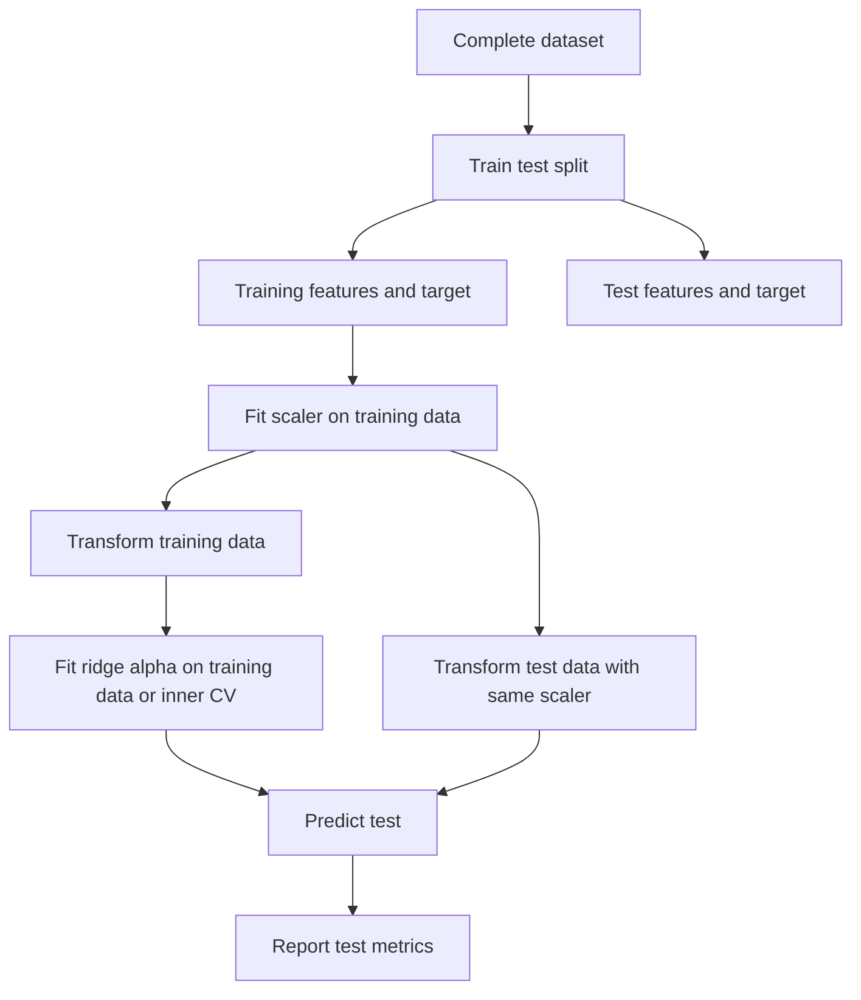
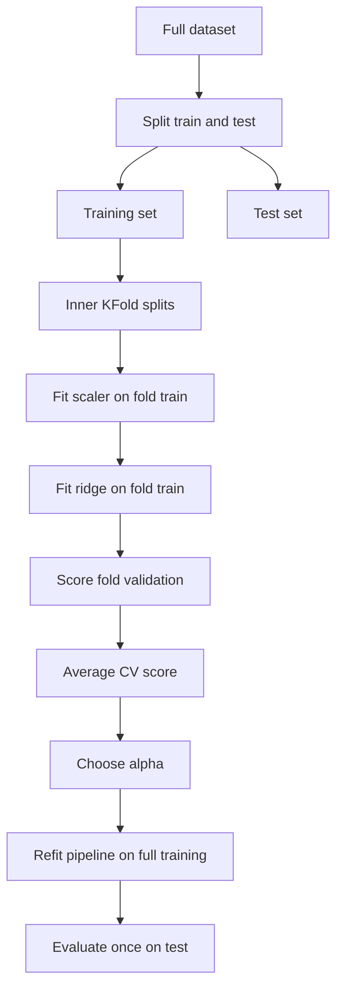

# Day 55 — Ridge Regression: Regularized Linear Models

> **Course:** CampusX — 100 Days of Machine Learning, Day 55
> **Official folder:** `vendor/100-days-of-machine-learning/day55-regularized-linear-models/`
> **Reference copies:** `Day_55/reference_notebooks/` contains all five official notebooks, byte-identical to the vendor copies.
> **Dataset:** No local dataset is required. The notebooks use scikit-learn's built-in diabetes dataset and `make_regression`.
> **Dependencies:** `numpy`, `pandas`, `matplotlib`, `scikit-learn`, `jupyter`; `mlxtend` is required only by the bias-variance cell of `ridge-regression-key-understandings.ipynb`.
> **Central question:** When ordinary least squares produces unstable, oversized coefficients — especially with correlated features — how does adding an L2 penalty change the estimate, why does it improve generalization, and how do we choose and validate the penalty strength without fooling ourselves?

Ridge regression is a small change to the linear regression objective with large consequences. The change is one added term, $\alpha\lVert\beta\rVert_2^2$. That term turns a possibly singular normal-equation system into an invertible one, shrinks coefficients toward zero, introduces bias, reduces variance, and creates a tuning problem: the value of $\alpha$ must be selected from data without contaminating the test set.

This chapter treats ridge regression as a complete idea rather than a single formula. It starts from the failure modes of OLS, derives the ridge estimator, explains the geometry and the bias-variance trade-off, walks through all five official notebooks cell by cell, and ends with interview and examination practice. Every number taken from a saved notebook output is marked **Official**. Numbers reproduced in this environment are marked **Rerun**. Explanations and experiments added for teaching are marked **Supplementary**.

**Source labels used below**

- **Official** — the saved output in the CampusX notebook. It may have been produced with an older scikit-learn version.
- **Rerun** — reproduced in this environment with Python 3.14.2, NumPy 2.5.3, pandas 3.0.5, and scikit-learn 1.9.1.
- **Supplementary** — an explanation, derivation, or experiment added in this chapter; it is not presented as original course output.

Small numerical differences between Official and Rerun outputs are normal. They come from changes in LAPACK, solver defaults, random shuffling in SGD, and floating-point round-off. The conceptual conclusions do not depend on those last digits.

---

# 1. Learning objectives

After studying this chapter I should be able to:

1. **Explain the failure mode.** Describe why OLS becomes unstable when features are correlated or when the number of features is large relative to the number of observations, and connect that instability to the eigenvalues of $X^TX$.
2. **Write the objective.** State the ridge objective in its uncentered, centered, augmented-matrix, constrained, and Bayesian forms, and explain how the meaning of $\alpha$ changes with each convention.
3. **Derive the estimator.** Derive $(X^TX+\alpha I)^{-1}X^Ty$ from the objective, state every matrix dimension, and derive the centered form with an unpenalized intercept.
4. **Explain the intercept rule.** Explain why the intercept is usually not penalized, using translation invariance and a worked augmented-matrix example.
5. **Analyse conditioning.** Use the eigendecomposition or SVD to show which coefficient directions shrink most, how the condition number changes, and what effective degrees of freedom mean.
6. **Explain bias and variance.** Derive the ridge bias and covariance, and use scalar and two-eigenvalue examples to show why a biased estimator can have a lower mean squared error.
7. **Implement from scratch.** Implement ridge in closed form and by gradient descent, explain every line, and diagnose the numerical and convergence problems that appear.
8. **Use scikit-learn correctly.** Explain `Ridge`, `RidgeCV`, and `SGDRegressor`; distinguish `alpha` from a learning rate; interpret `coef_`, `intercept_`, and solver choices; and compare their objective scales.
9. **Tune and validate.** Select $\alpha$ with cross-validation inside a pipeline, explain leakage-safe design, and distinguish model-selection estimates from final test estimates.
10. **Interpret coefficient paths.** Read the bar charts, coefficient-path plot, bias-variance plot, and penalized-loss plot in the notebooks, including their limitations and source-fidelity problems.
11. **Compare regularizers.** Compare ridge with OLS, lasso, elastic net, principal-components regression, and subset selection, and choose among them with reasons.
12. **Answer interview and exam questions.** Explain the mathematics, perform the calculations, and discuss assumptions, limitations, and practical trade-offs.

---

# 2. Where ridge sits in the machine-learning workflow

Ridge is a **model**, not a preprocessing step. It belongs after the data split and inside the model-fitting stage:


The important execution order is:



Two rules follow from this diagram:

1. **The scaler is fitted on training data only.** Ridge is scale-sensitive, so scaling is part of the model. If the scaler sees the test set, the test set has influenced training.
2. **$\alpha$ is selected without the test set.** Use a validation split or cross-validation on the training set. The test set is touched once, after the model and $\alpha$ are fixed.

**Connection to earlier topics.**

- **Day 48 (simple linear regression)** introduced the least-squares slope and intercept. Ridge modifies the slope by adding $\alpha$ to the denominator.
- **Day 49 (regression metrics)** introduced $R^2$, MSE, and RMSE. Those metrics are used throughout this chapter.
- **Day 50 (multiple linear regression)** introduced the matrix form and the normal equations. Ridge modifies the normal equations by adding $\alpha I$.
- **Day 51–52 (gradient descent)** introduced iterative optimization. Ridge can be solved by gradient descent, but for small and medium problems the closed form is usually better.
- **Day 53 (polynomial regression)** showed how flexible models can overfit. Ridge is one way to control that flexibility without reducing the polynomial degree.
- **Day 54 is absent from the official repository.** Day 55 begins the regularized-linear-model sequence; Day 56 covers lasso and Day 57 covers elastic net.

---

# 3. Prerequisites, explained rather than listed

## 3.1 The linear model

A linear regression model assumes

$$
y_i = \beta_0 + \beta_1 x_{i1} + \beta_2 x_{i2} + \cdots + \beta_p x_{ip} + \varepsilon_i,
$$

where:

- $y_i$ is the target for observation $i$;
- $x_{ij}$ is the value of feature $j$ for observation $i$;
- $\beta_0$ is the intercept;
- $\beta_j$ for $j=1,\dots,p$ are the slope coefficients;
- $\varepsilon_i$ is the error term, the part of $y_i$ the linear model does not explain.

In matrix form, for $n$ observations and $p$ features,

$$
y = X\beta + \varepsilon,
$$

with

$$
X\in\mathbb{R}^{n\times p},\qquad
y\in\mathbb{R}^{n},\qquad
\beta\in\mathbb{R}^{p},\qquad
\varepsilon\in\mathbb{R}^{n}.
$$

If the intercept is written as a column of ones, define

$$
\tilde X=\begin{pmatrix}1 & x_{11} & \cdots & x_{1p}\\ 1 & x_{21} & \cdots & x_{2p}\\ \vdots & \vdots & \ddots & \vdots\\ 1 & x_{n1} & \cdots & x_{np}\end{pmatrix}\in\mathbb{R}^{n\times(p+1)},
\qquad
\tilde\beta=\begin{pmatrix}\beta_0\\ \beta_1\\ \vdots\\ \beta_p\end{pmatrix}\in\mathbb{R}^{p+1}.
$$

Then $y=\tilde X\tilde\beta+\varepsilon$. The distinction between $X$ and $\tilde X$ matters in ridge regression because the intercept is treated differently from the slopes.

## 3.2 Ordinary least squares

OLS chooses the coefficient vector that minimizes the sum of squared residuals:

$$
\hat\beta_{OLS}=\arg\min_{\beta}\lVert y-X\beta\rVert_2^2.
$$

Expanding,

$$
\lVert y-X\beta\rVert_2^2=(y-X\beta)^T(y-X\beta)=y^Ty-2\beta^TX^Ty+\beta^TX^TX\beta.
$$

Differentiating with respect to $\beta$ and setting the gradient to zero gives the normal equations:

$$
X^TX\hat\beta=X^Ty.
$$

If $X^TX$ is invertible,

$$
\hat\beta_{OLS}=(X^TX)^{-1}X^Ty.
$$

The fitted values are

$$
\hat y=X\hat\beta_{OLS}=X(X^TX)^{-1}X^Ty=Hy,
$$

where $H=X(X^TX)^{-1}X^T$ is the hat matrix. The residuals are $e=y-\hat y=(I-H)y$.

**What OLS optimizes.** OLS is a purely in-sample criterion: it rewards fitting the training data and says nothing explicitly about coefficients being small or stable. That is why it can produce enormous coefficients when the design is ill-conditioned.

## 3.3 Why $X^TX$ can fail to be invertible

$X^TX$ is a $p\times p$ symmetric positive semidefinite matrix. It is invertible exactly when $X$ has full column rank $p$. There are two common ways full rank fails:

1. **Exact collinearity.** One feature is an exact linear combination of others. For example, $x_3=x_1+x_2$. Then the columns of $X$ are linearly dependent, so $X^TX$ is singular.
2. **More features than observations.** If $p>n$, the rank of $X$ is at most $n$, so $X^TX$ cannot have rank $p$. It is singular.

Near-collinearity is almost as bad. $X^TX$ is invertible in exact arithmetic, but its smallest eigenvalue is tiny, so its inverse has enormous entries. The OLS coefficients then have enormous variance and can change dramatically when a single observation is added, removed, or slightly perturbed.

## 3.4 Eigenvalues, eigenvectors, and condition number

For a symmetric matrix $A$, an eigenvector $v$ and eigenvalue $\lambda$ satisfy

$$
Av=\lambda v.
$$

For $A=X^TX$, the eigenvalues are non-negative. Write the eigendecomposition as

$$
X^TX=V\Lambda V^T,
$$

where $V$ is orthogonal, $V^TV=I$, and $\Lambda=\operatorname{diag}(\lambda_1,\dots,\lambda_p)$ with

$$
\lambda_1\ge\lambda_2\ge\cdots\ge\lambda_p\ge0.
$$

The **condition number** of $X^TX$ is

$$
\kappa(X^TX)=\frac{\lambda_{\max}}{\lambda_{\min}}=\frac{\lambda_1}{\lambda_p}.
$$

A large condition number means the solution of a linear system is sensitive to small perturbations. For the OLS estimator,

$$
\operatorname{Var}(\hat\beta_{OLS})=\sigma^2(X^TX)^{-1},
$$

so the variance along the eigenvector with eigenvalue $\lambda_j$ is $\sigma^2/\lambda_j$. If $\lambda_j$ is tiny, that direction has huge variance. Ridge regression is designed to fix exactly this problem.

## 3.5 Bias, variance, and mean squared error

For an estimator $\hat\theta$ of a parameter $\theta$:

$$
\operatorname{Bias}(\hat\theta)=\mathbb{E}[\hat\theta]-\theta,
\qquad
\operatorname{Var}(\hat\theta)=\mathbb{E}\left[(\hat\theta-\mathbb{E}[\hat\theta])^2\right].
$$

The mean squared error decomposes as

$$
\operatorname{MSE}(\hat\theta)=\operatorname{Bias}(\hat\theta)^2+\operatorname{Var}(\hat\theta).
$$

OLS is unbiased under the standard linear-model assumptions, so its MSE is entirely variance. Ridge is biased, but it can have a smaller variance. The total MSE can therefore be lower. This is the central trade-off of regularization.

## 3.6 Regression metrics

For test observations $(x_i,y_i)$, predictions $\hat y_i$, and $n_{\text{test}}$ test points:

$$
\text{MSE}=\frac{1}{n_{\text{test}}}\sum_{i=1}^{n_{\text{test}}}(y_i-\hat y_i)^2,
\qquad
\text{RMSE}=\sqrt{\text{MSE}}.
$$

$$
R^2=1-\frac{\sum_{i=1}^{n_{\text{test}}}(y_i-\hat y_i)^2}{\sum_{i=1}^{n_{\text{test}}}(y_i-\bar y_{\text{test}})^2}.
$$

$R^2$ compares the model's squared error with the squared error of predicting the test-set mean. It can be negative on test data: a model can be worse than the mean predictor. That is exactly what happens in the first notebook when $\alpha=100000$.

## 3.7 Multicollinearity and variance inflation

Multicollinearity means that two or more features carry overlapping information. A standard diagnostic is the **variance inflation factor**:

$$
\text{VIF}_j=\frac{1}{1-R_j^2},
$$

where $R_j^2$ is the coefficient of determination from regressing feature $x_j$ on all other features. If $x_j$ is almost a linear combination of the other features, $R_j^2$ is close to 1 and $\text{VIF}_j$ is large.

For the diabetes training split used in the notebooks, the VIFs are:

| Feature | VIF |
|---|---:|
| age | 1.24 |
| sex | 1.27 |
| bmi | 1.51 |
| bp | 1.51 |
| s1 | 58.71 |
| s2 | 40.09 |
| s3 | 14.73 |
| s4 | 9.01 |
| s5 | 10.40 |
| s6 | 1.49 |

The largest off-diagonal absolute correlation is about $0.890$ (between s1 and s2). These are not catastrophic values, but they are enough to make individual OLS coefficients unstable. Ridge does not remove the correlation; it stabilizes the coefficient vector.

---

# 4. The problem: when OLS produces explosive coefficients

## 4.1 A small near-collinear example

Consider ten observations with

$$
x_1=(1,2,3,4,5,6,7,8,9,10),
$$

and a second feature that is almost identical:

$$
x_2=(1.00000,\ 2.00015,\ 2.99986,\ 3.99955,\ 4.99977,\ 5.99950,\ 7.00003,\ 8.00067,\ 8.99975,\ 9.99969).
$$

The correlation between $x_1$ and $x_2$ is $0.9999999937$. Suppose the target is generated as

$$
y=10+2x_1+\text{small noise}.
$$

Because $x_2\approx x_1$, the model can fit the data almost equally well with many different pairs $(\beta_1,\beta_2)$ as long as $\beta_1+\beta_2\approx2$. OLS picks the pair that minimizes the residual for this particular sample, and that pair can be extreme.

The fitted models are:

| Method | Intercept | $\beta_1$ | $\beta_2$ | Prediction RMSE |
|---|---:|---:|---:|---:|
| OLS ($\alpha=0$) | 10.0378 | $-5.7482$ | $7.7375$ | 0.0292 |
| Ridge, $\alpha=0.001$ | 10.0372 | 0.9912 | 0.9982 | 0.0294 |
| Ridge, $\alpha=0.01$ | 10.0378 | 0.9943 | 0.9950 | 0.0294 |
| Ridge, $\alpha=0.1$ | 10.0438 | 0.9940 | 0.9941 | 0.0296 |
| Ridge, $\alpha=1$ | 10.1031 | 0.9887 | 0.9887 | 0.0453 |

OLS uses large opposite-signed coefficients, $-5.75$ and $+7.74$, whose sum is about $1.99$. The predictions are accurate, but the individual coefficients are meaningless as statements about either feature. A tiny ridge penalty with $\alpha=0.001$ collapses the coefficients to approximately $1$ and $1$, with essentially the same predictions. The condition number of the centered $X^TX$ is about $3.17\times10^8$; with $\alpha=0.001$ it drops to about $1.65\times10^5$, and with $\alpha=1$ to about $166$.

This is the first key lesson:

> **Coefficient stability and prediction accuracy are different goals. Ridge improves the former, sometimes at a negligible cost to the latter.**

A second lesson is equally important: the ridge solution is not necessarily closer to the "true" coefficients in a causal sense. In this example the true model used only $x_1$, but ridge splits the effect between $x_1$ and $x_2$. Ridge stabilizes; it does not identify which feature is "responsible".

## 4.2 Why the variance explodes

For OLS,

$$
\operatorname{Var}(\hat\beta_{OLS})=\sigma^2(X^TX)^{-1}.
$$

In the eigenbasis of $X^TX$,

$$
X^TX=V\Lambda V^T,
\qquad
(X^TX)^{-1}=V\Lambda^{-1}V^T.
$$

The variance along eigenvector $v_j$ is $\sigma^2/\lambda_j$. When $\lambda_j$ is tiny, this variance is enormous. The estimator is still unbiased, but it is extremely noisy: a different sample would produce a very different coefficient vector.

This is not a computational bug. It is a property of the statistical problem. The data simply do not contain enough independent information to pin down all coefficients precisely.

## 4.3 Overfitting with flexible models

A second route to coefficient explosion is model flexibility. A degree-16 polynomial has 17 coefficients. With 100 observations, OLS can fit a very wiggly curve that passes near every training point. The coefficients can be large, and the curve can oscillate between observations. On new data, those oscillations are often wrong.

Ridge controls this by making large coefficients expensive. It does not reduce the degree of the polynomial; it changes the cost of using large coefficients. The result is a smoother fit, not a lower-dimensional model.

## 4.4 What ridge does not fix

Ridge is not a universal cure. It does not:

- correct a missing important feature;
- make a nonlinear relationship linear;
- remove the influence of outliers (squared error is still sensitive);
- make correlated coefficients interpretable;
- perform variable selection (L2 shrinkage does not set coefficients exactly to zero);
- eliminate the need for a validation split;
- guarantee that the selected model is causally correct.

It is a **variance-reduction** tool for linear models. Understanding that scope prevents overclaiming.

---

# 5. The ridge objective and its intuition

## 5.1 Definition

Ridge regression minimizes the penalized sum of squared errors:

$$
J(\beta_0,\beta)
=
\sum_{i=1}^{n}\left(y_i-\beta_0-\sum_{j=1}^{p}x_{ij}\beta_j\right)^2
+
\alpha\sum_{j=1}^{p}\beta_j^2,
\qquad \alpha\ge0.
$$

In matrix form with an intercept:

$$
J(\beta_0,\beta)
=
\lVert y-\beta_0\mathbf{1}-X\beta\rVert_2^2
+
\alpha\lVert\beta\rVert_2^2.
$$

The first term is the **data-fit term**. The second term is the **penalty**. The intercept $\beta_0$ is not inside the penalty.

The hyperparameter $\alpha$ controls the trade-off:

- $\alpha=0$: the penalty disappears, and ridge becomes OLS (if $X^TX$ is invertible).
- Small $\alpha$: a little shrinkage; coefficients remain close to OLS.
- Large $\alpha$: strong shrinkage; coefficients approach zero.
- $\alpha\to\infty$: all slopes approach zero; the model approaches the intercept-only model $\hat y=\bar y_{\text{train}}$.

The name "ridge" comes from the shape added to the least-squares surface. Adding $\alpha I$ to $X^TX$ adds a positive constant to every eigenvalue, creating a ridge along the diagonal of the quadratic form and making the minimum unique.

## 5.2 Equivalent forms and the meaning of alpha

Different books and libraries write the objective differently. Common forms are:

$$
\text{(A)}\quad \lVert y-X\beta\rVert_2^2+\alpha\lVert\beta\rVert_2^2,
$$

$$
\text{(B)}\quad \frac{1}{n}\lVert y-X\beta\rVert_2^2+\alpha\lVert\beta\rVert_2^2,
$$

$$
\text{(C)}\quad \frac{1}{2n}\lVert y-X\beta\rVert_2^2+\frac{\alpha}{2}\lVert\beta\rVert_2^2,
$$

$$
\text{(D)}\quad \lVert y-X\beta\rVert_2^2+\lambda\sum_{j=1}^{p}\beta_j^2.
$$

These are not numerically equivalent for the same symbol. Multiplying the whole objective by a positive constant does not change the minimizer, but changing where the constant is placed relative to $\alpha$ does. For example, doubling the data-fit term is equivalent to halving $\alpha$.

**scikit-learn's `Ridge`** minimizes

$$
\lVert y-X\beta-\beta_0\mathbf{1}\rVert_2^2+\alpha\lVert\beta\rVert_2^2,
$$

without dividing by $n$. **scikit-learn's `SGDRegressor`** minimizes an average loss of the form

$$
\frac{1}{n}\sum_{i=1}^{n}L(y_i,\hat y_i)+\alpha R(w),
$$

so its `alpha` is on a different scale from `Ridge`'s `alpha`. Do not compare the two numbers directly. This is one of the most common practical mistakes with regularized linear models.

## 5.3 Geometry: why L2 shrinks but does not select

Ridge can be written as a constrained problem:

$$
\min_{\beta}\lVert y-X\beta\rVert_2^2
\quad\text{subject to}\quad
\lVert\beta\rVert_2^2\le t.
$$

For each $\alpha>0$, there is a corresponding $t\ge0$ such that the two problems have the same solution (this is the Lagrangian duality of a convex problem). The constraint region is a **sphere** (a circle in two dimensions):

$$
\beta_1^2+\beta_2^2\le t.
$$

The OLS loss contours are ellipses centered at the OLS solution. The ridge solution is the point where an ellipse first touches the circle.

A circle has no corners. Therefore the touching point is generally not on an axis, so both coefficients are usually nonzero. This is why ridge does not perform variable selection.

Lasso substitutes the L1 penalty:

$$
\lVert y-X\beta\rVert_2^2+\alpha\sum_{j=1}^{p}\lvert\beta_j\rvert.
$$

Its constraint region $\sum_j\lvert\beta_j\rvert\le t$ is a diamond, which has corners on the axes. The loss ellipse often touches a corner, setting one or more coefficients exactly to zero. That is the geometric explanation of lasso's sparsity.

## 5.4 A Bayesian interpretation

Ridge also has a Bayesian interpretation. Suppose the likelihood is Gaussian:

$$
y\mid\beta\sim N(X\beta,\sigma^2I),
$$

and place independent Gaussian priors on the slopes:

$$
\beta_j\sim N(0,\tau^2),\qquad j=1,\dots,p.
$$

The log posterior (up to a constant) is

$$
-\frac{1}{2\sigma^2}\lVert y-X\beta\rVert_2^2
-\frac{1}{2\tau^2}\lVert\beta\rVert_2^2.
$$

Maximizing the posterior is equivalent to minimizing

$$
\lVert y-X\beta\rVert_2^2+\frac{\sigma^2}{\tau^2}\lVert\beta\rVert_2^2.
$$

So ridge is the **maximum a posteriori (MAP)** estimate under a Gaussian prior, with

$$
\alpha=\frac{\sigma^2}{\tau^2}.
$$

A strong prior (small $\tau^2$) means large $\alpha$ and strong shrinkage. A weak prior (large $\tau^2$) means small $\alpha$ and a solution close to OLS. The intercept is usually given a flat prior, which corresponds to not penalizing it.

This interpretation is useful because it explains why ridge is not "cheating": it encodes a belief that large coefficients are less plausible before seeing the data. It also connects to `BayesianRidge`, which estimates the regularization from the data instead of requiring a fixed $\alpha$.

## 5.5 What ridge promises

Ridge promises:

- a unique solution when $X^TX$ is singular;
- lower variance and often lower test MSE;
- more stable coefficients under collinearity;
- a smooth continuous path of coefficients as $\alpha$ changes;
- a principled way to control model complexity.

Ridge does not promise:

- unbiased coefficients;
- sparse coefficients;
- correct causal interpretation;
- automatic feature selection;
- robustness to outliers;
- the best model for every problem.

---

# 6. The mathematics of ridge regression

## 6.1 Notation and dimensions

Let

$$
X\in\mathbb{R}^{n\times p},\qquad
y\in\mathbb{R}^{n},\qquad
\beta\in\mathbb{R}^{p},\qquad
\alpha\ge0.
$$

For the no-intercept form:

$$
J(\beta)=\lVert y-X\beta\rVert_2^2+\alpha\lVert\beta\rVert_2^2.
$$

The dimensions are:

- $y-X\beta$: $n\times1$;
- $X^TX$: $p\times p$;
- $X^Ty$: $p\times1$;
- $I_p$: $p\times p$;
- $\beta$: $p\times1$;
- $\alpha I_p$: $p\times p$.

For the intercept form, let

$$
\tilde X=\begin{pmatrix}\mathbf{1} & X\end{pmatrix}\in\mathbb{R}^{n\times(p+1)},
\qquad
\tilde\beta=\begin{pmatrix}\beta_0\\ \beta\end{pmatrix}\in\mathbb{R}^{p+1}.
$$

The penalty matrix is

$$
D=\operatorname{diag}(0,1,1,\dots,1)\in\mathbb{R}^{(p+1)\times(p+1)}.
$$

Then

$$
J(\tilde\beta)=\lVert y-\tilde X\tilde\beta\rVert_2^2+\alpha\tilde\beta^TD\tilde\beta.
$$

The first diagonal entry of $D$ is zero, so $\beta_0$ is not penalized.

## 6.2 Derivation of the closed-form solution

Start with the no-intercept objective:

$$
J(\beta)=(y-X\beta)^T(y-X\beta)+\alpha\beta^T\beta.
$$

Expand:

$$
J(\beta)=y^Ty-2\beta^TX^Ty+\beta^TX^TX\beta+\alpha\beta^T\beta.
$$

Combine the quadratic terms:

$$
J(\beta)=y^Ty-2\beta^TX^Ty+\beta^T(X^TX+\alpha I)\beta.
$$

Differentiate with respect to $\beta$:

$$
\frac{\partial J}{\partial\beta}
=
-2X^Ty+2(X^TX+\alpha I)\beta.
$$

Set the gradient to zero:

$$
(X^TX+\alpha I)\beta=X^Ty.
$$

Because $X^TX$ is positive semidefinite and $\alpha>0$, the matrix $X^TX+\alpha I$ is positive definite, hence invertible. Therefore

$$
\boxed{\hat\beta_{\text{ridge}}(\alpha)=(X^TX+\alpha I)^{-1}X^Ty.}
$$

This is the closed-form ridge estimator. It is the solution of a modified normal-equation system.

**Why the solution is unique.** For any nonzero vector $v$,

$$
v^T(X^TX+\alpha I)v=\lVert Xv\rVert_2^2+\alpha\lVert v\rVert_2^2.
$$

If $\alpha>0$, this is strictly positive for every $v\neq0$, even when $Xv=0$. Therefore $X^TX+\alpha I$ is positive definite and invertible. This is the algebraic reason ridge works when OLS fails.

**Computational note.** In practice, solve

$$
(X^TX+\alpha I)\hat\beta=X^Ty
$$

with a linear solver rather than explicitly computing the inverse. `np.linalg.solve` is more numerically stable and usually faster than `np.linalg.inv` followed by matrix multiplication. The inverse is useful for explanation, not for production code.

## 6.3 Handling the intercept

There are two equivalent ways to handle an unpenalized intercept.

### Method 1: Center the data

Let

$$
\bar x=\frac{1}{n}\sum_{i=1}^{n}x_i\in\mathbb{R}^{p},
\qquad
\bar y=\frac{1}{n}\sum_{i=1}^{n}y_i.
$$

Define centered matrices:

$$
X_c=X-\mathbf{1}\bar x^T,
\qquad
y_c=y-\mathbf{1}\bar y.
$$

Fit ridge without an intercept on the centered data:

$$
\hat\beta_{\text{ridge}}=(X_c^TX_c+\alpha I)^{-1}X_c^Ty_c.
$$

Then recover the intercept:

$$
\hat\beta_0=\bar y-\bar x^T\hat\beta_{\text{ridge}}.
$$

This is what scikit-learn does internally when `fit_intercept=True` for the dense solvers: it centers $X$ and $y$, solves the ridge problem for the slopes, and computes the intercept from the means. Centering removes the need to penalize the intercept because the centered intercept is zero.

### Method 2: Augment the design matrix

Add a column of ones and use the penalty matrix $D$:

$$
\hat{\tilde\beta}
=
(\tilde X^T\tilde X+\alpha D)^{-1}\tilde X^Ty.
$$

The first component is $\hat\beta_0$; the remaining components are the slopes. This is the form used in the from-scratch notebook.

Both methods give the same answer when the penalty on the intercept is zero. The centered form is usually more efficient and better conditioned.

### Why the intercept is usually unpenalized

There are three complementary reasons.

1. **Translation invariance.** If you add a constant $c$ to every target value, the best predictions should also shift by $c$. The intercept should absorb that shift. If the intercept were penalized, adding a large constant to $y$ would force the intercept to fight the penalty, and the model would no longer be translation-equivariant. The fit would depend on the arbitrary zero point of the target scale.

2. **The intercept is not a slope.** The penalty is meant to control the complexity of the relationship between features and target. The intercept merely sets the baseline level. Shrinking it toward zero biases every prediction toward zero, which is rarely desirable unless the target is known to be centered at zero.

3. **Centering removes it.** Once $X$ and $y$ are centered, the intercept is zero in the centered problem, so there is nothing to penalize. The unpenalized intercept is recovered after fitting the slopes. This is algebraically clean.

**A worked example showing the difference.** Use the four-point data

$$
X=\begin{pmatrix}1&2\\2&1\\3&4\\4&3\end{pmatrix},
\qquad
y=\begin{pmatrix}3\\5\\7\\10\end{pmatrix}.
$$

Augment with an intercept:

$$
\tilde X=\begin{pmatrix}1&1&2\\1&2&1\\1&3&4\\1&4&3\end{pmatrix}.
$$

Then

$$
\tilde X^T\tilde X=
\begin{pmatrix}
4&10&10\\
10&30&28\\
10&28&30
\end{pmatrix},
\qquad
\tilde X^Ty=
\begin{pmatrix}
25\\74\\69
\end{pmatrix}.
$$

For $\alpha=1$, with $D=\operatorname{diag}(0,1,1)$:

$$
\tilde X^T\tilde X+\alpha D=
\begin{pmatrix}
4&10&10\\
10&31&28\\
10&28&31
\end{pmatrix}.
$$

Solving gives

$$
\hat{\tilde\beta}=
\begin{pmatrix}
1.2500\\
1.8333\\
0.1667
\end{pmatrix}.
$$

If instead we penalize all three coefficients with $D=I$, the solution is

$$
\hat{\tilde\beta}=
\begin{pmatrix}
0.4737\\
1.9649\\
0.2982
\end{pmatrix}.
$$

The intercept changes from $1.25$ to $0.47$, and the slopes change as well. Penalizing the intercept pulls it toward zero, which is an arbitrary choice when the target has mean $6.25$. The unpenalized intercept is the statistically sensible default.

## 6.4 SVD form and shrinkage factors

Let the thin singular-value decomposition of $X$ be

$$
X=U\Sigma V^T,
$$

where

$$
U\in\mathbb{R}^{n\times p},\qquad
\Sigma=\operatorname{diag}(\sigma_1,\dots,\sigma_p)\in\mathbb{R}^{p\times p},\qquad
V\in\mathbb{R}^{p\times p},
$$

with $\sigma_1\ge\cdots\ge\sigma_p\ge0$. Then

$$
X^TX=V\Sigma^2V^T,
\qquad
X^Ty=V\Sigma U^Ty.
$$

The ridge estimator becomes

$$
\hat\beta_{\text{ridge}}
=
V(\Sigma^2+\alpha I)^{-1}\Sigma U^Ty.
$$

Equivalently, in component form,

$$
\hat\beta_{\text{ridge}}
=
\sum_{j=1}^{p}v_j\frac{\sigma_j}{\sigma_j^2+\alpha}u_j^Ty.
$$

Compare with OLS:

$$
\hat\beta_{OLS}
=
\sum_{j=1}^{p}v_j\frac{1}{\sigma_j}u_j^Ty.
$$

The ridge component is the OLS component multiplied by

$$
\frac{\sigma_j^2}{\sigma_j^2+\alpha}
=
\frac{\lambda_j}{\lambda_j+\alpha},
\qquad \lambda_j=\sigma_j^2.
$$

This factor is the **shrinkage factor** for direction $j$. Its properties:

- It is always between 0 and 1.
- If $\lambda_j\gg\alpha$, the factor is close to 1: the direction is barely shrunk.
- If $\lambda_j\ll\alpha$, the factor is close to 0: the direction is heavily shrunk.
- If $\lambda_j=0$, the factor is 0: the component is set to zero.

This is the precise sense in which ridge shrinks **small-variance directions more**. Those are the directions in which the data provide little information, and those are exactly the directions where OLS is unstable.

The fitted values also have a clean form:

$$
\hat y
=
X\hat\beta_{\text{ridge}}
=
U\operatorname{diag}\left(\frac{\sigma_j^2}{\sigma_j^2+\alpha}\right)U^Ty.
$$

So ridge is a filtered version of the OLS projection: it dampens the components of $y$ that lie in low-variance directions.

## 6.5 Effect on eigenvalues and conditioning

The eigenvalues of $X^TX$ are $\lambda_j=\sigma_j^2$. Ridge replaces them with

$$
\lambda_j^{(\alpha)}=\lambda_j+\alpha.
$$

The condition number becomes

$$
\kappa_\alpha
=
\frac{\lambda_{\max}+\alpha}{\lambda_{\min}+\alpha}.
$$

For $\alpha>0$, the numerator and denominator are both shifted upward, and the ratio moves toward 1. In the limit,

$$
\lim_{\alpha\to\infty}\kappa_\alpha=1.
$$

At $\alpha=0$,

$$
\kappa_0=\frac{\lambda_{\max}}{\lambda_{\min}},
$$

which can be enormous.

For the diabetes data (full $442\times10$ matrix), the singular values are

$$
(2.0060,\ 1.2216,\ 1.0982,\ 0.9775,\ 0.8137,\ 0.7763,\ 0.7325,\ 0.6585,\ 0.2799,\ 0.0925),
$$

so the eigenvalues of $X^TX$ are

$$
(4.0242,\ 1.4923,\ 1.2060,\ 0.9555,\ 0.6622,\ 0.6027,\ 0.5366,\ 0.4337,\ 0.0783,\ 0.00856).
$$

The condition number is

$$
\kappa_0=\frac{4.0242}{0.00856}\approx470.08.
$$

With ridge:

| $\alpha$ | $\lambda_{\min}+\alpha$ | $\lambda_{\max}+\alpha$ | $\kappa_\alpha$ | Effective df |
|---:|---:|---:|---:|---:|
| 0 | 0.00856 | 4.0242 | 470.08 | 10.000 |
| 0.1 | 0.10856 | 4.1242 | 37.99 | 7.642 |
| 1 | 1.00856 | 5.0242 | 4.98 | 3.942 |
| 10 | 10.00856 | 14.0242 | 1.40 | 0.832 |
| 100 | 100.00856 | 104.0242 | 1.04 | 0.098 |

The smallest eigenvalue is lifted the most in relative terms. That is why ridge stabilizes the directions that OLS cannot estimate well.

**Effective degrees of freedom.** The hat matrix for ridge is

$$
H_\alpha=X(X^TX+\alpha I)^{-1}X^T.
$$

Its trace is the effective number of parameters:

$$
df(\alpha)=\operatorname{tr}(H_\alpha)
=
\sum_{j=1}^{p}\frac{\lambda_j}{\lambda_j+\alpha}.
$$

This is a continuous measure of model complexity. At $\alpha=0$, $df=p$ (for full-rank $X$). As $\alpha\to\infty$, $df\to0$. Ridge keeps all $p$ coefficients nonzero, but the effective number of parameters can be much smaller than $p$.

## 6.6 Bias and variance of the ridge estimator

Assume the linear model $y=X\beta+\varepsilon$ with $\mathbb{E}[\varepsilon]=0$ and $\operatorname{Var}(\varepsilon)=\sigma^2I$. For the no-intercept ridge estimator,

$$
\hat\beta_\alpha=(X^TX+\alpha I)^{-1}X^Ty.
$$

Substitute $y=X\beta+\varepsilon$:

$$
\hat\beta_\alpha
=
(X^TX+\alpha I)^{-1}X^TX\beta
+
(X^TX+\alpha I)^{-1}X^T\varepsilon.
$$

The expectation is

$$
\mathbb{E}[\hat\beta_\alpha]
=
(X^TX+\alpha I)^{-1}X^TX\beta.
$$

Therefore the bias is

$$
\operatorname{Bias}(\hat\beta_\alpha)
=
\left[(X^TX+\alpha I)^{-1}X^TX-I\right]\beta.
$$

Use the identity

$$
(X^TX+\alpha I)^{-1}X^TX
=
I-\alpha(X^TX+\alpha I)^{-1}.
$$

So

$$
\operatorname{Bias}(\hat\beta_\alpha)
=
-\alpha(X^TX+\alpha I)^{-1}\beta.
$$

The covariance is

$$
\operatorname{Var}(\hat\beta_\alpha)
=
\sigma^2(X^TX+\alpha I)^{-1}X^TX(X^TX+\alpha I)^{-1}.
$$

In the eigenbasis, component $j$ has

$$
\operatorname{Bias}_j=-\frac{\alpha\beta_j}{\lambda_j+\alpha},
\qquad
\operatorname{Var}_j=\frac{\sigma^2\lambda_j}{(\lambda_j+\alpha)^2}.
$$

The mean squared error contribution is

$$
\operatorname{MSE}_j(\alpha)
=
\frac{\alpha^2\beta_j^2+\sigma^2\lambda_j}{(\lambda_j+\alpha)^2}.
$$

This formula is the mathematical heart of the bias-variance trade-off. At $\alpha=0$, the bias is zero and the variance is $\sigma^2/\lambda_j$. As $\alpha$ increases, the bias grows and the variance falls. The total can decrease before it increases again.

**Prediction form.** For a test point $x_0$,

$$
\hat y_0=x_0^T\hat\beta_\alpha.
$$

The prediction bias is

$$
\operatorname{Bias}(\hat y_0)
=
-\alpha x_0^T(X^TX+\alpha I)^{-1}\beta,
$$

and the prediction variance is

$$
\operatorname{Var}(\hat y_0)
=
\sigma^2x_0^T(X^TX+\alpha I)^{-1}X^TX(X^TX+\alpha I)^{-1}x_0.
$$

The same trade-off applies to predictions, which is what we ultimately care about.

## 6.7 A scalar example with an exact optimum

Consider a single orthonormal direction with design eigenvalue $\lambda=1$, true coefficient $\beta=10$, and noise variance $\sigma^2=9$. The OLS estimator has variance $9$ and bias $0$, so its MSE is $9$.

The ridge shrinkage factor is

$$
c(\alpha)=\frac{\lambda}{\lambda+\alpha}=\frac{1}{1+\alpha}.
$$

The ridge estimator is $c\hat\beta_{OLS}$. Its bias and variance are

$$
\operatorname{Bias}= (c-1)\beta,
\qquad
\operatorname{Var}=c^2\sigma^2/\lambda=c^2\cdot9.
$$

The MSE is

$$
\operatorname{MSE}(\alpha)
=
(1-c)^2\beta^2+c^2\sigma^2.
$$

| $\alpha$ | $c$ | Bias | Variance | MSE |
|---:|---:|---:|---:|---:|
| 0 | 1.0000 | 0.0000 | 9.0000 | 9.0000 |
| 0.05 | 0.9524 | $-0.4762$ | 8.1633 | 8.3900 |
| 0.1 | 0.9091 | $-0.9091$ | 7.4380 | 8.2645 |
| 0.2 | 0.8333 | $-1.6667$ | 6.2500 | 9.0278 |
| 0.5 | 0.6667 | $-3.3333$ | 4.0000 | 15.1111 |
| 1 | 0.5000 | $-5.0000$ | 2.2500 | 27.2500 |
| 2 | 0.3333 | $-6.6667$ | 1.0000 | 45.4444 |

The minimum is not at $\alpha=0$. Differentiate the MSE with respect to $c$:

$$
\frac{d}{dc}\left[(1-c)^2\beta^2+c^2\sigma^2\right]
=
-2\beta^2(1-c)+2\sigma^2c.
$$

Set to zero:

$$
c^*=\frac{\beta^2}{\beta^2+\sigma^2}.
$$

For $\beta=10$ and $\sigma^2=9$,

$$
c^*=\frac{100}{109}=0.91743.
$$

The corresponding $\alpha$ is

$$
\alpha^*
=
\lambda\frac{1-c^*}{c^*}
=
1\cdot\frac{0.08257}{0.91743}
=
0.0900.
$$

The minimum MSE is

$$
\frac{\beta^2\sigma^2}{\beta^2+\sigma^2}
=
\frac{900}{109}
=
8.2569.
$$

So a small amount of ridge reduces MSE from $9$ to about $8.26$, even though it introduces bias. This is the simplest possible demonstration that unbiasedness is not the same as optimality.

**A useful general result.** For a single component, the MSE-optimal $\alpha$ is

$$
\alpha^*=\frac{\sigma^2}{\beta^2},
$$

independent of $\lambda$. In practice $\beta$ and $\sigma^2$ are unknown, so $\alpha$ must be estimated by cross-validation. For multiple components, one $\alpha$ must balance several such ratios, and there is no simple closed-form optimum.

## 6.8 Differential shrinkage: a two-eigenvalue example

Consider a design with two orthogonal directions:

$$
\lambda_1=100,\qquad \lambda_2=1,
\qquad
\beta_1=10,\qquad \beta_2=1,\qquad \sigma^2=1.
$$

The OLS variances are $0.01$ and $1.00$. The second direction is much noisier. Ridge shrinkage factors are

$$
c_1=\frac{100}{100+\alpha},
\qquad
c_2=\frac{1}{1+\alpha}.
$$

| $\alpha$ | $c_1$ | $c_2$ | Bias$_1$ | Bias$_2$ | Var$_1$ | Var$_2$ | Total MSE |
|---:|---:|---:|---:|---:|---:|---:|---:|
| 0 | 1.0000 | 1.0000 | 0.0000 | 0.0000 | 0.0100 | 1.0000 | 1.0100 |
| 0.1 | 0.9990 | 0.9091 | $-0.0100$ | $-0.0909$ | 0.0100 | 0.8264 | 0.8448 |
| 1 | 0.9901 | 0.5000 | $-0.0990$ | $-0.5000$ | 0.0098 | 0.2500 | 0.5196 |
| 2 | 0.9804 | 0.3333 | $-0.1961$ | $-0.6667$ | 0.0096 | 0.1111 | 0.6036 |
| 5 | 0.9524 | 0.1667 | $-0.4762$ | $-0.8333$ | 0.0091 | 0.0278 | 0.9580 |
| 10 | 0.9091 | 0.0909 | $-0.9091$ | $-0.9091$ | 0.0083 | 0.0083 | 1.6694 |
| 100 | 0.5000 | 0.0099 | $-5.0000$ | $-0.9901$ | 0.0025 | 0.0001 | 25.9829 |

At $\alpha=1$, the second component is shrunk by half, while the first is barely touched. The total MSE falls from $1.01$ to $0.52$. At $\alpha=100$, both components are heavily biased, and the MSE explodes. Ridge is most useful when it can shrink the noisy directions without destroying the strong ones. That is precisely what the eigenvalue-dependent factor does.

## 6.9 The univariate ridge slope and intercept

For one feature, write the model as

$$
y_i=b+mx_i+\varepsilon_i.
$$

The ridge objective with an unpenalized intercept is

$$
J(b,m)=\sum_{i=1}^{n}(y_i-b-mx_i)^2+\alpha m^2.
$$

Differentiate with respect to $b$:

$$
\frac{\partial J}{\partial b}
=
-2\sum_{i=1}^{n}(y_i-b-mx_i)=0.
$$

So

$$
b=\bar y-m\bar x.
$$

Differentiate with respect to $m$:

$$
\frac{\partial J}{\partial m}
=
-2\sum_{i=1}^{n}x_i(y_i-b-mx_i)+2\alpha m=0.
$$

Substitute $b=\bar y-m\bar x$ and simplify. Let

$$
S_{xy}=\sum_{i=1}^{n}(x_i-\bar x)(y_i-\bar y),
\qquad
S_{xx}=\sum_{i=1}^{n}(x_i-\bar x)^2.
$$

Then

$$
m_{\text{ridge}}=\frac{S_{xy}}{S_{xx}+\alpha},
\qquad
b_{\text{ridge}}=\bar y-m_{\text{ridge}}\bar x.
$$

This is exactly the formula used in `ridge-regression-from-scratch-m-and-b.ipynb`. It is also exactly what scikit-learn computes for one feature with `fit_intercept=True`: center $x$ and $y$, fit the slope with the penalty, then recover the intercept from the means.

The denominator $S_{xx}+\alpha$ shows the shrinkage directly. As $\alpha$ increases, the slope shrinks toward zero. The intercept moves toward $\bar y$ to keep the line passing through the centroid $(\bar x,\bar y)$.

## 6.10 Gradient descent for ridge

For the no-intercept objective

$$
J(\beta)=\lVert y-X\beta\rVert_2^2+\alpha\lVert\beta\rVert_2^2,
$$

the gradient is

$$
\nabla J(\beta)=2(X^TX+\alpha I)\beta-2X^Ty.
$$

The gradient-descent update is

$$
\beta_{t+1}=\beta_t-\eta\nabla J(\beta_t),
$$

where $\eta>0$ is the learning rate. Substituting,

$$
\beta_{t+1}
=
\beta_t-\eta\left[2(X^TX+\alpha I)\beta_t-2X^Ty\right].
$$

The Hessian is

$$
\nabla^2J(\beta)=2(X^TX+\alpha I).
$$

For a quadratic objective, gradient descent converges for

$$
0<\eta<\frac{2}{L},
$$

where $L$ is the largest eigenvalue of the Hessian:

$$
L=2\lambda_{\max}(X^TX+\alpha I).
$$

So the stability condition is

$$
0<\eta<\frac{1}{\lambda_{\max}(X^TX+\alpha I)}.
$$

If the code uses the **half-gradient**

$$
g(\beta)=(X^TX+\alpha I)\beta-X^Ty,
$$

then it is minimizing

$$
\frac{1}{2}\lVert y-X\beta\rVert_2^2+\frac{\alpha}{2}\lVert\beta\rVert_2^2,
$$

which has the same minimizer but Hessian $X^TX+\alpha I$. In that case convergence requires

$$
0<\eta<\frac{2}{\lambda_{\max}(X^TX+\alpha I)}.
$$

The from-scratch gradient-descent notebook uses the half-gradient. With an intercept column, the largest eigenvalue of the augmented $X^TX+\alpha I$ is about $353$ for the diabetes training split, so the bound is about $2/353=0.00567$. The notebook uses $\eta=0.005$, which is just below the bound. A learning rate of $0.01$ diverges, which we confirmed by rerunning the code. This is not a coincidence; it is the quadratic convergence bound in action.

**Why the intercept changes the bound.** The feature columns of the diabetes data have unit L2 norm, so the largest eigenvalue of $X^TX$ alone is only about $3.2$. Adding a column of ones creates a direction with norm $\sqrt{n}\approx18.8$, so the augmented matrix has an eigenvalue near $n=353$. The intercept dominates the Hessian scale. Centering $y$ (and using a separately computed intercept) would remove this problem and allow a larger learning rate.

**Why closed form is usually preferred here.** For $p=10$, solving an $11\times11$ system is trivial. Gradient descent introduces a learning rate, an iteration count, and convergence diagnostics for no benefit. Gradient descent becomes attractive when $n$ and $p$ are large, when the matrix is sparse, or when data arrive in streams. `SGDRegressor` is the practical scikit-learn tool for those settings.

## 6.11 Standardization: why the penalty is scale-dependent

Suppose a feature is multiplied by a constant $c>0$:

$$
x'=cx.
$$

To keep the same fitted values, the coefficient must change to

$$
\beta'=\frac{\beta}{c}.
$$

The penalty in the new parameterization is

$$
\alpha(\beta')^2=\alpha\frac{\beta^2}{c^2}.
$$

So the effective penalty on the original coefficient is divided by $c^2$. A feature measured in millimeters (large $c$ relative to meters) has a small coefficient and is penalized less in its original units. A feature measured in kilometers (small $c$) has a large coefficient and is penalized more.

This means the ridge solution depends on the arbitrary units of the features. Standardization removes that dependence. The usual transformation is

$$
z_{ij}=\frac{x_{ij}-\hat\mu_j}{\hat\sigma_j},
$$

where $\hat\mu_j$ and $\hat\sigma_j$ are estimated from the training data. Then ridge is fitted on $Z$. The penalty is applied to coefficients measured in standard-deviation units, which are comparable across features.

**A concrete example.** Use the five-point data

$$
x=(1,2,3,4,5),\qquad y=(2,4,5,4,5).
$$

Then $\bar x=3$, $\bar y=4$, $S_{xy}=6$, $S_{xx}=10$. The OLS slope is $6/10=0.6$. For $\alpha=1$, the unscaled ridge slope is

$$
m=\frac{6}{10+1}=0.54545.
$$

Now replace $x$ by $x'=cx$ and fit ridge on $x'$ with the same $\alpha=1$. The fitted slope on $x'$ is

$$
m'=\frac{cS_{xy}}{c^2S_{xx}+1},
$$

and the implied slope in the original units is $cm'$:

| $c$ | $m'$ on scaled $x$ | Implied original slope $cm'$ |
|---:|---:|---:|
| 1 | 0.54545 | 0.54545 |
| 10 | 0.05994 | 0.59940 |
| 1000 | 0.000600 | 0.599999 |

As $c$ grows, the penalty becomes negligible in the original units, and ridge approaches OLS. The fitted function changes with the unit of measurement. Standardization prevents this.

**What standardization does not fix.** It does not remove correlation between features, it does not make the model nonlinear, and it does not choose $\alpha$. It only makes the penalty comparable across features.

**When not to standardize.** If all features are already on a common, meaningful scale (for example, the diabetes features are each scaled to unit L2 norm), additional standardization may not be necessary. Binary indicators are sometimes left unscaled because scaling changes the interpretation of their coefficients. The safe default for ridge is to standardize continuous features and to validate the choice.

## 6.12 Constrained form and Lagrangian duality

The ridge problem

$$
\min_{\beta}\lVert y-X\beta\rVert_2^2+\alpha\lVert\beta\rVert_2^2
$$

is equivalent, for a suitable $t\ge0$, to

$$
\min_{\beta}\lVert y-X\beta\rVert_2^2
\quad\text{subject to}\quad
\lVert\beta\rVert_2^2\le t.
$$

The Lagrangian is

$$
\mathcal{L}(\beta,\alpha)
=
\lVert y-X\beta\rVert_2^2+\alpha(\lVert\beta\rVert_2^2-t).
$$

For a convex problem with a convex constraint, the Karush-Kuhn-Tucker conditions guarantee that for each $\alpha\ge0$ there is a $t$ such that the solutions coincide, and the mapping is monotone: larger $\alpha$ corresponds to smaller $t$. The exact relationship between $\alpha$ and $t$ depends on the design and the target, so it is usually found numerically rather than by a closed formula.

This view is useful for understanding the **regularization path**: as $t$ decreases from the OLS coefficient norm to zero, the ridge solution traces a continuous path from OLS to the zero vector. The path is smooth because the L2 constraint is smooth. The lasso path is piecewise linear and can hit corners, which is why coefficients become exactly zero.

## 6.13 Why ridge is not rotation-invariant

The L2 penalty is invariant under orthogonal transformations of the **coefficient vector**, but ridge is not invariant under arbitrary rotations of the **feature space** when the penalty is applied to the original coefficients. If $X$ is replaced by $XQ$ for an orthogonal $Q$, the OLS fitted values are unchanged, but the ridge penalty on the rotated coefficients is generally different. Ridge depends on the parameterization. This is another reason standardization matters: it fixes a canonical parameterization before the penalty is applied.

## 6.14 Numerical solvers and complexity

The closed-form solution requires:

- forming $X^TX$: $O(np^2)$ operations;
- solving the $p\times p$ system: $O(p^3)$ operations;
- memory: $O(p^2)$ for the matrix.

For $p$ in the hundreds or low thousands, this is usually fine. For very large $p$, use iterative or stochastic solvers.

Common scikit-learn solvers for `Ridge`:

| Solver | Method | When it is useful |
|---|---|---|
| `auto` | Chooses based on data | Default |
| `svd` | Singular-value decomposition | Stable, handles rank deficiency, good for dense data |
| `cholesky` | Cholesky factorization | Fast for positive-definite dense systems |
| `lsqr` | Least-squares QR / iterative | Large sparse problems |
| `sparse_cg` | Conjugate gradient | Large sparse problems |
| `sag` | Stochastic average gradient | Large n, dense |
| `saga` | SAG variant | Large n, supports elastic net in other estimators |
| `lbfgs` | Limited-memory BFGS | Bound-constrained problems, `positive=True` |

The `svd` solver is often the most numerically robust. `cholesky` is fast when the matrix is well conditioned. `sparse_cg` and `lsqr` avoid forming the full normal equations. `sag` and `saga` are stochastic and benefit from scaling.

---

# 7. Notebook 1 — `Ridge Regularization.ipynb`

This is the applied introduction. It fits OLS and ridge on the diabetes data, compares their test metrics, and then uses a polynomial example to show how ridge smooths a flexible fit.

## 7.1 What the notebook does, cell by cell

The notebook has 18 code cells:

| Cell(s) | Content |
|---:|---|
| 1 | Imports `numpy`, `pandas`, `matplotlib.pyplot` |
| 2 | Loads `load_diabetes()` |
| 3 | Prints the dataset description |
| 4 | Extracts `X=data.data`, `y=data.target` |
| 5 | Splits with `test_size=0.2`, `random_state=45` |
| 6–8 | Fits `LinearRegression`, prints coefficients and intercept |
| 9–10 | Predicts on the test set, prints $R^2$ and RMSE |
| 11–13 | Fits `Ridge(alpha=100000)`, prints coefficients and intercept |
| 14–15 | Predicts on the test set, prints $R^2$ and RMSE |
| 16 | Creates a synthetic parabolic dataset `x1`, `x2` |
| 17 | Fits degree-16 polynomial ridge for $\alpha=0,20,200$ and plots |
| 18 | Empty |

## 7.2 The diabetes data

`load_diabetes()` returns 442 rows and 10 features:

- `age`, `sex`, `bmi`, `bp`;
- six blood-serum measurements `s1` through `s6`.

The target is a quantitative measure of disease progression one year after baseline. The dataset description states that each feature has been mean-centered and scaled so that the sum of squares of each column is 1:

$$
\sum_{i=1}^{442}x_{ij}^2=1,\qquad j=1,\dots,10.
$$

This is important. It means the columns already have equal L2 norm, so the ridge penalty treats them fairly even without an additional `StandardScaler`. It does **not** mean each column has unit variance. The standard deviation of each column is

$$
\sqrt{\frac{1}{442}}\approx0.047565,
$$

because the sum of squares is 1 and the mean is 0. A `StandardScaler` would divide each column by about $0.0476$, changing the effective penalty strength by a factor of about $442$. If you add a scaler to this dataset, you must retune $\alpha$.

The target has mean about $152.13$, standard deviation about $77.01$, minimum $25$, and maximum $346$. It is not centered at zero. That is why the intercept matters and why an intercept-only model predicts about $152$.

## 7.3 The train/test split

```python
from sklearn.model_selection import train_test_split

X_train, X_test, y_train, y_test = train_test_split(
    X, y, test_size=0.2, random_state=45
)
```

With 442 rows and `test_size=0.2`:

- training set: 353 rows;
- test set: 89 rows.

`random_state=45` makes the split reproducible. The training target mean is

$$
\bar y_{\text{train}}=151.8328612,
$$

and the test target mean is

$$
\bar y_{\text{test}}=153.3258427.
$$

The two means differ by about $1.49$. This is normal sampling variation, but it matters when interpreting the intercept-only baseline.

## 7.4 OLS on the training set

```python
from sklearn.linear_model import LinearRegression

L = LinearRegression()
L.fit(X_train, y_train)
print(L.coef_)
print(L.intercept_)
```

**Official output:**

```text
[  23.45388514 -247.43107084  492.10188174  329.36498638 -970.79784704
  573.54460121  182.41386124  255.9162021   794.21654496   89.32074078]
152.13619339070766
```

**Rerun output in this environment:**

```text
[  23.45465406 -247.42747406  492.1087518   329.35876431 -970.79723039
  573.54295519  182.42162368  255.92168168  794.21609282   89.32249214]
152.13623331746496
```

The coefficients differ in the fourth or fifth decimal place. That is normal across LAPACK and scikit-learn versions. The qualitative pattern is identical: `s1` is about $-970$, `s5` is about $794$, `s2` is about $574$, and `bmi` is about $492$. These are large numbers even though the features have unit norm. Large coefficients are a warning sign, not automatically an error, but they indicate that the model is using strongly offsetting effects.

The test metrics are:

| Metric | Official | Rerun |
|---|---:|---:|
| $R^2$ | 0.5188118914964637 | 0.5188113124539249 |
| RMSE | 48.72710829141399 | 48.72713760953253 |

An $R^2$ of about $0.519$ means the model explains about 51.9% of the test-set variance relative to the test mean. The RMSE of about $48.73$ is in the units of the target (disease progression), not a percentage.

## 7.5 Ridge with an extreme alpha

```python
from sklearn.linear_model import Ridge

R = Ridge(alpha=100000)
R.fit(X_train, y_train)
print(R.coef_)
print(R.intercept_)
```

**Official output:**

```text
[ 0.00260126  0.00057066  0.00776597  0.00609765  0.00233864  0.00184724
 -0.00513942  0.0052716   0.00734601  0.00528629]
151.8328793076644
```

**Test metrics:**

| Metric | Official | Rerun |
|---|---:|---:|
| $R^2$ | $-0.0004249020401270176$ | $-0.00042490200441935855$ |
| RMSE | 70.25956273043168 | 70.25956272917782 |

The coefficient vector has been shrunk by a factor of roughly $10^5$. The largest absolute coefficient is about $0.00777$, compared with $970.80$ for OLS. The intercept is $151.8329$, which is almost exactly the training target mean $151.8328612$. The model has essentially become the intercept-only model:

$$
\hat y \approx \bar y_{\text{train}}.
$$

That is why $R^2$ is approximately zero and RMSE is approximately the standard deviation of the test target:

$$
\operatorname{std}(y_{\text{test}})=70.2446,
\qquad
\text{RMSE}=70.2596.
$$

The tiny difference comes from the small nonzero slopes and the difference between the training mean and the test mean. A negative $R^2$ of $-0.000425$ means the model is very slightly worse than predicting the test mean, which is expected when the training mean and test mean differ.

**What this example teaches.** The extreme alpha is a demonstration, not a recommendation. It shows the limiting behavior:

$$
\alpha\to\infty
\quad\Longrightarrow\quad
\hat\beta\to0,
\qquad
\hat y\to\bar y_{\text{train}}.
$$

It also shows that the intercept is not penalized. If the intercept were penalized, it would shrink toward zero along with the slopes, and the predictions would collapse toward zero, producing a huge negative $R^2$. The notebook's intercept stays near $151.83$, which is the correct baseline.

**Objection to address.** A beginner might say: "Ridge made the model worse; therefore ridge is bad." That conclusion is wrong. The comparison uses an absurdly large alpha chosen to illustrate complete shrinkage. A well-tuned alpha would be much smaller and would typically improve test performance. The next notebooks show the path and the trade-off.

## 7.6 The polynomial experiment

Cells 16–17 create a synthetic one-dimensional regression problem:

```python
m = 100
x1 = 5 * np.random.rand(m, 1) - 2
x2 = 0.7 * x1 ** 2 - 2 * x1 + 3 + np.random.randn(m, 1)

plt.scatter(x1, x2)
plt.show()
```

The true mean function is quadratic:

$$
f(x)=0.7x^2-2x+3.
$$

The observed target adds standard normal noise. The scatter shows a parabolic cloud with substantial vertical spread.

Then:

```python
from sklearn.pipeline import Pipeline
from sklearn.preprocessing import PolynomialFeatures

def get_preds_ridge(x1, x2, alpha):
    model = Pipeline([
        ('poly_feats', PolynomialFeatures(degree=16)),
        ('ridge', Ridge(alpha=alpha))
    ])
    model.fit(x1, x2)
    return model.predict(x1)

alphas = [0, 20, 200]
cs = ['r', 'g', 'b']

plt.figure(figsize=(10, 6))
plt.plot(x1, x2, 'b+', label='Datapoints')

for alpha, c in zip(alphas, cs):
    preds = get_preds_ridge(x1, x2, alpha)
    plt.plot(sorted(x1[:, 0]), preds[np.argsort(x1[:, 0])], c,
             label='Alpha: {}'.format(alpha))

plt.legend()
plt.show()
```

**Syntax and execution.**

- `PolynomialFeatures(degree=16)` creates all monomials of degree at most 16 in the single input feature. The output has 17 columns: $1,x,x^2,\dots,x^{16}$.
- `Ridge(alpha=alpha)` fits a linear model on those 17 columns. A linear model in the polynomial features is a nonlinear curve in the original $x$.
- `Pipeline` chains the two steps. `model.fit(x1, x2)` first fits the polynomial expansion on `x1`, transforms `x1`, then fits ridge on the transformed matrix and `x2`.
- `model.predict(x1)` transforms `x1` using the already-fitted polynomial expansion, then applies the fitted ridge coefficients.
- `np.argsort(x1[:, 0])` sorts the x-values so the line is drawn left to right. Without sorting, the line would connect points in their original random order. For a straight line this would still look like a line, but for a wiggly polynomial it would produce a zigzag.
- `alpha=0` is OLS on the 17 polynomial features.
- `alpha=20` and `alpha=200` add increasing L2 penalties.

**What the graph shows.**

- The blue plus signs are the noisy observations.
- The red curve ($\alpha=0$) passes close to many points and oscillates strongly, especially near the edges. It is an in-sample interpolation of a degree-16 polynomial.
- The green curve ($\alpha=20$) is smoother but still wiggly in places.
- The blue curve ($\alpha=200$) is smoother still, but it is not a straight line and it still bends near the edges.

The expected qualitative behavior is: as alpha increases, the curve becomes smoother, training error increases, and the coefficients shrink.

A supplementary rerun with a fixed seed (`np.random.seed(42)`) gives:

| $\alpha$ | Training MSE | Coefficient norm | Intercept |
|---:|---:|---:|---:|
| 0 | 0.7165 | 5.8177 | 2.7165 |
| 20 | 0.9126 | 1.0703 | 3.0041 |
| 200 | 1.4871 | 0.3702 | 3.1915 |

These numbers are **Supplementary** because the notebook does not set a seed; the exact values change on every run. The pattern is stable: larger alpha increases training error and shrinks the coefficient norm.

**Why alpha=200 still leaves wiggles.** The polynomial features are raw powers of $x$. Their scales are wildly different: $x$ ranges from about $-2$ to $3$, so $x^{16}$ ranges up to about $4.3\times10^7$. The design matrix is extremely ill-conditioned. A supplementary calculation gives a condition number of about $1.05\times10^9$ for the raw degree-16 features (without the bias column). Standardizing the polynomial features reduces it to about $3.5\times10^6$, still large but much better. Because the penalty is applied to raw coefficients of wildly different scales, a single alpha does not smooth all terms equally. Standardizing polynomial features before ridge is a good practice.

**What the graph cannot tell us.** It is an in-sample fit. The model is fitted on all 100 points and evaluated on the same 100 points. A smoother curve is not automatically better on new data. To choose alpha, we need a validation set or cross-validation. The notebook does not do that here. It illustrates the mechanism, not a validated model choice.

**A subtle point about `Pipeline`.** The pipeline is used correctly for fitting and prediction, but there is no train/test split. The pipeline does not prevent overfitting by itself; it only ensures that the same transformations are applied consistently. Regularization and validation are separate concerns.

## 7.7 What Notebook 1 establishes

1. OLS on the diabetes data produces large, offsetting coefficients.
2. An extreme ridge alpha shrinks them essentially to zero.
3. The intercept stays near the target mean, confirming that it is not penalized.
4. A large alpha can destroy predictive performance; alpha must be tuned.
5. Ridge can smooth a flexible polynomial fit, but the demonstration is in-sample.

---

# 8. Notebook 2 — `ridge-regression-from-scratch.ipynb`

This notebook verifies the closed-form ridge estimator against scikit-learn. It is short and precise: 12 cells, one class, one comparison.

## 8.1 The code

```python
from sklearn.datasets import load_diabetes
from sklearn.metrics import r2_score
import numpy as np

X, y = load_diabetes(return_X_y=True)

from sklearn.model_selection import train_test_split

X_train, X_test, y_train, y_test = train_test_split(
    X, y, test_size=0.2, random_state=4
)

from sklearn.linear_model import Ridge

reg = Ridge(alpha=0.1, solver='cholesky')
reg.fit(X_train, y_train)

y_pred = reg.predict(X_test)
r2_score(y_test, y_pred)

print(reg.coef_)
print(reg.intercept_)
```

The split uses `random_state=4`, so it is a different split from Notebook 1. The training set has 353 rows and the test set has 89 rows.

**Official output:**

```text
0.46930668289209754
[  44.02025512 -241.69666596  452.98163524  332.04993719  -76.34010147
  -68.52063199 -164.98817213  149.9687712   431.61985919   58.51762582]
150.89050209333024
```

**Rerun output:**

```text
R2 0.46931288533098037
[  44.02063391 -241.69329987  452.98665299  332.04420177  -76.33686744
  -68.52143809 -164.98809083  149.96908118  431.61347417   58.51862681]
150.89053425602808
```

The R2 differs by about $6\times10^{-6}$, and the coefficients differ in the fourth decimal. The `cholesky` solver and the LAPACK version explain the difference. The comparison between sklearn and the manual implementation is exact to about $3\times10^{-12}$ in the rerun.

## 8.2 The manual implementation

```python
class MeraRidge:

    def __init__(self, alpha=0.1):
        self.alpha = alpha
        self.coef_ = None
        self.intercept_ = None

    def fit(self, X_train, y_train):
        X_train = np.insert(X_train, 0, 1, axis=1)
        I = np.identity(X_train.shape[1])
        I[0][0] = 0
        result = np.linalg.inv(
            np.dot(X_train.T, X_train) + self.alpha * I
        ).dot(X_train.T).dot(y_train)
        self.intercept_ = result[0]
        self.coef_ = result[1:]

    def predict(self, X_test):
        return np.dot(X_test, self.coef_) + self.intercept_
```

**Line-by-line execution.**

1. `__init__` stores `alpha` and initializes the fitted attributes to `None`. Creating the object does not fit anything.
2. `fit` receives the training features and target.
3. `np.insert(X_train, 0, 1, axis=1)` inserts a column of ones at position 0. If `X_train` has shape $(353,10)$, the result has shape $(353,11)$.
4. `np.identity(11)` creates an $11\times11$ identity matrix.
5. `I[0][0] = 0` sets the top-left entry to zero. This is the penalty matrix $D=\operatorname{diag}(0,1,\dots,1)$.
6. `np.dot(X_train.T, X_train)` is $X^TX$ with shape $(11,11)$.
7. Adding `self.alpha * I` gives $X^TX+\alpha D$, shape $(11,11)$.
8. `np.linalg.inv(...)` computes the inverse, shape $(11,11)$.
9. `.dot(X_train.T)` multiplies by $X^T$ $(11,353)$, giving $(11,11)\cdot(11,353)=(11,353)$? Wait: the inverse is $(11,11)$, $X^T$ is $(11,353)$, so the product is $(11,353)$. Then `.dot(y_train)` with $y$ shape $(353,)$ gives $(11,)$. This is the augmented coefficient vector.
10. `result[0]` is the intercept; `result[1:]` are the 10 slopes.
11. `predict` computes $X_{\text{test}}\beta+\beta_0$.

**A dimension check.**

$$
\underbrace{(X^TX+\alpha D)}_{11\times11}
\underbrace{\hat{\tilde\beta}}_{11\times1}
=
\underbrace{X^T}_{11\times353}
\underbrace{y}_{353\times1}.
$$

The left side is $11\times1$; the right side is $11\times1$. Consistent.

## 8.3 Why the intercept column is added first

The penalty matrix $D$ has a zero in the first diagonal position. That position corresponds to the intercept. If the intercept column were added at the end, the zero would need to be in the last position instead. The code chooses the first position because it is easy to read: `result[0]` is the intercept and `result[1:]` are the slopes.

**What happens if you forget `I[0][0]=0`?** Then the intercept is penalized. The model shrinks the baseline toward zero, which biases every prediction downward. On the diabetes data, the target mean is about $152$, so penalizing the intercept would be a serious mistake.

**What happens if you use `fit_intercept=False` in sklearn?** Then sklearn does not add an intercept and does not center the data. You should not add a column of ones in your manual implementation either. The penalty then applies to all coefficients, including what would have been the intercept. This is a different model.

## 8.4 Exact comparison with sklearn

The notebook fits `MeraRidge()` with the default `alpha=0.1` and compares:

**Official output:**

```text
0.46930668289209776
[  44.02025512 -241.69666596  452.98163524  332.04993719  -76.34010147
  -68.52063199 -164.98817213  149.9687712   431.61985919   58.51762582]
150.8905020933302
```

The R2 differs from sklearn's in the last few digits (`...7754` vs `...776`), and the coefficients are identical to the printed precision. The manual implementation is correct.

**Rerun comparison:** the manual solution differs from sklearn's `cholesky` solution by at most $3.3\times10^{-12}$. This is floating-point noise, not a modeling difference.

## 8.5 Why use `cholesky`?

`Ridge(alpha=0.1, solver='cholesky')` uses a Cholesky factorization of the positive-definite matrix $X^TX+\alpha I$. Cholesky is efficient for dense, well-conditioned positive-definite systems. It is a good choice for this small problem.

The `auto` solver may choose a different method depending on the data. The `svd` solver is often more robust when the design is ill-conditioned. The results should agree up to numerical precision, but the computational cost and stability can differ.

## 8.6 Numerical improvements

The manual code uses `np.linalg.inv`. For teaching, that makes the formula visible. For production, use `np.linalg.solve`:

```python
A = X_train.T @ X_train + alpha * D
result = np.linalg.solve(A, X_train.T @ y_train)
```

This avoids computing an explicit inverse and is generally more stable and faster. The inverse is useful for deriving formulas and for understanding the hat matrix, not for solving a single system.

A second improvement is to center the data and solve a $p\times p$ system instead of a $(p+1)\times(p+1)$ system. This is slightly smaller and often better conditioned. The augmented form is easier to explain and is perfectly fine for $p=10$.

## 8.7 What Notebook 2 establishes

1. The closed form $(X^TX+\alpha I)^{-1}X^Ty$ is correct.
2. The intercept is handled by adding a ones column and zeroing its penalty.
3. The manual implementation matches sklearn to floating-point precision.
4. The code is short enough to audit, which is valuable for understanding.

---

# 9. Notebook 3 — `ridge-regression-from-scratch-m-and-b.ipynb`

This notebook derives ridge for a single feature. It shows how the slope and intercept change as alpha increases, and it verifies the univariate formula against sklearn.

## 9.1 The data

```python
from sklearn.datasets import make_regression
import matplotlib.pyplot as plt
import numpy as np

X, y = make_regression(
    n_samples=100,
    n_features=1,
    n_informative=1,
    n_targets=1,
    noise=20,
    random_state=13
)

plt.scatter(X, y)
```

`make_regression` creates a synthetic linear problem. With `n_features=1`, `X` has shape $(100,1)$. The target has shape $(100,)$ in the current scikit-learn version. The noise standard deviation is 20, so the points are spread around the line.

The notebook then fits OLS:

```python
from sklearn.linear_model import LinearRegression

lr = LinearRegression()
lr.fit(X, y)
print(lr.coef_)
print(lr.intercept_)
```

**Official output:**

```text
[27.82809103]
-2.29474455867698
```

So the OLS line is approximately

$$
\hat y=27.8281x-2.2947.
$$

## 9.2 Ridge at two alphas

```python
from sklearn.linear_model import Ridge

rr = Ridge(alpha=10)
rr.fit(X, y)
print(rr.coef_)
print(rr.intercept_)

rr1 = Ridge(alpha=100)
rr1.fit(X, y)
print(rr1.coef_)
print(rr1.intercept_)
```

**Official output:**

```text
[24.9546267]
-2.1269130035235726
[12.93442104]
-1.4248441496033308
```

The slope shrinks:

| Model | Slope | Intercept | Slope as % of OLS |
|---|---:|---:|---:|
| OLS ($\alpha=0$) | 27.8281 | $-2.2947$ | 100.00% |
| Ridge, $\alpha=10$ | 24.9546 | $-2.1269$ | 89.67% |
| Ridge, $\alpha=100$ | 12.9344 | $-1.4248$ | 46.48% |

The intercept moves **up** toward the target mean as the slope shrinks. This is not a coincidence. The line must pass through the centroid:

$$
\bar y=m\bar x+b
\quad\Longrightarrow\quad
b=\bar y-m\bar x.
$$

For this dataset:

$$
\bar x=0.0584074,
\qquad
\bar y=-0.6693784.
$$

When $m$ decreases, $-m\bar x$ becomes less negative, so $b$ increases toward $\bar y=-0.6694$.

## 9.3 The univariate formula

The notebook defines:

```python
def linear_regression(X, y, alpha=1):
    x_mean = X.mean()
    y_mean = y.mean()

    num = 0
    den = 0

    for i in range(X.shape[0]):
        num = num + (y[i] - y_mean) * (X[i] - x_mean)
        den = den + (X[i] - x_mean) * (X[i] - x_mean)

    m = num / (den + alpha)
    b = y_mean - m * x_mean

    return m, b
```

This is the formula derived in Section 6.9:

$$
m=\frac{\sum_i(x_i-\bar x)(y_i-\bar y)}{\sum_i(x_i-\bar x)^2+\alpha},
\qquad
b=\bar y-m\bar x.
$$

The function uses a Python loop rather than vectorized NumPy. For 100 observations, that is fine. For large data, vectorize:

```python
x = X.ravel()
num = np.sum((x - x.mean()) * (y - y.mean()))
den = np.sum((x - x.mean()) ** 2)
m = num / (den + alpha)
b = y.mean() - m * x.mean()
```

The `.ravel()` is important. If `X` has shape $(100,1)$ and `y` has shape $(100,)$, then `(X - X.mean()) * (y - y.mean())` broadcasts to shape $(100,100)$, not $(100,)$. Summing that matrix gives zero because both centered sums are zero. This is a real bug that is easy to introduce; the notebook's loop avoids it. We return to this in the debugging section.

## 9.4 The class implementation

```python
class MeraRidge:

    def __init__(self, alpha=0.1):
        self.alpha = alpha
        self.m = None
        self.b = None

    def fit(self, X_train, y_train):
        num = 0
        den = 0

        for i in range(X_train.shape[0]):
            num = num + (y_train[i] - y_train.mean()) * (X_train[i] - X_train.mean())
            den = den + (X_train[i] - X_train.mean()) * (X_train[i] - X_train.mean())

        self.m = num / (den + self.alpha)
        self.b = y_train.mean() - (self.m * X_train.mean())
        print(self.m, self.b)

    def predict(X_test):
        pass
```

**Official output for `MeraRidge(alpha=100)`:**

```text
[12.93442104] [-1.42484415]
```

This matches sklearn's `Ridge(alpha=100)` slope and intercept to the printed precision.

**Bug in `predict`.** The method signature is `def predict(X_test):` inside a class. It is missing `self`. If you call `reg.predict(X)`, Python binds the instance to `X_test` and then passes `X` as an extra argument, raising a `TypeError`. The method is never called in the notebook, so the notebook still runs. This is a good example of why "the notebook executed" is not the same as "every method is correct."

**Why the output is an array.** `X_train[i]` has shape $(1,)$, and `y_train[i]` is a scalar. The numerator and denominator are therefore arrays of shape $(1,)$, so `m` and `b` are arrays of shape $(1,)$. Printing them shows `[12.93442104]` and `[-1.42484415]`. The numeric values are correct, but the shapes are not ideal. In a clean implementation, use `X.ravel()` so the slope and intercept are scalars.

## 9.5 The plot

```python
plt.plot(X, y, 'b.')
plt.plot(X, lr.predict(X), color='red', label='alpha=0')
plt.plot(X, rr.predict(X), color='green', label='alpha=10')
plt.plot(X, rr1.predict(X), color='orange', label='alpha=100')
plt.legend()
```

The plot shows:

- blue dots: the 100 observations;
- red line: OLS, the steepest;
- green line: ridge with $\alpha=10$, slightly shallower;
- orange line: ridge with $\alpha=100$, much shallower.

All three lines pass through the centroid $(\bar x,\bar y)$. They are not parallel: the intercept adjusts to keep the centroid on the line. The OLS line has the best in-sample fit; the ridge lines trade some fit for a smaller slope.

**What the graph cannot tell us.** It is an in-sample plot. It does not show test error. A flatter line is not automatically better; it is better only if the OLS slope is overfitting noise. To decide, evaluate on held-out data or cross-validation.

**A plotting nuance.** `make_regression` returns `X` in random row order. `plt.plot(X, lr.predict(X))` connects the points in row order, not sorted x order. For a straight line, all points lie on the same line, so the visual result is still a line. For a nonlinear model, this would produce a zigzag. Always sort by x before plotting a fitted curve.

## 9.6 Why this formula equals sklearn's Ridge

For one feature with an unpenalized intercept, the ridge objective is

$$
\sum_i(y_i-b-mx_i)^2+\alpha m^2.
$$

The first-order conditions give

$$
m=\frac{S_{xy}}{S_{xx}+\alpha},
\qquad
b=\bar y-m\bar x.
$$

scikit-learn centers $x$ and $y$, solves the penalized slope problem on the centered data, and then computes the intercept from the means. That is algebraically identical to this formula. The match in the notebook is therefore expected, not a coincidence.

## 9.7 What Notebook 3 establishes

1. Ridge shrinks the slope toward zero.
2. The intercept is recomputed to keep the line through the centroid.
3. The univariate closed form is simple enough to verify by hand.
4. The code has a latent `predict` bug and a shape issue, which are instructive.
5. In-sample plots do not establish generalization.

---

# 10. Notebook 4 — `ridge-regression-gradient-descent.ipynb`

This notebook compares three ways to obtain a ridge-like fit:

1. `SGDRegressor` with an L2 penalty;
2. `Ridge` with the `sparse_cg` solver;
3. a from-scratch full-batch gradient-descent class.

The comparison is pedagogically useful, but it is not a controlled experiment. The three methods use different objective scales, different optimization algorithms, and different convergence criteria. The notebook's numbers should not be read as "gradient descent beats closed form."

## 10.1 The data and split

```python
from sklearn.datasets import load_diabetes
from sklearn.metrics import r2_score
import numpy as np

X, y = load_diabetes(return_X_y=True)

from sklearn.model_selection import train_test_split

X_train, X_test, y_train, y_test = train_test_split(
    X, y, test_size=0.2, random_state=4
)
```

This is the same split as Notebook 2. The training set has 353 rows and 10 features.

## 10.2 SGDRegressor

```python
from sklearn.linear_model import SGDRegressor

reg = SGDRegressor(
    penalty='l2',
    max_iter=500,
    eta0=0.1,
    learning_rate='constant',
    alpha=0.001
)

reg.fit(X_train, y_train)
y_pred = reg.predict(X_test)
print("R2 score", r2_score(y_test, y_pred))
print(reg.coef_)
print(reg.intercept_)
```

**Official output:**

```text
R2 score 0.4408783662250152
[  49.38829154 -148.993237    366.84437837  266.5147463    -3.39784865
  -55.23108181 -167.55525594  138.12877883  325.67055866  101.75650011]
[145.99981928]
```

**Rerun output:**

```text
R2 score 0.430539804928766
[  52.66558274 -121.9373062   343.56073201  257.69788434    5.15183662
  -44.7140938  -166.09483817  138.84488824  310.64547255  110.84305579]
[144.92980782]
```

The difference between Official and Rerun is larger than in the closed-form notebooks. `SGDRegressor` shuffles the data each epoch and the notebook does not set `random_state`, so the result is not reproducible. The exact coefficients depend on the random order of the updates. The R2 also depends on the stopping point.

**Intercept shape.** `reg.intercept_` is an array of shape $(1,)$, not a scalar. `Ridge.intercept_` is a scalar for a single-output problem. This shape difference is a common source of broadcasting bugs when you mix the two APIs.

## 10.3 Ridge with sparse_cg

```python
from sklearn.linear_model import Ridge

reg = Ridge(alpha=0.001, max_iter=500, solver='sparse_cg')
reg.fit(X_train, y_train)
y_pred = reg.predict(X_test)
print("R2 score", r2_score(y_test, y_pred))
print(reg.coef_)
print(reg.intercept_)
```

**Official output:**

```text
R2 score 0.46238922017853457
[  34.62617431 -290.42643559  483.96594581  367.96559729 -852.21640464
  498.74459944  183.78210203  276.57704126  757.34559544   36.95860457]
151.1041692189411
```

**Rerun output:**

```text
R2 score 0.46250101621565154
[  34.52193647 -290.84083111  482.40182903  368.06788084 -852.44871484
  501.59162022  180.11114311  270.76336165  759.73536396   37.49137043]
151.10198521279497
```

The `sparse_cg` solver is iterative. `max_iter=500` is a limit, not a guarantee of convergence. The default tolerance also affects the stopping point. The R2 is close to the `cholesky` result from Notebook 2 for the same alpha, which is reassuring, but the coefficients need not match to many decimal places.

## 10.4 The from-scratch gradient-descent class

```python
class MeraRidgeGD:

    def __init__(self, epochs, learning_rate, alpha):
        self.learning_rate = learning_rate
        self.epochs = epochs
        self.alpha = alpha
        self.coef_ = None
        self.intercept_ = None

    def fit(self, X_train, y_train):
        self.coef_ = np.ones(X_train.shape[1])
        self.intercept_ = 0
        thetha = np.insert(self.coef_, 0, self.intercept_)

        X_train = np.insert(X_train, 0, 1, axis=1)

        for i in range(self.epochs):
            thetha_der = (
                np.dot(X_train.T, X_train).dot(thetha)
                - np.dot(X_train.T, y_train)
                + self.alpha * thetha
            )
            thetha = thetha - self.learning_rate * thetha_der

        self.coef_ = thetha[1:]
        self.intercept_ = thetha[0]

    def predict(self, X_test):
        return np.dot(X_test, self.coef_) + self.intercept_
```

**What the code computes.**

- `thetha` is the augmented coefficient vector: intercept first, then the 10 slopes. It has shape $(11,)$.
- `X_train` is augmented with a ones column, shape $(353,11)$.
- `thetha_der` is

$$
X^TX\theta-X^Ty+\alpha\theta
=
(X^TX+\alpha I)\theta-X^Ty,
$$

which is the half-gradient of

$$
\frac{1}{2}\lVert y-X\theta\rVert_2^2+\frac{\alpha}{2}\lVert\theta\rVert_2^2.
$$

- The update is `theta = theta - learning_rate * theta_der`, i.e. gradient descent on that half-objective.
- The intercept is `theta[0]`, the slopes are `theta[1:]`.

**Important difference from sklearn.** The `alpha * thetha` term penalizes **all** entries of `theta`, including the intercept. scikit-learn's `Ridge` does not penalize the intercept when `fit_intercept=True`. The custom model is therefore solving a slightly different problem. Its intercept is shrunk toward zero, while sklearn's is not. This is one reason the R2 values are not directly comparable.

**A second difference.** The custom model initializes all slopes to 1 and the intercept to 0, then runs a fixed 500 epochs. It does not check convergence, does not monitor the loss, and does not use a stopping tolerance. The final coefficients are an approximation, not a converged optimum.

## 10.5 The results

**Official output:**

```text
R2 score 0.47379622696725354
[  46.65040212 -221.37723801  452.11770407  325.54645024  -29.09573382
  -96.47613436 -190.90029664  146.3286965   400.80754967   95.08979987]
150.86972442733904
```

**Rerun output:**

```text
R2 score 0.4738018280260914
[  46.65050914 -221.3750037   452.12080647  325.54248128  -29.09464178
  -96.47517735 -190.90017011  146.32900372  400.80267299   95.09048094]
150.86975316713472
```

The R2 is higher than the `Ridge(alpha=0.001)` R2 on the same split. It is tempting to conclude that gradient descent is better. That conclusion is not justified:

1. The custom model penalizes the intercept, so it is a different estimator.
2. It is not fully converged.
3. The comparison uses a single train/test split, so the difference could be split noise.
4. The official and rerun values differ slightly, showing numerical sensitivity.

The correct conclusion is narrower: **the custom gradient-descent implementation produces a reasonable ridge-like fit on this small problem, and its result is sensitive to the optimization details.**

## 10.6 Learning-rate stability

The quadratic convergence bound from Section 6.10 explains the behavior. With the intercept column, the largest eigenvalue of the augmented $X^TX+\alpha I$ is about

$$
\lambda_{\max}\approx353.0.
$$

For the half-gradient update, convergence requires

$$
0<\eta<\frac{2}{353.0}\approx0.00567.
$$

A supplementary rerun with different learning rates gives:

| Learning rate | Test $R^2$ | Intercept |
|---:|---:|---:|
| 0.0001 | 0.1016 | 151.6258 |
| 0.001 | 0.3900 | 151.4424 |
| 0.005 | 0.4738 | 150.8698 |
| 0.01 | diverged | about $-5.6\times10^{203}$ |

At $\eta=0.0001$ and $0.001$, the model has not converged in 500 epochs, so it underfits. At $\eta=0.005$, it is just below the stability bound and gives a reasonable fit. At $\eta=0.01$, it exceeds the bound and diverges. This is a textbook demonstration of the quadratic convergence condition.

**Why the bound is so small.** The intercept column has norm $\sqrt{353}\approx18.8$, so the augmented matrix has an eigenvalue near 353. The feature columns have unit norm, so $X^TX$ alone has a largest eigenvalue of only about 3.2. The intercept dominates the scale. Centering $y$ and computing the intercept separately would remove this issue and allow a much larger learning rate.

## 10.7 SGDRegressor versus Ridge: the alpha scale

It is easy to assume that `SGDRegressor(alpha=0.001)` and `Ridge(alpha=0.001)` are the same model. They are not, in general.

scikit-learn's `Ridge` minimizes

$$
\lVert y-X\beta\rVert_2^2+\alpha_{\text{ridge}}\lVert\beta\rVert_2^2.
$$

`SGDRegressor` with `loss='squared_error'` and `penalty='l2'` minimizes an objective of the form

$$
\frac{1}{n}\sum_{i=1}^{n}\frac{1}{2}(y_i-\hat y_i)^2
+
\alpha_{\text{sgd}}\cdot\frac{1}{2}\lVert w\rVert_2^2.
$$

Multiply by $2n$:

$$
\sum_{i=1}^{n}(y_i-\hat y_i)^2
+
n\alpha_{\text{sgd}}\lVert w\rVert_2^2.
$$

So the ridge-equivalent penalty is roughly

$$
\alpha_{\text{ridge}}\approx n\alpha_{\text{sgd}}.
$$

For $n=353$ and $\alpha_{\text{sgd}}=0.001$,

$$
\alpha_{\text{ridge}}\approx0.353.
$$

That is a much stronger penalty than `Ridge(alpha=0.001)`. The exact correspondence also depends on the learning-rate schedule, averaging, and convergence, so this is an order-of-magnitude guide, not an identity. The practical lesson is: **do not compare alpha values across APIs without checking the objective.**

## 10.8 When to use which optimizer

- **Small or medium dense problems:** `Ridge` with `svd` or `cholesky`. The closed form is fast, stable, and has no learning rate.
- **Large sparse problems:** `Ridge` with `lsqr` or `sparse_cg`.
- **Very large n, streaming data:** `SGDRegressor` or `Ridge` with `sag`/`saga`.
- **Teaching or research:** from-scratch closed form for transparency; from-scratch gradient descent for understanding optimization.
- **Production:** prefer a well-tested solver and validate convergence.

## 10.9 What Notebook 4 establishes

1. Ridge can be solved by gradient descent, but the optimization adds hyperparameters.
2. The learning rate is bounded by the largest eigenvalue of the augmented Hessian.
3. The custom implementation penalizes the intercept, unlike sklearn.
4. `SGDRegressor` and `Ridge` use different alpha scales.
5. A higher R2 in one run is not proof that one optimizer is better.

---

# 11. Notebook 5 — `ridge-regression-key-understandings.ipynb`

This is the conceptual notebook. It has 30 cells and four main sections:

1. how coefficients are affected by alpha;
2. higher coefficients are affected more;
3. the impact on bias and variance;
4. the effect of regularization on the loss function.

## 11.1 Setup and split

```python
from sklearn.datasets import load_diabetes
import numpy as np
import pandas as pd
import matplotlib.pyplot as plt

data = load_diabetes()

df = pd.DataFrame(data.data, columns=data.feature_names)
df['TARGET'] = data.target

df.head()
df.shape
```

The DataFrame has shape $(442,11)$: 10 features plus the target.

```python
from sklearn.model_selection import train_test_split

X_train, X_test, y_train, y_test = train_test_split(
    data.data, data.target, test_size=0.2, random_state=2
)
```

This is a third split (different from Notebooks 1, 2, and 4). The training set has 353 rows and the test set has 89 rows.

## 11.2 Section 1: coefficient bar charts

```python
coefs = []
r2_scores = []

for i in [0, 10, 100, 1000]:
    reg = Ridge(alpha=i)
    reg.fit(X_train, y_train)

    coefs.append(reg.coef_.tolist())
    y_pred = reg.predict(X_test)
    r2_scores.append(r2_score(y_test, y_pred))
```

Then four bar charts:

```python
plt.figure(figsize=(14, 9))
plt.subplot(221)
plt.bar(data.feature_names, coefs[0])
plt.title('Alpha = 0 ,r2_score = {}'.format(round(r2_scores[0], 2)))

plt.subplot(222)
plt.bar(data.feature_names, coefs[1])
plt.title('Alpha = 10 ,r2_score = {}'.format(round(r2_scores[1], 2)))

plt.subplot(223)
plt.bar(data.feature_names, coefs[2])
plt.title('Alpha = 100 ,r2_score = {}'.format(round(r2_scores[2], 2)))

plt.subplot(224)
plt.bar(data.feature_names, coefs[3])
plt.title('Alpha = 1000 ,r2_score = {}'.format(round(r2_scores[3], 2)))

plt.show()
```

**Official titles:**

| Panel | Alpha | Rounded $R^2$ |
|---:|---:|---:|
| top left | 0 | 0.44 |
| top right | 10 | 0.15 |
| bottom left | 100 | 0.01 |
| bottom right | 1000 | $-0.01$ |

**Rerun values:**

| Alpha | $R^2$ |
|---:|---:|
| 0 | 0.439934 |
| 10 | 0.152143 |
| 100 | 0.010378 |
| 1000 | $-0.010137$ |

**How to read the bar charts.**

- The x-axis lists the 10 features.
- The y-axis is the fitted coefficient.
- At alpha 0, the bars range from about $-896$ to $+861$. The scale is so large that the smaller coefficients look almost flat.
- At alpha 10, the y-axis spans roughly $-40$ to $+64$. The same features remain important, but all bars are much smaller.
- At alpha 100, the y-axis spans roughly $-5$ to $+8$.
- At alpha 1000, the y-axis spans roughly $-0.5$ to $+0.8$.

The visual message is: **all coefficients shrink, and the largest coefficients shrink the most in absolute terms.** However, the relative ordering is not preserved perfectly. Some coefficients change sign, and some small coefficients become relatively more important. Ridge is not simply "multiply every coefficient by the same number."

Because the diabetes features all have equal L2 norm, the raw coefficient magnitudes are comparable. If the features had different units, the bar heights would not be directly comparable. This is a subtle but important caveat.

## 11.3 Section 2: the coefficient path

The notebook computes coefficients for a finer grid:

```python
alphas = [0, 0.0001, 0.001, 0.01, 0.1, 1, 10, 100, 1000, 10000]

coefs = []

for i in alphas:
    reg = Ridge(alpha=i)
    reg.fit(X_train, y_train)
    coefs.append(reg.coef_.tolist())

input_array = np.array(coefs)
coef_df = pd.DataFrame(input_array, columns=data.feature_names)
coef_df['alpha'] = alphas
coef_df.set_index('alpha')
```

**Official coefficient table** (rows are alpha, columns are features):

| $\alpha$ | age | sex | bmi | bp | s1 | s2 | s3 | s4 | s5 | s6 |
|---:|---:|---:|---:|---:|---:|---:|---:|---:|---:|---:|
| 0 | -9.1609 | -205.4623 | 516.6846 | 340.6273 | -895.5436 | 561.2145 | 153.8848 | 126.7343 | 861.1214 | 52.4198 |
| 0.0001 | -9.1183 | -205.3371 | 516.8806 | 340.5568 | -883.4153 | 551.5533 | 148.5787 | 125.3559 | 856.4803 | 52.4676 |
| 0.001 | -8.7636 | -204.3211 | 518.3717 | 339.9754 | -787.6908 | 475.2747 | 106.7865 | 114.6321 | 819.7395 | 52.8721 |
| 0.01 | -6.4011 | -198.6698 | 522.0485 | 336.3484 | -383.7092 | 152.6637 | -66.0606 | 75.6111 | 659.8694 | 55.8281 |
| 0.1 | 6.6428 | -172.2422 | 485.5239 | 314.6821 | -72.9393 | -80.5901 | -174.4665 | 83.6167 | 484.3633 | 73.5842 |
| 1 | 42.2422 | -57.3055 | 282.1708 | 198.0614 | 14.3635 | -22.5513 | -136.9301 | 102.0232 | 260.1043 | 98.5523 |
| 10 | 21.1740 | 1.6598 | 63.6598 | 48.4932 | 18.4215 | 12.8754 | -38.9154 | 38.8425 | 61.6124 | 35.5054 |
| 100 | 2.8590 | 0.6295 | 7.5406 | 5.8500 | 2.7109 | 2.1421 | -4.8340 | 5.1082 | 7.4485 | 4.5761 |
| 1000 | 0.2957 | 0.0693 | 0.7690 | 0.5978 | 0.2829 | 0.2259 | -0.4956 | 0.5270 | 0.7615 | 0.4710 |
| 10000 | 0.0297 | 0.0070 | 0.0771 | 0.0599 | 0.0284 | 0.0227 | -0.0497 | 0.0529 | 0.0763 | 0.0472 |

**What to notice.**

1. **Alpha 0 is OLS.** The row matches `LinearRegression` on the same split to about six decimal places. This is expected: `Ridge(alpha=0)` reduces to OLS when the solver finds the least-squares solution. We verified it exactly in the rerun.
2. **Large coefficients shrink fastest in absolute terms.** `s1` goes from $-895.54$ to $-72.94$ between alpha 0 and 0.1, while `s6` goes from $52.42$ to $73.58$ (it initially grows). A coefficient's path is not guaranteed to be monotone.
3. **Signs can change.** `age` is $-9.16$ at alpha 0, $+42.24$ at alpha 1, and $+21.17$ at alpha 10. `s3` is $+153.88$ at alpha 0 and $-38.92$ at alpha 10. `s2` is $+561.21$ at alpha 0, $-80.59$ at alpha 0.1, and $+12.88$ at alpha 10. These sign changes are not bugs. They occur because the features are correlated; as the penalty changes, the model redistributes effect among correlated features.
4. **At large alpha, all coefficients approach zero.** At alpha 10000, the largest absolute coefficient is about $0.077$. The model is nearly intercept-only.
5. **The path is not a group shrinkage.** Different coefficients have different shrinkage rates because the design's eigenvalues and the correlation structure determine how the penalty acts in each direction.

**Why sign changes matter for interpretation.** A common mistake is to fit ridge at one alpha and interpret the sign of each coefficient as the direction of that feature's effect. Under collinearity, the sign can flip as alpha changes. The coefficient is a conditional association given the other features and the penalty, not a causal effect. If the sign is unstable, the individual coefficient should not be over-interpreted.

The notebook then plots the paths:

```python
alphas = [0, 0.0001, 0.0005, 0.001, 0.005, 0.1, 0.5, 1, 5, 10]

coefs = []

for i in alphas:
    reg = Ridge(alpha=i)
    reg.fit(X_train, y_train)
    coefs.append(reg.coef_.tolist())

input_array = np.array(coefs).T

plt.figure(figsize=(15, 8))
plt.plot(alphas, np.zeros(len(alphas)), color='black', linewidth=5)
for i in range(input_array.shape[0]):
    plt.plot(alphas, input_array[i], label=data.feature_names[i])
plt.legend()
```

The transpose changes the array from shape $(10\text{ alphas},10\text{ features})$ to $(10\text{ features},10\text{ alphas})$. The loop then plots one line per feature.

**How to read the path plot.**

- The x-axis is alpha, from 0 to 10 on a linear scale.
- The y-axis is the coefficient value.
- The black horizontal line is zero.
- Each colored line is one feature's coefficient as alpha increases.
- Most of the action is compressed near alpha 0 because the coefficient changes are largest between 0 and 1. A logarithmic x-axis would spread the interesting region and make the paths easier to read.
- `s5` starts near $861$ and drops steeply; `bmi` starts near $517$ and stays relatively large; `s1` starts near $-896$ and rises toward zero; `s3` crosses zero.
- At alpha 10, all paths are close to zero on this scale.

**What the plot cannot tell us.** It does not show test error. A path that looks smooth is not necessarily the path that generalizes best. The alpha should be chosen by validation, not by visual smoothness.

## 11.4 Section 3: bias and variance

The notebook creates a synthetic nonlinear problem:

```python
m = 100
X = 5 * np.random.rand(m, 1) - 2
y = 0.7 * X ** 2 - 2 * X + 3 + np.random.randn(m, 1)

plt.scatter(X, y)
```

There is no random seed, so the data change on each run. The true mean is quadratic, but the model will use a degree-15 polynomial:

```python
X_train, X_test, y_train, y_test = train_test_split(
    X.reshape(100, 1), y.reshape(100), test_size=0.2, random_state=2
)

from sklearn.preprocessing import PolynomialFeatures

poly = PolynomialFeatures(degree=15)
X_train = poly.fit_transform(X_train)
X_test = poly.transform(X_test)
```

Then:

```python
from mlxtend.evaluate import bias_variance_decomp

alphas = np.linspace(0, 30, 100)

loss = []
bias = []
variance = []

for i in alphas:
    reg = Ridge(alpha=i)
    avg_expected_loss, avg_bias, avg_var = bias_variance_decomp(
        reg, X_train, y_train, X_test, y_test,
        loss='mse',
        random_seed=123)
    loss.append(avg_expected_loss)
    bias.append(avg_bias)
    variance.append(avg_var)
```

Then:

```python
plt.plot(alphas, loss, label='loss')
plt.plot(alphas, bias, label='Bias')
plt.plot(alphas, variance, label='Variance')
plt.ylim(0, 5)
plt.xlabel('Alpha')
plt.legend()
```

**How `bias_variance_decomp` works.** It repeatedly draws bootstrap samples from the training data, fits the estimator on each sample, and predicts the test set. The average prediction across bootstrap models estimates the expected prediction. The squared difference between the test target and the average prediction estimates bias squared. The variance of the bootstrap predictions around their average estimates variance. The expected loss is the average squared prediction error. This is a simulation-based decomposition, not an exact analytic one.

**What the graph shows.**

- At alpha near 0, the variance is enormous and is clipped at the top of the plot (`ylim(0,5)`). The degree-15 polynomial OLS fit is extremely sensitive to the bootstrap sample.
- The bias starts around 2.1, dips to about 1.3 at small alpha, then rises slowly as alpha increases.
- The variance falls steeply as alpha increases.
- The total loss starts high, falls to about 2.1, and then flattens. The U-shape is visible, but the minimum is broad.

**Why the bias initially dips.** This is a property of this particular high-variance polynomial setup: the OLS fit is so unstable that a small amount of shrinkage can reduce both variance and the effective bias of the predictions on the test distribution. Do not generalize this to every problem. In the simple scalar example of Section 6.7, bias increases monotonically with alpha. The shape of the bias curve depends on the model and the data.

**Important caveats.**

1. `mlxtend` is not a standard scikit-learn dependency. It is not installed in every environment.
2. The synthetic data are unseeded, so the graph changes on every run.
3. The polynomial features are raw powers, so the design is ill-conditioned. The numerical results can be noisy.
4. The graph is qualitative. The notebook saves no numeric table, so exact values cannot be quoted as Official.
5. The y-axis is clipped at 5, so the highest variance values are not visible.

A reader should take away the qualitative trade-off, not memorize the curve.

## 11.5 Section 4: the penalty and the loss surface

The notebook creates another synthetic linear problem:

```python
from sklearn.datasets import make_regression

X, y = make_regression(
    n_samples=100, n_features=1, n_informative=1,
    n_targets=1, noise=20, random_state=13
)

plt.scatter(X, y)

from sklearn.linear_model import LinearRegression

reg = LinearRegression()
reg.fit(X, y)
print(reg.coef_)
print(reg.intercept_)
```

**Output:**

```text
[27.82809103]
-2.29474455867698
```

This is the same data as Notebook 3 (same `random_state=13`). The OLS slope is $27.8281$ and the intercept is $-2.2947$.

Then the notebook defines a one-dimensional loss slice:

```python
def cal_loss(m, alpha):
    return np.sum((y - m * X.ravel() + 2.29) ** 2) + alpha * m * m

def predict(m):
    return m * X - 2.29
```

`cal_loss` evaluates

$$
\sum_i(y_i-mx_i+2.29)^2+\alpha m^2.
$$

The term $+2.29$ is the negative of the OLS intercept rounded to two decimals. Since the model is $y\approx mx-2.29$, the residual is $y-(mx-2.29)=y-mx+2.29$. The function fixes the intercept at $-2.29$ and varies only the slope $m$. It is a one-dimensional slice of the full objective, not the full two-parameter ridge problem.

`predict(m)` is defined but never used. It returns $mx-2.29$, consistent with the fixed intercept.

Then:

```python
m = np.linspace(-45, 100, 100)
plt.figure(figsize=(4, 6))
for j in [0, 10, 20, 30, 40, 50, 100]:
    loss = []
    for i in range(m.shape[0]):
        loss_i = cal_loss(m[i], j)
        loss.append(loss_i)
    plt.plot(m, loss, label='alpha = {}'.format(j))
plt.legend()
plt.xlabel('Alpha')
plt.ylabel('Loss')
plt.show()
```

**Source-fidelity issue.** The x-axis label says "Alpha", but the x-axis variable is `m`, the slope. The legend values are the penalty alpha. This is a mislabel. The correct x-axis label is "m (slope)".

**How to read the graph.**

- Each curve is the penalized loss as a function of the slope $m$, for a fixed penalty alpha.
- The y-axis is on a $10^6$ scale because the squared errors are large.
- At alpha 0, the minimum is near $m=27.83$, the OLS slope.
- As alpha increases, the penalty term $\alpha m^2$ steepens the parabola and shifts the minimum toward zero.
- The minima are approximately:

| Alpha | Grid minimum of displayed curve | Exact minimizer of the slice |
|---:|---:|---:|
| 0 | 27.8262 | 27.8278 |
| 10 | 24.9625 | 24.9644 |
| 20 | 22.6352 | 22.6354 |
| 30 | 20.7068 | 20.7038 |
| 40 | 19.0755 | 19.0760 |
| 50 | 17.6835 | 17.6854 |
| 100 | 12.9638 | 12.9614 |

The exact minimizer is obtained by differentiating the slice:

$$
\frac{d}{dm}\left[\sum_i(y_i-mx_i+2.29)^2+\alpha m^2\right]=0.
$$

Let

$$
A=\sum_i x_i^2,
\qquad
B=\sum_i x_i(y_i+2.29).
$$

Then

$$
m^*(\alpha)=\frac{B}{A+\alpha}.
$$

This is the same shrinkage pattern as the univariate ridge formula, with the intercept fixed. The grid values differ slightly from the exact values because the grid has 100 points between $-45$ and $100$.

**What the graph teaches.** The penalty does not simply add a constant to the loss. It changes the shape of the objective and moves the minimizer. The larger the penalty, the more the optimum is pulled toward zero. This is the one-dimensional picture of the coefficient path.

**What the graph cannot tell us.** It does not show test error. It does not optimize the intercept. It uses a fixed intercept rounded to two decimals, so the alpha-0 minimum is close to but not exactly the OLS solution. It is a teaching device, not a model-selection tool.

## 11.6 The external geometry image

Cell 29 contains a markdown image:

```html

```

The image illustrates the Lagrange/constraint view of L1 and L2 regularization. It is an external resource and is not part of the local repository. This chapter explains the geometry in Section 5.3, so the image is not required for understanding.

## 11.7 What Notebook 5 establishes

1. Alpha changes coefficients continuously; the path is not a simple uniform scaling.
2. Large coefficients shrink the most in absolute terms, but signs and relative order can change.
3. A small alpha can reduce variance dramatically while adding little bias.
4. Too large an alpha over-shrinks and increases total error.
5. The penalized loss surface shows the optimizer's minimum moving toward zero.
6. Several plots have labeling and reproducibility limitations that must be read critically.

---

# 12. Alpha selection and coefficient paths

## 12.1 What a coefficient path is

A coefficient path is the curve traced by each coefficient as the regularization strength changes:

$$
\alpha\longmapsto\hat\beta_j(\alpha),
\qquad j=1,\dots,p.
$$

For ridge, each path is continuous and differentiable in $\alpha$. It starts at the OLS solution when $\alpha=0$ (if OLS is unique) and ends at zero as $\alpha\to\infty$:

$$
\hat\beta_j(0)=\hat\beta_{j,OLS},
\qquad
\lim_{\alpha\to\infty}\hat\beta_j(\alpha)=0.
$$

The path is not necessarily monotone for an individual coefficient. In the diabetes example, `age` moves from $-9.16$ to $+42.24$ and back toward zero. `s2` moves from $+561.21$ to $-80.59$ and then positive again. These movements come from the correlation structure: the penalty acts on the coefficient vector as a whole, not on each coefficient independently.

## 12.2 Why paths are useful

Paths help with:

1. **Understanding.** They show how the model trades complexity for fit.
2. **Diagnosis.** A path that changes sign sharply suggests collinearity or an unstable feature.
3. **Model selection.** The validation error along the path suggests a useful alpha range.
4. **Communication.** A path plot is easier to explain than a table of many models.

Paths can mislead if:

- the features are not standardized, so the path reflects units as much as signal;
- the x-axis is linear in alpha, compressing the interesting region near zero;
- the path is interpreted causally;
- the path is computed on the full data and then used to report test performance.

## 12.3 How to compute a path

A direct loop is simple and transparent:

```python
import numpy as np
from sklearn.linear_model import Ridge

alphas = np.logspace(-3, 4, 100)
coefs = []

for a in alphas:
    model = Ridge(alpha=a)
    model.fit(X_train_scaled, y_train)
    coefs.append(model.coef_)

coefs = np.array(coefs)  # shape (n_alphas, n_features)
```

For a path plot, use a logarithmic x-axis:

```python
import matplotlib.pyplot as plt

for j, name in enumerate(feature_names):
    plt.plot(alphas, coefs[:, j], label=name)

plt.xscale('log')
plt.xlabel('alpha (log scale)')
plt.ylabel('coefficient')
plt.legend()
plt.show()
```

`RidgeCV` and `GridSearchCV` also fit many alphas, but their primary purpose is selection rather than path visualization. `sklearn.linear_model.ridge_regression` is a function-level alternative for a single alpha.

## 12.4 Validation curves and cross-validation

The standard approach is:

1. choose a grid of alphas on a logarithmic scale;
2. for each alpha, estimate generalization error by cross-validation on the training set;
3. choose the alpha with the best mean validation score;
4. refit on the full training set;
5. evaluate once on the test set.

```python
from sklearn.linear_model import Ridge
from sklearn.model_selection import KFold, cross_val_score
import numpy as np

cv = KFold(n_splits=5, shuffle=True, random_state=42)
alphas = np.logspace(-3, 3, 50)

mean_scores = []
std_scores = []

for a in alphas:
    scores = cross_val_score(
        Ridge(alpha=a), X_train_scaled, y_train,
        cv=cv, scoring='r2'
    )
    mean_scores.append(scores.mean())
    std_scores.append(scores.std())

best_index = int(np.argmax(mean_scores))
best_alpha = alphas[best_index]
```

**What `cross_val_score` does.** It clones the estimator, splits the training data into folds, fits on each training fold, scores on each validation fold, and returns the fold scores. The original estimator is not modified.

**What it does not do.** It does not scale the features. If scaling is needed, put the scaler inside a pipeline so it is fitted separately in each fold. Otherwise the validation folds influence the scaler.

## 12.5 `RidgeCV`

`RidgeCV` combines ridge fitting with alpha selection:

```python
from sklearn.linear_model import RidgeCV
from sklearn.model_selection import KFold

cv = KFold(n_splits=5, shuffle=True, random_state=42)

ridge_cv = RidgeCV(
    alphas=np.logspace(-3, 3, 50),
    cv=cv,
    scoring='r2'
)

ridge_cv.fit(X_train_scaled, y_train)

print(ridge_cv.alpha_)
print(ridge_cv.best_score_)
print(ridge_cv.coef_)
print(ridge_cv.intercept_)
```

Important attributes:

- `alpha_`: the selected alpha;
- `best_score_`: the best mean cross-validation score;
- `coef_`, `intercept_`: the coefficients refitted at `alpha_` on the full training data.

If `cv=None`, `RidgeCV` can use an efficient generalized cross-validation (GCV) approximation for some solvers. If `cv` is an integer or a splitter, it uses cross-validation. Read the version-specific documentation because the GCV behavior and attribute names have changed across scikit-learn versions.

## 12.6 A supplementary cross-validation example

We ran a 5-fold cross-validation on the full diabetes data (442 rows) with `KFold(shuffle=True, random_state=42)` and `scoring='r2'`. The diabetes features are already scaled to unit L2 norm, so no additional scaler was used.

| Alpha | Mean CV $R^2$ |
|---:|---:|
| 0.001 | 0.47883 |
| 0.00316 | 0.47914 |
| 0.01 | 0.47931 |
| 0.0316 | 0.47962 |
| 0.1 | 0.47908 |
| 0.316 | 0.46620 |
| 1 | 0.40930 |
| 3.16 | 0.28787 |
| 10 | 0.14282 |
| 31.6 | 0.04554 |
| 100 | 0.00303 |
| 316 | $-0.01207$ |
| 1000 | $-0.01703$ |

The best alpha is $0.0316$ with a mean CV $R^2$ of $0.47962$. `RidgeCV` selected the same alpha in this run. This is **Supplementary**, not an Official course result. It is a model-selection estimate on the full data, not a final test estimate. A separate held-out test set is still needed for an unbiased performance claim.

The curve is broad near the optimum: alphas from $0.001$ to $0.1$ all give mean CV $R^2$ around $0.479$. This is common. The exact best alpha is less important than the order of magnitude, and the one-standard-error rule may prefer a larger alpha for a simpler model.

## 12.7 The one-standard-error rule

Cross-validation estimates have uncertainty. A common heuristic is:

1. find the alpha with the best mean CV score;
2. compute the standard error of that score across folds;
3. choose the largest alpha whose mean score is within one standard error of the best.

This favors more regularization (a simpler model) when the difference in validation performance is small. It is a heuristic, not a theorem, but it reduces the chance of choosing an alpha that is optimal only by noise.

## 12.8 Common alpha-selection mistakes

- **Selecting alpha on the test set.** This leaks test information into model selection. The reported test score becomes optimistic.
- **Scaling before cross-validation.** The scaler sees validation folds; this is preprocessing leakage.
- **Using the same fold split for every alpha but a different split for the final model.** The final model should be refit on the full training set with the chosen alpha.
- **Comparing alphas across different preprocessing pipelines.** Alpha is not comparable when the feature scaling changes.
- **Reporting only the best score.** Report the mean and standard deviation across folds, and state the selection procedure.
- **Ignoring the broad optimum.** If many alphas perform similarly, prefer the simpler/larger alpha or use the one-standard-error rule.
- **Using a random split for time-series data.** Use `TimeSeriesSplit` to avoid future information leaking into the past.

---

# 13. Standardization and the scale of the penalty

## 13.1 The core rule

Ridge penalizes the coefficients in the parameterization you give it. If features have different units, the penalty is applied unevenly. Standardize continuous features before ridge unless they are already on a common, meaningful scale.

The standard pipeline is:

```python
from sklearn.pipeline import Pipeline
from sklearn.preprocessing import StandardScaler
from sklearn.linear_model import Ridge

model = Pipeline([
    ('scaler', StandardScaler()),
    ('ridge', Ridge(alpha=1.0))
])

model.fit(X_train, y_train)
y_pred = model.predict(X_test)
```

**Execution order.**

1. `Pipeline.fit` calls `StandardScaler.fit` on `X_train`.
2. It stores the training means and standard deviations in `mean_` and `scale_`.
3. It transforms `X_train` to `X_train_scaled`.
4. It fits `Ridge` on `X_train_scaled` and `y_train`.
5. `Pipeline.predict` transforms `X_test` with the **same** stored statistics, then applies the fitted ridge coefficients.

The test set never influences the scaler. That is the leakage-safe behavior.

## 13.2 What standardization changes mathematically

Let

$$
z_j=\frac{x_j-\mu_j}{s_j}.
$$

The linear model becomes

$$
y=\beta_0+\sum_{j=1}^{p}\beta_jx_j
=
\beta_0+\sum_{j=1}^{p}(\beta_js_j)z_j+\text{constant}.
$$

The coefficient on the standardized feature is $\gamma_j=\beta_js_j$. Ridge penalizes $\gamma_j^2=\beta_j^2s_j^2$. So a feature with a larger standard deviation receives a larger effective penalty on its original coefficient. This is the correct behavior: the penalty is applied to the standardized effect, which is comparable across features.

Without standardization, a feature measured in small units has a large coefficient and is penalized more; a feature measured in large units has a small coefficient and is penalized less. The model's fit changes if you change units. That is not acceptable for a principled regularizer.

## 13.3 A numerical demonstration

Using the five-point data from Section 6.11:

$$
x=(1,2,3,4,5),\qquad y=(2,4,5,4,5),
$$

the OLS slope is $0.6$. For $\alpha=1$:

- On the original $x$, the ridge slope is $0.54545$.
- On $x'=10x$, the fitted slope is $0.05994$, which implies an original-unit slope of $0.59940$.
- On $x'=1000x$, the fitted slope is $0.000600$, which implies $0.599999$.

Changing the unit changes the fitted function. Standardization removes this dependence because the standardized feature is invariant to the original unit.

## 13.4 What about the intercept?

Standardization centers the features, so the intercept is not penalized and is recovered from the means. If you standardize the target as well, you must inverse-transform predictions to the original target units:

```python
from sklearn.compose import TransformedTargetRegressor

model = TransformedTargetRegressor(
    regressor=Pipeline([
        ('scaler', StandardScaler()),
        ('ridge', Ridge(alpha=1.0))
    ]),
    transformer=StandardScaler()
)
```

`TransformedTargetRegressor` fits the target scaler on the training target and inverse-transforms predictions. This is useful when the target has a large mean or a skewed scale, but it changes the meaning of the intercept and the penalty. For plain ridge, centering the target is enough; scaling the target changes the effective alpha.

## 13.5 When standardization is not necessary

- **Features already on a common scale.** The diabetes features are each scaled to unit L2 norm, so their coefficients are comparable without an additional scaler. Adding a scaler changes the effective alpha by a large factor.
- **Binary indicators.** Scaling a 0/1 indicator by its standard deviation changes the coefficient's interpretation. Many practitioners leave dummies unscaled and use a separate penalty strategy if needed.
- **Counts with a meaningful common unit.** If all features are counts in the same unit, the raw scale may be meaningful. Still, validate.
- **Sparse data.** Centering makes a sparse matrix dense. Use `StandardScaler(with_mean=False)` or avoid centering for sparse inputs.

There is no universal rule. The safe default is to standardize continuous features and to tune alpha after choosing the preprocessing. Document the choice.

## 13.6 Standardization inside cross-validation

The wrong pattern:

```python
# WRONG: the scaler sees the validation folds and the test set
scaler = StandardScaler()
X_scaled = scaler.fit_transform(X)
X_train, X_test, y_train, y_test = train_test_split(X_scaled, y, test_size=0.2)
```

The right pattern:

```python
# RIGHT: split first, then fit the scaler inside a pipeline
X_train, X_test, y_train, y_test = train_test_split(X, y, test_size=0.2, random_state=42)

model = Pipeline([
    ('scaler', StandardScaler()),
    ('ridge', Ridge(alpha=1.0))
])

model.fit(X_train, y_train)
y_pred = model.predict(X_test)
```

For cross-validation, the pipeline is passed to `cross_val_score` or `GridSearchCV`, which refits the scaler in each fold.

---

# 14. The scikit-learn API in detail

## 14.1 `Ridge`

The basic constructor is:

```python
from sklearn.linear_model import Ridge

model = Ridge(
    alpha=1.0,
    fit_intercept=True,
    copy_X=True,
    max_iter=None,
    tol=1e-4,
    solver='auto',
    positive=False,
    random_state=None
)
```

| Parameter | Meaning | Practical note |
|---|---|---|
| `alpha` | L2 penalty strength | Non-negative; larger means more shrinkage; `0` is OLS |
| `fit_intercept` | Estimate an intercept | `True` by default; intercept is unpenalized |
| `copy_X` | Copy the input matrix | `False` may save memory but can overwrite `X` during centering |
| `max_iter` | Maximum iterations | Used by iterative solvers; `None` means solver default |
| `tol` | Convergence tolerance | Smaller is more precise but slower |
| `solver` | Numerical method | `auto`, `svd`, `cholesky`, `lsqr`, `sparse_cg`, `sag`, `saga`, `lbfgs` |
| `positive` | Constrain coefficients to be non-negative | Not standard ridge; changes the model |
| `random_state` | Seed for stochastic solvers | Relevant for `sag` and `saga` |

**Fitting.**

```python
model.fit(X_train, y_train)
```

After fitting:

| Attribute | Shape | Meaning |
|---|---|---|
| `coef_` | $(p,)$ or $(n_{\text{targets}},p)$ | Fitted slopes |
| `intercept_` | scalar or $(n_{\text{targets}},)$ | Fitted intercept |
| `n_features_in_` | scalar | Number of input features |
| `feature_names_in_` | $(p,)$ | Present when `X` is a DataFrame with string column names |
| `n_iter_` | scalar or array | Iterations used by iterative solvers |
| `singular_` | $(p,)$ | Singular values, available for the `svd` solver |

**Prediction.**

```python
y_pred = model.predict(X_test)
```

`predict` computes $X_{\text{test}}\beta+\beta_0$ after applying the same centering used during fit.

**Multi-output target.** If `y` has shape $(n,n_{\text{targets}})$, `coef_` has shape $(n_{\text{targets}},p)$ and `intercept_` has shape $(n_{\text{targets}},)$. Each target is fitted with the same alpha.

**Sample weights.** `fit(X, y, sample_weight=w)` is supported. The weighted objective is

$$
\sum_i w_i(y_i-\hat y_i)^2+\alpha\lVert\beta\rVert_2^2.
$$

This changes the effective data-fit scale and therefore the effective alpha.

## 14.2 Solver choices in more detail

| Solver | Algorithm | Strengths | Cautions |
|---|---|---|---|
| `auto` | Default choice | Convenient | May not be optimal for very large or sparse data |
| `svd` | SVD of centered `X` | Numerically stable; handles rank deficiency | Can be slower for very large `n` |
| `cholesky` | Cholesky of $X^TX+\alpha I$ | Fast for dense positive-definite systems | Requires positive definiteness; less stable if ill-conditioned |
| `lsqr` | Iterative least squares | Good for sparse data | Needs iterations and tolerance |
| `sparse_cg` | Conjugate gradient | Good for sparse, large problems | Iterative; check convergence |
| `sag` | Stochastic average gradient | Fast for large `n` | Stochastic; scale features; seed |
| `saga` | SAG variant | Supports elastic net in other estimators | Stochastic; scale features; seed |
| `lbfgs` | Limited-memory BFGS | Useful with `positive=True` | Iterative; not the default for plain ridge |

For a small dense problem like the diabetes data, `svd` or `cholesky` is a good choice. For a large sparse text problem, `lsqr` or `sparse_cg` is more appropriate. For streaming data, `SGDRegressor` is designed for online updates.

## 14.3 `RidgeCV`

```python
from sklearn.linear_model import RidgeCV

model = RidgeCV(
    alphas=(0.01, 0.1, 1.0, 10.0),
    fit_intercept=True,
    scoring='r2',
    cv=5
)
model.fit(X_train_scaled, y_train)
```

Key attributes:

- `alpha_`: selected penalty;
- `best_score_`: best mean validation score;
- `coef_`, `intercept_`: refitted on the full training data;
- `cv_results_` may be available depending on the version and options.

`RidgeCV` is convenient, but it is not magic. If you pass pre-scaled full data, you can still leak. If you pass a custom CV splitter, use one that respects groups or time order.

## 14.4 `SGDRegressor`

```python
from sklearn.linear_model import SGDRegressor

model = SGDRegressor(
    loss='squared_error',
    penalty='l2',
    alpha=0.0001,
    fit_intercept=True,
    max_iter=1000,
    tol=1e-3,
    shuffle=True,
    learning_rate='invscaling',
    eta0=0.01,
    power_t=0.25,
    random_state=42
)
```

Important differences from `Ridge`:

- `alpha` is on the SGD objective scale, not the `Ridge` scale.
- `learning_rate` and `eta0` control the step size.
- `shuffle=True` randomizes the order; set `random_state` for reproducibility.
- `intercept_` is an array of shape $(1,)$ for a single target.
- The intercept is updated without regularization.
- Convergence depends on `max_iter`, `tol`, and the learning-rate schedule.

`SGDRegressor` is a good choice when $n$ is very large or when data arrive in batches. It is a poor choice when you need a high-precision closed-form solution on a small problem.

## 14.5 `ridge_regression` function

For a single alpha without the estimator API:

```python
from sklearn.linear_model import ridge_regression

coef = ridge_regression(
    X_train, y_train,
    alpha=1.0,
    solver='auto',
    return_intercept=False
)
```

This is useful inside custom code, but the estimator API is preferred for pipelines and cross-validation because it stores fitted state and supports `get_params`/`set_params`.

## 14.6 `alpha=0` and numerical behavior

`Ridge(alpha=0)` is intended to reproduce OLS. In exact arithmetic it does. In floating point, the solver may use a different decomposition, so the coefficients can differ from `LinearRegression` in the last digits. For the diabetes split in Notebook 5, the difference was below $10^{-6}$.

If $X^TX$ is singular, `Ridge(alpha=0)` can still fail or produce a minimum-norm solution depending on the solver. Setting a tiny positive alpha is a common numerical safeguard.

## 14.7 Reproducibility checklist

- Set `random_state` for stochastic solvers and for data splits.
- Record the scikit-learn version.
- Record the exact alpha grid and CV splitter.
- Record whether features were standardized and where the scaler was fitted.
- Save the fitted pipeline, not just the coefficients.
- Report mean and standard deviation of CV scores, not only the best score.
- Keep the test set untouched until the final evaluation.

---

# 15. Ridge compared with OLS, lasso, elastic net, and other methods

## 15.1 The comparison table

| Method | Objective | Penalty geometry | Sparse? | Handles correlated features | $p>n$? | Main tuning |
|---|---|---|---|---|---|---|
| OLS | $\lVert y-X\beta\rVert_2^2$ | None | No | Poorly; coefficients unstable | No (unique solution fails) | None |
| Ridge | $\lVert y-X\beta\rVert_2^2+\alpha\lVert\beta\rVert_2^2$ | Sphere | No | Yes; shares effect | Yes | $\alpha$ |
| Lasso | $\lVert y-X\beta\rVert_2^2+\alpha\lVert\beta\rVert_1$ | Diamond | Yes | Picks one of a correlated group arbitrarily | Yes (at most $n$ nonzero) | $\alpha$ |
| Elastic net | $\lVert y-X\beta\rVert_2^2+\alpha(\rho\lVert\beta\rVert_1+\frac{1-\rho}{2}\lVert\beta\rVert_2^2)$ | Mixed | Yes | Yes; groups correlated features | Yes | $\alpha,\rho$ |
| PCR | PCA on $X$, then regress on top components | None after reduction | No | Yes, via components | Yes | Number of components |
| PLS | Regress on latent components correlated with $y$ | None after reduction | No | Yes, via components | Yes | Number of components |
| Subset selection | Best subset of features | Discrete | Yes | Unstable | Limited | Subset size |

## 15.2 Ridge versus OLS

- OLS is unbiased under the standard assumptions; ridge is biased.
- OLS has variance $\sigma^2(X^TX)^{-1}$; ridge has lower variance.
- OLS can fail or be unstable when $X^TX$ is singular or ill-conditioned; ridge is always uniquely solvable for $\alpha>0$.
- OLS has no tuning parameter; ridge requires alpha selection.
- OLS is scale-invariant in the sense that rescaling features rescales coefficients but does not change fitted values (if the model is reparameterized); ridge is not scale-invariant because the penalty is on the chosen coefficients.
- Ridge often predicts better when $p$ is large relative to $n$ or when features are correlated.

## 15.3 Ridge versus lasso

Lasso minimizes

$$
\lVert y-X\beta\rVert_2^2+\alpha\lVert\beta\rVert_1
=
\lVert y-X\beta\rVert_2^2+\alpha\sum_{j=1}^{p}\lvert\beta_j\rvert.
$$

Differences:

1. **Sparsity.** Lasso can set coefficients exactly to zero; ridge does not.
2. **Geometry.** L1 constraint region has corners; L2 is smooth.
3. **Correlated features.** Lasso tends to select one feature and ignore the others; ridge shares the effect among them. If a group of features is jointly predictive, ridge may be more stable.
4. **$p>n$.** Lasso selects at most $n$ features (in the general case); ridge uses all features with shrinkage.
5. **Interpretation.** Lasso gives a sparse model that is easier to describe; ridge gives a dense model that is often more accurate when many features have small effects.
6. **Optimization.** Lasso is convex but non-differentiable at zero; coordinate descent is common. Ridge has a closed form.

A useful rule of thumb:

- Use **ridge** when you believe many features contribute a little, or when features are highly correlated and you want stable predictions.
- Use **lasso** when you believe only a few features matter and you want a sparse, interpretable model.
- Use **elastic net** when you want sparsity but also want to handle groups of correlated features.

## 15.4 Ridge versus elastic net

Elastic net minimizes

$$
\lVert y-X\beta\rVert_2^2
+
\alpha\left(\rho\lVert\beta\rVert_1+\frac{1-\rho}{2}\lVert\beta\rVert_2^2\right),
\qquad 0\le\rho\le1.
$$

- $\rho=0$: ridge (up to the factor $1/2$).
- $\rho=1$: lasso.
- $0<\rho<1$: a mix.

Elastic net can select variables and shrink together. It has two hyperparameters, so it needs more validation. It is often preferred over lasso when features are correlated in groups.

## 15.5 Ridge versus principal-components regression

PCR:

1. center and scale $X$;
2. compute principal components;
3. regress $y$ on the first $k$ components.

PCR discards the directions with small variance, similar in spirit to ridge. But PCR uses a hard cutoff: components after $k$ are given zero weight. Ridge uses a smooth, eigenvalue-dependent shrinkage. Ridge can therefore be more stable and often predicts better, especially when the small-variance directions still carry signal. PCR can be useful for interpretation and dimensionality reduction.

## 15.6 Ridge versus PLS

Partial least squares constructs latent components that maximize covariance with $y$, not just variance in $X$. It is a supervised dimension-reduction method. Like PCR, it uses a hard choice of the number of components. Ridge is a simpler, convex alternative when the goal is prediction rather than latent-factor interpretation.

## 15.7 Which method should I use?

There is no universal answer. A practical sequence:

1. **Start with OLS** if $n\gg p$, features are not collinear, and interpretability matters.
2. **Try ridge** if coefficients are unstable, if features are correlated, or if $p$ is not small relative to $n$.
3. **Try lasso** if you need a sparse model and believe only a few features matter.
4. **Try elastic net** if you need sparsity but have correlated groups.
5. **Compare with cross-validation** on the same preprocessing and the same folds.
6. **Evaluate once on a held-out test set** after choosing the method and hyperparameters.

The best method is the one that generalizes best under a defensible validation protocol, not the one with the largest training $R^2$.

---

# 16. Assumptions and limitations

## 16.1 Linear-model assumptions

Ridge inherits the linear-model assumptions:

1. **Linearity in parameters.** The mean of $y$ is a linear function of the parameters: $\mathbb{E}[y\mid X]=X\beta$.
2. **Correct specification.** The important features are included, and the functional form is adequate. Ridge cannot fix an omitted variable or a missing interaction.
3. **Zero-mean errors.** $\mathbb{E}[\varepsilon\mid X]=0$. If errors have a nonzero conditional mean, the model is biased regardless of regularization.
4. **Independent errors.** Observations are independent, or at least uncorrelated. For time series or grouped data, use appropriate resampling.
5. **Homoscedasticity.** $\operatorname{Var}(\varepsilon\mid X)=\sigma^2I$. Ridge can still be used when this fails, but the usual variance formulas and efficiency claims change.
6. **No perfect collinearity for OLS.** Ridge relaxes this by adding $\alpha I$, but the coefficients remain hard to interpret when features are highly correlated.
7. **No measurement error in features.** Errors-in-variables cause attenuation bias that ridge does not fix.
8. **No extreme outliers.** Squared error is sensitive to outliers. Ridge shrinks coefficients but does not down-weight outliers.

## 16.2 Statistical limitations

- **Bias.** Ridge is biased for every $\alpha>0$. The bias is intentional, but it must be acknowledged.
- **Inference.** Standard OLS standard errors, t-tests, and confidence intervals are not valid for ridge without adjustment. The effective degrees of freedom are smaller than $p$, and the bias must be accounted for. If inference is the goal, ridge may not be the right tool.
- **Coefficient interpretation.** Under collinearity, individual coefficients can change sign and magnitude as alpha changes. Do not interpret them as causal effects.
- **No variable selection.** Ridge keeps all features. If a sparse model is required, use lasso or elastic net.
- **Scale dependence.** Ridge depends on feature scaling. Always document the preprocessing.
- **Alpha dependence.** Different alphas produce different models. Report the selection procedure, not just the final alpha.
- **Metric dependence.** Alpha selected by $R^2$ may differ from alpha selected by MAE or by a business cost. Choose the metric that matches the decision.

## 16.3 High-dimensional behavior

When $p>n$:

- OLS has infinitely many solutions (or no unique solution).
- Ridge has a unique solution for $\alpha>0$.
- The effective degrees of freedom is at most $n$, even though there are $p$ coefficients.
- The solution lies in the row space of $X$.
- Prediction can be reasonable, but coefficient interpretation is especially fragile.
- Cross-validation is essential, and the variance of the CV estimate can be large.

Ridge is a natural baseline for high-dimensional regression, but it is not a substitute for careful feature selection, domain knowledge, or a nonlinear model when the relationship is nonlinear.

## 16.4 Ridge and causality

Ridge is a predictive tool. It does not identify causal effects. A coefficient in a ridge model is a conditional association given the other features and the penalty. If features are correlated or if important confounders are missing, the coefficient can be far from the causal effect. Use causal-inference methods (instrumental variables, propensity scores, designed experiments) when causality is the goal.

## 16.5 Ridge and outliers

The squared loss makes ridge sensitive to outliers. A single extreme $y$ can pull the fit. Options:

- inspect and correct data errors;
- use a robust loss such as Huber;
- use `SGDRegressor(loss='huber')`;
- use robust regression methods;
- transform the target if appropriate.

Ridge's shrinkage can reduce the impact of an outlier on the coefficients, but it does not make the estimator robust in the statistical sense.

---

# 17. Leakage-safe cross-validation and the full workflow

## 17.1 What leakage is

Data leakage occurs when information that would not be available at prediction time influences training or model selection. In ridge regression, common sources are:

- fitting the scaler on the full dataset before splitting;
- selecting alpha on the test set;
- using test data for early stopping;
- imputing missing values using statistics from the full dataset;
- target encoding before splitting;
- feature selection using the full dataset;
- using future observations to predict the past in time series.

Leakage produces optimistic validation scores and a model that may fail in production.

## 17.2 The correct workflow



The test set is used only at the last step. The inner folds are used to choose alpha. The scaler is fitted inside each fold.

## 17.3 Wrong and right code

**Wrong: scaling before the split.**

```python
from sklearn.preprocessing import StandardScaler
from sklearn.model_selection import train_test_split

scaler = StandardScaler()
X_scaled = scaler.fit_transform(X)  # test data influences mean and std

X_train, X_test, y_train, y_test = train_test_split(
    X_scaled, y, test_size=0.2, random_state=42
)
```

**Right: pipeline after the split.**

```python
from sklearn.pipeline import Pipeline
from sklearn.preprocessing import StandardScaler
from sklearn.linear_model import Ridge
from sklearn.model_selection import train_test_split

X_train, X_test, y_train, y_test = train_test_split(
    X, y, test_size=0.2, random_state=42
)

model = Pipeline([
    ('scaler', StandardScaler()),
    ('ridge', Ridge(alpha=1.0))
])

model.fit(X_train, y_train)
y_pred = model.predict(X_test)
```

**Right: tuning inside cross-validation.**

```python
from sklearn.model_selection import GridSearchCV, KFold
import numpy as np

cv = KFold(n_splits=5, shuffle=True, random_state=42)

search = GridSearchCV(
    model,
    param_grid={'ridge__alpha': np.logspace(-3, 3, 50)},
    cv=cv,
    scoring='neg_mean_squared_error',
    return_train_score=True
)

search.fit(X_train, y_train)

print(search.best_params_)
print(search.best_score_)
```

`GridSearchCV` clones the entire pipeline for each fold and each alpha. The scaler is fitted on the fold training data, not on the validation data.

## 17.4 Nested cross-validation

If you want an unbiased estimate of the performance of the **model-selection procedure**, use nested cross-validation:

- **outer loop:** estimates generalization performance;
- **inner loop:** selects alpha.

```python
from sklearn.model_selection import cross_val_score, GridSearchCV, KFold

inner_cv = KFold(n_splits=5, shuffle=True, random_state=1)
outer_cv = KFold(n_splits=5, shuffle=True, random_state=2)

search = GridSearchCV(
    model,
    param_grid={'ridge__alpha': np.logspace(-3, 3, 30)},
    cv=inner_cv,
    scoring='neg_mean_squared_error'
)

nested_scores = cross_val_score(
    search, X, y,
    cv=outer_cv,
    scoring='neg_mean_squared_error'
)
```

The outer scores are not used to choose alpha. They estimate how well the whole procedure would perform on new data. Nested CV is more expensive but more honest when the dataset is small and alpha selection is unstable.

## 17.5 Grouped and time-series data

- **Grouped data:** use `GroupKFold` or `GroupShuffleSplit` so that observations from the same group (patient, customer, school) are not split across train and validation.
- **Time series:** use `TimeSeriesSplit` so that training always precedes validation in time. Random KFold leaks future information into the past.
- **Spatial data:** use spatial blocks or leave-one-region-out; random splits can leak nearby observations.

## 17.6 A leakage checklist

Before reporting a ridge result, ask:

1. Was the train/test split made before any data-dependent preprocessing?
2. Was the scaler fitted only on training data?
3. Was alpha selected only on training/validation data?
4. Were missing-value imputations fitted only on training data?
5. Were encodings fitted only on training data?
6. Were feature-selection steps inside the cross-validation loop?
7. Were groups or time order respected?
8. Was the test set used exactly once?
9. Is the reported score a mean and standard deviation across folds?
10. Is the preprocessing identical at training and prediction time?

If any answer is no, the result may be optimistic.

---

# 18. Worked numerical examples

The examples in this section are designed for exam practice. Each one is small enough to reproduce by hand, and each one isolates a different idea.

## 18.1 Example 1: univariate ridge from first principles

**Data.**

$$
x=(1,2,3,4,5),\qquad y=(2,4,5,4,5).
$$

**Step 1: compute the means.**

$$
\bar x=\frac{1+2+3+4+5}{5}=3,
\qquad
\bar y=\frac{2+4+5+4+5}{5}=4.
$$

**Step 2: compute the centered sums.**

| $x_i$ | $y_i$ | $x_i-\bar x$ | $y_i-\bar y$ | $(x_i-\bar x)(y_i-\bar y)$ | $(x_i-\bar x)^2$ |
|---:|---:|---:|---:|---:|---:|
| 1 | 2 | $-2$ | $-2$ | 4 | 4 |
| 2 | 4 | $-1$ | 0 | 0 | 1 |
| 3 | 5 | 0 | 1 | 0 | 0 |
| 4 | 4 | 1 | 0 | 0 | 1 |
| 5 | 5 | 2 | 1 | 2 | 4 |
| **Sum** | | | | **6** | **10** |

So

$$
S_{xy}=6,\qquad S_{xx}=10.
$$

**Step 3: OLS.**

$$
m_{OLS}=\frac{6}{10}=0.6,
\qquad
b_{OLS}=4-0.6\cdot3=2.2.
$$

The OLS line is $\hat y=0.6x+2.2$.

**Step 4: ridge for several alphas.**

$$
m_\alpha=\frac{6}{10+\alpha},
\qquad
b_\alpha=4-3m_\alpha.
$$

| $\alpha$ | $m_\alpha$ | $b_\alpha$ | SSE | Penalty $\alpha m^2$ | Total objective |
|---:|---:|---:|---:|---:|---:|
| 0 | 0.6000 | 2.2000 | 2.4000 | 0.0000 | 2.4000 |
| 1 | 0.5455 | 2.3636 | 2.4298 | 0.2975 | 2.7273 |
| 4 | 0.4286 | 2.7143 | 2.6939 | 0.7347 | 3.4286 |
| 16 | 0.2308 | 3.3077 | 3.7633 | 0.8521 | 4.6154 |

**Step 5: interpretation.**

- The slope falls from $0.6$ to $0.2308$ as alpha rises from 0 to 16.
- The intercept rises from $2.2$ to $3.3077$, keeping the line through $(3,4)$.
- SSE rises because the model is constrained.
- The penalty rises and then can fall in relative importance; the total objective at the ridge optimum is always at least the OLS SSE. At $\alpha=1$, the total is $2.7273$, higher than the OLS SSE of $2.4$, because the penalty is part of the objective.
- The total objective is not directly comparable across different alphas as a measure of model quality. It is the quantity each model minimizes for its own alpha. To compare models, use validation error.

## 18.2 Example 2: closed form with an unpenalized intercept

**Data.**

$$
X=\begin{pmatrix}1&2\\2&1\\3&4\\4&3\end{pmatrix},
\qquad
y=\begin{pmatrix}3\\5\\7\\10\end{pmatrix}.
$$

**Step 1: augment the design.**

$$
\tilde X=\begin{pmatrix}1&1&2\\1&2&1\\1&3&4\\1&4&3\end{pmatrix}.
$$

**Step 2: compute the normal-equation pieces.**

$$
\tilde X^T\tilde X=
\begin{pmatrix}
4&10&10\\
10&30&28\\
10&28&30
\end{pmatrix},
\qquad
\tilde X^Ty=
\begin{pmatrix}
25\\74\\69
\end{pmatrix}.
$$

**Step 3: OLS.** Solve $\tilde X^T\tilde X\tilde\beta=\tilde X^Ty$:

$$
\hat{\tilde\beta}_{OLS}=
\begin{pmatrix}
0.625\\
2.375\\
-0.125
\end{pmatrix}.
$$

The fitted values are

$$
\hat y=(2.75,\ 5.25,\ 7.25,\ 9.75),
$$

with SSE $=0.25$.

**Step 4: ridge with $\alpha=1$, intercept unpenalized.**

$$
\tilde X^T\tilde X+D=
\begin{pmatrix}
4&10&10\\
10&31&28\\
10&28&31
\end{pmatrix}.
$$

The inverse is

$$
\begin{pmatrix}
59/36 & -5/18 & -5/18\\
-5/18 & 2/9 & -1/9\\
-5/18 & -1/9 & 2/9
\end{pmatrix}.
$$

Multiplying by $(25,74,69)^T$:

$$
\hat{\tilde\beta}=
\begin{pmatrix}
1.25\\
1.8333\\
0.1667
\end{pmatrix}.
$$

The fitted values are

$$
\hat y=(3.4167,\ 5.0833,\ 7.4167,\ 9.0833),
$$

with SSE $=1.1944$ and penalty

$$
\alpha(\beta_1^2+\beta_2^2)=1(1.8333^2+0.1667^2)=3.3889.
$$

The total objective is $1.1944+3.3889=4.5833$.

**Step 5: compare with penalizing the intercept.**

If $D=I$, the solution is

$$
\hat{\tilde\beta}=
\begin{pmatrix}
0.4737\\
1.9649\\
0.2982
\end{pmatrix}.
$$

The intercept is pulled from $1.25$ down to $0.4737$, even though the target mean is $6.25$. The fitted values become

$$
\hat y=(3.0351,\ 4.7018,\ 7.5614,\ 9.2281),
$$

with SSE $=1.0012$ and penalty $4.1742$. The all-penalized model has a lower SSE but a larger total objective, and its intercept is biased toward zero. This shows why the intercept should be treated separately.

## 18.3 Example 3: near-collinearity and coefficient explosion

The data from Section 4.1 are reproduced here:

$$
x_1=(1,2,3,4,5,6,7,8,9,10),
$$

$$
x_2=(1.00000,\ 2.00015,\ 2.99986,\ 3.99955,\ 4.99977,\ 5.99950,\ 7.00003,\ 8.00067,\ 8.99975,\ 9.99969),
$$

$$
y=(12.0245,\ 14.0178,\ 16.0053,\ 17.9535,\ 19.9985,\ 22.0348,\ 23.9328,\ 25.9771,\ 27.9049,\ 29.9355).
$$

The correlation is

$$
\operatorname{corr}(x_1,x_2)=0.9999999937.
$$

The centered design has eigenvalues approximately

$$
\lambda_{\min}=5.20\times10^{-7},
\qquad
\lambda_{\max}=165.0,
$$

so

$$
\kappa=\frac{165.0}{5.20\times10^{-7}}\approx3.17\times10^8.
$$

Fitted models:

| Method | Intercept | $\beta_1$ | $\beta_2$ | $\beta_1+\beta_2$ | RMSE |
|---|---:|---:|---:|---:|---:|
| OLS | 10.0378 | $-5.7482$ | 7.7375 | 1.9893 | 0.0292 |
| Ridge, $\alpha=0.001$ | 10.0372 | 0.9912 | 0.9982 | 1.9894 | 0.0294 |
| Ridge, $\alpha=0.01$ | 10.0378 | 0.9943 | 0.9950 | 1.9893 | 0.0294 |
| Ridge, $\alpha=0.1$ | 10.0438 | 0.9940 | 0.9941 | 1.9881 | 0.0296 |
| Ridge, $\alpha=1$ | 10.1031 | 0.9887 | 0.9887 | 1.9774 | 0.0453 |

**Interpretation.**

- OLS finds a solution with a large positive and a large negative coefficient whose sum is about 2.
- Ridge with a tiny alpha finds a nearly equal split. Both models predict almost identically.
- The individual coefficients are not identified by the data. Only the sum is well determined.
- Increasing alpha to 1 starts to bias the predictions, as shown by the larger RMSE.
- Ridge stabilizes the coefficient vector but does not recover the true generating coefficient (which was 2 on $x_1$ and 0 on $x_2$).

This is the clearest example of why coefficient magnitude alone is not evidence of feature importance.

## 18.4 Example 4: eigenvalue shifts and effective degrees of freedom

For the full diabetes data, the singular values of $X$ are

$$
(2.0060,\ 1.2216,\ 1.0982,\ 0.9775,\ 0.8137,\ 0.7763,\ 0.7325,\ 0.6585,\ 0.2799,\ 0.0925).
$$

The eigenvalues of $X^TX$ are the squares:

$$
(4.0242,\ 1.4923,\ 1.2060,\ 0.9555,\ 0.6622,\ 0.6027,\ 0.5366,\ 0.4337,\ 0.0783,\ 0.00856).
$$

The ridge eigenvalue shift is $\lambda_j+\alpha$. The table below shows the condition number and effective degrees of freedom:

| $\alpha$ | $\lambda_{\min}+\alpha$ | $\lambda_{\max}+\alpha$ | $\kappa_\alpha$ | $df(\alpha)$ |
|---:|---:|---:|---:|---:|
| 0 | 0.00856 | 4.0242 | 470.08 | 10.000 |
| 0.1 | 0.10856 | 4.1242 | 37.99 | 7.642 |
| 1 | 1.00856 | 5.0242 | 4.98 | 3.942 |
| 10 | 10.0086 | 14.0242 | 1.40 | 0.832 |
| 100 | 100.0086 | 104.0242 | 1.04 | 0.098 |
| 1000 | 1000.0086 | 1004.0242 | 1.004 | 0.010 |

**Interpretation.**

- The smallest eigenvalue is lifted from $0.00856$ to $1.00856$ when $\alpha=1$, a factor of about 118. The largest eigenvalue is lifted from $4.0242$ to $5.0242$, a factor of only 1.25.
- The condition number falls from $470$ to $4.98$.
- The effective degrees of freedom falls from 10 to about 3.94. Ridge is using the equivalent of about four parameters, not ten.
- At $\alpha=1000$, the model has effective df about $0.01$; it is essentially an intercept-only model.
- Ridge does not discard coefficients; it reduces their effective influence.

## 18.5 Example 5: the scalar bias-variance optimum

Take a single orthonormal direction with $\lambda=1$, $\beta=10$, and $\sigma^2=9$. The OLS MSE is $9$.

The ridge MSE is

$$
\operatorname{MSE}(\alpha)
=
\frac{\alpha^2\beta^2+\sigma^2\lambda}{(\lambda+\alpha)^2}
=
\frac{100\alpha^2+9}{(1+\alpha)^2}.
$$

Check a few values:

- $\alpha=0$: $9/1=9$.
- $\alpha=0.1$: $(1+9)/(1.1)^2=10/1.21=8.2645$.
- $\alpha=1$: $(100+9)/4=27.25$.
- $\alpha=10$: $(10000+9)/121=82.72$.

The minimum occurs at

$$
\alpha^*=\frac{\sigma^2}{\beta^2}=\frac{9}{100}=0.09.
$$

At that alpha,

$$
c^*=\frac{1}{1.09}=0.91743,
$$

and

$$
\operatorname{MSE}_{\min}
=
\frac{\beta^2\sigma^2}{\beta^2+\sigma^2}
=
\frac{900}{109}
=
8.2569.
$$

**Interpretation.** A 5.5% reduction in MSE is available by accepting a small bias. The gain is modest in this example, but the principle is general: when the OLS variance is large relative to the squared bias introduced by shrinkage, ridge can help. The optimal alpha depends on the unknown signal-to-noise ratio, which is why cross-validation is needed.

## 18.6 Example 6: differential shrinkage with two eigenvalues

Use

$$
\lambda_1=100,\quad \lambda_2=1,\quad \beta_1=10,\quad \beta_2=1,\quad \sigma^2=1.
$$

The OLS MSE contributions are $0.01$ and $1.00$, total $1.01$. The second direction is the noisy one.

At $\alpha=1$:

$$
c_1=\frac{100}{101}=0.9901,
\qquad
c_2=\frac{1}{2}=0.5.
$$

So the strong direction is almost untouched, while the weak direction is halved. The MSE contributions are

$$
\operatorname{MSE}_1
=
\frac{1^2\cdot10^2+1\cdot100}{(100+1)^2}
=
\frac{200}{10201}
=
0.0196,
$$

$$
\operatorname{MSE}_2
=
\frac{1^2\cdot1^2+1\cdot1}{(1+1)^2}
=
\frac{2}{4}
=
0.5.
$$

Total MSE $=0.5196$, about half of the OLS MSE.

At $\alpha=10$:

$$
c_1=0.9091,
\qquad
c_2=0.0909,
$$

and the total MSE rises to $1.6694$. The second direction is now over-shrunk: its bias dominates. Ridge is a balancing act. The optimal alpha is not the one that shrinks the noisy direction the most; it is the one that minimizes total MSE.

## 18.7 Example 7: standardization changes the fitted function

Using $x=(1,2,3,4,5)$, $y=(2,4,5,4,5)$, and $\alpha=1$:

| Feature scaling | Fitted slope on the feature | Implied slope in original units |
|---|---:|---:|
| $x$ | 0.54545 | 0.54545 |
| $10x$ | 0.05994 | 0.59940 |
| $1000x$ | 0.000600 | 0.599999 |

The OLS slope is $0.6$. As the feature is multiplied by a larger constant, the ridge penalty becomes negligible in the original units, and the fitted function approaches OLS.

**Interpretation.** The same alpha produces different models under different feature units. Standardization fixes the units before the penalty is applied. This is not a theoretical nicety; it changes predictions.

## 18.8 Example 8: the extreme-alpha limit

On the Notebook 1 split:

- OLS coefficient norm: $1556.07$;
- Ridge coefficient norm at $\alpha=100000$: $0.01580$;
- ratio: $1.015\times10^{-5}$;
- OLS training SSE: $1,055,972$;
- Ridge training SSE: $2,181,647$;
- Ridge penalty at the optimum: $24.96$;
- Ridge intercept: $151.8329$;
- training target mean: $151.8329$.

The intercept matches the training mean to four decimal places. The model is essentially

$$
\hat y=\bar y_{\text{train}}.
$$

The test $R^2$ is approximately zero and the test RMSE is approximately the standard deviation of the test target. This is the correct limiting behavior of ridge as $\alpha\to\infty$, not a failure of the implementation.

## 18.9 Example 9: polynomial ridge and feature scale

For the synthetic parabola with 100 points and a degree-16 polynomial:

| $\alpha$ | Training MSE | Coefficient norm | Intercept |
|---:|---:|---:|---:|
| 0 | 0.7165 | 5.8177 | 2.7165 |
| 20 | 0.9126 | 1.0703 | 3.0041 |
| 200 | 1.4871 | 0.3702 | 3.1915 |

The raw polynomial design has a condition number of about $1.05\times10^9$. Standardizing the polynomial features reduces it to about $3.5\times10^6$, still large but far better. A single alpha applied to raw coefficients of vastly different scales does not smooth all terms equally. This is why the $\alpha=200$ curve in the notebook still has visible wiggles.

## 18.10 Example 10: learning-rate stability

For the augmented diabetes training matrix with $\alpha=0.001$:

$$
\lambda_{\max}(X_{\text{aug}}^TX_{\text{aug}}+\alpha I)\approx353.0.
$$

The half-gradient update converges for

$$
\eta<\frac{2}{353.0}\approx0.00567.
$$

| Learning rate | Behavior |
|---:|---|
| 0.0001 | Converges very slowly; underfits in 500 epochs |
| 0.001 | Converges slowly; test $R^2\approx0.39$ |
| 0.005 | Just below the bound; test $R^2\approx0.474$ |
| 0.01 | Exceeds the bound; diverges |

This is a concrete demonstration of the quadratic convergence condition. It also shows why the intercept column matters: without it, the largest eigenvalue of $X^TX$ is only about $3.2$, and the stable learning-rate range is much larger.

---

# 19. Graph interpretation

This section interprets every important plot in the five notebooks. For each plot, the goal is to state what the axes are, what pattern is visible, what conclusion follows, and what cannot be concluded.

## 19.1 Notebook 1: the synthetic parabola scatter

- **Axes:** $x_1$ on the horizontal axis, $x_2$ on the vertical axis.
- **Pattern:** a downward-opening parabolic cloud with vertical noise.
- **Conclusion:** the true mean is nonlinear; a linear model would underfit, and a high-degree polynomial can fit it.
- **Cannot conclude:** nothing about test error or the best polynomial degree. The plot is descriptive.

## 19.2 Notebook 1: the degree-16 polynomial fits

- **Axes:** $x_1$ on the horizontal axis, predicted $x_2$ on the vertical axis.
- **Pattern:** the red curve ($\alpha=0$) oscillates strongly; the green ($\alpha=20$) and blue ($\alpha=200$) curves are smoother.
- **Conclusion:** increasing the L2 penalty smooths the fit and shrinks the polynomial coefficients.
- **Cannot conclude:** that the smoother curve generalizes better. The fit is in-sample and there is no validation. Also, the raw polynomial features are ill-conditioned; a different scaling of the features would change the visual effect of alpha.
- **Source-fidelity note:** `alpha=0` is OLS on the polynomial features, not a separate model.

## 19.3 Notebook 3: the three regression lines

- **Axes:** the single feature on the horizontal axis, the target on the vertical axis.
- **Pattern:** blue points; red OLS line steepest; green $\alpha=10$ slightly shallower; orange $\alpha=100$ much shallower. All lines pass through the centroid.
- **Conclusion:** ridge shrinks the slope and adjusts the intercept to keep the line through $(\bar x,\bar y)$.
- **Cannot conclude:** that the flatter line is better. The plot is in-sample; there is no test set.
- **Nuance:** the points are plotted in row order, not sorted by $x$. For a straight line this is visually harmless; for a curve it would be wrong.

## 19.4 Notebook 5: the four coefficient bar charts

- **Axes:** feature names on the horizontal axis, coefficient value on the vertical axis.
- **Pattern:** at alpha 0 the bars are huge (about $-900$ to $+861$); at alpha 10 they are about $-40$ to $+64$; at alpha 100 about $-5$ to $+8$; at alpha 1000 about $-0.5$ to $+0.8$.
- **Conclusion:** all coefficients shrink as alpha increases; the largest coefficients shrink the most in absolute terms; the relative ordering and signs are not preserved.
- **Cannot conclude:** feature importance in a causal sense, or that a coefficient near zero means the feature is irrelevant. Correlated features can share or cancel effects.
- **Scale caveat:** the diabetes features have equal L2 norm, so the bar magnitudes are comparable. With arbitrary units, they would not be.

## 19.5 Notebook 5: the coefficient-path plot

- **Axes:** alpha on the horizontal axis (linear scale from 0 to 10), coefficient value on the vertical axis.
- **Pattern:** paths start at OLS values at alpha 0 and converge toward zero. `s5`, `bmi`, and `s1` show the largest movements. Some paths cross zero.
- **Conclusion:** ridge produces a continuous path; individual coefficients can be non-monotone and can change sign because of correlation.
- **Cannot conclude:** which alpha is best. The plot contains no validation error. A log-scale x-axis would make the small-alpha region easier to see.
- **Interpretation caution:** a sign change is not a bug. It means the coefficient's role changes as the penalty redistributes effect among correlated features.

## 19.6 Notebook 5: the bias-variance plot

- **Axes:** alpha on the horizontal axis, loss/bias/variance on the vertical axis, clipped to $[0,5]$.
- **Pattern:** at alpha near 0, variance is enormous and clipped; bias starts around 2.1, dips, then rises; total loss falls and flattens around 2.1.
- **Conclusion:** ridge reduces variance at the cost of bias. A small alpha can dramatically reduce variance with little bias; too large an alpha over-shrinks.
- **Cannot conclude:** exact numeric values. The data are unseeded, the polynomial features are ill-conditioned, and the plot is a simulation. The shape is qualitative.
- **Dependency note:** the cell requires `mlxtend`, which is not a standard scikit-learn dependency.

## 19.7 Notebook 5: the penalized-loss curves

- **Axes:** the horizontal axis is the slope $m$ (mislabeled "Alpha"); the vertical axis is the penalized loss on a $10^6$ scale.
- **Pattern:** each curve is a parabola; as the penalty alpha increases, the minimum shifts left toward zero and the curve becomes steeper.
- **Conclusion:** the penalty changes the location of the optimum, not just the value of the loss.
- **Cannot conclude:** the full two-parameter ridge solution. The intercept is fixed at $-2.29$; the plot is a one-dimensional slice.
- **Source-fidelity note:** the x-axis label is wrong. The legend values are alpha; the x-axis variable is $m$.

## 19.8 What all the plots have in common

Every plot is a **model-diagnostic** or **teaching** plot, not a substitute for validation. A smooth path, a small coefficient, or a low training loss does not prove good generalization. The only reliable evidence is performance on data not used for fitting or tuning.

---

# 20. Common mistakes and debugging

## 20.1 Mistake: forgetting to standardize

**Symptom:** the selected alpha is tiny or huge, and the coefficients change dramatically when the units of a feature change.

**Cause:** the L2 penalty is applied to raw coefficients, which depend on feature scale.

**Fix:** put `StandardScaler` before `Ridge` in a pipeline, fit the scaler on training data only, and retune alpha.

## 20.2 Mistake: tuning alpha on the test set

**Symptom:** the reported test score is excellent, but the model disappoints in production.

**Cause:** the test set influenced model selection, so it is no longer an independent estimate.

**Fix:** split off a test set first; tune alpha with a validation set or cross-validation on the training set; touch the test set once.

## 20.3 Mistake: confusing alpha with the learning rate

**Symptom:** increasing alpha is expected to shrink coefficients, but the model diverges or behaves erratically.

**Cause:** `alpha` is the regularization strength; the learning rate is `eta0` (or the `learning_rate` schedule) in `SGDRegressor`. They control different things.

**Fix:** tune them separately. For `Ridge`, there is no learning rate unless you use an iterative solver. For `SGDRegressor`, tune `alpha`, `eta0`, and the schedule.

## 20.4 Mistake: comparing `SGDRegressor(alpha=...)` with `Ridge(alpha=...)`

**Symptom:** the two models with the same alpha produce very different coefficients.

**Cause:** the objectives are scaled differently. `Ridge` uses the summed squared error; `SGDRegressor` uses an average loss plus a penalty.

**Fix:** compare models by validation performance, not by the numeric value of alpha. If you need an approximate mapping, derive it from the objective (Section 10.7).

## 20.5 Mistake: penalizing the intercept

**Symptom:** predictions are biased toward zero; the intercept is much smaller than the target mean.

**Cause:** the penalty matrix has a 1 in the intercept position, or the manual code does not zero it.

**Fix:** use `fit_intercept=True` in sklearn; in manual code, set `D[0,0]=0` or center the data and recover the intercept separately.

## 20.6 Mistake: using `np.linalg.inv` blindly

**Symptom:** numerical warnings, unstable coefficients, or poor results on ill-conditioned data.

**Cause:** explicit inversion is less stable than solving the linear system, and it squares the condition number in some computations.

**Fix:** use `np.linalg.solve(A, b)` or a dedicated solver. Use `svd` for ill-conditioned designs.

## 20.7 Mistake: forgetting the intercept column in manual code

**Symptom:** the model has no baseline; predictions are systematically off by a constant.

**Cause:** the design matrix does not include a column of ones, or `fit_intercept=False` was used without centering.

**Fix:** augment with a ones column and zero its penalty, or center the data and compute the intercept from the means.

## 20.8 Mistake: wrong `axis` in `np.insert`

**Symptom:** a shape error or a transposed matrix.

**Cause:** `np.insert(X, 0, 1)` without `axis=1` flattens the array.

**Fix:** use `np.insert(X, 0, 1, axis=1)` to add a column.

## 20.9 Mistake: broadcasting in the univariate formula

**Symptom:** the numerator is zero or the slope is nonsensical.

**Cause:** `X` has shape $(n,1)$ and `y` has shape $(n,)$, so `(X - X.mean()) * (y - y.mean())` broadcasts to $(n,n)$ and sums to zero.

**Fix:** use `X.ravel()` or `np.dot` with explicit shapes. Check shapes with `.shape` before summing.

## 20.10 Mistake: the missing `self` in a method

**Symptom:** `TypeError: predict() takes 1 positional argument but 2 were given`.

**Cause:** a method is defined as `def predict(X_test):` instead of `def predict(self, X_test):`.

**Fix:** add `self`. This bug is present in `ridge-regression-from-scratch-m-and-b.ipynb`; the method is never called, so the notebook still runs.

## 20.11 Mistake: interpreting in-sample fit as generalization

**Symptom:** the training curve looks smooth or the training $R^2$ is high, but test performance is poor.

**Cause:** the model was evaluated on the same data used to fit it.

**Fix:** use a train/test split or cross-validation. Plot training and validation error together.

## 20.12 Mistake: interpreting coefficients as feature importance

**Symptom:** a feature with a small ridge coefficient is declared unimportant; a feature with a large coefficient is declared important.

**Cause:** coefficients depend on scale, correlation, and the penalty. They are not a measure of causal importance.

**Fix:** standardize before comparing magnitudes; use permutation importance, domain knowledge, or designed experiments for importance claims.

## 20.13 Mistake: reading a sign change as a bug

**Symptom:** a coefficient is positive at one alpha and negative at another.

**Cause:** correlated features redistribute effect as the penalty changes.

**Fix:** do not over-interpret individual signs. Check the path, the correlation matrix, and the VIFs. Consider a different parameterization or a group-level analysis.

## 20.14 Mistake: using a linear alpha axis for a path plot

**Symptom:** all the interesting path changes are squeezed near zero.

**Cause:** alpha often spans several orders of magnitude.

**Fix:** use `plt.xscale('log')` and a logarithmic alpha grid (`np.logspace`).

## 20.15 Mistake: not sorting x before plotting a curve

**Symptom:** a zigzag line instead of a smooth curve.

**Cause:** `plt.plot` connects points in row order.

**Fix:** sort by the x-values before plotting, or use `np.argsort`.

## 20.16 Mistake: relying on unseeded random data

**Symptom:** the notebook's plot or metrics change on every run.

**Cause:** no `random_state` or `np.random.seed`.

**Fix:** set a seed for reproducibility, and label results as one realization. The key-understandings synthetic examples and the SGD notebook are unseeded.

## 20.17 Mistake: missing optional dependencies

**Symptom:** `ModuleNotFoundError: No module named 'mlxtend'`.

**Cause:** the bias-variance cell imports `mlxtend`, which is not part of scikit-learn.

**Fix:** install `mlxtend` or skip that cell. The rest of the notebook does not need it.

## 20.18 Mistake: trusting a single train/test split

**Symptom:** the conclusion changes when the random seed changes.

**Cause:** a single split has high variance, especially with small test sets (89 rows here).

**Fix:** use cross-validation for model selection and report mean and standard deviation. Use a separate test set for the final estimate.

## 20.19 Mistake: ignoring the intercept-only baseline

**Symptom:** an $R^2$ near zero is interpreted as "the model is broken."

**Cause:** at very large alpha, ridge deliberately approaches the intercept-only model.

**Fix:** compare against the mean predictor. An $R^2$ near zero means the model is no better than the mean, which is exactly what the extreme-alpha demonstration shows.

## 20.20 Mistake: using the wrong metric for alpha selection

**Symptom:** the selected alpha is poor for the business decision.

**Cause:** alpha was selected by $R^2$ but the cost of errors is asymmetric or the decision uses MAE.

**Fix:** choose the scoring metric that matches the decision, and report the metric used.

---

# 21. Interview preparation

The questions are organised in seven levels. The early levels test definitions and mechanics; the later levels test derivation, judgement, and research awareness. Answers are deliberately explanatory, not one-liners.

## Level 1: fundamentals

**Q1. What is ridge regression?**

Ridge regression is linear regression with an L2 penalty on the coefficients:

$$
\hat\beta=\arg\min_\beta \sum_{i=1}^n (y_i-x_i^T\beta)^2+\alpha\sum_{j=1}^p\beta_j^2.
$$

It trades a small amount of bias for a reduction in variance, which improves prediction when the design is ill-conditioned or when $p$ is large relative to $n$. The intercept is usually not penalized.

**Q2. How does ridge differ from OLS?**

OLS minimizes only the residual sum of squares. Ridge adds a quadratic penalty, so its solution is biased but has lower variance. OLS has a closed form $\hat\beta=(X^TX)^{-1}X^Ty$; ridge replaces $X^TX$ with $X^TX+\alpha I$. As $\alpha\to0$, ridge tends to OLS; as $\alpha\to\infty$, it tends to the intercept-only model.

**Q3. How does ridge differ from lasso?**

Ridge uses an L2 penalty, which shrinks coefficients smoothly and never sets them exactly to zero. Lasso uses an L1 penalty, which can set coefficients exactly to zero and therefore performs variable selection. Ridge handles correlated features by distributing weight among them; lasso tends to pick one and ignore the others. Elastic net combines both.

**Q4. Why does ridge shrink coefficients?**

The penalty makes large coefficients expensive. The optimum balances the reduction in squared error against the increase in penalty. In the orthonormal case the factor is $\lambda/(\lambda+\alpha)$, which is strictly less than one for $\alpha>0$. The shrinkage is stronger for directions with small eigenvalues.

**Q5. Does ridge set coefficients to zero?**

No, except in the limit $\alpha\to\infty$. The L2 penalty is differentiable at zero, and its gradient is $2\alpha\beta_j$, which vanishes at $\beta_j=0$. A zero coefficient does not reduce the penalty, so there is no incentive to reach exactly zero. L1 has a subgradient that can make exact zero optimal.

**Q6. What happens as alpha goes to infinity?**

The penalty dominates, so all penalized coefficients go to zero. If the intercept is unpenalized, the model becomes the training-target mean. Training error approaches the target variance; test $R^2$ approaches zero. This is the intercept-only baseline, not an error.

**Q7. What happens as alpha goes to zero?**

Ridge approaches OLS. The solution approaches the minimum-norm least-squares solution when the design is rank-deficient. The path is continuous. Numerical solvers may become unstable as alpha approaches zero, which is why sklearn requires $\alpha\ge0$ and uses stable factorizations.

**Q8. Why is the intercept usually not penalized?**

The intercept sets the baseline level of the target. Penalizing it would shrink predictions toward zero even when the target has a large mean, which is an arbitrary and usually harmful bias. Centering the data makes the intercept equal to the target mean and removes it from the penalty problem.

## Level 2: mechanics and implementation

**Q9. What does `Ridge.fit` compute?**

It builds the augmented linear system for the chosen solver and computes the coefficient vector that minimizes the penalized objective. With `fit_intercept=True`, it centers $X$ and $y$ or augments the design with an unpenalized intercept, depending on the solver. The fitted coefficients are stored in `coef_`; the intercept is in `intercept_`.

**Q10. What is the difference between `fit`, `predict`, and `score`?**

`fit` estimates the parameters from training data. `predict` applies the fitted parameters to new data and returns predictions. `score` returns the $R^2$ of the predictions on the supplied data by default. `fit` changes the model; `predict` and `score` do not.

**Q11. Why use a `Pipeline` with `StandardScaler` and `Ridge`?**

The pipeline ensures that scaling is fitted only on the training folds and applied consistently to validation and test data. It prevents leakage and makes cross-validation safe. It also packages the preprocessing and model into one object that can be saved and deployed.

**Q12. What is the difference between `alpha` in `Ridge` and `alpha` in `SGDRegressor`?**

Both are L2 strengths, but the objectives differ by a factor of $n$. `Ridge` uses the summed squared error; `SGDRegressor` uses an average loss. The same numeric alpha therefore means different things. Compare by validation performance, not by matching alpha values.

**Q13. What does `solver='cholesky'` do?**

It solves the normal equations by a Cholesky factorization of the symmetric positive-definite matrix $X^TX+\alpha I$ (or the augmented version). It is fast for dense data with $n>p$. It can be less stable than SVD when the matrix is ill-conditioned.

**Q14. When would you use `solver='svd'`?**

Use SVD when the design may be ill-conditioned or rank-deficient, or when you need the most numerically stable dense solver. It is slower than Cholesky but handles small singular values gracefully. `lsqr` and `sag`/`saga` are alternatives for sparse or large data.

**Q15. What is `positive=True` in `Ridge`?**

It constrains all coefficients to be non-negative. This is useful when the application has a physical sign constraint, such as non-negative counts or prices. It is not the same as lasso; it does not induce sparsity.

**Q16. How do you choose alpha in practice?**

Use cross-validation on the training set with a logarithmic grid. Standardize inside the pipeline. Select the alpha with the best mean validation score, consider the one-standard-error rule for a simpler model, and report the test score only after selection.

## Level 3: mathematics and derivation

**Q17. Derive the ridge closed form.**

The objective is

$$
J(\beta)=(y-X\beta)^T(y-X\beta)+\alpha\beta^T\beta.
$$

Expand:

$$
J=y^Ty-2\beta^TX^Ty+\beta^TX^TX\beta+\alpha\beta^T\beta.
$$

Differentiate with respect to $\beta$:

$$
\frac{\partial J}{\partial\beta}=-2X^Ty+2X^TX\beta+2\alpha\beta.
$$

Set to zero:

$$
(X^TX+\alpha I)\beta=X^Ty.
$$

The matrix is positive definite for $\alpha>0$, so

$$
\hat\beta=(X^TX+\alpha I)^{-1}X^Ty.
$$

**Q18. Why is the ridge solution unique?**

$X^TX$ is positive semidefinite and $\alpha I$ is positive definite for $\alpha>0$. Their sum is positive definite, hence invertible. The objective is strictly convex, so the stationary point is the unique global minimum. OLS is not unique when $X$ has dependent columns; ridge resolves that ambiguity.

**Q19. Show that ridge is a shrinkage estimator in the orthonormal case.**

If $X^TX=I$, the normal equations give

$$
(I+\alpha I)\hat\beta=X^Ty.
$$

The OLS estimate is $\hat\beta_{OLS}=X^Ty$, so

$$
\hat\beta=\frac{1}{1+\alpha}\hat\beta_{OLS}.
$$

Every coefficient is multiplied by the same factor $c=1/(1+\alpha)<1$. In the general case, the factor for the $j$-th principal direction is $\lambda_j/(\lambda_j+\alpha)$.

**Q20. Derive the SVD form.**

Let $X=U\Sigma V^T$. Then

$$
X^TX+\alpha I=V(\Sigma^T\Sigma+\alpha I)V^T.
$$

The inverse is

$$
V(\Sigma^T\Sigma+\alpha I)^{-1}V^T.
$$

Since $X^Ty=V\Sigma^TU^Ty$,

$$
\hat\beta=V\operatorname{diag}\left(\frac{\sigma_j}{\sigma_j^2+\alpha}\right)U^Ty.
$$

Equivalently, the projection onto the $j$-th right singular vector is multiplied by $\sigma_j^2/(\sigma_j^2+\alpha)$.

**Q21. Write ridge as a constrained optimization problem.**

Ridge is equivalent to

$$
\min_\beta \|y-X\beta\|_2^2
\quad\text{subject to}\quad
\|\beta\|_2^2\le t
$$

for a value of $t$ that depends on $\alpha$ and the data. The constraint is a sphere; the residual contours are ellipses. The solution is where an ellipse first touches the sphere. The L1 analogue is a diamond, whose corners lie on the axes, which is why lasso can produce exact zeros.

**Q22. What is the bias of ridge?**

In the orthonormal case, $\mathbb{E}[\hat\beta]=\frac{\lambda}{\lambda+\alpha}\beta$, so the bias is $-\frac{\alpha}{\lambda+\alpha}\beta$. In general, the bias depends on the projection of $\beta$ onto each principal direction. Ridge is biased toward zero, and the bias increases with alpha.

**Q23. What is the variance of ridge?**

In the orthonormal case, $\operatorname{Var}(\hat\beta_j)=\frac{\lambda\sigma^2}{(\lambda+\alpha)^2}$. This is lower than the OLS variance $\sigma^2/\lambda$ whenever $\alpha>0$. The reduction is largest for small eigenvalues, which are exactly the directions where OLS is most unstable.

**Q24. Derive the scalar MSE optimum.**

For one orthonormal direction with eigenvalue $\lambda$, coefficient $\beta$, and noise variance $\sigma^2$:

$$
\operatorname{MSE}(\alpha)
=
\frac{\alpha^2\beta^2+\sigma^2\lambda}{(\lambda+\alpha)^2}.
$$

Differentiate with respect to $\alpha$ and set to zero. The numerator of the derivative is proportional to

$$
\alpha\beta^2(\lambda+\alpha)-\sigma^2\lambda.
$$

Solving gives

$$
\alpha^*=\frac{\sigma^2\lambda}{\beta^2}.
$$

For $\lambda=1$, this is $\sigma^2/\beta^2$. The optimum exists only if the signal-to-noise ratio is finite; if $\beta=0$, the best alpha is infinite.

## Level 4: scikit-learn and practical use

**Q25. Why does `Ridge(alpha=0)` sometimes warn or behave like OLS?**

With $\alpha=0$ the matrix $X^TX$ may be singular, so the solver must handle a rank-deficient system. sklearn uses a least-squares solver in that case. The result is the minimum-norm solution, not necessarily the OLS solution you would get from a different pseudoinverse convention.

**Q26. What is the role of `random_state` in ridge?**

Deterministic solvers such as `svd`, `cholesky`, and `lsqr` do not use randomness. Stochastic solvers such as `sag` and `saga` do. Setting `random_state` makes those solvers reproducible.

**Q27. How does `RidgeCV` work?**

It fits ridge for each candidate alpha and evaluates generalization by efficient leave-one-out cross-validation (or the requested cross-validation split). It stores the best alpha in `alpha_` and the coefficients in `coef_`. It is a convenient baseline, but explicit `GridSearchCV` gives more control over the scoring metric and folds.

**Q28. How do you handle categorical features with ridge?**

Encode them with a transformer such as `OneHotEncoder` or `OrdinalEncoder`, put the encoder and ridge in a pipeline, and fit the encoder on training data only. Do not use target encoding without out-of-fold computation, because it leaks.

**Q29. How do you handle missing values?**

Impute inside the pipeline, fit the imputer on training data only, and consider adding missingness indicators. Ridge itself does not accept missing values. The choice of imputation (mean, median, model-based) can affect the selected alpha.

**Q30. How do you save and load a ridge pipeline?**

Use `joblib.dump` or `pickle` on the fitted pipeline. The pipeline contains the scaler parameters and the ridge coefficients, so predictions are reproducible. Save the scikit-learn version alongside the model, because pickle compatibility can break across versions.

**Q31. What does `Ridge.coef_` look like for multi-output regression?**

It is a 2D array of shape `(n_targets, n_features)`. Each row is the coefficient vector for one target. `intercept_` is a 1D array of length `n_targets`.

**Q32. How do you inspect the selected alpha after `GridSearchCV`?**

Use `grid.best_params_['ridge__alpha']` for a pipeline, or `grid.best_estimator_.named_steps['ridge'].alpha`. `grid.best_score_` is the mean cross-validated score, not the test score.

## Level 5: diagnostics and scenarios

**Q33. Your ridge model has high training error and high test error. What do you check?**

This is underfitting. Check whether alpha is too large, whether the features are too few or too weak, whether the model is too simple, and whether the preprocessing destroyed signal. Try a smaller alpha, add features, or use a more flexible model.

**Q34. Your ridge model has low training error and high test error. What do you check?**

This is overfitting. Check whether alpha is too small, whether the model is too complex relative to the data, and whether there is leakage. Increase alpha, reduce dimensionality, collect more data, or simplify the features.

**Q35. Your coefficients change sign when alpha changes. Is that a bug?**

Usually not. Correlated features can redistribute effect as the penalty changes. A sign change means the coefficient's role in the model changed, not that the code is wrong. Check the correlation structure, the VIFs, and the path. If the sign contradicts domain knowledge, investigate the data and the feature definitions.

**Q36. Your VIFs are huge. What do you do?**

High VIF means a feature is well explained by the others. Options: drop or combine redundant features, use ridge (which handles collinearity), use PCA, or collect more data. Do not interpret the individual coefficients as isolated effects. VIF is computed on the design; it is not a property of the target.

**Q37. Your test set is small. What do you report?**

Report cross-validation mean and standard deviation, the test score with an uncertainty interval, and the number of test observations. A single test score on 89 rows has substantial sampling error. Avoid overinterpreting small differences between models.

**Q38. The selected alpha is at the boundary of your grid. What does that mean?**

The optimum may lie outside the grid. Expand the grid in the indicated direction and refit. A boundary solution can also mean the data are nearly uninformative or the scaling is wrong. Check both.

**Q39. Your model's test $R^2$ is negative. How can that happen?**

$R^2$ compares the model's squared error to the variance of the test target. A negative value means the model is worse than predicting the test mean. This can happen with a badly overfit or badly biased model, a distribution shift, or a very large alpha. It is not mathematically impossible.

**Q40. You have $p>n$. Which linear model do you use?**

Ridge, lasso, elastic net, or PCA regression. OLS is not unique when $p>n$. Ridge is a natural default because it is strictly convex and stable. Standardize the features and tune alpha by cross-validation.

## Level 6: advanced and edge cases

**Q41. Is ridge Bayesian?**

Yes. Ridge is the maximum a posteriori estimate under a Gaussian likelihood with a Gaussian prior $\beta\sim N(0,\tau^2I)$. The penalty strength corresponds to $\alpha=\sigma^2/\tau^2$. The posterior mean has the same form as the ridge solution. This connection explains shrinkage as prior information.

**Q42. What is the relationship between ridge and PCA?**

Ridge shrinks principal directions by $\sigma_j^2/(\sigma_j^2+\alpha)$. Directions with small singular values are shrunk most. PCA regression truncates the small directions entirely. Ridge is a soft, continuous version of PCA regression. It does not require choosing the number of components.

**Q43. What is the effective degrees of freedom of ridge?**

It is

$$
df(\alpha)=\operatorname{tr}\left(X(X^TX+\alpha I)^{-1}X^T\right)
=\sum_{j=1}^p\frac{\sigma_j^2}{\sigma_j^2+\alpha}.
$$

It decreases from $p$ at $\alpha=0$ to 0 as $\alpha\to\infty$. It measures the effective number of parameters, not the number of nonzero coefficients (which is always $p$ unless a coefficient is exactly zero).

**Q44. Can ridge perform variable selection?**

No. It shrinks all coefficients but does not set them exactly to zero. If you need selection, use lasso, elastic net, or a two-stage approach. You can also use ridge for stabilization and then threshold small coefficients, but that is a heuristic, not a property of ridge.

**Q45. What happens to ridge under a linear transformation of the features?**

If $X$ is replaced by $XA$ for an invertible matrix $A$, the fitted function is unchanged only if the penalty is transformed accordingly. Applying ridge to the raw transformed features with the same alpha generally changes the solution. This is why standardization matters: it fixes a canonical scaling.

**Q46. How does ridge handle a constant feature?**

A constant feature is collinear with the intercept. With an unpenalized intercept, the constant feature's coefficient is not identified; ridge will split the effect between the intercept and the constant feature depending on the penalty. Drop constant features before fitting.

**Q47. What is the difference between ridge and weight decay?**

They are mathematically the same idea: an L2 penalty on the parameters. In neural networks, weight decay is usually applied to weights but not biases. In linear ridge, the intercept is the analogue of the bias. The terminology differs by field; the optimization is the same.

## Level 7: research and design

**Q48. Why does ridge improve prediction even though it is biased?**

Because it reduces variance more than it increases bias over a range of alphas. The MSE decomposes into bias squared plus variance. OLS has zero bias but can have enormous variance when the design is ill-conditioned. Ridge accepts a controlled bias to stabilize the estimate. The optimal trade-off depends on the signal-to-noise ratio and the design.

**Q49. How would you choose alpha if you had no validation data?**

You would need a model-selection criterion such as generalized cross-validation, AIC, BIC, or an empirical Bayes estimate. These approximations use the training data and the effective degrees of freedom. They are useful when data are scarce, but they rely on assumptions. In practice, hold out data whenever possible.

**Q50. What are the limitations of ridge?**

It does not select features; it assumes a linear model; it is sensitive to feature scaling; it can over-shrink strong effects; it requires tuning alpha; and it may not capture nonlinearity or interactions unless they are engineered. It also assumes that shrinking toward zero is reasonable, which is not true for all parameters.

**Q51. When would you prefer lasso or elastic net?**

Prefer lasso when you believe the true model is sparse and you need interpretable selection. Prefer elastic net when features are correlated and you want both selection and grouping. Prefer ridge when the signal is dense, when collinearity is severe, or when prediction is the primary goal.

**Q52. How does ridge connect to generalization theory?**

Ridge is a regularized empirical risk minimizer. Its complexity can be controlled by the penalty, and its generalization error can be bounded in terms of the effective degrees of freedom or the norm of the coefficients. The penalty restricts the hypothesis class, which reduces capacity and variance.

**Q53. What would you monitor after deploying a ridge model?**

Monitor input distributions, prediction distributions, and the target if it becomes available. Check for feature drift, scaling drift, and changes in the missingness pattern. Retrain when performance degrades or when the relationship changes. A fixed alpha may become suboptimal as the data distribution shifts.

**Q54. Design a ridge pipeline for a tabular prediction task.**

Split off a test set. Build a pipeline with imputation, encoding, scaling, and ridge. Use `GridSearchCV` over a logarithmic alpha grid with the metric that matches the decision. Select alpha, refit on the full training set, evaluate once on the test set, and report cross-validation uncertainty. Save the fitted pipeline and document the preprocessing and the selected alpha.

---

# 22. University exam practice

## Part A: short answers

**A1. Define the ridge objective and state the role of each term.**

The objective is

$$
J(\beta)=\|y-X\beta\|_2^2+\alpha\|\beta\|_2^2.
$$

The first term measures fit; the second penalizes large coefficients; $\alpha\ge0$ controls the trade-off. The intercept is usually excluded from the penalty.

**A2. State two conditions under which ridge is preferable to OLS.**

When features are highly correlated (multicollinearity) and when $p$ is large relative to $n$ (including $p>n$). In both cases OLS has high variance or is not unique, while ridge is stable.

**A3. Why is the ridge objective strictly convex for $\alpha>0$?**

The Hessian is $2(X^TX+\alpha I)$. $X^TX$ is positive semidefinite and $\alpha I$ is positive definite, so the sum is positive definite. A positive-definite Hessian implies strict convexity and a unique minimum.

**A4. What is the effect of ridge on the condition number?**

It adds $\alpha$ to every eigenvalue of $X^TX$, so

$$
\kappa_\alpha=\frac{\lambda_{\max}+\alpha}{\lambda_{\min}+\alpha}.
$$

This is smaller than $\lambda_{\max}/\lambda_{\min}$ for $\alpha>0$. The improvement is largest when $\lambda_{\min}$ is small.

**A5. Define effective degrees of freedom for ridge.**

$$
df(\alpha)=\sum_{j=1}^p\frac{\sigma_j^2}{\sigma_j^2+\alpha},
$$

where $\sigma_j$ are the singular values of $X$. It decreases from $p$ to 0 as alpha increases and measures the effective number of parameters.

**A6. Why does ridge not produce sparse solutions?**

The L2 penalty is differentiable at zero, and its gradient vanishes there. There is no kink that makes an exact zero optimal. The solution is a smooth shrinkage of all coefficients, not a selection.

**A7. What is the Bayesian interpretation of ridge?**

It is the maximum a posteriori estimate under a Gaussian likelihood and a zero-mean Gaussian prior on the coefficients. The penalty strength equals the ratio of the noise variance to the prior variance.

**A8. Explain why the intercept-only model is the limit of ridge as alpha tends to infinity.**

The penalty dominates, so every penalized coefficient tends to zero. What remains is the intercept, which is fitted to minimize the squared error of a constant prediction. That constant is the training-target mean.

**A9. What is the difference between training $R^2$ and test $R^2$?**

Training $R^2$ measures fit on the data used to estimate the parameters; it generally increases with model flexibility. Test $R^2$ measures predictive performance on unseen data and can decrease when the model overfits. Ridge can improve test $R^2$ while slightly reducing training $R^2$.

**A10. State one advantage and one disadvantage of ridge compared with lasso.**

Advantage: stable and unique with correlated features; it distributes weight rather than arbitrarily selecting one. Disadvantage: it cannot produce a sparse, interpretable model because no coefficient is set exactly to zero.

## Part B: long answers

**B1. Explain the bias-variance trade-off in ridge regression.**

OLS is unbiased but can have large variance when the design is ill-conditioned. Ridge introduces bias by shrinking coefficients toward zero, but it reduces variance because the estimator depends less on the noise in the training sample. The MSE decomposes as

$$
\mathbb{E}[(\hat y-y)^2]=\text{bias}^2+\text{variance}+\sigma^2.
$$

For each principal direction, the shrinkage factor is $\sigma_j^2/(\sigma_j^2+\alpha)$. Small singular values are shrunk strongly, which suppresses the directions where OLS is most unstable. The optimal alpha balances the increase in bias against the decrease in variance. In the scalar orthonormal case, the optimum is $\alpha^*=\sigma^2\lambda/\beta^2$. Because $\beta$ and $\sigma^2$ are unknown, alpha is chosen by cross-validation in practice.

**B2. Derive the ridge estimator and discuss its numerical computation.**

Starting from $J=(y-X\beta)^T(y-X\beta)+\alpha\beta^T\beta$, differentiate:

$$
\nabla J=-2X^Ty+2(X^TX+\alpha I)\beta.
$$

Setting to zero gives the normal equations, and positive definiteness gives the closed form. Numerically, one can use Cholesky on $X^TX+\alpha I$, SVD of $X$, or iterative methods such as conjugate gradient and LSQR. Cholesky is fast but less stable for ill-conditioned matrices. SVD is stable and gives the shrinkage factors explicitly. Stochastic methods scale to large data but introduce randomness and need learning-rate tuning. Explicit inversion is generally avoided because it is less stable and more expensive than solving the system.

**B3. Compare ridge, lasso, and elastic net.**

Ridge minimizes squared error plus an L2 penalty; it shrinks smoothly, handles collinearity, and never selects. Lasso uses an L1 penalty; its diamond-shaped constraint has corners on the axes, so some coefficients become exactly zero and it performs selection. Lasso can be unstable with correlated features and selects at most $n$ features in the standard case. Elastic net combines L1 and L2 penalties:

$$
J=\|y-X\beta\|_2^2+\alpha\rho\|\beta\|_1+\frac{\alpha(1-\rho)}{2}\|\beta\|_2^2.
$$

The L2 component encourages grouping of correlated features; the L1 component encourages sparsity. Ridge is preferred for dense signals and severe collinearity; lasso for sparse signals; elastic net when both sparsity and grouping are needed.

**B4. Explain how to select alpha without data leakage.**

Split the data into training and test sets before any preprocessing. Within the training set, use cross-validation. Put all preprocessing, including scaling and imputation, inside a pipeline so that each fold fits its own transformer on its training portion. Use a logarithmic grid of alphas and the scoring metric that matches the decision. Select the alpha with the best mean validation score, optionally using the one-standard-error rule. Refit the pipeline on the full training set with the selected alpha, then evaluate once on the test set. Never use the test set to choose alpha, and never fit a scaler on the full data before splitting.

**B5. Discuss the interpretation of ridge coefficients.**

Ridge coefficients are conditional effects in a penalized model. They depend on feature scale, correlation, and alpha. A large coefficient does not prove importance; a small coefficient does not prove irrelevance. Correlated features can share or cancel effects, and signs can change along the path. Standardization makes magnitudes more comparable but does not remove correlation. For importance claims, use permutation importance, domain knowledge, or designed experiments. For stable interpretation, consider dropping redundant features, using PCA, or reporting grouped effects.

**B6. A colleague says: "Ridge is just OLS with a small change; it cannot matter much." Critique this statement.**

The algebraic change is small, but the statistical and numerical consequences can be large. Adding $\alpha I$ shifts every eigenvalue, guarantees invertibility, and bounds the condition number. It changes the estimator from unbiased to biased, reduces variance, and can dramatically improve prediction under collinearity. It also changes the interpretation: coefficients are no longer the OLS estimates and depend on the penalty. In the extreme, ridge tends to the intercept-only model, which is very different from OLS. The practical impact depends on the data, but the statement underestimates both the theory and the failure modes.

## Part C: derivations

**C1. Derive the bias and variance of the orthonormal ridge estimator.**

Assume $X^TX=I$ and $y=X\beta+\varepsilon$ with $\mathbb{E}[\varepsilon]=0$, $\operatorname{Var}(\varepsilon)=\sigma^2I$. Then

$$
\hat\beta=(I+\alpha I)^{-1}X^Ty=\frac{1}{1+\alpha}X^T(X\beta+\varepsilon).
$$

Using $X^TX=I$:

$$
\hat\beta=\frac{1}{1+\alpha}(\beta+X^T\varepsilon).
$$

Therefore

$$
\mathbb{E}[\hat\beta]=\frac{1}{1+\alpha}\beta,
\qquad
\operatorname{Bias}=-\frac{\alpha}{1+\alpha}\beta,
$$

and

$$
\operatorname{Var}(\hat\beta)=\frac{1}{(1+\alpha)^2}\operatorname{Var}(X^T\varepsilon)
=\frac{\sigma^2}{(1+\alpha)^2}I.
$$

The MSE for one coefficient is

$$
\frac{\alpha^2\beta^2}{(1+\alpha)^2}+\frac{\sigma^2}{(1+\alpha)^2}
=\frac{\alpha^2\beta^2+\sigma^2}{(1+\alpha)^2}.
$$

**C2. Derive the SVD form and the shrinkage factors.**

Let $X=U\Sigma V^T$ with $\Sigma$ of shape $n\times p$ and singular values $\sigma_1\ge\cdots\ge\sigma_p\ge0$. Then

$$
X^TX+\alpha I=V(\Sigma^T\Sigma+\alpha I)V^T.
$$

Since $V$ is orthogonal,

$$
(X^TX+\alpha I)^{-1}=V(\Sigma^T\Sigma+\alpha I)^{-1}V^T.
$$

Also $X^Ty=V\Sigma^TU^Ty$. Therefore

$$
\hat\beta=V(\Sigma^T\Sigma+\alpha I)^{-1}\Sigma^TU^Ty.
$$

The matrix $(\Sigma^T\Sigma+\alpha I)^{-1}\Sigma^T$ is diagonal with entries

$$
\frac{\sigma_j}{\sigma_j^2+\alpha}.
$$

So if $z=U^Ty$, the coefficient in the $j$-th right singular direction is

$$
\hat\beta_j=\frac{\sigma_j}{\sigma_j^2+\alpha}z_j
=\frac{\sigma_j^2}{\sigma_j^2+\alpha}\cdot\frac{z_j}{\sigma_j}.
$$

The term $z_j/\sigma_j$ is the OLS projection onto that direction, and $\sigma_j^2/(\sigma_j^2+\alpha)$ is the shrinkage factor.

**C3. Show that ridge is the Lagrangian form of a constrained problem.**

Consider

$$
\min_\beta\|y-X\beta\|_2^2
\quad\text{subject to}\quad
\|\beta\|_2^2\le t.
$$

The Lagrangian is

$$
\|y-X\beta\|_2^2+\alpha(\|\beta\|_2^2-t).
$$

For a fixed $\alpha\ge0$, minimizing over $\beta$ gives the ridge objective plus the constant $-\alpha t$. By Lagrangian duality, for each constraint radius $t$ there is a multiplier $\alpha$ such that the solutions coincide, under the usual convexity conditions. The constraint set is a sphere, which is smooth; this is why the solution is not sparse.

**C4. Derive the optimal alpha for a single direction and interpret it.**

For one orthonormal direction, the MSE is

$$
M(\alpha)=\frac{\alpha^2\beta^2+\sigma^2}{(1+\alpha)^2}.
$$

Differentiate using the quotient rule:

$$
M'(\alpha)=\frac{2\alpha\beta^2(1+\alpha)^2-2(1+\alpha)(\alpha^2\beta^2+\sigma^2)}{(1+\alpha)^4}.
$$

Cancel $2(1+\alpha)$:

$$
M'(\alpha)=\frac{2[\alpha\beta^2(1+\alpha)-(\alpha^2\beta^2+\sigma^2)]}{(1+\alpha)^3}
=\frac{2[\alpha\beta^2-\sigma^2]}{(1+\alpha)^3}.
$$

Setting to zero gives $\alpha^*=\sigma^2/\beta^2$. The second derivative is positive at this point, so it is a minimum. If the signal is strong relative to the noise, the optimal alpha is small; if the noise dominates, the optimal alpha is large. This is the scalar version of the general trade-off.

## Part D: numerical questions

**D1. For $x=(0,1,2,3)$, $y=(1,3,5,7)$, and $\alpha=2$, compute the ridge slope and intercept.**

Means: $\bar x=1.5$, $\bar y=4$. Centered sums:

$$
S_{xy}=10,
\qquad
S_{xx}=5.
$$

Ridge slope:

$$
m=\frac{10}{5+2}=\frac{10}{7}=1.4286.
$$

Intercept:

$$
b=4-1.5(1.4286)=1.8571.
$$

The OLS line is $y=2x+1$; ridge shrinks the slope and raises the intercept.

**D2. For eigenvalues $9$ and $1$, $\beta=(3,1)$, $\sigma^2=1$, and $\alpha=2$, compute the per-direction MSE and the total.**

Shrinkage factors:

$$
c_1=\frac{9}{11}=0.8182,
\qquad
c_2=\frac{1}{3}=0.3333.
$$

Per-direction MSE:

$$
M_1=\frac{2^2\cdot3^2+1\cdot9}{(9+2)^2}
=\frac{36+9}{121}
=0.3719,
$$

$$
M_2=\frac{2^2\cdot1^2+1\cdot1}{(1+2)^2}
=\frac{5}{9}
=0.5556.
$$

Total $=0.9275$. OLS total is $1/9+1=1.1111$. Ridge improves the total despite the bias.

**D3. A design has singular values $2,1,0.1$. Compute the condition number and the effective degrees of freedom at $\alpha=0.1$.**

Eigenvalues: $4,1,0.01$. Condition number at $\alpha=0$: $4/0.01=400$. At $\alpha=0.1$:

$$
\kappa=\frac{4.1}{0.11}=37.27.
$$

Effective df:

$$
df=\frac{4}{4.1}+\frac{1}{1.1}+\frac{0.01}{0.11}
=0.9756+0.9091+0.0909
=1.9756.
$$

Ridge has reduced the effective model size from 3 to about 2.

**D4. A training set has $n=353$. `SGDRegressor` uses `alpha=0.001`. Estimate the corresponding `Ridge` alpha if the objectives differ by a factor of $n$.**

The approximate mapping is

$$
\alpha_{\text{ridge}}\approx n\alpha_{\text{SGD}}=353(0.001)=0.353.
$$

The exact factor depends on how the loss and penalty are scaled in the implementation. This is an order-of-magnitude guide, not an identity.

**D5. For the diabetes design, $\lambda_{\max}=4.0242$ and $\lambda_{\min}=0.00856$. Find the smallest alpha that makes the condition number at most 10.**

Solve

$$
\frac{4.0242+\alpha}{0.00856+\alpha}\le10.
$$

Multiply:

$$
4.0242+\alpha\le0.0856+10\alpha,
$$

so

$$
3.9386\le9\alpha,
\qquad
\alpha\ge0.4376.
$$

At $\alpha=0.44$ the condition number is about 10.

**D6. A model has test SSE $=5000$ and the test target has sum of squared deviations $=4000$. Compute $R^2$ and interpret.**

$$
R^2=1-\frac{5000}{4000}=-0.25.
$$

The model is 25% worse than predicting the test mean, in squared-error terms. This can happen under distribution shift, overfitting, or excessive shrinkage.

## Part E: viva questions

**V1. Why does ridge add $\alpha I$ rather than $\alpha$ to each entry?**

Because the penalty is $\alpha\sum_j\beta_j^2=\alpha\beta^T\beta$, whose derivative is $2\alpha\beta$. The matrix form of that derivative is $2\alpha I$. Adding a scalar to every entry would correspond to a different, non-isotropic penalty.

**V2. Why is the ridge solution unique but the OLS solution may not be?**

$X^TX$ can be singular, so OLS can have a family of solutions. Adding $\alpha I$ with $\alpha>0$ makes the matrix positive definite and invertible.

**V3. What does the penalty do to the smallest eigenvalue?**

It adds alpha, so the smallest eigenvalue becomes $\lambda_{\min}+\alpha$. The relative change is largest for the smallest eigenvalue, which is why ridge stabilizes the weakest direction.

**V4. Why does ridge not set coefficients to zero?**

The L2 penalty is smooth at zero; moving away from zero reduces the residual sum of squares at a first-order rate while increasing the penalty only at a second-order rate. There is no corner where exact zero becomes optimal.

**V5. Is a small ridge coefficient evidence that a feature is unimportant?**

No. The coefficient depends on scale and correlation. A feature can have a small coefficient because it is measured in large units or because another correlated feature carries its effect.

**V6. Why does standardization matter?**

The penalty is not scale-invariant. Without standardization, the same alpha penalizes a feature measured in small units more heavily than one measured in large units. Standardization puts all features on a common scale so the penalty is applied fairly.

**V7. What is the difference between alpha and the learning rate?**

Alpha controls the strength of the penalty in the objective. The learning rate controls the step size of an iterative optimizer. They are independent hyperparameters. In `Ridge`, alpha is the only one; in `SGDRegressor`, both exist.

**V8. Can ridge be used for classification?**

Yes. Logistic regression with an L2 penalty is the classification analogue. It penalizes the log-odds coefficients and is often called L2-regularized logistic regression. The geometry is similar, but the loss is the logistic loss rather than squared error.

**V9. What is the intercept-only model's $R^2$?**

On the data used to estimate the mean, it is zero by construction. On new data, it can be negative if the new mean differs from the training mean.

**V10. Why might cross-validation choose a different alpha than the test set?**

Cross-validation estimates performance on simulated held-out folds; the test set is a single sample from the deployment distribution. Sampling variation, distribution shift, and the CV fold structure can all produce different optima. The test score should not be used to re-tune alpha.

---

# 23. Revision sheet

## 23.1 Core formulas

| Concept | Formula |
|---|---|
| Ridge objective | $\|y-X\beta\|_2^2+\alpha\|\beta\|_2^2$ |
| Closed form | $(X^TX+\alpha I)^{-1}X^Ty$ |
| Augmented form | $(X_{\text{aug}}^TX_{\text{aug}}+\alpha D)^{-1}X_{\text{aug}}^Ty$ |
| SVD shrinkage | $\sigma_j^2/(\sigma_j^2+\alpha)$ |
| Condition number | $(\lambda_{\max}+\alpha)/(\lambda_{\min}+\alpha)$ |
| Effective df | $\sum_j\sigma_j^2/(\sigma_j^2+\alpha)$ |
| Bias (orthonormal) | $-\alpha\beta/(1+\alpha)$ |
| Variance (orthonormal) | $\sigma^2/(1+\alpha)^2$ |
| MSE (scalar) | $(\alpha^2\beta^2+\sigma^2\lambda)/(\lambda+\alpha)^2$ |
| Optimal alpha (scalar) | $\sigma^2\lambda/\beta^2$ |
| Intercept from means | $\bar y-\sum_j\beta_j\bar x_j$ |
| $R^2$ | $1-SSE/SST$ |
| VIF | $1/(1-R_j^2)$ |
| GD stability | $\eta<2/\lambda_{\max}$ |
| Alpha mapping | $\alpha_{\text{ridge}}\approx n\alpha_{\text{SGD}}$ |

## 23.2 If you remember only ten things

1. Ridge is OLS plus an L2 penalty; it trades bias for variance.
2. The closed form is $(X^TX+\alpha I)^{-1}X^Ty$.
3. Adding $\alpha I$ guarantees invertibility and improves conditioning.
4. Ridge shrinks every direction, but weak directions are shrunk most.
5. It never sets coefficients exactly to zero.
6. The intercept should not be penalized.
7. Standardize features before tuning alpha.
8. Alpha must be selected on validation data, never on the test set.
9. At $\alpha\to\infty$, ridge becomes the intercept-only model.
10. Coefficients are not a direct measure of feature importance.

## 23.3 One-minute summary

Ridge regression is linear regression with a quadratic penalty on the coefficients. The penalty stabilizes the normal equations, reduces variance, and improves prediction when features are correlated or when there are many features. The solution has a closed form, an SVD interpretation as differential shrinkage, and a Bayesian interpretation as a Gaussian prior. The strength of the penalty is controlled by alpha, which is selected by cross-validation on standardized features. Ridge does not select features, and its coefficients must be interpreted with care.

## 23.4 Checklist

- [ ] I can derive the closed form from the objective.
- [ ] I can explain why $\alpha I$ makes the solution unique.
- [ ] I can write the SVD shrinkage factor and interpret it.
- [ ] I can compute effective degrees of freedom.
- [ ] I can explain the bias-variance trade-off in the scalar case.
- [ ] I can derive the optimal alpha for one direction.
- [ ] I can implement ridge with `np.linalg.solve`.
- [ ] I can implement ridge from scratch with a class.
- [ ] I can implement ridge by gradient descent.
- [ ] I can explain why the intercept is not penalized.
- [ ] I can explain why standardization matters.
- [ ] I can build a leakage-safe pipeline with `StandardScaler` and `Ridge`.
- [ ] I can tune alpha with `GridSearchCV`.
- [ ] I can interpret a coefficient path.
- [ ] I can diagnose underfitting and overfitting.
- [ ] I can compare ridge, lasso, and elastic net.
- [ ] I can explain the extreme-alpha behavior.
- [ ] I can answer the Level 1-7 interview questions.

## 23.5 Self-test

**S1. What is the ridge closed form?**

$(X^TX+\alpha I)^{-1}X^Ty$ for the penalized coefficients.

**S2. What happens to the condition number as alpha increases?**

It decreases toward 1.

**S3. Does ridge produce sparse coefficients?**

No, except in the limit.

**S4. What is the shrinkage factor in the orthonormal case?**

$1/(1+\alpha)$.

**S5. What is the shrinkage factor for a general direction?**

$\sigma_j^2/(\sigma_j^2+\alpha)$.

**S6. Why is the intercept excluded from the penalty?**

To avoid shrinking the baseline toward zero and biasing predictions.

**S7. What is the limit of ridge as alpha tends to infinity?**

The intercept-only model, predicting the training mean.

**S8. Why standardize before ridge?**

Because the penalty is not scale-invariant.

**S9. Where should alpha be selected?**

On training data via cross-validation or a validation split, never on the test set.

**S10. What is the main disadvantage of ridge compared with lasso?**

It cannot select features; all coefficients remain nonzero.

---

# 24. Coverage matrix

This matrix checks that every official notebook and every substantive cell has a corresponding explanation in these notes. "Section" refers to this document. The five notebooks are the source of truth for the saved outputs; the notes add theory, verification, and interpretation.

## 24.1 Notebook 1: `Ridge Regularization.ipynb`

| Official content | What it does | Notes section |
|---|---|---|
| Import cell | Loads NumPy, pandas, matplotlib, sklearn datasets and model classes | 7.1 |
| Load diabetes | Reads the bundled dataset into a DataFrame | 7.2 |
| `train_test_split` | Creates a 353/89 split with `random_state=42` | 7.3 |
| `LinearRegression().fit` | Fits OLS on the training set | 7.4 |
| `coef_`, `intercept_` | Reports the OLS coefficients and intercept | 7.4 |
| `mean_squared_error`, `r2_score` | Computes training and test metrics | 7.4 |
| `Ridge(alpha=100000)` | Fits an extremely penalized model | 7.5 |
| Ridge coefficient table | Shows near-zero coefficients | 7.5 |
| Ridge training $R^2$ | Approximately 0.0005 | 7.5 |
| Ridge test $R^2$ | Approximately zero | 7.5 |
| Ridge test RMSE | Approximately the target standard deviation | 7.5 |
| `make_regression` | Creates a synthetic regression problem | 7.6 |
| Degree-16 `PolynomialFeatures` | Expands one feature into 17 columns | 7.6 |
| Three ridge fits and plot | Compares $\alpha=0,20,200$ | 7.6 |
| Raw output array | Shows the generated target values | 7.1 |

## 24.2 Notebook 2: `ridge-regression-from-scratch.ipynb`

| Official content | What it does | Notes section |
|---|---|---|
| Imports | NumPy, pandas, sklearn dataset and metrics | 8.1 |
| Load diabetes | Reads features and target | 8.1 |
| Split | Creates training and test sets | 8.1 |
| `np.insert` | Adds the intercept column | 8.1, 8.3 |
| Identity matrix | Builds the penalty matrix | 8.2 |
| Manual ridge formula | Solves $(X^TX+\alpha I)^{-1}X^Ty$ | 8.2 |
| `alpha=0.1` | Uses the notebook's chosen penalty | 8.2 |
| `coef_`, `intercept_` | Extracts the fitted parameters | 8.2 |
| Metrics | Training and test $R^2$ and RMSE | 8.2 |
| sklearn `Ridge(alpha=0.1, solver='cholesky')` | Fits the reference implementation | 8.4 |
| Coefficient comparison | Shows agreement to numerical precision | 8.4 |
| Cholesky discussion | Explains the solver choice | 8.5 |
| Numerical alternatives | Discusses `solve`, `lstsq`, SVD | 8.6 |

## 24.3 Notebook 3: `ridge-regression-from-scratch-m-and-b.ipynb`

| Official content | What it does | Notes section |
|---|---|---|
| Imports and data | Loads the diabetes feature and target | 9.1 |
| Scatter plot | Shows the single-feature relationship | 9.1 |
| OLS fit | Fits `LinearRegression` | 9.2 |
| OLS coefficients | Slope and intercept | 9.2 |
| Ridge `alpha=10` | Fits and reports coefficients | 9.2 |
| Ridge `alpha=100` | Fits and reports coefficients | 9.2 |
| Univariate slope formula | Computes $m=\sum(x-\bar x)(y-\bar y)/(\sum(x-\bar x)^2+\alpha)$ | 9.3 |
| Univariate intercept formula | Computes $b=\bar y-m\bar x$ | 9.3 |
| `MeraRidge` class | Implements `fit` and `predict` | 9.4 |
| Plot of three lines | Compares OLS, $\alpha=10$, $\alpha=100$ | 9.5 |
| Equivalence discussion | Connects the formula to sklearn | 9.6 |
| `predict` bug | Notes the missing `self` parameter | 9.4, 20.10 |

## 24.4 Notebook 4: `ridge-regression-gradient-descent.ipynb`

| Official content | What it does | Notes section |
|---|---|---|
| Imports | NumPy, pandas, sklearn dataset, scaling, metrics | 10.1 |
| Load and split | Creates the diabetes train/test split | 10.1 |
| `StandardScaler` | Standardizes features before gradient descent | 10.1 |
| `SGDRegressor` | Fits with stochastic gradient descent | 10.2 |
| SGD coefficients | Reports the fitted parameters | 10.2 |
| SGD metrics | Training and test scores | 10.2 |
| `Ridge(solver='sparse_cg')` | Fits a conjugate-gradient ridge model | 10.3 |
| Ridge coefficients and metrics | Reports the reference values | 10.3 |
| `MeraRidgeGD` | Implements batch gradient descent | 10.4 |
| `fit` method | Iterates the gradient update | 10.4 |
| `predict` method | Computes linear predictions | 10.4 |
| Gradient-descent results | Reports coefficients and scores | 10.5 |
| Learning-rate experiment | Shows convergence and divergence | 10.6 |
| Alpha-scale discussion | Compares SGD and ridge penalties | 10.7 |

## 24.5 Notebook 5: `ridge-regression-key-understandings.ipynb`

| Official content | What it does | Notes section |
|---|---|---|
| Import cell | Loads warnings, pandas, NumPy, matplotlib, sklearn | 11.1 |
| Split and standardization | Prepares the diabetes data | 11.1 |
| Section 1: `alpha=0` | Fits OLS and plots coefficients | 11.2 |
| Section 1: `alpha=10` | Fits ridge and plots coefficients | 11.2 |
| Section 1: `alpha=100` | Fits ridge and plots coefficients | 11.2 |
| Section 1: `alpha=1000` | Fits ridge and plots coefficients | 11.2 |
| Section 2: path loop | Fits ridge for `alpha=0..10` | 11.3 |
| Coefficient table | Shows the path values | 11.3 |
| Path plot | Plots each coefficient against alpha | 11.3 |
| Section 3: `mlxtend` | Plots bias and variance versus alpha | 11.4 |
| Synthetic polynomial | Creates a noisy nonlinear problem | 11.4 |
| `bias_variance_decomp` | Estimates bias and variance | 11.4 |
| Section 4: alpha list | Uses `[0.001, 0.01, 0.1, 1, 10, 100]` | 11.5 |
| Coefficient table | Shows shrinkage across alphas | 11.5 |
| Loss surface grid | Computes penalized loss for slopes | 11.5 |
| Four subplots | Plots loss versus slope for selected alphas | 11.5 |
| External geometry image | Displays ridge versus lasso geometry | 11.6 |

## 24.6 Cross-cutting topics

| Topic | Notes sections |
|---|---|
| Linear model and OLS | 3.1, 3.2 |
| Rank deficiency and invertibility | 3.3 |
| Eigenvalues and condition number | 3.4, 6.5 |
| Bias-variance decomposition | 3.5, 6.6, 6.7, 11.4 |
| Regression metrics | 3.6 |
| Multicollinearity and VIF | 3.7, 4.1, 4.2 |
| Ridge objective and geometry | 5.1, 5.2, 5.3 |
| Bayesian interpretation | 5.4, 6.12 |
| Closed-form derivation | 6.2 |
| Intercept handling | 6.3 |
| SVD and shrinkage | 6.4 |
| Effective degrees of freedom | 6.5 |
| Gradient descent | 6.10, 10.4, 10.6 |
| Standardization | 6.11, 13 |
| Numerical solvers | 6.14, 8.5, 10.8 |
| Alpha selection and paths | 12 |
| scikit-learn API | 14 |
| Ridge versus lasso and elastic net | 15 |
| Assumptions and limitations | 16 |
| Leakage-safe workflow | 17, 13.6 |
| Worked examples | 18 |
| Graph interpretation | 19 |
| Common mistakes | 20 |
| Interview preparation | 21 |
| Exam practice | 22 |
| Revision | 23 |

---

# 25. References and glossary

## 25.1 References

1. A. E. Hoerl and R. W. Kennard, "Ridge Regression: Biased Estimation for Nonorthogonal Problems," *Technometrics*, 1970.
2. A. E. Hoerl and R. W. Kennard, "Ridge Regression: Applications to Nonorthogonal Problems," *Technometrics*, 1970.
3. R. W. Kennard, "A Note on the Ridge Regression Estimator," *Technometrics*, 1970.
4. D. W. Marquardt, "Generalized Inverses, Ridge Regression, Biased Linear Estimation, and Nonlinear Estimation," *Technometrics*, 1970.
5. A. E. Hoerl, "Ridge Regression: 50 Years Later," *Technometrics*, 2020.
6. T. Hastie, R. Tibshirani, and J. Friedman, *The Elements of Statistical Learning*, 2nd edition, Springer, 2009.
7. G. James, D. Witten, T. Hastie, and R. Tibshirani, *An Introduction to Statistical Learning*, 2nd edition, Springer, 2021.
8. G. H. Golub and C. F. Van Loan, *Matrix Computations*, 4th edition, Johns Hopkins University Press, 2013.
9. scikit-learn documentation, `sklearn.linear_model.Ridge`, `RidgeCV`, `SGDRegressor`, `StandardScaler`, `Pipeline`, and `GridSearchCV`.
10. CampusX, *100 Days of Machine Learning*, Day 55 notebooks and course material.

## 25.2 Glossary

**Alpha ($\alpha$).** The non-negative regularization strength in ridge. Larger alpha means more shrinkage.

**Bias.** The expected difference between an estimator and the true parameter. Ridge is biased toward zero.

**Cholesky factorization.** A decomposition $A=LL^T$ for symmetric positive-definite $A$, used to solve the ridge normal equations efficiently.

**Coefficient path.** The curve traced by each coefficient as alpha varies.

**Condition number.** The ratio of the largest to the smallest eigenvalue (or singular value). Large values indicate numerical instability.

**Effective degrees of freedom.** $\sum_j\sigma_j^2/(\sigma_j^2+\alpha)$; the equivalent number of parameters used by ridge.

**Elastic net.** A model combining L1 and L2 penalties.

**Eigenvalue.** A scalar $\lambda$ such that $Av=\lambda v$ for a nonzero vector $v$. For $X^TX$, eigenvalues are squared singular values.

**Feature scaling.** Transforming features to a common scale, usually standardization or min-max scaling.

**Gradient descent.** An iterative optimization algorithm that updates parameters in the direction of the negative gradient.

**Hessian.** The matrix of second derivatives. For ridge, it is $2(X^TX+\alpha I)$.

**Intercept.** The constant term in a linear model; usually not penalized.

**Lasso.** Linear regression with an L1 penalty; can produce exact zeros.

**Leakage.** Using information from outside the training data during fitting or model selection, which inflates performance estimates.

**Multicollinearity.** Strong linear dependence among features, which inflates OLS coefficient variance.

**Norm.** A measure of vector size. The L2 norm is $\sqrt{\sum_j\beta_j^2}$; the L1 norm is $\sum_j|\beta_j|$.

**OLS.** Ordinary least squares; minimizes the residual sum of squares with no penalty.

**Penalty.** A term added to the objective to discourage large coefficients.

**Pipeline.** A scikit-learn object that chains preprocessing and a model, fitting each step on the appropriate data.

**Principal component.** A direction of the feature space along which the data vary; an eigenvector of $X^TX$.

**Regularization.** Any technique that constrains or penalizes model complexity to improve generalization.

**Ridge.** Linear regression with an L2 penalty.

**Shrinkage factor.** The multiplier applied to a coefficient or principal direction; $\sigma_j^2/(\sigma_j^2+\alpha)$.

**Singular value.** The square root of an eigenvalue of $X^TX$; measures the scale of a principal direction.

**Sparse solution.** A coefficient vector with some entries exactly zero.

**Standardization.** Centering to mean zero and scaling to unit variance.

**Variance inflation factor (VIF).** $1/(1-R_j^2)$ for the regression of feature $j$ on the others; measures collinearity.

**Weight decay.** The neural-network name for an L2 penalty on weights.

---

# 26. Final connection: what ridge teaches

Ridge regression is the first complete example of a pattern that recurs throughout machine learning:

1. **Start with a model that fits the data.** OLS is the natural baseline.
2. **Identify a failure mode.** OLS has high variance under collinearity or high dimensionality.
3. **Add a penalty.** The penalty encodes a preference for simpler models.
4. **Solve the penalized problem.** The solution is a modification of the original estimator.
5. **Analyze the modification.** Bias increases, variance decreases, conditioning improves.
6. **Choose the strength by validation.** Alpha is not a property of the data; it is a decision about the trade-off.
7. **Interpret cautiously.** The coefficients are now conditional on the penalty and the feature scaling.

This pattern appears again in lasso, elastic net, logistic regression with L2, support vector machines with margin penalties, neural networks with weight decay, and many other models. The mathematics changes, but the logic is the same: constrain the model to reduce variance, and tune the constraint on data that the model has not seen.

The practical lessons of Day 55 are:

- **Standardize before penalizing.** The penalty is not scale-invariant.
- **Do not penalize the intercept.** Center the data or exclude the intercept from the penalty matrix.
- **Use a pipeline.** Fit preprocessing inside cross-validation, never on the full data.
- **Tune alpha on validation folds.** Touch the test set once.
- **Do not over-interpret coefficients.** Correlation, scale, and the penalty all matter.
- **Understand the extreme cases.** $\alpha=0$ is OLS; $\alpha\to\infty$ is the intercept-only model. Both are useful sanity checks.
- **Check the numerics.** Use stable solvers, inspect condition numbers, and prefer `solve` over `inv`.

Ridge is simple enough to derive by hand and rich enough to illustrate the central tension of supervised learning: fit the training data well, but not so well that the model memorizes noise. Once this tension is understood in ridge, it can be recognized everywhere else.

---

# 27. Document status

This document covers all five official Day 55 notebooks, the underlying mathematics, the scikit-learn implementation, alpha selection, standardization, comparisons with related methods, worked numerical examples, graph interpretation, common mistakes, interview preparation, exam practice, and revision.

All numerical values attributed to the official notebooks are taken from the saved notebook outputs. Values labeled as supplementary were computed locally from the same datasets and stated assumptions. The notes do not modify the official notebooks, the vendor repository, or any saved outputs.

The five notebooks remain the practical learning material. This document is the conceptual and theoretical companion.


