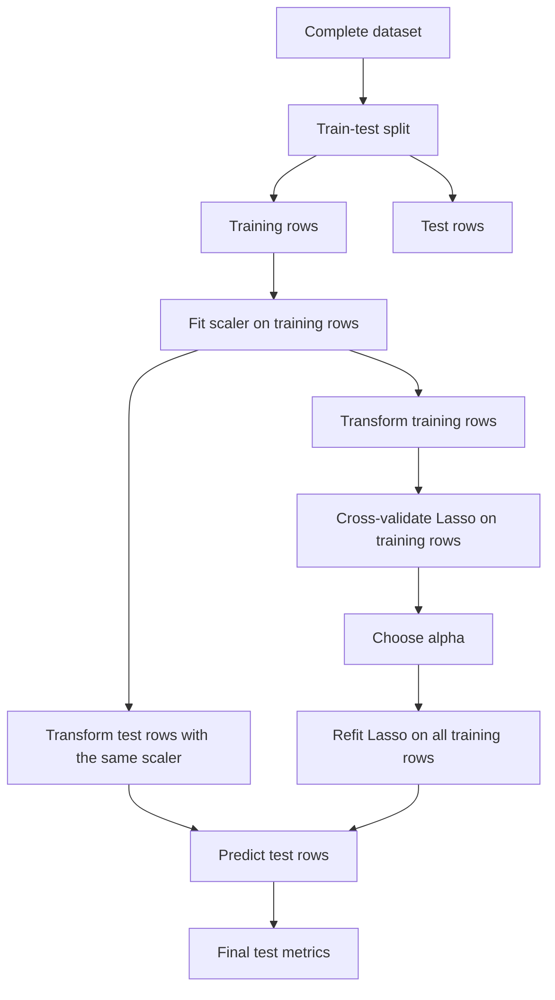
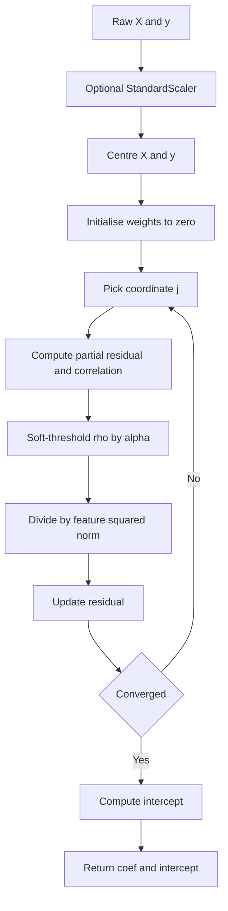
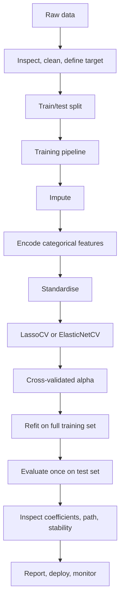

# Day 56 — Lasso Regression

> **Course:** CampusX — 100 Days of Machine Learning, Day 56
> **Official notebook 1:** `reference_notebooks/lasso-regression-demo.ipynb` (6 cells)
> **Official notebook 2:** `reference_notebooks/lasso-regression-key-points.ipynb` (23 cells)
> **Personal notebook:** none for this day; no notebook is created or modified during preparation.
> **Dataset:** none. The notebooks use `sklearn.datasets.make_regression` and the built-in diabetes dataset.
> **Central question:** How can adding a penalty on the absolute size of the coefficients make a linear model not only more stable, but also set some coefficients exactly to zero — and when is that sparsity genuinely useful rather than a misleading accident?

### How this chapter is organised

The chapter starts with the problem that regularisation is meant to solve, then builds the mathematics of the lasso objective, the geometry and subgradient explanation of exact zeros, the coordinate-descent algorithm that Scikit-learn uses, and the complete API. It then walks through **both** official notebooks cell by cell, reproduces and checks their numbers, interprets every graph, compares lasso with ridge, ordinary least squares (OLS), and elastic net, and finishes with limitations, debugging, interview preparation, and examination practice.

**Source labels used below.**

- **Official** means a value that appears in the saved output of one of the two CampusX notebooks. Official outputs were produced in an older environment (the notebooks record Python 3.8.8); they are quoted as saved, not silently replaced by a rerun.
- **Reproduced** means a value recomputed in this environment with Python 3.14.2, NumPy 2.5.3, pandas 3.0.5, and Scikit-learn 1.9.1. Reproduced values can differ in the last digits because the solver and library versions differ.
- **Supplementary** means an explanation, derivation, experiment, or diagnostic added in this chapter. It is not presented as course output.

The two official notebooks are copied byte-identically into `reference_notebooks/`. Their counts were verified: **6 cells** in the demo notebook and **23 cells** in the key-points notebook. They are distinct lessons and are never merged.

### Contents

1. Learning objectives
2. Big picture: where lasso sits in the ML workflow
3. Prerequisites, explained rather than listed
4. The problem lasso addresses
5. Ridge in one page: the baseline that does not select
6. The lasso objective
7. Why L1 produces exact zeros
8. Coordinate descent: how the solver actually works
9. Scikit-learn `Lasso`: syntax and execution
10. Choosing alpha
11. Notebook 1: `lasso-regression-demo.ipynb` (6 cells)
12. Notebook 2: `lasso-regression-key-points.ipynb` (23 cells)
13. Worked numerical examples
14. Interpreting the graphs
15. Comparison: OLS, ridge, lasso, and elastic net
16. Bias, variance, prediction, and interpretation
17. Limitations and failure modes
18. Common mistakes and debugging
19. Connection to the machine-learning workflow
20. Interview preparation
21. Examination preparation
22. Revision sheet and mastery checklist
23. Coverage matrix for both notebooks
24. References and glossary
25. Final connection

---

# 1. Learning objectives

After studying this chapter, I should be able to:

1. **Explain the problem.** Describe why OLS becomes unstable when features are correlated or numerous, why a large coefficient vector increases variance, and why a model with hundreds of non-zero coefficients is hard to interpret.
2. **Write the objective.** State the lasso objective in penalised and constrained forms, explain every symbol, convert between the common scaling conventions, and explain the role of the intercept.
3. **Explain sparsity.** Derive the one-dimensional soft-threshold solution, explain the subgradient condition at zero, and explain the geometry that makes the L1 ball produce corner solutions while the L2 ball does not.
4. **Explain the solver.** Derive the coordinate-descent update, write the algorithm in pseudocode, describe the stopping rule, and explain why `alpha=0` produces convergence warnings.
5. **Use the API.** Distinguish creating, fitting, predicting, and scoring a `Lasso`; explain `alpha`, `fit_intercept`, `max_iter`, `tol`, `selection`, `warm_start`, `positive`, and the fitted attributes `coef_`, `intercept_`, `n_iter_`, `dual_gap_`, and `sparse_coef_`.
6. **Choose alpha.** Explain `alpha_max`, the regularisation path, `LassoCV`, the one-standard-error rule, and the difference between model selection and final evaluation.
7. **Read both notebooks.** Walk through all 6 cells of the demo and all 23 cells of the key-points notebook; interpret the line fits, bar charts, coefficient paths, bias-variance plot, and loss curves.
8. **Work numerically.** Compute soft-threshold solutions by hand, reproduce the diabetes coefficient table, compute L1 norms and non-zero counts, and find the minimum of the notebook's loss function for several alphas.
9. **Compare methods.** Contrast OLS, ridge, lasso, and elastic net for prediction, interpretation, correlated features, and the $p>n$ setting.
10. **Diagnose and communicate.** Recognise leakage, scale dependence, selection instability, post-selection inference problems, and the difference between a predictive model and a causal explanation; answer interview and exam questions with reasoning.

---

# 2. Big picture: where lasso sits in the ML workflow

Lasso is a **regularised linear regression** method. It belongs to model training, not to data cleaning:


The important ordering rule is the same one that governed Days 24–36: **anything learned from data is learned from the training portion only**. For lasso this includes the standardisation mean and standard deviation and the chosen `alpha`. The test set is used for `transform` and one final evaluation, never for choosing the penalty.

A second, equally important point is that lasso is **not** a feature-selection step that can be done before the split. If the selected features are chosen by looking at all rows, including the test rows, the later evaluation is contaminated. Selection is part of fitting the model.



**Connection to previous days.**

- **Day 48 (simple linear regression)** introduced the line $\hat y=b+wx$ and the squared-error fit. Lasso adds a penalty to that same fit.
- **Day 49 (regression metrics)** introduced MSE, RMSE, MAE, and $R^2$. These metrics are used to compare lasso with OLS and to choose alpha.
- **Day 50 (multiple linear regression)** introduced the design matrix and the normal equations. Lasso replaces the closed-form OLS solution with a constrained optimisation problem.
- **Day 51–52 (gradient descent)** showed how a model can be fitted iteratively. Lasso is also fitted iteratively, but with coordinate descent rather than ordinary gradient descent, because the L1 penalty is not differentiable at zero.
- **Day 53 (polynomial regression)** showed how a flexible basis can overfit. The demo notebook uses a degree-16 polynomial to show that lasso can control that flexibility.
- **Day 55 (ridge regression)** introduced the L2 penalty. Lasso is the L1 counterpart, and the comparison between the two is the central conceptual contrast of this day.
- **Day 57 (elastic net)** combines the two penalties. Understanding lasso first makes the elastic-net objective easy to read.

---

# 3. Prerequisites, explained rather than listed

## 3.1 Linear regression and OLS

A linear regression predicts a continuous target as a weighted sum of features:

$$
\hat y_i = \beta_0 + \beta_1 x_{i1} + \beta_2 x_{i2} + \cdots + \beta_p x_{ip}.
$$

In matrix form, with an intercept column absorbed into $\mathbf X$,

$$
\hat{\mathbf y} = \mathbf X\boldsymbol\beta.
$$

OLS chooses the coefficient vector that minimises the residual sum of squares:

$$
\widehat{\boldsymbol\beta}_{\mathrm{OLS}}
= \arg\min_{\boldsymbol\beta}
\sum_{i=1}^{n}\left(y_i-\mathbf x_i^{\top}\boldsymbol\beta\right)^2.
$$

When $\mathbf X^{\top}\mathbf X$ is invertible, the solution is

$$
\widehat{\boldsymbol\beta}_{\mathrm{OLS}}
=(\mathbf X^{\top}\mathbf X)^{-1}\mathbf X^{\top}\mathbf y.
$$

The formula is useful, but it hides the difficulty: if two columns are nearly identical, $\mathbf X^{\top}\mathbf X$ is nearly singular. Its inverse then contains very large entries, and the coefficients can change dramatically when a few rows change. This is the problem regularisation addresses.

## 3.2 Residuals, SSE, MSE, and $R^2$

For observation $i$:

$$
e_i=y_i-\hat y_i.
$$

The **residual sum of squares** is

$$
\mathrm{SSE}=\sum_{i=1}^{n}e_i^2.
$$

The **mean squared error** is

$$
\mathrm{MSE}=\frac{1}{n}\sum_{i=1}^{n}e_i^2.
$$

The coefficient of determination is

$$
R^2=1-\frac{\sum_{i=1}^{n}(y_i-\hat y_i)^2}
{\sum_{i=1}^{n}(y_i-\bar y)^2}.
$$

$R^2=1$ means perfect prediction on the evaluated rows; $R^2=0$ means the model is no better than predicting the mean; $R^2<0$ means it is worse than that baseline. A negative $R^2$ is possible on a test set, and the key-points notebook reports one: at `alpha=10`, the model has set every coefficient to zero and predicts the training mean, which is slightly worse than the test-set mean on that particular split.

$R^2$ is not "percentage accuracy", and it is not comparable across different targets or transformations. For model comparison, use the same rows and the same metric.

## 3.3 Norms: L0, L1, and L2

A **norm** measures the size of a vector. The three norms that matter here are:

$$
\lVert\mathbf w\rVert_0=\sum_{j=1}^{p}\mathbf 1\{w_j\ne 0\},
$$

$$
\lVert\mathbf w\rVert_1=\sum_{j=1}^{p}|w_j|,
$$

$$
\lVert\mathbf w\rVert_2=\sqrt{\sum_{j=1}^{p}w_j^2},
\qquad
\lVert\mathbf w\rVert_2^2=\sum_{j=1}^{p}w_j^2.
$$

- The **L0 norm** counts non-zero coefficients. Penalising it would directly target sparsity, but the resulting problem is combinatorial and generally NP-hard.
- The **L1 norm** is the sum of absolute values. It is convex, and it is the tightest convex relaxation of the L0 count on the unit box.
- The **L2 norm squared** is the sum of squares. It is smooth and differentiable everywhere.

Ridge uses $\lVert\mathbf w\rVert_2^2$; lasso uses $\lVert\mathbf w\rVert_1$. The difference between a square and an absolute value is the difference between shrinkage and selection.

## 3.4 Convexity and subgradients

A function $f$ is **convex** if the line segment between any two points on its graph lies above the graph:

$$
f(\theta u+(1-\theta)v)\le \theta f(u)+(1-\theta)f(v),
\qquad 0\le\theta\le1.
$$

Convex objectives have a useful guarantee: every local minimum is a global minimum. This is why lasso can be solved reliably even though the L1 term has a kink.

The absolute value $|w|$ is differentiable everywhere except at $w=0$. At zero, it has a **subgradient interval**:

$$
\partial|w|=
\begin{cases}
\{-1\}, & w<0,\\
[-1,1], & w=0,\\
\{1\}, & w>0.
\end{cases}
$$

A point $w^\star$ minimises a convex function $f$ if and only if $0\in\partial f(w^\star)$. At a non-zero coordinate this becomes the ordinary derivative condition; at a zero coordinate it becomes an inequality. That inequality is exactly what allows lasso to keep a coefficient at zero even when its correlation with the residual is not zero.

## 3.5 Bias-variance decomposition

For squared-error prediction, the expected test error at a point can be decomposed as

$$
\mathbb E\left[(y-\hat f(x))^2\right]
=\sigma^2
+\left(\mathbb E[\hat f(x)]-f(x)\right)^2
+\operatorname{Var}\left(\hat f(x)\right),
$$

where $\sigma^2$ is the irreducible noise variance, the second term is **bias squared**, and the third term is **variance**. Regularisation deliberately introduces bias in order to reduce variance. The best amount of regularisation is the one that minimises the total, not the one that makes the training error smallest.

The key-points notebook attempts to display this trade-off with `mlxtend.evaluate.bias_variance_decomp`. Section 12.7 explains what the saved plot does and does not show.

## 3.6 Standardisation and scale

A penalty on coefficients is **scale-dependent**. Suppose a feature is measured in metres in one dataset and in millimetres in another. The numerical value of its coefficient changes by a factor of 1000, even though the underlying relationship is identical. An L1 penalty of the same numerical size therefore penalises the millimetre version far more strongly, and the selected model can change merely because the units changed.

The standard remedy is to centre and scale each feature before fitting:

$$
z_{ij}=\frac{x_{ij}-\bar x_j}{s_j},
$$

where $\bar x_j$ is the training mean and $s_j$ is the training standard deviation. Then a one-unit change in $z_j$ means a one-standard-deviation change in the original feature, and the penalty treats features comparably.

Two cautions:

1. Fit the scaler on the training data only. Using the full dataset to compute means and standard deviations leaks information.
2. Coefficients on the standardised scale are not directly interpretable in the original units. Convert predictions back, or convert coefficients by dividing by $s_j$, if original-unit interpretation is required.

The diabetes dataset used in the key-points notebook is a special case: Scikit-learn's `load_diabetes()` returns features that are already centred and scaled to unit L2 norm. Each column has mean zero and sum of squares one, so the columns have equal norms. That is why the notebook does not call `StandardScaler`; it is a property of this built-in dataset, not a general recommendation.

## 3.7 Train, test, and cross-validation

The **training set** is used to estimate coefficients. The **validation set**, or the folds of a cross-validation procedure, is used to choose hyperparameters such as `alpha`. The **test set** is used once, after all choices are made, to estimate generalisation performance.

If alpha is chosen by looking at test $R^2$, the test set has become a validation set, and the reported score is optimistically biased. The demo notebook fits several alphas and plots their predictions on `X_test`; that is a teaching visualisation, not a clean model-selection procedure. The key-points notebook computes test $R^2$ for four alphas; those values are useful for comparing the fitted models on one split, but they are not a substitute for cross-validation.

---

# 4. The problem lasso addresses

## 4.1 Multicollinearity makes OLS coefficients unstable

The diabetes features are a realistic example. The pairwise correlations include:

| Pair | Correlation |
|---|---:|
| `s1` and `s2` | $0.897$ |
| `s3` and `s4` | $-0.738$ |
| `s4` and `s5` | $0.618$ |
| `bmi` and `s5` | $0.446$ |
| `bp` and `s5` | $0.393$ |

When two features carry almost the same information, OLS can assign a large positive coefficient to one and a large negative coefficient to the other. The predictions may be fine, but the individual coefficients are poorly determined. A small change in the data can flip their signs or change their magnitudes dramatically.

Lasso responds by shrinking some coefficients all the way to zero. In the diabetes table, `s1` and `s2` are strongly correlated; at `alpha=0.1`, `s1` remains at $-82.69$ while `s2` is exactly zero. At `alpha=0.01`, both are non-zero ($-430.21$ and $191.28$). The choice between them is not a statement that `s2` is irrelevant to the target; it is a statement that, given `s1`, the L1 penalty prefers not to pay for a second correlated coefficient.

## 4.2 Many features, few observations

When the number of features $p$ is close to or larger than the number of observations $n$, OLS has no unique solution (if $p>n$) or a very unstable one (if $p\approx n$). Lasso remains well-defined because the penalty makes the objective strictly convex in the relevant directions. It also produces a sparse solution: in general, at most $n$ coefficients can be non-zero (with an intercept, at most $n-1$ in the usual formulation). This is a mathematical property, not a guarantee that the selected features are the "true" ones.

## 4.3 Overfitting and variance

A flexible linear model with many features can fit noise. The polynomial demo makes this concrete: a degree-16 polynomial has 17 coefficients, and with 80 training points it can wiggle aggressively. OLS with such a basis can have low training error and poor test behaviour. Lasso adds a penalty that discourages large coefficients, trading a little bias for a large reduction in variance.

## 4.4 Interpretation with too many features

A model with 500 non-zero coefficients is difficult to communicate. A sparse model with 12 non-zero coefficients is easier to inspect, provided the selection is stable. Lasso is often used as a screening tool: fit a path of models, inspect which features enter first, and validate the selected set on held-out data or across bootstrap samples.

## 4.5 What lasso does and does not solve

Lasso **does**:

- shrink coefficients toward zero;
- set some coefficients exactly to zero;
- reduce variance when the bias increase is worthwhile;
- produce a model that can be fitted when $p$ is large;
- provide a path of solutions as alpha varies.

Lasso **does not**:

- prove that a zero coefficient means the feature is causally irrelevant;
- guarantee that the selected set is the true set;
- handle strongly correlated features by selecting all of them together (elastic net is better for that);
- provide valid ordinary confidence intervals after selection;
- fix outliers, missing data, nonlinearity, or leakage;
- remove the need for cross-validation.

---

# 5. Ridge in one page: the baseline that does not select

Ridge regression minimises

$$
\widehat{\boldsymbol\beta}_{\mathrm{ridge}}
=\arg\min_{\boldsymbol\beta}
\left[
\frac{1}{2n}\lVert\mathbf y-\mathbf X\boldsymbol\beta\rVert_2^2
+\lambda\lVert\boldsymbol\beta\rVert_2^2
\right].
$$

For centred data and an unpenalised intercept, the closed-form solution is

$$
\widehat{\boldsymbol\beta}_{\mathrm{ridge}}
=\left(\mathbf X^{\top}\mathbf X+2n\lambda\mathbf I\right)^{-1}
\mathbf X^{\top}\mathbf y.
$$

Adding $2n\lambda\mathbf I$ to the diagonal makes the matrix invertible and stabilises the solution. The shrinkage factor in the orthonormal design is

$$
\widehat\beta_j^{\mathrm{ridge}}
=\frac{\widehat\beta_j^{\mathrm{OLS}}}{1+2n\lambda}.
$$

The factor is never exactly zero for finite $\lambda$, so ridge shrinks coefficients but does not select variables. In the same orthonormal design, lasso gives

$$
\widehat\beta_j^{\mathrm{lasso}}
=\operatorname{sign}\left(\widehat\beta_j^{\mathrm{OLS}}\right)
\max\left(\left|\widehat\beta_j^{\mathrm{OLS}}\right|-\alpha,0\right),
$$

which is exactly zero whenever the OLS coefficient is small enough.

| Property | Ridge | Lasso |
|---|---|---|
| Penalty | $\lambda\lVert\beta\rVert_2^2$ | $\alpha\lVert\beta\rVert_1$ |
| Coefficient shape | Smooth shrinkage | Shrinkage plus thresholding |
| Exact zeros | Generally no | Yes |
| Correlated features | Shrinks together | Tends to pick one |
| $p>n$ | Works | Works, with at most $n$ non-zeros |
| Closed form | Yes | No (quadratic programming or coordinate descent) |
| Typical use | Prediction with many correlated features | Sparse prediction and screening |

Ridge is not "worse" than lasso. It is the better default when the goal is prediction and the features are correlated, because it distributes weight across correlated features instead of arbitrarily discarding some of them. Lasso is preferable when a sparse, interpretable model is genuinely useful and the selection is stable.

---

# 6. The lasso objective

## 6.1 Penalised form

The lasso estimator minimises the sum of a squared-error term and an L1 penalty:

$$
\widehat{\boldsymbol\beta}_{\mathrm{lasso}}
=\arg\min_{\boldsymbol\beta}
\left[
\frac{1}{2n}\lVert\mathbf y-\mathbf X\boldsymbol\beta\rVert_2^2
+\alpha\lVert\boldsymbol\beta\rVert_1
\right].
$$

Every symbol has a precise meaning:

- $\mathbf y\in\mathbb R^n$ is the vector of training targets.
- $\mathbf X\in\mathbb R^{n\times p}$ is the training design matrix.
- $\boldsymbol\beta\in\mathbb R^p$ is the coefficient vector, excluding the intercept.
- $n$ is the number of training rows.
- $p$ is the number of features.
- $\lVert\mathbf y-\mathbf X\boldsymbol\beta\rVert_2^2=\sum_{i=1}^{n}(y_i-\mathbf x_i^{\top}\boldsymbol\beta)^2$ is the residual sum of squares.
- $\lVert\boldsymbol\beta\rVert_1=\sum_{j=1}^{p}|\beta_j|$ is the L1 norm.
- $\alpha\ge0$ is the regularisation strength.

The factor $1/(2n)$ is a convention. It makes the gradient of the squared-error term equal to $-(1/n)\mathbf X^{\top}(\mathbf y-\mathbf X\boldsymbol\beta)$, which is convenient for coordinate descent. A textbook may write $1/2$ instead of $1/(2n)$; the numerical meaning of alpha then changes. Always check the convention before comparing alpha values across libraries.

## 6.2 Constrained form and the Lagrange connection

For every $\alpha\ge0$ there exists a radius $t\ge0$ such that the penalised problem has the same solution as

$$
\min_{\boldsymbol\beta}
\frac{1}{2n}\lVert\mathbf y-\mathbf X\boldsymbol\beta\rVert_2^2
\quad\text{subject to}\quad
\lVert\boldsymbol\beta\rVert_1\le t.
$$

This is the **constrained form**. It is often easier to visualise: the feasible region is an L1 ball, and the loss contours expand until they first touch it. The penalised form is easier to optimise and is the form used by Scikit-learn. The two forms are related by Lagrange duality; the exact correspondence between $\alpha$ and $t$ depends on the data.

The constrained form also explains why lasso can set coefficients to zero: the L1 ball has sharp corners on the coordinate axes, and the first contact between an expanding elliptical contour and the ball often occurs at a corner. Section 7.3 develops this picture.

## 6.3 Common scaling conventions

Three conventions appear in textbooks and software:

$$
\text{(A)}\quad
\min_{\boldsymbol\beta}\frac{1}{2}\lVert\mathbf y-\mathbf X\boldsymbol\beta\rVert_2^2+\lambda\lVert\boldsymbol\beta\rVert_1,
$$

$$
\text{(B)}\quad
\min_{\boldsymbol\beta}\frac{1}{2n}\lVert\mathbf y-\mathbf X\boldsymbol\beta\rVert_2^2+\alpha\lVert\boldsymbol\beta\rVert_1,
$$

$$
\text{(C)}\quad
\min_{\boldsymbol\beta}\lVert\mathbf y-\mathbf X\boldsymbol\beta\rVert_2^2+\lambda\lVert\boldsymbol\beta\rVert_1.
$$

Scikit-learn uses convention (B). If a paper reports $\lambda$ under convention (A), the equivalent Scikit-learn value is $\alpha=\lambda/n$. If a paper uses convention (C), the equivalent is $\alpha=\lambda/(2n)$. This conversion matters when reproducing published alpha values.

## 6.4 The intercept is not penalised

Scikit-learn's `Lasso` fits an intercept when `fit_intercept=True` (the default). The intercept is not included in the penalty. Internally, the solver centres $\mathbf X$ and $\mathbf y$, solves the penalised problem for the slopes, and then computes the intercept as

$$
\widehat\beta_0=\bar y-\bar{\mathbf x}^{\top}\widehat{\boldsymbol\beta}.
$$

Penalising the intercept would make the model depend on the origin of the target, which is arbitrary. For example, measuring a temperature in kelvin instead of degrees Celsius shifts every target by 273.15; the slopes should not change, and the intercept should absorb the shift. Excluding the intercept from the penalty preserves that invariance.

If `fit_intercept=False`, the model is forced through the origin and the solver does not centre the data. This is appropriate only when a zero target at zero features is meaningful.

## 6.5 Alpha limits

Three values of alpha are conceptually important:

- $\alpha=0$: the penalty disappears, and the objective is ordinary least squares. If $\mathbf X^{\top}\mathbf X$ is singular, the solution is not unique.
- $\alpha=\alpha_{\max}$: the smallest alpha for which every coefficient is exactly zero. For centred data,

$$
\alpha_{\max}=\frac{1}{n}\max_{j}\left|\mathbf x_j^{\top}\mathbf y\right|.
$$

- $\alpha\to\infty$: every coefficient is zero; the model predicts the training mean (or zero if the intercept is disabled).

The interval $[0,\alpha_{\max}]$ is the useful range. A path algorithm typically starts at $\alpha_{\max}$ and decreases alpha on a log scale.

For the diabetes training split, the reproduced value is $\alpha_{\max}\approx2.18$. This explains the saved coefficient table: at `alpha=10`, every coefficient is zero; at `alpha=1`, three coefficients remain; at `alpha=0.1`, seven remain. The table is not an arbitrary collection of numbers; it is a path indexed by a penalty that is large relative to the scale of the correlations.

## 6.6 Standardisation is part of the objective

Because the penalty is on the coefficients, the solution depends on the units of the features. The correct workflow is:

```python
from sklearn.pipeline import Pipeline
from sklearn.preprocessing import StandardScaler
from sklearn.linear_model import Lasso

model = Pipeline([
    ("scaler", StandardScaler()),
    ("lasso", Lasso(alpha=0.1))
])
model.fit(X_train, y_train)
```

The pipeline ensures that the scaler is fitted on the training rows and that the same means and standard deviations are applied to the test rows. It also ensures that cross-validation refits the scaler inside each fold.

A common mistake is to standardise the full dataset once, before splitting. That leaks the test set's mean and variance into training. The leakage is usually small for standardisation, but it is still leakage, and the same mistake is much more damaging for target encoding or feature selection.

## 6.7 Why not penalise the intercept?

The intercept is a location parameter, not a measure of feature importance. Penalising it would make the model's prediction at the feature means depend on the arbitrary zero point of the target. Excluding it keeps the model equivariant to shifts of the target: if every $y_i$ is increased by a constant $c$, the fitted slopes stay the same and the intercept increases by $c$.

---

# 7. Why L1 produces exact zeros

## 7.1 The one-feature derivation

Consider a single feature with no intercept, using the Scikit-learn scaling:

$$
J(w)=\frac{1}{2n}\sum_{i=1}^{n}(y_i-x_iw)^2+\alpha|w|.
$$

Let

$$
a=\frac{1}{n}\sum_{i=1}^{n}x_i^2,
\qquad
c=\frac{1}{n}\sum_{i=1}^{n}x_i y_i.
$$

Expanding the squared term,

$$
J(w)=\frac{a}{2}w^2-cw+\frac{1}{2n}\sum_i y_i^2+\alpha|w|.
$$

For $w>0$, the derivative is $aw-c+\alpha$. Setting it to zero gives

$$
w=\frac{c-\alpha}{a}.
$$

This is positive only if $c>\alpha$. For $w<0$, the derivative is $aw-c-\alpha$, and the stationary point is

$$
w=\frac{c+\alpha}{a},
$$

which is negative only if $c<-\alpha$. If $-\alpha\le c\le\alpha$, neither branch is feasible, and the minimum is at $w=0$. Therefore

$$
\widehat w=
\begin{cases}
\dfrac{c-\alpha}{a}, & c>\alpha,\\
0, & |c|\le\alpha,\\
\dfrac{c+\alpha}{a}, & c<-\alpha.
\end{cases}
$$

This can be written compactly with the **soft-threshold operator**:

$$
S(c,\alpha)=\operatorname{sign}(c)\max(|c|-\alpha,0),
\qquad
\widehat w=\frac{S(c,\alpha)}{a}.
$$

When the features are standardised to unit variance, $a=1$ (if the variance is defined with the same $1/n$ convention), and the solution is simply $S(c,\alpha)$. The quantity $c$ is the covariance between the feature and the target. The penalty therefore subtracts a fixed amount from the covariance; if the covariance is smaller than that amount, the coefficient is set exactly to zero.

This is the algebraic root of sparsity. It is not a numerical accident or a rounding effect. The kink at zero creates a whole interval of correlations that map to the same zero coefficient.

## 7.2 A worked soft-threshold example

Take four observations with a centred feature

$$
\mathbf x=(-1.5,\,-0.5,\,0.5,\,1.5),
\qquad
\mathbf y=(1,\,2,\,2,\,5).
$$

Then

$$
\sum_i x_i^2=(-1.5)^2+(-0.5)^2+0.5^2+1.5^2=5,
$$

$$
\sum_i x_i y_i=(-1.5)(1)+(-0.5)(2)+(0.5)(2)+(1.5)(5)=6.
$$

With $n=4$ and Scikit-learn scaling, $a=5/4=1.25$ and $c=6/4=1.5$. The OLS coefficient is $c/a=1.2$.

Now set $\alpha=0.4$. The threshold in the $c$ scale is $\alpha=0.4$, so

$$
S(c,\alpha)=S(1.5,0.4)=1.1,
\qquad
\widehat w=\frac{1.1}{1.25}=0.88.
$$

Set $\alpha=1.6$. Then $S(1.5,1.6)=0$, so $\widehat w=0$. The coefficient is exactly zero even though the unpenalised covariance is positive. The break-even point is $\alpha=|c|=1.5$: below it the coefficient is positive, above it the coefficient is zero.

This small example is worth memorising because it contains the whole lasso mechanism: a covariance, a threshold, and a hard zero.

## 7.3 Geometry in two dimensions

Consider two coefficients and a fixed L1 budget:

$$
|w_1|+|w_2|\le t.
$$

The boundary is a diamond with corners at $(t,0)$, $(0,t)$, $(-t,0)$, and $(0,-t)$. The OLS loss contours are ellipses centred at the unconstrained OLS solution. As the allowed budget grows, the ellipse expands until it first touches the diamond.

When the unconstrained solution lies along a direction that is not axis-aligned, the first contact is often a corner. At a corner, one coordinate is zero. This is the geometric picture of sparsity.

For ridge, the constraint is

$$
w_1^2+w_2^2\le t,
$$

a circle. A circle has no corners. The first contact is generically at a smooth point where both coordinates are non-zero. Ridge therefore shrinks both coefficients but rarely sets either exactly to zero.

A compact way to remember the contrast:

| Constraint | Shape | Typical contact | Result |
|---|---|---|---|
| $\lVert w\rVert_1\le t$ | Diamond with corners on axes | Corner | Some coefficients exactly zero |
| $\lVert w\rVert_2\le t$ | Circle | Smooth boundary point | All coefficients shrunk, usually non-zero |

In higher dimensions the L1 ball is a cross-polytope with many corners, edges, and faces. The number of "flat" directions where some coordinates are zero grows with the dimension. This is why L1 regularisation becomes increasingly effective at producing sparse solutions as $p$ grows.

The geometric argument is intuitive, but it is not a proof that a particular data set will produce a particular sparsity pattern. The actual solution depends on the correlation structure and the loss contours. The subgradient condition in the next subsection is the precise statement.

## 7.4 The subgradient and KKT conditions

For the objective

$$
J(\boldsymbol\beta)=\frac{1}{2n}\lVert\mathbf y-\mathbf X\boldsymbol\beta\rVert_2^2
+\alpha\sum_{j=1}^{p}|\beta_j|,
$$

the subgradient with respect to $\beta_j$ is

$$
\partial_{\beta_j}J=
-\frac{1}{n}\mathbf x_j^{\top}\mathbf r
+\alpha\,\partial|\beta_j|,
$$

where $\mathbf r=\mathbf y-\mathbf X\boldsymbol\beta$ is the residual vector. At an optimum:

- If $\beta_j\ne0$,

$$
\frac{1}{n}\mathbf x_j^{\top}\mathbf r
=\alpha\,\operatorname{sign}(\beta_j).
$$

- If $\beta_j=0$,

$$
\left|\frac{1}{n}\mathbf x_j^{\top}\mathbf r\right|\le\alpha.
$$

The first condition says that an active feature's correlation with the residual is exactly the penalty size, with the sign of its coefficient. The second says that an inactive feature's correlation with the residual can be anything inside the interval $[-\alpha,\alpha]$; it does not have to be zero.

This is the precise reason a coefficient can be zero while the feature is still correlated with the residual. The penalty is "absorbing" a correlation up to size alpha. Ridge has no such interval: its derivative at zero is zero, so a zero coefficient requires the correlation with the residual to be exactly zero, which is a measure-zero event in continuous data.

## 7.5 The Bayesian interpretation

Lasso can be derived as a maximum a posteriori (MAP) estimate under a Laplace prior on the coefficients:

$$
p(\beta_j)=\frac{1}{2b}\exp\left(-\frac{|\beta_j|}{b}\right).
$$

Combining the Gaussian likelihood for the targets with this prior and taking the negative logarithm gives an objective of the form

$$
\frac{1}{2\sigma^2}\sum_i(y_i-\mathbf x_i^{\top}\boldsymbol\beta)^2
+\frac{1}{b}\sum_j|\beta_j|+\text{constant}.
$$

After dividing by the appropriate factor, this is the lasso objective with $\alpha$ proportional to $\sigma^2/b$. The Laplace prior has a sharp peak at zero and heavier tails than a Gaussian. The peak at zero gives the prior mass that produces exact zero estimates; the heavy tails allow large coefficients when the data strongly support them.

Ridge corresponds to a Gaussian prior $\beta_j\sim\mathcal N(0,\tau^2)$. The Gaussian density is smooth at zero, so the posterior mode is generally not exactly zero. This is the Bayesian counterpart of the geometric and subgradient explanations.

The prior interpretation is a useful intuition, but it is not a license to interpret the selected coefficients as posterior probabilities. The lasso estimate is a point estimate, and its uncertainty is not captured by the coefficient values alone.

## 7.6 Why ridge cannot produce exact zeros

In the orthonormal design, ridge gives

$$
\widehat\beta_j^{\mathrm{ridge}}
=\frac{\widehat\beta_j^{\mathrm{OLS}}}{1+2n\lambda}.
$$

For any finite $\lambda$, the numerator is unchanged and the denominator is finite, so the result is zero only if the OLS coefficient is exactly zero. In real data, that happens only by coincidence or by an exact linear dependency. Ridge shrinks small coefficients toward zero, but it never makes a hard decision to exclude them.

Lasso's soft-threshold,

$$
\widehat\beta_j^{\mathrm{lasso}}
=\operatorname{sign}(\widehat\beta_j^{\mathrm{OLS}})
\max\left(|\widehat\beta_j^{\mathrm{OLS}}|-\alpha,0\right),
$$

contains an explicit max with zero. That max is the hard decision. It is also why the lasso coefficient is biased: even a large true coefficient is shifted toward zero by the threshold amount. Ridge also biases coefficients, but its bias is multiplicative rather than an absolute shift.

## 7.7 What sparsity does not mean

A zero lasso coefficient does **not** mean:

- the feature is unrelated to the target;
- the feature is useless in every model;
- the feature would be excluded in a different sample;
- the feature has no causal effect;
- the model has found the "true" variables.

A zero coefficient means that, **given the other features in this model, this penalty, this scaling, and this sample**, the L1 objective is minimised by setting that coefficient to zero. Change the correlation structure, the penalty, or the sample, and the decision can change. Section 17 develops the consequences.


---

# 8. Coordinate descent: how the solver actually works

## 8.1 Why there is no closed-form solution

Ridge has a closed form because its penalty is quadratic and differentiable. Lasso does not, because the absolute value has a kink at zero. The objective is convex, so it has a global minimum, but the minimum cannot be written as a single matrix inverse.

There are several ways to solve it:

- formulate it as a quadratic program and call a general solver;
- use the LARS algorithm, which follows the piecewise-linear coefficient path;
- use proximal gradient methods;
- use **coordinate descent**, which is the default in Scikit-learn.

Coordinate descent is popular because each one-dimensional subproblem has a closed-form soft-threshold solution, and the algorithm is simple, memory-efficient, and fast for sparse or wide problems.

## 8.2 Deriving the coordinate-descent update

Write the objective with an intercept $b$:

$$
J(\mathbf w,b)=
\frac{1}{2n}\sum_{i=1}^{n}\left(y_i-b-\sum_{k=1}^{p}x_{ik}w_k\right)^2
+\alpha\sum_{k=1}^{p}|w_k|.
$$

Suppose all coordinates except $w_j$ are fixed. Define the **partial residual**

$$
r_i^{(j)}=y_i-b-\sum_{k\ne j}x_{ik}w_k.
$$

Then the objective as a function of $w_j$ alone is

$$
J_j(w_j)=
\frac{1}{2n}\sum_{i=1}^{n}\left(r_i^{(j)}-x_{ij}w_j\right)^2
+\alpha|w_j|+\text{constant}.
$$

Let

$$
\rho_j=\frac{1}{n}\sum_{i=1}^{n}x_{ij}r_i^{(j)},
\qquad
z_j=\frac{1}{n}\sum_{i=1}^{n}x_{ij}^2.
$$

Expanding the square gives

$$
J_j(w_j)=
\frac{z_j}{2}w_j^2-\rho_j w_j+\alpha|w_j|+\text{constant}.
$$

For $w_j>0$, the derivative is $z_jw_j-\rho_j+\alpha$. Setting it to zero gives

$$
w_j=\frac{\rho_j-\alpha}{z_j},
$$

which is feasible only when $\rho_j>\alpha$. For $w_j<0$, the derivative is $z_jw_j-\rho_j-\alpha$, giving

$$
w_j=\frac{\rho_j+\alpha}{z_j},
$$

feasible only when $\rho_j<-\alpha$. If $|\rho_j|\le\alpha$, the minimum is at zero. Therefore

$$
\widehat w_j=
\frac{S(\rho_j,\alpha)}{z_j},
\qquad
S(\rho,\alpha)=\operatorname{sign}(\rho)\max(|\rho|-\alpha,0).
$$

If the feature has been standardised so that $z_j=1$, the update is simply

$$
\widehat w_j=S(\rho_j,\alpha).
$$

This is the algorithm's inner step. It is applied to one coordinate at a time, and the partial residual is updated incrementally.

## 8.3 The soft-threshold operator

The function $S(\rho,\alpha)$ has three regions:

$$
S(\rho,\alpha)=
\begin{cases}
\rho+\alpha, & \rho<-\alpha,\\
0, & -\alpha\le\rho\le\alpha,\\
\rho-\alpha, & \rho>\alpha.
\end{cases}
$$

Its graph is the identity line shifted down by alpha on the right and up by alpha on the left, with a flat zero region in the middle. The flat region is the source of exact zeros. The function is continuous but not differentiable at $\rho=\pm\alpha$.

Useful properties:

- $S(\rho,0)=\rho$: no penalty means no thresholding.
- $S(\rho,\alpha)$ is non-expansive: $|S(a,\alpha)-S(b,\alpha)|\le|a-b|$.
- $S$ is odd: $S(-\rho,\alpha)=-S(\rho,\alpha)$.
- For fixed $\rho$, $S(\rho,\alpha)$ is non-increasing in $\alpha$.

## 8.4 The algorithm in pseudocode

```text
input: X (n x p), y (n), alpha >= 0, tol, max_iter
standardise X if requested
centre X and y; initialise w = 0, b = mean(y)
r = y - b                      # residual with w = 0
repeat
    max_change = 0
    for j in 1..p (or a random permutation):
        old = w[j]
        r = r + X[:, j] * old          # remove old contribution
        rho = (X[:, j] . r) / n
        z = (X[:, j] . X[:, j]) / n
        w[j] = soft_threshold(rho, alpha) / z
        r = r - X[:, j] * w[j]         # add new contribution
        max_change = max(max_change, abs(w[j] - old))
    b = mean(y) - mean(X, axis=0) . w
until max_change < tol or iterations >= max_iter
return w, b
```

The actual Scikit-learn implementation is more careful:

- it uses a **duality gap** as the stopping criterion, not only the largest coefficient change;
- it can update coordinates cyclically or in random order;
- it can precompute the Gram matrix $\mathbf X^{\top}\mathbf X$ when that is beneficial;
- it supports warm starts, which reuse the previous solution as the initial point for a new alpha.

## 8.5 A first sweep by hand

Use the four-row example from Section 7.2 with two features:

$$
\mathbf x_1=(-1.5,-0.5,0.5,1.5),
\qquad
\mathbf x_2=(-0.5,-1.5,1.5,0.5),
\qquad
\mathbf y=(1,2,2,5).
$$

The columns have $\sum_i x_{ij}^2=5$, and their dot product is $3$, so they are correlated. Let $n=4$, $\alpha=0.2$, and ignore the intercept for this illustration (the columns are centred).

Start with $w_1=w_2=0$ and residual $\mathbf r=\mathbf y$.

**Update $w_1$:**

$$
\rho_1=\frac{1}{4}\sum_i x_{i1}y_i=\frac{6}{4}=1.5,
\qquad
z_1=\frac{5}{4}=1.25.
$$

$$
w_1=\frac{S(1.5,0.2)}{1.25}=\frac{1.3}{1.25}=1.04.
$$

Update the residual:

$$
\mathbf r=\mathbf y-w_1\mathbf x_1
=(1,2,2,5)-1.04(-1.5,-0.5,0.5,1.5)
=(2.56,2.52,1.48,3.44).
$$

**Update $w_2$:**

$$
\rho_2=\frac{1}{4}\sum_i x_{i2}r_i
=\frac{1}{4}\left[(-0.5)(2.56)+(-1.5)(2.52)+(1.5)(1.48)+(0.5)(3.44)\right]
=-0.28.
$$

$$
w_2=\frac{S(-0.28,0.2)}{1.25}=\frac{-0.08}{1.25}=-0.064.
$$

Update the residual:

$$
\mathbf r=\mathbf r-w_2\mathbf x_2
=(2.56,2.52,1.48,3.44)+0.064(-0.5,-1.5,1.5,0.5)
=(2.528,2.424,1.576,3.472).
$$

This is one sweep. The next sweep updates $w_1$ again because $w_2$ changed. The algorithm continues until the coefficients stop moving. The important observation is that the update is **local**: each coordinate is solved exactly while the others are held fixed. Convexity guarantees that repeated exact coordinate minimisation converges to a global minimum.

## 8.6 Convergence and stopping

Scikit-learn stops when the **duality gap** is smaller than `tol`, or when `max_iter` iterations have been performed. The duality gap measures how far the current primal objective is from a feasible dual objective; when it is small, the solution is close to optimal.

`n_iter_` records the number of iterations actually used. A large `n_iter_` close to `max_iter`, together with a `ConvergenceWarning`, means the solver did not reach the requested tolerance. Common responses are:

1. standardise the features;
2. increase `max_iter`;
3. increase `tol` if a slightly less precise solution is acceptable;
4. increase `alpha` if the model is not required to fit every small effect;
5. use `selection='random'` for very wide problems, with a fixed `random_state`.

The `alpha=0` case deserves special mention. With no penalty, the objective is smooth, but coordinate descent is not the recommended solver for OLS. Scikit-learn emits:

```text
UserWarning: With alpha=0, this algorithm does not converge well.
You are advised to use the LinearRegression estimator.
```

and may also emit a `ConvergenceWarning`. The warning is not a bug in the data; it is a warning that the algorithm and the objective are mismatched. Use `LinearRegression` when you want OLS, or use a very small positive alpha when you want a numerically regularised approximation.

## 8.7 Scikit-learn internals: the parameters that affect the solver

| Parameter | Default | What it does | Practical note |
|---|---|---|---|
| `alpha` | `1.0` | Penalty strength | Must be tuned; it is not estimated by `Lasso` |
| `fit_intercept` | `True` | Fit an unpenalised intercept | Keep `True` unless the origin is meaningful |
| `precompute` | `False` | Precompute the Gram matrix | Can speed up when $n>p$; costs memory |
| `copy_X` | `True` | Copy the input matrix | `False` can overwrite `X` |
| `max_iter` | `1000` | Maximum iterations | Increase if convergence warnings persist |
| `tol` | `1e-4` | Duality-gap tolerance | Smaller is more precise but slower |
| `warm_start` | `False` | Reuse the previous solution | Useful for paths over alpha |
| `positive` | `False` | Constrain coefficients to be non-negative | Useful for counts or physically non-negative effects |
| `random_state` | `None` | Seed for random coordinate selection | Set it when `selection='random'` |
| `selection` | `'cyclic'` | Coordinate update order | `'random'` can converge faster on wide data |

## 8.8 Data flow through the solver



The diagram is the execution order inside `fit`. `predict` is a separate operation: it takes the stored coefficients and intercept and computes $\mathbf X_{\text{new}}\widehat{\boldsymbol\beta}+\widehat\beta_0$. It does not re-run coordinate descent.

---

# 9. Scikit-learn `Lasso`: syntax and execution

## 9.1 Creating, fitting, predicting, scoring

The three operations are distinct:

```python
from sklearn.linear_model import Lasso

model = Lasso(alpha=0.1)      # 1. create an estimator object
model.fit(X_train, y_train)   # 2. estimate coefficients
predictions = model.predict(X_test)  # 3. apply the fitted model
score = model.score(X_test, y_test)  # 4. R^2 on the test rows
```

- **Creating** an estimator stores hyperparameters such as `alpha`. It does not look at data and does not compute coefficients.
- **Fitting** reads `X_train` and `y_train`, runs the solver, and stores `coef_` and `intercept_` on the object. `fit` returns the same object, which is why `Lasso(alpha=0.1).fit(X, y)` works.
- **Predicting** uses the stored coefficients. It does not learn anything and does not modify the model.
- **Scoring** calls `predict` internally and returns $R^2$ by default for a regressor.

A frequent beginner confusion is to write `Lasso(alpha=0.1)` and expect it to be fitted. It is only a specification. The coefficients exist only after `fit`.

## 9.2 Constructor arguments

The installed signature is:

```python
Lasso(
    alpha=1.0,
    *,
    fit_intercept=True,
    precompute=False,
    copy_X=True,
    max_iter=1000,
    tol=0.0001,
    warm_start=False,
    positive=False,
    random_state=None,
    selection='cyclic'
)
```

The keyword-only marker `*` means the arguments after `alpha` must be passed by name. `Lasso(0.1, True)` is invalid; use `Lasso(alpha=0.1, fit_intercept=True)`.

## 9.3 Fitted attributes

After `fit`, the important attributes are:

| Attribute | Shape or type | Meaning |
|---|---|---|
| `coef_` | `(n_features,)` | Estimated slopes on the scale of the input features |
| `intercept_` | float or array | Estimated intercept (unpenalised) |
| `n_iter_` | int | Iterations used by the coordinate-descent solver |
| `dual_gap_` | float or array | Final duality gap; a measure of optimality |
| `n_features_in_` | int | Number of features seen during `fit` |
| `feature_names_in_` | array of str | Present when `X` is a DataFrame with string column names |
| `sparse_coef_` | sparse matrix | Sparse representation of `coef_` |

There is **no `alpha_`** on `Lasso`. `alpha` is a hyperparameter chosen by the user, not a parameter estimated from the data. `LassoCV` is the class that estimates `alpha_` by cross-validation; do not confuse the two.

## 9.4 Reading `coef_` correctly

`coef_` is ordered like the columns of `X`. If `X` is a DataFrame, `feature_names_in_` gives the column names, but `coef_` itself is a NumPy array. A safe way to display the association is:

```python
import pandas as pd

coef_table = pd.Series(model.coef_, index=X_train.columns)
print(coef_table.sort_values(key=abs, ascending=False))
```

If a `ColumnTransformer` or `Pipeline` changes the number or order of columns, `coef_` refers to the transformed columns, not the original ones. Use `get_feature_names_out()` on the preprocessing step to recover meaningful names.

## 9.5 `fit_intercept` and centring

With `fit_intercept=True`, the solver centres the data internally. The penalty applies to the slopes, not to the intercept. With `fit_intercept=False`, the model is forced through the origin and the data are not centred.

The choice matters for regularisation. If the target has a large mean and the model is forced through the origin, the solver must use large slopes to fit that mean, and those slopes are penalised. This can produce a very different, and usually worse, model. Keep `fit_intercept=True` unless there is a domain reason for the origin constraint.

## 9.6 `positive=True`

`positive=True` constrains every coefficient to be non-negative. The objective remains convex, and coordinate descent handles the constraint by clipping negative updates to zero. This is useful when the sign is known in advance, for example:

- counts of events;
- physical quantities that cannot have a negative effect;
- some epidemiological exposures.

It is not a substitute for domain knowledge. A positive constraint can improve interpretability and stability, but it can also hide a genuinely negative relationship by forcing it to zero.

## 9.7 `selection='random'` and reproducibility

With `selection='cyclic'`, coordinates are updated in a fixed order. With `selection='random'`, the order is shuffled each iteration. Random selection can converge faster when many features are irrelevant, because it does not waste full sweeps on coordinates that will stay at zero. It introduces randomness, so set `random_state` for reproducibility.

The choice does not change the objective or the ideal solution; it changes the path taken by the solver and therefore the finite-iteration result.

## 9.8 `sparse_coef_`

For very wide problems, most coefficients may be zero. `sparse_coef_` returns a SciPy sparse matrix, which stores only the non-zero entries and can save memory. `coef_` remains a dense array for compatibility.

## 9.9 `LassoCV`, `lasso_path`, and `LassoLars`

Three related tools are worth knowing:

```python
from sklearn.linear_model import LassoCV, LassoLars, LassoLarsIC
from sklearn.linear_model import lasso_path

# 1. Cross-validated alpha
cv_model = LassoCV(cv=5, random_state=0).fit(X_train, y_train)
print(cv_model.alpha_)

# 2. Coefficient path over a grid of alphas
alphas, coefs, dual_gaps = lasso_path(X_train, y_train, alphas=[1.0, 0.1, 0.01])

# 3. LARS-based path and information criteria
lars = LassoLars(alpha=0.1).fit(X_train, y_train)
lars_ic = LassoLarsIC(criterion="bic").fit(X_train, y_train)
```

- `LassoCV` estimates alpha by cross-validation and stores `alpha_`, `alphas_`, `mse_path_`, `coef_`, and `intercept_`.
- `lasso_path` computes solutions over a decreasing sequence of alphas, which is useful for plotting and for warm starts.
- `LassoLars` uses the LARS algorithm; it can be faster for very sparse problems and gives an exact path. `LassoLarsIC` selects alpha using AIC or BIC instead of cross-validation.

For most tabular problems, `LassoCV` is the simplest defensible choice. `LassoLarsIC` is convenient when $n$ is large relative to $p$ and the assumptions of the information criterion are plausible; it is not a universal replacement for cross-validation.

## 9.10 A complete execution trace

```python
import numpy as np
from sklearn.datasets import load_diabetes
from sklearn.model_selection import train_test_split
from sklearn.pipeline import Pipeline
from sklearn.preprocessing import StandardScaler
from sklearn.linear_model import Lasso

X, y = load_diabetes(return_X_y=True)
X_train, X_test, y_train, y_test = train_test_split(
    X, y, test_size=0.2, random_state=2
)

pipe = Pipeline([
    ("scaler", StandardScaler()),
    ("lasso", Lasso(alpha=0.1, max_iter=10000))
])
pipe.fit(X_train, y_train)

lasso = pipe.named_steps["lasso"]
print("non-zero coefficients:", np.sum(lasso.coef_ != 0))
print("n_iter:", lasso.n_iter_)
print("dual_gap:", lasso.dual_gap_)
print("test R^2:", pipe.score(X_test, y_test))
```

What happens, in order:

1. `StandardScaler` computes the training means and standard deviations.
2. It transforms `X_train`.
3. `Lasso.fit` centres the scaled training data and runs coordinate descent.
4. The fitted scaler and lasso are stored inside the pipeline.
5. `predict` on the test set applies the stored scaler, then the stored coefficients.
6. `score` computes $R^2$ on the test rows.

If this pipeline is passed to `cross_val_score`, steps 1–3 are repeated inside every fold. That is the leakage-safe design.

---

# 10. Choosing alpha

## 10.1 What alpha controls

Alpha is the price paid for a non-zero coefficient. At $\alpha=0$, every feature can enter freely. As alpha increases:

- coefficients shrink toward zero;
- small coefficients hit zero and stay there;
- the number of non-zero coefficients decreases;
- bias increases;
- variance usually decreases;
- training error increases;
- test error can decrease, then increase.

The goal is not the sparsest model. The goal is the model with the best expected out-of-sample performance, or a sparse model whose selection is stable enough to interpret.

## 10.2 Manual grids versus cross-validation

The notebooks use manual grids:

```python
for a in [0, 0.1, 1, 10]:
    model = Lasso(alpha=a).fit(X_train, y_train)
    print(a, r2_score(y_test, model.predict(X_test)))
```

This is useful for teaching the shape of the path, but it is not a model-selection procedure. It compares four models on one split, and the reported test $R^2$ is used both to fit and to judge. A defensible workflow uses cross-validation on the training set:

```python
from sklearn.linear_model import LassoCV

cv = LassoCV(
    alphas=np.logspace(-4, 1, 50),
    cv=5,
    max_iter=10000,
    random_state=0
).fit(X_train_scaled, y_train)
print(cv.alpha_)
```

`LassoCV` fits the model once per alpha and per fold, then averages the validation error. It stores the mean squared error for each alpha and fold in `mse_path_`, so the whole path can be inspected.

## 10.3 Reading `LassoCV` attributes

| Attribute | Shape | Meaning |
|---|---|---|
| `alpha_` | float | Selected penalty |
| `alphas_` | `(n_alphas,)` | Grid of penalties that was evaluated |
| `mse_path_` | `(n_alphas, n_folds)` | Validation MSE for each alpha and fold |
| `coef_` | `(n_features,)` | Coefficients refitted at `alpha_` |
| `intercept_` | float | Intercept at `alpha_` |
| `n_iter_` | int | Iterations for the final fit |

If `cv` is an integer, Scikit-learn uses KFold for regression (not stratified). If the rows are grouped or ordered in time, pass an explicit splitter such as `GroupKFold` or `TimeSeriesSplit`.

## 10.4 The one-standard-error rule

Cross-validation gives a mean error and a standard error for each alpha. The **one-standard-error rule** chooses the largest alpha whose mean error is within one standard error of the minimum:

$$
\alpha_{\mathrm{1SE}}
=\max\left\{\alpha:
\overline{\mathrm{CV}}(\alpha)
\le
\min_{\alpha'}\overline{\mathrm{CV}}(\alpha')
+\operatorname{SE}(\alpha')
\right\}.
$$

The idea is to prefer a simpler model when its performance is statistically indistinguishable from the best. The rule is not a law; it is a convention. Report both the minimum-error alpha and the one-standard-error alpha if the choice matters.

## 10.5 Nested cross-validation

If cross-validation is used both to choose alpha and to estimate performance, the estimate is optimistically biased. **Nested cross-validation** separates the two:

- the **inner** loop chooses alpha on the training portion of each outer fold;
- the **outer** loop evaluates the entire selection-and-fit procedure on the held-out portion.

```python
from sklearn.model_selection import cross_val_score, GridSearchCV
from sklearn.pipeline import Pipeline
from sklearn.preprocessing import StandardScaler
from sklearn.linear_model import Lasso

pipe = Pipeline([
    ("scaler", StandardScaler()),
    ("lasso", Lasso(max_iter=10000))
])
grid = {"lasso__alpha": np.logspace(-4, 1, 30)}
search = GridSearchCV(pipe, grid, cv=5, scoring="r2")
nested_scores = cross_val_score(search, X, y, cv=5, scoring="r2")
```

Nested CV is more expensive, but it is the correct way to report an unbiased estimate of a pipeline that includes hyperparameter selection.

## 10.6 Paths, warm starts, and scale

A **regularisation path** is the sequence of solutions as alpha decreases from $\alpha_{\max}$ to a small value. Path algorithms use the previous solution as a warm start, which makes the sequence much faster than fitting each alpha from scratch.

```python
from sklearn.linear_model import lasso_path
import numpy as np

alphas = np.logspace(-4, 1, 100)
alphas, coefs, gaps = lasso_path(
    X_train_scaled, y_train, alphas=alphas, max_iter=10000
)
```

The path is usually plotted with alpha on a logarithmic x-axis. The key-points notebook plots it on a linear axis, which compresses most of the interesting behaviour near zero; Section 12.6 discusses the consequences.

## 10.7 Common alpha-selection mistakes

1. **Choosing alpha on the test set.** The test score is then not a test score.
2. **Comparing alphas across different scalings.** Alpha is scale-dependent; a model fitted on unscaled features and one fitted on standardised features are different problems.
3. **Using a single split.** One split can be lucky or unlucky; use cross-validation or repeated splits.
4. **Ignoring fold variability.** A small mean difference with large fold-to-fold variation is not strong evidence.
5. **Choosing the sparsest model.** Sparsity is not the objective; predictive performance or stable interpretation is.
6. **Forgetting to refit at the chosen alpha.** `LassoCV` does this automatically; a manual grid must refit on all training data.

---

# 11. Notebook 1: `lasso-regression-demo.ipynb` (6 cells)

The demo notebook is short and visual. It shows three things: a one-feature line fit under increasing alpha, a nonlinear curve fitted by a degree-16 polynomial with lasso, and the role of alpha in controlling the flexibility of that fit.

## 11.1 Cell map

| Cell | Type | Content |
|---|---|---|
| 0 | code | Imports: NumPy, pandas, Matplotlib, `Lasso`, `make_regression`, `train_test_split` |
| 1 | code | Synthetic one-feature regression, train/test split, OLS fit, print coefficients |
| 2 | code | Lasso fits for `alpha` in `[0, 1, 5, 10, 30]`, plot lines over the scatter |
| 3 | code | Synthetic nonlinear data: $x_1$ and $x_2=0.7x_1^2-2x_1+3+\text{noise}$ |
| 4 | code | Degree-16 polynomial pipeline with Lasso for `alpha` in `[0, 0.1, 1]` |
| 5 | code | Empty trailing cell |

## 11.2 Cell 0: imports

```python
import numpy as np
import pandas as pd
import matplotlib.pyplot as plt

from sklearn.linear_model import Lasso
from sklearn.datasets import make_regression
from sklearn.model_selection import train_test_split
```

`pandas` is imported but not used in this notebook. That is harmless; it is a common copy-paste import.

## 11.3 Cell 1: synthetic data and the OLS baseline

```python
X, y = make_regression(
    n_samples=100,
    n_features=1,
    n_informative=1,
    n_targets=1,
    noise=20,
    random_state=13
)

X_train, X_test, y_train, y_test = train_test_split(X, y, test_size=0.2)

plt.scatter(X, y)

reg = LinearRegression()
reg.fit(X_train, y_train)
print(reg.coef_)
print(reg.intercept_)
```

The saved output is:

```text
[26.43941934]
-2.5331087147574536
```

The data-generating process has one informative feature, one target, and Gaussian noise with standard deviation 20. `random_state=13` fixes the data. The train/test split, however, does **not** set `random_state`, so the particular 80/20 partition is not reproducible from the notebook alone. The saved OLS coefficients belong to that one saved split. This is a source-fidelity detail: the data are seeded, but the split is not.

The fitted line is

$$
\widehat y=26.4394\,x-2.5331.
$$

The slope is positive and large because the feature has a modest range (roughly $-2.19$ to $2.15$) and the target has a wide range (roughly $-75.7$ to $64.2$). A one-unit increase in $x$ is associated with an expected increase of about 26.44 in $y$ on this training split.

If the same data are fitted on all 100 rows, the OLS slope is $27.8281$ and the intercept is $-2.2947$. That is the value printed in cell 18 of the key-points notebook. The difference between 26.44 and 27.83 is a split effect, not a bug.

## 11.4 Cell 2: one-feature lasso fits

```python
alphas = [0, 1, 5, 10, 30]
plt.figure(figsize=(12, 6))
plt.scatter(X, y)

for i in alphas:
    L = Lasso(alpha=i)
    L.fit(X_train, y_train)
    plt.plot(X_test, L.predict(X_test), label="alpha={}".format(i))

plt.legend()
plt.show()
```

The saved output includes a `UserWarning` for `alpha=0` and a `ConvergenceWarning` from coordinate descent. The plot shows five lines:

- `alpha=0`: the steepest line, essentially the OLS fit;
- `alpha=1`: slightly flatter;
- `alpha=5`: flatter still;
- `alpha=10`: clearly flatter;
- `alpha=30`: almost horizontal, near $y=0$.

This is the one-feature lasso path in pictures. The slope is shrunk toward zero as alpha grows; at a sufficiently large alpha, the slope is exactly zero and the model predicts the training mean (approximately zero here because the target is roughly centred).

The plot connects the lines by joining predictions at the 20 test points in their original order. Since there is only one feature, the points lie on a line, but the connecting segments can look slightly jagged if the test rows are not sorted by $x$. Sorting the test rows before plotting would produce a cleaner line; this does not affect the model.

## 11.5 Cell 3: a nonlinear data set

```python
m = 100
x1 = 5 * np.random.rand(m, 1) - 2
x2 = 0.7 * x1 ** 2 - 2 * x1 + 3 + np.random.randn(m, 1)

plt.scatter(x1, x2)
plt.show()
```

The true mean curve is a parabola:

$$
x_2=0.7x_1^2-2x_1+3+\varepsilon,
\qquad
\varepsilon\sim\mathcal N(0,1).
$$

The scatter shows a U-shaped relationship with noise. A straight line would underfit; a high-degree polynomial can capture the curve but can also overfit.

The data are generated with `np.random.rand` and `np.random.randn` **without a seed**, so this notebook's nonlinear example is not reproducible from the code alone. The saved plot is one realization.

## 11.6 Cell 4: degree-16 polynomial with lasso

```python
def get_preds_lasso(x1, x2, alpha):
    model = Pipeline([
        ("poly_feats", PolynomialFeatures(degree=16)),
        ("lasso", Lasso(alpha=alpha))
    ])
    model.fit(x1, x2)
    return model.predict(x1)

alphas = [0, 0.1, 1]
cs = ["r", "g", "b"]

plt.figure(figsize=(10, 6))
plt.plot(x1, x2, "b+", label="Datapoints")

for alpha, c in zip(alphas, cs):
    preds = get_preds_lasso(x1, x2, alpha)
    plt.plot(sorted(x1[:, 0]), preds[np.argsort(x1[:, 0])], c,
             label="Alpha: {}".format(alpha))

plt.legend()
plt.show()
```

The pipeline has two steps:

1. `PolynomialFeatures(degree=16)` expands the single feature into $1,x,x^2,\ldots,x^{16}$, giving 17 columns including the bias column.
2. `Lasso(alpha=alpha)` fits a sparse linear model on those 17 columns.

The saved plot shows:

- `alpha=0` (red): a flexible curve that follows the U-shape and some noise;
- `alpha=0.1` (green): a smoother curve that still follows the main shape;
- `alpha=1` (blue): an oversmoothed curve that misses the sharp rise on the left and flattens the bottom of the U.

This is a clear picture of the bias-variance trade-off. The unpenalised degree-16 model has low bias but high variance; the strongly penalised model has higher bias but lower variance. The middle value is often the best compromise, but the best value must be chosen by validation, not by looking at the plot.

Two technical cautions:

1. **No standardisation.** The polynomial columns have vastly different scales ($x^{16}$ can be enormous compared with $x$), so the L1 penalty is not applied fairly across terms. Standardising the polynomial features would change the path and usually make the comparison more meaningful.
2. **Alpha is not comparable to the diabetes example.** The design matrices, target scales, and number of rows are different. An alpha of 0.1 here is not the same amount of regularisation as an alpha of 0.1 on the diabetes data.

## 11.7 What the demo teaches

The demo is not a rigorous experiment. It is a visual demonstration of three facts:

- lasso shrinks coefficients as alpha increases;
- a large alpha can set the slope to zero;
- lasso can control the flexibility of a high-degree polynomial basis.

It does not show how to choose alpha, does not use a validation set, and does not standardise the polynomial features. Those gaps are filled by the key-points notebook and by the workflow in Section 19.

---

# 12. Notebook 2: `lasso-regression-key-points.ipynb` (23 cells)

The key-points notebook is the substantive lesson. It studies four questions:

1. How are coefficients affected by alpha?
2. Are larger coefficients affected more?
3. What happens to bias and variance?
4. How does regularisation change the loss function?

## 12.1 Cell map

| Cell | Type | Content |
|---|---|---|
| 0 | markdown | Heading: "1. How are coefficients affected?" |
| 1 | code | Imports |
| 2 | code | Load diabetes, build DataFrame, `head()` |
| 3 | code | Train/test split, `random_state=2` |
| 4 | code | Lasso for `[0, 0.1, 1, 10]`; store coefficients and test $R^2$ |
| 5 | code | Four bar charts of coefficients with $R^2$ titles |
| 6 | markdown | Heading: "2. Higher Coefficients are affected more" |
| 7 | code | Lasso for a wide alpha grid; store coefficients |
| 8 | code | Coefficient table indexed by alpha |
| 9 | code | Another alpha grid for the path plot |
| 10 | code | Coefficient-path plot |
| 11 | markdown | Heading: "3. Impact on Bias and Variance" |
| 12 | code | Synthetic parabola; scatter plot |
| 13 | code | Train/test split, `random_state=2` |
| 14 | code | Degree-10 polynomial expansion |
| 15 | code | `mlxtend` bias-variance decomposition over 100 alphas |
| 16 | code | Plot loss, bias, and variance against alpha |
| 17 | markdown | Heading: "4. Effect of Regularization on Loss Function" |
| 18 | code | `make_regression`; OLS on all rows; print coefficients |
| 19 | code | Define `cal_loss(m, alpha)` |
| 20 | code | Define `predict(m)` |
| 21 | code | Plot loss curves for eight alphas |
| 22 | code | Empty trailing cell |

## 12.2 Cell 2: the diabetes data

```python
from sklearn.datasets import load_diabetes

data = load_diabetes()
df = pd.DataFrame(data.data, columns=data.feature_names)
df["TARGET"] = data.target
df.head()
```

The dataset has **442 rows**, **10 features**, and one target. The feature names are `age`, `sex`, `bmi`, `bp`, `s1`, `s2`, `s3`, `s4`, `s5`, and `s6`. The target is a quantitative measure of disease progression one year after baseline.

The saved `head()` shows values such as `age=0.038076`, `sex=0.050680`, `bmi=0.061696`, and `TARGET=151.0`. These are not raw clinical measurements; Scikit-learn's version is centred and scaled. Each feature column has mean zero and sum of squares one:

$$
\sum_{i=1}^{442}x_{ij}=0,
\qquad
\sum_{i=1}^{442}x_{ij}^2=1
\quad\text{for every }j.
$$

Consequently each column has standard deviation

$$
s_j=\sqrt{\frac{1}{442}\sum_i x_{ij}^2}=\frac{1}{\sqrt{442}}\approx0.047619.
$$

All ten features therefore have the same L2 norm and the same standard deviation on the full dataset. This is why the notebook can use `Lasso` without an explicit `StandardScaler`: the built-in data are already on a common scale. For a raw dataset, this would be an unsafe assumption.

The target has mean $152.1335$, median $140.5$, minimum $25$, and maximum $346$. Its standard deviation is $77.0930$.

The correlation matrix contains strong pairwise relationships:

| Pair | Correlation | Consequence |
|---|---:|---|
| `s1`, `s2` | $0.897$ | Nearly redundant; lasso tends to choose one |
| `s3`, `s4` | $-0.738$ | Strong negative relationship |
| `s4`, `s5` | $0.618$ | Shared variation |
| `bmi`, `s5` | $0.446$ | Moderate |
| `bp`, `s5` | $0.393$ | Moderate |

This structure is central to the lesson. Lasso's selection is not arbitrary in the sense of being random; it is determined by the correlations and the penalty. But it is arbitrary in the sense that a correlated group can be represented equally well by several different subsets, and lasso chooses one of them.

## 12.3 Cell 3: the split

```python
X_train, X_test, y_train, y_test = train_test_split(
    data.data, data.target, test_size=0.2, random_state=2
)
```

The training set has **353 rows** and the test set has **89 rows**. The seed `2` makes this split reproducible.

## 12.4 Cell 4: coefficients and test $R^2$

```python
coefs = []
r2_scores = []

for i in [0, 0.1, 1, 10]:
    reg = Lasso(alpha=i)
    reg.fit(X_train, y_train)

    coefs.append(reg.coef_.tolist())
    y_pred = reg.predict(X_test)
    r2_scores.append(r2_score(y_test, y_pred))
```

The saved output contains the `alpha=0` warning. The four test $R^2$ values, as displayed in the plot titles rounded to two decimals, are:

| Alpha | Test $R^2$ (title) | Non-zero coefficients |
|---:|---:|---:|
| 0 | 0.44 | 10 |
| 0.1 | 0.43 | 7 |
| 1 | 0.33 | 3 |
| 10 | -0.01 | 0 |

The unrounded reproduced values are approximately $0.4399$, $0.4335$, $0.3257$, and $-0.0125$. The differences from the titles are only rounding.

At `alpha=0`, lasso is numerically close to OLS but is solved by coordinate descent, which is not the right solver for OLS; hence the warning. At `alpha=0.1`, seven coefficients remain and the test $R^2$ is almost unchanged from OLS. At `alpha=1`, only three coefficients remain and the test $R^2$ drops to about $0.33$. At `alpha=10`, every coefficient is zero and the model predicts the training mean; the test $R^2$ is slightly negative.

This is a useful warning against the assumption that sparsity always improves prediction. Here, the strongest penalty produces the sparsest model and the worst test performance. The best test $R^2$ in this one split is at `alpha=0` or `alpha=0.1`, not at the sparsest setting.

## 12.5 Cell 5: four coefficient bar charts

```python
plt.figure(figsize=(14, 9))
plt.subplot(221)
plt.bar(data.feature_names, coefs[0])
plt.title("Alpha = 0 ,r2_score = {}".format(round(r2_scores[0], 2)))
# ... three more subplots ...
plt.show()
```

The four panels show the coefficient vector at four penalties:

- **Alpha 0:** all ten coefficients are large and of mixed sign. `s5` is about $861$, `s1` about $-896$, `s2` about $561$, and `bmi` about $517$. The model is using the correlated features with large opposing coefficients.
- **Alpha 0.1:** `bmi` ($527$) and `s5` ($551$) remain large; `sex` ($-114$), `bp` ($293$), `s1` ($-83$), `s3` ($-153$), and `s6` ($7.17$) remain non-zero; `age`, `s2`, and `s4` are zero.
- **Alpha 1:** only `bmi` ($364$), `bp` ($27.3$), and `s5` ($336$) remain.
- **Alpha 10:** all coefficients are zero; the bars are invisible.

The visual message is that the penalty does not simply scale every bar by the same factor. It removes some bars entirely and shrinks others by different amounts. The large correlated coefficients at `alpha=0` are a symptom of multicollinearity: the model can trade a large positive `s1` against a large negative `s2` without changing predictions much.

## 12.6 Cell 8: the coefficient table

Cell 7 loops over

```python
alphas = [0, 0.0001, 0.001, 0.01, 0.1, 1, 10, 100, 1000, 10000]
```

and stores `reg.coef_` for each. Cell 8 builds a DataFrame and displays it. The saved table is reproduced exactly below. The values are the official saved output; they differ from a current Scikit-learn rerun in the last digits, which is expected.

| Alpha | age | sex | bmi | bp | s1 | s2 | s3 | s4 | s5 | s6 |
|---:|---:|---:|---:|---:|---:|---:|---:|---:|---:|---:|
| 0.0000 | -9.160885 | -205.462260 | 516.684624 | 340.627341 | -895.543596 | 561.214523 | 153.884780 | 126.734314 | 861.121395 | 52.419828 |
| 0.0001 | -9.071288 | -205.337332 | 516.780313 | 340.539730 | -888.652320 | 555.952271 | 150.585260 | 125.453044 | 858.639860 | 52.379002 |
| 0.0010 | -8.264924 | -204.213177 | 517.641106 | 339.751339 | -826.653342 | 508.609613 | 120.899583 | 113.924518 | 836.314382 | 52.011583 |
| 0.0100 | -1.361404 | -192.944226 | 526.348511 | 332.649058 | -430.205495 | 191.277876 | -44.048113 | 68.990747 | 688.384976 | 47.939528 |
| 0.1000 | 0.000000 | -113.976046 | 526.737112 | 292.635423 | -82.691928 | -0.000000 | -152.691332 | 0.000000 | 551.077200 | 7.169852 |
| 1.0000 | 0.000000 | 0.000000 | 363.882636 | 27.278420 | 0.000000 | 0.000000 | -0.000000 | 0.000000 | 336.135971 | 0.000000 |
| 10.0000 | 0.000000 | 0.000000 | 0.000000 | 0.000000 | 0.000000 | 0.000000 | 0.000000 | 0.000000 | 0.000000 | 0.000000 |
| 100.0000 | 0.000000 | 0.000000 | 0.000000 | 0.000000 | 0.000000 | 0.000000 | 0.000000 | 0.000000 | 0.000000 | 0.000000 |
| 1000.0000 | 0.000000 | 0.000000 | 0.000000 | 0.000000 | 0.000000 | 0.000000 | 0.000000 | 0.000000 | 0.000000 | 0.000000 |
| 10000.0000 | 0.000000 | 0.000000 | 0.000000 | 0.000000 | 0.000000 | 0.000000 | 0.000000 | 0.000000 | 0.000000 | 0.000000 |

Several details are worth reading carefully:

1. **The path is not monotone in every coefficient.** `bmi` increases from $516.68$ at `alpha=0` to $526.74$ at `alpha=0.1` before falling to $363.88$ at `alpha=1`. Lasso coefficients are not guaranteed to shrink monotonically with alpha in a multiple regression; the sign and magnitude can move as other correlated coefficients change.
2. **`s1` and `s2` separate.** At `alpha=0.01`, both are large ($-430.21$ and $191.28$). At `alpha=0.1`, `s2` is zero while `s1` is still $-82.69$. At `alpha=1`, both are zero. The correlated pair is not removed simultaneously.
3. **`s3` and `s4` separate.** At `alpha=0.1`, `s3` is $-152.69$ and `s4` is zero, even though they are strongly negatively correlated.
4. **`bmi`, `bp`, and `s5` survive longest.** At `alpha=1`, only these three remain. At `alpha=10`, all are zero.
5. **The zeros are exact.** The table prints `0.000000`, not a tiny decimal. This is the defining feature of lasso.

The `-0.000000` entries are negative zero or a tiny negative value rounded for display; they are numerically zero for practical purposes. A test such as `coef != 0` may treat `-0.0` as equal to zero, but a test with a tolerance is safer:

```python
nonzero = np.abs(model.coef_) > 1e-8
```

## 12.7 Cell 8 and the pandas `set_index` subtlety

Cell 8 ends with:

```python
coef_df.set_index("alpha")
```

without assigning the result. `DataFrame.set_index` returns a **new** DataFrame by default; it does not mutate `coef_df` unless `inplace=True` is used. Jupyter displays the returned DataFrame, so the saved output shows `alpha` as the index. The variable `coef_df` itself still has an integer index and an `alpha` column. This is a common pandas pattern: the displayed result is not necessarily the stored object.

If the intention is to keep the indexed frame, write:

```python
coef_df = coef_df.set_index("alpha")
```

This does not affect the numerical lesson, but it is a useful debugging reminder: an expression statement in a notebook can display a result without changing the variable.

## 12.8 Cell 10: the coefficient path

Cell 9 uses a different alpha grid:

```python
alphas = [0, 0.0001, 0.0005, 0.001, 0.005, 0.1, 0.5, 1, 5, 10]
```

Cell 10 transposes the coefficient array and plots each feature against alpha:

```python
input_array = np.array(coefs).T

plt.figure(figsize=(15, 8))
plt.plot(alphas, np.zeros(len(alphas)), color="black", linewidth=5)
for i in range(input_array.shape[0]):
    plt.plot(alphas, input_array[i], label=data.feature_names[i])
plt.legend()
```

The plot shows:

- a thick black horizontal line at zero;
- `bmi` (green) and `s5` (yellow) as the two largest positive paths;
- `bp` (red) rising from about $340$ at alpha zero, crossing zero near alpha $1$, and staying at zero;
- `s1` (purple) and `s2` (brown) as large negative and positive paths that collapse quickly;
- the remaining features close to zero for most of the range.

The x-axis is **linear** and spans 0 to 10. Most of the action happens between 0 and 2, so the left part of the plot is compressed. A logarithmic x-axis would make the path much easier to read. This is a presentation issue, not a modelling error.

The path also shows why "higher coefficients are affected more" is only a rough slogan. The penalty is applied to the absolute value, so a coefficient of 800 pays a larger absolute penalty than a coefficient of 50 at the same alpha. But the *relative* change depends on the correlation structure and on how the other coefficients adjust. `bmi` actually increases slightly at small alpha before decreasing, so the path is not a simple proportional shrinkage.

## 12.9 Cells 12–16: the bias-variance experiment

Cell 12 generates a nonlinear data set:

```python
m = 100
X = 5 * np.random.rand(m, 1) - 2
y = 0.7 * X ** 2 - 2 * X + 3 + np.random.randn(m, 1)

plt.scatter(X, y)
plt.show()
```

Cell 13 splits it with `random_state=2`. Cell 14 expands the feature to degree 10:

```python
poly = PolynomialFeatures(degree=10)
X_train = poly.fit_transform(X_train)
X_test = poly.transform(X_test)
```

Cell 15 uses `mlxtend.evaluate.bias_variance_decomp` over 100 alphas from 0 to 30:

```python
from mlxtend.evaluate import bias_variance_decomp

alphas = np.linspace(0, 30, 100)
loss, bias, variance = [], [], []

for i in alphas:
    reg = Lasso(alpha=i)
    avg_expected_loss, avg_bias, avg_var = bias_variance_decomp(
        reg, X_train, y_train, X_test, y_test,
        loss="mse", random_seed=123
    )
    loss.append(avg_expected_loss)
    bias.append(avg_bias)
    variance.append(avg_var)
```

The saved output contains more than a hundred warning messages. Many are `ConvergenceWarning`s from coordinate descent, including warnings at alphas where the model should be easy to solve. This is a signal that the polynomial design is poorly conditioned and that the experiment is fragile.

The plot in cell 16 has alpha on the x-axis and loss, bias, and variance on the y-axis. The saved y-axis is scaled by $10^6$. The visible pattern is:

- loss and bias rise steeply as alpha increases;
- variance stays small and comparatively flat, with a slight rise and fall;
- loss and bias are almost indistinguishable, meaning bias dominates the decomposition in this run.

This is **not** the textbook U-shaped picture in which variance falls and bias rises, with a clear minimum. There are several reasons:

1. **The polynomial features are not standardised.** The columns range from constant to $x^{10}$, and their scales differ by orders of magnitude. The L1 penalty is therefore applied very unevenly.
2. **The design is ill-conditioned.** High-degree polynomial columns are highly collinear, and coordinate descent struggles; the warnings confirm this.
3. **The test set is small.** Only 20 rows are used, so the decomposition is noisy.
4. **The absolute scale is suspicious.** The response values are on the order of 1–13, but the plotted loss is on the order of $10^6$. The notebook does not explain this scaling. Do not quote the absolute numbers as if they were MSE values on the original target scale.
5. **`bias_variance_decomp` uses bootstrap resampling.** Its estimate depends on the number of rounds and the random seed. The default protocol is not a substitute for a carefully designed repeated cross-validation experiment.

The defensible conclusion is qualitative: in this particular run, increasing alpha increases bias substantially while variance remains small, so the trade-off is not balanced. The plot should not be used to select alpha. A clean experiment would standardise the polynomial features, use more test rows or repeated splits, fix all seeds, and compare the total error on a validation set.

## 12.10 Cells 18–21: the loss-function experiment

Cell 18 returns to the one-feature regression:

```python
X, y = make_regression(
    n_samples=100, n_features=1, n_informative=1,
    n_targets=1, noise=20, random_state=13
)

reg = LinearRegression()
reg.fit(X, y)
print(reg.coef_)
print(reg.intercept_)
```

The saved output is:

```text
[27.82809103]
-2.29474455867698
```

This is the OLS fit on **all 100 rows**, unlike the demo notebook, which fitted on an 80-row split. The difference between the two notebooks' OLS values is a split difference, not a contradiction.

Cell 19 defines the penalised loss for a slope `m`, holding the intercept at approximately $-2.29$:

```python
def cal_loss(m, alpha):
    return np.sum((y - m * X.ravel() + 2.29) ** 2) + alpha * abs(m)
```

The residual is $y_i-(mx_i-2.29)=y_i-mx_i+2.29$, so the first term is the SSE. The second term is the L1 penalty. The function is a sum of a quadratic and an absolute value.

Cell 20 defines the prediction:

```python
def predict(m):
    return m * X - 2.29
```

Cell 21 plots `cal_loss(m, alpha)` for `m` from $-45$ to $100$ and eight alphas:

```python
m = np.linspace(-45, 100, 100)
plt.figure(figsize=(12, 12))
for j in [0, 100, 500, 1000, 2500, 3500, 4500, 5500]:
    loss = [cal_loss(m[i], j) for i in range(m.shape[0])]
    plt.plot(m, loss, label="alpha = {}".format(j))
plt.legend()
plt.xlabel("Alpha")
plt.ylabel("Loss")
plt.show()
```

The x-axis label says "Alpha", but the x-axis variable is the **slope $m$**, not alpha. Alpha is the parameter that labels each curve. This is a labelling error in the notebook. The correct label would be "m (slope)".

The curves show the core lasso behaviour:

- at `alpha=0`, the minimum is at the OLS slope, about $27.83$;
- as alpha increases, the minimum moves left, toward zero;
- the minimum loss increases because the penalty is paid;
- at `alpha=5500`, the minimum is at $m=0$, and the curve is flat at the bottom around zero.

This is a one-dimensional visualisation of the same soft-threshold mechanism derived in Section 7.1. The next section computes the minima exactly.

## 12.11 Source-fidelity findings in the key-points notebook

1. **No standardisation.** The diabetes data are pre-scaled by Scikit-learn, so the notebook gets away with it. The polynomial experiment is not pre-scaled, and the penalty is applied unevenly.
2. **`alpha=0` is fitted with `Lasso`.** This produces warnings and is not the recommended way to fit OLS.
3. **The test set is used for model comparison.** The four $R^2$ values are computed on `X_test`; that is not a clean selection procedure.
4. **The bias-variance plot is not a clean experiment.** See Section 12.9.
5. **The loss plot has a mislabelled x-axis.** The variable is $m$, not alpha.
6. **The notebook has two empty trailing cells** (cell 22 in the key-points notebook, cell 5 in the demo). They do not affect execution.
7. **`coef_df.set_index("alpha")` is not assigned.** The displayed output is correct, but the variable is unchanged.
8. **`mlxtend` is an extra dependency.** It is not part of Scikit-learn and must be installed to rerun cell 15.

These are not reasons to reject the lesson. They are reasons to read it as a demonstration rather than as a validated empirical study.


---

# 13. Worked numerical examples

The examples below use the notebook values wherever possible. Official values are quoted as saved; reproduced values are labelled.

## Example 1 — The demo notebook's OLS line and a prediction

The demo notebook's saved OLS fit is

$$
\widehat y=26.43941934\,x-2.5331087147574536.
$$

For a new observation with $x=0$, the predicted target is

$$
\widehat y(0)=-2.5331.
$$

For $x=1$,

$$
\widehat y(1)=26.4394-2.5331=23.9063.
$$

For $x=-1$,

$$
\widehat y(-1)=-26.4394-2.5331=-28.9725.
$$

The slope means that a one-unit increase in $x$ is associated with an expected increase of about $26.44$ in $y$, on the scale of this synthetic problem. The intercept is the predicted value when $x=0$.

This line was fitted on a particular 80-row split. The full-data OLS fit in the key-points notebook is $27.8281x-2.2947$, so the demo slope is about $1.39$ lower. That difference is a split effect. It is a useful reminder that a single train/test split can change a coefficient, especially when $n$ is only 80.

## Example 2 — Soft-thresholding with two alphas

Using the four-row example from Section 7.2:

$$
\mathbf x=(-1.5,-0.5,0.5,1.5),
\qquad
\mathbf y=(1,2,2,5),
$$

we have $a=1.25$ and $c=1.5$. The OLS coefficient is $1.2$.

At $\alpha=0.4$:

$$
S(1.5,0.4)=1.1,
\qquad
\widehat w=\frac{1.1}{1.25}=0.88.
$$

At $\alpha=1.6$:

$$
S(1.5,1.6)=0,
\qquad
\widehat w=0.
$$

At $\alpha=1.5$:

$$
S(1.5,1.5)=0,
\qquad
\widehat w=0.
$$

The break-even point is exactly $\alpha=|c|=1.5$. For any alpha below $1.5$, the coefficient is positive; for any alpha at or above $1.5$, it is zero. This is a hard threshold, not a smooth shrinkage to a tiny value.

## Example 3 — The diabetes path: exact table values

The official table in Section 12.6 gives the coefficient path. The following table adds the L1 norm and the number of non-zero coefficients for each alpha. The norms are computed from the official saved values.

| Alpha | Non-zero count | L1 norm | L2 norm | Largest absolute coefficient |
|---:|---:|---:|---:|---:|
| 0.0000 | 10 | 3722.8535 | 1525.2110 | 895.5436 |
| 0.0001 | 10 | 3703.3904 | 1517.3929 | 888.6523 |
| 0.0010 | 10 | 3528.2836 | 1448.0734 | 836.3144 |
| 0.0100 | 10 | 2524.1499 | 1062.7622 | 688.3850 |
| 0.1000 | 7 | 1726.9789 | 842.5960 | 551.0772 |
| 1.0000 | 3 | 727.2970 | 496.1271 | 363.8826 |
| 10.0000 | 0 | 0.0000 | 0.0000 | 0.0000 |

Read the table as a sequence of decisions:

- From `alpha=0` to `alpha=0.01`, the L1 norm falls from $3722.85$ to $2524.15$, but all ten coefficients remain non-zero. The penalty is shrinking, not yet selecting.
- At `alpha=0.1`, three coefficients have been removed: `age`, `s2`, and `s4`. The L1 norm is $1726.98$.
- At `alpha=1`, four more have been removed: only `bmi`, `bp`, and `s5` remain. The L1 norm is $727.30$.
- At `alpha=10`, all are removed. The model is the intercept-only model.

The non-monotonicity of `bmi` is visible in the original table: it rises from $516.68$ to $526.74$ between `alpha=0` and `alpha=0.1` before falling. The L1 norm still falls overall, but individual coefficients can move in either direction.

## Example 4 — A sparse prediction from the diabetes model

At `alpha=1`, the saved coefficients are approximately:

$$
\widehat y
=\widehat\beta_0
+363.8826\,\text{bmi}
+27.2784\,\text{bp}
+336.1360\,\text{s5}.
$$

All other coefficients are zero. Using the reproduced intercept $\widehat\beta_0\approx151.3121$ and the first row of the diabetes data:

$$
\text{bmi}=0.061696,
\qquad
\text{bp}=0.021872,
\qquad
\text{s5}=0.019908.
$$

The prediction is

$$
\begin{aligned}
\widehat y
&=151.3121
+363.8826(0.061696)\\
&\quad +27.2784(0.021872)
+336.1360(0.019908)\\
&=151.3121+22.450+0.597+6.692\\
&\approx181.05.
\end{aligned}
$$

The observed target for that row is $151.0$, so the residual is about $-30.05$. The prediction uses only three features, which is the practical meaning of sparsity: the model ignores seven columns entirely.

The intercept is not printed in the official coefficient table, so the value $151.3121$ is reproduced. The three coefficients are official saved values. The prediction is therefore a hybrid illustration: official slopes, reproduced intercept, and a real feature row. It is labelled accordingly, not presented as a saved notebook output.

## Example 5 — Why alpha_max is about 2.18

For centred data and the Scikit-learn scaling, the first coefficient to enter the model as alpha decreases from infinity is the one with the largest absolute correlation with the target:

$$
\alpha_{\max}=\frac{1}{n}\max_j\left|\mathbf x_j^{\top}\mathbf y\right|.
$$

For the diabetes training split, the reproduced value is

$$
\alpha_{\max}\approx2.1833.
$$

This explains the path:

- at `alpha=10`, no feature can survive;
- at `alpha=1`, the penalty is below $\alpha_{\max}$, so the strongest features survive;
- at `alpha=0.1`, even weaker features can enter.

The exact value depends on the training split and on the scaling convention. It is not a property of the dataset alone. If the features were multiplied by 100, $\alpha_{\max}$ would also be multiplied by 100.

A practical path algorithm uses

$$
\alpha_{\min}=\varepsilon\,\alpha_{\max},
$$

with a small $\varepsilon$ such as $10^{-3}$, and places alphas on a logarithmic grid between the two. `LassoCV` does this automatically when `alphas` is an integer.

## Example 6 — Changing units changes the lasso solution

Return to the four-row example with $a=1.25$, $c=1.5$, and $\alpha=0.4$. The fitted coefficient is $0.88$.

Now suppose the feature is measured in units that are ten times larger:

$$
x'=10x.
$$

Then

$$
a'=\frac{1}{n}\sum_i (x_i')^2=100a=125,
\qquad
c'=\frac{1}{n}\sum_i x_i'y_i=10c=15.
$$

The lasso coefficient on the new scale is

$$
\widehat w'=\frac{S(15,0.4)}{125}
=\frac{14.6}{125}=0.1168.
$$

In the original units, the slope is $10\widehat w'=1.168$, not $0.88$. The same alpha now produces a **weaker** penalty relative to the feature's scale, so the fitted relationship is closer to the OLS slope of $1.2$.

This is not a contradiction; it is the definition of scale dependence. The penalty is a fixed number in coefficient units, and changing the feature's units changes what a coefficient of a given size means. Standardise before comparing alphas or coefficients across features.

## Example 7 — Correlated features and selection instability

The diabetes data contain strongly correlated features. A supplementary bootstrap experiment (300 resamples of the 353 training rows, `random_state=123`, Scikit-learn 1.9.1) gives the following selection frequencies:

| Feature | Frequency at `alpha=0.1` | Frequency at `alpha=1` |
|---|---:|---:|
| `age` | 0.393 | 0.000 |
| `sex` | 0.967 | 0.000 |
| `bmi` | 1.000 | 1.000 |
| `bp` | 1.000 | 0.623 |
| `s1` | 0.707 | 0.000 |
| `s2` | 0.183 | 0.000 |
| `s3` | 0.977 | 0.040 |
| `s4` | 0.073 | 0.000 |
| `s5` | 1.000 | 1.000 |
| `s6` | 0.547 | 0.007 |

Mean non-zero count: $6.847$ at `alpha=0.1`, $2.67$ at `alpha=1`.

The correlated pair `s1`/`s2` illustrates the problem. `s1` is selected in $70.7\%$ of resamples, `s2` in $18.3\%$, and `s4` in $7.3\%$. The model is not randomly choosing; the data and the penalty determine the choice. But the choice is not stable across resamples, and a scientist who reports only the selected set from one sample would overstate its uniqueness. `bmi` and `s5` are selected in every resample at both alphas, which is evidence that their signal is robust in this dataset. `bp` is robust at `alpha=0.1` but only $62.3\%$ at `alpha=1`.

This is supplementary evidence, not a notebook output. It is included because it makes the abstract warning about correlated features concrete. The correct response is not "never use lasso"; it is "report stability, use elastic net or ridge when grouping matters, and validate on held-out data".

## Example 8 — Ridge versus lasso on a correlated pair

Consider a simplified two-feature problem with standardised columns and a target that is equally associated with both:

$$
\mathbf x_1\approx\mathbf x_2,
\qquad
\widehat\beta_1^{\mathrm{OLS}}\approx\widehat\beta_2^{\mathrm{OLS}}\approx2.
$$

Ridge, with its symmetric quadratic penalty, tends to split the weight:

$$
\widehat\beta_1^{\mathrm{ridge}}\approx\widehat\beta_2^{\mathrm{ridge}}\approx1.2
\quad\text{(illustrative)}.
$$

Lasso, with its L1 penalty, tends to choose one:

$$
\widehat\beta_1^{\mathrm{lasso}}\approx2.4,
\qquad
\widehat\beta_2^{\mathrm{lasso}}=0
\quad\text{(illustrative)}.
$$

The exact numbers depend on the correlation and alpha. The qualitative difference is the important part: ridge **groups**, lasso **selects**. If the two features are two measurements of the same underlying quantity, lasso's choice is arbitrary and may be undesirable. Elastic net, which combines L1 and L2, can select both together; this is its main advantage over lasso for correlated features.

## Example 9 — Elastic net as a bridge

The elastic-net objective is

$$
\widehat{\boldsymbol\beta}
=\arg\min_{\boldsymbol\beta}
\left[
\frac{1}{2n}\lVert\mathbf y-\mathbf X\boldsymbol\beta\rVert_2^2
+\alpha\rho\lVert\boldsymbol\beta\rVert_1
+\frac{\alpha(1-\rho)}{2}\lVert\boldsymbol\beta\rVert_2^2
\right],
$$

where $\rho\in[0,1]$ is the `l1_ratio`.

- $\rho=1$: lasso.
- $\rho=0$: ridge.
- $0<\rho<1$: a mixture.

With `alpha=0.1` and `l1_ratio=0.5`, the L1 part has strength $0.05$ and the L2 part has strength $0.05$. The two penalties are not simply averaged in their effects; the L2 part encourages grouping and stabilises the selection, while the L1 part still produces zeros.

Elastic net is often the better default when features are correlated and a sparse model is desired. It can select groups of correlated features together, and its selection is usually more stable than lasso's. The cost is an extra hyperparameter to tune.

## Example 10 — Degrees of freedom and the polynomial basis

A degree-16 polynomial in one variable has 17 basis functions:

$$
1,x,x^2,\ldots,x^{16}.
$$

The lasso model has 17 candidate coefficients. At `alpha=0`, all can be non-zero; at `alpha=0.1`, some are zero; at `alpha=1`, the fit is heavily constrained. The effective degrees of freedom of a lasso fit are often approximated by the number of non-zero coefficients, but this is an approximation, not an exact equality. The approximation is useful for AIC/BIC-style criteria and for intuition, but it should not be treated as a precise model dimension.

In the demo plot, the degree-16 model with `alpha=0` follows the data closely, including noise. With `alpha=1`, the model is too stiff to capture the sharp left-hand rise. The visual difference is the bias-variance trade-off in action.

## Example 11 — The $p>n$ case

Suppose $n=50$ and $p=500$. OLS cannot uniquely estimate 500 coefficients from 50 rows. Lasso can, because the penalty makes the objective strictly convex in the relevant directions and drives many coefficients to zero. In general, a lasso solution has at most $n$ non-zero coefficients (or $n-1$ with an intercept in the usual formulation).

This is a mathematical constraint, not a guarantee of usefulness. If the true signal is spread across many small coefficients, lasso may discard too much. If the true signal is sparse, lasso can work well. The $p>n$ setting is where regularisation is indispensable, but it is also where selection instability is most severe.

## Example 12 — Edge cases

**Constant feature.** A constant column has zero variance and zero correlation with the centred target. Its coefficient is zero for any alpha. Standardisation would divide by zero; Scikit-learn's `StandardScaler` handles zero-variance columns by leaving them at zero scale, but the feature carries no information for a model with an intercept.

**Duplicate feature.** If two columns are exactly identical, the L1 penalty has multiple equivalent solutions: it can put the weight on either column or split it in some ranges. The fitted coefficients are not unique. Ridge, by contrast, splits the weight symmetrically.

**Very large alpha.** Every coefficient is zero. The model predicts the training mean. Test $R^2$ is negative if the test mean differs from the training mean; this is exactly what happens in the key-points notebook at `alpha=10`.

**Very small alpha.** The model approaches OLS. If the design is collinear, coefficients can be huge and unstable. A tiny alpha is not a safe substitute for OLS; use `LinearRegression` if OLS is the target.

**Single feature.** The lasso solution is the soft-threshold formula. The path has one coefficient, and the break-even alpha is the absolute covariance between the feature and the target.

---

# 14. Interpreting the graphs

This section treats each important graph separately. For each one, the questions are: what are the axes, what pattern is visible, what can be concluded, and what cannot be concluded.

## 14.1 Demo: line fits for five alphas

**Axes.** The x-axis is the single feature $x$; the y-axis is the target $y$. The blue dots are the 100 synthetic observations. The colored lines are predictions on the 20 test rows.

**Pattern.** At `alpha=0`, the line has the steepest positive slope. As alpha increases through 1, 5, and 10, the slope decreases. At `alpha=30`, the line is almost horizontal near zero.

**Conclusion.** In a one-feature model, the L1 penalty shrinks the slope toward zero and eventually sets it to zero. The intercept also adjusts so that the horizontal line is near the target mean.

**What cannot be concluded.** The plot does not show which alpha is best. It does not show test error as a function of alpha. It does not show the effect of correlated features, because there is only one feature. It does not prove that alpha=30 is a good model; it only shows that the slope has been eliminated.

## 14.2 Demo: degree-16 polynomial fits

**Axes.** The x-axis is $x_1$; the y-axis is $x_2$. The blue plus signs are the noisy observations. The red, green, and blue curves are the fitted polynomials at `alpha=0`, `0.1`, and `1`.

**Pattern.** The red curve (`alpha=0`) is the most flexible. It follows the U-shape and some of the noise. The green curve (`alpha=0.1`) is smoother but still captures the main shape. The blue curve (`alpha=1`) is oversmoothed: it misses the steep rise on the left and flattens the bottom of the U.

**Conclusion.** Regularisation controls the effective flexibility of a high-degree basis. A small penalty preserves the shape; a large penalty introduces visible bias.

**What cannot be concluded.** The plot does not identify the best alpha. It does not use a validation set. It does not standardise the polynomial features, so the comparison across alphas is not on a common scale. It does not show variance directly; it shows one fitted curve per alpha on one data realization.

## 14.3 Key points: four coefficient bar charts

**Axes.** The x-axis lists the ten feature names; the y-axis is the coefficient value. Each panel is a different alpha. The title reports the test $R^2$ rounded to two decimals.

**Pattern.** At `alpha=0`, all ten bars are large and some have opposite signs. At `alpha=0.1`, three bars are zero and the rest are smaller. At `alpha=1`, only three bars remain. At `alpha=10`, all bars are zero.

**Conclusion.** Lasso performs variable selection: it removes coefficients entirely rather than merely shrinking them. The sparsity increases with alpha. The test $R^2$ falls from $0.44$ to $0.43$ to $0.33$ to $-0.01$ as the model becomes sparser.

**What cannot be concluded.** The plot does not show that the removed features are irrelevant. The correlated features `s1`/`s2` and `s3`/`s4` mean that a removed feature may be replaceable by a retained one. The plot does not show coefficient uncertainty or selection stability. The test $R^2$ values are from one split and are not cross-validated.

## 14.4 Key points: coefficient path

**Axes.** The x-axis is alpha (linear scale, 0 to 10); the y-axis is the coefficient value. Each colored line is one feature's coefficient as alpha changes.

**Pattern.** The two largest positive paths (`bmi` and `s5`) decline as alpha grows and hit zero near the end of the path. `bp` rises from about $340$ at alpha zero and crosses zero near alpha $1$. Several features (`s1`, `s2`, `s3`, `s4`) collapse quickly. The thick black line marks zero.

**Conclusion.** The model is a sequence of nested (not necessarily strictly nested) sparse solutions. Different features leave at different alphas. The path is a useful diagnostic for seeing which features are robust and which are marginal.

**What cannot be concluded.** The order of entry is not a causal ranking. A feature that enters late can still be important; it may be correlated with a feature that entered earlier. The linear x-axis compresses the small-alpha region, so the exact crossing points are hard to read. The path is for one training split; another split can change the order.

## 14.5 Key points: bias-variance plot

**Axes.** The x-axis is alpha (0 to 30); the y-axis is loss, bias, or variance, with a $10^6$ scale. The blue curve is expected loss, the orange curve is bias, and the green curve is variance.

**Pattern.** Loss and bias rise steeply with alpha and nearly coincide. Variance stays small and roughly flat, with a slight rise and fall.

**Conclusion.** In this particular run, increasing alpha mainly increases bias; the variance reduction is small. The plot does not show the classic U-shape because the experiment is not a clean bias-variance study.

**What cannot be concluded.** The absolute values should not be quoted as MSE on the original scale. The plot does not establish the optimal alpha. It does not separate the effect of the polynomial basis from the effect of the penalty, because the basis is fixed and unscaled. It does not show repeated-split variability.

## 14.6 Key points: loss versus slope

**Axes.** The x-axis is the slope $m$ (mislabeled "Alpha"); the y-axis is the penalised loss. Each curve is a different alpha.

**Pattern.** Each curve is a quadratic with a kink-induced flat bottom. At `alpha=0`, the minimum is at the OLS slope, about $27.83$. As alpha increases, the minimum moves left toward zero and the minimum loss rises. At `alpha=5500`, the minimum is at zero.

**Conclusion.** The L1 penalty adds a constant slope to the left and right of zero, which shifts the minimum and creates a flat region. The one-dimensional picture matches the soft-threshold formula.

**What cannot be concluded.** The plot is for one feature and a fixed intercept. It does not show the multivariate interaction between coefficients. It does not show test performance. It does not justify a particular alpha; it only shows how the minimiser changes with alpha.

## 14.7 General rules for reading lasso graphs

1. **Check the x-axis scale.** A linear alpha axis hides the small-alpha region where most selection happens.
2. **Check whether the model was standardised.** If not, the path is scale-dependent.
3. **Check the evaluation set.** A path computed on training data shows fit; a path evaluated on test data shows generalisation; they are different.
4. **Do not interpret a zero as proof of irrelevance.** Correlated features can substitute for one another.
5. **Look for non-monotone coefficients.** Lasso paths are not guaranteed to be monotone.
6. **Look for convergence warnings.** A path with many warnings may be numerically unreliable.
7. **Distinguish one split from cross-validation.** A single path is one realization.

---

# 15. Comparison: OLS, ridge, lasso, and elastic net

## 15.1 The objectives side by side

| Method | Objective | Penalty shape | Typical coefficient pattern |
|---|---|---|---|
| OLS | $\frac{1}{2n}\lVert y-X\beta\rVert_2^2$ | None | Unbiased, high variance, no zeros |
| Ridge | $\frac{1}{2n}\lVert y-X\beta\rVert_2^2+\lambda\lVert\beta\rVert_2^2$ | Smooth quadratic | Shrunk, rarely zero, groups correlated features |
| Lasso | $\frac{1}{2n}\lVert y-X\beta\rVert_2^2+\alpha\lVert\beta\rVert_1$ | Diamond, non-smooth at zero | Sparse, selects one from a correlated group |
| Elastic net | $\frac{1}{2n}\lVert y-X\beta\rVert_2^2+\alpha\rho\lVert\beta\rVert_1+\frac{\alpha(1-\rho)}{2}\lVert\beta\rVert_2^2$ | Mixture | Sparse and grouped |

## 15.2 Prediction

For pure prediction, the choice depends on the data:

- If $n$ is large, $p$ is small, and the features are not collinear, OLS is hard to beat.
- If $p$ is large or the features are correlated, ridge is a strong default. It reduces variance without making hard selection decisions.
- If the true signal is sparse, lasso can improve prediction by removing noise features.
- If the features are correlated and a sparse model is desired, elastic net is often better than lasso.

There is no theorem that says lasso always predicts better than ridge. The key-points notebook itself shows a case where stronger lasso penalties reduce test $R^2$: $0.44\to0.43\to0.33\to-0.01$. The best predictive model on that split is the least sparse one.

## 15.3 Interpretation

Lasso's advantage is interpretability: a model with fewer non-zero coefficients is easier to describe. But the interpretation is only as good as the stability of the selection. If the selected set changes across bootstrap samples, the narrative "these are the important features" is fragile. Section 17 discusses stability and post-selection inference.

Ridge's coefficients are all non-zero, so it does not give a short list. But it distributes weight across correlated features, which can be more honest when the features measure the same underlying quantity. A large ridge coefficient on one of two identical features is not a claim that the other is irrelevant.

## 15.4 Correlated features and grouping

This is the most important practical difference.

- **Lasso** tends to select one feature from a correlated group and set the others to zero. The choice can be arbitrary and unstable.
- **Ridge** shrinks the group together. It does not choose.
- **Elastic net** combines the two: the L2 part encourages correlated features to enter together, while the L1 part still produces sparsity.

The diabetes example is a concrete case. `s1` and `s2` have correlation $0.897$. At `alpha=0.1`, `s1` remains and `s2` is zero. A different sample might reverse the choice. If both features are biologically meaningful, a model that reports only one of them can mislead.

## 15.5 The $p>n$ setting

OLS is not identifiable when $p>n$. Ridge and lasso are both identifiable because of the penalty. Lasso has the additional property that at most $n$ coefficients are non-zero, which is useful for screening but can be a limitation if the true model is dense. Elastic net does not have the same hard limit; its L2 part allows more than $n$ non-zero coefficients in some configurations.

## 15.6 Computation

- OLS: one matrix factorisation; fast when $p$ is moderate.
- Ridge: one matrix inverse or factorisation; fast.
- Lasso: iterative coordinate descent or LARS; can be slower, especially for very large $p$, but highly optimised in Scikit-learn.
- Elastic net: similar to lasso, with an additional L2 term.

For a path of 100 alphas, warm starts make lasso and elastic net practical. For a single alpha on a small problem, the difference is negligible.

## 15.7 Bayesian priors

| Method | Prior on coefficients | Shape at zero | Effect |
|---|---|---|---|
| Ridge | Gaussian $\mathcal N(0,\tau^2)$ | Smooth | Shrinkage, no exact zeros |
| Lasso | Laplace | Sharp peak | Shrinkage plus selection |
| Elastic net | Gaussian times Laplace | Sharp peak with smooth tails | Selection plus grouping |

The prior interpretation is a useful way to remember the qualitative behaviour. It is not a claim that the prior is "true"; it is a modelling choice that encodes a preference for small or sparse coefficients.

## 15.8 A decision table

| Situation | First choice | Reason |
|---|---|---|
| $n\gg p$, little collinearity, inference is the goal | OLS | Unbiased, familiar standard errors |
| Many correlated features, prediction is the goal | Ridge | Stable, groups correlated features |
| Sparse true signal, interpretation is the goal | Lasso | Produces exact zeros |
| Sparse signal with correlated groups | Elastic net | Selects groups and zeros |
| $p>n$ | Ridge, lasso, or elastic net | OLS is not identifiable |
| Need valid post-selection inference | Debiased lasso or sample splitting | Naive lasso intervals are invalid |
| Need a path for screening | Lasso path or LARS | Efficient sequence of solutions |

---

# 16. Bias, variance, prediction, and interpretation

## 16.1 The decomposition again

For a fixed test point $x$,

$$
\mathbb E[(y-\hat f(x))^2]
=\sigma^2+\operatorname{Bias}^2(\hat f(x))+\operatorname{Var}(\hat f(x)).
$$

Regularisation increases bias and decreases variance. The total can go down even though one component goes up. The optimal alpha is the one that minimises the total expected error, not the one that minimises the training error or maximises sparsity.

## 16.2 What alpha does to the components

In the orthonormal design, lasso's soft-threshold solution is

$$
\widehat\beta_j=S(\widehat\beta_j^{\mathrm{OLS}},\alpha).
$$

For a true coefficient $\beta_j$:

- if $|\beta_j|$ is much larger than the threshold, the estimator is approximately unbiased;
- if $|\beta_j|$ is near the threshold, the estimator is biased toward zero;
- if $|\beta_j|$ is below the threshold, the estimator is exactly zero, which is a large bias but also a large variance reduction.

This is why lasso can work well when many coefficients are truly zero or very small: the bias is concentrated on coefficients that contribute little, while the variance reduction applies to the whole model.

## 16.3 The key-points experiment in this language

The four alphas in the notebook illustrate the trade-off:

| Alpha | Non-zero | Test $R^2$ | Interpretation |
|---:|---:|---:|---|
| 0 | 10 | 0.44 | Low bias, high variance; unstable large coefficients |
| 0.1 | 7 | 0.43 | Slight bias, small variance reduction; almost unchanged prediction |
| 1 | 3 | 0.33 | Strong bias, sparse model; prediction degrades |
| 10 | 0 | -0.01 | Maximum bias; predicts the mean |

The sequence is not a smooth U-shape because the test set is small and only four alphas are evaluated. A proper path with cross-validation would estimate the curve more reliably.

## 16.4 Prediction versus interpretation

These are different goals and can lead to different choices.

**Prediction.** Choose the model with the best cross-validated error. That model may be dense. A dense model with slightly better accuracy is often preferable if the only goal is to predict.

**Interpretation.** Choose a model whose selected features are stable and whose coefficients have a defensible sign and magnitude. A sparse model is easier to communicate, but only if the selection is stable. If the selection is unstable, a sparse model can be more misleading than a dense one.

A practical compromise:

1. Use cross-validation to compare OLS, ridge, lasso, and elastic net.
2. If lasso is competitive, inspect the path and the bootstrap selection frequencies.
3. Report the selected set with a stability measure, not as a unique truth.
4. If inference is required, use a method designed for post-selection inference.

## 16.5 Selection bias

The lasso coefficient is biased toward zero by construction. The *selected set* is also biased: features that survive the penalty tend to have larger estimated effects than their true effects, because the penalty preferentially removes small effects. This is a **winner's curse**.

Consequences:

- The reported coefficients of selected features are not unbiased estimates.
- Ordinary confidence intervals and p-values, computed as if the model were fixed in advance, are invalid.
- The selected model's training error is optimistically biased.
- Cross-validation on the same data used for selection can still be optimistic if the selection is not nested.

The remedy is not to abandon lasso; it is to be honest about what it provides. For inference, use:

- sample splitting: select on one part, fit and test on another;
- debiased lasso: correct the bias using the inverse Gram matrix;
- stability selection: repeat selection on subsamples and report frequencies;
- Bayesian alternatives with appropriate priors.

## 16.6 A useful sentence to remember

"Lasso gives me a sparse predictive model and a list of candidate features; it does not give me unbiased effect estimates or a guarantee that the list is the true one."

---

# 17. Limitations and failure modes

## 17.1 Correlated features

Lasso tends to select one feature from a correlated group and discard the rest. This is not a bug; it is a consequence of the geometry. But it has practical consequences:

- the selected feature may be the wrong one from a domain perspective;
- the selection can change with a small perturbation of the data;
- the model may appear to say that one measurement is irrelevant when it is actually a proxy for the same underlying quantity.

Elastic net is the standard remedy. Ridge is the remedy when prediction, not sparsity, is the goal.

## 17.2 Instability

The bootstrap experiment in Section 13 shows that `s1` is selected in $70.7\%$ of resamples, `s2` in $18.3\%$, and `s4` in $7.3\%$ at `alpha=0.1`. A single-sample model could report any of these. Stability selection, which repeats lasso on subsamples and keeps features selected in a high fraction of runs, is a principled way to report the uncertainty.

Instability is worse when:

- features are highly correlated;
- $p$ is large relative to $n$;
- alpha is close to the point where many coefficients enter or leave;
- the data are noisy.

## 17.3 Selection bias and inference

As Section 16.5 explains, the selected coefficients are biased away from zero, and naive standard errors are too small. This is not a small technicality. A model that selects 5 features from 500 and then reports ordinary p-values will produce many false positives.

If the goal is explanation rather than prediction, consider:

- pre-specifying the features based on domain knowledge;
- using ridge and reporting all coefficients with regularised standard errors;
- using debiased lasso;
- using sample splitting;
- reporting stability frequencies rather than a single selected set.

## 17.4 At most $n$ non-zero coefficients

In the standard formulation, a lasso fit can have at most $n$ non-zero coefficients (or $n-1$ with an intercept). This is a hard constraint. If the true model has more than $n$ relevant features, lasso cannot represent it exactly. In high-dimensional settings, this is a real limitation, not a theoretical curiosity.

Elastic net and ridge do not have the same hard limit in the same sense; they can produce more than $n$ non-zero coefficients depending on the penalty and the data.

## 17.5 Scale dependence

The penalty is on coefficients, not on features. Changing the units of a feature changes its coefficient and therefore the effective penalty. Always standardise, or at least centre and scale to a common unit, before fitting lasso. The diabetes notebook is a special case because the built-in data are already scaled.

## 17.6 Outliers

Lasso uses squared error, so it is sensitive to outliers in the target. A single large residual can dominate the fit. The L1 penalty controls the size of coefficients, not the influence of outlying observations. If outliers are a concern, consider:

- robust regression (Huber, quantile regression);
- outlier detection and justified removal;
- a model with a different loss function.

## 17.7 Non-uniqueness

If two features are exactly collinear, the lasso solution is not unique. Different solvers or different coordinate orders can return different coefficient vectors with the same fitted values. The predictions are stable, but the coefficients are not. This is another reason not to overinterpret individual coefficients in a collinear design.

## 17.8 No causal claim

Lasso selection is a predictive procedure. A feature can be selected because it is correlated with the target, not because changing it would change the target. Conversely, a feature can be excluded because another feature mediates its effect. Causal claims require a causal design, not a penalty.

## 17.9 Cross-validation cost

`LassoCV` fits the model once per alpha and per fold. With 100 alphas and 10 folds, that is 1000 fits. Warm starts make this manageable, but it is still more expensive than a single OLS fit. For very large problems, use a coarser grid, fewer folds, or a path algorithm.

## 17.10 Lasso is not a universal feature selector

Lasso can be a useful screening tool, but it is not a substitute for domain knowledge, experimental design, or a held-out evaluation. It is one model among several, and its selection should be validated.

---

# 18. Common mistakes and debugging

## 18.1 Mistake catalogue

### Mistake 1 — Forgetting to standardise

**Wrong:**

```python
model = Lasso(alpha=0.1)
model.fit(X_train, y_train)   # features have wildly different units
```

**Right:**

```python
model = Pipeline([
    ("scaler", StandardScaler()),
    ("lasso", Lasso(alpha=0.1))
])
model.fit(X_train, y_train)
```

**Why it matters.** The penalty is on coefficients, and coefficients depend on units. A feature measured in small units gets a large coefficient and is penalised more heavily. Standardisation makes the penalty comparable across features.

### Mistake 2 — Standardising before the split

**Wrong:**

```python
X_scaled = StandardScaler().fit_transform(X)   # uses all rows
X_train, X_test, y_train, y_test = train_test_split(X_scaled, y)
```

**Right:**

```python
X_train, X_test, y_train, y_test = train_test_split(X, y)
scaler = StandardScaler().fit(X_train)
X_train_scaled = scaler.transform(X_train)
X_test_scaled = scaler.transform(X_test)
```

**Why it matters.** Fitting the scaler on all rows leaks the test set's mean and variance. The leakage is usually small, but it is still a violation of the evaluation protocol.

### Mistake 3 — Choosing alpha on the test set

**Wrong:**

```python
best = max([0.01, 0.1, 1, 10],
           key=lambda a: r2_score(y_test, Lasso(alpha=a).fit(X_train, y_train).predict(X_test)))
```

**Right:**

```python
from sklearn.linear_model import LassoCV
cv = LassoCV(cv=5).fit(X_train_scaled, y_train)
best = cv.alpha_
```

**Why it matters.** If the test set influences the choice, the test score is optimistic. Use cross-validation on the training set.

### Mistake 4 — Reporting a test score after selecting on the same test set

**Wrong:**

```python
for a in alphas:
    score = model.fit(X_train, y_train).score(X_test, y_test)
    print(a, score)
print("final score", max(scores))
```

**Right:**

```python
cv_scores = cross_val_score(pipe, X_train, y_train, cv=5)
final = pipe.fit(X_train, y_train).score(X_test, y_test)
```

**Why it matters.** The maximum of several test scores is not an unbiased estimate of the chosen model's performance.

### Mistake 5 — Assuming alpha means the same thing across libraries

**Wrong:** comparing `Lasso(alpha=0.1)` with a paper's `lambda=0.1` without checking the objective scaling.

**Right:** convert to a common convention. Scikit-learn uses

$$
\frac{1}{2n}\lVert y-X\beta\rVert_2^2+\alpha\lVert\beta\rVert_1.
$$

A paper using $\frac12\lVert y-X\beta\rVert_2^2+\lambda\lVert\beta\rVert_1$ has $\alpha=\lambda/n$.

### Mistake 6 — Using `alpha=0` and expecting a clean OLS fit

**Wrong:**

```python
Lasso(alpha=0).fit(X_train, y_train)   # warnings, possible non-convergence
```

**Right:**

```python
LinearRegression().fit(X_train, y_train)
```

**Why it matters.** Coordinate descent is designed for the penalised objective. At alpha zero, the problem is better solved by OLS. The warning is a real signal.

### Mistake 7 — Ignoring convergence warnings

**Wrong:**

```python
model = Lasso(alpha=0.001).fit(X_train, y_train)
# ConvergenceWarning ignored
```

**Right:**

```python
model = Lasso(alpha=0.001, max_iter=50000, tol=1e-5).fit(X_train, y_train)
print(model.n_iter_, model.dual_gap_)
```

**Why it matters.** A non-converged solution can be far from the optimum. Standardise, increase `max_iter`, or adjust `tol`.

### Mistake 8 — Interpreting zero as "unrelated"

**Wrong:** "Lasso set `s2` to zero, so `s2` has no relationship with the target."

**Right:** "Given `s1`, the penalty, and this sample, `s2` is not worth its cost. The two features are highly correlated, so the data cannot distinguish their contributions cleanly."

**Why it matters.** A zero is a model decision, not a causal discovery.

### Mistake 9 — Comparing coefficients across features without standardising

**Wrong:** "The coefficient of `age` is larger than the coefficient of `bmi`, so `age` is more important."

**Right:** compare standardised coefficients, or report the change in predicted target for a one-standard-deviation change in each feature.

**Why it matters.** Coefficient magnitude depends on feature units and scale.

### Mistake 10 — Using lasso for inference

**Wrong:** reporting ordinary p-values for the selected coefficients.

**Right:** use debiased lasso, sample splitting, or a pre-specified model; report selection stability.

**Why it matters.** Selection invalidates the usual sampling distribution of the coefficients.

### Mistake 11 — Forgetting the intercept

**Wrong:** `Lasso(fit_intercept=False)` on data with a large mean target.

**Right:** keep `fit_intercept=True` unless the origin is meaningful.

**Why it matters.** Without an intercept, the model must fit the mean using penalised slopes, which can distort the entire fit.

### Mistake 12 — Penalising the intercept manually

**Wrong:** adding a constant column to `X` and using `fit_intercept=False` so that the constant is penalised.

**Right:** let `fit_intercept=True` handle the intercept outside the penalty.

**Why it matters.** Penalising the intercept makes the model depend on the arbitrary zero of the target.

### Mistake 13 — Using `copy_X=False` without understanding it

**Wrong:**

```python
Lasso(copy_X=False).fit(X_train, y_train)
# X_train may be overwritten
```

**Right:** keep the default `copy_X=True` unless memory is a proven constraint.

### Mistake 14 — Using `precompute=True` on sparse data

**Wrong:** `Lasso(precompute=True)` with a sparse matrix.

**Right:** leave `precompute=False` or use a solver that supports sparse input.

**Why it matters.** Precomputing the Gram matrix can be expensive or unsupported for sparse data.

### Mistake 15 — Plotting a path on a linear alpha axis

**Wrong:** `plt.plot(alphas, coefs)` with alphas from 0 to 10.

**Right:** `plt.xscale("log")` or plot against $\log(\alpha)$.

**Why it matters.** Most of the selection happens at small alpha; a linear axis hides it.

### Mistake 16 — Reading a coefficient path as a causal ordering

**Wrong:** "`bmi` enters first, so it is the most important feature."

**Right:** "`bmi` has the strongest marginal correlation with the target in this sample; the path order is not a causal ranking."

### Mistake 17 — Using a single split to compare alphas

**Wrong:** choosing alpha from one train/test split.

**Right:** use cross-validation or repeated splits; report variability.

### Mistake 18 — Forgetting that lasso can select at most $n$ features

**Wrong:** expecting lasso to recover 200 true features from 100 rows.

**Right:** use a method that can represent dense signals, or collect more data.

### Mistake 19 — Applying lasso to a target with outliers

**Wrong:** fitting lasso with squared error and interpreting the coefficients as robust.

**Right:** inspect residuals; consider robust regression or justified outlier handling.

### Mistake 20 — Confusing `Lasso` and `LassoCV`

**Wrong:** `Lasso().alpha_` after fitting.

**Right:** `LassoCV().fit(...).alpha_` for a learned alpha; `Lasso(alpha=...)` for a fixed one.

**Why it matters.** `Lasso` has no `alpha_`; the attribute error is a common beginner symptom.

## 18.2 Debugging procedure

When a lasso model behaves unexpectedly, check the following in order:

1. **Shapes and alignment.** Does `X` have the expected number of columns? Are the column names in the same order in training and test?
2. **Missing values.** Scikit-learn's `Lasso` does not accept NaN. Impute before fitting, inside a pipeline.
3. **Scaling.** Are the features on comparable scales? Was the scaler fitted on training data only?
4. **Alpha scale.** Is alpha plausible relative to $\alpha_{\max}$? Print `alpha_max` and the number of non-zero coefficients.
5. **Convergence.** Check `n_iter_`, `dual_gap_`, and warnings. Standardise and increase `max_iter` if needed.
6. **Collinearity.** Compute correlations or variance inflation factors. If features are nearly collinear, expect unstable selection.
7. **Leakage.** Was alpha or the scaler fitted on the test set? Was feature selection done before the split?
8. **Evaluation.** Is the reported score from cross-validation or from a single split? Is it comparable to the baseline?
9. **Reproducibility.** Are all random seeds fixed? Is `selection='random'` seeded?
10. **Interpretation.** Are the selected features stable across bootstrap samples? If not, do not overstate the selection.

## 18.3 A compact diagnostic snippet

```python
import numpy as np
from sklearn.linear_model import Lasso

def lasso_diagnostics(model, X, y):
    print("n_features_in_:", model.n_features_in_)
    print("non_zero:", np.sum(np.abs(model.coef_) > 1e-8))
    print("n_iter_:", model.n_iter_)
    print("dual_gap_:", model.dual_gap_)
    print("intercept_:", model.intercept_)
    print("coef range:", model.coef_.min(), model.coef_.max())

model = Lasso(alpha=0.1, max_iter=50000).fit(X_train, y_train)
lasso_diagnostics(model, X_train, y_train)
```

This does not replace cross-validation, but it catches the most common numerical and API problems quickly.


---

# 19. Where lasso fits in the machine-learning workflow

## 19.1 The workflow

A safe supervised workflow with lasso looks like this:



The order matters. The test set is untouched until the very end. Every learned preprocessing step, including imputation, encoding, scaling, and alpha selection, is fitted inside the training pipeline. The final test score is computed once, after the model is frozen.

## 19.2 Why the pipeline is not optional

Consider this incorrect sequence:

```python
scaler = StandardScaler().fit(X)          # sees test data
X_scaled = scaler.transform(X)
X_train, X_test = train_test_split(X_scaled)
```

The scaler has already learned the mean and variance of the full dataset, including the test rows. The model's test performance is therefore slightly optimistic. The leakage is usually small for scaling, but the principle is the same as fitting on the test set: information from the evaluation data has entered training.

A pipeline prevents this by construction:

```python
from sklearn.pipeline import Pipeline
from sklearn.impute import SimpleImputer
from sklearn.preprocessing import StandardScaler
from sklearn.linear_model import LassoCV

pipe = Pipeline([
    ("imputer", SimpleImputer(strategy="median")),
    ("scaler", StandardScaler()),
    ("lasso", LassoCV(cv=5, random_state=0, max_iter=50000))
])

pipe.fit(X_train, y_train)
test_r2 = pipe.score(X_test, y_test)
```

`pipe.fit` fits the imputer on `X_train`, transforms `X_train`, fits the scaler on the imputed training data, transforms it, and then fits `LassoCV` on the scaled training data. During `pipe.predict(X_test)`, the already-fitted imputer and scaler transform the test data with the training statistics. The test rows never influence the learned parameters.

## 19.3 Where lasso sits relative to other steps

| Step | Question | Lasso's role |
|---|---|---|
| Data cleaning | Are values plausible? | Lasso does not fix bad data |
| Missing values | How are NaNs handled? | Impute before lasso; lasso does not accept NaN |
| Encoding | How are categories represented? | Encode before lasso; dummy encoding changes the penalty |
| Scaling | Are features comparable? | Standardise; lasso is scale-dependent |
| Feature engineering | Are interactions needed? | Lasso can select among them, but does not create them |
| Feature selection | Which features matter? | Lasso performs embedded selection, with caveats |
| Model fitting | What is the prediction function? | Linear, penalised |
| Hyperparameter tuning | How is alpha chosen? | Cross-validation inside training |
| Evaluation | How well does it generalise? | Held-out test set, once |
| Interpretation | What does it say? | Sparse coefficients, stability caveats |
| Deployment | How is it served? | Freeze the pipeline; monitor drift |

## 19.4 A complete example with leakage-safe cross-validation

```python
import numpy as np
from sklearn.datasets import load_diabetes
from sklearn.model_selection import train_test_split, cross_validate
from sklearn.pipeline import Pipeline
from sklearn.preprocessing import StandardScaler
from sklearn.linear_model import LassoCV

X, y = load_diabetes(return_X_y=True, as_frame=True)
X_train, X_test, y_train, y_test = train_test_split(
    X, y, test_size=0.2, random_state=2
)

pipe = Pipeline([
    ("scaler", StandardScaler()),
    ("lasso", LassoCV(cv=5, random_state=0, max_iter=50000))
])

cv = cross_validate(
    pipe, X_train, y_train,
    cv=5,
    scoring=("r2", "neg_mean_squared_error"),
    return_train_score=True
)

print("CV R2:", cv["test_r2"].mean())
pipe.fit(X_train, y_train)
print("chosen alpha:", pipe.named_steps["lasso"].alpha_)
print("test R2:", pipe.score(X_test, y_test))
```

Notice the nesting: `cross_validate` runs the entire pipeline, including the inner `LassoCV`, on each outer training fold. This is the correct way to estimate the performance of the *procedure* "select alpha by CV and fit lasso". If you instead ran `LassoCV` once on all training data and then cross-validated the chosen alpha, the outer estimate would be slightly optimistic because the alpha was chosen using all training rows.

## 19.5 Time series and grouped data

For time series, a random train/test split leaks future information into the past. Use a time-ordered split and `TimeSeriesSplit` for cross-validation. Lasso itself does not know about time; the evaluation protocol must respect it.

For grouped data (several rows per patient, several images per person), use `GroupKFold` so that the same group does not appear in both training and validation folds. Otherwise the model can memorise group-specific patterns and the CV score is optimistic.

## 19.6 What to report

A complete report should include:

1. The preprocessing steps and whether they were fitted inside the pipeline.
2. The alpha grid or the CV procedure used to choose alpha.
3. The chosen alpha and the number of non-zero coefficients.
4. Cross-validated performance with a measure of variability.
5. The final held-out test score, clearly labelled as such.
6. The coefficient table, with standardisation stated.
7. A stability check if the selected features are interpreted.
8. Limitations: correlation, sample size, selection bias, causal caution.

## 19.7 Deployment

At deployment time, save the entire fitted pipeline, not just the coefficient vector. The scaler's mean and scale, the imputer's statistics, the encoder's categories, and the lasso coefficients must all be applied in the same order. A common production bug is to save the model but recompute the scaler on live data, which changes the meaning of the coefficients.

Monitoring should track:

- the distribution of each input feature;
- the distribution of predictions;
- the residual distribution when labels arrive;
- the number of non-zero coefficients if the model is refitted periodically;
- the stability of the selected set across refits.

A lasso model that silently changes its selected features after a refit is a warning sign, not a routine event.

---

# 20. Interview preparation

The questions are organised by level. Answers are explanatory, not one-line definitions. Where a follow-up is natural, it is included.

## Level 1 — Fundamentals

### Q1. What is lasso regression?

Lasso is linear regression with an L1 penalty on the coefficients:

$$
\widehat{\boldsymbol\beta}
=\arg\min_{\boldsymbol\beta}
\frac{1}{2n}\lVert\mathbf y-\mathbf X\boldsymbol\beta\rVert_2^2
+\alpha\lVert\boldsymbol\beta\rVert_1.
$$

The first term measures fit; the second penalises the absolute size of the coefficients. The L1 penalty has a sharp corner at zero, so the optimum can set coefficients exactly to zero. That is why lasso is used for sparse models and embedded feature selection.

### Q2. Why does the L1 penalty produce exact zeros?

For a single coefficient, the penalised objective is locally linear on each side of zero, with slopes $a-c-\alpha$ on the positive side and $-a-c+\alpha$ on the negative side (using $a=\sum x_i^2/n$ and $c=\sum x_i y_i/n$). If the penalty slope $\alpha$ is large enough, the objective decreases as the coefficient approaches zero from either side, so the minimum is at zero. Geometrically, the diamond-shaped constraint region has corners on the axes, and the elliptical loss contour often first touches the diamond at a corner.

**Follow-up:** does the L2 penalty also produce zeros? No. Its derivative at zero is zero, so the penalty is smooth there and the optimum is generally non-zero. Ridge shrinks but does not select.

### Q3. What is the difference between lasso and ridge?

Ridge uses an L2 penalty $\lambda\lVert\beta\rVert_2^2$; lasso uses an L1 penalty $\alpha\lVert\beta\rVert_1$. Ridge shrinks all coefficients smoothly and keeps them non-zero. Lasso can set coefficients exactly to zero. Ridge handles correlated features by splitting weight; lasso tends to select one and discard the others. Ridge is often better for prediction under collinearity; lasso is better when a sparse, interpretable model is desired.

### Q4. What does alpha control?

Alpha controls the strength of the penalty. At `alpha=0`, lasso reduces to OLS. As alpha increases, coefficients shrink, more become zero, and the model becomes simpler. At a sufficiently large alpha, all coefficients are zero and the model predicts the training mean. Alpha is a hyperparameter, usually chosen by cross-validation.

### Q5. Does Scikit-learn's `Lasso` standardise the data automatically?

No. `Lasso` centres the data internally when `fit_intercept=True`, but it does not scale the features. The documentation recommends standardising before fitting. If the features have different units, the penalty is applied unevenly. The diabetes dataset is already standardised, which is why the notebook does not scale it, but that is a property of the dataset, not of `Lasso`.

### Q6. Why is scaling important for lasso?

Because the penalty is on coefficients, and coefficients depend on feature units. If a feature is measured in millimetres instead of metres, its coefficient becomes 1000 times smaller, so the same alpha penalises it much less. Standardising puts all features on a comparable scale, so alpha has a consistent meaning across features.

### Q7. What is sparsity?

Sparsity means that many coefficients are exactly zero. A sparse model uses only a subset of the available features. Lasso produces sparsity because of the L1 penalty. Sparsity is useful for interpretation, computation, and sometimes prediction, but it is not automatically better: a sparse model can discard useful signal.

### Q8. What is a coefficient path?

A coefficient path is the set of coefficient values as alpha varies over a grid. Plotting the path shows when each feature enters or leaves the model. It is a diagnostic for understanding the model's behaviour, not a substitute for cross-validation. Paths are often plotted against $\log(\alpha)$ because most selection happens at small alpha.

### Q9. Why is the intercept usually not penalised?

The intercept sets the baseline prediction. Penalising it would make the model depend on the arbitrary zero point of the target. If the target is shifted by a constant, the intercept should shift by that constant; penalising it would prevent this. Scikit-learn's `fit_intercept=True` fits the intercept outside the penalty.

### Q10. What is `alpha_max`?

`alpha_max` is the smallest alpha for which all coefficients are zero. For centred data,

$$
\alpha_{\max}=\frac{1}{n}\max_j|\mathbf x_j^\top\mathbf y|.
$$

It is the natural starting point for a path: alphas above it are uninteresting because the model is already empty. Libraries often construct a logarithmic grid from a small fraction of `alpha_max` down to `alpha_max`.

## Level 2 — Mechanics

### Q11. How does coordinate descent fit a lasso model?

Coordinate descent cycles through the coefficients. For each coefficient, it holds the others fixed and solves a one-dimensional lasso problem. That one-dimensional solution is the soft-thresholding formula

$$
\beta_j\leftarrow\frac{S\left(\frac1n\mathbf x_j^\top\mathbf r_{(-j)},\,n\alpha\right)}
{\frac1n\mathbf x_j^\top\mathbf x_j},
$$

where $\mathbf r_{(-j)}$ is the residual excluding feature $j$. The update is cheap, and repeating it converges to the global optimum because the objective is convex.

**Follow-up:** why is it fast for sparse data? Each update touches only one column, and sparse columns can be multiplied cheaply.

### Q12. What is soft-thresholding?

Soft-thresholding is the function

$$
S(z,\gamma)=\operatorname{sign}(z)\max(|z|-\gamma,0).
$$

It shrinks a value toward zero by $\gamma$ and sets it to zero if its absolute value is at most $\gamma$. It is the proximal operator of the L1 penalty and the exact solution of the one-dimensional lasso problem.

### Q13. What happens at `alpha=0` and at very large alpha?

At `alpha=0`, the penalty disappears and the objective is OLS. The coordinate-descent solver may be slow or may warn because the problem is no longer strictly convex in the same way; `LinearRegression` is the better tool. At very large alpha, every coefficient is zero and the model predicts the training mean. Test $R^2$ can be negative if the test mean differs from the training mean.

### Q14. Why can lasso have at most $n$ non-zero coefficients?

The lasso solution is characterised by the subgradient conditions. In general position, the number of non-zero coefficients cannot exceed the number of observations (or $n-1$ with an intercept). Intuitively, the active coefficients must satisfy a system of equations determined by the $n$ rows, so there are not enough degrees of freedom for more than $n$ active features. This is a hard constraint of the standard lasso formulation.

### Q15. What does lasso do with two highly correlated features?

It tends to select one and set the other to zero. The choice depends on the sample and on the small differences between the features, so it can be unstable. Ridge splits the weight between them. Elastic net can select both together because its L2 component encourages grouping. The diabetes `s1`/`s2` pair, with correlation $0.897$, is a concrete example.

### Q16. Is the lasso objective convex? Is the solution unique?

The objective is convex because the squared-error term is convex and the L1 norm is convex. It is strictly convex only under conditions on the design matrix. If features are exactly collinear, there can be multiple coefficient vectors with the same fitted values and the same objective. Predictions may be unique even when coefficients are not.

### Q17. What is the dual gap?

The dual gap is the difference between the primal objective and the dual objective. At the optimum it is zero. Scikit-learn exposes `dual_gap_`; a large gap after fitting suggests that the solver has not converged. It is a useful diagnostic beyond the iteration count.

### Q18. Why do I get convergence warnings?

Common causes: features are on very different scales, alpha is very small, `max_iter` is too low, or the tolerance is too tight for the available precision. Standardise, increase `max_iter`, use a larger `tol`, or switch to a solver suited to the problem. Do not ignore the warning; a non-converged model can give misleading coefficients.

### Q19. How does `LassoCV` choose alpha?

It fits lasso for each alpha on each cross-validation fold, computes the validation error, averages across folds, and selects the alpha with the best average. By default it uses mean squared error. It then refits the model on the full training set at the selected alpha. The attribute `alpha_` stores the choice.

### Q20. What does `selection='random'` do?

It updates coordinates in a random order rather than a fixed cyclic order. This can speed convergence on some problems. It introduces randomness, so set `random_state` for reproducibility. The solution is the same in exact arithmetic; only the path to it changes.

## Level 3 — Mathematics

### Q21. Derive the soft-threshold solution for one feature.

With an intercept already handled, the objective is

$$
g(w)=\frac a2w^2-cw+\alpha|w|,
\qquad
a=\frac1n\sum_i x_i^2,\quad
c=\frac1n\sum_i x_i y_i.
$$

For $w>0$, $g'(w)=aw-c+\alpha$; setting it to zero gives $w=(c-\alpha)/a$, valid only if $c>\alpha$. For $w<0$, $g'(w)=aw-c-\alpha$; setting it to zero gives $w=(c+\alpha)/a$, valid only if $c<-\alpha$. At $w=0$, the subgradient is $[-c-\alpha,-c+\alpha]$, which contains zero exactly when $|c|\le\alpha$. Combining the cases gives $w=S(c,\alpha)/a$.

### Q22. What is the subgradient condition for the multivariate lasso?

At the optimum,

$$
\frac1n\mathbf X^\top(\mathbf y-\mathbf X\widehat{\boldsymbol\beta})
=\alpha\mathbf s,
$$

where $s_j=\operatorname{sign}(\widehat\beta_j)$ if $\widehat\beta_j\ne0$, and $s_j\in[-1,1]$ if $\widehat\beta_j=0$. This condition says that the correlation between each active feature and the residual has magnitude exactly alpha, while inactive features have correlation at most alpha. It is the basis of the KKT checks used by solvers.

### Q23. Show that lasso is equivalent to a constrained problem.

For every $\alpha>0$, there is a $t\ge0$ such that

$$
\min_\beta \frac{1}{2n}\lVert y-X\beta\rVert_2^2+\alpha\lVert\beta\rVert_1
$$

has the same solution as

$$
\min_\beta \frac{1}{2n}\lVert y-X\beta\rVert_2^2
\quad\text{subject to}\quad
\lVert\beta\rVert_1\le t.
$$

The equivalence follows from convexity and Lagrangian duality. The constrained form is useful for the geometric explanation: the elliptical loss contours expand until they touch the L1 ball, and the touching point is often a corner on an axis.

### Q24. What is the Bayesian interpretation of lasso?

The lasso estimate is the posterior mode under a Gaussian likelihood and independent Laplace priors on the coefficients:

$$
p(\beta_j)=\frac{\lambda}{2}\exp(-\lambda|\beta_j|).
$$

The negative log-prior is proportional to $\lVert\beta\rVert_1$, so maximising the posterior is equivalent to minimising the penalised least-squares objective. The Laplace prior has a sharp peak at zero, which encourages exact zeros. This is a modelling interpretation, not a claim that the prior is literally true.

### Q25. How does lasso affect bias and variance?

Lasso introduces bias by shrinking coefficients toward zero. In exchange, it reduces variance, especially when $p$ is large or features are collinear. The optimal alpha balances the two. A useful decomposition is

$$
\mathbb E[(y-\hat f(x))^2]
=\sigma^2+\operatorname{Bias}^2+\operatorname{Var}.
$$

A sparse model with a slightly worse test score can still be preferable if it is much more interpretable and stable.

### Q26. Why does the L1 ball have corners?

The L1 ball $\{\beta:\lVert\beta\rVert_1\le t\}$ is a diamond in two dimensions, an octahedron in three, and a cross-polytope in general. Its vertices lie on the coordinate axes, where many coordinates are zero. The loss contours are smooth ellipses; the first contact with the diamond is often at a vertex, producing exact zeros.

### Q27. Write the elastic-net objective and explain its parameters.

$$
\frac{1}{2n}\lVert y-X\beta\rVert_2^2
+\alpha\rho\lVert\beta\rVert_1
+\frac{\alpha(1-\rho)}{2}\lVert\beta\rVert_2^2.
$$

Here $\alpha\ge0$ controls overall penalty strength, and $\rho\in[0,1]$ controls the mix. $\rho=1$ is lasso, $\rho=0$ is ridge. Intermediate values combine sparsity with grouping. The L2 term also stabilises the solution when features are correlated.

### Q28. Why are ordinary standard errors invalid after lasso selection?

The usual standard errors assume that the model was fixed before seeing the data. Lasso selects the model using the same data, so the selected coefficients are conditional on a random selection event. This conditioning changes the sampling distribution. Selected coefficients tend to be biased away from zero (winner's curse), and naive intervals are too narrow. Valid inference requires debiasing, sample splitting, or a selection-aware procedure.

### Q29. What are the degrees of freedom of a lasso fit?

A common approximation is the number of non-zero coefficients. This is exact in some orthonormal settings and approximate in general. It is used in AIC/BIC-style criteria and in the interpretation of the path. It should not be treated as an exact dimension of the model space.

### Q30. Why does standardisation change the lasso solution?

The penalty is on coefficients, and a coefficient's meaning depends on the feature's scale. If $x'=cx$, then the coefficient becomes $\beta'=\beta/c$, so the L1 penalty on $\beta'$ is $|\beta|/|c|$. Scaling a feature up makes its coefficient smaller and reduces its effective penalty; scaling it down increases the penalty. Standardisation removes this arbitrary dependence.

## Level 4 — Implementation

### Q31. What is the difference between `Lasso` and `LassoCV`?

`Lasso` fits a single alpha supplied by the user. `LassoCV` fits a path of alphas and selects one by cross-validation. After fitting, `LassoCV` exposes `alpha_`, `alphas_`, `mse_path_`, and `coef_path_`. `Lasso` has no `alpha_` because alpha is not learned.

### Q32. How do you access the chosen alpha and coefficients in a pipeline?

```python
pipe.named_steps["lasso"].alpha_
pipe.named_steps["lasso"].coef_
pipe.named_steps["scaler"].mean_
pipe.named_steps["scaler"].scale_
```

The coefficients are on the scale of the scaled features. To interpret them in the original units, divide each coefficient by the corresponding scale. The intercept also needs adjustment if the features were centred.

### Q33. Why should `StandardScaler` be inside the pipeline?

Because it must be fitted on the training data only. If you scale before splitting, the test data influence the mean and variance. A pipeline ensures that `fit` learns the scaler on training rows and `predict` applies the training statistics to test rows. It also makes cross-validation correct by construction.

### Q34. What do `max_iter` and `tol` control?

`max_iter` is the maximum number of coordinate-descent iterations. `tol` is the tolerance for the stopping criterion, based on the dual gap and the norm of the coefficients. If the solver hits `max_iter`, increase it; if the solution is not accurate enough, decrease `tol`. Both interact with scaling and alpha.

### Q35. What does `positive=True` do?

It constrains all coefficients to be non-negative. This is useful when domain knowledge says the relationship cannot be negative, for example with counts or physical quantities. It is not a substitute for checking the data; a wrong sign constraint can force a poor fit.

### Q36. What is `precompute`?

It controls whether the Gram matrix $\mathbf X^\top\mathbf X$ is precomputed. For dense data with many rows and relatively few features, precomputing can speed up coordinate descent. For sparse data, it can be expensive or unsupported. The default `False` is usually safe.

### Q37. Can `Lasso` handle sparse input?

Yes, with compatible solvers and settings. Sparse matrices are common in text data. Avoid `precompute=True` with sparse input unless you know the solver supports it. Coordinate descent can exploit sparsity in the columns.

### Q38. What does `fit_intercept=True` do?

It centres the data internally, fits the coefficients on the centred data, and computes the intercept so that the model passes through the mean of the target. The intercept is not penalised. Setting it to `False` forces the model through the origin, which is rarely appropriate unless the origin is meaningful.

### Q39. Why is the `normalize` parameter deprecated?

Scaling is better handled by a preprocessing pipeline, which can be cross-validated and applied consistently to new data. The old `normalize=True` option scaled inside the estimator, which made the preprocessing harder to inspect and easy to misuse. Use `StandardScaler` instead.

### Q40. How do you make lasso reproducible?

Set `random_state` when using `selection='random'` or when the solver uses randomness. Fix the train/test split and the cross-validation folds. Record library versions. For stability experiments, fix the bootstrap seed and report the number of resamples.

## Level 5 — Advanced

### Q41. What is the debiased lasso?

The debiased lasso corrects the first-order bias of the lasso estimator using an estimate of the inverse Gram matrix. It produces asymptotically normal coefficient estimates with valid confidence intervals under regularity conditions. It is useful when inference on individual coefficients is required after selection, but it relies on assumptions such as sparsity and a well-conditioned design.

### Q42. What is stability selection?

Stability selection repeats lasso on many subsamples (typically half the data) and records how often each feature is selected. Features selected in a high fraction of runs are considered stable. The method controls false discoveries under certain conditions and gives a more honest picture than a single selected set. The bootstrap frequencies in Section 13 are a simplified version of this idea.

### Q43. What is group lasso?

Group lasso replaces the L1 penalty on individual coefficients with an L2 penalty on groups:

$$
\sum_g \lambda_g\lVert\beta_g\rVert_2.
$$

It selects entire groups at once, which is useful when features are naturally grouped (for example, dummy variables for one categorical variable). It does not produce sparsity within a group; that requires sparse group lasso.

### Q44. What is adaptive lasso?

Adaptive lasso uses feature-specific weights:

$$
\sum_j \alpha w_j|\beta_j|,
\qquad
w_j=1/|\widehat\beta_j^{\mathrm{init}}|^\gamma.
$$

Features with large initial estimates are penalised less, which reduces the bias for strong signals and can improve selection consistency. The initial estimate is often from OLS or ridge. The method adds a tuning parameter $\gamma$ and depends on the quality of the initial estimator.

### Q45. What is post-selection inference?

Post-selection inference provides valid confidence intervals and p-values for coefficients after a selection procedure. Naive intervals are invalid because the selection event depends on the data. Methods include sample splitting, debiased lasso, and conditional inference that conditions on the selection event. The choice depends on the assumptions and the goal.

### Q46. What is the irrepresentable condition?

The irrepresentable condition is a condition on the design matrix under which lasso selects the true support with high probability in the high-dimensional asymptotic regime. It roughly requires that the inactive features are not too correlated with the active ones. When it fails, lasso can select spurious features or miss true ones. It is a theoretical condition, not something you can check reliably in small samples.

### Q47. What is sorted L1 penalisation (SLOPE)?

SLOPE uses a penalty on the sorted absolute coefficients:

$$
\sum_{j=1}^p \lambda_j|\beta|_{(j)},
\qquad
\lambda_1\ge\cdots\ge\lambda_p\ge0,
$$

where $|\beta|_{(j)}$ is the $j$-th largest absolute coefficient. It combines sparsity with control of the false discovery rate under certain conditions. It is more complex than lasso but can be more powerful when many small signals are present.

### Q48. How does lasso extend to generalised linear models?

For logistic regression, the objective becomes the negative log-likelihood plus an L1 penalty:

$$
-\ell(\beta)+\alpha\lVert\beta\rVert_1.
$$

The same coordinate-descent idea applies with a different one-dimensional update, often using a quadratic approximation. Scikit-learn provides `LogisticRegression(penalty="l1", solver="saga")`. The interpretation of alpha depends on the scaling of the likelihood.

### Q49. What is the computational complexity of lasso?

Coordinate descent costs roughly $O(np)$ per full cycle for dense data, with the number of cycles depending on the conditioning and alpha. Path algorithms such as LARS can compute the entire path in $O(np\min(n,p))$ in favourable cases. For very large problems, the constants and the sparsity of the data matter more than the asymptotic notation.

### Q50. Does lasso work with non-linear features?

Yes, if the non-linearity is represented in the feature matrix. The polynomial demo creates powers of $x_1$ and lets lasso select among them. The penalty is still linear in the coefficients; the model is non-linear in the original input but linear in the basis. This is the standard basis-expansion approach.

## Level 6 — Scenario questions

### Q51. You have 442 rows and 10 features, and the features are correlated. Which model would you try first?

Start with OLS as a baseline, then ridge, lasso, and elastic net with cross-validation. With $n=442$ and $p=10$, OLS is stable enough to be a baseline, but the correlated features can make its coefficients unstable. Ridge is a strong candidate for prediction. Lasso is useful if a sparse model is desired, but the selection may be unstable. Elastic net is a reasonable compromise. Compare on held-out data and inspect the coefficient path.

### Q52. You have 200 rows and 50,000 gene-expression features, and you expect only a few genes to matter. What do you do?

Standardise, then use lasso or elastic net with cross-validation. With $p\gg n$, OLS is not an option. Lasso can select at most about $n$ features, which is acceptable if the true signal is sparse. Use a pipeline, nested cross-validation for honest performance, and stability selection to assess the selected genes. Consider screening methods or prior biological knowledge. Report the uncertainty; a single selected set is not definitive.

### Q53. A business stakeholder wants "the drivers" of an outcome, and lasso selects different features on different bootstrap samples. What do you say?

Explain that lasso gives a predictive model, not a unique causal ranking. The instability is evidence that the data cannot distinguish among correlated features. Report selection frequencies, not just one set. Consider ridge if the goal is prediction, or a pre-specified model based on domain knowledge if the goal is explanation. Do not present a single unstable selection as ground truth.

### Q54. How would you deploy a lasso model?

Save the entire pipeline: imputer, encoder, scaler, and lasso coefficients. Apply the same transformations to live data. Monitor input distributions, prediction distributions, and refit stability. Re-run cross-validation periodically. Version the model and the preprocessing. Do not recompute the scaler on live data.

### Q55. Your time-series model has a great cross-validated score, but it uses future information. What went wrong?

The cross-validation likely used a random split, which leaks future rows into the training set. Use a time-ordered split and `TimeSeriesSplit`. Check that lagged features are computed using only past values. Lasso cannot fix leakage; the evaluation protocol must respect time.

### Q56. Your target has extreme outliers. Is lasso the right tool?

Lasso's squared-error loss is sensitive to outliers. The L1 penalty controls coefficient size, not observation influence. Inspect residuals, consider robust regression or a different loss, and justify any outlier removal. Do not assume that regularisation makes the model robust.

### Q57. You have $n=30$ and $p=1000$. What are the main risks?

The model can select at most about 30 features, and the selection will be highly unstable. Cross-validation is noisy with so few rows. Any $R^2$ estimate has a wide uncertainty interval. Use strong regularisation, report stability, and avoid causal claims. Collect more data if possible.

### Q58. A lasso coefficient has a negative sign, but domain knowledge says the relationship should be positive. What do you do?

First check for collinearity and suppression effects: a negative coefficient can appear when another correlated feature is in the model. Check the data for coding errors and outliers. Try ridge or a model without the competing feature. If the sign remains negative and domain knowledge is strong, consider a sign constraint, but only with justification. Do not silently flip the sign.

## Level 7 — Research and frontier

### Q59. Does lasso always recover the true support?

No. Support recovery requires conditions such as sufficient sparsity, a well-conditioned design, and the irrepresentable condition. In finite samples with correlated features, lasso can miss true features and select false ones. The theoretical guarantees are asymptotic and assumption-dependent.

### Q60. What are the limitations of the debiased lasso?

It requires a good estimate of the inverse Gram matrix, which can be difficult when features are highly correlated. It relies on sparsity and regularity conditions. In finite samples, the confidence intervals can have poor coverage. It is not a universal solution to post-selection inference.

### Q61. What are model-X knockoffs?

Model-X knockoffs construct synthetic features that mimic the correlation structure of the original features but are conditionally independent of the target. They allow false-discovery-rate control for variable selection under the assumption that the feature distribution is known or well estimated. Knockoffs are a principled alternative to lasso selection when FDR control is the goal.

### Q62. What is the difference between lasso and best-subset selection?

Best-subset selection minimises the residual sum of squares over all subsets of a given size. It is combinatorial and computationally infeasible for large $p$. Lasso is a convex relaxation that performs selection and shrinkage simultaneously. Best-subset can be more accurate in low dimensions but is unstable and expensive; lasso is scalable but biased.

### Q63. How does lasso relate to compressed sensing?

In compressed sensing, an unknown sparse signal is recovered from fewer measurements than the ambient dimension by solving an L1-minimisation problem. Lasso is the noisy version of this idea. The theory shows that, under conditions such as incoherence, L1 minimisation recovers the sparse signal exactly or stably. This is one of the deepest connections of the L1 penalty.

### Q64. Is lasso useful in deep learning?

L1 regularisation can be applied to weights or activations to encourage sparsity, but modern deep networks use other forms of regularisation (dropout, weight decay, early stopping) more commonly. Lasso is most useful in linear or generalised linear models, and in sparse coding, where the L1 penalty has a clear probabilistic and geometric interpretation.

### Q65. What is the current status of post-selection inference?

It remains an active research area. Debiased lasso, sample splitting, conditional inference, and knockoffs are all useful but rely on assumptions. There is no universally accepted method that is assumption-free, computationally efficient, and valid in all high-dimensional settings. The practical advice is to pre-specify hypotheses when possible and to report selection stability.

### Q66. What would you read next?

The original lasso paper by Tibshirani (1996), the elastic-net paper by Zou and Hastie (2005), the debiased-lasso paper by Zhang and Zhang (2014) and Javanmard and Montanari (2014), and the stability-selection paper by Meinshausen and Bühlmann (2010). For a textbook treatment, Hastie, Tibshirani, and Friedman's *Elements of Statistical Learning* and Bühlmann and van de Geer's *Statistics for High-Dimensional Data*.

---

# 21. Examination-style questions

## 21.1 Short-answer questions

**Q1. Define the lasso objective and identify each term.**

$$
\frac{1}{2n}\lVert y-X\beta\rVert_2^2+\alpha\lVert\beta\rVert_1.
$$

The first term is the mean squared residual (fit); the second is the L1 penalty (complexity); alpha controls the trade-off.

**Q2. State one key difference between ridge and lasso in terms of the coefficient solution.**

Ridge shrinks coefficients smoothly and generally keeps them non-zero; lasso can set them exactly to zero because the L1 penalty is non-differentiable at zero.

**Q3. What is the geometric reason lasso produces sparse solutions?**

The L1 constraint region has corners on the coordinate axes; the loss ellipse often first touches the region at a corner, where some coefficients are zero.

**Q4. What is `alpha_max`?**

The smallest alpha for which all coefficients are zero, equal to $\frac1n\max_j|x_j^\top y|$ for centred data.

**Q5. Why standardise features before lasso?**

Because the penalty is on coefficients, whose magnitudes depend on feature units. Standardisation makes the penalty comparable across features.

**Q6. What does `LassoCV` do?**

It fits lasso over a grid of alphas with cross-validation, selects the alpha with the best average validation error, and refits on the full training set.

**Q7. Why is the intercept not penalised?**

Penalising it would make the model depend on the arbitrary zero of the target; the intercept should adjust freely to the target's mean.

**Q8. What is soft-thresholding?**

$S(z,\gamma)=\operatorname{sign}(z)\max(|z|-\gamma,0)$: shrink toward zero by gamma, and set to zero if the magnitude is at most gamma.

**Q9. What is the difference between lasso and elastic net?**

Elastic net adds an L2 penalty, which encourages grouping of correlated features and stabilises selection; lasso is the special case with no L2 component.

**Q10. Why can ordinary confidence intervals be invalid after lasso?**

Because the model was selected using the data, so the selected coefficients are conditional on a random selection event; naive intervals ignore this and are too narrow.

**Q11. What is the at-most-$n$ property?**

A standard lasso fit has at most $n$ non-zero coefficients (or $n-1$ with an intercept), because the active set is constrained by the number of observations.

**Q12. What is a coefficient path?**

The values of the coefficients as alpha varies over a grid; it shows when features enter and leave the model.

## 21.2 Long-answer and derivation questions

### Q13. Derive the soft-threshold solution for a single feature and interpret it.

Start with

$$
g(w)=\frac a2w^2-cw+\alpha|w|.
$$

For $w>0$, the derivative is $aw-c+\alpha$. Setting it to zero gives $w=(c-\alpha)/a$, which is positive only if $c>\alpha$. For $w<0$, the derivative is $aw-c-\alpha$, giving $w=(c+\alpha)/a$, which is negative only if $c<-\alpha$. At $w=0$, the subgradient is $[-c-\alpha,-c+\alpha]$, which contains zero when $|c|\le\alpha$. Therefore

$$
\widehat w=
\begin{cases}
(c-\alpha)/a, & c>\alpha,\\
0, & |c|\le\alpha,\\
(c+\alpha)/a, & c<-\alpha,
\end{cases}
=\frac{S(c,\alpha)}{a}.
$$

Interpretation: the estimate is the OLS estimate shrunk toward zero by $\alpha/a$, and it is exactly zero when the signal is weaker than the penalty.

### Q14. Explain the bias-variance trade-off in lasso, with the diabetes example.

Lasso introduces bias by shrinking coefficients; in return it reduces variance. At `alpha=0`, the model has low bias but high variance and unstable coefficients. At `alpha=0.1`, three coefficients are removed and test $R^2$ barely changes ($0.44\to0.43$), which is a favourable trade. At `alpha=1`, only three features remain and test $R^2$ falls to $0.33$: the bias is now too large. At `alpha=10`, the model predicts the mean and $R^2$ is $-0.01$. The example shows that the optimal trade-off is not at maximum sparsity; it must be chosen by validation.

### Q15. Compare lasso and ridge for correlated features, and explain the role of elastic net.

Lasso tends to select one feature from a correlated group because the L1 geometry encourages sparse solutions; the choice can be unstable. Ridge shrinks the group together and does not select, which is often better for prediction. Elastic net combines L1 and L2: the L2 part encourages correlated features to enter together, while the L1 part still produces zeros. For grouped or correlated features, elastic net often gives more stable and interpretable selections than lasso, at the cost of an extra hyperparameter.

### Q16. Discuss the validity of inference after lasso selection.

The lasso estimator is biased, and the selected set is random. Reporting ordinary p-values for selected coefficients treats the model as if it were fixed in advance, which is incorrect. Selected coefficients tend to be overestimated (winner's curse), and their standard errors are understated. Valid approaches include sample splitting, debiased lasso, conditional inference, and stability selection. Each relies on assumptions; none is universally valid. If inference is the primary goal, pre-specification or a Bayesian model may be preferable.

### Q17. Explain why lasso can fail when features are highly correlated, using the diabetes data.

In the diabetes data, `s1` and `s2` have correlation $0.897$, and `s3` and `s4` have correlation $-0.738$. At `alpha=0.1`, lasso keeps `s1`, `s3`, and `s5` but sets `s2` and `s4` to zero. The data cannot cleanly separate the contributions of the correlated pairs, so the choice is driven by small sample differences. A bootstrap experiment shows `s1` selected in $70.7\%$ of resamples and `s2` in $18.3\%$, confirming the instability. Elastic net or ridge would handle the groups more appropriately.

### Q18. Derive the equivalence between the penalised and constrained forms of lasso.

The penalised problem is

$$
\min_\beta f(\beta)+\alpha\lVert\beta\rVert_1,
\qquad
f(\beta)=\frac{1}{2n}\lVert y-X\beta\rVert_2^2.
$$

For a given $\alpha>0$, let $\widehat\beta$ be the solution and let $t=\lVert\widehat\beta\rVert_1$. Suppose $\beta'$ is feasible for the constrained problem with $\lVert\beta'\rVert_1\le t$ and $f(\beta')<f(\widehat\beta)$. Then

$$
f(\beta')+\alpha\lVert\beta'\rVert_1
<f(\widehat\beta)+\alpha t
=f(\widehat\beta)+\alpha\lVert\widehat\beta\rVert_1,
$$

contradicting the optimality of $\widehat\beta$. Hence the constrained problem has the same minimum value. The converse follows from Lagrangian duality and the convexity of $f$ and the L1 norm. The exact correspondence between $\alpha$ and $t$ depends on the data.

### Q19. What are the main limitations of lasso, and how would you mitigate them?

Limitations: instability with correlated features; selection bias and invalid naive inference; at most $n$ non-zero coefficients; scale dependence; sensitivity to outliers; no causal interpretation. Mitigations: elastic net or ridge for correlated features; stability selection and bootstrap reporting; debiased lasso or sample splitting for inference; standardisation; robust loss or outlier handling; domain knowledge and held-out validation. No single mitigation solves all problems; the choice depends on the goal.

## 21.3 Numerical questions

### Q20. For the four-row example, compute the lasso coefficient at alpha 0.4 and alpha 1.6.

With $a=1.25$ and $c=1.5$:

$$
\widehat w(0.4)=\frac{S(1.5,0.4)}{1.25}
=\frac{1.1}{1.25}=0.88,
$$

$$
\widehat w(1.6)=\frac{S(1.5,1.6)}{1.25}=0.
$$

### Q21. Compute the L1 and L2 norms of the coefficient vector $(3,-4,0)$.

$$
\lVert\beta\rVert_1=|3|+|-4|+0=7,
\qquad
\lVert\beta\rVert_2=\sqrt{9+16+0}=5.
$$

### Q22. A model has test $R^2=0.33$ at alpha 1 and $0.43$ at alpha 0.1. Compute the relative drop.

$$
\frac{0.33-0.43}{0.43}\approx-0.2326,
$$

so the $R^2$ falls by about $23.3\%$ relative to the alpha 0.1 value. In absolute terms it falls by $0.10$.

### Q23. Suppose `alpha_max` is 2.18 and the path uses 100 alphas from $10^{-3}\alpha_{\max}$ to $\alpha_{\max}$ on a log scale. What is the ratio between consecutive alphas?

The ratio is

$$
\left(\frac{\alpha_{\max}}{10^{-3}\alpha_{\max}}\right)^{1/(100-1)}
=1000^{1/99}\approx1.0723.
$$

So each alpha is about $7.23\%$ larger than the previous one.

### Q24. A lasso model has 7 non-zero coefficients out of 10 features. What fraction of features is excluded?

$$
\frac{10-7}{10}=0.30,
$$

so $30\%$ of the features are excluded. The model retains $70\%$.

### Q25. A coefficient is 363.88 on a feature with standard deviation 0.0476. What is the change in prediction for a one-unit increase in the standardised feature?

The prediction changes by $363.88$ units of the target. If the feature is standardised, a one-unit increase is one standard deviation. In the original (unstandardised) units, the change would be $363.88\times0.0476\approx17.32$ target units per original unit. This illustrates why coefficient interpretation depends on the scale.

---

# 22. Revision sheet and self-check

## 22.1 Formula sheet

| Concept | Formula |
|---|---|
| Lasso objective | $\frac{1}{2n}\lVert y-X\beta\rVert_2^2+\alpha\lVert\beta\rVert_1$ |
| Ridge objective | $\frac{1}{2n}\lVert y-X\beta\rVert_2^2+\lambda\lVert\beta\rVert_2^2$ |
| Elastic net | $\frac{1}{2n}\lVert y-X\beta\rVert_2^2+\alpha\rho\lVert\beta\rVert_1+\frac{\alpha(1-\rho)}{2}\lVert\beta\rVert_2^2$ |
| Soft-threshold | $S(z,\gamma)=\operatorname{sign}(z)\max(|z|-\gamma,0)$ |
| One-feature lasso | $\widehat w=S(c,\alpha)/a$, $a=\frac1n\sum x_i^2$, $c=\frac1n\sum x_i y_i$ |
| Break-even alpha | $\alpha=|c|$ |
| Alpha max | $\alpha_{\max}=\frac1n\max_j|x_j^\top y|$ |
| L1 norm | $\lVert\beta\rVert_1=\sum_j|\beta_j|$ |
| L2 norm | $\lVert\beta\rVert_2=\sqrt{\sum_j\beta_j^2}$ |
| Bias-variance | $\mathbb E[(y-\hat f)^2]=\sigma^2+\operatorname{Bias}^2+\operatorname{Var}$ |
| KKT condition | $\frac1nX^\top(y-X\beta)=\alpha s$, $s_j\in\partial|\beta_j|$ |
| Standard error conversion | $\operatorname{se}(\beta_j)=\operatorname{se}(\tilde\beta_j)/\text{scale}_j$ |

## 22.2 API sheet

| Task | Code |
|---|---|
| Fit lasso | `Lasso(alpha=0.1).fit(X, y)` |
| Choose alpha by CV | `LassoCV(cv=5).fit(X, y)` |
| Chosen alpha | `model.alpha_` |
| Coefficients | `model.coef_`, `model.intercept_` |
| Non-zero count | `np.sum(np.abs(model.coef_) > 1e-8)` |
| Path | `model.coef_path_`, `model.alphas_` |
| CV errors | `model.mse_path_` |
| Pipeline | `Pipeline([("scaler", StandardScaler()), ("lasso", LassoCV())])` |
| Access step | `pipe.named_steps["lasso"]` |
| Elastic net | `ElasticNet(alpha=..., l1_ratio=...)` |
| Positive coefficients | `Lasso(positive=True)` |
| Reproducible random selection | `Lasso(selection="random", random_state=0)` |

## 22.3 Interpretation checklist

When you see a lasso result, ask:

1. Were the features standardised? If not, coefficient magnitudes are not comparable.
2. What alpha was used, and how was it chosen? A fixed alpha and a CV alpha answer different questions.
3. How many non-zero coefficients are there? Does the sparsity match the stated goal?
4. Is the test score from a held-out set or from the same data used to choose alpha?
5. Are correlated features present? If so, is the selected set stable?
6. Are the signs plausible? A surprising sign may indicate collinearity or a coding error.
7. Is the intercept reported? It is needed to reconstruct predictions.
8. Is the model being used for prediction or explanation? The answer changes the acceptable trade-offs.
9. Are standard errors or confidence intervals reported? If so, are they selection-aware?
10. Is the selected set stable across resamples? If not, do not present it as unique.

## 22.4 One-page summary

Lasso is linear regression with an L1 penalty. The penalty shrinks coefficients and sets some exactly to zero, producing a sparse model. The strength is controlled by alpha: zero gives OLS, large values give the intercept-only model. Alpha is chosen by cross-validation. Standardise features because the penalty depends on scale. Lasso is useful for high-dimensional prediction and screening, but it is unstable with correlated features and does not provide valid naive inference. Ridge is often better for prediction under collinearity; elastic net combines sparsity with grouping. Always evaluate on held-out data, and report selection stability if you interpret the selected features.

## 22.5 Self-check questions

Answer these without looking at the notes:

1. Why does the L1 penalty produce zeros but the L2 penalty does not?
2. What is the soft-threshold formula, and where does it come from?
3. What happens to the lasso solution as alpha goes from zero to infinity?
4. Why is `alpha_max` useful?
5. Why must the scaler be fitted inside the pipeline?
6. What is the difference between `Lasso` and `LassoCV`?
7. Why can lasso select at most $n$ features?
8. What does lasso do with two identical features?
9. Why are naive standard errors invalid after selection?
10. When would you prefer ridge or elastic net over lasso?

If you can answer these ten questions with reasoning and a concrete example, you have the core of Day 56.


---

# 23. Coverage matrix

## 23.1 How to read this matrix

The matrices below map every notebook cell to the place in this document where its content is explained. "Official" means a value or output stored in the notebook. "Reproduced" means a value computed again in the current environment; it is labelled because library versions can change the last digits. "Supplementary" means an experiment added for teaching; it is not a notebook output.

Both reference notebooks are copied in `reference_notebooks/` and are byte-identical to the CampusX originals. The demo has 6 cells and the key-points notebook has 23 cells. No notebook cell was modified.

## 23.2 Demo notebook — 6 cells

| Cell | Type | Content | Covered in |
|---|---|---|---|
| 0 | markdown | Title: "Lasso Regression Demo" | Sections 1, 11.1 |
| 1 | code | Imports; synthetic one-feature data; train/test split; OLS baseline; scatter | Sections 11.2–11.3, 5, 6 |
| 2 | code | Lasso fits for `alphas=[0,1,5,10,30]`; line plot | Sections 11.4, 7.4, 14.1 |
| 3 | code | Nonlinear data: $x_2=0.7x_1^2-2x_1+3+\varepsilon$; scatter | Sections 11.5, 6 |
| 4 | code | Degree-16 polynomial pipeline; lasso at `alpha=0,0.1,1`; curves | Sections 11.6, 6, 7.4, 14.2 |
| 5 | code | Empty trailing cell | Section 11.7 (source-fidelity note) |

**Demo checks.**

- The split has no `random_state`; the saved 80/20 partition is not reproducible from the notebook alone.
- The nonlinear example uses unseeded `np.random.rand` and `np.random.randn`; the saved scatter is one realization.
- `alpha=0` is fitted with `Lasso`, producing a `UserWarning` and a `ConvergenceWarning`.
- The demo does not standardise the polynomial features.
- The plot lines join predictions in test-row order; unsorted test rows can make the one-feature lines look slightly jagged.
- The demo does not choose alpha by validation. It is a visual demonstration, not an empirical study.

## 23.3 Key-points notebook — 23 cells

| Cell | Type | Content | Covered in |
|---|---|---|---|
| 0 | markdown | Heading: "1. How are coefficients affected?" | Sections 12.1, 12.4 |
| 1 | code | Imports (`numpy`, `pandas`, `matplotlib`, `Lasso`, `load_diabetes`, `train_test_split`, `r2_score`) | Section 12.1 |
| 2 | code | Load diabetes; DataFrame; `head()` | Sections 12.2, 6.3 |
| 3 | code | Train/test split, `test_size=0.2`, `random_state=2` | Sections 12.3, 19.2 |
| 4 | code | Lasso for `[0,0.1,1,10]`; store coefficients and test $R^2$ | Sections 12.4, 5, 7.4 |
| 5 | code | Four coefficient bar charts with $R^2$ titles | Sections 12.5, 14.3 |
| 6 | markdown | Heading: "2. Higher coefficients are affected more" | Sections 12.6, 7.6 |
| 7 | code | Wide alpha grid: `[0,0.0001,0.001,0.01,0.1,1,10,100,1000,10000]`; store coefficients | Sections 12.6, 13.3 |
| 8 | code | Coefficient table; `set_index("alpha")` display | Sections 12.6–12.7, 13.3 |
| 9 | code | Second alpha grid: `[0,0.0001,0.0005,0.001,0.005,0.1,0.5,1,5,10]` | Section 12.8 |
| 10 | code | Coefficient-path plot (linear alpha axis) | Sections 12.8, 14.4 |
| 11 | markdown | Heading: "3. Impact on Bias and Variance" | Sections 12.9, 16 |
| 12 | code | Synthetic parabola; scatter | Section 12.9 |
| 13 | code | Train/test split, `random_state=2` | Section 12.9 |
| 14 | code | Degree-10 polynomial expansion | Sections 12.9, 7.5 |
| 15 | code | `mlxtend` bias-variance decomposition over 100 alphas | Sections 12.9, 14.5, 16.3 |
| 16 | code | Plot loss, bias, variance against alpha | Sections 12.9, 14.5 |
| 17 | markdown | Heading: "4. Effect of Regularization on Loss Function" | Sections 12.10, 7.1 |
| 18 | code | `make_regression`; OLS on all 100 rows; print slope and intercept | Sections 12.10, 13.1 |
| 19 | code | `cal_loss(m, alpha)`; SSE plus L1 penalty | Sections 12.10, 7.1, 13.5 |
| 20 | code | `predict(m)` | Sections 12.10, 5.4 |
| 21 | code | Loss curves for eight alphas; mislabelled x-axis | Sections 12.10, 13.5, 14.6 |
| 22 | code | Empty trailing cell | Section 12.11 |

**Key-points checks.**

- Diabetes data are pre-standardised: each column has mean zero and sum of squares one. No explicit scaler is needed for this dataset, but that is not a general licence to skip scaling.
- The split is reproducible: 353 training rows, 89 test rows.
- Test $R^2$ is computed on `X_test` for four alphas; those values are used for comparison, which is not a clean model-selection procedure.
- The coefficient table is the official saved output. Current reruns can differ in the last digits.
- `coef_df.set_index("alpha")` returns a new frame and is not assigned; the displayed output is indexed, the stored variable is not.
- The path plot uses a linear alpha axis, compressing the small-alpha region.
- The bias-variance experiment uses unstandardised degree-10 polynomial features, a small test set, and `mlxtend`; the plot is qualitative, not a precise decomposition.
- The loss plot's x-axis is the slope $m$, not alpha. The label is wrong.
- `alpha=0` is fitted with `Lasso`, which is not the recommended OLS solver.
- `mlxtend` is not installed in the current environment, so cell 15 cannot be rerun without adding it.

## 23.4 Topic coverage

| Topic | Where covered | Notebook source |
|---|---|---|
| Problem: why OLS fails with many/correlated features | Sections 1–2 | Motivation for both notebooks |
| L1 vs L2 geometry | Sections 3, 7.6 | Key-points coefficient behaviour |
| Soft-thresholding | Sections 7.1–7.2, 8.2–8.3, 21.2 | Key-points loss curves |
| Coordinate descent | Section 8 | Implementation behind `Lasso` |
| One-feature shrinkage | Sections 7.4, 11.4, 14.1 | Demo cells 2, 4 |
| High-degree polynomial and sparsity | Sections 6, 11.6, 14.2 | Demo cell 4 |
| Diabetes coefficient path | Sections 12.6–12.8, 13.3, 14.4 | Key-points cells 4–10 |
| Test $R^2$ vs alpha | Sections 12.4, 16.3 | Key-points cell 4 |
| Bias-variance trade-off | Sections 12.9, 16, 14.5 | Key-points cells 11–16 |
| Penalised loss geometry | Sections 7.1, 12.10, 14.6 | Key-points cells 17–21 |
| Standardisation and data leakage | Sections 17.5, 18, 19 | Implicit in both notebooks |
| Correlated features and instability | Sections 13.7, 15.4, 17.1–17.2 | Diabetes correlation structure |
| Inference after selection | Sections 16.5, 17.3, 20 | Not in notebooks; conceptual extension |
| Elastic net and alternatives | Sections 15, 20 | Not in notebooks; conceptual extension |
| Workflow and deployment | Section 19 | Not in notebooks; practical extension |
| Interview and exam preparation | Sections 20–22 | Whole day |

## 23.5 Mathematical coverage

| Mathematical object | Definition | Derivation or worked use |
|---|---|---|
| Lasso objective | Section 3.2 | Section 7.1, 21.2 |
| L1 and L2 norms | Section 3.2 | Sections 13.3, 21.3 |
| Soft-threshold operator | Section 7.2, 8.3 | Sections 8.2, 13.2, 21.2 |
| Coordinate-descent update | Section 8.2 | Section 8.5 |
| KKT/subgradient condition | Section 20 (Q22) | Section 21.2 |
| Alpha max | Section 20 (Q10) | Section 13.5 |
| Bias-variance decomposition | Section 16.1 | Section 16.3 |
| Elastic-net objective | Section 15.1 | Section 13.9, 21.1 |
| Constrained lasso equivalence | Section 21.2 (Q18) | Section 7.6 |
| Bayesian Laplace prior | Section 15.7, 20 (Q24) | Section 21.1 |
| Standard-error scaling | Section 20 (Q32) | Section 21.3 |

## 23.6 Practical coverage

| Practical skill | Where practised |
|---|---|
| Fit `Lasso` and inspect coefficients | Sections 5, 9, 18.3 |
| Choose alpha with `LassoCV` | Sections 9, 10, 19.4 |
| Build a leakage-safe pipeline | Sections 18, 19.2–19.4 |
| Read a coefficient path | Sections 12.8, 14.4 |
| Count non-zero coefficients | Sections 12.6, 13.3 |
| Diagnose convergence warnings | Sections 8.6, 18.1, 18.3 |
| Compare OLS, ridge, lasso, elastic net | Section 15 |
| Report stability | Sections 13.7, 17.2, 20 |
| Avoid test-set leakage | Sections 18.1, 19.2 |
| Deploy a fitted pipeline | Section 19.7 |

## 23.7 What is not covered by the notebooks

The notebooks do not cover:

- cross-validated alpha selection;
- elastic net or ridge comparison;
- stability selection or bootstrap inference;
- debiased lasso or post-selection inference;
- sparse matrices and text features;
- time-series or grouped cross-validation;
- deployment and monitoring.

These are covered conceptually in Sections 15–20 because they are the natural next questions after the notebook lesson. They are labelled as extensions, not as course content. No experimental result is invented; the only supplementary numerical experiment is the bootstrap in Section 13.7, which is explicitly labelled.

---

# 24. References, glossary, and source notes

## 24.1 Core references

1. **Tibshirani, R. (1996).** "Regression Shrinkage and Selection via the Lasso." *Journal of the Royal Statistical Society, Series B*, 58(1), 267–288. The original lasso paper: objective, soft-thresholding, and the geometry of the L1 constraint.

2. **Zou, H., and Hastie, T. (2005).** "Regularization and Variable Selection via the Elastic Net." *Journal of the Royal Statistical Society, Series B*, 67(2), 301–320. The elastic-net objective, the grouping effect, and the limitations of lasso with correlated features.

3. **Hastie, T., Tibshirani, R., and Friedman, J. (2009).** *The Elements of Statistical Learning* (2nd ed.). Springer. **Hastie, T., Tibshirani, R., and Wainwright, M. (2015).** *Statistical Learning with Sparsity: The Lasso and Generalizations*. CRC Press. Textbook treatments of ridge, lasso, path algorithms, and high-dimensional inference. The second book is especially relevant to post-selection issues.

4. **Bühlmann, P., and van de Geer, S. (2011).** *Statistics for High-Dimensional Data: Methods, Theory and Applications*. Springer. A rigorous treatment of lasso theory, oracle inequalities, and support recovery.

5. **Efron, B., Hastie, T., Johnstone, I., and Tibshirani, R. (2004).** "Least Angle Regression." *Annals of Statistics*, 32(2), 407–499. The LARS algorithm and its connection to the lasso path.

6. **Friedman, J., Hastie, T., and Tibshirani, R. (2010).** "Regularization Paths for Generalized Linear Models via Coordinate Descent." *Journal of Statistical Software*, 33(1), 1–22. The coordinate-descent algorithm used by `glmnet` and related implementations.

7. **Zhang, C.-H., and Zhang, S. S. (2014).** "Confidence Intervals for Low-Dimensional Parameters in High-Dimensional Linear Models." *Journal of the Royal Statistical Society, Series B*, 76(1), 217–242. Debiased lasso.

8. **Javanmard, A., and Montanari, A. (2014).** "Confidence Intervals and Optimal Hypotheses Testing for High-Dimensional Regression." *Journal of Machine Learning Research*, 15, 2869–2909. Another foundational debiased-lasso approach.

9. **Meinshausen, N., and Bühlmann, P. (2010).** "Stability Selection." *Journal of the Royal Statistical Society, Series B*, 72(4), 417–473. Subsampling-based selection frequencies and false-discovery control.

10. **Barber, R. F., and Candès, E. J. (2015).** "Controlling the False Discovery Rate via Knockoffs." *Annals of Statistics*, 43(5), 2055–2085. Model-X knockoffs for FDR-controlled variable selection.

11. **Candès, E. J., and Tao, T. (2006).** "Near-Optimal Signal Recovery From Random Projections: Universal Encoding Strategies?" *IEEE Transactions on Information Theory*, 52(12), 5406–5425. Compressed sensing and the role of L1 minimisation.

12. **Scikit-learn developers.** *Scikit-learn User Guide: Linear Models* and the API reference for `Lasso`, `LassoCV`, `ElasticNet`, and `Pipeline`. The authoritative source for the exact objective scaling, parameters, and attributes used in this document.

## 24.2 Course references

- CampusX 100 Days of Machine Learning, Day 56: lasso regression.
- Official repository path: `vendor/100-days-of-machine-learning/day56-lasso-regression/`.
- The vendor `readme.md` contains only `Video Link:` with no URL. No video URL is invented here.
- Reference notebooks:
  - `lasso-regression-demo.ipynb`, 6 cells.
  - `lasso-regression-key-points.ipynb`, 23 cells.
- Both are copied to `reference_notebooks/` and are byte-identical to the vendor originals.

## 24.3 Source labels used in this document

| Label | Meaning |
|---|---|
| **Official** | A value or output saved in one of the two reference notebooks |
| **Reproduced** | A value computed again in the current environment (Scikit-learn 1.9.1, NumPy 2.5.3, pandas 3.0.5) |
| **Supplementary** | An experiment or calculation added for teaching; not a notebook output |
| **Extension** | A topic beyond the notebooks, included for completeness and interview preparation |

The distinction matters because saved notebook outputs were produced with an older library version and, in the case of the demo split and the polynomial data, without a fixed seed. Reproduced values can differ in the last digits; the lesson does not depend on those digits.

## 24.4 Glossary

| Term | Meaning |
|---|---|
| **Lasso** | Least absolute shrinkage and selection operator; linear regression with an L1 penalty |
| **Ridge** | Linear regression with an L2 penalty |
| **Elastic net** | Linear regression with a mixture of L1 and L2 penalties |
| **L1 norm** | $\sum_j|\beta_j|$; the penalty used by lasso |
| **L2 norm** | $\sqrt{\sum_j\beta_j^2}$; the penalty used by ridge |
| **Sparsity** | Many coefficients exactly equal to zero |
| **Soft-thresholding** | Shrink a value toward zero by a threshold; set to zero if below it |
| **Hard-thresholding** | Keep a value unchanged if above a threshold, otherwise set to zero |
| **Alpha** | Scikit-learn's lasso penalty strength |
| **Lambda** | Common symbol for the penalty strength; scaling conventions differ |
| **Alpha max** | The smallest alpha for which all coefficients are zero |
| **Coefficient path** | Coefficients plotted as a function of alpha |
| **Active set** | The set of features with non-zero coefficients |
| **KKT conditions** | First-order optimality conditions for a constrained or non-smooth problem |
| **Subgradient** | A generalisation of the derivative for non-smooth convex functions |
| **Coordinate descent** | Optimise one coefficient at a time while holding the others fixed |
| **Dual gap** | Difference between the primal and dual objective values; a convergence measure |
| **Warm start** | Initialise a fit with a previous solution, usually from a nearby alpha |
| **Cross-validation** | Estimate generalisation by fitting on folds and validating on held-out folds |
| **Data leakage** | Information from the evaluation data influencing training |
| **Standardisation** | Centre to mean zero and scale to unit standard deviation |
| **Collinearity** | Strong linear dependence among features |
| **Multicollinearity** | Collinearity involving more than two features |
| **Variance inflation factor** | A measure of how much a coefficient's variance is inflated by collinearity |
| **Selection bias** | Bias caused by choosing a model or features using the data |
| **Winner's curse** | Selected effects tend to be overestimated |
| **Post-selection inference** | Valid inference after a data-driven selection step |
| **Debiased lasso** | A bias-corrected lasso estimator with asymptotic normality |
| **Stability selection** | Repeat selection on subsamples and report selection frequencies |
| **Group lasso** | Lasso with group-level penalties that select entire groups |
| **Adaptive lasso** | Lasso with feature-specific penalty weights |
| **Knockoffs** | Synthetic features used to control the false discovery rate |
| **FDR** | False discovery rate: expected proportion of false discoveries among selected features |
| **Compressed sensing** | Recovering a sparse signal from few measurements using L1 minimisation |
| **Effective degrees of freedom** | A measure of model complexity; approximated by the number of non-zero coefficients for lasso |
| **Irrepresentable condition** | A design condition for lasso support recovery |
| **Bias-variance trade-off** | The balance between systematic error and sensitivity to the training sample |

## 24.5 Notation

| Symbol | Meaning |
|---|---|
| $n$ | Number of observations |
| $p$ | Number of features |
| $\mathbf X$ | Design matrix, $n\times p$ |
| $\mathbf y$ | Target vector, length $n$ |
| $\boldsymbol\beta$ | Coefficient vector, length $p$ |
| $\beta_0$ | Intercept |
| $\alpha$ | Lasso penalty strength (Scikit-learn convention) |
| $\lambda$ | Penalty strength in other conventions |
| $\rho$ | Elastic-net mixing parameter (`l1_ratio`) |
| $\mathbf r$ | Residual vector |
| $\mathbf r^{(-j)}$ | Partial residual excluding feature $j$ |
| $S(z,\gamma)$ | Soft-threshold function |
| $\lVert\cdot\rVert_1$ | L1 norm |
| $\lVert\cdot\rVert_2$ | L2 norm |
| $\widehat{\cdot}$ | Estimated quantity |
| $\mathcal N(\mu,\sigma^2)$ | Normal distribution |
| $\operatorname{sign}(z)$ | Sign of $z$: $+1$, $-1$, or $0$ |
| $\partial|\beta|$ | Subdifferential of the absolute value |

---

# 25. Final connection: what Day 56 adds to the learning system

## 25.1 The chain from previous days

Day 56 sits at the end of a chain:

```text
Simple linear regression
        |
        v
Multiple linear regression
        |
        v
Polynomial regression and overfitting
        |
        v
Bias-variance trade-off
        |
        v
Ridge regression (L2 penalty)
        |
        v
Lasso regression (L1 penalty)
        |
        v
Elastic net, feature selection, high-dimensional models
```

Each step solves a problem created by the previous step:

- Simple linear regression cannot use more than one feature.
- Multiple regression can, but its coefficients become unstable when features are correlated.
- Polynomial regression can fit nonlinear shapes, but high-degree bases overfit.
- Ridge stabilises coefficients by shrinking them, but it does not produce a sparse model.
- Lasso shrinks and selects, producing a sparse model, but it is unstable with correlated features.
- Elastic net combines the two, and the cycle continues into high-dimensional statistics and post-selection inference.

## 25.2 The three questions lasso answers

1. **Can I fit a linear model when $p$ is large or features are correlated?** Yes, by adding a penalty that controls the coefficients.
2. **Can I get a shorter feature list?** Yes, because the L1 penalty sets some coefficients exactly to zero. But the list is not guaranteed to be the true or stable one.
3. **Can I trade a little prediction accuracy for a simpler model?** Yes, and the trade-off is controlled by alpha, chosen by validation.

## 25.3 The three questions lasso does not answer

1. **Which features are causally responsible for the target?** Lasso is a predictive procedure; it does not identify causal effects.
2. **Are the selected coefficients unbiased?** No; they are shrunk, and the selection introduces bias.
3. **Is the selected set unique?** No; correlated features can substitute for one another, and the selection can change across samples.

## 25.4 A mental model to keep

Picture the loss as a bowl and the L1 penalty as a diamond. As the penalty grows, the allowed region shrinks. The optimal point is where the bowl first touches the diamond. Because the diamond has corners on the axes, the touch often happens at a corner, where some coefficients are zero. That single picture explains:

- why lasso selects;
- why ridge does not (its circle has no corners);
- why alpha controls sparsity;
- why correlated features cause instability (the bowl is flat along the correlation direction, so several corners are nearly equally good);
- why elastic net helps (its constraint region is rounded at the corners but still has flat edges).

The picture is not a proof, but it is a reliable guide to the behaviour.

## 25.5 The practical sequence to remember

1. **Understand the problem.** Is the goal prediction, explanation, or screening? How many rows and features? Are features correlated? Are there outliers?
2. **Prepare the data.** Clean, impute, encode, and standardise. Fit all preprocessing inside the training pipeline.
3. **Split.** Hold out a test set before any model selection.
4. **Baseline.** Fit OLS or the intercept-only model. Know what "no signal" looks like.
5. **Regularise.** Fit ridge, lasso, and elastic net with cross-validation. Compare on validation folds, not on the test set.
6. **Inspect.** Look at the coefficient path, the number of non-zero coefficients, the signs, and the stability across resamples.
7. **Evaluate once.** Score the frozen model on the test set. Report the uncertainty.
8. **Interpret carefully.** Separate prediction from explanation. Do not make causal claims from selection.
9. **Deploy the pipeline.** Save the preprocessing and the model together. Monitor drift and refit stability.

## 25.6 Common misconceptions, corrected

| Misconception | Correction |
|---|---|
| "Lasso always improves prediction." | It can hurt when the signal is dense or the penalty is too strong; the notebook's `alpha=1` and `alpha=10` models are worse than OLS on the test split. |
| "A zero coefficient means the feature is irrelevant." | It means the feature is not worth its penalty given the other features and this sample; correlated features can substitute. |
| "Lasso finds the true model." | It finds a sparse predictive model; support recovery requires strong assumptions. |
| "Alpha has the same meaning everywhere." | The objective scaling differs across libraries and papers; check the convention. |
| "Scaling is optional." | The penalty is scale-dependent; standardise unless the data are already on a common scale. |
| "The selected coefficients have ordinary standard errors." | Selection invalidates naive inference; use debiasing, sample splitting, or stability reporting. |
| "A larger alpha is always simpler and therefore better." | Simpler is not always better; the intercept-only model is simplest and usually useless. |
| "The path order is a causal ranking." | The path order reflects correlation and penalty, not causal importance. |
| "Ridge and lasso are interchangeable." | Ridge shrinks and groups; lasso selects; elastic net combines them. |

## 25.7 What to study next

- **Elastic net in practice:** tune both `alpha` and `l1_ratio` with `ElasticNetCV` or `GridSearchCV`.
- **Logistic regression with L1:** `LogisticRegression(penalty="l1", solver="saga")` for sparse classification.
- **Feature selection beyond lasso:** forward/backward selection, recursive feature elimination, mutual information, and stability selection.
- **Post-selection inference:** debiased lasso, sample splitting, and knockoffs.
- **High-dimensional theory:** oracle inequalities, irrepresentable condition, and compressed sensing.
- **Pipelines and model selection:** nested cross-validation, `ColumnTransformer`, and custom transformers.
- **Causal inference:** why predictive selection is not causal identification.

## 25.8 Final checklist for Day 56

- [ ] I can write the lasso objective and explain every term.
- [ ] I can explain why the L1 penalty produces exact zeros, geometrically and algebraically.
- [ ] I can derive the soft-threshold solution for one feature.
- [ ] I can describe coordinate descent and the role of the dual gap.
- [ ] I can explain what alpha does and how `alpha_max` is defined.
- [ ] I can read a coefficient path and a coefficient bar chart.
- [ ] I can explain why standardisation is required and how to avoid leakage with a pipeline.
- [ ] I can compare OLS, ridge, lasso, and elastic net.
- [ ] I can explain why lasso is unstable with correlated features.
- [ ] I can explain why naive inference after selection is invalid.
- [ ] I can choose alpha with cross-validation and evaluate once on a test set.
- [ ] I can report a lasso model honestly, including its limitations.

## 25.9 Closing

The most important lesson of Day 56 is not the formula. It is the habit of asking what a model is optimising, what its coefficients mean, and what the data can actually support. Lasso is a powerful tool precisely because it makes the trade-off explicit: fit versus simplicity, prediction versus interpretation, selection versus stability. Used with cross-validation, standardisation, and honest reporting, it is a reliable workhorse. Used as an oracle for "the important features", it is misleading.

The notebook shows the mechanics. The notes show the reasoning. The next step is to use both on a dataset where the answer matters, and to check whether the selected features survive a different split, a different alpha, and a different model.
