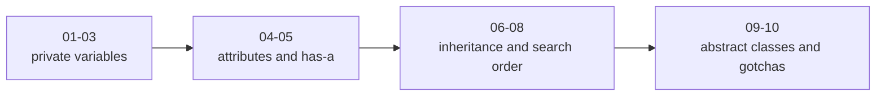

# Notes Index

All notes follow `../../AGENT_STYLE/MASTER_TEACHING_STYLE.md` — **Rule Set 1** (build-from-zero format: diagrams, misconceptions, lock-in line, cheat sheet) **+ Rule Set 2** (Big Picture → WHAT/WHY/HOW/INTERNALS → 3-level explanations → comparisons → interview questions → progress tracker).

| # | File | Topic |
|---|------|-------|
| 01 | [01_private_variables_name_mangling.md](01_private_variables_name_mangling.md) | Private variables, name mangling, 3 access levels |
| 02 | [02_encapsulation_and_dict.md](02_encapsulation_and_dict.md) | Encapsulation, attributes as references, `__dict__` |
| 03 | [03_outside_class_assignment_trap.md](03_outside_class_assignment_trap.md) | The `my.__balance = 5000` trap |
| 04 | [04_class_vs_instance_attributes.md](04_class_vs_instance_attributes.md) | Class attribute counters vs instance attributes |
| 05 | [05_composition_has_a.md](05_composition_has_a.md) | Customer–Address composition, print vs return bugs |
| 06 | [06_inheritance_method_lookup.md](06_inheritance_method_lookup.md) | Inheritance mental model, child-first lookup |
| 07 | [07_constructors_and_super.md](07_constructors_and_super.md) | Constructor rules, `super()` deep dive |
| 08 | [08_mro_multiple_inheritance.md](08_mro_multiple_inheritance.md) | MRO, multiple inheritance, C3 |
| 09 | [09_abstraction_abc.md](09_abstraction_abc.md) | Abstraction, ABC, @abstractmethod, Java comparison |
| 10 | [10_python_gotchas.md](10_python_gotchas.md) | Mutable/immutable containers, mutable default args |

Raw source transcript: [`../Python_OOP_Private_Variables_Chat.md`](../Python_OOP_Private_Variables_Chat.md)

## Suggested reading order
01 → 02 → 03 → 04 → 05 → 06 → 07 → 08 → 09 → 10

**📊 Diagram — all ten notes in four stops**



## Every note contains (per master style)

```text
0. Big Picture            what / why / problem / where / prereqs / fit
1..N Build-up             WHAT → WHY → HOW → INTERNALS with diagrams
Three levels              simple → precise → advanced for key mechanisms
Comparisons               easily-confused concepts side by side
🎤 Interview Questions    with short answers
⭐ Key Takeaway           ONE bolded lock-in line
Cheat Sheet               ASCII summary block
✅ Progress               now know / should remember / next
```
