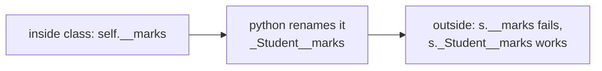
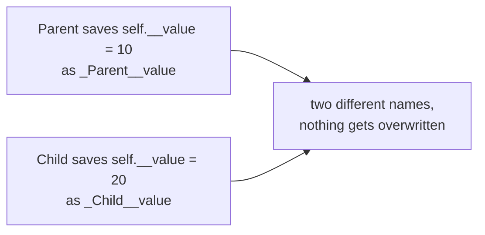

# 01 — Private Variables & Name Mangling

> **Python's `__variable` is not truly private. Python uses name mangling to make direct accidental access difficult.**

Source: [Chat](../Python_OOP_Private_Variables_Chat.md) · Follows: [MASTER_TEACHING_STYLE.md](../../AGENT_STYLE/MASTER_TEACHING_STYLE.md) (Rule Sets 1 + 2)

---

## 0. Big Picture

| Question | Answer |
|---|---|
| **What is it?** | A naming convention (`__name`) that makes Python rename an attribute to `_ClassName__name`. |
| **Why does it exist?** | To stop outside code from *accidentally* interfering with a class's internal data. |
| **What problem does it solve?** | Uncontrolled external modification (`obj.balance = -500`) and parent/child name collisions. |
| **Where is it used?** | Any serious class with internal state: bank accounts, caches, connection pools, framework internals. |
| **Prerequisites** | Objects, `__init__`, instance attributes. |
| **Bigger picture** | This is the mechanical core of **encapsulation**, pillar #1 of OOP. |

---

## 1. WHAT — First: what is an instance variable?

```python
class Student:
    def __init__(self, name, marks):
        self.name = name
        self.marks = marks

s1 = Student("Adarsh", 90)
```

When you do `s1.name`, you are accessing data belonging to the **object `s1`**.

```text
s1
 │
 ▼
┌─────────────────────┐
│ Student object      │
│                     │
│ name  ──────────────┼──► "Adarsh"
│ marks ──────────────┼──► 90
└─────────────────────┘
```

> **Mental model:** the object is a box of named slots. *(Internally it's an object whose instance `__dict__` maps names to object references — see note 02.)*

---

## 2. WHY — what happens without privacy?

Anyone can do:

```python
s1.marks = -500        # nonsense state, no error
```

For internal data (balances, passwords, cache tables) the class must control every read/write. That control is **encapsulation** — and `__` is its tool.

---

## 3. HOW — using `__`

```python
class Student:
    def __init__(self):
        self.__marks = 90
```

**Predict:** you expect `print(s.__marks)` to work.
**It breaks:**

```text
AttributeError
```

So you might think *"Python has hidden the variable."*
**Reveal:** that's not exactly what happened.

---

## 4. INTERNALS — name mangling

Python internally changes:

```python
self.__marks           # what you write (inside the class)
self._Student__marks   # what Python actually compiles it to
```

**Proof:**

```python
s = Student()
print(s._Student__marks)
```

```text
90
```

**📊 Diagram — __marks quietly becomes _Student__marks**



### The three levels of understanding

```text
Level 1 (Simple):    Python hides variables starting with __.
Level 2 (Precise):   At compile time, identifiers with two leading underscores
                     inside a class body are renamed to _ClassName__name.
Level 3 (Advanced):  Mangling happens when the compiler builds the class body's
                     code object — the mangled name is what gets stored in
                     __dict__, which is why the original name never exists
                     as an attribute at runtime.
```

---

## 5. WHY two underscores exist at all: collision prevention

```python
class Parent:
    def __init__(self):
        self.__value = 10   # stored as _Parent__value → 10

class Child(Parent):
    def __init__(self):
        super().__init__()
        self.__value = 20   # stored as _Child__value  → 20
```

**📊 Diagram — parent and child each keep their own value**



The child does not overwrite the parent's internal attribute. This is **name collision prevention**.

---

## 6. The three access levels

| Syntax | Meaning | Enforced? |
|---|---|---|
| `self.name` | Public — accessible normally | — |
| `self._name` | "Internal/protected use" — **convention only** | No — `s._name` still works |
| `self.__name` | Triggers **name mangling** → `_ClassName__name` | Partially — `s._ClassName__name` works |

---

## 7. Comparison — C++/Java bridge

```cpp
class Student {
private:
    int marks;
public:
    int getMarks() { return marks; }
};
```

```text
SIMILAR:  intent — restrict outside access, expose methods.
DIFFERENT: C++ private → compiler REJECTS s.marks (hard error).
           Python __x  → renamed; s._Student__x still works (soft block).
```

> Python's privacy is **not a security boundary**.

---

## 🎤 Interview Questions

1. **Does Python have true private variables?** — No. `__x` triggers name mangling to `_Class__x`; it prevents accidental access, not deliberate access.
2. **What is name mangling and when does it happen?** — Renaming `__x` → `_ClassName__x`, applied at compile time based on the class whose body contains the code.
3. **Why does mangling exist instead of real privacy?** — Mainly to prevent name collisions in subclasses, and to support "protected by convention" culture.
4. **Can a child class read the parent's `__secret`?** — Not as `self.__secret` (that becomes `self._Child__secret`). Only via `self._Parent__secret`.
5. **What does `__x__` (dunder) do?** — Nothing special for privacy: trailing double underscore means NO mangling (it's reserved for Python's magic methods).

---

## ⭐ Key Takeaway

> **`__variable` isn't a magical hidden variable — Python renames it to `_ClassName__variable`, making accidental outside access harder and preventing name collisions.**

---

## Cheat Sheet

```text
PUBLIC        name          → anyone can access
PROTECTED     _name         → convention only ("internal use")
PRIVATE       __name        → name mangling → _ClassName__name

INSIDE class:   self.__marks   → self._Student__marks   ✅
OUTSIDE class:  s.__marks      → looks for "__marks"    ❌ AttributeError
OUTSIDE class:  s._Student__marks                       ✅ (but don't)

WHY: prevent accidents + parent/child name collisions
     (_Parent__value vs _Child__value are different names)
WHEN: compile time, based on WHERE the code lives
```

---

## ✅ Progress

```text
WHAT YOU NOW KNOW:      how __ works, why it exists, how to prove it
WHAT YOU SHOULD REMEMBER: mangling = rename at compile time, NOT separate memory
WHAT WE LEARN NEXT:     note 02 — where attributes actually live (__dict__)
```
