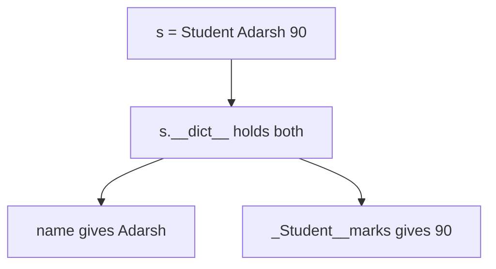

# 02 — Encapsulation & the Object's `__dict__`

> **Encapsulation = keep an object's data and the methods that operate on that data together, while controlling how outside code interacts with that data.**

Source: [Chat](../Python_OOP_Private_Variables_Chat.md) · Follows: [MASTER_TEACHING_STYLE.md](../../AGENT_STYLE/MASTER_TEACHING_STYLE.md) (Rule Sets 1 + 2)

---

## 0. Big Picture

| Question | Answer |
|---|---|
| **What is it?** | Bundling data + the methods that guard it, exposing only a controlled interface. |
| **Why does it exist?** | So objects can protect their own invariants (e.g., balance never negative). |
| **What problem does it solve?** | Scattered, unvalidated mutation of an object's state from anywhere in the codebase. |
| **Where is it used?** | Every API class: `list.append()`, DB drivers, request objects — you use methods, not raw internals. |
| **Prerequisites** | Note 01 (name mangling), functions. |
| **Bigger picture** | Pillar #1 of OOP; pairs with abstraction (pillar #2 — see note 09). |

---

## 1. WHAT + WHY — encapsulation in action

```python
class BankAccount:
    def __init__(self, balance):
        self.__balance = balance

    def deposit(self, amount):
        if amount > 0:
            self.__balance += amount

    def get_balance(self):
        return self.__balance


account = BankAccount(1000)
account.deposit(500)
print(account.get_balance())
```

```text
1500
```

**📊 Diagram — outside code must knock on the front door**


Outside code never touches `__balance` directly — the class controls every operation. No more `s.marks = -500`.

> "Modulation" → the term you want is **encapsulation**.

---

## 2. HOW — attributes are references, not boxes

An attribute is a **name stored in the object's namespace that references a value/object**:

```text
my
 ↓
┌─────────────────────────────┐
│       Atm object            │
│                             │
│ pin ────────────────┐       │
│                     ↓       │
│                  "" object  │
│                             │
│ _Atm__balance ──────┐       │
│                     ↓       │
│                    0 object │
└─────────────────────────────┘
```

> **Mental model:** attributes are arrows to objects.
> *(Internals: each instance carries a real dict — its `__dict__` — mapping name strings to object references.)*

Reassigning changes what the name points to:

```text
Before:  pin ──→ 100
After:   pin ──→ 500
```

`self.pin = 500` rebinds the name; it never copies or mutates `100`.

---

## 3. INTERNALS — prove it with `__dict__`

```python
class Student:
    def __init__(self, name, marks):
        self.name = name
        self.__marks = marks

s = Student("Adarsh", 90)
print(s.__dict__)
```

```python
{'name': 'Adarsh', '_Student__marks': 90}
```

**📊 Diagram — where the object keeps its stuff**



Notice: `__marks` is **not** stored literally as `__marks`. Name mangling renamed the key.

### Attribute lookup — three levels

```text
Level 1 (Simple):    obj.x looks inside the object's box.
Level 2 (Precise):   obj.x checks instance __dict__ first, then the class,
                     then parents along the MRO.
Level 3 (Advanced):  Full order: data descriptors on the class → instance
                     __dict__ → non-data descriptors / class attrs via MRO;
                     __slots__ classes skip __dict__ entirely.
```

---

## 4. Is a private variable stored somewhere different in memory?

**No.**

> **Private ≠ separate memory.**
> **Private ≈ name mangling + convention/access control through the class interface.**

Python does **not** create a secret memory section for `__marks`. It is still an ordinary attribute of the object — only the **name** changed.

```text
                 Python object
                       │
                       ▼
              ┌─────────────────┐
              │    __dict__     │
              │                 │
              │ name → "Adarsh" │
              │ _Student__marks │
              │       → 90      │
              └─────────────────┘
                       ▲
                       │
        __marks ──name mangling──► _Student__marks
```

---

## 5. Comparison — encapsulation vs abstraction (don't confuse!)

| | Encapsulation | Abstraction |
|---|---|---|
| Question answered | **HOW** do I protect/hide data? | **WHAT** do I show vs hide? |
| Tool | `__private`, getters/setters | interfaces, abstract classes |
| Example | `self.__balance` + `deposit()` | `withdraw()` without knowing internals |
| Detail level | implementation hiding *inside* | interface design *on top* |

(Full abstraction coverage: note 09.)

---

## 🎤 Interview Questions

1. **What is encapsulation in Python?** — Binding data with the methods that operate on it and restricting direct access, typically via `__name` mangling + public methods.
2. **Where are instance attributes stored?** — In the object's instance `__dict__` (unless the class defines `__slots__`).
3. **How do you inspect all attributes of an object?** — `obj.__dict__` for instance attrs; `dir(obj)` includes class-level ones.
4. **Is `__balance` stored differently from normal attributes?** — No; same storage, renamed key `_Atm__balance`.
5. **Encapsulation vs abstraction?** — Encapsulation = hiding/protection of data; abstraction = hiding of implementation behind an interface.

---

## ⭐ Key Takeaway

> **Object attributes are names in the object's `__dict__` that reference values — "private" only renames the key; nothing is hidden in separate memory.**

---

## Cheat Sheet

```text
ENCAPSULATION
─────────────────────────────────────
data (__private) + methods (get/set) live together
outside code goes through the class interface

ATTRIBUTE = NAME ──► OBJECT      (reference, not a box)

s.__dict__        → see all instance attributes
lookup order      → instance __dict__ → class → MRO
private var       → SAME memory, RENAMED key (_Class__var)
```

---

## ✅ Progress

```text
WHAT YOU NOW KNOW:      encapsulation's purpose, where attributes live,
                        how to prove it with __dict__
WHAT YOU SHOULD REMEMBER: attribute = name→reference; private = renamed key
WHAT WE LEARN NEXT:     note 03 — the trap when you assign __x from outside
```
