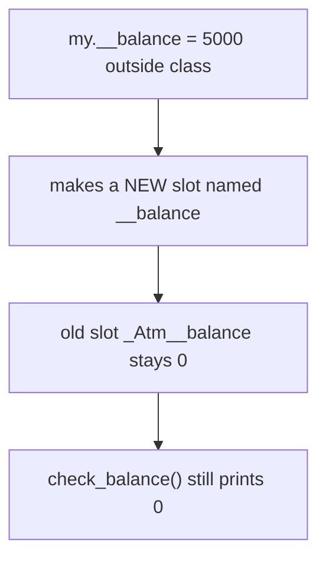
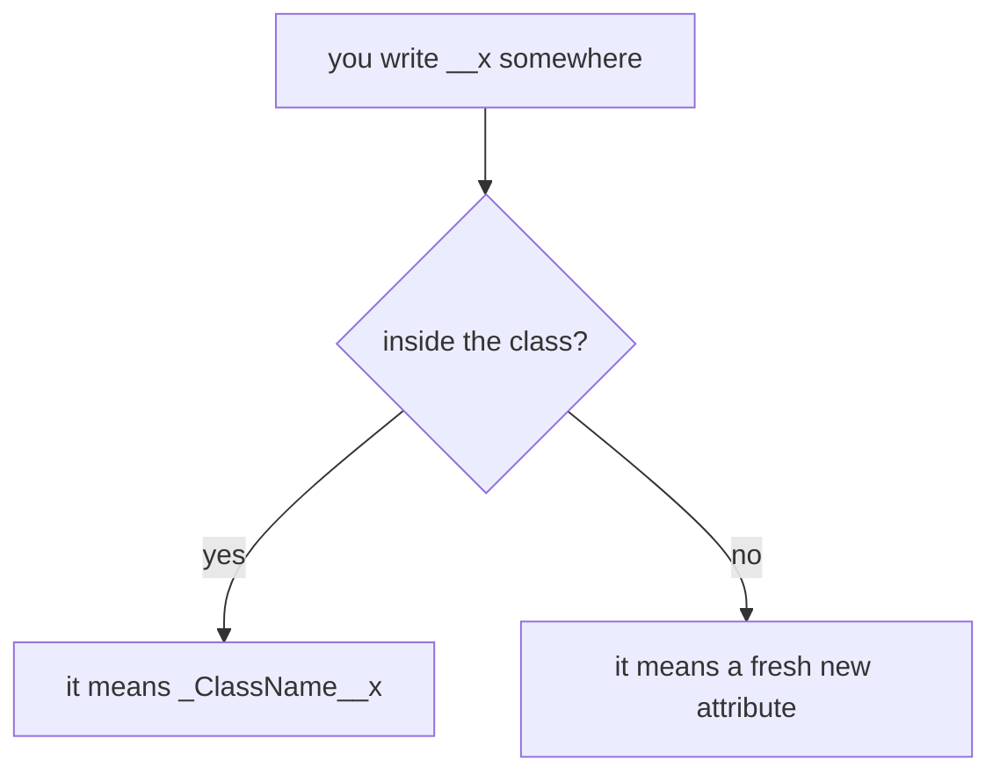

# 03 — The Outside-Class Assignment Trap

> **`my.__balance = 5000` creates a NEW instance attribute. It does NOT modify the existing private `__balance`.**

Source: [Chat](../Python_OOP_Private_Variables_Chat.md) · Follows: [MASTER_TEACHING_STYLE.md](../../AGENT_STYLE/MASTER_TEACHING_STYLE.md) (Rule Sets 1 + 2)

---

## 0. Big Picture

| Question | Answer |
|---|---|
| **What is it?** | The #1 beginner bug with "private" variables: assigning `obj.__x` from outside the class. |
| **Why does it happen?** | Name mangling is applied at **compile time based on where the code lives**, not on which object you touch. |
| **What problem does it solve (knowing this)?** | Explains mysterious bugs where methods "see old values" after you assigned new ones. |
| **Where does it bite?** | Debugging, code review, any quick script poking at class internals. |
| **Prerequisites** | Notes 01–02. |
| **Bigger picture** | Proves privacy in Python is a *compile-time renaming rule*, not runtime protection. |

---

## 1. WHAT — setup

```python
class Atm:
    def __init__(self):
        self.pin = ""
        self.__balance = 0     # stored as _Atm__balance

    def check_balance(self):
        print("Your current balance is:", self.__balance)


my = Atm()
```

Object right now:

```text
my
 ↓
┌─────────────────────────────┐
│ Atm object                  │
│                             │
│ pin → ""                    │
│ _Atm__balance → 0           │
└─────────────────────────────┘
```

---

## 2. Predict → break → reveal

You do, **outside the class**:

```python
my.__balance = 5000
```

**Predict:** "I just changed the private balance."
**Reveal:** Because this line is *outside the class*, name mangling does **not** happen. Python creates a completely new attribute literally named `__balance`:

```text
┌─────────────────────────────────┐
│ Atm object                      │
│                                 │
│ pin → ""                        │
│ _Atm__balance → 0   ← original │
│ __balance → 5000      ← NEW!   │
└─────────────────────────────────┘
```

**Proof:**

```python
print(my.__dict__)
```

```python
{'pin': '', '_Atm__balance': 0, '__balance': 5000}
```

**📊 Diagram — one assignment, two separate slots**



---

## 3. The twist — methods still see the OLD value

```python
my.check_balance()
```

Inside `Atm`, `self.__balance` IS mangled (the code lives in the class), so it reads `self._Atm__balance`:

```text
Your current balance is: 0
```

**Not 5000.**

---

## 4. INTERNALS — why exactly?

### Three levels

```text
Level 1 (Simple):    Outside the class, __balance is just a normal name.
Level 2 (Precise):   Mangling rewrites __x → _ClassName__x only for identifiers
                     appearing inside that class's body at compile time.
Level 3 (Advanced):  The compiler decides mangling from the lexical scope of the
                     code object; attribute access at runtime is a plain dict
                     lookup on whatever name survived compilation.
```

The rule in one picture:

```text
OUTSIDE class:  my.__balance    → literally "__balance"      (new attribute!)
INSIDE class:   self.__balance  → self._Atm__balance          (the private one)
```

**📊 Diagram — where the code sits changes what __x means**



---

## 🎤 Interview Questions

1. **What does `obj.__x = 5` do (from outside the class)?** — Creates/sets an attribute literally named `__x`; the mangled `_Class__x` is untouched.
2. **How would you detect this bug?** — `print(obj.__dict__)`: you'll see both `_Atm__balance` and `__balance`.
3. **When is name mangling applied?** — Compile time, determined by the class body containing the identifier.
4. **Is there any way outside code can set the real private var?** — Yes: `obj._Atm__balance = 5000` works — which shows Python privacy is convention + collision avoidance, not security.

---

## ⭐ Key Takeaway

> **Mangling depends on WHERE the code is written: inside the class `__x` means `_Class__x`; outside it means a brand-new attribute literally called `__x`.**

---

## Cheat Sheet

```text
THE TRAP
─────────────────────────────────────
my.__balance = 5000        # outside class
  → adds NEW key "__balance" to __dict__
  → original _Atm__balance untouched

methods still read _Atm__balance → old value

FIX: never touch __private from outside;
     use the class's own methods.
DEBUG: print(obj.__dict__) — two similar keys = this bug
```

---

## ✅ Progress

```text
WHAT YOU NOW KNOW:      why outside-class __ assignment silently creates
                        a second attribute and how to spot it
WHAT YOU SHOULD REMEMBER: mangling = compile-time + location-based
WHAT WE LEARN NEXT:     note 04 — class attributes vs instance attributes
```
