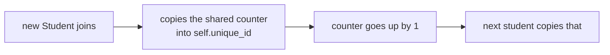
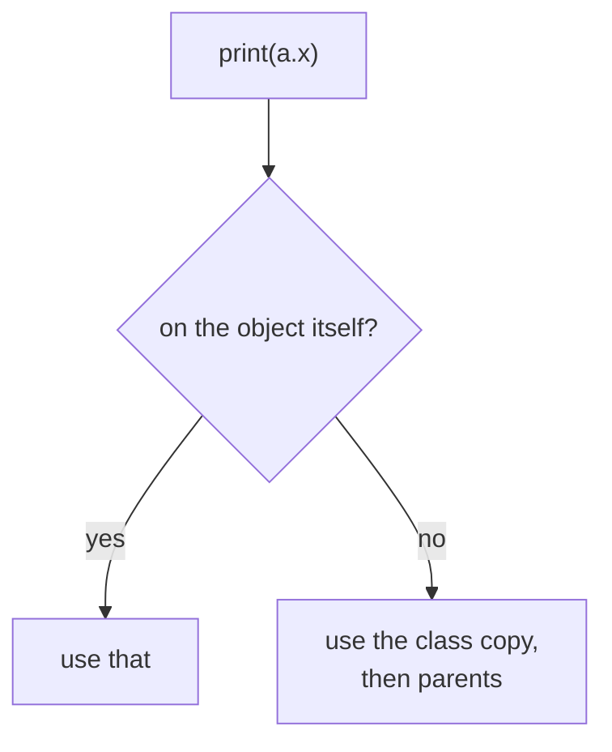

# 04 — Class vs Instance Attributes

> **A class attribute is ONE shared value belonging to the class; an instance attribute is a separate value per object.**

Source: [Chat](../Python_OOP_Private_Variables_Chat.md) · Follows: [MASTER_TEACHING_STYLE.md](../../AGENT_STYLE/MASTER_TEACHING_STYLE.md) (Rule Sets 1 + 2)

---

## 0. Big Picture

| Question | Answer |
|---|---|
| **What is it?** | Two storage levels for data: on the class (shared) vs on each object (per-instance). |
| **Why does it exist?** | Some data is naturally shared: counters, constants, default configs, registries. |
| **What problem does it solve?** | Sharing state across all objects without globals; auto-ID generation like this note's counter. |
| **Where is it used?** | `Student.__count`, config defaults, `Circle.pi`, ORM registries. |
| **Prerequisites** | Notes 01–03 (mangling), objects. |
| **Bigger picture** | Foundation for understanding lookup order → MRO (note 08). |

---

## 1. WHAT + HOW — the counter pattern

```python
class Student:
    __unique_id = 101              # CLASS attribute (shared counter)

    def __init__(self, name, roll):
        self.name = name           # instance attributes
        self.roll = roll
        self.unique_id = Student.__unique_id            # copy current value
        Student.__unique_id = Student.__unique_id + 1   # bump the counter


s4 = Student("RAT", 13)
s3 = Student("DEAN", 23)
s1 = Student("ewa", 33)
s2 = Student("mad", 43)

for i in [s1, s2, s3, s4]:
    print(i.unique_id)
```

```text
103
104
102
101
```

Creation order was s4→101, s3→102, s1→103, s2→104 — printing order is s1, s2, s3, s4.

**📊 Diagram — every new student grabs the next number**



---

## 2. Mental model — memory picture

```text
Student CLASS
│
└── _Student__unique_id → 101 → 102 → 103 → 104   (ONE shared counter)

s4 object                      s3 object
├── name → "RAT"               ├── name → "DEAN"
├── roll → 13                  └── unique_id → 102
└── unique_id → 101
```

Each `self.unique_id = ...` makes a **separate instance attribute**; only `Student.__unique_id` is shared.

---

## 3. Common mistake: constructor spelling

```python
def __init(*self, name, roll):    # ❌ missing trailing underscores
def __init__(self, name, roll):   # ✅ two underscores on BOTH sides
```

---

## 4. WHY can't you access `__unique_id` directly?

```python
print(Student.__unique_id)             # ❌ AttributeError
print(Student._Student__unique_id)     # ✅ works — mangled name
```

```text
Inside Student class:  __unique_id → _Student__unique_id
Outside class:         Student.__unique_id → looks for literally "__unique_id" → ❌
```

> `__variable` → `_ClassName__variable`. Not truly inaccessible — just mangled to discourage direct access.

---

## 5. INTERNALS — lookup order (why reading works without copying)

### Three levels

```text
Level 1 (Simple):    Reading obj.x finds instance first, then class.
Level 2 (Precise):   Read: instance __dict__ → class __dict__ → parents (MRO).
                     Write via obj.x ALWAYS creates/updates the INSTANCE attr.
Level 3 (Advanced):  That's why obj.class_attr += 1 "breaks": it reads the class
                     value then SHADOWS it with a new instance attribute;
                     only Class.attr += 1 mutates the shared one.
```

**📊 Diagram — where Python looks for a.x**



```python
class C:
    x = 10

a = C(); b = C()
print(a.x)        # 10  ← found on the CLASS (no copy made)
a.x = 99          # creates a.x in a's __dict__ (shadowing)
print(b.x)        # 10  ← b unaffected
```

---

## 6. Comparison table

| | Class attribute | Instance attribute |
|---|---|---|
| Defined | directly in class body | `self.x = ...` in methods |
| Copies | ONE for whole class | ONE per object |
| Stored in | class `__dict__` | object's `__dict__` |
| Access | `Class.x` / `obj.x` (read) | `obj.x` |
| Use for | counters, constants, shared config | per-object data |

---

## 🎤 Interview Questions

1. **Difference between class and instance attributes?** — Shared single copy at class level vs separate copy per object in its `__dict__`.
2. **What happens on `obj.x = 5` when `x` exists on the class?** — Creates a shadowing instance attribute; the class attribute is unchanged.
3. **Why use a private class attribute for counters?** — Mangling prevents subclasses accidentally clashing (`_Parent__counter` vs `_Child__counter`).
4. **Where would a mutable class attribute bite you?** — `class C: items = []` — every instance appending to `self.items` mutates the ONE shared list.

---

## ⭐ Key Takeaway

> **Class attribute = one value shared at class level (counters, constants); instance attribute = one value per object created by copying or computing from it — and writes through `self` always land on the instance.**

---

## Cheat Sheet

```text
CLASS ATTRIBUTE                INSTANCE ATTRIBUTE
─────────────────              ─────────────────
defined directly in class      defined as self.x in methods
ONE copy for whole class       ONE copy per object
Student.__x / _Student__x      obj.x / obj.__dict__
use for: counters, constants   use for: per-object data

LOOKUP:  obj.x → instance __dict__ → class → MRO
WRITE:   obj.x = ... → ALWAYS instance-level (shadowing!)

COUNTER PATTERN
self.id = Class.__counter      # read
Class.__counter += 1           # bump (on the CLASS)
```

---

## ✅ Progress

```text
WHAT YOU NOW KNOW:      shared vs per-object data, shadowing, counter pattern
WHAT YOU SHOULD REMEMBER: reads fall back to the class; writes never do
WHAT WE LEARN NEXT:     note 05 — objects holding other objects (composition)
```
