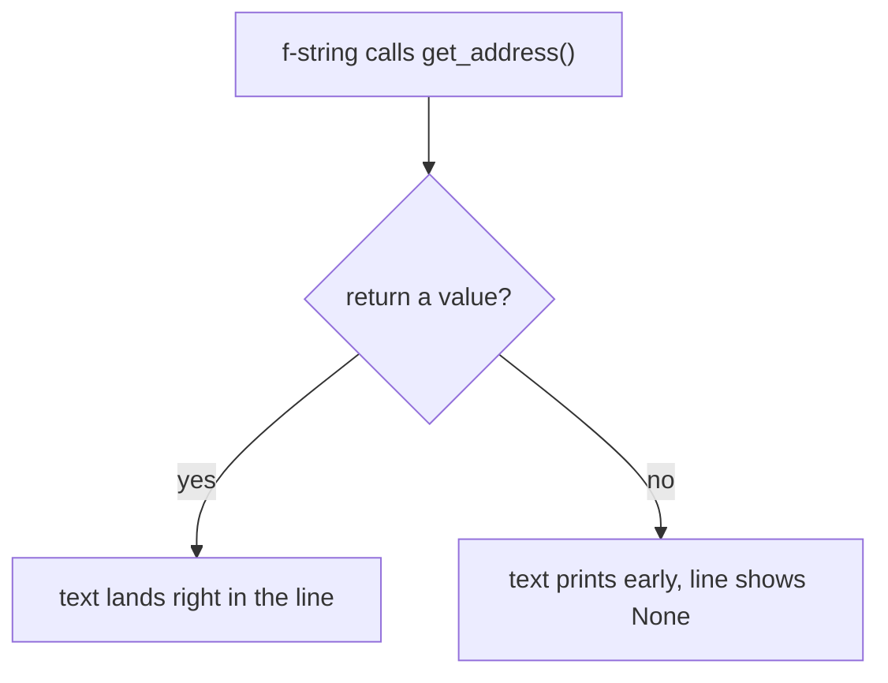

# 05 — Composition (has-a Relationships)

> **A Customer HAS an Address: one object holds a reference to another object and talks to it through its methods.**

Source: [Chat](../Python_OOP_Private_Variables_Chat.md) · Follows: [MASTER_TEACHING_STYLE.md](../../AGENT_STYLE/MASTER_TEACHING_STYLE.md) (Rule Sets 1 + 2)

---

## 0. Big Picture

| Question | Answer |
|---|---|
| **What is it?** | Building complex objects by holding references to simpler objects. |
| **Why does it exist?** | Real things are made of parts; classes model that naturally ("Customer has an Address"). |
| **What problem does it solve?** | Avoids one giant class; each part owns its data and rules (Address guards its own `__pincode`). |
| **Where is it used?** | Everywhere: Car–Engine, Order–Items, User–Profile, ML Pipeline–Steps. |
| **Prerequisites** | Notes 01–04. |
| **Bigger picture** | The main alternative to inheritance — "has-a" vs "is-a" (see comparison below). |

---

## 1. WHAT + HOW — the structure

```python
class Customer:
    def __init__(self, name, age, address):
        self.name = name
        self.age = age
        self.address = address

    def display_details(self):
        print(
            f"Name: {self.name}\n"
            f"Age: {self.age}\n"
            f"Address: {self.address.get_address()}"
        )


class Address:
    def __init__(self, state, city, pincode):
        self.__city = city
        self.__state = state
        self.__pincode = pincode

    def get_address(self):
        return f"{self.__state}, {self.__city}, {self.__pincode}"


add = Address("Uttar Pradesh", "Lucknow", 226021)
cmt = Customer("Saumitra", 22, add)
cmt.display_details()
```

```text
Name: Saumitra
Age: 22
Address: Uttar Pradesh, Lucknow, 226021
```

---

## 2. Mental model — memory picture

```text
cmt (Customer object)
        │
        ├── name ──→ "Saumitra"
        ├── age ──→ 22
        └── address ─────────┐
                             ↓
                       Address object
                             │
                             ├── _Address__state → "Uttar Pradesh"
                             ├── _Address__city → "Lucknow"
                             └── _Address__pincode → 226021
```

**📊 Diagram — a Customer has an Address**


`self.address.get_address()` means: *"go to the Address object referenced by `self.address` and call its method."*

Notice the encapsulation: `Customer` never touches `__state/__city/__pincode`; it asks through `get_address()`. **Encapsulation + composition working together.**

---

## 3. Bug #1 — print vs return (WHY it matters)

If `get_address()` **prints** instead of **returns**, then inside the f-string:

```python
f"Address : {self.address.get_address()}"
```

you get:

```text
Name : saumitra
Age : 22
Uttar Pradesh, lucknow, 226021     ← printed early, from inside get_address()
Address : None                     ← function with no return returns None
```

**📊 Diagram — return fills the line, print spills early**



**Rule:** a Python function that doesn't explicitly `return` anything automatically returns `None`. Methods whose value is *used* elsewhere must **return**, not print.

---

## 4. Bug #2 — creating NEW attributes instead of updating

```python
def edit_profile(self, Name, age, add):
    self.__name = Name              # ❌ NEW attribute _Customer__name
    self.__age = age                # ❌ NEW attribute _Customer__age
    self.__address.update_address(add)   # ❌ AttributeError — never created
```

The real attributes are `self.name`, `self.age`, `self.address`. Writing `self.__name` mangles to a **different name** (see note 03):

```text
cmt
 │
 ├── name       → "saumitra"   ← original (used by display)
 ├── age        → 22           ← original
 ├── address    → add          ← original
 │
 ├── __name     → "Roshan"     ← NEW, ignored by display
 ├── __age      → 22           ← NEW
 └── __address  → ???          ← AttributeError
```

**Fix — update the existing attributes:**

```python
def edit_profile(self, name, age, add):
    self.name = name
    self.age = age
    self.address.update_address(add)
```

Full working version:

```python
class Address:
    def __init__(self, state, city, pincode):
        self.__city = city
        self.__state = state
        self.__pincode = pincode

    def get_state(self):
        return self.__state

    def get_city(self):
        return self.__city

    def get_pincode(self):
        return self.__pincode

    def get_address(self):
        return f"{self.__state}, {self.__city}, {self.__pincode}"

    def update_address(self, new_add):
        self.__state = new_add.get_state()
        self.__city = new_add.get_city()
        self.__pincode = new_add.get_pincode()


add = Address("Uttar Pradesh", "Lucknow", 226021)
new_add = Address("U.P.", "Gr. Noida", 201310)

cmt = Customer("Saumitra", 22, add)
cmt.display_details()
cmt.edit_profile("Roshan", 22, new_add)
cmt.display_details()
```

```text
Name: Saumitra
Age: 22
Address: Uttar Pradesh, Lucknow, 226021

Name: Roshan
Age: 22
Address: U.P., Gr. Noida, 201310
```

Note: `return self` in `update_address()` is unnecessary unless you want chaining.

---

## 5. Comparison — composition vs inheritance

| | Composition (has-a) | Inheritance (is-a) |
|---|---|---|
| Relationship | Customer **has an** Address | Student **is a** User |
| Coupling | loose — parts swappable | tight — child bound to parent |
| Reuse | by delegation (`self.address.x()`) | by lookup (child inherits methods) |
| Flexibility | change part at runtime ✅ | fixed at class definition |
| Rule of thumb | default choice | only for true is-a |

---

## 🎤 Interview Questions

1. **Composition vs inheritance — when which?** — has-a → composition (flexible, decoupled); is-a → inheritance. Prefer composition when unsure.
2. **Why did `display_details` print `None` for address?** — `get_address()` printed instead of returning; functions without `return` yield `None`.
3. **Why did `edit_profile` raise AttributeError?** — `self.__address` mangled to `_Customer__address`, which was never created; attribute names are contracts.
4. **Who should validate pincode format?** — The `Address` class — each part guards its own invariants (encapsulation).

---

## ⭐ Key Takeaway

> **Composition = an object holds a reference to another object and works through its public methods; inside a class, always update the SAME attribute names you created in `__init__` — adding `__` creates different mangled attributes.**

---

## Cheat Sheet

```text
COMPOSITION (has-a)
─────────────────────────────────────
Customer ──has-a──► Address
customer_obj.address.method()      # delegate via reference

RETURN vs PRINT
method whose result is USED → return
method for human display    → print

ATTRIBUTE NAMES ARE CONTRACTS
__init__:  self.name        edit:  self.name   ✅ same attribute
__init__:  self.name        edit:  self.__name ❌ NEW mangled attr

COMPOSITION vs INHERITANCE: has-a vs is-a; prefer composition
```

---

## ✅ Progress

```text
WHAT YOU NOW KNOW:      has-a design, print-vs-return bug,
                        why renaming attributes breaks code
WHAT YOU SHOULD REMEMBER: delegate through references; names are contracts
WHAT WE LEARN NEXT:     note 06 — inheritance & how Python looks up methods
```
