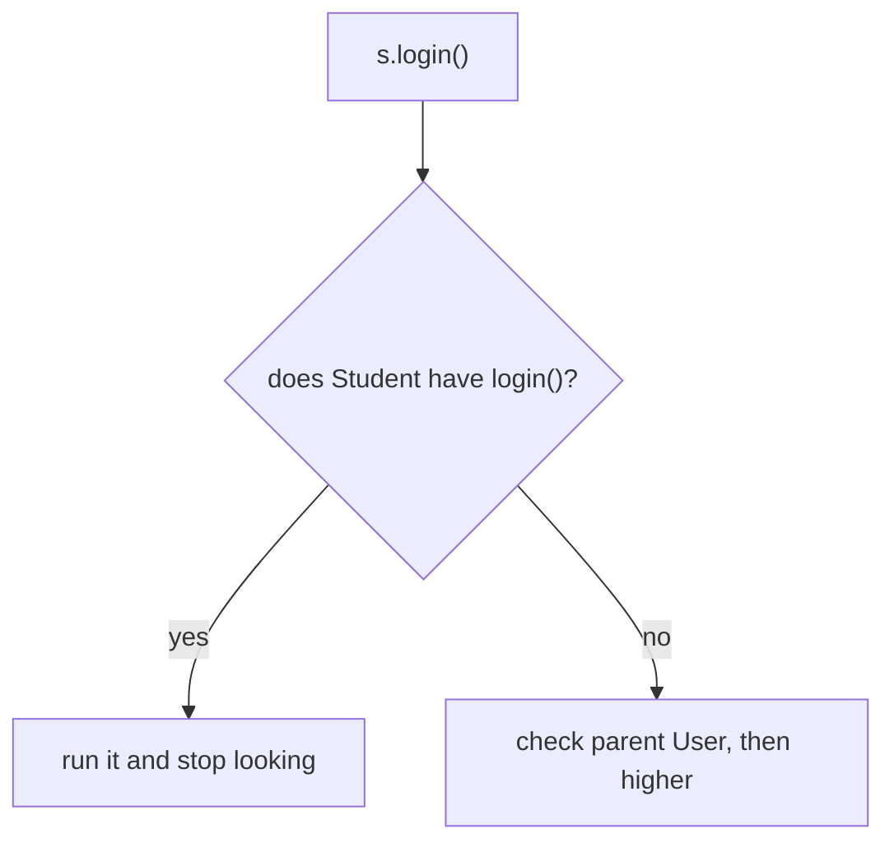
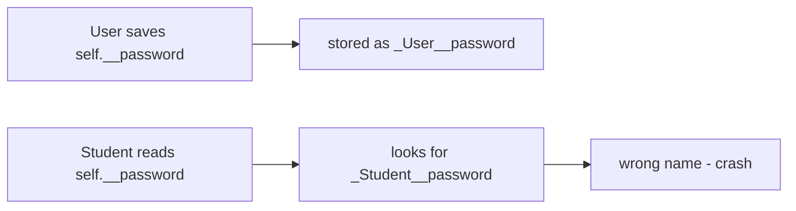

# 06 — Inheritance & Method Lookup

> **Inheritance doesn't mean "parent runs first." It means Python has a class hierarchy to search when resolving methods and attributes.**

Source: [Chat](../Python_OOP_Private_Variables_Chat.md) · Follows: [MASTER_TEACHING_STYLE.md](../../AGENT_STYLE/MASTER_TEACHING_STYLE.md) (Rule Sets 1 + 2)

---

## 0. Big Picture

| Question | Answer |
|---|---|
| **What is it?** | A child class reusing/extending a parent class's methods and attributes. |
| **Why does it exist?** | To model "is-a" relationships and reuse behavior without copy-paste. |
| **What problem does it solve?** | Duplicated code across similar classes; polymorphism (same call, many behaviors). |
| **Where is it used?** | Frameworks (base classes), exceptions (`ValueError` → `Exception`), Django models, ABCs. |
| **Prerequisites** | Notes 01–05. |
| **Bigger picture** | Pillar #3 of OOP; the search order it creates is the MRO (note 08). |

---

## 1. Bust the wrong mental model FIRST

> **There is NO "parent object created first, then child object."**
> A `Student` object is ONE object; Python just searches the class hierarchy to resolve names.

### Three levels of the correct model

```text
Level 1 (Simple):    Child gets parent's functionality.
Level 2 (Precise):   Attribute lookup: instance → child class → parent → ... → object.
Level 3 (Advanced):  Lookup follows the MRO linearization; each class is checked
                     once in order; first hit wins and search stops.
```

---

## 2. WHAT + HOW — lookup in action

```python
class User:
    def __init__(self, name, age):
        self.age = age
        self.name = name

    def login(self):
        return "successfully logged in"


class Student(User):
    def enroll(self):
        self.login()

    def display_enrollment_det(self):
        print(f"{self.login()} \n{self.name} \n{self.age}")


s = Student("Saumitra", 23)
s.display_enrollment_det()
```

`Student` has no `__init__`, so Python finds and uses `User.__init__`. Attributes land on the Student object.

```text
s.login()  lookup:
Student → login? ❌
User    → login? ✅ → use User.login()
```

**📊 Diagram — check the child, then the parent**



---

## 3. Overriding: found means STOP

If `Student` defines its own `login()`:

```python
class Student(User):
    def login(self):
        return "Student login"
```

```text
s.login()
  ↓
Student.login()  ← FOUND
  ↓
STOP            ← User.login() is NEVER called
```

This is **method overriding**: child's version wins for normal lookup.

See the search order yourself:

```python
print(Student.mro())
# [Student, User, object]
```

---

## 4. Child vs parent access

```text
Child object  → can use inherited Parent functionality   ✅
Parent object → cannot use Child functionality           ❌
```

```python
u = User()
u.login()          # ✅
u.study()          # ❌ AttributeError — User doesn't know about Student

s = Student(...)
s.login()          # ✅ inherited
s.study()          # ✅ own method
```

Inside the child, accessible parent members work through `self`:

```python
class Student(User):
    def study(self):
        self.login()     # ✅ found in User via MRO
```

---

## 5. Private members across inheritance

```python
class User:
    def __init__(self):
        self.__password = 123    # _User__password
```

Inside `Student`, `self.__password` mangles to `_Student__password` — a **different name**:

```text
Parent's:  _User__password
Child's:   self.__password → _Student__password   ❌ different!
```

**📊 Diagram — parent and child hide __password differently**



> A child cannot directly access a parent's `__private` attribute using the same name. (Technically `self._User__password` would work — privacy is mangling, not security.)

---

## 6. Comparison — overriding vs overloading (don't confuse!)

| | Overriding | Overloading |
|---|---|---|
| Where | parent + child classes | same class |
| Names | same method name | same name, different signatures |
| Resolution | runtime lookup via MRO | compile-time dispatch (C++/Java) |
| In Python | ✅ fully supported | ❌ not built-in (last `def` wins; use default args / `*args`) |

Also recall: composition vs inheritance (note 05) — has-a vs is-a.

---

## 🎤 Interview Questions

1. **How does Python resolve `obj.method()`?** — Instance dict → class dict → parents along the MRO; first match wins.
2. **Is a parent object created inside a child object?** — No. One object; classes form the *search path*.
3. **What is method overriding?** — Child defines the same name; its version is found first and runs instead of the parent's.
4. **Can a child access the parent's private members?** — Not by name: `_Child__x ≠ _Parent__x`; only via explicit mangled name.
5. **Does Python support method overloading like Java?** — No native overloading; redefining replaces. Use defaults/`*args` or `functools.singledispatch`.

---

## ⭐ Key Takeaway

> **Inheritance = name resolution along the MRO: search the child class first, then parents, stop at the first match — that stop is what we call overriding.**

---

## Cheat Sheet

```text
INHERITANCE LOOKUP
─────────────────────────────────────
obj.attr
  ↓
search obj's class → parent → ... → object   (the MRO)
  ↓
FIRST match wins (STOP)

OVERRIDING: child defines same name → child's runs
ACCESS:     child obj can use parent's stuff ✅
            parent obj cannot use child's stuff ❌
PRIVATE:    _Parent__x ≠ _Child__x → child can't see parent's __x by name
MRO check:  print(Class.mro())

OVERRIDING (runtime, child vs parent)
vs OVERLOADING (same-class signatures — NOT in Python)
```

---

## ✅ Progress

```text
WHAT YOU NOW KNOW:      the real inheritance model (lookup, not nesting),
                        overriding, cross-class privacy
WHAT YOU SHOULD REMEMBER: one object, searched hierarchy, first hit stops search
WHAT WE LEARN NEXT:     note 07 — constructors under inheritance & super()
```
