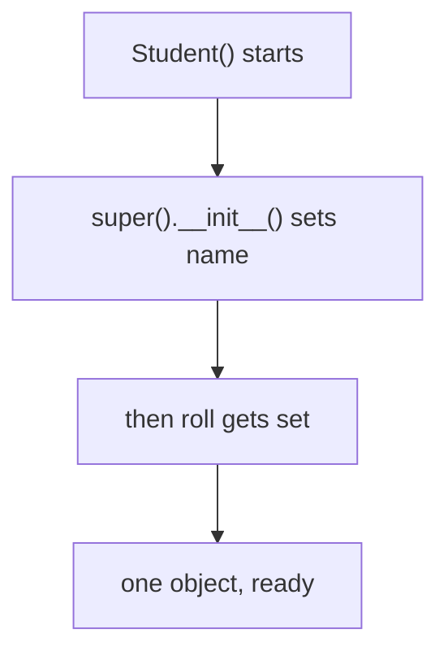

# 07 — Constructors & `super()`

> **`super()` does not mean "call my parent"; it means "continue the lookup from the next class in the MRO."**

Source: [Chat](../Python_OOP_Private_Variables_Chat.md) · Follows: [MASTER_TEACHING_STYLE.md](../../AGENT_STYLE/MASTER_TEACHING_STYLE.md) (Rule Sets 1 + 2)

---

## 0. Big Picture

| Question | Answer |
|---|---|
| **What is it?** | `__init__` initializes a new object; `super()` delegates to the next class in the hierarchy. |
| **Why does it exist?** | Child + parent both need to initialize their part of the SAME object. |
| **What problem does it solve?** | Missing initialization (`s.name` AttributeError) and duplicated parent logic. |
| **Where is it used?** | Every subclass with its own `__init__`; framework base classes; mixins. |
| **Prerequisites** | Note 06 (lookup, overriding). |
| **Bigger picture** | The bridge between inheritance lookup (06) and full MRO chains (08). |

---

## 1. WHAT — constructor rule #1: child has NO `__init__`

```python
class User:
    def __init__(self):
        self.name = "Adarsh"

class Student(User):
    pass

s = Student()
print(s.name)
```

```text
Adarsh
```

```text
Student.__init__ ?  ❌
User.__init__    ?  ✅ → runs
```

---

## 2. WHY — rule #2: child HAS its own `__init__` (the problem)

```python
class User:
    def __init__(self):
        self.name = "Adarsh"

class Student(User):
    def __init__(self):
        self.roll = 10

s = Student()
s.roll   # ✅
s.name   # ❌ AttributeError — User.__init__() never ran
```

> **If the child defines its own `__init__`, Python does NOT automatically call the parent's `__init__`.**

`__init__` is just a method — normal lookup finds the child's first and STOPS.

---

## 3. HOW — the fix: `super().__init__()`

```python
class Student(User):
    def __init__(self):
        super().__init__()
        self.roll = 10
```

```text
Student.__init__()
      │
      ├── super().__init__()
      │          ↓
      │     User.__init__()
      │          ↓
      │       name created
      │
      └── roll created
```

**📊 Diagram — super() borrows the parent's setup**



Both parts initialize. **The parent constructor operates on the SAME child object through `self`** — there is no separate "parent object inside."

---

## 4. INTERNALS — what `super()` actually is

### Three levels

```text
Level 1 (Simple):    super() helps access parent functionality.
Level 2 (Precise):   super() performs attribute lookup starting AFTER the
                     current class in the MRO.
Level 3 (Advanced):  super() returns a proxy object that delegates attribute
                     lookup according to the MRO of the relevant class hierarchy.
```

> **`super()` is NOT the parent object** — it's a special lookup object that follows the MRO.

Why not write `User.__init__(self, name)` directly? It works, but hard-codes the parent; `super()` follows the MRO, which matters with multiple inheritance (note 08).

---

## 5. `super()` for normal methods (extend, don't replace)

```python
class User:
    def login(self):
        print("User login")

class Student(User):
    def login(self):
        print("Student login")
        super().login()

s = Student()
s.login()
```

```text
Student login
User login
```

> **Overriding changes the behavior. `super()` lets you reuse the inherited behavior.**

Chain through levels:

```python
class A:
    def show(self): print("A")

class B(A):
    def show(self):
        print("B"); super().show()

class C(B):
    def show(self):
        print("C"); super().show()

C().show()
```

```text
C
B
A
```

**📊 Diagram — each link adds its line, then calls super()**


---

## 6. Two subtleties

1. **`super().name` is invalid.** Instance data belongs to the *object*; the parent constructor merely created `name` on the same object via `self`.
2. **Zero-argument `super()`** is modern Python — it automatically knows the current class and object (old style: `super(Student, self)`).

---

## 🎤 Interview Questions

1. **When is the parent's `__init__` called automatically?** — Only when the child defines none; otherwise you must call `super().__init__()` yourself.
2. **What does `super()` return?** — A proxy that continues attribute lookup after the current class in the MRO.
3. **Why prefer `super().__init__()` over `Parent.__init__(self)`?** — MRO-correct, cooperative across multiple inheritance, no hard-coded class.
4. **Can you use `super()` outside a class?** — No meaningful use; zero-arg form needs the implicit class/scope.
5. **Does `super().__init__()` create a second object?** — No — it runs the parent's initializer on the SAME instance via `self`.

---

## ⭐ Key Takeaway

> **`super()` follows the MRO to find the next implementation of a method (including `__init__`); that method then operates on the SAME child object through `self`.**

---

## Cheat Sheet

```text
CONSTRUCTORS
─────────────────────────────────────
Child has no __init__?   → parent's found via MRO and used
Child has own __init__?  → child's used; parent's NOT auto-called
Want both?               → super().__init__(args)

SUPER()
─────────────────────────────────────
super()  → "next class in the MRO", not "the parent object"
super().__init__()      # parent constructor
super().method()        # extend overridden behavior
super().x               ❌ instance data lives on self, not on classes
```

---

## ✅ Progress

```text
WHAT YOU NOW KNOW:      constructor rules under inheritance,
                        what super() really does, extending vs replacing
WHAT YOU SHOULD REMEMBER: own __init__ blocks parent's; super() = next-in-MRO
WHAT WE LEARN NEXT:     note 08 — MRO & multiple inheritance
```
